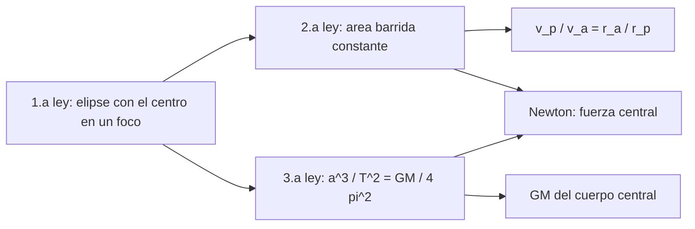

# B71-C01 — Leyes de Kepler

<!-- nav:top -->
[🏠 Programa](../../../../README.md) · [📚 Bloque B71](../../../tronco-comun/B71-mecanica-orbital-fundamental.md) · [← Anterior: B70-C07 — Flujos de lava y depósitos piroclásticos](../../B70/B70-C07-flujos-de-lava-y-depositos-piroclasticos/CLASE.md) · [Siguiente: B71-C02 — Ley de gravitación universal →](../B71-C02-ley-de-gravitacion-universal/CLASE.md)
<!-- /nav -->

## 1. Ubicación, nivel y alcance

Clase 1 del bloque B71. Nivel N3. Las tres leyes de Kepler son el primer modelo cuantitativo del movimiento orbital: una elipse con el Sol en un foco, áreas barridas iguales en tiempos iguales y un cociente `a³/T²` común. Aquí las compruebas con números: las dos primeras con una integración numérica del movimiento y la tercera con los semiejes y períodos de las fichas de la NASA. No necesitas otro bloque como prerrequisito: basta álgebra y trigonometría. La órbita integrada es sintética (usa el semieje y la excentricidad de Marte) y no es una efeméride.

## 2. Por qué esta clase existe

Kepler obtuvo sus leyes ajustando observaciones; Newton mostró después que son consecuencia de una fuerza central inversa al cuadrado. La decisión central: **¿qué afirma cada ley, con qué precisión se cumple con datos reales y qué parte es consecuencia de la gravitación y no un hecho independiente?**

## 3. Lo que podrás hacer al terminar

1. Enunciar las tres leyes con sus magnitudes y unidades.
2. Calcular `a³/T²` para la Tierra, Marte y la Luna y reconocer que es común solo para cuerpos del mismo centro.
3. Estimar `GM = 4π² a³/T²` y compararlo con el valor nominal de la IAU.
4. Comprobar la ley de las áreas con una integración numérica y no con la fórmula de la elipse.
5. Relacionar la ley de las áreas con la relación `v_p/v_a = r_a/r_p`.
6. Separar lo consultado (semiejes, períodos, `GM`) de lo sintético (la órbita integrada).

La evidencia es la **ficha de las tres leyes con `GM` estimado frente al nominal** del ejercicio 12 (sección 20).

## 4. Con qué llegas y cómo comprobarlo

1. ¿Qué es una elipse y qué son sus focos?
2. ¿Qué es el semieje mayor `a`?
3. ¿Qué es un período orbital y en qué unidades se mide?
4. ¿Qué es un dato sintético?
5. ¿Qué es una verificación por segunda vía?

<details>
<summary>Ver respuestas</summary>

1. Una curva cerrada tal que la suma de distancias a dos puntos fijos (focos) es constante. 2. La mitad del eje más largo de la elipse, en metros. 3. El tiempo de una vuelta completa; segundos en el SI. 4. Un dato generado para el ejemplo, no medido. 5. Calcular lo mismo con otro método y comparar.
</details>

Con cuatro o cinco aciertos, sigue; si no, repasa los prerrequisitos.

## 5. Un caso de contexto y casos de referencia

La Tierra tiene `a = 149,598 × 10⁶ km` y `T = 365,256 d`; Marte, `227,956 × 10⁶ km` y `686,980 d` (fichas NASA/NSSDC). Sus cocientes `a³/T²` valen `3.3617e+18` y `3.3623e+18` m³/s², con razón `0.999811`. Multiplicados por `4π²` dan `GM` del Sol con un error de `7.5e-06` (Tierra) frente al valor nominal de la IAU. Es el **ejemplo conductor**; la órbita de la integración numérica es **sintética**.

## 6. Vocabulario

El **semieje mayor** `a` es la mitad del eje mayor de la elipse. La **excentricidad** `e` mide su achatamiento (`e = 0` es un círculo). El **período** `T` es el tiempo de una vuelta. La **velocidad areolar** es el área barrida por unidad de tiempo. El **parámetro gravitacional** `μ = GM` (C04) aparece en `T = 2π√(a³/μ)`. **Periápside** y **apoápside** son los puntos más cercano y más lejano al cuerpo central; en torno al Sol se llaman perihelio y afelio.

## 7. Modelo mental



*Descripción textual:* la primera ley da la forma, la segunda relaciona la velocidad con la distancia y la tercera vincula semieje y período con `GM`; las tres se deducen de una fuerza central inversa al cuadrado.

Analogía: un patinador que recoge los brazos gira más rápido; el planeta «recoge» su radio en el perihelio y va más deprisa. Límite: la analogía no explica el factor `GM`; esa constante depende del cuerpo central, no de quien orbita.

## 8. La explicación, paso a paso

### 8.1 Primera ley: la forma

La órbita es una elipse con el cuerpo central en un foco: `r(θ) = a(1 − e²)/(1 + e cos θ)`, con `θ` medido desde el periápside. El perihelio es `a(1 − e)` y el afelio `a(1 + e)`. Para la órbita sintética con `a = 227,956 × 10⁹ m` y `e = 0,0935`, el cociente `r_a/r_p` es `1.206288`.

### 8.2 Segunda ley: áreas iguales

La velocidad areolar `dA/dt = ½ r² θ̇` es constante. El laboratorio integra `r̈ = −μ r/|r|³` con Runge–Kutta de cuarto orden en 4000 pasos por vuelta y suma el área de ocho sectores de igual tiempo; la dispersión relativa es `2.1e-07`. Como `r_p v_p = r_a v_a`, la razón de velocidades extremas es la inversa de la de distancias: `v_p/v_a = 1.206288`.

### 8.3 Tercera ley: `a³/T²`

Para una elipse alrededor de un cuerpo de parámetro `μ`, `a³/T² = μ/(4π²)`. Con las fichas: Tierra `3.36167e+18`, Marte `3.36231e+18` (razón `0.999811`, 0,02 % de diferencia por el redondeo de las fichas). Para la Luna en torno de la Tierra el cociente es `1.0193e+13`: es distinto, porque el cuerpo central es otro.

### 8.4 De Kepler a `GM`

`GM = 4π² a³/T²` da `1.3271344e+20` m³/s² con la Tierra y `1.3273857e+20` con Marte, contra `1,3271244 × 10²⁰` nominal (errores `7.5e-06` y `2.0e-04`). Con la Luna se obtiene `4.02408e+14` para la Tierra, `9.6e-03` de error relativo: la órbita lunar está muy perturbada por el Sol y la ley de dos cuerpos puntuales no basta. Eso es un límite del modelo, no un fallo de la ley.

## 9. Magnitudes, símbolos y unidades

| Símbolo | Qué es | Unidad | Valor / nota |
|---|---|---|---|
| `a` | semieje mayor | m | 149,598 × 10⁹ (Tierra); 227,956 × 10⁹ (Marte) |
| `e` | excentricidad | — | 0,0935 (Marte, ficha) |
| `T` | período | s | 365,256 d y 686,980 d (fichas) |
| `μ` | parámetro gravitacional `GM` | m³/s² | 1,3271244 × 10²⁰ (Sol, IAU) |
| `dA/dt` | velocidad areolar | m²/s | constante en la órbita |
| `r_p`, `r_a` | distancias de periápside y apoápside | m | `a(1 ∓ e)` |

## 10. Convenciones y referencias

Marco inercial centrado en el cuerpo atractor, SI. Dos cuerpos puntuales; el cuerpo central fijo (masa del orbitante despreciable). La integración parte del periápside en `+x` con velocidad `+y` (sentido antihorario). `GM` del Sol y de la Tierra, nominales de la IAU 2015; semiejes y períodos, de las fichas (redondeados). La órbita integrada usa `a` y `e` de Marte solo como números; es sintética.

## 11. De dónde sale lo que afirmamos

| ID | Fuente | Localizador | Respalda | Estado |
|---|---|---|---|---|
| S1 | IAU 2015 Resolución B3, Mamajek et al., arXiv:1510.07674 — https://arxiv.org/abs/1510.07674 (PDF leído con PyMuPDF, consultada 2026-11-10) | tabla de constantes nominales | (GM)ˢᵘⁿ = 1,327 124 4 × 10²⁰ m³ s⁻² y (GM)ᵀⁱᵉʳʳᵃ = 3,986 004 × 10¹⁴ m³ s⁻² (nominales, exactos); R_ecuatorial de la Tierra = 6,3781 × 10⁶ m | Consultada |
| S2 | NASA/NSSDC, Earth Fact Sheet — https://nssdc.gsfc.nasa.gov/planetary/factsheet/earthfact.html (consultada 2026-11-10) | ficha completa leída | masa 5,9722 × 10²⁴ kg; radio medio 6371,000 km; radio ecuatorial 6378,137 km; rotación sidérea 23,9345 h; a = 149,598 × 10⁶ km; e = 0,0167; velocidad de escape 11,186 km/s; g media 9,820 m/s² | Consultada |
| S3 | NASA/NSSDC, Mars Fact Sheet — https://nssdc.gsfc.nasa.gov/planetary/factsheet/marsfact.html (consultada 2026-11-10) | ficha completa leída | masa 0,64169 × 10²⁴ kg; radio medio 3389,5 km; a = 227,956 × 10⁶ km; e = 0,0935; período sidéreo 686,980 d; inclinación 1,848°; afelio 249,261 y perihelio 206,650 × 10⁶ km; velocidad de escape 5,03 km/s | Consultada |
| S4 | NASA/NSSDC, Moon Fact Sheet — https://nssdc.gsfc.nasa.gov/planetary/factsheet/moonfact.html (consultada 2026-11-10) | ficha completa leída | masa 0,07346 × 10²⁴ kg; radio medio 1737,4 km; a = 0,3844 × 10⁶ km; e = 0,0549; período 27,3217 d; inclinación a la eclíptica 5,145°; velocidad de escape 2,38 km/s | Consultada |
| — | Relaciones estándar de mecánica orbital de esta clase | — | las verifica el laboratorio con una segunda vía | No consultada en una fuente concreta |

Límites: las leyes de Kepler se verifican aquí con las fichas y con una integración propia; no se consultó el texto histórico de Kepler. La ficha de Marte no da el semieje en metros exactos; se usa su valor redondeado. No se infiere ninguna efeméride.

## 12. Cómo ver el resultado

| Magnitud | Valor |
|---|---|
| `a³/T²` Tierra / Marte | 0.999811 |
| error de `GM` del Sol (Tierra) | 7.5e-06 |
| dispersión de áreas (RK4) | 2.1e-07 |
| `v_p/v_a` = `r_a/r_p` | 1.206288 |
| error de `GM` de la Tierra (Luna) | 9.6e-03 |

Descripción larga: las cuatro cifras de planetas coinciden con `GM` a menos de `2 × 10⁻⁴`; la órbita de la Luna, perturbada por el Sol, se desvía casi 1 %.

## 13. Ejemplo trabajado

**Estimar `GM` del Sol con la Tierra.**

**Paso 1 · Unidades.** `a = 149,598 × 10⁹ m`; `T = 365,256 × 86 400 s = 3,15576 × 10⁷ s`.

**Paso 2 · Cociente.** `a³/T² = 3.36167e+18` m³/s².

**Paso 3 · `GM`.** `GM = 4π² × 3.36167e+18 = 1.3271344e+20` m³/s².

**Paso 4 · Comparación.** Frente a `1,3271244 × 10²⁰`, el error relativo es `7.5e-06`, menor que la precisión de las fichas.

## 14. Distintas formas de describir el problema

**Por geometría:** elipse, `a`, `e`. **Por tiempo:** áreas iguales. **Por escala:** `a³/T²`. **Por energía:** `−μ/(2a)` (C05). **Por momento angular:** `h = r_p v_p` (C06).

## 15. Práctica guiada

**Ejercicio 1 · con los pasos indicados.** Calcula `r_p` y `r_a` para `a = 227,956 × 10⁹ m` y `e = 0,0935`. *Pasos:* `r_p = a(1 − e)`, `r_a = a(1 + e)`.

<details><summary>Solución comentada</summary>

`r_p = 206,64 × 10⁹ m` y `r_a = 249,27 × 10⁹ m`; coinciden con la ficha de Marte (206,650 y 249,261 × 10⁶ km) a la precisión de su redondeo.
</details>

**Ejercicio 2 · con una pista.** Predice `v_p/v_a`. *Pista:* en el periápside y el apoápside la velocidad es perpendicular al radio.

<details><summary>Solución comentada</summary>

`v_p/v_a = r_a/r_p = (1 + e)/(1 − e) = 1,0935/0,9065 = 1.2063`; el laboratorio da `1.206288`.
</details>

**Ejercicio 3 · casi autónomo.** ¿Por qué el cociente `a³/T²` de la Luna difiere del de la Tierra? Mira qué cuerpo es el central.

<details><summary>Solución comentada</summary>

El cociente es `μ/(4π²)`; para la Luna `μ` es el de la Tierra (`3,986 × 10¹⁴`), no el del Sol. Vale `1.0193e+13` m³/s².
</details>

## 16. Práctica autónoma, transferencia e integrador

**Ejercicio 4 · autónomo.** Con el cociente de la Tierra, calcula el período de un cuerpo solar con `a = 2 × 149,598 × 10⁹ m`.

<details><summary>Solución comentada</summary>

`T = √(a³/k) = T_⊕ × 2^1,5 = 365,256 × 2,828 = 1033 d`.
</details>

**Ejercicio 5 · autónomo.** Si un planeta tiene `e = 0` ¿cuánto vale `v_p/v_a`?

<details><summary>Solución comentada</summary>

Uno: la órbita es circular y la velocidad es constante.
</details>

**Ejercicio 6 · autónomo.** Estima el error relativo de `GM` si `a` se mide con un 0,1 % de error y `T` es exacto.

<details><summary>Solución comentada</summary>

`GM ∝ a³`, así que el error es `3 × 0,1 % = 0,3 %`.
</details>

**Ejercicio 7 · autónomo.** Estima el error relativo de `GM` si `T` tiene 0,1 % de error y `a` es exacto.

<details><summary>Solución comentada</summary>

`GM ∝ T⁻²`: error `2 × 0,1 % = 0,2 %`.
</details>

**Ejercicio 8 · autónomo.** Una integración numérica de la órbita debe conservar las áreas. Si la dispersión fuera `10⁻²`, ¿qué sospecharías?

<details><summary>Solución comentada</summary>

Un paso demasiado grande o un integrador de orden bajo; con RK4 y 4000 pasos se obtiene `2.1e-07`.
</details>

**Ejercicio 9 · transferencia.** **Transferencia.** **Transferencia.** Un cometa tiene perihelio 0,6 UA y afelio 35 UA. ¿Cuál es su período en años si `a³/T² = 1` en UA y años?

<details><summary>Solución comentada</summary>

`a = 17,8 UA`; `T = 17,8^1,5 = 75,1 años`. (Datos ilustrativos, no de un cometa real.)
</details>

**Ejercicio 10 · transferencia.** **Transferencia.** **Transferencia.** Un colega usa la tercera ley con la razón `a³/T²` de la Tierra para un satélite de la Tierra. ¿Qué error comete?

<details><summary>Solución comentada</summary>

Usa el `μ` equivocado: el del Sol es unas 333 000 veces el de la Tierra, por lo que el período sale errado por un factor ≈ 577.
</details>

**Ejercicio 11 · transferencia.** **Transferencia.** **Transferencia.** Con `T = 27,3217 d` y `a = 0,3844 × 10⁹ m` obtén la masa de la Tierra y explica por qué sale 1 % mayor.

<details><summary>Solución comentada</summary>

`M = μ/G = 4.0241e+14/6,6743 × 10⁻¹¹ ≈ 6,03 × 10²⁴ kg`; el exceso se debe a la masa de la Luna (la fórmula usa `G(M_T + M_L)`) y a la perturbación solar.
</details>

**Ejercicio 12 · integrador.** **Integrador.** **Integrador.** Elabora tu *ficha de las tres leyes con `GM` estimado frente al nominal*: cociente `a³/T²` para tres sistemas, `GM` estimado y su error, áreas por sectores y lista de lo consultado y lo sintético.

<details><summary>Solución comentada</summary>

Secciones 8.1–8.4 y la salida del laboratorio.
</details>

## 17. Laboratorio: cociente a³/T² y ley de las áreas

El script [kepler.py](kepler.py) calcula `a³/T²` para tres sistemas, estima `GM` y suma las áreas de ocho sectores de igual tiempo en una órbita integrada con RK4 (**comprueba** áreas iguales < 1e-6, `v_p/v_a = r_a/r_p` y cierre de la órbita).

**Datos:** semiejes, períodos y `e` de las fichas NASA/NSSDC y `GM` nominales de la IAU (consultados); la órbita integrada es **sintética** (semieje y excentricidad de Marte). **Predice antes de ejecutar:** ¿Qué dispersión de áreas esperas con RK4? (Del orden de `10⁻⁷`.) **Ejecución del 2026-11-10 (Python 3.12.9):**

```text
Python 3.12.9 (biblioteca estandar)
3.a ley: a^3/T^2 [m3/s2] (fichas NASA/NSSDC)
  Tierra  3.361671e+18
  Marte   3.362307e+18
  Luna    1.019312e+13
  cociente Tierra/Marte = 0.999811
GM = 4 pi^2 a^3/T^2 frente al nominal IAU 2015:
  Sol (Tierra) 1.3271344e+20 m3/s2 ; error relativo 7.51e-06
  Sol (Marte)  1.3273857e+20 m3/s2 ; error relativo 1.97e-04
  Tierra (Luna) 4.024083e+14 m3/s2 ; error relativo 9.55e-03
2.a ley: orbita SINTETICA a = 227.956e9 m, e = 0.0935 (RK4, 4000 pasos, 8 sectores de igual tiempo)
  areas [1e18 m2]: 20316.78607 20316.78779 20316.78949 20316.79036 20316.79036 20316.78949 20316.78779 20316.78607
  dispersion relativa (max-min)/media = 2.11e-07
  periodo de la integracion = 687.048 d ; cierre de la orbita = 2.122e-01 m
  v_peri/v_afelio = 1.206288 ; r_afelio/r_peri = 1.206288
Pruebas superadas.
```

```bash
python programa/clases/B71/B71-C01-leyes-de-kepler/kepler.py
```

**Límites:** dos cuerpos puntuales, sin perturbaciones; el redondeo de las fichas limita la comparación a ≈ `10⁻⁴`; el área de cada paso usa la regla del triángulo, de segundo orden.

## 18. Errores frecuentes y cómo corregirlos

**Aplicar `a³/T²` de un cuerpo central a satélites de otro.** Se corrige con 8.3.

**Pensar que la velocidad es constante en una elipse.** Se corrige con 8.2.

**Confundir el error de una ley con un límite del modelo.** Se corrige con 8.4.

**Presentar la órbita integrada como la de Marte.** Se corrige con la sección 10.

## 19. Cómo sabrás que vas bien

Tras la sección 8: ¿qué dispersión de áreas esperabas y cuál obtuviste? Si dudas, repasa el ejemplo 13. Tras el laboratorio: ¿qué comprueba? (ver la sección 17).

## 20. Qué entregas y cómo se evalúa

El producto es tu **ficha de las tres leyes con `GM` estimado frente al nominal** (ejercicio 12).

| Criterio | Inicial | En desarrollo | Logrado | Destacado |
|---|---|---|---|---|
| Conceptos | Las confunde | Parciales | Enuncia y aplica las tres leyes | Explica sus límites |
| Cálculo | Sin unidades | Con errores | `GM` con unidades y error | Propaga incertidumbres |
| Numérico | Sin comprobar | Un caso | Integración frente a fórmula | Interpreta las diferencias |
| Fuentes | Sin fuente | Sin fecha | Fuentes con fecha y estado | Declara lo sintético y lo no consultado |
| Límites | No los nombra | Uno | Tres | Discute qué falta del modelo |

**Condiciones críticas (no se compensan con promedio):** rotular la órbita integrada como sintética; no presentarla como efeméride; citar solo lo consultado.

## 21. Ética, seguridad y límites

Clase educativa: los modelos son simplificados y sus datos son consultados, sintéticos o ilustrativos (rotulados); ningún resultado es una efeméride ni una predicción operativa ni sustituye a las herramientas de navegación de una misión. Accesibilidad: tablas equivalentes a las gráficas, fórmulas en texto, ejercicios sin conexión.

## 22. Para cerrar y seguir

Con la Tierra, `a³/T²` da `GM` del Sol con un error de `7.5e-06`, y una integración numérica reproduce la ley de las áreas con una dispersión de `2.1e-07`. Queda una pregunta: ¿qué fuerza produce estas leyes?

**Glosario español–inglés.** semieje mayor · *semi-major axis* · excentricidad · *eccentricity* · velocidad areolar · *areal velocity* · periápside · *periapsis* · período orbital · *orbital period*.

**Continuidad.** [B71-C02](../B71-C02-ley-de-gravitacion-universal/CLASE.md) deduce la fuerza de gravitación.

**Referencias:** ver sección 11.

<!-- nav:bottom -->
---

[← Anterior: B70-C07 — Flujos de lava y depósitos piroclásticos](../../B70/B70-C07-flujos-de-lava-y-depositos-piroclasticos/CLASE.md) · [📚 Bloque B71](../../../tronco-comun/B71-mecanica-orbital-fundamental.md) · [Siguiente: B71-C02 — Ley de gravitación universal →](../B71-C02-ley-de-gravitacion-universal/CLASE.md)
<!-- /nav -->
