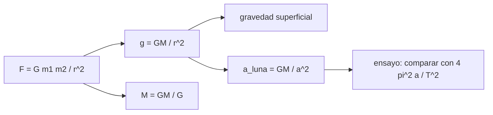

# B71-C02 — Ley de gravitación universal

<!-- nav:top -->
[🏠 Programa](../../../../README.md) · [📚 Bloque B71](../../../tronco-comun/B71-mecanica-orbital-fundamental.md) · [← Anterior: B71-C01 — Leyes de Kepler](../B71-C01-leyes-de-kepler/CLASE.md) · [Siguiente: B71-C03 — Ecuación de movimiento de dos cuerpos →](../B71-C03-ecuacion-de-movimiento-de-dos-cuerpos/CLASE.md)
<!-- /nav -->

## 1. Ubicación, nivel y alcance

Clase 2 del bloque B71. Nivel N3. Newton unió la caída de una manzana y el movimiento de la Luna en una sola ley: dos masas se atraen con una fuerza proporcional a ambas e inversamente proporcional al cuadrado de su distancia. Aquí la usas para calcular la gravedad en la superficie y a distintas alturas, para hallar la masa de la Tierra y para repetir el «ensayo de la Luna». Basta [C01](../B71-C01-leyes-de-kepler/CLASE.md) como contexto. La Tierra se trata como esfera homogénea sin rotación.

## 2. Por qué esta clase existe

La ley de gravitación convierte las leyes de Kepler de reglas empíricas en consecuencias de una fuerza. La decisión central: **¿cuánto vale la aceleración gravitatoria a una distancia dada y qué te dice sobre la masa del cuerpo central?**

## 3. Lo que podrás hacer al terminar

1. Calcular la fuerza y la aceleración gravitatorias entre dos cuerpos.
2. Comprobar el inverso del cuadrado con un cociente de fuerzas.
3. Obtener la masa de un cuerpo como `GM/G` y su incertidumbre.
4. Repetir el ensayo de la Luna: aceleración cinemática frente a gravitacional.
5. Calcular la gravedad a 400 km de altitud y a la distancia geoestacionaria.
6. Separar lo consultado (`G`, `GM`) de lo calculado (aceleraciones).

La evidencia es la **ficha de la gravitación con el ensayo de la Luna** del ejercicio 12 (sección 20).

## 4. Con qué llegas y cómo comprobarlo

1. ¿Qué es una fuerza y en qué unidades se mide?
2. ¿Qué es una aceleración centrípeta?
3. ¿Qué significa «inversamente proporcional al cuadrado»?
4. ¿Qué es una incertidumbre relativa?
5. ¿Qué es una verificación por segunda vía?

<details>
<summary>Ver respuestas</summary>

1. Una interacción que cambia el movimiento; newton (kg m/s²). 2. La aceleración hacia el centro en un movimiento circular, `v²/r`. 3. Que al duplicar la distancia el valor se divide por cuatro. 4. El cociente entre la incertidumbre y el valor. 5. Calcular lo mismo con otro método y comparar.
</details>

Con cuatro o cinco aciertos, sigue; si no, repasa los prerrequisitos.

## 5. Un caso de contexto y casos de referencia

Con `GM = 3,986004 × 10¹⁴ m³/s²` y `r = 6378,1 km` la gravedad es `9.7984 m/s²`; con el radio medio, `9.8202 m/s²`, que coincide con los `9,820` de la ficha. La Luna, a `384 400 km`, acelera `2.6976e-03 m/s²` hacia la Tierra, y el movimiento observado (período y radio) exige `2.7233e-03 m/s²`. Es el **ejemplo conductor**.

## 6. Vocabulario

La **ley de gravitación** `F = G m₁ m₂/r²`. La **constante de gravitación** `G`. La **aceleración gravitatoria** `g = GM/r²`. La **masa reducida** (C03). El **ensayo de la Luna** compara la aceleración de la Luna con `g` reducida por `(R/r)²`. La **incertidumbre** de `G` es la mayor de las constantes fundamentales de este bloque.

## 7. Modelo mental



*Descripción textual:* de la ley salen la aceleración a cualquier distancia, la gravedad superficial, la aceleración de la Luna y, con `GM` y `G`, la masa del cuerpo central.

Analogía: la luz de una bombilla se reparte sobre una esfera cuya área crece como `r²`; la gravedad se «diluye» igual. Límite: la gravedad no se apaga ni se absorbe; la analogía solo explica la forma `1/r²`.

## 8. La explicación, paso a paso

### 8.1 La fuerza y la aceleración

`F = G m₁ m₂/r²`. La aceleración del cuerpo 2 por la atracción del 1 es `g = G m₁/r² = μ₁/r²`. Si se duplica `r`, la fuerza se divide por cuatro: el laboratorio da `F(R)/F(2R) = 4.0`.

### 8.2 Gravedad en la superficie

Con `(GM)_⊕` nominal y `R = 6378,1 km`, `g = 9.79840 m/s²`, un `-8.4e-04` relativo frente a `gₙ = 9,80665` (esperable: `gₙ` es un valor convencional y la Tierra gira y está achatada). Con el radio medio `6371,000 km` se obtiene `9.82025`, que coincide con la ficha (`2.5e-05`). A 400 km de altitud la aceleración es `8.6760 m/s²` y a la distancia geoestacionaria (42 164 km del centro), `0.2242 m/s²`.

### 8.3 La masa de la Tierra

`M = GM/G = 5.97217e+24 kg`, a `-5.4e-06` de la ficha (`5,9722 × 10²⁴`). Su incertidumbre, `± 1.3e+20 kg`, viene solo de `G` (relativa `2,2 × 10⁻⁵`): `GM` se conoce mucho mejor que `M` (C04).

### 8.4 El ensayo de la Luna

La Luna se mueve casi en un círculo de radio `a` y período `T`; su aceleración centrípeta es `4π² a/T² = 2.72333e-03 m/s²`. La gravitación predice `GM/a² = 2.69756e-03 m/s²`. La diferencia relativa es `9.6e-03`. Además `g/a_luna = 3632.32` y `(a/R)² = 3632.32`: son iguales, que es el contenido del ensayo. La diferencia de 1 % se debe a la masa de la Luna y a la atracción solar, no a un fallo del inverso del cuadrado.

## 9. Magnitudes, símbolos y unidades

| Símbolo | Qué es | Unidad | Valor / nota |
|---|---|---|---|
| `G` | constante de gravitación | m³ kg⁻¹ s⁻² | 6,674 30 × 10⁻¹¹ (CODATA 2022) |
| `GM` | parámetro gravitacional | m³/s² | 3,986004 × 10¹⁴ (Tierra, IAU) |
| `g` | aceleración gravitatoria | m/s² | 9.7984 (ecuatorial) |
| `F` | fuerza | N | `G m₁ m₂/r²` |
| `a_luna` | aceleración de la Luna | m/s² | 2.6976e-03 |

## 10. Convenciones y referencias

Marco inercial geocéntrico, SI. La Tierra es una esfera homogénea sin rotación ni achatamiento; la Luna es un punto en órbita circular de radio `a` (la ficha da `e = 0,0549`). Se usa `(GM)_⊕` nominal de la IAU y `G` de CODATA 2022. El radio ecuatorial es el de la IAU; el medio, el de la ficha.

## 11. De dónde sale lo que afirmamos

| ID | Fuente | Localizador | Respalda | Estado |
|---|---|---|---|---|
| S1 | NIST, CODATA 2022 (allascii.txt) — https://physics.nist.gov/cuu/Constants/Table/allascii.txt (consultada 2026-11-10) | líneas de la constante de gravitación y de la aceleración estándar | G = 6,674 30 × 10⁻¹¹ m³ kg⁻¹ s⁻² (incertidumbre 0,000 15 × 10⁻¹¹); gₙ = 9,806 65 m/s² (exacta) | Consultada |
| S2 | IAU 2015 Resolución B3, Mamajek et al., arXiv:1510.07674 — https://arxiv.org/abs/1510.07674 (PDF leído con PyMuPDF, consultada 2026-11-10) | tabla de constantes nominales | (GM)ˢᵘⁿ = 1,327 124 4 × 10²⁰ m³ s⁻² y (GM)ᵀⁱᵉʳʳᵃ = 3,986 004 × 10¹⁴ m³ s⁻² (nominales, exactos); R_ecuatorial de la Tierra = 6,3781 × 10⁶ m | Consultada |
| S3 | NASA/NSSDC, Earth Fact Sheet — https://nssdc.gsfc.nasa.gov/planetary/factsheet/earthfact.html (consultada 2026-11-10) | ficha completa leída | masa 5,9722 × 10²⁴ kg; radio medio 6371,000 km; radio ecuatorial 6378,137 km; rotación sidérea 23,9345 h; a = 149,598 × 10⁶ km; e = 0,0167; velocidad de escape 11,186 km/s; g media 9,820 m/s² | Consultada |
| S4 | NASA/NSSDC, Moon Fact Sheet — https://nssdc.gsfc.nasa.gov/planetary/factsheet/moonfact.html (consultada 2026-11-10) | ficha completa leída | masa 0,07346 × 10²⁴ kg; radio medio 1737,4 km; a = 0,3844 × 10⁶ km; e = 0,0549; período 27,3217 d; inclinación a la eclíptica 5,145°; velocidad de escape 2,38 km/s | Consultada |
| — | Relaciones estándar de mecánica orbital de esta clase | — | las verifica el laboratorio con una segunda vía | No consultada en una fuente concreta |

Límites: no se consultó el texto de Newton ni mediciones de `G`; la constante `G` se toma de CODATA. La masa de la Luna entra solo como explicación cualitativa de la diferencia del ensayo. Las aceleraciones calculadas son modelos, no mediciones de gravimetría.

## 12. Cómo ver el resultado

| Magnitud | Valor |
|---|---|
| `g` superficial (radio medio) | 9.8202 m/s² |
| masa de la Tierra | 5.9722e+24 kg |
| `a_luna` cinemática / gravitacional | 2.7233e-03 / 2.6976e-03 m/s² |
| diferencia del ensayo | 9.6e-03 |
| `g` a 400 km | 8.6760 m/s² |

Descripción larga: la gravedad cae como `1/r²`; a 400 km de altitud sigue siendo el 88 % de la superficial, de modo que la ingravidez en órbita no es ausencia de gravedad.

## 13. Ejemplo trabajado

**Gravedad a 400 km de altitud.**

**Paso 1 · Radio.** `r = 6378,1 + 400 = 6778,1 km`.

**Paso 2 · Cociente.** `GM/r² = 3,986004 × 10¹⁴/(6,7781 × 10⁶)²`.

**Paso 3 · Resultado.** `g = 8.6760 m/s²`, es decir `8.676/9,80665 ≈ 88 %` del valor de superficie.

## 14. Distintas formas de describir el problema

**Por fuerza:** `F = G m₁ m₂/r²`. **Por campo:** `g = μ/r²`. **Por potencial:** `Φ = −μ/r` (C05). **Por movimiento:** `4π² a/T²`.

## 15. Práctica guiada

**Ejercicio 1 · con los pasos indicados.** Calcula `g` a `r = 2R` con `g(R) = 9,820`. *Pasos:* divide por `2²`.

<details><summary>Solución comentada</summary>

`9,820/4 = 2,455 m/s²`.
</details>

**Ejercicio 2 · con una pista.** Predice la fuerza sobre 1 kg en la superficie con `M = 5,9722 × 10²⁴ kg`. *Pista:* es `g` por 1 kg.

<details><summary>Solución comentada</summary>

`F = G M m/R² ≈ 9,82 N`; el laboratorio da `9.798 N` con el radio ecuatorial.
</details>

**Ejercicio 3 · casi autónomo.** ¿Por qué `g_sup/a_luna = (a/R)²`? Usa `g = μ/R²` y `a_luna = μ/a²`.

<details><summary>Solución comentada</summary>

El cociente es `(μ/R²)/(μ/a²) = (a/R)²`, independiente de `μ`: vale `3632.32`.
</details>

## 16. Práctica autónoma, transferencia e integrador

**Ejercicio 4 · autónomo.** Con `M = 7,346 × 10²² kg` y `R = 1737,4 km` calcula `g` lunar.

<details><summary>Solución comentada</summary>

`G M/R² = 6,6743 × 10⁻¹¹ × 7,346 × 10²²/(1,7374 × 10⁶)² = 1,62 m/s²`.
</details>

**Ejercicio 5 · autónomo.** Una nave a `r = 4R`: ¿cuánto vale `g` en fracción de la superficial?

<details><summary>Solución comentada</summary>

`1/16 = 6,25 %`.
</details>

**Ejercicio 6 · autónomo.** Calcula `F` entre dos masas de 1000 kg a 10 m.

<details><summary>Solución comentada</summary>

`6,6743 × 10⁻¹¹ × 10⁶/100 = 6,67 × 10⁻⁷ N`.
</details>

**Ejercicio 7 · autónomo.** Con la incertidumbre relativa de `G` (`2,2 × 10⁻⁵`), ¿cuál es la de `M = μ/G` si `μ` es exacto?

<details><summary>Solución comentada</summary>

La misma: `2,2 × 10⁻⁵`.
</details>

**Ejercicio 8 · autónomo.** Si la diferencia del ensayo de la Luna fuera de 50 %, ¿qué sospecharías?

<details><summary>Solución comentada</summary>

Un error de unidades (km frente a m) o de período (sidéreo frente a sinódico); con los datos correctos es de `9.6e-03`.
</details>

**Ejercicio 9 · transferencia.** **Transferencia.** **Transferencia.** Un satélite a 400 km de altitud se dice «sin gravedad». Refuta con un número.

<details><summary>Solución comentada</summary>

A esa altitud `g = 8.68 m/s²`; el satélite está en caída libre, por eso no se siente el peso, no porque falte la fuerza.
</details>

**Ejercicio 10 · transferencia.** **Transferencia.** **Transferencia.** Un colega calcula la masa de Júpiter con `GM/G` y pretende una precisión de `10⁻⁸`. ¿Qué límite se lo impide?

<details><summary>Solución comentada</summary>

La incertidumbre de `G` (`2,2 × 10⁻⁵`), que limita la masa en cualquier cuerpo aunque `GM` se conozca mejor.
</details>

**Ejercicio 11 · transferencia.** **Transferencia.** **Transferencia.** Un instrumento mide 0,3 % menos de `g` en el ecuador que el calculado con esfera. Nombra dos efectos físicos.

<details><summary>Solución comentada</summary>

La rotación terrestre (aceleración centrífuga) y el achatamiento; este modelo no los incluye.
</details>

**Ejercicio 12 · integrador.** **Integrador.** **Integrador.** Elabora tu *ficha de la gravitación con el ensayo de la Luna*: `g` en superficie y a 400 km y en GEO, `M = GM/G` con incertidumbre, ensayo de la Luna y lista de lo consultado.

<details><summary>Solución comentada</summary>

Secciones 8.1–8.4 y la salida del laboratorio.
</details>

## 17. Laboratorio: gravedad, masa de la Tierra y ensayo de la Luna

El script [gravitacion.py](gravitacion.py) calcula `g` en superficie y en altura, la masa de la Tierra con su incertidumbre y la aceleración de la Luna por dos vías (**comprueba** inverso del cuadrado exacto, `g_sup/a_luna = (a/R)²` y diferencia del ensayo < 2e-2).

**Datos:** `G` y `gₙ` de CODATA 2022, `(GM)_⊕` nominal y radio ecuatorial de la IAU, ficha de la Tierra y de la Luna de la NASA/NSSDC (consultados); todo lo demás se calcula. **Predice antes de ejecutar:** ¿Qué diferencia relativa esperas entre las dos aceleraciones de la Luna? (Del orden de 1 %.) **Ejecución del 2026-11-10 (Python 3.12.9):**

```text
Python 3.12.9 (biblioteca estandar)
g en la superficie terrestre con (GM)T de la IAU (esfera sin rotacion):
  r = 6378.1 km (ecuatorial): g = 9.79840 m/s2 ; frente a gn = -0.084 %
  r = 6371.000 km (medio)     : g = 9.82025 m/s2 ; frente a la ficha (9.820) = +0.003 %
Masa de la Tierra = GM/G = 5.97217e+24 kg (+/- 1.3e+20 por la incertidumbre de G) ; frente a la ficha -0.001 %
Ensayo de la Luna (a = 384400 km, T = 27.3217 d):
  a cinematica 4 pi^2 a/T^2 = 2.723330e-03 m/s2
  a gravitacional GM/a^2    = 2.697559e-03 m/s2 ; diferencia relativa = 9.55e-03
  g_sup / a_luna = 3632.32 ; (a_luna/R_T)^2 = 3632.32
Inverso del cuadrado: F(R)/F(2R) = 4.000000000000
Aceleracion a 400 km de altitud: 8.6760 m/s2 ; a 42164 km del centro: 0.2242 m/s2
Pruebas superadas.
```

```bash
python programa/clases/B71/B71-C02-ley-de-gravitacion-universal/gravitacion.py
```

**Límites:** Tierra esférica y homogénea, Luna puntual en órbita circular; no incluye la masa de la Luna ni la atracción solar.

## 18. Errores frecuentes y cómo corregirlos

**Usar el radio ecuatorial para comparar con la gravedad media de la ficha.** Se corrige con 8.2.

**Creer que en órbita no hay gravedad.** Se corrige con el ejemplo 13.

**Atribuir a `GM` la incertidumbre de `G`.** Se corrige con 8.3.

**Confundir período sidéreo y sinódico en el ensayo.** Se corrige con 8.4.

## 19. Cómo sabrás que vas bien

Tras la sección 8: ¿qué valor esperabas para `g` a 400 km y cuál obtuviste? Si dudas, repasa el ejemplo 13. Tras el laboratorio: ¿qué comprueba? (ver la sección 17).

## 20. Qué entregas y cómo se evalúa

El producto es tu **ficha de la gravitación con el ensayo de la Luna** (ejercicio 12).

| Criterio | Inicial | En desarrollo | Logrado | Destacado |
|---|---|---|---|---|
| Conceptos | Los confunde | Parciales | Aplica `F` y `g` | Explica los límites del modelo |
| Cálculo | Sin unidades | Con errores | Tablas con unidades | Propaga incertidumbres |
| Numérico | Sin comprobar | Un caso | Dos vías para la Luna | Interpreta la diferencia |
| Fuentes | Sin fuente | Sin fecha | Fuentes con fecha y estado | Declara lo no consultado |
| Límites | No los nombra | Uno | Tres | Discute qué falta del modelo |

**Condiciones críticas (no se compensan con promedio):** declarar unidades y marco de referencia; no confundir `g` convencional con el calculado; citar solo lo consultado.

## 21. Ética, seguridad y límites

Clase educativa: los modelos son simplificados y sus datos son consultados, sintéticos o ilustrativos (rotulados); ningún resultado es una efeméride ni una predicción operativa ni sustituye a las herramientas de navegación de una misión. Accesibilidad: tablas equivalentes a las gráficas, fórmulas en texto, ejercicios sin conexión.

## 22. Para cerrar y seguir

La gravedad cae de `9.82 m/s²` en superficie a `8.68 m/s²` a 400 km, y el ensayo de la Luna cierra con `9.6e-03` de diferencia. Queda una pregunta: ¿cómo se escribe el movimiento de un cuerpo bajo esta fuerza?

**Glosario español–inglés.** ley de gravitación · *law of gravitation* · constante de gravitación · *gravitational constant* · aceleración centrípeta · *centripetal acceleration* · incertidumbre · *uncertainty*.

**Continuidad.** [B71-C03](../B71-C03-ecuacion-de-movimiento-de-dos-cuerpos/CLASE.md) plantea la ecuación del movimiento.

**Referencias:** ver sección 11.

<!-- nav:bottom -->
---

[← Anterior: B71-C01 — Leyes de Kepler](../B71-C01-leyes-de-kepler/CLASE.md) · [📚 Bloque B71](../../../tronco-comun/B71-mecanica-orbital-fundamental.md) · [Siguiente: B71-C03 — Ecuación de movimiento de dos cuerpos →](../B71-C03-ecuacion-de-movimiento-de-dos-cuerpos/CLASE.md)
<!-- /nav -->
