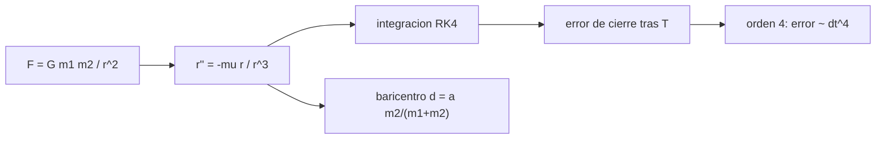

# B71-C03 — Ecuación de movimiento de dos cuerpos

<!-- nav:top -->
[🏠 Programa](../../../../README.md) · [📚 Bloque B71](../../../tronco-comun/B71-mecanica-orbital-fundamental.md) · [← Anterior: B71-C02 — Ley de gravitación universal](../B71-C02-ley-de-gravitacion-universal/CLASE.md) · [Siguiente: B71-C04 — Parámetro gravitacional →](../B71-C04-parametro-gravitacional/CLASE.md)
<!-- /nav -->

## 1. Ubicación, nivel y alcance

Clase 3 del bloque B71. Nivel N3. Dos cuerpos puntuales que solo se atraen entre sí tienen una solución exacta. Aquí escribes la ecuación del movimiento relativo `r̈ = −μ r/r³`, ves por qué se reduce a un cuerpo ficticio de masa reducida y la integras numéricamente para comprobar con qué rapidez converge el integrador. Usas [C02](../B71-C02-ley-de-gravitacion-universal/CLASE.md) para la fuerza. La órbita integrada es sintética y no pertenece a ningún satélite.

## 2. Por qué esta clase existe

Casi toda la mecánica orbital parte de esta ecuación; entender qué supone (cuerpos puntuales, sin otras fuerzas) permite saber cuándo falla. La decisión central: **¿qué resuelve exactamente la ecuación de dos cuerpos y cómo compruebas que tu integración numérica es fiable?**

## 3. Lo que podrás hacer al terminar

1. Escribir la ecuación del movimiento relativo y el papel de `μ = G(m₁ + m₂)`.
2. Calcular el baricentro de dos cuerpos y decidir cuándo el cuerpo central puede considerarse fijo.
3. Integrar el movimiento con RK4 y medir el error de cierre tras una vuelta.
4. Comprobar que el error cae como `dt⁴` (orden 4).
5. Usar la deriva de la energía como control de calidad.
6. Separar lo consultado (masas, `GM`) de lo sintético (la órbita).

La evidencia es la **ficha del problema de dos cuerpos con su orden de convergencia** del ejercicio 12 (sección 20).

## 4. Con qué llegas y cómo comprobarlo

1. ¿Qué es un vector de posición relativa?
2. ¿Qué es una ecuación diferencial ordinaria?
3. ¿Qué es el centro de masas?
4. ¿Qué es el orden de un método numérico?
5. ¿Qué es una verificación por segunda vía?

<details>
<summary>Ver respuestas</summary>

1. El vector que va de un cuerpo a otro. 2. Una ecuación que relaciona una función con sus derivadas respecto a una variable. 3. El punto medio ponderado por las masas. 4. El exponente `p` tal que el error global es proporcional a `dt^p`. 5. Calcular lo mismo con otro método y comparar.
</details>

Con cuatro o cinco aciertos, sigue; si no, repasa los prerrequisitos.

## 5. Un caso de contexto y casos de referencia

Una órbita sintética con periapsis a 300 km y apoapsis a 10 000 km de altitud tiene `a = 11528100 m` y `T = 12318.2 s`. Integrada con RK4 en `N = 200` pasos por vuelta cierra con `8.11e+01 m` de error; con `N = 1600`, `1.51e-02 m`. El baricentro Tierra–Luna queda a `0.733` radios terrestres del centro. Es el **ejemplo conductor**.

## 6. Vocabulario

El **movimiento relativo** es el de un cuerpo respecto al otro. La **masa reducida** `m₁m₂/(m₁ + m₂)` es la masa del cuerpo ficticio. El **baricentro** es el centro de masas del par. **RK4** es el método de Runge–Kutta de cuarto orden. El **error de cierre** es la distancia entre el estado final y el inicial tras un período exacto. El **orden** de un método describe cómo cae el error con el paso.

## 7. Modelo mental



*Descripción textual:* la fuerza lleva a la ecuación relativa; se integra con RK4, el error de cierre mide la calidad y el baricentro dice cuánto se mueve el cuerpo central.

Analogía: dos patinadores unidos por una cuerda giran alrededor de un punto entre ambos, más cerca del más pesado. Límite: la gravedad no es una cuerda; la fuerza cambia con la distancia.

## 8. La explicación, paso a paso

### 8.1 La ecuación del movimiento relativo

Para dos masas, `m₁ r̈₁ = G m₁m₂ r/r³` y `m₂ r̈₂ = −G m₁m₂ r/r³`, con `r = r₂ − r₁`. Restando se obtiene `r̈ = −μ r/r³` con `μ = G(m₁ + m₂)`. Es una ecuación de segundo orden en tres coordenadas: seis constantes de integración (los elementos de C10–C13).

### 8.2 Cuándo el cuerpo central está fijo

El baricentro está a `a m₂/(m₁ + m₂)` del cuerpo 1. Para Tierra–Luna, `m_T/m_L = 81.30` y el baricentro queda a `4670793`  m del centro de la Tierra, `0.733` radios terrestres: dentro del planeta, pero lejos de ser despreciable. Para un satélite de 1000 kg el desplazamiento de la Tierra es `10⁻²² ` veces menor y se ignora. `G(m_T + m_L) = 4.03505e+14` m³/s² difiere de `(GM)_⊕` en `1.23%`.

### 8.3 Integrar y medir el error

El laboratorio integra una órbita con RK4 en un número `N` de pasos iguales por vuelta y compara el estado tras un período exacto con el inicial. Errores de cierre: `8.11e+01`, `4.38e+00`, `2.52e-01`, `1.51e-02` m para `N = 200, 400, 800, 1600`.

### 8.4 El orden de convergencia

Los cocientes de errores al duplicar `N` son `18.54`, `17.35` y `16.70`, tendiendo a `2⁴ = 16`: el método es de cuarto orden. La deriva relativa de la energía baja de `2.5e-07` a `7.7e-12`. Un integrador cuyo error no cae así tiene un error de programación.

## 9. Magnitudes, símbolos y unidades

| Símbolo | Qué es | Unidad | Valor / nota |
|---|---|---|---|
| `μ` | parámetro gravitacional del par | m³/s² | 3,986004 × 10¹⁴ (Tierra) |
| `r` | posición relativa | m | vector |
| `dt` | paso de integración | s | `T/N` |
| `N` | pasos por vuelta | — | 200 a 1600 |
| `T` | período de la órbita sintética | s | 12318.2 |
| `d` | distancia del baricentro al cuerpo mayor | m | 4670793 |

## 10. Convenciones y referencias

Marco inercial geocéntrico, SI, plano xy. Cuerpos puntuales; sin arrastre, achatamiento ni terceros cuerpos. La integración parte del periapsis en `+x` con velocidad `+y`. `(GM)_⊕` nominal de la IAU; masas de la Tierra y de la Luna de las fichas de la NASA/NSSDC. La órbita es sintética.

## 11. De dónde sale lo que afirmamos

| ID | Fuente | Localizador | Respalda | Estado |
|---|---|---|---|---|
| S1 | NIST, CODATA 2022 (allascii.txt) — https://physics.nist.gov/cuu/Constants/Table/allascii.txt (consultada 2026-11-10) | líneas de la constante de gravitación y de la aceleración estándar | G = 6,674 30 × 10⁻¹¹ m³ kg⁻¹ s⁻² (incertidumbre 0,000 15 × 10⁻¹¹); gₙ = 9,806 65 m/s² (exacta) | Consultada |
| S2 | IAU 2015 Resolución B3, Mamajek et al., arXiv:1510.07674 — https://arxiv.org/abs/1510.07674 (PDF leído con PyMuPDF, consultada 2026-11-10) | tabla de constantes nominales | (GM)ˢᵘⁿ = 1,327 124 4 × 10²⁰ m³ s⁻² y (GM)ᵀⁱᵉʳʳᵃ = 3,986 004 × 10¹⁴ m³ s⁻² (nominales, exactos); R_ecuatorial de la Tierra = 6,3781 × 10⁶ m | Consultada |
| S3 | NASA/NSSDC, Earth Fact Sheet — https://nssdc.gsfc.nasa.gov/planetary/factsheet/earthfact.html (consultada 2026-11-10) | ficha completa leída | masa 5,9722 × 10²⁴ kg; radio medio 6371,000 km; radio ecuatorial 6378,137 km; rotación sidérea 23,9345 h; a = 149,598 × 10⁶ km; e = 0,0167; velocidad de escape 11,186 km/s; g media 9,820 m/s² | Consultada |
| S4 | NASA/NSSDC, Moon Fact Sheet — https://nssdc.gsfc.nasa.gov/planetary/factsheet/moonfact.html (consultada 2026-11-10) | ficha completa leída | masa 0,07346 × 10²⁴ kg; radio medio 1737,4 km; a = 0,3844 × 10⁶ km; e = 0,0549; período 27,3217 d; inclinación a la eclíptica 5,145°; velocidad de escape 2,38 km/s | Consultada |
| — | Relaciones estándar de mecánica orbital de esta clase | — | las verifica el laboratorio con una segunda vía | No consultada en una fuente concreta |

Límites: las masas de las fichas están redondeadas a cuatro o cinco cifras; no se consultó la teoría de integradores. La órbita no corresponde a ningún satélite real.

## 12. Cómo ver el resultado

| Magnitud | Valor |
|---|---|
| `a` de la órbita sintética | 11528100 m |
| error de cierre con `N = 200` / `1600` | 8.11e+01 / 1.51e-02 m |
| cociente de errores (último) | 16.70 |
| baricentro Tierra–Luna | 0.733 radios terrestres |
| deriva de energía con `N = 1600` | 7.7e-12 |

Descripción larga: el error baja unas 16 veces cada vez que se duplica el número de pasos y el baricentro Tierra–Luna cae dentro de la Tierra.

## 13. Ejemplo trabajado

**Baricentro Tierra–Luna.**

**Paso 1 · Razón de masas.** `m_L/(m_T + m_L) = 0,07346/(5,9722 + 0,07346) = 0,012151`.

**Paso 2 · Distancia.** `d = 384 400 km × 0,012151 = 4670793 m` (el laboratorio da `4670792.6 m`).

**Paso 3 · Interpretación.** `d/R_⊕ = 0.733`: el baricentro está dentro de la Tierra, a 73 % de su radio medio.

## 14. Distintas formas de describir el problema

**Por fuerzas:** `F = −μ m r/r³`. **Por energía:** `ε` constante (C05). **Por momento angular:** `h` constante (C06). **Por integración:** pasos y error de cierre.

## 15. Práctica guiada

**Ejercicio 1 · con los pasos indicados.** Calcula la masa reducida de Tierra y Luna en unidades de `m_L`. *Pasos:* `m_T m_L/(m_T + m_L)`.

<details><summary>Solución comentada</summary>

`m_L × 81,30/82,30 = 0,9879 m_L`.
</details>

**Ejercicio 2 · con una pista.** Predice cuánto baja el error de RK4 si pasas de `N = 400` a `N = 800`. *Pista:* orden 4.

<details><summary>Solución comentada</summary>

Unas 16 veces; el laboratorio da `4.38e+00 → 2.52e-01`, cociente `17.35`.
</details>

**Ejercicio 3 · casi autónomo.** ¿Por qué el error de cierre mide la calidad de la integración? Piensa en qué debería dar la solución analítica tras un período.

<details><summary>Solución comentada</summary>

La solución exacta vuelve al estado inicial tras `T`; cualquier diferencia es error numérico.
</details>

## 16. Práctica autónoma, transferencia e integrador

**Ejercicio 4 · autónomo.** Calcula el baricentro de un sistema 10:1 con separación de 1 UA.

<details><summary>Solución comentada</summary>

`1/11 UA = 0,0909 UA` del cuerpo más pesado.
</details>

**Ejercicio 5 · autónomo.** Si `N` se multiplica por 10, ¿cuánto baja el error de un método de orden 4?

<details><summary>Solución comentada</summary>

`10⁴ = 10 000` veces (en régimen asintótico).
</details>

**Ejercicio 6 · autónomo.** ¿Qué le pasa a `μ` si el satélite tiene 1000 kg?

<details><summary>Solución comentada</summary>

`μ = G(m_T + m) ≈ (GM)_⊕(1 + 1,7 × 10⁻²²)`; cambia en la vigésimo segunda cifra.
</details>

**Ejercicio 7 · autónomo.** Con `G(m_T + m_L)` calcula el período lunar para `a = 384 400 km`.

<details><summary>Solución comentada</summary>

`T = 2π√(a³/μ) = 2π√(5,680 × 10²⁵/4.0351e+14) ≈ 2,357 × 10⁶ s = 27,28 d` (la ficha da 27,3217 d; la diferencia de 0,2 % es la perturbación solar y la excentricidad).
</details>

**Ejercicio 8 · autónomo.** Un integrador da razón de errores 4 en lugar de 16. ¿Qué orden tiene?

<details><summary>Solución comentada</summary>

Orden 2 (`2² = 4`).
</details>

**Ejercicio 9 · transferencia.** **Transferencia.** **Transferencia.** Un colega integra una órbita con paso fijo de 60 s para cualquier altitud. ¿Qué riesgo corre cerca del periapsis?

<details><summary>Solución comentada</summary>

La velocidad angular es máxima allí y el paso puede ser grande respecto de la escala de variación; el error crece. Usa pasos proporcionales a `T/N` o variables.
</details>

**Ejercicio 10 · transferencia.** **Transferencia.** **Transferencia.** Para el sistema Plutón–Caronte (masas comparables) ¿puedes tratar el cuerpo central como fijo?

<details><summary>Solución comentada</summary>

No: el baricentro queda fuera del cuerpo mayor y ambos orbitan en torno a él; hay que usar el movimiento relativo con `μ = G(m₁ + m₂)`. (Datos no consultados; razonamiento cualitativo.)
</details>

**Ejercicio 11 · transferencia.** **Transferencia.** **Transferencia.** Tu código de dos cuerpos da energía que deriva `10⁻³` por vuelta. ¿Qué haces antes de usarlo?

<details><summary>Solución comentada</summary>

Reducir el paso, comprobar el orden con el cociente de errores y revisar el código; una deriva así no es admisible para la verificación.
</details>

**Ejercicio 12 · integrador.** **Integrador.** **Integrador.** Elabora tu *ficha del problema de dos cuerpos con su orden de convergencia*: ecuación, `μ`, tabla de errores de cierre y de deriva de energía para cuatro `N`, razón de errores y baricentro Tierra–Luna.

<details><summary>Solución comentada</summary>

Secciones 8.1–8.4 y la salida del laboratorio.
</details>

## 17. Laboratorio: integración RK4 del problema de dos cuerpos

El script [dos_cuerpos.py](dos_cuerpos.py) integra una órbita sintética con cuatro números de pasos, mide el error de cierre y la deriva de energía y calcula el baricentro Tierra–Luna (**comprueba** que el error baja y que los cocientes están entre 10 y 22).

**Datos:** `(GM)_⊕` de la IAU, `G` de CODATA, masas y semieje lunar de las fichas (consultados); la órbita es **sintética**. **Predice antes de ejecutar:** ¿Qué cociente de errores esperas al duplicar `N`? (16 en régimen asintótico.) **Ejecución del 2026-11-10 (Python 3.12.9):**

```text
Python 3.12.9 (biblioteca estandar)
Orbita SINTETICA: periapsis 300 km, apoapsis 10000 km de altitud; a = 11528.100 km ; T = 12318.210 s ; v_p = 9208.636 m/s
  N pasos/vuelta   error de cierre [m]   deriva relativa de la energia
     200             8.1126e+01           2.523e-07
     400             4.3759e+00           7.892e-09
     800             2.5214e-01           2.467e-10
    1600             1.5098e-02           7.711e-12
  cociente de errores al duplicar N: 18.54 17.35 16.70  (orden 4 -> 16)
Baricentro Tierra-Luna: a m_L/(m_T+m_L) = 4670.8 km del centro de la Tierra = 0.733 radios terrestres (dentro de la Tierra)
  m_T/m_L = 81.30 ; m_L/m_T = 0.01230
  G(m_T+m_L) = 4.035055e+14 m3/s2 frente a (GM)T = 3.986004e+14 m3/s2
Pruebas superadas.
```

```bash
python programa/clases/B71/B71-C03-ecuacion-de-movimiento-de-dos-cuerpos/dos_cuerpos.py
```

**Límites:** RK4 de paso fijo, dos cuerpos puntuales; el error de cierre crece con el número de vueltas.

## 18. Errores frecuentes y cómo corregirlos

**Tratar el cuerpo central como fijo en un par de masas comparables.** Se corrige con 8.2.

**Confiar en un integrador sin medir su orden.** Se corrige con 8.4.

**Usar `GM` del cuerpo central cuando el satélite es masivo.** Se corrige con 8.1.

**Presentar la órbita sintética como un satélite real.** Se corrige con la sección 10.

## 19. Cómo sabrás que vas bien

Tras la sección 8: ¿qué cociente de errores esperabas y cuál obtuviste? Si dudas, repasa el ejemplo 13. Tras el laboratorio: ¿qué comprueba? (ver la sección 17).

## 20. Qué entregas y cómo se evalúa

El producto es tu **ficha del problema de dos cuerpos con su orden de convergencia** (ejercicio 12).

| Criterio | Inicial | En desarrollo | Logrado | Destacado |
|---|---|---|---|---|
| Conceptos | Los confunde | Parciales | Deduce la ecuación relativa | Explica los límites |
| Cálculo | Sin unidades | Con errores | Baricentro y `μ` con unidades | Calcula casos nuevos |
| Numérico | Sin comprobar | Un caso | Orden de convergencia medido | Interpreta las diferencias |
| Fuentes | Sin fuente | Sin fecha | Fuentes con fecha y estado | Declara lo sintético |
| Límites | No los nombra | Uno | Tres | Discute qué falta del modelo |

**Condiciones críticas (no se compensan con promedio):** rotular la órbita como sintética; declarar el marco y las unidades; citar solo lo consultado.

## 21. Ética, seguridad y límites

Clase educativa: los modelos son simplificados y sus datos son consultados, sintéticos o ilustrativos (rotulados); ningún resultado es una efeméride ni una predicción operativa ni sustituye a las herramientas de navegación de una misión. Accesibilidad: tablas equivalentes a las gráficas, fórmulas en texto, ejercicios sin conexión.

## 22. Para cerrar y seguir

La ecuación `r̈ = −μ r/r³` integrada con RK4 cierra una vuelta con `1.5e-02 m` de error con 1600 pasos, y el error cae con orden 4. Queda una pregunta: ¿por qué se usa `μ` y no `G` y `M` por separado?

**Glosario español–inglés.** movimiento relativo · *relative motion* · masa reducida · *reduced mass* · baricentro · *barycenter* · error de cierre · *closure error* · paso de integración · *step size*.

**Continuidad.** [B71-C04](../B71-C04-parametro-gravitacional/CLASE.md) estudia el parámetro gravitacional.

**Referencias:** ver sección 11.

<!-- nav:bottom -->
---

[← Anterior: B71-C02 — Ley de gravitación universal](../B71-C02-ley-de-gravitacion-universal/CLASE.md) · [📚 Bloque B71](../../../tronco-comun/B71-mecanica-orbital-fundamental.md) · [Siguiente: B71-C04 — Parámetro gravitacional →](../B71-C04-parametro-gravitacional/CLASE.md)
<!-- /nav -->
