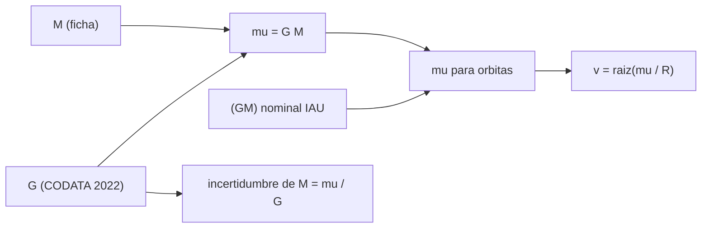

# B71-C04 — Parámetro gravitacional

<!-- nav:top -->
[🏠 Programa](../../../../README.md) · [📚 Bloque B71](../../../tronco-comun/B71-mecanica-orbital-fundamental.md) · [← Anterior: B71-C03 — Ecuación de movimiento de dos cuerpos](../B71-C03-ecuacion-de-movimiento-de-dos-cuerpos/CLASE.md) · [Siguiente: B71-C05 — Energía orbital específica →](../B71-C05-energia-orbital-especifica/CLASE.md)
<!-- /nav -->

## 1. Ubicación, nivel y alcance

Clase 4 del bloque B71. Nivel N3. En mecánica orbital casi nunca aparece la masa por separado: aparece el producto `μ = GM`. Esta clase explica por qué, cuánto se conoce cada factor y cómo se convierte entre unidades. Usas [C02](../B71-C02-ley-de-gravitacion-universal/CLASE.md) para la fuerza. Los valores de Marte y de la Luna se calculan aquí como `G·M` con masas de fichas; no son los valores determinados por seguimiento de naves, que no se consultaron.

## 2. Por qué esta clase existe

`G` es la constante fundamental peor medida, pero `GM` de la Tierra o del Sol se conoce cinco órdenes de magnitud mejor. La decisión central: **¿por qué se trabaja con `μ` y qué error introduces si en su lugar usas `G` y `M` por separado?**

## 3. Lo que podrás hacer al terminar

1. Definir `μ = GM` y distinguir el valor nominal de la IAU de un cálculo `G·M`.
2. Propagar la incertidumbre de `G` a la masa y a las velocidades.
3. Convertir `μ` entre km³/s² y m³/s² sin error.
4. Calcular la velocidad circular rasante en Tierra, Marte y la Luna a partir de `μ`.
5. Comparar `(GM)` del Sol y de la Tierra.
6. Separar lo consultado (`G`, `GM` nominales, masas) de lo derivado (`μ` de Marte y la Luna).

La evidencia es la **tabla de parámetros gravitacionales con incertidumbre** del ejercicio 12 (sección 20).

## 4. Con qué llegas y cómo comprobarlo

1. ¿Qué es una constante fundamental?
2. ¿Cómo se convierte km³/s² en m³/s²?
3. ¿Qué es una incertidumbre relativa?
4. ¿Cómo se propaga una incertidumbre en un producto?
5. ¿Qué es un valor nominal?

<details>
<summary>Ver respuestas</summary>

1. Un valor que no depende del sistema estudiado (como `G` o `c`). 2. Multiplicando por `10⁹` (1 km³ = 10⁹ m³). 3. El cociente entre la incertidumbre y el valor. 4. Las incertidumbres relativas se suman en cuadratura (o linealmente en el peor caso). 5. Un valor convencional exacto adoptado para evitar discrepancias, no la mejor estimación.
</details>

Con cuatro o cinco aciertos, sigue; si no, repasa los prerrequisitos.

## 5. Un caso de contexto y casos de referencia

`G` tiene una incertidumbre relativa de `2.25e-05`; por eso la masa de la Tierra, `M = μ/G = 5.97217e+24 kg`, solo se conoce con `± 1.3e+20 kg`. En cambio `(GM)_⊕ = 3,986004 × 10¹⁴ m³/s²` es nominal y exacto por definición. La velocidad circular rasante de la Tierra, `7910 m/s`, cambia solo `1.1e-05` si varía `G` dentro de su incertidumbre. Es el **ejemplo conductor**.

## 6. Vocabulario

El **parámetro gravitacional** `μ = GM` tiene unidades de m³/s². El **valor nominal** (IAU 2015 B3) es una constante de conversión exacta por definición. La **velocidad circular rasante** `√(μ/R)` es la de una órbita circular a ras de la superficie, sin atmósfera. El **peso** de un cuerpo en órbita no interviene: solo `μ`. **Derivado** significa calculado aquí a partir de otros datos, no medido.

## 7. Modelo mental



*Descripción textual:* `μ` puede venir del producto `G·M` (impreciso) o de un valor nominal (exacto); de él salen las velocidades, y la incertidumbre de `G` solo afecta a las masas.

Analogía: dos factores cuyo producto se conoce con precisión pero cada uno por separado no; como saber el área de un rectángulo con exactitud sin conocer su largo ni su ancho. Límite: en el caso físico el producto se determina observando órbitas, no midiendo los lados.

## 8. La explicación, paso a paso

### 8.1 Por qué `μ`

En `r̈ = −μ r/r³` solo entra `μ`. Observando el movimiento de naves y lunas se determina `μ` con muchas cifras; `M` solo se obtiene dividiendo por `G`. Por eso la IAU adopta `(GM)` nominales.

### 8.2 La incertidumbre viene de `G`

`G = 6,674 30 × 10⁻¹¹` con `u = 0,000 15 × 10⁻¹¹`: relativa `2.25e-05`. `M = μ/G = 5.97217e+24 kg` tiene la misma incertidumbre relativa: `± 1.3e+20 kg`. La razón entre el parámetro del Sol y el de la Tierra es `332946.1`, independiente de `G`.

### 8.3 Parámetros derivados de las fichas

Con las masas de las fichas, `G·M` da: Tierra `3.986025e+14`, Marte `4.282832e+13`, Luna `4.902941e+12` m³/s². Para la Tierra, `G·M` difiere del nominal en `5.4e-06`, dentro del redondeo de la masa de la ficha. Para Marte y la Luna esa precisión **no** es la de los valores obtenidos por seguimiento de naves.

### 8.4 Unidades y velocidades

`1 km³/s² = 10⁹ m³/s²`: ida y vuelta sin error. La velocidad circular rasante `√(μ/R)` sale `7909.8 m/s` (Tierra), `3554.7` (Marte) y `1679.9` (Luna). Con `μ` nominal para la Tierra se obtiene la misma cifra con una diferencia de `2.7e-06`. Como `v ∝ √G`, su incertidumbre por `G` es la mitad de la relativa: `1.1e-05`.

## 9. Magnitudes, símbolos y unidades

| Símbolo | Qué es | Unidad | Valor / nota |
|---|---|---|---|
| `μ`, `GM` | parámetro gravitacional | m³/s² | 3,986004 × 10¹⁴ (Tierra); 1,3271244 × 10²⁰ (Sol) |
| `G` | constante de gravitación | m³ kg⁻¹ s⁻² | 6,674 30 × 10⁻¹¹ |
| `u(G)/G` | incertidumbre relativa de `G` | — | 2.25e-05 |
| `M` | masa | kg | 5,9722 × 10²⁴ (ficha, Tierra) |
| `v_rasante` | velocidad circular rasante | m/s | 7910 (Tierra) |

## 10. Convenciones y referencias

SI. Los valores nominales de la IAU (Sol y Tierra) son exactos por definición y no son la mejor estimación actual. `μ` de Marte y la Luna es **derivado** (`G·M` de la ficha). Los radios son los medios de las fichas. Sin atmósfera ni relieve.

## 11. De dónde sale lo que afirmamos

| ID | Fuente | Localizador | Respalda | Estado |
|---|---|---|---|---|
| S1 | NIST, CODATA 2022 (allascii.txt) — https://physics.nist.gov/cuu/Constants/Table/allascii.txt (consultada 2026-11-10) | líneas de la constante de gravitación y de la aceleración estándar | G = 6,674 30 × 10⁻¹¹ m³ kg⁻¹ s⁻² (incertidumbre 0,000 15 × 10⁻¹¹); gₙ = 9,806 65 m/s² (exacta) | Consultada |
| S2 | IAU 2015 Resolución B3, Mamajek et al., arXiv:1510.07674 — https://arxiv.org/abs/1510.07674 (PDF leído con PyMuPDF, consultada 2026-11-10) | tabla de constantes nominales | (GM)ˢᵘⁿ = 1,327 124 4 × 10²⁰ m³ s⁻² y (GM)ᵀⁱᵉʳʳᵃ = 3,986 004 × 10¹⁴ m³ s⁻² (nominales, exactos); R_ecuatorial de la Tierra = 6,3781 × 10⁶ m | Consultada |
| S3 | NASA/NSSDC, Earth Fact Sheet — https://nssdc.gsfc.nasa.gov/planetary/factsheet/earthfact.html (consultada 2026-11-10) | ficha completa leída | masa 5,9722 × 10²⁴ kg; radio medio 6371,000 km; radio ecuatorial 6378,137 km; rotación sidérea 23,9345 h; a = 149,598 × 10⁶ km; e = 0,0167; velocidad de escape 11,186 km/s; g media 9,820 m/s² | Consultada |
| S4 | NASA/NSSDC, Mars Fact Sheet — https://nssdc.gsfc.nasa.gov/planetary/factsheet/marsfact.html (consultada 2026-11-10) | ficha completa leída | masa 0,64169 × 10²⁴ kg; radio medio 3389,5 km; a = 227,956 × 10⁶ km; e = 0,0935; período sidéreo 686,980 d; inclinación 1,848°; afelio 249,261 y perihelio 206,650 × 10⁶ km; velocidad de escape 5,03 km/s | Consultada |
| S5 | NASA/NSSDC, Moon Fact Sheet — https://nssdc.gsfc.nasa.gov/planetary/factsheet/moonfact.html (consultada 2026-11-10) | ficha completa leída | masa 0,07346 × 10²⁴ kg; radio medio 1737,4 km; a = 0,3844 × 10⁶ km; e = 0,0549; período 27,3217 d; inclinación a la eclíptica 5,145°; velocidad de escape 2,38 km/s | Consultada |
| — | Relaciones estándar de mecánica orbital de esta clase | — | las verifica el laboratorio con una segunda vía | No consultada en una fuente concreta |

Límites: no se consultaron los valores de `GM` de Marte y la Luna determinados por seguimiento (JPL u otras); los de esta clase son derivados y de menor precisión. No se consultó cómo se determina `G` ni `GM`.

## 12. Cómo ver el resultado

| Magnitud | Valor |
|---|---|
| incertidumbre relativa de `G` | 2.25e-05 |
| `μ` de Marte (derivado) | 4.28283e+13 m³/s² |
| `G·M` frente al nominal (Tierra) | 5.4e-06 |
| `(GM)_☉/(GM)_⊕` | 332946.1 |
| `v` rasante de la Luna | 1679.9 m/s |

Descripción larga: `G` limita las masas a 5 cifras, pero no limita las órbitas, que dependen de `μ`; las velocidades rasantes van de 1,7 km/s en la Luna a 7,9 km/s en la Tierra.

## 13. Ejemplo trabajado

**Velocidad rasante en Marte.**

**Paso 1 · `μ`.** `μ = G M = 6,6743 × 10⁻¹¹ × 0,64169 × 10²⁴ = 4.28283e+13 m³/s²` (derivado).

**Paso 2 · Cociente.** `μ/R = 4.28283e+13/3,3895 × 10⁶ = 1,2635 × 10⁷ m²/s²`.

**Paso 3 · Raíz.** `v = 3554.7 m/s ≈ 3,55 km/s`.

## 14. Distintas formas de describir el problema

**Por masa:** `μ = G M`. **Por órbita:** `μ = 4π² a³/T²` (C01). **Por tabla:** valor nominal en m³/s² o km³/s². **Por incertidumbre:** `δμ/μ`.

## 15. Práctica guiada

**Ejercicio 1 · con los pasos indicados.** Convierte `(GM)_⊕` a km³/s². *Pasos:* divide por `10⁹`.

<details><summary>Solución comentada</summary>

`3,986004 × 10⁵ km³/s²`.
</details>

**Ejercicio 2 · con una pista.** Predice la incertidumbre relativa de `M = μ/G` si `μ` es exacto. *Pista:* es la de `G`.

<details><summary>Solución comentada</summary>

`2.25e-05`, es decir `± 1.3e+20 kg` para la Tierra.
</details>

**Ejercicio 3 · casi autónomo.** Calcula `μ` de la Luna con `M = 7,346 × 10²² kg`.

<details><summary>Solución comentada</summary>

`6,6743 × 10⁻¹¹ × 7,346 × 10²² = 4.9029e+12 m³/s²`, es decir `4902,9 km³/s²` (derivado).
</details>

## 16. Práctica autónoma, transferencia e integrador

**Ejercicio 4 · autónomo.** Calcula la velocidad circular rasante de la Luna con `R = 1737,4 km`.

<details><summary>Solución comentada</summary>

`√(4.9029e+12/1,7374 × 10⁶) = 1679.9 m/s`.
</details>

**Ejercicio 5 · autónomo.** Si `G` fuera 1 % mayor, ¿cuánto cambiaría `v` para `M` fija?

<details><summary>Solución comentada</summary>

`v ∝ √G`: 0,5 %.
</details>

**Ejercicio 6 · autónomo.** ¿Por qué la razón `(GM)_☉/(GM)_⊕` no depende de `G`?

<details><summary>Solución comentada</summary>

Porque `G` se cancela: `G M_☉/(G M_⊕) = M_☉/M_⊕`; vale `332946.1`.
</details>

**Ejercicio 7 · autónomo.** Si el Sol tuviera `GM` 1 % menor, ¿cómo cambia el período de la Tierra?

<details><summary>Solución comentada</summary>

`T ∝ μ^(−1/2)`: aumenta 0,5 %.
</details>

**Ejercicio 8 · autónomo.** ¿Qué error cometes si usas `G·M_ficha` en lugar del nominal para la Tierra?

<details><summary>Solución comentada</summary>

Relativo `5.4e-06`, que en el período de una órbita baja es de `0,5 × 5.4e-06`: despreciable aquí, pero inaceptable para seguimiento de precisión.
</details>

**Ejercicio 9 · transferencia.** **Transferencia.** **Transferencia.** Un colega afirma que la masa de la Tierra se conoce a 9 cifras porque `GM` tiene 9. Refuta.

<details><summary>Solución comentada</summary>

`M = μ/G` hereda la incertidumbre de `G`, `2.2e-05`: solo 4–5 cifras.
</details>

**Ejercicio 10 · transferencia.** **Transferencia.** **Transferencia.** Para una misión a Marte, ¿usarías `G·M_ficha` o un `μ` determinado por seguimiento?

<details><summary>Solución comentada</summary>

El de seguimiento, mucho más preciso; en esta clase no se consultó, así que sirve solo para orden de magnitud.
</details>

**Ejercicio 11 · transferencia.** **Transferencia.** **Transferencia.** Una hoja de cálculo mezcla km³/s² con m³/s². ¿Qué factor de error esperas en `v`?

<details><summary>Solución comentada</summary>

`√(10⁹) ≈ 31 623` veces: un error de unidades se detecta por el orden de magnitud.
</details>

**Ejercicio 12 · integrador.** **Integrador.** **Integrador.** Elabora tu *tabla de parámetros gravitacionales con incertidumbre*: `μ` del Sol y la Tierra (nominal) y de Marte y la Luna (derivado), incertidumbre de `G`, velocidades rasantes y lista de lo consultado y lo derivado.

<details><summary>Solución comentada</summary>

Secciones 8.1–8.4 y la salida del laboratorio.
</details>

## 17. Laboratorio: μ nominal frente a G·M

El script [parametro.py](parametro.py) calcula `G·M` con masas de fichas, compara con el `GM` nominal de la Tierra, propaga la incertidumbre de `G`, convierte unidades y calcula velocidades rasantes (**comprueba** diferencia < 1e-3, conversión exacta y velocidades concordantes).

**Datos:** `G` de CODATA 2022, `GM` nominales de la IAU y masas y radios de las fichas NASA/NSSDC (consultados); `μ` de Marte y la Luna son **derivados**. **Predice antes de ejecutar:** ¿Qué diferencia esperas entre `G·M_ficha` y el nominal de la Tierra? (Unas millonésimas, por el redondeo de la masa.) **Ejecución del 2026-11-10 (Python 3.12.9):**

```text
Python 3.12.9 (biblioteca estandar)
Incertidumbre relativa de G (CODATA 2022) = 2.25e-05
mu = G*M con la masa de la ficha NASA/NSSDC [m3/s2] (derivado):
  Tierra  3.986025e+14   (km3/s2: 398602.5446)
  Marte   4.282832e+13   (km3/s2: 42828.3157)
  Luna    4.902941e+12   (km3/s2: 4902.9408)
  (GM)Tierra nominal IAU = 3.986004e+14 ; G*M_ficha frente al nominal = +5.38e-06
M = mu/G (Tierra) = 5.97217e+24 kg ; incertidumbre por G = 1.34e+20 kg
(GM)sol/(GM)Tierra = 332946.1
Conversion km3/s2 <-> m3/s2: ida y vuelta error relativo = 0.0e+00
Velocidad circular rasante sqrt(mu/R) con G*M [km/s]:
  Tierra  7.9098
  Marte   3.5547
  Luna    1.6799
  Tierra con mu nominal = 7.9098 km/s ; diferencia relativa = 2.69e-06 ; incertidumbre por G = 1.1e-05
Pruebas superadas.
```

```bash
python programa/clases/B71/B71-C04-parametro-gravitacional/parametro.py
```

**Límites:** sin valores de seguimiento de naves para Marte ni la Luna; la incertidumbre de las masas de las fichas no se propaga.

## 18. Errores frecuentes y cómo corregirlos

**Atribuir a `GM` la incertidumbre de `G`.** Se corrige con 8.2.

**Mezclar km³/s² y m³/s².** Se corrige con 8.4.

**Tomar un valor derivado como si fuera determinado por seguimiento.** Se corrige con 8.3.

**Tomar el valor nominal como mejor estimación.** Se corrige con la sección 10.

## 19. Cómo sabrás que vas bien

Tras la sección 8: ¿qué incertidumbre esperabas para `M` y cuál obtuviste? Si dudas, repasa el ejemplo 13. Tras el laboratorio: ¿qué comprueba? (ver la sección 17).

## 20. Qué entregas y cómo se evalúa

El producto es tu **tabla de parámetros gravitacionales con incertidumbre** (ejercicio 12).

| Criterio | Inicial | En desarrollo | Logrado | Destacado |
|---|---|---|---|---|
| Conceptos | Los confunde | Parciales | Distingue `μ`, `G` y `M` | Explica el origen de la precisión |
| Cálculo | Sin unidades | Con errores | Conversión y propagación correctas | Calcula casos nuevos |
| Numérico | Sin comprobar | Un caso | Nominal frente a derivado | Interpreta las diferencias |
| Fuentes | Sin fuente | Sin fecha | Fuentes con fecha y estado | Declara lo derivado y lo no consultado |
| Límites | No los nombra | Uno | Tres | Discute qué falta del modelo |

**Condiciones críticas (no se compensan con promedio):** rotular lo derivado y lo nominal; no tomar `G·M` de fichas como valor de seguimiento; citar solo lo consultado.

## 21. Ética, seguridad y límites

Clase educativa: los modelos son simplificados y sus datos son consultados, sintéticos o ilustrativos (rotulados); ningún resultado es una efeméride ni una predicción operativa ni sustituye a las herramientas de navegación de una misión. Accesibilidad: tablas equivalentes a las gráficas, fórmulas en texto, ejercicios sin conexión.

## 22. Para cerrar y seguir

`μ` de la Tierra es exacto como valor nominal, pero su masa solo se conoce a `2.2e-05`. Queda una pregunta: ¿qué cantidad se conserva cuando un cuerpo orbita bajo `μ`?

**Glosario español–inglés.** parámetro gravitacional · *gravitational parameter* · valor nominal · *nominal value* · incertidumbre · *uncertainty* · velocidad circular · *circular velocity*.

**Continuidad.** [B71-C05](../B71-C05-energia-orbital-especifica/CLASE.md) estudia la energía orbital.

**Referencias:** ver sección 11.

<!-- nav:bottom -->
---

[← Anterior: B71-C03 — Ecuación de movimiento de dos cuerpos](../B71-C03-ecuacion-de-movimiento-de-dos-cuerpos/CLASE.md) · [📚 Bloque B71](../../../tronco-comun/B71-mecanica-orbital-fundamental.md) · [Siguiente: B71-C05 — Energía orbital específica →](../B71-C05-energia-orbital-especifica/CLASE.md)
<!-- /nav -->
