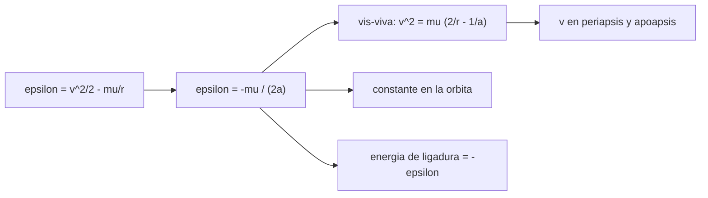

# B71-C05 — Energía orbital específica

<!-- nav:top -->
[🏠 Programa](../../../../README.md) · [📚 Bloque B71](../../../tronco-comun/B71-mecanica-orbital-fundamental.md) · [← Anterior: B71-C04 — Parámetro gravitacional](../B71-C04-parametro-gravitacional/CLASE.md) · [Siguiente: B71-C06 — Momento angular específico →](../../../tronco-comun/B71-mecanica-orbital-fundamental.md#b71-c06)
<!-- /nav -->

## 1. Ubicación, nivel y alcance

Clase 5 del bloque B71. Nivel N3. La energía orbital específica es la energía por unidad de masa de un satélite: cinética más potencial. En órbita ligada vale `−μ/(2a)`, solo depende del semieje y se conserva. Aquí la calculas para una órbita circular y una elíptica de transferencia, compruebas la ecuación vis‑viva y verificas la conservación con una integración numérica. Usas [C04](../B71-C04-parametro-gravitacional/CLASE.md) para `μ`. Las dos órbitas son sintéticas.

## 2. Por qué esta clase existe

El semieje fija el período y la energía; cambiar de órbita es cambiar de energía. La decisión central: **¿cuánta energía por kilogramo tiene una órbita y qué velocidad corresponde a cada distancia?**

## 3. Lo que podrás hacer al terminar

1. Calcular `ε = v²/2 − μ/r` y reconocer que es negativa en órbitas ligadas.
2. Usar `ε = −μ/(2a)` para obtener `a` desde la energía.
3. Aplicar la ecuación vis‑viva `v² = μ(2/r − 1/a)`.
4. Comprobar que `ε` es la misma en el periapsis y el apoapsis.
5. Medir la deriva de la energía en una integración RK4.
6. Separar lo consultado (`μ`) de lo sintético (las órbitas).

La evidencia es la **ficha energética de una órbita de transferencia geoestacionaria** del ejercicio 12 (sección 20).

## 4. Con qué llegas y cómo comprobarlo

1. ¿Qué es la energía cinética por unidad de masa?
2. ¿Qué es la energía potencial gravitatoria `−μ/r`?
3. ¿Qué es una cantidad conservada?
4. ¿Qué es el semieje mayor?
5. ¿Qué es una verificación por segunda vía?

<details>
<summary>Ver respuestas</summary>

1. `v²/2`, en J/kg = m²/s². 2. Energía por unidad de masa con cero en el infinito; es negativa. 3. Una magnitud que no cambia en el tiempo. 4. La mitad del eje mayor de la elipse. 5. Calcular lo mismo con otro método y comparar.
</details>

Con cuatro o cinco aciertos, sigue; si no, repasa los prerrequisitos.

## 5. Un caso de contexto y casos de referencia

A 400 km de altitud, una órbita circular tiene `v = 7668.6 m/s` y `ε = -2.9404e+07 J/kg = −μ/(2a)`. Una órbita de transferencia con periapsis a 200 km y apoapsis a 35 786 km de altitud tiene `a = 24371100 m` y `ε = -8.1777e+06 J/kg`, con `v_p = 10238.9` y `v_a = 1597.4 m/s`. Es el **ejemplo conductor**; ambas órbitas son **sintéticas**.

## 6. Vocabulario

La **energía orbital específica** `ε` es la energía mecánica por unidad de masa en J/kg. La **ecuación vis‑viva** `v² = μ(2/r − 1/a)` liga velocidad y distancia. La **energía de ligadura** es `−ε`: lo que falta para escapar. **Órbita ligada** significa `ε < 0`.

## 7. Modelo mental



*Descripción textual:* de la energía salen el semieje, la ecuación vis‑viva y las velocidades extremas; que la energía sea constante es la prueba de la integración.

Analogía: una bola que sube y baja en un cuenco: pierde velocidad al subir y la recupera al bajar, pero su energía total no cambia. Límite: el pozo gravitatorio no es un cuenco; su profundidad crece como `1/r`.

## 8. La explicación, paso a paso

### 8.1 Definición

`ε = v²/2 − μ/r`. Para la órbita circular de 400 km: `Ek = 2.9404e+07 J/kg`, `Ep = -5.8807e+07 J/kg`, `ε = -2.94035e+07 J/kg`. Se cumple `ε = −Ek`: en una circular la cinética es la mitad de la potencial en valor absoluto (teorema del virial).

### 8.2 `ε = −μ/(2a)`

La energía solo depende de `a`. Para la transferencia, `a = (r_p + r_a)/2 = 24371100 m` y `ε = -8.17773e+06 J/kg`. La circular de radio `a` tiene la misma energía.

### 8.3 Vis‑viva

`v = √(μ(2/r − 1/a))`. En el periapsis, `v_p = 10238.881 m/s`; en el apoapsis, `v_a = 1597.387 m/s`. Evaluando `v²/2 − μ/r` en ambos puntos la diferencia relativa con `−μ/(2a)` es `0.0e+00`.

### 8.4 Conservación numérica

Integrando con RK4 en 4000 pasos por vuelta, la deriva máxima de `ε` es `7.7e-10` y la vis‑viva coincide con la velocidad integrada en `2.5e-09`. La energía que falta para escapar es `−ε = 8.1777e+06 J/kg`, y un cuerpo en reposo en el ecuador tiene `ε = -6.2495e+07 J/kg`.

## 9. Magnitudes, símbolos y unidades

| Símbolo | Qué es | Unidad | Valor / nota |
|---|---|---|---|
| `ε` | energía orbital específica | J/kg = m²/s² | -8.1777e+06 (transferencia) |
| `μ` | parámetro gravitacional | m³/s² | 3,986004 × 10¹⁴ |
| `a` | semieje mayor | m | 24371100 |
| `v_p`, `v_a` | velocidades extremas | m/s | 10238.9; 1597.4 |
| `r_p`, `r_a` | distancias extremas | m | 6578100; 42164100 |

## 10. Convenciones y referencias

Marco inercial geocéntrico, SI; dos cuerpos puntuales; cero de la energía potencial en el infinito. `μ` nominal de la IAU. Radio ecuatorial de la IAU para pasar de altitud a distancia. Las órbitas son sintéticas.

## 11. De dónde sale lo que afirmamos

| ID | Fuente | Localizador | Respalda | Estado |
|---|---|---|---|---|
| S1 | IAU 2015 Resolución B3, Mamajek et al., arXiv:1510.07674 — https://arxiv.org/abs/1510.07674 (PDF leído con PyMuPDF, consultada 2026-11-10) | tabla de constantes nominales | (GM)ˢᵘⁿ = 1,327 124 4 × 10²⁰ m³ s⁻² y (GM)ᵀⁱᵉʳʳᵃ = 3,986 004 × 10¹⁴ m³ s⁻² (nominales, exactos); R_ecuatorial de la Tierra = 6,3781 × 10⁶ m | Consultada |
| — | Relaciones estándar de mecánica orbital de esta clase | — | las verifica el laboratorio con una segunda vía | No consultada en una fuente concreta |

Límites: las órbitas no corresponden a ningún satélite real; no se incluyen arrastre ni perturbaciones, que cambian la energía en la realidad. La conservación aquí es de un modelo.

## 12. Cómo ver el resultado

| Magnitud | Valor |
|---|---|
| `ε` circular a 400 km | -2.9404e+07 J/kg |
| `ε` de la transferencia | -8.1777e+06 J/kg |
| `v_p` / `v_a` | 10238.9 / 1597.4 m/s |
| deriva de `ε` (RK4) | 7.7e-10 |
| energía para escapar | 8.1777e+06 J/kg |

Descripción larga: la energía es la misma en todos los puntos de la órbita; la velocidad cae de 10,2 km/s a 1,6 km/s entre periapsis y apoapsis.

## 13. Ejemplo trabajado

**Velocidad en el apoapsis de la transferencia.**

**Paso 1 · Datos.** `r_a = 42164100 m`, `a = 24371100 m`.

**Paso 2 · Vis‑viva.** `v_a² = μ(2/r_a − 1/a) = 1597.387² m²/s²`.

**Paso 3 · Resultado.** `v_a = 1597.4 m/s`, inferior a la velocidad circular a esa altura (3075 m/s): hace falta un impulso para circularizar (C18).

## 14. Distintas formas de describir el problema

**Por energía:** `ε = −μ/(2a)`. **Por velocidad:** vis‑viva. **Por ligadura:** `−ε`. **Por integración:** deriva de `ε`.

## 15. Práctica guiada

**Ejercicio 1 · con los pasos indicados.** Calcula `ε` de una circular de radio `r = 7000 km`. *Pasos:* `−μ/(2r)`.

<details><summary>Solución comentada</summary>

`−3,986004 × 10¹⁴/(1,4 × 10⁷) = −2,847 × 10⁷ J/kg`.
</details>

**Ejercicio 2 · con una pista.** Predice `v` para la circular de radio `a = 24 371,1 km`. *Pista:* `√(μ/a)`.

<details><summary>Solución comentada</summary>

`√(3,986004 × 10¹⁴/2,43711 × 10⁷) = 4044 m/s`, entre `v_p` y `v_a`.
</details>

**Ejercicio 3 · casi autónomo.** ¿Por qué `ε` es la misma en el periapsis y el apoapsis? Mira las dos formas de la fórmula.

<details><summary>Solución comentada</summary>

Porque `ε = −μ/(2a)` solo depende de `a`; el laboratorio da diferencia `0.0e+00`.
</details>

## 16. Práctica autónoma, transferencia e integrador

**Ejercicio 4 · autónomo.** Calcula la energía por kg para escapar desde la circular de 400 km.

<details><summary>Solución comentada</summary>

`−ε = -2.9404e+07` en valor absoluto: `2,94 × 10⁷ J/kg` = 29,4 MJ/kg.
</details>

**Ejercicio 5 · autónomo.** Si `a` se duplica, ¿cómo cambia `ε`?

<details><summary>Solución comentada</summary>

Se reduce a la mitad en valor absoluto: `ε → ε/2` (menos negativa).
</details>

**Ejercicio 6 · autónomo.** ¿Qué signo tiene `ε` si `v = v_esc`?

<details><summary>Solución comentada</summary>

Cero: `v²/2 = μ/r`.
</details>

**Ejercicio 7 · autónomo.** Con `v = 8000 m/s` a 400 km de altitud ¿la órbita es ligada?

<details><summary>Solución comentada</summary>

`ε = 3,2 × 10⁷ − 5,881 × 10⁷ = −2,68 × 10⁷ < 0`: sí, ligada, con `a = −μ/(2ε) ≈ 7,43 × 10⁶ m`.
</details>

**Ejercicio 8 · autónomo.** Si la deriva de energía fuera `10⁻³` por vuelta ¿qué harías?

<details><summary>Solución comentada</summary>

Reducir el paso o cambiar de integrador; con 4000 pasos RK4 da `7.7e-10`.
</details>

**Ejercicio 9 · transferencia.** **Transferencia.** **Transferencia.** Un satélite pierde energía por arrastre. ¿Qué pasa con su semieje y su velocidad?

<details><summary>Solución comentada</summary>

`ε` baja (más negativa), `a` disminuye y, paradójicamente, la velocidad media aumenta (`v = √(μ/a)` en circular).
</details>

**Ejercicio 10 · transferencia.** **Transferencia.** **Transferencia.** Un colega dice que la energía de una órbita baja es mayor porque va más rápido. ¿Qué respondes?

<details><summary>Solución comentada</summary>

La energía total es `−μ/(2a)`, más negativa en órbitas bajas: ir más rápido aumenta la cinética pero la potencial baja el doble.
</details>

**Ejercicio 11 · transferencia.** **Transferencia.** **Transferencia.** Estima el `Δv` para pasar de la circular de 200 km a la transferencia con ese periapsis.

<details><summary>Solución comentada</summary>

`v_p − v_c(200 km) = 10238.9 − 7784 ≈ 2455 m/s`; el laboratorio da `2454.6 m/s` (en C18 se estudia).
</details>

**Ejercicio 12 · integrador.** **Integrador.** **Integrador.** Elabora tu *ficha energética de una órbita de transferencia geoestacionaria*: `a`, `ε`, `v_p`, `v_a`, comprobación de vis‑viva, deriva numérica y lista de lo consultado y lo sintético.

<details><summary>Solución comentada</summary>

Secciones 8.1–8.4 y la salida del laboratorio.
</details>

## 17. Laboratorio: energía orbital y vis-viva

El script [energia.py](energia.py) calcula `ε` de una circular y de una transferencia, evalúa la vis‑viva y mide la deriva de la energía con RK4 (**comprueba** `ε = −μ/(2a)`, igualdad periapsis–apoapsis y deriva < 1e-9).

**Datos:** `μ` y radio ecuatorial de la IAU (consultados); las órbitas son **sintéticas** (400 km circular; 200 × 35 786 km de transferencia). **Predice antes de ejecutar:** ¿Qué velocidad esperas en el apoapsis de la transferencia? (≈ 1,6 km/s.) **Ejecución del 2026-11-10 (Python 3.12.9):**

```text
Python 3.12.9 (biblioteca estandar)
Orbita circular SINTETICA a 400 km de altitud:
  r = a = 6778.100 km ; v = 7668.579 m/s
  Ek = 29.4035 MJ/kg ; Ep = -58.8071 MJ/kg ; epsilon = -29.4035 MJ/kg = -mu/(2a) = -29.4035 MJ/kg
Orbita de transferencia SINTETICA (periapsis 200 km, apoapsis 35786 km de altitud):
  a = 24371.100 km ; T = 37863.76 s ; v_p = 10238.881 m/s ; v_a = 1597.387 m/s
  epsilon = -mu/(2a) = -8.17773 MJ/kg ; en el periapsis -8.17773 ; en el apoapsis -8.17773
  diferencia relativa periapsis-apoapsis = 0.00e+00
  RK4 (4000 pasos): deriva maxima de epsilon = 7.73e-10 ; error maximo de vis-viva = 2.48e-09
  energia que falta para escapar = 8.1777 MJ/kg
  epsilon de un cuerpo en reposo en el ecuador = -62.495 MJ/kg
Pruebas superadas.
```

```bash
python programa/clases/B71/B71-C05-energia-orbital-especifica/energia.py
```

**Límites:** dos cuerpos puntuales; no se incluyen perturbaciones; la deriva depende del paso.

## 18. Errores frecuentes y cómo corregirlos

**Olvidar el signo negativo de la energía potencial.** Se corrige con 8.1.

**Creer que una órbita más baja tiene más energía.** Se corrige con 8.2.

**Usar `a` por `r` en la vis‑viva.** Se corrige con 8.3.

**Presentar la órbita como un satélite real.** Se corrige con la sección 10.

## 19. Cómo sabrás que vas bien

Tras la sección 8: ¿qué `v_a` esperabas y cuál obtuviste? Si dudas, repasa el ejemplo 13. Tras el laboratorio: ¿qué comprueba? (ver la sección 17).

## 20. Qué entregas y cómo se evalúa

El producto es tu **ficha energética de una órbita de transferencia geoestacionaria** (ejercicio 12).

| Criterio | Inicial | En desarrollo | Logrado | Destacado |
|---|---|---|---|---|
| Conceptos | Los confunde | Parciales | Relaciona `ε`, `a` y vis‑viva | Explica los límites |
| Cálculo | Sin unidades | Con errores | Tablas con unidades | Calcula casos nuevos |
| Numérico | Sin comprobar | Un caso | Energía numérica frente a analítica | Interpreta la deriva |
| Fuentes | Sin fuente | Sin fecha | Fuentes con fecha y estado | Declara lo sintético |
| Límites | No los nombra | Uno | Tres | Discute qué falta del modelo |

**Condiciones críticas (no se compensan con promedio):** rotular las órbitas como sintéticas; declarar unidades y el cero de la energía; citar solo lo consultado.

## 21. Ética, seguridad y límites

Clase educativa: los modelos son simplificados y sus datos son consultados, sintéticos o ilustrativos (rotulados); ningún resultado es una efeméride ni una predicción operativa ni sustituye a las herramientas de navegación de una misión. Accesibilidad: tablas equivalentes a las gráficas, fórmulas en texto, ejercicios sin conexión.

## 22. Para cerrar y seguir

La transferencia tiene `ε = -8.1777e+06 J/kg` en todos sus puntos y una deriva numérica de `7.7e-10`. Queda una pregunta: ¿qué otra cantidad se conserva y qué dice de la forma de la órbita?

**Glosario español–inglés.** energía orbital específica · *specific orbital energy* · ecuación vis‑viva · *vis-viva equation* · órbita ligada · *bound orbit* · deriva · *drift*.

**Continuidad.** [B71-C06](../B71-C06-momento-angular-especifico/CLASE.md) estudia el momento angular específico.

**Referencias:** ver sección 11.

<!-- nav:bottom -->
---

[← Anterior: B71-C04 — Parámetro gravitacional](../B71-C04-parametro-gravitacional/CLASE.md) · [📚 Bloque B71](../../../tronco-comun/B71-mecanica-orbital-fundamental.md) · [Siguiente: B71-C06 — Momento angular específico →](../../../tronco-comun/B71-mecanica-orbital-fundamental.md#b71-c06)
<!-- /nav -->
