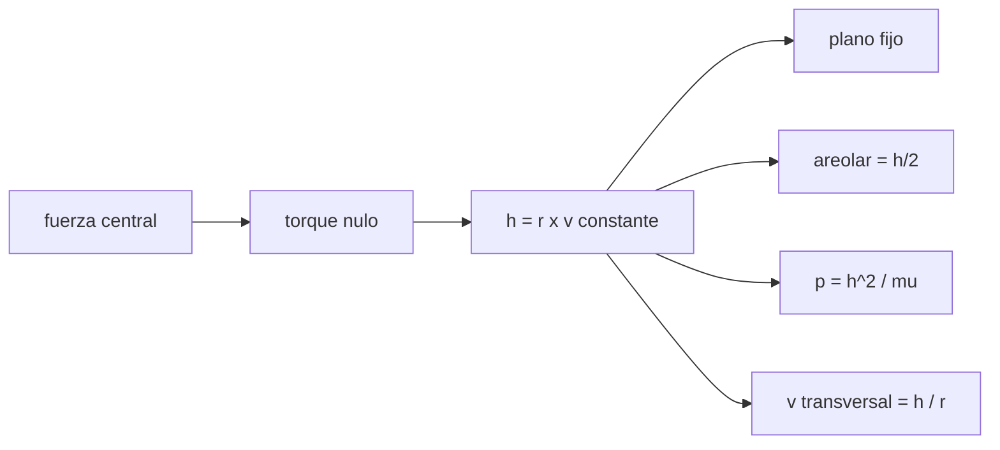

# B71-C06 — Momento angular específico

<!-- nav:top -->
[🏠 Programa](../../../../README.md) · [📚 Bloque B71](../../../tronco-comun/B71-mecanica-orbital-fundamental.md) · [← Anterior: B71-C05 — Energía orbital específica](../B71-C05-energia-orbital-especifica/CLASE.md) · [Siguiente: B71-C07 — Órbitas circulares →](../B71-C07-orbitas-circulares/CLASE.md)
<!-- /nav -->

## 1. Ubicación, nivel y alcance

Clase 6 del bloque B71. Nivel N3. El momento angular específico `h = r × v` es el vector que fija el plano de la órbita y su «tamaño»: como la fuerza gravitatoria es central, no cambia nunca. Aquí lo calculas, lo compruebas con una integración 3D, lo relacionas con el semilado recto `p` (`h = √(μp)`) y con la ley de las áreas de [C01](../B71-C01-leyes-de-kepler/CLASE.md), y lo usas para descomponer la velocidad. La órbita es sintética y su inclinación de 28,5° es ilustrativa.

## 2. Por qué esta clase existe

Si `h` es constante, el movimiento ocurre en un plano y la velocidad en el periapsis y el apoapsis queda ligada a la distancia. La decisión central: **¿qué dice `h` sobre la forma y la orientación de la órbita y cómo se usa para obtener velocidades?**

## 3. Lo que podrás hacer al terminar

1. Calcular `h = r × v` y su módulo.
2. Relacionar `h = √(μ p)` con `r_p v_p = r_a v_a`.
3. Deducir la velocidad areolar `h/2` y el área de la elipse `h T/2`.
4. Comprobar que `h` se conserva en módulo y dirección en una integración 3D.
5. Descomponer la velocidad en componente transversal `h/r` y radial.
6. Separar lo consultado (`μ`) de lo sintético (la órbita).

La evidencia es la **ficha de momento angular con el balance en periápside y apoápside** del ejercicio 12 (sección 20).

## 4. Con qué llegas y cómo comprobarlo

1. ¿Qué es el producto vectorial?
2. ¿Qué es una fuerza central?
3. ¿Qué es el semilado recto `p`?
4. ¿Qué es la velocidad areolar?
5. ¿Qué es una verificación por segunda vía?

<details>
<summary>Ver respuestas</summary>

1. Un vector perpendicular a los dos factores, con módulo `ab sin θ`. 2. Una fuerza dirigida siempre hacia (o desde) un punto fijo. 3. `p = a(1 − e²)`: la distancia a la que `r` es perpendicular al eje mayor. 4. El área barrida por unidad de tiempo. 5. Calcular lo mismo con otro método y comparar.
</details>

Con cuatro o cinco aciertos, sigue; si no, repasa los prerrequisitos.

## 5. Un caso de contexto y casos de referencia

Una órbita de transferencia sintética (periapsis 200 km, apoapsis 35 786 km de altitud, `i = 28,5°`) tiene `h = 6.735238e+10 m²/s` calculado de tres formas: `r_p v_p`, `r_a v_a` y `√(μp)`, con diferencias de `3e-16`. Su velocidad areolar es `3.3676e+10 m²/s`. Es el **ejemplo conductor**.

## 6. Vocabulario

El **momento angular específico** `h = r × v` es el momento angular por unidad de masa, en m²/s. El **semilado recto** `p = h²/μ`. La **velocidad areolar** es `h/2`. La **fuerza central** no genera torque respecto del centro. La **velocidad transversal** es `h/r` y la **radial**, `μ e sin ν/h`.

## 7. Modelo mental



*Descripción textual:* una fuerza central no ejerce torque, por lo que `h` es constante; de ahí salen el plano fijo, la ley de las áreas, el semilado recto y la velocidad transversal.

Analogía: un patinador que gira con los brazos abiertos y los recoge gira más rápido; su momento angular es el mismo. Límite: aquí no hay fuerzas externas que disipen el giro, pero en la realidad el arrastre atmosférico sí cambia `h`.

## 8. La explicación, paso a paso

### 8.1 Definición y conservación

`dh/dt = r × r̈ = r × (−μ r/r³) = 0`. Por tanto `h` es un vector constante: la órbita está en el plano perpendicular a `h`. En el laboratorio, con RK4 en 3D y 4000 pasos, el módulo deriva `4.3e-12` y la dirección `3.7e-15`; la inclinación del plano es `28.5000°`, la inicial.

### 8.2 `h` y la forma de la órbita

En el periapsis y el apoapsis `r ⟂ v`, así que `h = r_p v_p = r_a v_a`: valen `6.735238e+10` y `6.735238e+10 m²/s`. Con `p = h²/μ` se obtiene `h = √(μp) = 6.735238e+10`, con `p = 11380679 m`, `a = 24371100 m`, `e = 0.730086`.

### 8.3 Velocidad areolar

El área barrida es `dA = ½ r² dν = ½ h dt`, luego `dA/dt = h/2 = 3.3676e+10 m²/s`. Multiplicada por el período `T = 37863.76 s` da `1.275107e+15 m²`, el área de la elipse `π a² √(1 − e²) = 1.275107e+15 m²` (diferencia `2e-16`).

### 8.4 Componentes de la velocidad

En cualquier punto, `v_t = h/r` y `v_r = μ e sin ν/h`. Para `ν = 90°` (`r = p = 11380679 m`): `v_t = 5918.134`, `v_r = 4320.747`, `|v| = 7327.562 m/s`, igual a la vis‑viva `7327.562 m/s`. Una circular de radio `r_a` tiene `h = 1.2964e+11 m²/s`, mayor que la de la transferencia: para circularizar en el apoapsis hay que añadir momento angular.

## 9. Magnitudes, símbolos y unidades

| Símbolo | Qué es | Unidad | Valor / nota |
|---|---|---|---|
| `h` | momento angular específico | m²/s | 6.7352e+10 |
| `p` | semilado recto | m | 11380679 |
| `e` | excentricidad | — | 0.730086 |
| `v_t`, `v_r` | velocidad transversal y radial | m/s | 5918,1; 4320,7 (en `ν = 90°`) |
| `dA/dt` | velocidad areolar | m²/s | 3.3676e+10 |

## 10. Convenciones y referencias

Marco inercial geocéntrico, SI, vectores en 3D; `h` perpendicular al plano orbital (regla de la mano derecha). `μ` nominal de la IAU. La inclinación de 28,5° es ilustrativa y solo orienta el plano. La órbita es sintética.

## 11. De dónde sale lo que afirmamos

| ID | Fuente | Localizador | Respalda | Estado |
|---|---|---|---|---|
| S1 | IAU 2015 Resolución B3, Mamajek et al., arXiv:1510.07674 — https://arxiv.org/abs/1510.07674 (PDF leído con PyMuPDF, consultada 2026-11-10) | tabla de constantes nominales | (GM)ˢᵘⁿ = 1,327 124 4 × 10²⁰ m³ s⁻² y (GM)ᵀⁱᵉʳʳᵃ = 3,986 004 × 10¹⁴ m³ s⁻² (nominales, exactos); R_ecuatorial de la Tierra = 6,3781 × 10⁶ m | Consultada |
| — | Relaciones estándar de mecánica orbital de esta clase | — | las verifica el laboratorio con una segunda vía | No consultada en una fuente concreta |

Límites: solo se consulta `μ`; el resto son relaciones estándar. La conservación de `h` vale con fuerza central; el arrastre y las perturbaciones la rompen y no se modelan.

## 12. Cómo ver el resultado

| Magnitud | Valor |
|---|---|
| `h` | 6.73524e+10 m²/s |
| diferencia periapsis–apoapsis | 3e-16 |
| deriva de |h| / dirección | 4.3e-12 / 3.7e-15 |
| `h/2 · T` frente al área de la elipse | 2e-16 |
| `v_t`, `v_r` en `ν = 90°` | 5918.1, 4320.7 m/s |

Descripción larga: `h` coincide por tres vías hasta el redondeo de la máquina y se conserva en la integración con errores de `10⁻¹²`.

## 13. Ejemplo trabajado

**Velocidad en el apoapsis desde `h`.**

**Paso 1 · `h`.** `h = 6.73524e+10 m²/s`.

**Paso 2 · Distancia.** `r_a = 42164100 m`.

**Paso 3 · Velocidad.** `v_a = h/r_a = 1597.387 m/s`, la misma de la vis‑viva (C05).

## 14. Distintas formas de describir el problema

**Por vector:** `h = r × v`. **Por módulo:** `r v cos γ`, con `γ` el ángulo de trayectoria. **Por forma:** `√(μp)`. **Por áreas:** `2 dA/dt`.

## 15. Práctica guiada

**Ejercicio 1 · con los pasos indicados.** Calcula `h` de una circular de radio `7000 km`. *Pasos:* `√(μ r)`.

<details><summary>Solución comentada</summary>

`√(3,986004 × 10¹⁴ × 7 × 10⁶) = 5,282 × 10¹⁰ m²/s`.
</details>

**Ejercicio 2 · con una pista.** Predice `v_p` si `h = 6,735 × 10¹⁰` y `r_p = 6578,1 km`. *Pista:* `v = h/r`.

<details><summary>Solución comentada</summary>

`6,735 × 10¹⁰/6,5781 × 10⁶ = 10 239 m/s`; el laboratorio da `10238.9 m/s`.
</details>

**Ejercicio 3 · casi autónomo.** ¿Por qué el torque de la gravedad respecto del centro es nulo? Mira la dirección de la fuerza.

<details><summary>Solución comentada</summary>

Porque `F ∥ r`, luego `r × F = 0` y `dh/dt = 0`.
</details>

## 16. Práctica autónoma, transferencia e integrador

**Ejercicio 4 · autónomo.** Calcula `p` con `h = 6,735 × 10¹⁰ m²/s`.

<details><summary>Solución comentada</summary>

`h²/μ = 4,536 × 10²¹/3,986 × 10¹⁴ = 1,138 × 10⁷ m`, `11380679 m`.
</details>

**Ejercicio 5 · autónomo.** Si `r_a/r_p = 5`, ¿cuánto vale `v_p/v_a`?

<details><summary>Solución comentada</summary>

`5`: `r_p v_p = r_a v_a`.
</details>

**Ejercicio 6 · autónomo.** Un satélite tiene `h` con `h_z/|h| = 0,879`. ¿Qué inclinación tiene?

<details><summary>Solución comentada</summary>

`i = arccos(0,879) = 28,5°` (ilustrativo).
</details>

**Ejercicio 7 · autónomo.** Con `h` y `e` ¿cómo obtienes `v_r` en `ν = 90°`?

<details><summary>Solución comentada</summary>

`v_r = μ e/h = 4320.7 m/s`.
</details>

**Ejercicio 8 · autónomo.** Si el arrastre reduce `h` en 1 % ¿qué pasa con `p`?

<details><summary>Solución comentada</summary>

`p ∝ h²`: baja 2 %.
</details>

**Ejercicio 9 · transferencia.** **Transferencia.** **Transferencia.** Un colega dice que la velocidad es máxima en el periapsis «porque la gravedad es mayor». Reformula con `h`.

<details><summary>Solución comentada</summary>

Con `h` constante, `v_t = h/r` crece al disminuir `r`; la conservación de `h` lo exige, y no hace falta invocar la intensidad de la fuerza.
</details>

**Ejercicio 10 · transferencia.** **Transferencia.** **Transferencia.** Para circularizar en el apoapsis ¿qué debe cambiar en `h`?

<details><summary>Solución comentada</summary>

Debe aumentar de 6.7352e+10 a 1.2964e+11 m²/s: el impulso tangencial añade la velocidad que falta (C18).
</details>

**Ejercicio 11 · transferencia.** **Transferencia.** **Transferencia.** Un código reporta deriva de la dirección de `h` de `10⁻⁴` rad por vuelta. ¿Qué sospechas?

<details><summary>Solución comentada</summary>

Un error de integración o de sistema de referencia (p. ej. un marco rotante tratado como inercial); con RK4 correcto es `4e-15`.
</details>

**Ejercicio 12 · integrador.** **Integrador.** **Integrador.** Elabora tu *ficha de momento angular con el balance en periápside y apoápside*: `h` por tres vías, `p`, `e`, área de la elipse, deriva numérica de módulo y dirección y velocidades en `ν = 90°`.

<details><summary>Solución comentada</summary>

Secciones 8.1–8.4 y la salida del laboratorio.
</details>

## 17. Laboratorio: momento angular en 3D

El script [momento.py](momento.py) calcula `h` por tres vías, verifica la ley de las áreas e integra en 3D para medir la deriva del módulo y de la dirección de `h` (**comprueba** diferencias < 1e-12 y derivas < 1e-9).

**Datos:** `μ` y radio ecuatorial de la IAU (consultados); la órbita (200 × 35 786 km, `i = 28,5°`) es **sintética**. **Predice antes de ejecutar:** ¿Qué inclinación tendrá el plano al final de la integración? (La misma: 28,5°.) **Ejecución del 2026-11-10 (Python 3.12.9):**

```text
Python 3.12.9 (biblioteca estandar)
Orbita SINTETICA: periapsis 200 km, apoapsis 35786 km de altitud, i = 28.5 grados (ilustrativo)
  a = 24371.100 km ; e = 0.730086 ; p = 11380.679 km
  r_p v_p = 6.735238e+10 m2/s ; r_a v_a = 6.735238e+10 m2/s ; sqrt(mu p) = 6.735238e+10 m2/s
  diferencias relativas: periapsis-apoapsis 3.4e-16 ; periapsis-formula 1.1e-16
  velocidad areolar h/2 = 3.367619e+10 m2/s ; area de la elipse = 1.275107e+15 m2 ; h/2 * T = 1.275107e+15 m2 ; dif = 2.0e-16
RK4 3D (4000 pasos): deriva maxima de |h| = 4.30e-12 ; de la direccion de h = 3.71e-15 ; inclinacion de h = 28.5000 grados
En nu = 90 grados (r = p = 11380.679 km): v_transversal = h/r = 5918.134 m/s ; v_radial = mu e/h = 4320.747 m/s ; |v| = 7327.562 m/s ; vis-viva = 7327.562 m/s
h de una circular de radio r_a = 1.296404e+11 m2/s (mayor que la de la transferencia)
Pruebas superadas.
```

```bash
python programa/clases/B71/B71-C06-momento-angular-especifico/momento.py
```

**Límites:** fuerza central pura; sin perturbaciones; el plano orbital es un marco inercial idealizado.

## 18. Errores frecuentes y cómo corregirlos

**Pensar que `h` cambia con la distancia.** Se corrige con 8.1.

**Confundir `h` (por unidad de masa) con el momento angular total.** Se corrige con el vocabulario.

**Olvidar que `v_r ≠ 0` fuera de los apsides.** Se corrige con 8.4.

**Presentar la órbita como la de un satélite real.** Se corrige con la sección 10.

## 19. Cómo sabrás que vas bien

Tras la sección 8: ¿qué inclinación esperabas al final y cuál obtuviste? Si dudas, repasa el ejemplo 13. Tras el laboratorio: ¿qué comprueba? (ver la sección 17).

## 20. Qué entregas y cómo se evalúa

El producto es tu **ficha de momento angular con el balance en periápside y apoápside** (ejercicio 12).

| Criterio | Inicial | En desarrollo | Logrado | Destacado |
|---|---|---|---|---|
| Conceptos | Los confunde | Parciales | Relaciona `h`, `p` y áreas | Explica los límites |
| Cálculo | Sin unidades | Con errores | Tablas con unidades | Calcula casos nuevos |
| Numérico | Sin comprobar | Un caso | Integración 3D de `h` | Interpreta la deriva |
| Fuentes | Sin fuente | Sin fecha | Fuentes con fecha y estado | Declara lo sintético |
| Límites | No los nombra | Uno | Tres | Discute qué falta del modelo |

**Condiciones críticas (no se compensan con promedio):** rotular la órbita e inclinación como sintéticas; declarar unidades y marco; citar solo lo consultado.

## 21. Ética, seguridad y límites

Clase educativa: los modelos son simplificados y sus datos son consultados, sintéticos o ilustrativos (rotulados); ningún resultado es una efeméride ni una predicción operativa ni sustituye a las herramientas de navegación de una misión. Accesibilidad: tablas equivalentes a las gráficas, fórmulas en texto, ejercicios sin conexión.

## 22. Para cerrar y seguir

`h = 6.7352e+10 m²/s` se obtiene por tres vías y se conserva con una deriva de `4e-12`. Con energía y momento angular ya se puede clasificar cada órbita. Queda una pregunta: ¿qué forma tiene la órbita circular, la más simple?

**Glosario español–inglés.** momento angular específico · *specific angular momentum* · semilado recto · *semi-latus rectum* · fuerza central · *central force* · velocidad areolar · *areal velocity*.

**Continuidad.** [B71-C07](../B71-C07-orbitas-circulares/CLASE.md) estudia las órbitas circulares.

**Referencias:** ver sección 11.

<!-- nav:bottom -->
---

[← Anterior: B71-C05 — Energía orbital específica](../B71-C05-energia-orbital-especifica/CLASE.md) · [📚 Bloque B71](../../../tronco-comun/B71-mecanica-orbital-fundamental.md) · [Siguiente: B71-C07 — Órbitas circulares →](../B71-C07-orbitas-circulares/CLASE.md)
<!-- /nav -->
