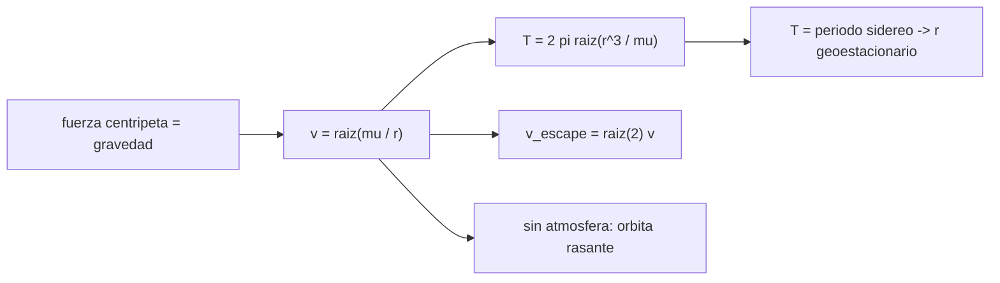

# B71-C07 — Órbitas circulares

<!-- nav:top -->
[🏠 Programa](../../../../README.md) · [📚 Bloque B71](../../../tronco-comun/B71-mecanica-orbital-fundamental.md) · [← Anterior: B71-C06 — Momento angular específico](../B71-C06-momento-angular-especifico/CLASE.md) · [Siguiente: B71-C08 — Órbitas elípticas →](../B71-C08-orbitas-elipticas/CLASE.md)
<!-- /nav -->

## 1. Ubicación, nivel y alcance

Clase 7 del bloque B71. Nivel N3. La órbita circular es el caso más simple y el que más se usa para dimensionar: la velocidad y el período dependen solo del radio. Aquí calculas `v = √(μ/r)` y `T = 2π√(r³/μ)` en la Tierra, la Luna y Marte, obtienes el radio geoestacionario desde el período de rotación terrestre y compruebas todo con una integración RK4. Usas [C05](../B71-C05-energia-orbital-especifica/CLASE.md) y [C06](../B71-C06-momento-angular-especifico/CLASE.md). Las altitudes son ilustrativas y `μ` de la Luna y de Marte es derivado (`G·M`).

## 2. Por qué esta clase existe

Una circular fija la velocidad de referencia de cualquier maniobra. La decisión central: **¿qué velocidad y qué período corresponden a un radio dado y cómo cambian de un cuerpo a otro?**

## 3. Lo que podrás hacer al terminar

1. Calcular `v = √(μ/r)` y `T = 2π√(r³/μ)`.
2. Obtener el radio geoestacionario desde el período de rotación sidéreo.
3. Comparar órbitas bajas en la Tierra, la Luna y Marte.
4. Verificar con RK4 que una circular mantiene su radio y cierra tras un período.
5. Reconocer que a menor radio la velocidad es mayor y el período menor.
6. Separar lo consultado (`μ`, períodos) de lo derivado y lo ilustrativo.

La evidencia es la **tabla de órbitas circulares en cuatro entornos** del ejercicio 12 (sección 20).

## 4. Con qué llegas y cómo comprobarlo

1. ¿Qué es la aceleración centrípeta?
2. ¿Qué relaciona `v`, `r` y la velocidad angular?
3. ¿Qué es el período sidéreo?
4. ¿Qué es un valor derivado?
5. ¿Qué es una verificación por segunda vía?

<details>
<summary>Ver respuestas</summary>

1. `v²/r`, dirigida al centro. 2. `v = ω r`, con `ω = 2π/T`. 3. El tiempo en que un cuerpo completa una vuelta respecto de las estrellas. 4. Un dato calculado aquí a partir de otros, no medido. 5. Calcular lo mismo con otro método y comparar.
</details>

Con cuatro o cinco aciertos, sigue; si no, repasa los prerrequisitos.

## 5. Un caso de contexto y casos de referencia

A 400 km de altitud sobre la Tierra, una circular tiene `v = 7668.6 m/s` y `T = 92.56 min`. A 100 km sobre la Luna, `v = 1633.5 m/s` y `T = 7067 s`. La órbita geoestacionaria queda a `42164204 m` del centro, `35786104 m` de altitud. Es el **ejemplo conductor**; las altitudes son **ilustrativas**.

## 6. Vocabulario

La **velocidad circular** `v_c = √(μ/r)`. El **período** `T = 2π√(r³/μ)`. La **órbita geoestacionaria** tiene período igual al de rotación sidérea de la Tierra y plano ecuatorial. La **órbita rasante** tiene `r` igual al radio del cuerpo. La **altitud** es `r` menos el radio del cuerpo.

## 7. Modelo mental



*Descripción textual:* igualar la aceleración centrípeta con la gravedad da la velocidad; de ella salen el período, el radio geoestacionario y la velocidad de escape (`√2 v`).

Analogía: una piedra atada a una cuerda gira más rápido si la cuerda es corta; la «cuerda» de un satélite es la gravedad, que tira más fuerte cerca. Límite: aquí no hay cuerda ni tensión ajustable; la órbita es una caída libre continua.

## 8. La explicación, paso a paso

### 8.1 Velocidad y período

De `v²/r = μ/r²` sale `v = √(μ/r)`. El período `T = 2πr/v = 2π√(r³/μ)`. En la Tierra a 400 km: `r = 6778100 m`, `v = 7668.579 m/s`, `T = 5553.58 s`.

### 8.2 Tres cuerpos

| Cuerpo | Altitud | `r` (m) | `v` (m/s) | `T` (s) |
|---|---|---|---|---|
| Tierra | 400 km | 6778100 | 7668.6 | 5554 |
| Luna | 100 km | 1837400 | 1633.5 | 7067 |
| Marte | 400 km | 3789500 | 3361.8 | 7083 |

La circular rasante terrestre sin atmósfera tendría `7905.4 m/s` y `84.49 min`.

### 8.3 La órbita geoestacionaria

Igualando `T` al período sidéreo `23,9345 h` y despejando, `r = (μ (T/2π)²)^(1/3) = 42164204 m`, es decir `35786104 m` de altitud y `v = 3074.659 m/s`. Coherencia con `ω`: `1e-15`.

### 8.4 Comprobación numérica

Integrando con RK4 (2000 pasos) la circular de 400 km: el radio varía como máximo `3.1e-12` en términos relativos, el ángulo final es `0.0000°` y el cierre es `9.7e-05 m`. Más alto implica más lento: `v(200 km) = 7784.3`, `v(400 km) = 7668.6`, `v(1000 km) = 7350.2 m/s`. La velocidad de escape desde esa altura es `√2 v = 10845.0 m/s`.

## 9. Magnitudes, símbolos y unidades

| Símbolo | Qué es | Unidad | Valor / nota |
|---|---|---|---|
| `v_c` | velocidad circular | m/s | 7668.6 (Tierra, 400 km) |
| `T` | período | s | 5553.6 (Tierra, 400 km) |
| `r` | radio orbital | m | 6778100 |
| `μ` | parámetro gravitacional | m³/s² | 3,986004 × 10¹⁴ (Tierra) |
| `a_geo` | radio geoestacionario | m | 42164204 |

## 10. Convenciones y referencias

Marco inercial del cuerpo central, SI; dos cuerpos puntuales; sin atmósfera. `μ` de la Tierra, nominal de la IAU; `μ` de la Luna y de Marte, derivado de `G·M` con masas de fichas. Período sidéreo de la ficha de la Tierra. Las altitudes son ilustrativas.

## 11. De dónde sale lo que afirmamos

| ID | Fuente | Localizador | Respalda | Estado |
|---|---|---|---|---|
| S1 | NIST, CODATA 2022 (allascii.txt) — https://physics.nist.gov/cuu/Constants/Table/allascii.txt (consultada 2026-11-10) | líneas de la constante de gravitación y de la aceleración estándar | G = 6,674 30 × 10⁻¹¹ m³ kg⁻¹ s⁻² (incertidumbre 0,000 15 × 10⁻¹¹); gₙ = 9,806 65 m/s² (exacta) | Consultada |
| S2 | IAU 2015 Resolución B3, Mamajek et al., arXiv:1510.07674 — https://arxiv.org/abs/1510.07674 (PDF leído con PyMuPDF, consultada 2026-11-10) | tabla de constantes nominales | (GM)ˢᵘⁿ = 1,327 124 4 × 10²⁰ m³ s⁻² y (GM)ᵀⁱᵉʳʳᵃ = 3,986 004 × 10¹⁴ m³ s⁻² (nominales, exactos); R_ecuatorial de la Tierra = 6,3781 × 10⁶ m | Consultada |
| S3 | NASA/NSSDC, Earth Fact Sheet — https://nssdc.gsfc.nasa.gov/planetary/factsheet/earthfact.html (consultada 2026-11-10) | ficha completa leída | masa 5,9722 × 10²⁴ kg; radio medio 6371,000 km; radio ecuatorial 6378,137 km; rotación sidérea 23,9345 h; a = 149,598 × 10⁶ km; e = 0,0167; velocidad de escape 11,186 km/s; g media 9,820 m/s² | Consultada |
| S4 | NASA/NSSDC, Mars Fact Sheet — https://nssdc.gsfc.nasa.gov/planetary/factsheet/marsfact.html (consultada 2026-11-10) | ficha completa leída | masa 0,64169 × 10²⁴ kg; radio medio 3389,5 km; a = 227,956 × 10⁶ km; e = 0,0935; período sidéreo 686,980 d; inclinación 1,848°; afelio 249,261 y perihelio 206,650 × 10⁶ km; velocidad de escape 5,03 km/s | Consultada |
| S5 | NASA/NSSDC, Moon Fact Sheet — https://nssdc.gsfc.nasa.gov/planetary/factsheet/moonfact.html (consultada 2026-11-10) | ficha completa leída | masa 0,07346 × 10²⁴ kg; radio medio 1737,4 km; a = 0,3844 × 10⁶ km; e = 0,0549; período 27,3217 d; inclinación a la eclíptica 5,145°; velocidad de escape 2,38 km/s | Consultada |
| — | Relaciones estándar de mecánica orbital de esta clase | — | las verifica el laboratorio con una segunda vía | No consultada en una fuente concreta |

Límites: no se consultaron los `μ` determinados por seguimiento de la Luna y Marte; las altitudes no corresponden a ninguna misión. La radio geoestacionario ignora la precesión y las perturbaciones.

## 12. Cómo ver el resultado

| Magnitud | Valor |
|---|---|
| `v` y `T` Tierra 400 km | 7668.6 m/s ; 92.56 min |
| `v` rasante Tierra | 7905.4 m/s |
| radio geoestacionario | 42164204 m |
| deriva del radio (RK4) | 3.1e-12 |
| `v` Luna 100 km | 1633.5 m/s |

Descripción larga: las órbitas bajas terrestres tardan unos 90 minutos; la geoestacionaria, 23,93 horas; en la Luna y en Marte, las velocidades son 4 a 2 veces menores.

## 13. Ejemplo trabajado

**Velocidad geoestacionaria.**

**Paso 1 · Radio.** `a = 42164204 m` (de `T = 23,9345 h`).

**Paso 2 · Velocidad.** `v = √(μ/a) = √(3,986004 × 10¹⁴/42164204) = 3074.659 m/s`.

**Paso 3 · Control.** `ω = v/a = 2π/T` con diferencia `1e-15`.

## 14. Distintas formas de describir el problema

**Por fuerza:** `v²/r = μ/r²`. **Por energía:** `ε = −μ/(2r)` (C05). **Por período:** `T`. **Por momento angular:** `h = √(μ r)` (C06).

## 15. Práctica guiada

**Ejercicio 1 · con los pasos indicados.** Calcula `v` para `r = 7000 km`. *Pasos:* `√(μ/r)`.

<details><summary>Solución comentada</summary>

`√(3,986004 × 10¹⁴/7 × 10⁶) = 7546 m/s`.
</details>

**Ejercicio 2 · con una pista.** Predice `T` a 1000 km de altitud. *Pista:* mayor que 92,56 min.

<details><summary>Solución comentada</summary>

`105.12 min`, según el laboratorio.
</details>

**Ejercicio 3 · casi autónomo.** ¿Por qué una órbita más alta es más lenta? Usa `v = √(μ/r)`.

<details><summary>Solución comentada</summary>

Porque `v` decrece como `r^(−1/2)`: `v(1000 km) = 7350.2` frente a `7668.6 m/s`.
</details>

## 16. Práctica autónoma, transferencia e integrador

**Ejercicio 4 · autónomo.** Calcula `v` rasante de Marte con `μ = 4,2828 × 10¹³` y `R = 3389,5 km`.

<details><summary>Solución comentada</summary>

`√(4,2828 × 10¹³/3,3895 × 10⁶) = 3555 m/s`.
</details>

**Ejercicio 5 · autónomo.** Si el radio se cuadruplica, ¿cómo cambian `v` y `T`?

<details><summary>Solución comentada</summary>

`v` se reduce a la mitad y `T` aumenta 8 veces.
</details>

**Ejercicio 6 · autónomo.** Calcula `√2 v` para la circular de 400 km.

<details><summary>Solución comentada</summary>

`10845.0 m/s`: la velocidad de escape desde esa altitud.
</details>

**Ejercicio 7 · autónomo.** ¿Qué altitud tendría una circular terrestre con `T = 100 min`?

<details><summary>Solución comentada</summary>

`r = (μ(6000/2π)²)^(1/3) ≈ 7,14 × 10⁶ m`, es decir, unos 760 km.
</details>

**Ejercicio 8 · autónomo.** Para `T = 12 h` ¿cuál es el radio de la circular terrestre?

<details><summary>Solución comentada</summary>

`r = (μ(43 200/2π)²)^(1/3) = 2,66 × 10⁷ m` (altitud ≈ 20 300 km).
</details>

**Ejercicio 9 · transferencia.** **Transferencia.** **Transferencia.** Un colega dice que un satélite en la ISS‑like (400 km) «no tiene gravedad». Calcula la fracción de `g` y explica.

<details><summary>Solución comentada</summary>

Es el 88 % de la gravedad de superficie (C02); el satélite cae libremente alrededor de la Tierra a `7669 m/s`.
</details>

**Ejercicio 10 · transferencia.** **Transferencia.** **Transferencia.** Un satélite necesita pasar sobre el mismo punto cada día solar. ¿Basta con una circular a 35 786 km?

<details><summary>Solución comentada</summary>

No necesariamente: la geoestacionaria exige además inclinación 0° para quedar fija; si no, traza una figura en ocho. Aquí solo se calcula el radio.
</details>

**Ejercicio 11 · transferencia.** **Transferencia.** **Transferencia.** Estima el error de usar `μ` de Marte con `G·M` de la ficha frente a un valor de seguimiento en `v`.

<details><summary>Solución comentada</summary>

No se puede cuantificar aquí: el valor de seguimiento no se consultó. Se declara como límite.
</details>

**Ejercicio 12 · integrador.** **Integrador.** **Integrador.** Elabora tu *tabla de órbitas circulares en cuatro entornos* (rasante, 400 km, GEO, Luna y Marte): `r`, `v`, `T`, `ε` y `h`, más la comprobación RK4.

<details><summary>Solución comentada</summary>

Secciones 8.1–8.4 y la salida del laboratorio.
</details>

## 17. Laboratorio: circulares en la Tierra, la Luna y Marte

El script [circulares.py](circulares.py) calcula `v`, `T`, la circular rasante y el radio geoestacionario, e integra con RK4 la circular de 400 km (**comprueba** radio constante < 1e-6, coherencia de `ω` y `v` decreciente con la altitud).

**Datos:** `μ` de la Tierra y radio de la IAU, período sidéreo y masas de las fichas (consultados); `μ` de la Luna y Marte **derivados**; altitudes **ilustrativas**. **Predice antes de ejecutar:** ¿Qué altitud tendrá la órbita geoestacionaria? (≈ 35 786 km.) **Ejecución del 2026-11-10 (Python 3.12.9):**

```text
Python 3.12.9 (biblioteca estandar)
 cuerpo   altitud   r [km]     v [m/s]    T [s]     T [min]
 Tierra     400 km  6778.100   7668.579    5553.58   92.560
 Luna       100 km  1837.400   1633.528    7067.36  117.789
 Marte      400 km  3789.500   3361.821    7082.51  118.042
Circular rasante en la Tierra (sin atmosfera): v = 7905.388 m/s ; T = 84.488 min
Circular geoestacionaria (T = 23.9345 h): a = 42164.204 km ; altitud = 35786.104 km ; v = 3074.659 m/s
  coherencia omega: 1.5e-15
RK4 (2000 pasos) en la circular terrestre: deriva maxima del radio = 3.07e-12 ; angulo final = 0.0000 grados ; cierre = 9.680e-05 m
v(200 km) = 7784.283 m/s ; v(1000 km) = 7350.157 m/s ; T(1000 km) = 105.118 min
sqrt(2) v_c(400 km) = 10845.008 m/s (velocidad de escape desde esa altitud)
Pruebas superadas.
```

```bash
python programa/clases/B71/B71-C07-orbitas-circulares/circulares.py
```

**Límites:** sin atmósfera ni perturbaciones; los `μ` derivados limitan la precisión en la Luna y Marte.

## 18. Errores frecuentes y cómo corregirlos

**Usar la altitud como si fuera el radio orbital.** Se corrige con 8.1.

**Creer que una órbita más rápida es más alta.** Se corrige con 8.4.

**Confundir período sidéreo y día solar.** Se corrige con 8.3.

**Presentar la altitud ilustrativa como la de una misión.** Se corrige con la sección 10.

## 19. Cómo sabrás que vas bien

Tras la sección 8: ¿qué altitud esperabas para GEO y cuál obtuviste? Si dudas, repasa el ejemplo 13. Tras el laboratorio: ¿qué comprueba? (ver la sección 17).

## 20. Qué entregas y cómo se evalúa

El producto es tu **tabla de órbitas circulares en cuatro entornos** (ejercicio 12).

| Criterio | Inicial | En desarrollo | Logrado | Destacado |
|---|---|---|---|---|
| Conceptos | Los confunde | Parciales | Deduce `v` y `T` | Explica los límites |
| Cálculo | Sin unidades | Con errores | Tabla con unidades | Calcula casos nuevos |
| Numérico | Sin comprobar | Un caso | RK4 frente a fórmula | Interpreta las diferencias |
| Fuentes | Sin fuente | Sin fecha | Fuentes con fecha y estado | Declara lo derivado e ilustrativo |
| Límites | No los nombra | Uno | Tres | Discute qué falta del modelo |

**Condiciones críticas (no se compensan con promedio):** rotular lo derivado y lo ilustrativo; declarar unidades y marco; citar solo lo consultado.

## 21. Ética, seguridad y límites

Clase educativa: los modelos son simplificados y sus datos son consultados, sintéticos o ilustrativos (rotulados); ningún resultado es una efeméride ni una predicción operativa ni sustituye a las herramientas de navegación de una misión. Accesibilidad: tablas equivalentes a las gráficas, fórmulas en texto, ejercicios sin conexión.

## 22. Para cerrar y seguir

Una circular a 400 km de altitud va a `7669 m/s` y da una vuelta en `92.6 min`; la geoestacionaria queda a `35786104 m` de altitud. Queda una pregunta: ¿qué cambia cuando la órbita no es circular?

**Glosario español–inglés.** velocidad circular · *circular velocity* · órbita geoestacionaria · *geostationary orbit* · órbita rasante · *grazing orbit* · altitud · *altitude*.

**Continuidad.** [B71-C08](../B71-C08-orbitas-elipticas/CLASE.md) estudia las órbitas elípticas.

**Referencias:** ver sección 11.

<!-- nav:bottom -->
---

[← Anterior: B71-C06 — Momento angular específico](../B71-C06-momento-angular-especifico/CLASE.md) · [📚 Bloque B71](../../../tronco-comun/B71-mecanica-orbital-fundamental.md) · [Siguiente: B71-C08 — Órbitas elípticas →](../B71-C08-orbitas-elipticas/CLASE.md)
<!-- /nav -->
