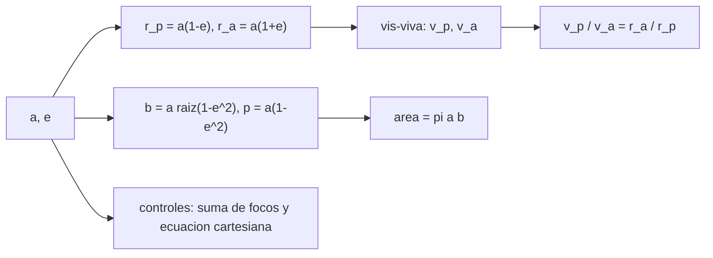

# B71-C08 — Órbitas elípticas

<!-- nav:top -->
[🏠 Programa](../../../../README.md) · [📚 Bloque B71](../../../tronco-comun/B71-mecanica-orbital-fundamental.md) · [← Anterior: B71-C07 — Órbitas circulares](../B71-C07-orbitas-circulares/CLASE.md) · [Siguiente: B71-C09 — Órbitas parabólicas e hiperbólicas →](../B71-C09-orbitas-parabolicas-e-hiperbolicas/CLASE.md)
<!-- /nav -->

## 1. Ubicación, nivel y alcance

Clase 8 del bloque B71. Nivel N3. Casi todas las órbitas reales son elipses: el satélite se mueve más rápido cerca del cuerpo central y más lento lejos. Aquí describes la geometría de una elipse (`a`, `b`, `e`, `p`, `c`), calculas las distancias y velocidades extremas y compruebas la forma con dos criterios independientes. Usas [C01](../B71-C01-leyes-de-kepler/CLASE.md), [C05](../B71-C05-energia-orbital-especifica/CLASE.md) y [C06](../B71-C06-momento-angular-especifico/CLASE.md). La órbita de Marte usa datos de la ficha; la tipo Molniya es sintética.

## 2. Por qué esta clase existe

Elegir `a` y `e` es elegir energía y forma; de ellos salen el perigeo, el apogeo, el período y las velocidades. La decisión central: **¿cómo se obtienen las distancias, velocidades y áreas de una elipse desde `a` y `e`, y cómo compruebas que tu geometría es correcta?**

## 3. Lo que podrás hacer al terminar

1. Calcular `r_p`, `r_a`, `b`, `p` y `c` desde `a` y `e`.
2. Comparar `a(1 ∓ e)` con el perihelio y el afelio de Marte de la ficha.
3. Calcular las velocidades extremas con la vis‑viva y su razón `r_a/r_p`.
4. Comprobar la elipse con la suma de distancias a los focos y con su ecuación cartesiana.
5. Distinguir la distancia media en el tiempo, en el ángulo y en la anomalía excéntrica.
6. Separar lo consultado (ficha de Marte, `μ`) de lo sintético (la órbita tipo Molniya).

La evidencia es la **ficha de una órbita elíptica con su geometría** del ejercicio 12 (sección 20).

## 4. Con qué llegas y cómo comprobarlo

1. ¿Qué es la excentricidad?
2. ¿Qué es el semieje menor `b`?
3. ¿Qué son los focos de una elipse?
4. ¿Qué es el periápside?
5. ¿Qué es una verificación por segunda vía?

<details>
<summary>Ver respuestas</summary>

1. Un número entre 0 y 1 que mide el achatamiento: `e = c/a`. 2. La mitad del eje menor: `b = a√(1 − e²)`. 3. Dos puntos tales que la suma de distancias de cualquier punto de la elipse a ambos es `2a`. 4. El punto de la órbita más cercano al cuerpo central. 5. Calcular lo mismo con otro método y comparar.
</details>

Con cuatro o cinco aciertos, sigue; si no, repasa los prerrequisitos.

## 5. Un caso de contexto y casos de referencia

Marte (`a = 227,956 × 10⁶ km`, `e = 0,0935`) pasa a `2.0664e+11 m` en el perihelio y a `2.4927e+11 m` en el afelio, con errores de `4e-05` y `4e-05` frente a la ficha. Una órbita sintética tipo Molniya (500 × 39 700 km de altitud) tiene `a = 26478100 m`, `e = 0.74023` y velocidades de `10042.4` y `1499.0 m/s`. Es el **ejemplo conductor**.

## 6. Vocabulario

El **semieje menor** `b = a√(1 − e²)`. El **semilado recto** `p = a(1 − e²)`. La **distancia focal** `c = a e`. El **periápside** `r_p = a(1 − e)` y el **apoápside** `r_a = a(1 + e)`. La **elipse** es el lugar de los puntos con suma constante de distancias a los focos. La **órbita tipo Molniya** es muy excéntrica y de unas 12 horas (aquí sintética).

## 7. Modelo mental



*Descripción textual:* de `a` y `e` salen las distancias extremas, el semieje menor y el semilado recto; la vis‑viva da las velocidades y dos controles geométricos independientes validan la forma.

Analogía: un círculo visto desde un ángulo parece una elipse; cuanto más lo inclinas, más excéntrico. Límite: la excentricidad orbital es una propiedad del movimiento, no de la perspectiva.

## 8. La explicación, paso a paso

### 8.1 Geometría

`r_p = a(1 − e)`, `r_a = a(1 + e)`, `b = a√(1 − e²)`, `p = a(1 − e²)`, `c = a e`. Para Marte: `r_p = 2.06642e+11 m` (ficha 2,06650 × 10¹¹, diferencia `3.8e-05`), `r_a = 2.49270e+11 m` (ficha 2,49261 × 10¹¹, diferencia `3.6e-05`), `b = 2.26957e+11 m`, `p = 2.25963e+11 m`. La diferencia es el redondeo de la ficha.

### 8.2 Velocidades y período

Con la vis‑viva en torno al Sol: `v_p = 26500.6 m/s` y `v_a = 21968.7 m/s`. El período es `687.048 d` (ficha: 686,980 d; el residuo de `10⁻⁴` viene de redondear `a`). El área encerrada es `π a b = 1.62534e+23 m²`.

### 8.3 Dos controles geométricos

En 360 puntos `ν`, `r(ν) = p/(1 + e cos ν)` cumple que la suma de distancias a los dos focos vale `2a` con error relativo máximo `3e-16`, y satisface la ecuación cartesiana `(x + c)²/a² + y²/b² = 1` con residuo `6e-16`. Para la órbita sintética los errores son `7e-16` y `2e-15`.

### 8.4 La órbita tipo Molniya sintética

`a = 26478100 m`, `e = 0.74023`, `b = 17802522 m`, `p = 11969506 m`, `T = 11.9107 h`. La razón de velocidades extremas, `6.69925`, es igual a la razón de distancias `r_a/r_p = 6.69925`. Tres «distancias medias» difieren: en el tiempo, `a(1 + e²/2) = 33732397 m`; en el ángulo verdadero, `b = 17802522 m`; y en la anomalía excéntrica, `a`.

## 9. Magnitudes, símbolos y unidades

| Símbolo | Qué es | Unidad | Valor / nota |
|---|---|---|---|
| `a`, `b` | semiejes mayor y menor | m | 26478100; 17802522 (Molniya) |
| `e` | excentricidad | — | 0,0935 (Marte); 0.74023 |
| `p` | semilado recto | m | 11969506 |
| `r_p`, `r_a` | distancias extremas | m | `a(1 ∓ e)` |
| `v_p`, `v_a` | velocidades extremas | m/s | 10042.4; 1499.0 |

## 10. Convenciones y referencias

Marco inercial centrado en el foco ocupado, SI; periápside en `+x`; sentido antihorario. `μ` del Sol y de la Tierra nominales de la IAU; `a`, `e`, perihelio, afelio y período de Marte, de la ficha. La órbita tipo Molniya es sintética e ilustrativa.

## 11. De dónde sale lo que afirmamos

| ID | Fuente | Localizador | Respalda | Estado |
|---|---|---|---|---|
| S1 | IAU 2015 Resolución B3, Mamajek et al., arXiv:1510.07674 — https://arxiv.org/abs/1510.07674 (PDF leído con PyMuPDF, consultada 2026-11-10) | tabla de constantes nominales | (GM)ˢᵘⁿ = 1,327 124 4 × 10²⁰ m³ s⁻² y (GM)ᵀⁱᵉʳʳᵃ = 3,986 004 × 10¹⁴ m³ s⁻² (nominales, exactos); R_ecuatorial de la Tierra = 6,3781 × 10⁶ m | Consultada |
| S2 | NASA/NSSDC, Mars Fact Sheet — https://nssdc.gsfc.nasa.gov/planetary/factsheet/marsfact.html (consultada 2026-11-10) | ficha completa leída | masa 0,64169 × 10²⁴ kg; radio medio 3389,5 km; a = 227,956 × 10⁶ km; e = 0,0935; período sidéreo 686,980 d; inclinación 1,848°; afelio 249,261 y perihelio 206,650 × 10⁶ km; velocidad de escape 5,03 km/s | Consultada |
| — | Relaciones estándar de mecánica orbital de esta clase | — | las verifica el laboratorio con una segunda vía | No consultada en una fuente concreta |

Límites: no se consultó ninguna órbita Molniya real; las cifras de la órbita tipo Molniya no corresponden a ningún satélite. Los redondeos de la ficha de Marte limitan la comparación a `10⁻⁴`.

## 12. Cómo ver el resultado

| Magnitud | Valor |
|---|---|
| perihelio de Marte | 2.06642e+11 m (4e-05 frente a la ficha) |
| `e` Molniya sintética | 0.74023 |
| `v_p/v_a` = `r_a/r_p` | 6.69925 |
| suma de distancias a focos | 7e-16 |
| `T` Molniya sintética | 11.9107 h |

Descripción larga: la elipse se verifica por dos vías a la precisión de la máquina y la razón de velocidades es igual a la de distancias; la órbita sintética tarda unas 12 horas.

## 13. Ejemplo trabajado

**Distancias extremas de la órbita sintética.**

**Paso 1 · Datos.** `r_p = 6378,1 + 500 = 6878,1 km`; `r_a = 6378,1 + 39 700 = 46 078,1 km`.

**Paso 2 · Semieje.** `a = (r_p + r_a)/2 = 26478100 m`.

**Paso 3 · Excentricidad.** `e = (r_a − r_p)/(r_a + r_p) = 0.74023`.

**Paso 4 · Velocidades.** `v_p = 10042.4 m/s` y `v_a = 1499.0 m/s` por vis‑viva.

## 14. Distintas formas de describir el problema

**Por geometría:** `a`, `b`, `e`. **Por distancias:** `r_p`, `r_a`. **Por ecuación polar:** `r(ν) = p/(1 + e cos ν)`. **Por energía:** `a` (C05).

## 15. Práctica guiada

**Ejercicio 1 · con los pasos indicados.** Calcula `r_p` y `r_a` para `a = 10 000 km`, `e = 0,3`. *Pasos:* `a(1 ∓ e)`.

<details><summary>Solución comentada</summary>

`r_p = 7000 km`, `r_a = 13 000 km`.
</details>

**Ejercicio 2 · con una pista.** Predice `v_p/v_a` para `e = 0,3`. *Pista:* `r_a/r_p`.

<details><summary>Solución comentada</summary>

`1,3/0,7 = 1,857`.
</details>

**Ejercicio 3 · casi autónomo.** ¿Por qué `r(ν = 90°) = p`? Sustituye en la ecuación polar.

<details><summary>Solución comentada</summary>

`cos 90° = 0`, luego `r = p/(1 + 0) = p`.
</details>

## 16. Práctica autónoma, transferencia e integrador

**Ejercicio 4 · autónomo.** Calcula `b` y el área para `a = 10 000 km`, `e = 0,3`.

<details><summary>Solución comentada</summary>

`b = 10 000 √0,91 = 9539 km`; área `π a b = 2,997 × 10⁸ km²`.
</details>

**Ejercicio 5 · autónomo.** Si `e = 0,0935` ¿cuánto vale `b/a`?

<details><summary>Solución comentada</summary>

`√(1 − 0,00874) = 0,99562`: casi circular.
</details>

**Ejercicio 6 · autónomo.** Verifica que la suma de distancias a los focos de un punto con `ν = 0` es `2a`.

<details><summary>Solución comentada</summary>

`r_p + (r_p + 2c) = 2a(1 − e) + 2a e = 2a`.
</details>

**Ejercicio 7 · autónomo.** ¿Qué `e` tiene una elipse con `r_a = 3 r_p`?

<details><summary>Solución comentada</summary>

`e = (3 − 1)/(3 + 1) = 0,5`.
</details>

**Ejercicio 8 · autónomo.** Con `T = 11.91 h`, ¿cuántas vueltas da la órbita sintética en un día sidéreo?

<details><summary>Solución comentada</summary>

`23,9345/11.9107 ≈ 2,01`: casi dos vueltas.
</details>

**Ejercicio 9 · transferencia.** **Transferencia.** **Transferencia.** Un colega dice que la distancia media de Marte al Sol es `a`. ¿Siempre?

<details><summary>Solución comentada</summary>

Depende del promedio: en el tiempo es `a(1 + e²/2)`, en el ángulo es `b` y en la anomalía excéntrica es `a`; la diferencia es del orden de `e²`.
</details>

**Ejercicio 10 · transferencia.** **Transferencia.** **Transferencia.** Un satélite tipo Molniya pasa muy bajo en un hemisferio. ¿Qué dice `v_p/v_a` sobre el tiempo que pasa cerca del apoapsis?

<details><summary>Solución comentada</summary>

Con razón 6.70, se mueve 6,7 veces más lento en el apoapsis: la ley de las áreas le hace pasar la mayor parte del período allí (conclusión cualitativa; órbita sintética).
</details>

**Ejercicio 11 · transferencia.** **Transferencia.** **Transferencia.** Con la ficha de Marte, ¿qué cifra usarías para el período y por qué?

<details><summary>Solución comentada</summary>

La de la ficha (686,980 d) si solo se quiere el valor observado; el calculado con `μ` nominal difiere `10⁻⁴` por redondeo de `a`.
</details>

**Ejercicio 12 · integrador.** **Integrador.** **Integrador.** Elabora tu *ficha de una órbita elíptica con su geometría*: `r_p`, `r_a`, `b`, `p`, `e`, velocidades, período, área y los dos controles geométricos, rotulando lo consultado y lo sintético.

<details><summary>Solución comentada</summary>

Secciones 8.1–8.4 y la salida del laboratorio.
</details>

## 17. Laboratorio: geometría de una elipse y vis-viva

El script [elipticas.py](elipticas.py) calcula la geometría de la órbita de Marte (ficha) y de una órbita sintética tipo Molniya y las verifica con la suma de distancias a los focos y con la ecuación cartesiana (**comprueba** errores < 1e-9 y `v_p/v_a = r_a/r_p`).

**Datos:** `a`, `e`, perihelio, afelio y período de Marte (NASA/NSSDC) y `μ` (IAU), consultados; la órbita tipo Molniya (500 × 39 700 km) es **sintética**. **Predice antes de ejecutar:** ¿Qué razón `v_p/v_a` tendrá la órbita sintética? (Igual a `r_a/r_p`, ≈ 6,7.) **Ejecución del 2026-11-10 (Python 3.12.9):**

```text
Python 3.12.9 (biblioteca estandar)
Marte alrededor del Sol (a, e de la ficha NASA/NSSDC):
  perihelio = 206.642e6 km (ficha 206.650) dif 3.8e-05 ; afelio = 249.270e6 km (ficha 249.261) dif 3.6e-05
  b = 226.957e6 km ; p = 225.963e6 km ; area = 1.62534e+23 m2 ; T = 687.048 d (ficha 686.980)
  v_peri = 26.5006 km/s ; v_afelio = 21.9687 km/s
  suma de distancias a los focos: error relativo maximo 2.7e-16 ; ecuacion cartesiana: 5.6e-16
Orbita tipo Molniya SINTETICA (500 x 39700 km de altitud) alrededor de la Tierra:
  a = 26478.100 km ; e = 0.74023 ; b = 17802.522 km ; p = 11969.506 km
  v_peri = 10042.423 m/s ; v_apo = 1499.037 m/s ; razon = 6.69925 = r_a/r_p = 6.69925
  T = 11.9107 h
  suma de distancias: 7.0e-16 ; ecuacion cartesiana: 1.6e-15
  distancia media en el tiempo a(1+e^2/2) = 33732.397 km ; en el angulo (b) = 17802.522 km ; r(nu=90) = p = 11969.506 km
Pruebas superadas.
```

```bash
python programa/clases/B71/B71-C08-orbitas-elipticas/elipticas.py
```

**Límites:** dos cuerpos puntuales; el redondeo de la ficha de Marte limita la comparación a `10⁻⁴`.

## 18. Errores frecuentes y cómo corregirlos

**Confundir altitud con distancia al centro.** Se corrige con el ejemplo 13.

**Creer que `a` es la distancia media en el tiempo.** Se corrige con 8.4.

**Usar `b` por `a` en el período.** Se corrige con 8.2.

**Presentar la órbita tipo Molniya como real.** Se corrige con la sección 10.

## 19. Cómo sabrás que vas bien

Tras la sección 8: ¿qué `v_p/v_a` esperabas y cuál obtuviste? Si dudas, repasa el ejemplo 13. Tras el laboratorio: ¿qué comprueba? (ver la sección 17).

## 20. Qué entregas y cómo se evalúa

El producto es tu **ficha de una órbita elíptica con su geometría** (ejercicio 12).

| Criterio | Inicial | En desarrollo | Logrado | Destacado |
|---|---|---|---|---|
| Conceptos | Los confunde | Parciales | Calcula la geometría completa | Explica los límites |
| Cálculo | Sin unidades | Con errores | Tablas con unidades | Calcula casos nuevos |
| Numérico | Sin comprobar | Un caso | Dos controles geométricos | Interpreta las diferencias |
| Fuentes | Sin fuente | Sin fecha | Fuentes con fecha y estado | Declara lo sintético |
| Límites | No los nombra | Uno | Tres | Discute qué falta del modelo |

**Condiciones críticas (no se compensan con promedio):** rotular la órbita tipo Molniya como sintética; declarar unidades y marco; citar solo lo consultado.

## 21. Ética, seguridad y límites

Clase educativa: los modelos son simplificados y sus datos son consultados, sintéticos o ilustrativos (rotulados); ningún resultado es una efeméride ni una predicción operativa ni sustituye a las herramientas de navegación de una misión. Accesibilidad: tablas equivalentes a las gráficas, fórmulas en texto, ejercicios sin conexión.

## 22. Para cerrar y seguir

Con `a` y `e` se obtienen las distancias, las velocidades, el período y el área de una elipse, verificadas por dos vías con errores de `7e-16`. Queda una pregunta: ¿qué pasa cuando `e` llega a 1 o lo supera?

**Glosario español–inglés.** semieje menor · *semi-minor axis* · semilado recto · *semi-latus rectum* · perigeo y apogeo · *perigee and apogee* · excentricidad · *eccentricity*.

**Continuidad.** [B71-C09](../B71-C09-orbitas-parabolicas-e-hiperbolicas/CLASE.md) estudia las órbitas parabólicas e hiperbólicas.

**Referencias:** ver sección 11.

<!-- nav:bottom -->
---

[← Anterior: B71-C07 — Órbitas circulares](../B71-C07-orbitas-circulares/CLASE.md) · [📚 Bloque B71](../../../tronco-comun/B71-mecanica-orbital-fundamental.md) · [Siguiente: B71-C09 — Órbitas parabólicas e hiperbólicas →](../B71-C09-orbitas-parabolicas-e-hiperbolicas/CLASE.md)
<!-- /nav -->
