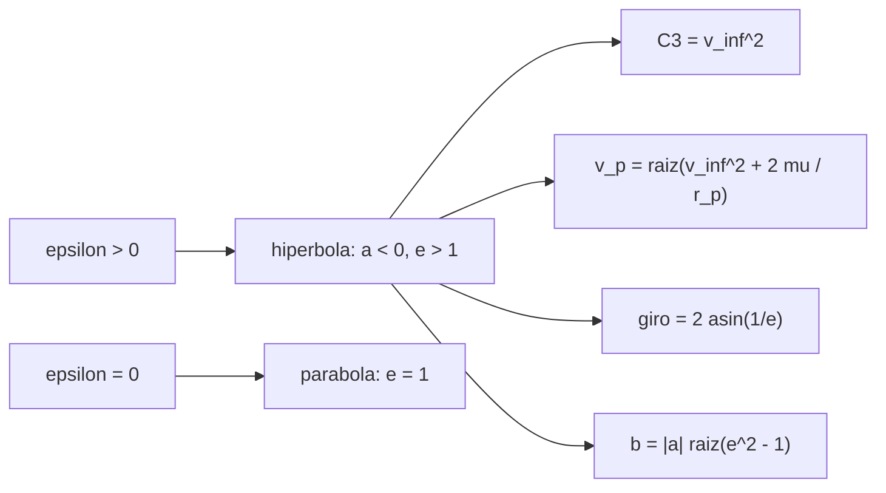

# B71-C09 — Órbitas parabólicas e hiperbólicas

<!-- nav:top -->
[🏠 Programa](../../../../README.md) · [📚 Bloque B71](../../../tronco-comun/B71-mecanica-orbital-fundamental.md) · [← Anterior: B71-C08 — Órbitas elípticas](../B71-C08-orbitas-elipticas/CLASE.md) · [Siguiente: B71-C10 — Semieje mayor y excentricidad →](../B71-C10-semieje-mayor-y-excentricidad/CLASE.md)
<!-- /nav -->

## 1. Ubicación, nivel y alcance

Clase 9 del bloque B71. Nivel N3. Cuando la energía orbital deja de ser negativa la órbita no se cierra: es una parábola (`ε = 0`) o una hipérbola (`ε > 0`). Aquí calculas la excentricidad, el exceso de velocidad hiperbólica `v∞`, la energía característica `C3`, el ángulo de giro y el parámetro de impacto de una hipérbola, y los verificas con una integración numérica hasta 40 radios terrestres. Usas [C05](../B71-C05-energia-orbital-especifica/CLASE.md) y [C08](../B71-C08-orbitas-elipticas/CLASE.md). Los valores de `v∞` son ilustrativos y no corresponden a ninguna misión.

## 2. Por qué esta clase existe

Las trayectorias de escape y de sobrevuelo son hipérbolas respecto del cuerpo local. La decisión central: **¿qué velocidad en el periapsis produce un exceso `v∞` dado y cuánto se desvía la trayectoria?**

## 3. Lo que podrás hacer al terminar

1. Clasificar una órbita por `ε` y `e` (elipse, parábola, hipérbola).
2. Calcular `e`, `a`, `C3` y `v_p` desde `v∞` y `r_p`.
3. Calcular el ángulo asintótico `ν∞`, el giro `δ = 2 arcsin(1/e)` y el parámetro de impacto `b`.
4. Comparar `v_p` hiperbólica y parabólica y el impulso desde la circular.
5. Verificar la hipérbola integrando con RK4 hasta 40 radios terrestres.
6. Separar lo consultado (`μ`) de lo ilustrativo (`v∞`, altitud).

La evidencia es la **ficha de una órbita de escape con C3 y ángulo de giro** del ejercicio 12 (sección 20).

## 4. Con qué llegas y cómo comprobarlo

1. ¿Qué es la energía orbital específica?
2. ¿Qué es una asíntota?
3. ¿Qué es la velocidad de escape?
4. ¿Qué es el periapsis?
5. ¿Qué es una verificación por segunda vía?

<details>
<summary>Ver respuestas</summary>

1. La energía mecánica por unidad de masa, `v²/2 − μ/r`. 2. Una recta a la que una curva se acerca sin llegar a tocarla. 3. La velocidad mínima para que la energía sea cero a esa distancia. 4. El punto de la órbita más cercano al cuerpo central. 5. Calcular lo mismo con otro método y comparar.
</details>

Con cuatro o cinco aciertos, sigue; si no, repasa los prerrequisitos.

## 5. Un caso de contexto y casos de referencia

Desde un periapsis a 200 km de altitud, una velocidad `v_p = 11410.1 m/s` produce un exceso `v∞ = 3000 m/s` (ilustrativo): `C3 = 9000000 m²/s²`, `e = 1.14853`, `a = -44288933 m` y un giro de `121.08°`. La parábola exige `√2 v_c = 11008.6 m/s`. Es el **ejemplo conductor**; `v∞` y la altitud son **ilustrativos**.

## 6. Vocabulario

El **exceso de velocidad hiperbólica** `v∞` es la velocidad lejos del cuerpo. La **energía característica** `C3 = v∞²` (m²/s² o km²/s²). La **excentricidad** `e > 1` en una hipérbola y `e = 1` en una parábola. El **ángulo de giro** `δ` es la desviación entre las direcciones de llegada y salida. El **parámetro de impacto** `b` es la distancia de la asíntota al centro.

## 7. Modelo mental



*Descripción textual:* la energía positiva da una hipérbola; de `v∞` y `r_p` salen la excentricidad, la velocidad de periapsis, el giro y el parámetro de impacto.

Analogía: un cometa que pasa una sola vez cerca del Sol y se va; su trayectoria se curva y se aleja sin volver. Límite: la hipérbola es un modelo de dos cuerpos; cerca de otros cuerpos la trayectoria real cambia.

## 8. La explicación, paso a paso

### 8.1 Parábola e hipérbola

Con `ε = v²/2 − μ/r`: `ε < 0` elipse, `ε = 0` parábola, `ε > 0` hipérbola. En la parábola `v_p = √(2μ/r_p) = √2 v_c = 11008.639 m/s` (la vis‑viva con `a → ∞` da `11008.639`).

### 8.2 De `v∞` a la hipérbola

`ε = v∞²/2`, `a = −μ/v∞²`, `e = 1 + r_p v∞²/μ`, `v_p = √(v∞² + 2μ/r_p)`. Caso A (`v∞ = 3000 m/s`): `C3 = 9000000 m²/s²`, `e = 1.14853`, `a = -44288933 m`, `v_p = 11410.089 m/s`; el impulso desde la circular de 200 km es `3625.8 m/s`. Caso B (`v∞ = 500 m/s`): `e = 1.00413`, `v_p = 11019.988 m/s`, impulso `3235.7 m/s`: casi la parábola.

### 8.3 Giro y asíntotas

El ángulo asintótico es `ν∞ = arccos(−1/e)` y el giro `δ = 2 arcsin(1/e)`. Caso A: `ν∞ = 150.538°`, `δ = 121.076°`, `b = 25018902 m`. Caso B: `ν∞ = 174.804°`, `δ = 169.609°`. A menor `v∞` la órbita gira más y se parece a una parábola.

### 8.4 Comprobación numérica

Integrando el caso A con RK4 hasta `40.0` radios terrestres (`17.24 h`) la energía deriva `1e-13`, la velocidad final `3482.061 m/s` coincide con `√(v∞² + 2μ/r) = 3482.061` (`5e-14`) y el ángulo de la velocidad coincide con la fórmula cónica en `2e-14 rad`. La anomalía alcanzada, `145.33°`, está por debajo del límite `ν∞`.

## 9. Magnitudes, símbolos y unidades

| Símbolo | Qué es | Unidad | Valor / nota |
|---|---|---|---|
| `v∞` | exceso de velocidad hiperbólica | m/s | 3000 (ilustrativo) |
| `C3` | energía característica `v∞²` | m²/s² | 9000000 |
| `e` | excentricidad | — | 1.14853 |
| `a` | semieje (negativo) | m | -44288933 |
| `δ` | ángulo de giro | grados | 121.076 |
| `b` | parámetro de impacto | m | 25018902 |

## 10. Convenciones y referencias

Marco inercial geocéntrico, SI; periapsis en `+x`, velocidad inicial en `+y`; esfera de influencia ignorada (dos cuerpos). `μ` y radio de la IAU. `v∞` y altitud de periapsis ilustrativos; ninguna cifra describe una misión.

## 11. De dónde sale lo que afirmamos

| ID | Fuente | Localizador | Respalda | Estado |
|---|---|---|---|---|
| S1 | IAU 2015 Resolución B3, Mamajek et al., arXiv:1510.07674 — https://arxiv.org/abs/1510.07674 (PDF leído con PyMuPDF, consultada 2026-11-10) | tabla de constantes nominales | (GM)ˢᵘⁿ = 1,327 124 4 × 10²⁰ m³ s⁻² y (GM)ᵀⁱᵉʳʳᵃ = 3,986 004 × 10¹⁴ m³ s⁻² (nominales, exactos); R_ecuatorial de la Tierra = 6,3781 × 10⁶ m | Consultada |
| S2 | NASA/NSSDC, Earth Fact Sheet — https://nssdc.gsfc.nasa.gov/planetary/factsheet/earthfact.html (consultada 2026-11-10) | ficha completa leída | masa 5,9722 × 10²⁴ kg; radio medio 6371,000 km; radio ecuatorial 6378,137 km; rotación sidérea 23,9345 h; a = 149,598 × 10⁶ km; e = 0,0167; velocidad de escape 11,186 km/s; g media 9,820 m/s² | Consultada |
| — | Relaciones estándar de mecánica orbital de esta clase | — | las verifica el laboratorio con una segunda vía | No consultada en una fuente concreta |

Límites: no se consultó ninguna trayectoria real de escape ni de sobrevuelo; no se trata el empalme entre esferas de influencia. Los valores de `v∞` no pertenecen a ninguna misión.

## 12. Cómo ver el resultado

| Magnitud | Valor |
|---|---|
| `v_p` parabólica | 11008.6 m/s |
| `e`, `a` del caso A | 1.14853; -44288933 m |
| giro del caso A / B | 121.08° / 169.61° |
| impulso desde circular (A) | 3625.8 m/s |
| deriva de energía (RK4) | 1e-13 |

Descripción larga: un exceso de 3 km/s exige 3,6 km/s de impulso desde una circular baja y gira la trayectoria 121°; con 0,5 km/s casi no hay hipérbola y el giro es 170°.

## 13. Ejemplo trabajado

**Velocidad de periapsis para `v∞ = 3 km/s`.**

**Paso 1 · Datos.** `r_p = 6578100 m`; `v∞² = 9 × 10⁶ m²/s²`.

**Paso 2 · Fórmula.** `v_p = √(v∞² + 2μ/r_p) = √(9 × 10⁶ + 1,2118 × 10⁸)`.

**Paso 3 · Resultado.** `v_p = 11410.089 m/s`; el impulso desde la circular (`7784.3 m/s`) es `3625.8 m/s`.

## 14. Distintas formas de describir el problema

**Por energía:** `ε > 0`. **Por velocidad:** `v∞`, `C3`. **Por forma:** `e`, `a`, `b`. **Por geometría de giro:** `ν∞`, `δ`.

## 15. Práctica guiada

**Ejercicio 1 · con los pasos indicados.** Calcula `e` para `r_p = 6578,1 km` y `v∞ = 3 km/s`. *Pasos:* `1 + r_p v∞²/μ`.

<details><summary>Solución comentada</summary>

`1 + 6,5781 × 10⁶ × 9 × 10⁶/3,986 × 10¹⁴ = 1,1485`.
</details>

**Ejercicio 2 · con una pista.** Predice qué ocurre con `δ` si `v∞` crece. *Pista:* `e` crece.

<details><summary>Solución comentada</summary>

`δ = 2 arcsin(1/e)` disminuye: a mayor `v∞`, menos giro.
</details>

**Ejercicio 3 · casi autónomo.** ¿Por qué `a < 0` en una hipérbola? Usa `a = −μ/(2ε)`.

<details><summary>Solución comentada</summary>

Porque `ε > 0` y el signo cambia; |a| es la distancia del vértice al centro.
</details>

## 16. Práctica autónoma, transferencia e integrador

**Ejercicio 4 · autónomo.** Calcula `C3` en km²/s² para `v∞ = 3 km/s`.

<details><summary>Solución comentada</summary>

`9 km²/s²`.
</details>

**Ejercicio 5 · autónomo.** ¿Qué `v_p` da la parábola desde 200 km de altitud?

<details><summary>Solución comentada</summary>

`11008.6 m/s`.
</details>

**Ejercicio 6 · autónomo.** Con `e = 2`, calcula `ν∞` y `δ`.

<details><summary>Solución comentada</summary>

`ν∞ = arccos(−0,5) = 120°`; `δ = 2 arcsin 0,5 = 60°`.
</details>

**Ejercicio 7 · autónomo.** Calcula `b` para `a = −44 289 km` y `e = 1,1485`.

<details><summary>Solución comentada</summary>

`b = 44 289 √(1,3191 − 1) = 25 019 km`.
</details>

**Ejercicio 8 · autónomo.** Si `C3 = 0`, ¿qué órbita tienes?

<details><summary>Solución comentada</summary>

La parábola: `v∞ = 0`.
</details>

**Ejercicio 9 · transferencia.** **Transferencia.** **Transferencia.** Una nave sale de la Tierra con `C3 = 9 km²/s²`. ¿Qué pasa con su velocidad en el infinito terrestre y con la trayectoria heliocéntrica?

<details><summary>Solución comentada</summary>

Lejos de la Tierra queda con `v∞ = 3 km/s` respecto de ella; la órbita heliocéntrica la determina esa velocidad sumada a la de la Tierra (tema de B72/B73; valor ilustrativo).
</details>

**Ejercicio 10 · transferencia.** **Transferencia.** **Transferencia.** Un colega afirma que un sobrevuelo «roba» energía a la nave. ¿Qué dice la hipérbola respecto del planeta?

<details><summary>Solución comentada</summary>

En el marco del planeta, `v∞` entra y sale con el mismo módulo (`ε` conservada); solo gira la dirección `δ`. El cambio de energía aparece en el marco del Sol.
</details>

**Ejercicio 11 · transferencia.** **Transferencia.** **Transferencia.** Con `v∞` pequeña (0,5 km/s) ¿qué precisión necesitas en `v_p` para controlar `v∞`?

<details><summary>Solución comentada</summary>

De `v∞² = v_p² − 2μ/r_p` sale `d v∞ = (v_p/v∞) d v_p ≈ 22 d v_p`: un error de 0,1 m/s en `v_p` cambia `v∞` unos 2,2 m/s. La sensibilidad es alta.
</details>

**Ejercicio 12 · integrador.** **Integrador.** **Integrador.** Elabora tu *ficha de una órbita de escape con C3 y ángulo de giro*: dos casos de `v∞`, `e`, `a`, `v_p`, impulso, `ν∞`, `δ`, `b` y la comprobación RK4, rotulando lo ilustrativo.

<details><summary>Solución comentada</summary>

Secciones 8.1–8.4 y la salida del laboratorio.
</details>

## 17. Laboratorio: parábola e hipérbola desde un periapsis bajo

El script [hiperbolicas.py](hiperbolicas.py) calcula `e`, `a`, `v_p`, `C3`, el giro y el parámetro de impacto de dos hipérbolas y verifica una de ellas integrando con RK4 hasta 40 radios terrestres (**comprueba** parábola exacta, energía conservada < 1e-9 y ángulo de velocidad < 1e-4 rad).

**Datos:** `μ` y radio de la IAU (consultados); `v∞ = 3000` y `500 m/s` y la altitud de 200 km son **ilustrativos**. **Predice antes de ejecutar:** ¿Qué giro tendrá la hipérbola de `v∞ = 500 m/s`? (Cercano a 170°.) **Ejecución del 2026-11-10 (Python 3.12.9):**

```text
Python 3.12.9 (biblioteca estandar)
Periapsis ILUSTRATIVO a 200 km de altitud: r_p = 6578.100 km ; v_circular = 7784.283 m/s
Parabola (e = 1): v_p = sqrt(2) v_c = 11008.639 m/s ; por vis-viva con a -> inf = 11008.639 m/s ; dif = 0.0e+00
Hiperbola A (v_inf = 3000 m/s, ILUSTRATIVA): C3 = 9.0000 km2/s2
  e = 1.14853 ; a = -44288.933 km ; v_p = 11410.089 m/s ; dv desde la circular = 3625.806 m/s
  angulo asintotico nu_inf = 150.5378 grados ; giro delta = 121.0756 grados ; parametro de impacto b = 25018.902 km
Hiperbola B (v_inf = 500 m/s, ILUSTRATIVA): C3 = 0.2500 km2/s2
  e = 1.00413 ; a = -1594401.600 km ; v_p = 11019.988 m/s ; dv desde la circular = 3235.705 m/s
  angulo asintotico nu_inf = 174.8043 grados ; giro delta = 169.6086 grados ; parametro de impacto b = 144981.163 km
RK4 del caso A hasta r = 40.00 R_T (17.24 h): deriva de la energia = 1.3e-13
  v final = 3482.061 m/s ; vis-viva = 3482.061 m/s ; dif = 4.8e-14
  anomalia verdadera alcanzada = 145.331 grados (limite nu_inf = 150.538) ; diferencia del angulo de la velocidad con la teoria = 2.1e-14 rad
Pruebas superadas.
```

```bash
python programa/clases/B71/B71-C09-orbitas-parabolicas-e-hiperbolicas/hiperbolicas.py
```

**Límites:** dos cuerpos; sin esfera de influencia; el RK4 de paso fijo de 0,5 s es suficiente para este caso pero no para periapsis muy bajos.

## 18. Errores frecuentes y cómo corregirlos

**Dar signo positivo al semieje de una hipérbola.** Se corrige con 8.2.

**Confundir `v∞` con la velocidad en el periapsis.** Se corrige con 8.2.

**Creer que más `v∞` gira más la trayectoria.** Se corrige con 8.3.

**Presentar `v∞` ilustrativo como el de una misión.** Se corrige con la sección 10.

## 19. Cómo sabrás que vas bien

Tras la sección 8: ¿qué giro esperabas para el caso B y cuál obtuviste? Si dudas, repasa el ejemplo 13. Tras el laboratorio: ¿qué comprueba? (ver la sección 17).

## 20. Qué entregas y cómo se evalúa

El producto es tu **ficha de una órbita de escape con C3 y ángulo de giro** (ejercicio 12).

| Criterio | Inicial | En desarrollo | Logrado | Destacado |
|---|---|---|---|---|
| Conceptos | Los confunde | Parciales | Clasifica por `ε` y `e` | Explica los límites |
| Cálculo | Sin unidades | Con errores | Tablas con unidades | Calcula casos nuevos |
| Numérico | Sin comprobar | Un caso | RK4 frente a fórmulas cónicas | Interpreta las diferencias |
| Fuentes | Sin fuente | Sin fecha | Fuentes con fecha y estado | Declara lo ilustrativo |
| Límites | No los nombra | Uno | Tres | Discute qué falta del modelo |

**Condiciones críticas (no se compensan con promedio):** rotular `v∞` y altitud como ilustrativos; no presentarlos como los de una misión; citar solo lo consultado.

## 21. Ética, seguridad y límites

Clase educativa: los modelos son simplificados y sus datos son consultados, sintéticos o ilustrativos (rotulados); ningún resultado es una efeméride ni una predicción operativa ni sustituye a las herramientas de navegación de una misión. Accesibilidad: tablas equivalentes a las gráficas, fórmulas en texto, ejercicios sin conexión.

## 22. Para cerrar y seguir

Un exceso de 3 km/s desde 200 km de altitud exige `v_p = 11410 m/s` y gira la trayectoria `121°`. Queda una pregunta: ¿cómo se describe en seis números cualquier órbita, abierta o cerrada?

**Glosario español–inglés.** exceso de velocidad hiperbólica · *hyperbolic excess speed* · energía característica · *characteristic energy* · ángulo de giro · *turning angle* · parámetro de impacto · *impact parameter*.

**Continuidad.** [B71-C10](../B71-C10-semieje-mayor-y-excentricidad/CLASE.md) estudia el semieje mayor y la excentricidad.

**Referencias:** ver sección 11.

<!-- nav:bottom -->
---

[← Anterior: B71-C08 — Órbitas elípticas](../B71-C08-orbitas-elipticas/CLASE.md) · [📚 Bloque B71](../../../tronco-comun/B71-mecanica-orbital-fundamental.md) · [Siguiente: B71-C10 — Semieje mayor y excentricidad →](../B71-C10-semieje-mayor-y-excentricidad/CLASE.md)
<!-- /nav -->
