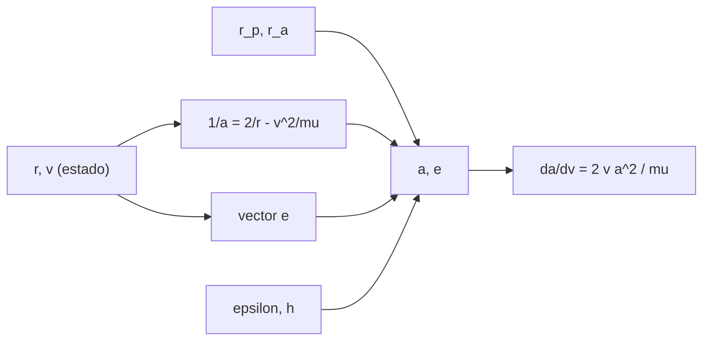

# B71-C10 — Semieje mayor y excentricidad

<!-- nav:top -->
[🏠 Programa](../../../../README.md) · [📚 Bloque B71](../../../tronco-comun/B71-mecanica-orbital-fundamental.md) · [← Anterior: B71-C09 — Órbitas parabólicas e hiperbólicas](../B71-C09-orbitas-parabolicas-e-hiperbolicas/CLASE.md) · [Siguiente: B71-C11 — Inclinación y nodo ascendente →](../../../tronco-comun/B71-mecanica-orbital-fundamental.md#b71-c11)
<!-- /nav -->

## 1. Ubicación, nivel y alcance

Clase 10 del bloque B71. Nivel N3. El semieje mayor `a` y la excentricidad `e` fijan el tamaño y la forma de una órbita; el primero determina además la energía y el período. Aquí los obtienes por tres vías independientes (apsides, vector de estado con la vis‑viva y el vector excentricidad, y energía con momento angular), los verificas en tres órbitas sintéticas y mides cuánto cambia `a` con un error de 1 m/s en la velocidad. Usas [C05](../B71-C05-energia-orbital-especifica/CLASE.md), [C06](../B71-C06-momento-angular-especifico/CLASE.md) y [C08](../B71-C08-orbitas-elipticas/CLASE.md). Las órbitas son sintéticas.

## 2. Por qué esta clase existe

Dos números describen la forma de la órbita, y un error pequeño de velocidad los cambia mucho. La decisión central: **¿cómo recuperas `a` y `e` desde un estado medido y cuánto cambian si la velocidad tiene un error?**

## 3. Lo que podrás hacer al terminar

1. Calcular `a` y `e` desde los apsides.
2. Calcular `a` y `e` desde un vector de estado con la vis‑viva y el vector excentricidad.
3. Calcular `a` y `e` desde la energía y el momento angular.
4. Comprobar que las tres vías coinciden a la precisión de la máquina.
5. Estimar la sensibilidad `da/dv = 2 v a²/μ` y verificarla con un salto de 1 m/s.
6. Separar lo consultado (`μ`, radio) de lo sintético (órbitas y estados).

La evidencia es la **ficha de a y e con la sensibilidad a δv** del ejercicio 12 (sección 20).

## 4. Con qué llegas y cómo comprobarlo

1. ¿Qué es la excentricidad y qué rango tiene en una elipse?
2. ¿Qué es el vector excentricidad?
3. ¿Qué es la ecuación vis‑viva?
4. ¿Qué es una derivada como sensibilidad?
5. ¿Qué es una verificación por segunda vía?

<details>
<summary>Ver respuestas</summary>

1. Un número entre 0 (círculo) y 1 (límite parabólico). 2. Un vector que apunta al periapsis con módulo `e`. 3. `v² = μ(2/r − 1/a)`. 4. La variación de una magnitud por unidad de variación de otra. 5. Calcular lo mismo con otro método y comparar.
</details>

Con cuatro o cinco aciertos, sigue; si no, repasa los prerrequisitos.

## 5. Un caso de contexto y casos de referencia

La órbita de transferencia sintética (200 × 35 786 km de altitud) tiene `a = 24371100 m` y `e = 0.730086`; el vector de estado en `ν = 110°` (`r = 15168255 m`, `v = 6016.79 m/s`) devuelve los mismos valores con un acuerdo de `2e-16`. Un error de +1 m/s en el periapsis (`v_p = 10238.881 m/s`) eleva `a` en `30553 m`. Es el **ejemplo conductor**; órbitas y estados son **sintéticos**.

## 6. Vocabulario

El **vector excentricidad** `e = ((v² − μ/r) r − (r·v) v)/μ` apunta al periapsis. El **semieje mayor** se obtiene con `1/a = 2/r − v²/μ`. La **sensibilidad** es la derivada de un elemento respecto de una perturbación. El **estado** es el par posición–velocidad en un instante. **Acuerdo entre vías** es la diferencia relativa máxima entre los resultados.

## 7. Modelo mental



*Descripción textual:* tres entradas distintas —apsides, estado, energía y momento angular— dan los mismos `a` y `e`; la derivada de `a` respecto de `v` mide la sensibilidad.

Analogía: tres personas miden la misma habitación con cinta, con láser y contando baldosas; si coinciden, la medida es fiable. Límite: aquí las tres «mediciones» son fórmulas sobre el mismo estado, no instrumentos distintos.

## 8. La explicación, paso a paso

### 8.1 Desde los apsides

`a = (r_p + r_a)/2`, `e = (r_a − r_p)/(r_a + r_p)`. Órbita 1: `a = 24371100 m`, `e = 0.730086`; órbita 2 (casi circular, 600 × 800 km): `a = 7078100 m`, `e = 0.014128`; órbita 3 (500 × 39 700 km): `a = 26478100 m`, `e = 0.740234`.

### 8.2 Desde un estado

Con `r` y `v` en `ν = 110°`: `1/a = 2/r − v²/μ` y `e = |((v² − μ/r) r − (r·v) v)/μ|`. Las radios y velocidades son `15168255 m`, `6016.79 m/s` (órbita 1), `7111048`, `7469.45` (órbita 2) y `16027191`, `5889.53` (órbita 3).

### 8.3 Desde energía y momento angular

`a = −μ/(2ε)` y `e = √(1 + 2ε h²/μ²)`. Las tres vías coinciden con diferencias de `2e-16`, `4e-15` y `8e-16`; la peor es `4e-15`. En la órbita casi circular `e` se obtiene restando cantidades casi iguales y pierde cifras (C12).

### 8.4 Sensibilidad

`da/dv = 2 v a²/μ`. En el periapsis de la órbita 1, +1 m/s da `Δa = 30553.5 m` (numérico) frente a `30513.7 m` (analítico; la diferencia de `1e-03` es el término de segundo orden). El apoapsis sube `61107 m` y `e` cambia `3.38e-04`. En órbitas de gran `a` un error pequeño de velocidad se amplifica en distancia.

## 9. Magnitudes, símbolos y unidades

| Símbolo | Qué es | Unidad | Valor / nota |
|---|---|---|---|
| `a` | semieje mayor | m | 24371100 (órbita 1) |
| `e` | excentricidad | — | 0.730086 |
| `ε` | energía orbital específica | J/kg | `−μ/(2a)` |
| `h` | momento angular específico | m²/s | `√(μ a (1 − e²))` |
| `da/dv` | sensibilidad del semieje | s | `2 v a²/μ` |

## 10. Convenciones y referencias

Marco inercial geocéntrico, SI, plano xy; estados generados en `ν = 110°` con periapsis en `+x`. `μ` y radio de la IAU. Las tres órbitas y los estados son sintéticos. El salto de velocidad de 1 m/s es un número de ejemplo, no la precisión de ningún sistema.

## 11. De dónde sale lo que afirmamos

| ID | Fuente | Localizador | Respalda | Estado |
|---|---|---|---|---|
| S1 | IAU 2015 Resolución B3, Mamajek et al., arXiv:1510.07674 — https://arxiv.org/abs/1510.07674 (PDF leído con PyMuPDF, consultada 2026-11-10) | tabla de constantes nominales | (GM)ˢᵘⁿ = 1,327 124 4 × 10²⁰ m³ s⁻² y (GM)ᵀⁱᵉʳʳᵃ = 3,986 004 × 10¹⁴ m³ s⁻² (nominales, exactos); R_ecuatorial de la Tierra = 6,3781 × 10⁶ m | Consultada |
| — | Relaciones estándar de mecánica orbital de esta clase | — | las verifica el laboratorio con una segunda vía | No consultada en una fuente concreta |

Límites: solo se consulta `μ`; no se modela ruido de medida ni covarianza, y las tres vías provienen del mismo modelo de dos cuerpos.

## 12. Cómo ver el resultado

| Magnitud | Valor |
|---|---|
| `a`, `e` órbita 1 | 24371100 m; 0.730086 |
| peor acuerdo entre vías | 4e-15 |
| `Δa` por +1 m/s (numérico / analítico) | 30553.5 / 30513.7 m |
| `Δr_a` por +1 m/s | 61107 m |
| `T` órbita 2 | 98.772 min |

Descripción larga: las tres vías coinciden hasta el redondeo y un impulso de 1 m/s en el periapsis eleva el apoapsis 61 km, mostrando el efecto palanca de la órbita grande.

## 13. Ejemplo trabajado

**`a` y `e` desde un estado.**

**Paso 1 · Datos.** `r = 7111048 m`; `v = 7469.45 m/s` (órbita 2, sintética).

**Paso 2 · Semieje.** `1/a = 2/r − v²/μ`, de donde `a = 7078100 m`.

**Paso 3 · Excentricidad.** Con el vector `e`, `e = 0.014128`; coincide con `(r_a − r_p)/(r_a + r_p)` en `4e-15`.

## 14. Distintas formas de describir el problema

**Por apsides:** `r_p`, `r_a`. **Por estado:** `r`, `v`. **Por invariantes:** `ε`, `h`. **Por sensibilidad:** `da/dv`.

## 15. Práctica guiada

**Ejercicio 1 · con los pasos indicados.** Calcula `a` y `e` para `r_p = 7000 km` y `r_a = 8000 km`. *Pasos:* semisuma y semidiferencia normalizada.

<details><summary>Solución comentada</summary>

`a = 7500 km`, `e = 1000/15 000 = 0,0667`.
</details>

**Ejercicio 2 · con una pista.** Predice `Δa` por +1 m/s en el periapsis de la órbita 1. *Pista:* `2 v a²/μ`.

<details><summary>Solución comentada</summary>

`30514 m` (analítico); el laboratorio da `30553 m`.
</details>

**Ejercicio 3 · casi autónomo.** ¿Por qué las tres vías coinciden? Piensa en qué comparten.

<details><summary>Solución comentada</summary>

Todas parten del mismo modelo de dos cuerpos y del mismo estado; la coincidencia valida el código, no la física.
</details>

## 16. Práctica autónoma, transferencia e integrador

**Ejercicio 4 · autónomo.** Con `ε = −8,18 × 10⁶ J/kg` calcula `a`.

<details><summary>Solución comentada</summary>

`a = μ/(2·8,18 × 10⁶) = 2,437 × 10⁷ m`.
</details>

**Ejercicio 5 · autónomo.** Si `e = 0,5` y `a = 10 000 km`, ¿cuánto vale `p`?

<details><summary>Solución comentada</summary>

`p = a(1 − e²) = 7500 km`.
</details>

**Ejercicio 6 · autónomo.** En una circular `v² = μ/r`: ¿qué `a` da la fórmula?

<details><summary>Solución comentada</summary>

`1/a = 2/r − 1/r = 1/r`: `a = r`.
</details>

**Ejercicio 7 · autónomo.** Si `a` aumenta 1 %, ¿cómo cambia el período?

<details><summary>Solución comentada</summary>

`T ∝ a^1,5`: 1,5 %.
</details>

**Ejercicio 8 · autónomo.** Un error de 0,1 m/s en `v_p` ¿cuánto desplaza `r_a` en la órbita 1?

<details><summary>Solución comentada</summary>

Unos `6,1 km` (1/10 de los 61 km).
</details>

**Ejercicio 9 · transferencia.** **Transferencia.** **Transferencia.** Un código obtiene `e = −3 × 10⁻⁹` para una órbita casi circular. ¿Qué significa?

<details><summary>Solución comentada</summary>

Ruido numérico: `e` es un módulo y no puede ser negativo; indica que se calcula como diferencia de cantidades casi iguales y que `e` es indistinguible de 0 a esa precisión.
</details>

**Ejercicio 10 · transferencia.** **Transferencia.** **Transferencia.** Un seguimiento da `v` con 1 m/s de error en el periapsis de una órbita con `a` grande. ¿Qué cuantificas primero?

<details><summary>Solución comentada</summary>

`da/dv = 2 v a²/μ` y su efecto en `r_a` y en el período; para la órbita 1 son 30 km y 61 km por m/s.
</details>

**Ejercicio 11 · transferencia.** **Transferencia.** **Transferencia.** ¿Se pueden usar `a` y `e` de una efeméride de una misión real con este laboratorio?

<details><summary>Solución comentada</summary>

No: aquí solo hay órbitas sintéticas y no se consultó ninguna efeméride; habría que verificar fuente, sistema de referencia y época.
</details>

**Ejercicio 12 · integrador.** **Integrador.** **Integrador.** Elabora tu *ficha de a y e con la sensibilidad a δv*: tres órbitas, tres vías de cálculo, acuerdo entre vías y sensibilidad numérica frente a analítica.

<details><summary>Solución comentada</summary>

Secciones 8.1–8.4 y la salida del laboratorio.
</details>

## 17. Laboratorio: a y e por tres vías y sensibilidad

El script [semieje_excentricidad.py](semieje_excentricidad.py) obtiene `a` y `e` de tres órbitas sintéticas desde los apsides, desde un estado y desde `ε` y `h`, y mide la sensibilidad a +1 m/s (**comprueba** acuerdo < 1e-9 y derivada numérica frente a analítica < 5e-3).

**Datos:** `μ` y radio ecuatorial de la IAU (consultados); las tres órbitas y los estados en `ν = 110°` son **sintéticos**. **Predice antes de ejecutar:** ¿Cuánto subirá el apoapsis con +1 m/s en el periapsis de la órbita 1? (Unas decenas de km.) **Ejecución del 2026-11-10 (Python 3.12.9):**

```text
Python 3.12.9 (biblioteca estandar)
Orbita SINTETICA 1: periapsis 6578.1 km ; apoapsis 42164.1 km del centro
  a = 24371.100 km ; e = 0.730086 ; T = 631.063 min
  en nu = 110 grados: r = 15168.255 km ; v = 6016.788 m/s ; acuerdo de las tres vias = 1.5e-16
Orbita SINTETICA 2: periapsis 6978.1 km ; apoapsis 7178.1 km del centro
  a = 7078.100 km ; e = 0.014128 ; T = 98.772 min
  en nu = 110 grados: r = 7111.048 km ; v = 7469.454 m/s ; acuerdo de las tres vias = 3.9e-15
Orbita SINTETICA 3: periapsis 6878.1 km ; apoapsis 46078.1 km del centro
  a = 26478.100 km ; e = 0.740234 ; T = 714.644 min
  en nu = 110 grados: r = 16027.191 km ; v = 5889.529 m/s ; acuerdo de las tres vias = 8.4e-16
Peor acuerdo entre vias = 3.9e-15
Sensibilidad (orbita 1, periapsis, +1 m/s a v_p = 10238.881 m/s):
  delta a numerico = 30553.456 m ; analitico 2 v a^2/mu = 30513.710 m ; dif = 1.3e-03
  delta e = 3.380e-04 ; nuevo apoapsis = 42225.207 km (delta r_a = 61.107 km)
Pruebas superadas.
```

```bash
python programa/clases/B71/B71-C10-semieje-mayor-y-excentricidad/semieje_excentricidad.py
```

**Límites:** dos cuerpos, sin ruido de medida; la derivada analítica es de primer orden.

## 18. Errores frecuentes y cómo corregirlos

**Calcular `e` solo como diferencia de apsides en órbitas casi circulares.** Se corrige con 8.3.

**Confundir `r` instantáneo con `a`.** Se corrige con 8.2.

**Creer que la coincidencia de las tres vías prueba la física.** Se corrige con el ejercicio 3.

**Presentar el estado sintético como medido.** Se corrige con la sección 10.

## 19. Cómo sabrás que vas bien

Tras la sección 8: ¿qué `Δa` esperabas y cuál obtuviste? Si dudas, repasa el ejemplo 13. Tras el laboratorio: ¿qué comprueba? (ver la sección 17).

## 20. Qué entregas y cómo se evalúa

El producto es tu **ficha de a y e con la sensibilidad a δv** (ejercicio 12).

| Criterio | Inicial | En desarrollo | Logrado | Destacado |
|---|---|---|---|---|
| Conceptos | Los confunde | Parciales | Obtiene `a` y `e` por tres vías | Explica los límites |
| Cálculo | Sin unidades | Con errores | Tablas con unidades | Calcula casos nuevos |
| Numérico | Sin comprobar | Un caso | Acuerdo y sensibilidad | Interpreta las diferencias |
| Fuentes | Sin fuente | Sin fecha | Fuentes con fecha y estado | Declara lo sintético |
| Límites | No los nombra | Uno | Tres | Discute qué falta del modelo |

**Condiciones críticas (no se compensan con promedio):** rotular órbitas y estados como sintéticos; declarar unidades y marco; citar solo lo consultado.

## 21. Ética, seguridad y límites

Clase educativa: los modelos son simplificados y sus datos son consultados, sintéticos o ilustrativos (rotulados); ningún resultado es una efeméride ni una predicción operativa ni sustituye a las herramientas de navegación de una misión. Accesibilidad: tablas equivalentes a las gráficas, fórmulas en texto, ejercicios sin conexión.

## 22. Para cerrar y seguir

Las tres vías dan los mismos `a` y `e` (peor acuerdo `4e-15`) y +1 m/s en el periapsis eleva el apoapsis `61107 m`. Queda una pregunta: ¿cómo se orienta el plano de la órbita en el espacio?

**Glosario español–inglés.** vector excentricidad · *eccentricity vector* · sensibilidad · *sensitivity* · vector de estado · *state vector* · semieje mayor · *semi-major axis*.

**Continuidad.** [B71-C11](../B71-C11-inclinacion-y-nodo-ascendente/CLASE.md) estudia la inclinación y el nodo ascendente.

**Referencias:** ver sección 11.

<!-- nav:bottom -->
---

[← Anterior: B71-C09 — Órbitas parabólicas e hiperbólicas](../B71-C09-orbitas-parabolicas-e-hiperbolicas/CLASE.md) · [📚 Bloque B71](../../../tronco-comun/B71-mecanica-orbital-fundamental.md) · [Siguiente: B71-C11 — Inclinación y nodo ascendente →](../../../tronco-comun/B71-mecanica-orbital-fundamental.md#b71-c11)
<!-- /nav -->
