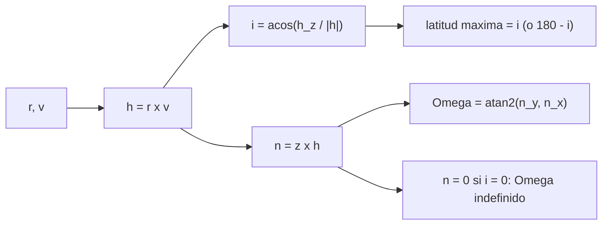

# B71-C11 — Inclinación y nodo ascendente

<!-- nav:top -->
[🏠 Programa](../../../../README.md) · [📚 Bloque B71](../../../tronco-comun/B71-mecanica-orbital-fundamental.md) · [← Anterior: B71-C10 — Semieje mayor y excentricidad](../B71-C10-semieje-mayor-y-excentricidad/CLASE.md) · [Siguiente: B71-C12 — Argumento del periapsis →](../B71-C12-argumento-del-periapsis/CLASE.md)
<!-- /nav -->

## 1. Ubicación, nivel y alcance

Clase 11 del bloque B71. Nivel N3. La inclinación y el nodo ascendente orientan el plano de la órbita respecto del ecuador: la primera dice cuánto se inclina y el segundo, dónde cruza el ecuador hacia el norte. Aquí los calculas desde el vector de estado con atan2 (para obtener el cuadrante correcto), los recuperas en 1000 casos sintéticos y relacionas la inclinación con la latitud máxima que sobrevuela un satélite. Usas [C06](../B71-C06-momento-angular-especifico/CLASE.md) para `h`. Los estados son sintéticos y el marco es un ECI idealizado.

## 2. Por qué esta clase existe

Un error de cuadrante en `Ω` coloca el plano a 180° de su sitio. La decisión central: **¿cómo obtienes `i` y `Ω` sin ambigüedad y qué latitudes puede alcanzar una órbita con esa inclinación?**

## 3. Lo que podrás hacer al terminar

1. Calcular `i = arccos(h_z/|h|)` y reconocer prógradas (`i < 90°`) y retrógradas.
2. Calcular el nodo ascendente con `Ω = atan2(n_y, n_x)`, con `n = ẑ × h`.
3. Recuperar `i` y `Ω` de elementos conocidos en 1000 estados sintéticos.
4. Relacionar `i` con la latitud máxima alcanzada.
5. Reconocer el caso degenerado `i = 0` donde `Ω` no está definido.
6. Separar lo consultado (`μ`) de lo sintético (los estados).

La evidencia es la **ficha de i y Ω recuperados en 1.000 casos sintéticos** del ejercicio 12 (sección 20).

## 4. Con qué llegas y cómo comprobarlo

1. ¿Qué es el plano ecuatorial?
2. ¿Qué es un vector normal a un plano?
3. ¿Qué hace la función atan2?
4. ¿Qué es una órbita retrógrada?
5. ¿Qué es una verificación por segunda vía?

<details>
<summary>Ver respuestas</summary>

1. El plano perpendicular al eje de rotación que pasa por el centro del cuerpo. 2. Un vector perpendicular al plano; aquí `h`. 3. Devuelve el ángulo de un par `(y, x)` con el cuadrante correcto. 4. Una con `i > 90°`: se mueve en sentido contrario a la rotación del cuerpo. 5. Calcular lo mismo con otro método y comparar.
</details>

Con cuatro o cinco aciertos, sigue; si no, repasa los prerrequisitos.

## 5. Un caso de contexto y casos de referencia

Con 1000 estados sintéticos (semilla 71; 524 retrógrados), las recuperaciones de `i` y `Ω` desde `(r, v)` tienen errores máximos de `3.2e-14` y `8.9e-16` rad. Con `i = 51,6°` (ilustrativa) la latitud máxima sobrevolada es `51.6000°`; con `i = 97,8°`, `82.2000°`. Es el **ejemplo conductor**; los estados y las inclinaciones son **sintéticos/ilustrativos**.

## 6. Vocabulario

La **inclinación** `i` es el ángulo entre `h` y el eje polar `ẑ`. La **línea de nodos** es la intersección del plano orbital con el ecuatorial. El **nodo ascendente** es el punto donde la órbita cruza el ecuador hacia el norte; su longitud es la **ascensión recta del nodo ascendente** (`Ω` o RAAN). El **vector nodo** `n = ẑ × h` apunta al nodo ascendente. **Prógrada** es `i < 90°`; **retrógrada**, `i > 90°`.

## 7. Modelo mental



*Descripción textual:* del estado sale `h`; de `h` salen la inclinación y el vector nodo, del que `atan2` da `Ω`; la inclinación fija la latitud máxima y `i = 0` degenera el nodo.

Analogía: una moneda que gira apoyada sobre una mesa inclinada; el ángulo con la mesa es la inclinación y el punto donde cruza el borde, el nodo. Límite: la mesa del ecuador es un plano fijo en el espacio inercial, no una superficie que gira con el planeta.

## 8. La explicación, paso a paso

### 8.1 Inclinación

`h = r × v` es normal al plano orbital; `i = arccos(h_z/|h|)` va de 0° a 180°. Como `arccos` ya cubre ese rango, no hay ambigüedad de cuadrante. En los 1000 casos el error máximo es `3.2e-14` rad.

### 8.2 Nodo ascendente

`n = ẑ × h = (−h_y, h_x, 0)` y `Ω = atan2(n_y, n_x) mod 2π`. Usar `arccos(n_x/|n|)` solo cubre 0–180° y falla en los cuadrantes III y IV. Recuperación de `Ω` de partida 30°, 120°, 210° y 300° (con `i = 51,6°` ilustrativa): `30,0000°`, `120,0000°`, `210,0000°`, `300,0000°`, con error `1e-14°`. Los 1000 casos cayeron `[258, 262, 234, 246]` en los cuatro cuadrantes, con error máximo angular `8.9e-16` rad.

### 8.3 Latitud máxima

La latitud del satélite cumple `sin φ = sin i · sin u`, con `u` el argumento de latitud. El máximo de `|φ|` es `i` si `i ≤ 90°` y `180° − i` si `i > 90°`. Muestreando 3600 puntos: `i = 51,6°` da `51.6000°`; `i = 97,8°`, `82.2000°`; `i = 0`, `0.0000°`.

### 8.4 El caso degenerado

Si `i = 0`, `n = 0`: el cociente `|n|/|h|` vale `0.0e+00`, el nodo no existe y `Ω` queda indefinido (se fija por convención, p. ej. 0; C12). Algo parecido ocurre con `i = 180°`. Los elementos clásicos tienen estas singularidades.

## 9. Magnitudes, símbolos y unidades

| Símbolo | Qué es | Unidad | Valor / nota |
|---|---|---|---|
| `i` | inclinación | grados | 0–180° |
| `Ω` | ascensión recta del nodo ascendente | grados | 0–360° |
| `h` | momento angular específico | m²/s | vector |
| `n` | vector nodo `ẑ × h` | m²/s | vector |
| `φ_max` | latitud máxima | grados | `i` o `180° − i` |

## 10. Convenciones y referencias

Marco ECI idealizado: eje `ẑ` hacia el polo, `x̂` hacia el equinoccio de referencia (no se especifica una época real); SI. Matriz de rotación 3‑1‑3 `R_z(Ω)R_x(i)R_z(ω)`. `μ` de la IAU. Estados, rangos de elementos e inclinaciones de 51,6° y 97,8° son sintéticos e ilustrativos.

## 11. De dónde sale lo que afirmamos

| ID | Fuente | Localizador | Respalda | Estado |
|---|---|---|---|---|
| S1 | IAU 2015 Resolución B3, Mamajek et al., arXiv:1510.07674 — https://arxiv.org/abs/1510.07674 (PDF leído con PyMuPDF, consultada 2026-11-10) | tabla de constantes nominales | (GM)ˢᵘⁿ = 1,327 124 4 × 10²⁰ m³ s⁻² y (GM)ᵀⁱᵉʳʳᵃ = 3,986 004 × 10¹⁴ m³ s⁻² (nominales, exactos); R_ecuatorial de la Tierra = 6,3781 × 10⁶ m | Consultada |
| — | Relaciones estándar de mecánica orbital de esta clase | — | las verifica el laboratorio con una segunda vía | No consultada en una fuente concreta |

Límites: no se consultó ningún sistema de referencia real (J2000 u otro) ni la definición de la IERS; el marco aquí es idealizado y no se aplica precesión ni nutación.

## 12. Cómo ver el resultado

| Magnitud | Valor |
|---|---|
| error máximo de `i` / `Ω` | 3.2e-14 / 8.9e-16 rad |
| casos retrógrados | 524 de 1000 |
| latitud máxima `i = 51,6°` | 51.6000° |
| latitud máxima `i = 97,8°` | 82.2000° |
| `|n|/|h|` para `i = 0` | 0.0e+00 |

Descripción larga: los dos ángulos se recuperan con errores de redondeo en 1000 casos; la latitud máxima sigue la regla `i` o `180° − i` y el nodo desaparece en `i = 0`.

## 13. Ejemplo trabajado

**Recuperar `Ω` en el tercer cuadrante.**

**Paso 1 · Datos.** Un estado sintético con `Ω = 210°`, `i = 51,6°`.

**Paso 2 · Vector nodo.** `n = (−h_y, h_x, 0)`, con `n_x < 0` y `n_y < 0`.

**Paso 3 · `atan2`.** `Ω = atan2(n_y, n_x) mod 2π = 210,0000°`; con `arccos(n_x/|n|)` habría salido `150°` (el simétrico).

## 14. Distintas formas de describir el problema

**Por vector:** `h`, `n`. **Por ángulos:** `i`, `Ω`. **Por latitud:** `φ_max`. **Por matriz:** `R_z(Ω)R_x(i)`.

## 15. Práctica guiada

**Ejercicio 1 · con los pasos indicados.** Calcula `i` si `h = (0, −2, 3) × 10¹⁰`. *Pasos:* `arccos(h_z/|h|)`.

<details><summary>Solución comentada</summary>

`|h| = 3,606 × 10¹⁰`; `i = arccos(0,832) = 33,7°`.
</details>

**Ejercicio 2 · con una pista.** Predice `Ω` si `n = (−1, −1, 0)`. *Pista:* `atan2(−1, −1)`.

<details><summary>Solución comentada</summary>

`225°` (tercer cuadrante).
</details>

**Ejercicio 3 · casi autónomo.** ¿Por qué `arccos` no basta para `Ω`? Piensa en el rango.

<details><summary>Solución comentada</summary>

`arccos` devuelve 0–180° y `Ω` va de 0 a 360°; `atan2` usa los signos de `n_x` y `n_y`.
</details>

## 16. Práctica autónoma, transferencia e integrador

**Ejercicio 4 · autónomo.** ¿Qué latitud máxima alcanza una órbita con `i = 28,5°` (ilustrativa)?

<details><summary>Solución comentada</summary>

`28,5°`.
</details>

**Ejercicio 5 · autónomo.** ¿Y una con `i = 135°`?

<details><summary>Solución comentada</summary>

`180° − 135° = 45°`.
</details>

**Ejercicio 6 · autónomo.** Con `i = 90°` ¿qué latitud máxima y qué tipo de órbita?

<details><summary>Solución comentada</summary>

`90°`: órbita polar.
</details>

**Ejercicio 7 · autónomo.** Si `h_z/|h| = −0,5` ¿qué `i` tiene y es prógrada?

<details><summary>Solución comentada</summary>

`i = 120°`; retrógrada.
</details>

**Ejercicio 8 · autónomo.** Calcula `n` si `h = (3, 4, 5)`.

<details><summary>Solución comentada</summary>

`n = (−4, 3, 0)`; `Ω = atan2(3, −4) = 143,1°`.
</details>

**Ejercicio 9 · transferencia.** **Transferencia.** **Transferencia.** Un código devuelve `Ω = 60°` para un satélite cuyo plano está en `240°`. ¿Qué error de programación es probable?

<details><summary>Solución comentada</summary>

Usó `arccos(n_x/|n|)` (o `atan` sin cuadrante) y obtuvo el simétrico; hay que usar `atan2(n_y, n_x)`.
</details>

**Ejercicio 10 · transferencia.** **Transferencia.** **Transferencia.** Un satélite necesita cubrir latitudes hasta 80° con una órbita retrógrada. ¿Qué inclinación mínima hace falta?

<details><summary>Solución comentada</summary>

`i ≥ 100°`, pues `φ_max = 180° − i`.
</details>

**Ejercicio 11 · transferencia.** **Transferencia.** **Transferencia.** ¿Por qué un software de elementos puede fallar con `i` muy cercana a 0?

<details><summary>Solución comentada</summary>

El vector nodo tiende a cero y `Ω` se vuelve sensible al ruido; se usan elementos equinocciales, no clásicos (fuera de esta clase).
</details>

**Ejercicio 12 · integrador.** **Integrador.** **Integrador.** Elabora tu *ficha de i y Ω recuperados en 1.000 casos sintéticos*: fórmulas, error máximo, distribución por cuadrante, latitud máxima para tres inclinaciones y el caso degenerado.

<details><summary>Solución comentada</summary>

Secciones 8.1–8.4 y la salida del laboratorio.
</details>

## 17. Laboratorio: i y Ω desde el estado

El script [inclinacion_nodo.py](inclinacion_nodo.py) genera 1000 estados sintéticos con semilla 71, recupera `i` y `Ω` con `atan2`, comprueba la latitud máxima y muestra el caso `i = 0` (**comprueba** errores < 1e-9 rad, latitud máxima y nodo nulo).

**Datos:** `μ` de la IAU (consultado); estados, rangos y la inclinación de 51,6° y 97,8° **sintéticos/ilustrativos**. **Predice antes de ejecutar:** ¿Qué latitud máxima alcanza la órbita de `i = 97,8°`? (82,2°.) **Ejecución del 2026-11-10 (Python 3.12.9):**

```text
Python 3.12.9 (biblioteca estandar)
1000 estados SINTETICOS (semilla 71); retrogradas (i > 90): 524
  error maximo de i = 3.20e-14 rad ; error angular maximo de RAAN = 8.88e-16 rad
  RAAN por cuadrante (0-90, 90-180, 180-270, 270-360): [258, 262, 234, 246]
Cuadrante de RAAN con atan2 (i = 51.6 grados ilustrativo): RAAN de partida -> recuperada [grados]
    30.0 ->  30.0000   (i recuperada = 51.6000)
   120.0 -> 120.0000   (i recuperada = 51.6000)
   210.0 -> 210.0000   (i recuperada = 51.6000)
   300.0 -> 300.0000   (i recuperada = 51.6000)
  error maximo = 1.4e-14 grados
Latitud geocentrica maxima alcanzada (muestreo de 3600 puntos):
  i = 51.6 -> 51.6000 grados ; i = 97.8 -> 82.2000 grados (= 180 - i) ; i = 0 -> 0.0000
Caso i = 0: |n|/|h| = 0.0e+00 (nodo indeterminado) ; h_z/|h| = 1.000000
Pruebas superadas.
```

```bash
python programa/clases/B71/B71-C11-inclinacion-y-nodo-ascendente/inclinacion_nodo.py
```

**Límites:** marco ECI idealizado sin precesión; los elementos clásicos son singulares en `i = 0` y `180°`.

## 18. Errores frecuentes y cómo corregirlos

**Obtener `Ω` con `arccos` y perder el cuadrante.** Se corrige con 8.2.

**Creer que una órbita retrógrada llega a latitud `i`.** Se corrige con 8.3.

**Ignorar el caso `i = 0`.** Se corrige con 8.4.

**Presentar el marco idealizado como J2000.** Se corrige con la sección 10.

## 19. Cómo sabrás que vas bien

Tras la sección 8: ¿qué latitud esperabas para `i = 97,8°` y cuál obtuviste? Si dudas, repasa el ejemplo 13. Tras el laboratorio: ¿qué comprueba? (ver la sección 17).

## 20. Qué entregas y cómo se evalúa

El producto es tu **ficha de i y Ω recuperados en 1.000 casos sintéticos** (ejercicio 12).

| Criterio | Inicial | En desarrollo | Logrado | Destacado |
|---|---|---|---|---|
| Conceptos | Los confunde | Parciales | Define `i`, `Ω` y el nodo | Explica las singularidades |
| Cálculo | Sin unidades | Con errores | Cuadrante correcto | Calcula casos nuevos |
| Numérico | Sin comprobar | Un caso | 1000 casos recuperados | Interpreta las diferencias |
| Fuentes | Sin fuente | Sin fecha | Fuentes con fecha y estado | Declara lo sintético |
| Límites | No los nombra | Uno | Tres | Discute qué falta del modelo |

**Condiciones críticas (no se compensan con promedio):** rotular estados y marco como sintéticos/idealizados; resolver el cuadrante con `atan2`; citar solo lo consultado.

## 21. Ética, seguridad y límites

Clase educativa: los modelos son simplificados y sus datos son consultados, sintéticos o ilustrativos (rotulados); ningún resultado es una efeméride ni una predicción operativa ni sustituye a las herramientas de navegación de una misión. Accesibilidad: tablas equivalentes a las gráficas, fórmulas en texto, ejercicios sin conexión.

## 22. Para cerrar y seguir

Los dos ángulos se recuperan en 1000 casos con errores de `9e-16` rad y la latitud máxima sigue la regla `i` o `180° − i`. Queda una pregunta: ¿dónde está el periapsis dentro del plano?

**Glosario español–inglés.** inclinación · *inclination* · nodo ascendente · *ascending node* · ascensión recta del nodo ascendente · *right ascension of the ascending node (RAAN)* · línea de nodos · *line of nodes*.

**Continuidad.** [B71-C12](../B71-C12-argumento-del-periapsis/CLASE.md) estudia el argumento del periapsis.

**Referencias:** ver sección 11.

<!-- nav:bottom -->
---

[← Anterior: B71-C10 — Semieje mayor y excentricidad](../B71-C10-semieje-mayor-y-excentricidad/CLASE.md) · [📚 Bloque B71](../../../tronco-comun/B71-mecanica-orbital-fundamental.md) · [Siguiente: B71-C12 — Argumento del periapsis →](../B71-C12-argumento-del-periapsis/CLASE.md)
<!-- /nav -->
