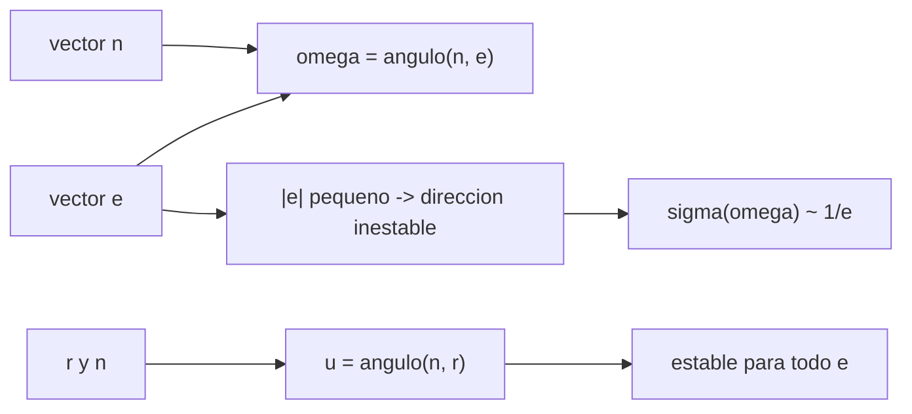

# B71-C12 — Argumento del periapsis

<!-- nav:top -->
[🏠 Programa](../../../../README.md) · [📚 Bloque B71](../../../tronco-comun/B71-mecanica-orbital-fundamental.md) · [← Anterior: B71-C11 — Inclinación y nodo ascendente](../B71-C11-inclinacion-y-nodo-ascendente/CLASE.md) · [Siguiente: B71-C13 — Anomalías orbitales →](../B71-C13-anomalias-orbitales/CLASE.md)
<!-- /nav -->

## 1. Ubicación, nivel y alcance

Clase 12 del bloque B71. Nivel N3. El argumento del periapsis `ω` es el ángulo, medido en el plano orbital, entre el nodo ascendente y el periapsis. Si la órbita es casi circular el periapsis no está bien definido y `ω` se vuelve inestable. Aquí lo calculas con el vector excentricidad, mides cómo crece su incertidumbre cuando `e → 0` con ruido sintético y ves que el argumento de latitud `u = ω + ν` sí es estable. Usas [C10](../B71-C10-semieje-mayor-y-excentricidad/CLASE.md) y [C11](../B71-C11-inclinacion-y-nodo-ascendente/CLASE.md). El ruido y la órbita son sintéticos.

## 2. Por qué esta clase existe

Un elemento mal condicionado puede dar un valor sin sentido aunque el estado sea exacto. La decisión central: **¿cuándo puedes fiarte de `ω` y qué ángulo usas cuando no?**

## 3. Lo que podrás hacer al terminar

1. Calcular `ω` con el vector excentricidad y el vector nodo, con el signo de `e_z`.
2. Calcular el argumento de latitud `u = ω + ν` por dos vías.
3. Medir cómo crece la incertidumbre de `ω` cuando `e` disminuye (proporcional a `1/e`).
4. Comprobar que la incertidumbre de `u` no depende de `e`.
5. Citar la inclinación crítica como dato que se deduce en B72.
6. Separar lo consultado (`μ`) de lo sintético (órbita y ruido) y de lo no consultado.

La evidencia es la **ficha de ω con su error frente a e** del ejercicio 12 (sección 20).

## 4. Con qué llegas y cómo comprobarlo

1. ¿Qué es el vector excentricidad?
2. ¿Qué es el vector nodo?
3. ¿Qué es el argumento de latitud?
4. ¿Qué es el mal condicionamiento?
5. ¿Qué es una verificación por segunda vía?

<details>
<summary>Ver respuestas</summary>

1. Un vector que apunta al periapsis, de módulo `e`. 2. `ẑ × h`: apunta al nodo ascendente. 3. El ángulo desde el nodo ascendente hasta el satélite, `u = ω + ν`. 4. Que un pequeño error de entrada produce un gran error en el resultado. 5. Calcular lo mismo con otro método y comparar.
</details>

Con cuatro o cinco aciertos, sigue; si no, repasa los prerrequisitos.

## 5. Un caso de contexto y casos de referencia

Con una órbita sintética de `ω = 130°` y ruido de 1 m en posición y 1 mm/s en velocidad, la desviación de `ω` es `0.00005°` para `e = 0,3` y `5.16°` para `e = 3 × 10⁻⁶`, mientras que la de `u` se mantiene en `0.000014°`. Es el **ejemplo conductor**; órbita y ruido son **sintéticos**.

## 6. Vocabulario

El **argumento del periapsis** `ω` va del nodo ascendente al periapsis, en el plano orbital. El **argumento de latitud** `u = ω + ν` va del nodo al satélite. El **mal condicionamiento** mide la amplificación del error. La **inclinación crítica** es un valor de `i` con propiedades especiales bajo `J₂` (B72). Un **elemento indefinido** es el que pierde sentido en un límite (aquí `ω` si `e = 0`).

## 7. Modelo mental



*Descripción textual:* `ω` depende de la dirección de un vector de módulo `e`; cuando `e` es pequeño esa dirección es muy sensible al ruido, mientras que el ángulo `u` se calcula con `r` y no sufre.

Analogía: señalar el punto más alto de una colina casi plana; un pequeño temblor cambia por completo el punto señalado. Límite: la colina es una imagen del periapsis de una órbita casi circular, no un modelo físico.

## 8. La explicación, paso a paso

### 8.1 Cálculo de `ω`

`e = ((v² − μ/r) r − (r·v) v)/μ`, `n = ẑ × h` y `ω = arccos(n·e/(|n||e|))`, con `ω → 2π − ω` si `e_z < 0`. Sin ruido, el error máximo sobre las seis excentricidades es `1.5e-08` rad (el redondeo de la máquina, amplificado por `1/e`).

### 8.2 Argumento de latitud por una segunda vía

`u` se calcula como ángulo entre `n` y `r`, y se compara con `ω + ν`. Coinciden en `1.5e-08` rad. Importa que `u` no usa `e`.

### 8.3 Crecimiento de la incertidumbre

Con 400 repeticiones de ruido sintético (semilla 12), la desviación de `ω` es: `0.00005°` (`e = 0,3`), `0.00047°` (0,03), `0.00504°` (3 × 10⁻³), `0.05154°` (3 × 10⁻⁴), `0.5294°` (3 × 10⁻⁵) y `5.160°` (3 × 10⁻⁶). Cada vez que `e` baja un factor 10, la desviación sube unas `10.69`, `10.23`, `10.27` y `9.75` veces; el producto `e·σ(ω)` es casi constante (`2.64e-07` rad).

### 8.4 Lo que sí es estable y un dato no consultado

La desviación de `u` es del orden de `0.000011°` para todas las excentricidades (cociente máx/mín `1.12`). Por eso en órbitas casi circulares se usa `u` o los elementos equinocciales. La inclinación crítica `arccos(1/√5) = 63.4349°` (y `116.5651°` retrógrada) es un resultado de la teoría de `J₂` que se deduce en B72 y **no se consultó** aquí.

## 9. Magnitudes, símbolos y unidades

| Símbolo | Qué es | Unidad | Valor / nota |
|---|---|---|---|
| `ω` | argumento del periapsis | grados | 130° (partida, sintético) |
| `u` | argumento de latitud `ω + ν` | grados | 180° (sintético) |
| `e` | excentricidad | — | 0,3 … 3 × 10⁻⁶ |
| `σ(ω)` | desviación de `ω` con ruido | grados | 0.00005 … 5.16 |
| `i_crit` | inclinación crítica | grados | 63.4349 (no consultado) |

## 10. Convenciones y referencias

Marco inercial geocéntrico idealizado, SI; rotación 3‑1‑3. `ω` en 0–360° con el signo de `e_z`. Ruido gaussiano de `σ_r = 1 m` y `σ_v = 1 mm/s` por componente; 400 repeticiones; semilla 12. El ruido y la órbita no corresponden a ningún sensor ni satélite.

## 11. De dónde sale lo que afirmamos

| ID | Fuente | Localizador | Respalda | Estado |
|---|---|---|---|---|
| S1 | IAU 2015 Resolución B3, Mamajek et al., arXiv:1510.07674 — https://arxiv.org/abs/1510.07674 (PDF leído con PyMuPDF, consultada 2026-11-10) | tabla de constantes nominales | (GM)ˢᵘⁿ = 1,327 124 4 × 10²⁰ m³ s⁻² y (GM)ᵀⁱᵉʳʳᵃ = 3,986 004 × 10¹⁴ m³ s⁻² (nominales, exactos); R_ecuatorial de la Tierra = 6,3781 × 10⁶ m | Consultada |
| — | Relaciones estándar de mecánica orbital de esta clase | — | las verifica el laboratorio con una segunda vía | No consultada en una fuente concreta |

Límites: la inclinación crítica no se consultó. El ruido es un modelo simple sin correlaciones; no se estimaron covarianzas. Los resultados ilustran la tendencia `1/e`, no la precisión de ningún sistema.

## 12. Cómo ver el resultado

| Magnitud | Valor |
|---|---|
| `σ(ω)` con `e = 0,3` | 0.00005° |
| `σ(ω)` con `e = 3 × 10⁻⁶` | 5.16° |
| `e·σ(ω)` | ≈ 2.64e-07 rad (constante) |
| `σ(u)` (cualquier `e`) | ≈ 0.000011° |
| `i_crit` | 63.4349° (no consultado) |

Descripción larga: al bajar `e` un factor diez la incertidumbre de `ω` sube unas diez veces, mientras que la de `u` no cambia.

## 13. Ejemplo trabajado

**Qué fiabilidad tiene `ω` con `e = 3 × 10⁻⁴`.**

**Paso 1 · Constante.** `e·σ(ω) ≈ 2.70e-07 rad` (del laboratorio).

**Paso 2 · Incertidumbre.** `σ(ω) = 2.70e-07/(3 × 10⁻⁴) = 9,0 × 10⁻⁴ rad = 0.0515°`.

**Paso 3 · Decisión.** Con ruido de 1 m y 1 mm/s, `ω` queda con ~0,05°; si se necesitara 0,01°, convendría usar `u`.

## 14. Distintas formas de describir el problema

**Por vectores:** `e`, `n`. **Por ángulos:** `ω`, `ν`, `u`. **Por condicionamiento:** `σ(ω) ∝ 1/e`. **Por alternativa:** elementos equinocciales (fuera de esta clase).

## 15. Práctica guiada

**Ejercicio 1 · con los pasos indicados.** Calcula `u` si `ω = 130°` y `ν = 50°`. *Pasos:* suma.

<details><summary>Solución comentada</summary>

`u = 180°`.
</details>

**Ejercicio 2 · con una pista.** Predice `σ(ω)` para `e = 3 × 10⁻⁴` a partir de `e = 3 × 10⁻³`. *Pista:* factor 10.

<details><summary>Solución comentada</summary>

`≈ 10 ×` `0.00504° = 0,05°`; el laboratorio da `0.05154°`.
</details>

**Ejercicio 3 · casi autónomo.** ¿Por qué `u` no depende de `e`? Mira con qué vectores se calcula.

<details><summary>Solución comentada</summary>

Usa `n` y `r` (posición), no el vector excentricidad.
</details>

## 16. Práctica autónoma, transferencia e integrador

**Ejercicio 4 · autónomo.** Si `e = 0`, ¿qué valor tiene `ω`?

<details><summary>Solución comentada</summary>

Indefinido: no hay periapsis; se fija por convención (p. ej. 0) y se usa `u`.
</details>

**Ejercicio 5 · autónomo.** Con `e·σ(ω) = 2,6 × 10⁻⁷ rad`, estima `σ(ω)` para `e = 10⁻⁵`.

<details><summary>Solución comentada</summary>

`0,026 rad = 1,5°`.
</details>

**Ejercicio 6 · autónomo.** ¿Qué `e` necesitas para `σ(ω) ≤ 0,01°` con este ruido?

<details><summary>Solución comentada</summary>

`e ≥ 2,6 × 10⁻⁷/1,75 × 10⁻⁴ rad = 1,5 × 10⁻³`.
</details>

**Ejercicio 7 · autónomo.** Si `e_z < 0`, ¿cómo corriges el `arccos`?

<details><summary>Solución comentada</summary>

`ω → 360° − ω`.
</details>

**Ejercicio 8 · autónomo.** Calcula el complemento retrógrado de la inclinación crítica `63,4349°`.

<details><summary>Solución comentada</summary>

`116,5651°`.
</details>

**Ejercicio 9 · transferencia.** **Transferencia.** **Transferencia.** Un satélite de órbita casi circular reporta `ω` que salta 100° entre dos pasadas. ¿Es una maniobra?

<details><summary>Solución comentada</summary>

Probablemente no: con `e` muy pequeña el periapsis oscila por ruido y perturbaciones; hay que mirar `u` o los elementos equinocciales antes de concluir.
</details>

**Ejercicio 10 · transferencia.** **Transferencia.** **Transferencia.** Un usuario fija `ω = 0` para `e < 10⁻⁶`. ¿Qué cuida?

<details><summary>Solución comentada</summary>

Que `ν` se mida entonces desde el nodo (`ν = u`) para no perder la posición.
</details>

**Ejercicio 11 · transferencia.** **Transferencia.** **Transferencia.** ¿Puedes usar la inclinación crítica de esta clase en un diseño?

<details><summary>Solución comentada</summary>

No: es un valor citado sin consulta; habría que deducirlo en B72 y verificarlo con fuente.
</details>

**Ejercicio 12 · integrador.** **Integrador.** **Integrador.** Elabora tu *ficha de ω con su error frente a e*: tabla de `σ(ω)` y `σ(u)` para seis excentricidades, producto `e·σ`, recomendación de qué ángulo usar y lo consultado, lo sintético y lo no consultado.

<details><summary>Solución comentada</summary>

Secciones 8.1–8.4 y la salida del laboratorio.
</details>

## 17. Laboratorio: ω frente a e con ruido sintético

El script [argumento_periapsis.py](argumento_periapsis.py) calcula `ω` y `u` para seis excentricidades, añade ruido gaussiano sintético con semilla 12 y mide la desviación (**comprueba** error sin ruido < 1e-6 rad, razón ≈ 10 entre excentricidades vecinas y `σ(u)` independiente de `e`).

**Datos:** `μ` de la IAU (consultado); órbita, ruido y excentricidades **sintéticos**; la inclinación crítica es un valor **no consultado**. **Predice antes de ejecutar:** ¿Cuánto vale `σ(ω)` para `e = 3 × 10⁻⁶`? (Unos 5°.) **Ejecución del 2026-11-10 (Python 3.12.9):**

```text
Python 3.12.9 (biblioteca estandar)
Orbita SINTETICA a = 8000 km, i = 40, RAAN = 70, omega = 130, nu = 50 grados; ruido sigma_r = 1 m, sigma_v = 1e-3 m/s (400 repeticiones, semilla 12)
Sin ruido: error maximo de omega y de u = 1.5e-08 rad
      e        sigma(omega) [grados]   sigma(u) [grados]   e*sigma(omega) [rad]
     3e-01            0.00005            0.000014         2.622e-07
     3e-02            0.00047            0.000012         2.466e-07
     3e-03            0.00504            0.000011         2.638e-07
     3e-04            0.05154            0.000011         2.699e-07
     3e-05            0.52936            0.000011         2.772e-07
     3e-06            5.16050            0.000012         2.702e-07
  cocientes sigma(omega) entre excentricidades vecinas (e/10): 10.69 10.23 10.27 9.75
  cociente max/min de sigma(u) para e <= 0.03: 1.12
Inclinacion critica acos(1/sqrt(5)) = 63.4349 grados (y 116.5651 retrograda); valor citado sin consultar
Pruebas superadas.
```

```bash
python programa/clases/B71/B71-C12-argumento-del-periapsis/argumento_periapsis.py
```

**Límites:** ruido gaussiano independiente, sin covarianzas reales; el comportamiento `1/e` es una tendencia, no un valor para un sensor.

## 18. Errores frecuentes y cómo corregirlos

**Fiarse de `ω` en órbitas casi circulares.** Se corrige con 8.3.

**Olvidar el signo de `e_z`.** Se corrige con 8.1.

**Usar la inclinación crítica sin deducirla.** Se corrige con 8.4.

**Interpretar el ruido sintético como precisión real.** Se corrige con la sección 10.

## 19. Cómo sabrás que vas bien

Tras la sección 8: ¿qué `σ(ω)` esperabas para `e = 3 × 10⁻⁶` y cuál obtuviste? Si dudas, repasa el ejemplo 13. Tras el laboratorio: ¿qué comprueba? (ver la sección 17).

## 20. Qué entregas y cómo se evalúa

El producto es tu **ficha de ω con su error frente a e** (ejercicio 12).

| Criterio | Inicial | En desarrollo | Logrado | Destacado |
|---|---|---|---|---|
| Conceptos | Los confunde | Parciales | Define `ω` y `u` | Explica el condicionamiento |
| Cálculo | Sin unidades | Con errores | Tablas con unidades | Calcula casos nuevos |
| Numérico | Sin comprobar | Un caso | Ruido sintético con semilla | Interpreta la ley `1/e` |
| Fuentes | Sin fuente | Sin fecha | Fuentes con fecha y estado | Declara lo no consultado |
| Límites | No los nombra | Uno | Tres | Discute qué falta del modelo |

**Condiciones críticas (no se compensan con promedio):** rotular órbita y ruido como sintéticos; declarar lo no consultado (inclinación crítica); no presentar el ruido como precisión real.

## 21. Ética, seguridad y límites

Clase educativa: los modelos son simplificados y sus datos son consultados, sintéticos o ilustrativos (rotulados); ningún resultado es una efeméride ni una predicción operativa ni sustituye a las herramientas de navegación de una misión. Accesibilidad: tablas equivalentes a las gráficas, fórmulas en texto, ejercicios sin conexión.

## 22. Para cerrar y seguir

La incertidumbre de `ω` crece como `1/e` (de `0.00005°` a `5.2°`), mientras que `u` se mantiene. Queda una pregunta: ¿cómo se pasa del ángulo a la posición en el tiempo?

**Glosario español–inglés.** argumento del periapsis · *argument of periapsis* · argumento de latitud · *argument of latitude* · mal condicionamiento · *ill-conditioning* · inclinación crítica · *critical inclination*.

**Continuidad.** [B71-C13](../B71-C13-anomalias-orbitales/CLASE.md) estudia las anomalías orbitales.

**Referencias:** ver sección 11.

<!-- nav:bottom -->
---

[← Anterior: B71-C11 — Inclinación y nodo ascendente](../B71-C11-inclinacion-y-nodo-ascendente/CLASE.md) · [📚 Bloque B71](../../../tronco-comun/B71-mecanica-orbital-fundamental.md) · [Siguiente: B71-C13 — Anomalías orbitales →](../B71-C13-anomalias-orbitales/CLASE.md)
<!-- /nav -->
