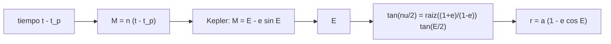

# B71-C13 — Anomalías orbitales

<!-- nav:top -->
[🏠 Programa](../../../../README.md) · [📚 Bloque B71](../../../tronco-comun/B71-mecanica-orbital-fundamental.md) · [← Anterior: B71-C12 — Argumento del periapsis](../B71-C12-argumento-del-periapsis/CLASE.md) · [Siguiente: B71-C14 — Ecuación de Kepler →](../B71-C14-ecuacion-de-kepler/CLASE.md)
<!-- /nav -->

## 1. Ubicación, nivel y alcance

Clase 13 del bloque B71. Nivel N3. Para saber dónde está un satélite en un instante hay que pasar del tiempo a la posición, y para eso hay tres ángulos: la anomalía media `M` (proporcional al tiempo), la excéntrica `E` (auxiliar) y la verdadera `ν` (la posición real). Aquí conviertes entre las tres, mides la ecuación del centro y calculas qué fracción del período se tarda en llegar a `ν = 90°`. Usas [C08](../B71-C08-orbitas-elipticas/CLASE.md) y [C12](../B71-C12-argumento-del-periapsis/CLASE.md). Las excentricidades distintas de la de Marte son ilustrativas.

## 2. Por qué esta clase existe

Confundir una anomalía con otra es el error más común al propagar órbitas. La decisión central: **¿cómo conviertes entre `ν`, `E` y `M` sin ambigüedad y cuánto difieren cuando `e` es grande?**

## 3. Lo que podrás hacer al terminar

1. Definir `ν`, `E` y `M` y sus rangos.
2. Convertir `ν ↔ E` con `tan(ν/2) = √((1 + e)/(1 − e)) tan(E/2)` y `E → M` con `M = E − e sin E`.
3. Comprobar la conversión de ida y vuelta en 1000 casos sintéticos.
4. Evaluar la ecuación del centro `ν − M ≈ 2e sin M + 1,25 e² sin 2M` y su error.
5. Calcular el tiempo desde el periapsis hasta una `ν` dada por dos vías.
6. Separar lo consultado (`e` de Marte) de lo ilustrativo y sintético.

La evidencia es la **tabla de anomalías de una órbita de excentricidad dada** del ejercicio 12 (sección 20).

## 4. Con qué llegas y cómo comprobarlo

1. ¿Qué es la excentricidad?
2. ¿Qué es el movimiento medio `n = 2π/T`?
3. ¿Qué es la función atan2?
4. ¿Qué es una serie truncada?
5. ¿Qué es una verificación por segunda vía?

<details>
<summary>Ver respuestas</summary>

1. El número que mide el achatamiento de la elipse. 2. La velocidad angular media: `n = 2π/T`, en rad/s. 3. Una función que devuelve el ángulo con el cuadrante correcto. 4. Una aproximación que conserva solo los primeros términos de un desarrollo. 5. Calcular lo mismo con otro método y comparar.
</details>

Con cuatro o cinco aciertos, sigue; si no, repasa los prerrequisitos.

## 5. Un caso de contexto y casos de referencia

En una órbita con `e = 0,0935` (la de Marte, ficha), una anomalía media de 90° corresponde a `E = 95,3340°` y `ν = 100,6526°`; con `e = 0,7402` (sintética), `M = 90°` da `ν = 157,1686°`. Ir del periapsis a `ν = 90°` toma el `0.2203` del período para `e = 0,0935` y solo el `0.0382` para `e = 0,7402`. Es el **ejemplo conductor**.

## 6. Vocabulario

La **anomalía verdadera** `ν` es el ángulo real desde el periapsis. La **excéntrica** `E` es el ángulo auxiliar sobre el círculo circunscrito. La **media** `M = n(t − t_p)` crece con el tiempo de forma uniforme. La **ecuación del centro** es `ν − M` como función de `M`. El **movimiento medio** es `n = √(μ/a³)`.

## 7. Modelo mental



*Descripción textual:* el tiempo da `M`; la ecuación de Kepler da `E`; la relación de semiángulos da `ν`, y de `E` sale el radio.

Analogía: un corredor que da vueltas a una pista elíptica con un cronómetro que avanza parejo (M); su posición angular real (ν) va más rápida en el extremo cercano y más lenta en el lejano. Límite: la pista elíptica no explica la anomalía excéntrica, que es una construcción geométrica.

## 8. La explicación, paso a paso

### 8.1 Las tres anomalías

`M = E − e sin E`. `E` y `ν` coinciden en 0 y 180°; en medio, `ν` va por delante de `E` si `e > 0`. Para `e = 0,0935`: `M = 45° → E = 49,0459°, ν = 53,2273°`; `90° → 95,3340°, 100,6526°`; `135° → 138,5465°, 141,9792°`. Para `e = 0,7402` (sintética): `45° → 87,3655°, 135,9462°`; `90° → 124,8177°, 157,1686°`; `135° → 153,7546°, 169,7058°`.

### 8.2 Ida y vuelta

La cadena `ν → E → M → E → ν` en 1000 casos (`e ∈ [0; 0,95]`, semilla 13) tiene un error máximo de `1.6e-14` rad. `E` desde `M` se obtiene con Newton (C14).

### 8.3 La ecuación del centro

Hasta orden `e²`, `ν − M ≈ 2e sin M + 1,25 e² sin 2M`. Para `e = 0,0935` el error máximo de la serie en 361 valores de `M` es `1.09e-03` rad, bajo la cota `3e³ = 2.45e-03` rad. Con `e = 0,7402` la serie ya no sirve: `ν − M` llega a 91° en la tabla.

### 8.4 Tiempo hasta una posición

La fracción del período hasta `ν = 90°` es `M/(2π)`. Para `e = 0,0935`: `0.220281`; la integral numérica de `dt = r² dν/h` da `0.220281` (diferencia `7.5e-12`). Para `e = 0,7402`: `0.038154` frente a `0.038154` (`1.8e-11`). En la órbita excéntrica, un cuarto de vuelta angular se recorre en solo el 3,8 % del período, y `M` correspondiente es `13.74°`.

## 9. Magnitudes, símbolos y unidades

| Símbolo | Qué es | Unidad | Valor / nota |
|---|---|---|---|
| `ν` | anomalía verdadera | grados | 0–360° |
| `E` | anomalía excéntrica | grados | 0–360° |
| `M` | anomalía media | grados | 0–360° |
| `n` | movimiento medio `√(μ/a³)` | rad/s | — |
| `e` | excentricidad | — | 0,0935 (ficha); 0,7402 (sintética) |

## 10. Convenciones y referencias

Ángulos desde el periapsis, en el sentido del movimiento; internamente en radianes. Dos cuerpos puntuales. `e = 0,0935` procede de la ficha de Marte; `e = 0,7402` es el de la órbita tipo Molniya sintética de B71‑C08; los 1000 pares (semilla 13) son sintéticos.

## 11. De dónde sale lo que afirmamos

| ID | Fuente | Localizador | Respalda | Estado |
|---|---|---|---|---|
| S1 | NASA/NSSDC, Mars Fact Sheet — https://nssdc.gsfc.nasa.gov/planetary/factsheet/marsfact.html (consultada 2026-11-10) | ficha completa leída | masa 0,64169 × 10²⁴ kg; radio medio 3389,5 km; a = 227,956 × 10⁶ km; e = 0,0935; período sidéreo 686,980 d; inclinación 1,848°; afelio 249,261 y perihelio 206,650 × 10⁶ km; velocidad de escape 5,03 km/s | Consultada |
| — | Relaciones estándar de mecánica orbital de esta clase | — | las verifica el laboratorio con una segunda vía | No consultada en una fuente concreta |

Límites: solo la excentricidad de Marte es un dato consultado; las demás son ilustrativas. La serie de la ecuación del centro se cita como desarrollo estándar sin consulta; su error se mide aquí.

## 12. Cómo ver el resultado

| Magnitud | Valor |
|---|---|
| error de ida y vuelta | 1.6e-14 rad |
| `ν` para `M = 90°`, `e = 0,0935` | 100,6526° |
| error de la serie (orden `e²`) | 1.09e-03 rad |
| fracción de `T` hasta `ν = 90°`, `e = 0,7402` | 0.0382 |
| integral numérica frente a Kepler | 1.8e-11 |

Descripción larga: las conversiones cierran a la precisión de la máquina; la serie de segundo orden funciona para `e` pequeña pero falla para `e` alta.

## 13. Ejemplo trabajado

**De `M = 90°` a `ν` con `e = 0,0935`.**

**Paso 1 · Kepler.** `E − 0,0935 sin E = π/2` ⟹ `E = 95,3340°`.

**Paso 2 · Semiángulos.** `tan(ν/2) = √(1,0935/0,9065) tan(47,6670°) = 1,0983 × 1,0968`.

**Paso 3 · Resultado.** `ν = 100,6526°`; la ecuación del centro vale `10,6526°`, cerca de `2e sin M = 10,7°`.

## 14. Distintas formas de describir el problema

**Por tiempo:** `M`. **Por geometría auxiliar:** `E`. **Por posición:** `ν`. **Por radio:** `r = a(1 − e cos E)`.

## 15. Práctica guiada

**Ejercicio 1 · con los pasos indicados.** Calcula `M` si `E = 90°` y `e = 0,5`. *Pasos:* `E − e sin E` en radianes.

<details><summary>Solución comentada</summary>

`π/2 − 0,5 = 1,0708 rad = 61,35°`.
</details>

**Ejercicio 2 · con una pista.** Predice `ν` si `E = 180°`. *Pista:* simetría.

<details><summary>Solución comentada</summary>

`ν = 180°` para cualquier `e`.
</details>

**Ejercicio 3 · casi autónomo.** ¿Por qué `ν − M` se anula en 0° y 180°? Mira la ecuación del centro.

<details><summary>Solución comentada</summary>

Porque `sin M = 0` y `sin 2M = 0` allí; en esos puntos las tres anomalías coinciden.
</details>

## 16. Práctica autónoma, transferencia e integrador

**Ejercicio 4 · autónomo.** Calcula `n` y el tiempo desde el periapsis hasta `M = 90°` para `T = 687 d`.

<details><summary>Solución comentada</summary>

`n = 2π/687 = 0,009146 rad/día`; `t = (π/2)/n = 171,75 d` (un cuarto de `T`).
</details>

**Ejercicio 5 · autónomo.** Con `e = 0,0935` y `M = 45°`, ¿cuánto vale `2e sin M`?

<details><summary>Solución comentada</summary>

`0,187 × 0,7071 = 0,1322 rad = 7,57°` (el término de orden `e²` suma 0,65°: total 8,2°).
</details>

**Ejercicio 6 · autónomo.** Si `e = 0,9`, ¿`E` o `ν` va más adelantada cerca del periapsis?

<details><summary>Solución comentada</summary>

`ν`: para `M` pequeño `ν ≫ E ≫ M`.
</details>

**Ejercicio 7 · autónomo.** ¿Qué fracción del período dura la mitad de la órbita (del periapsis al apoapsis)?

<details><summary>Solución comentada</summary>

0,5 (por simetría), con cualquier `e`.
</details>

**Ejercicio 8 · autónomo.** Con `r = a(1 − e cos E)` calcula `r` para `E = 95,334°`, `e = 0,0935`, `a = 227,956 × 10⁶ km`.

<details><summary>Solución comentada</summary>

`r = 227,956 × 10⁶(1 + 0,0935 × 0,0935) ≈ 229,94 × 10⁶ km`.
</details>

**Ejercicio 9 · transferencia.** **Transferencia.** **Transferencia.** Un código confunde `ν` con `M` y coloca un satélite de `e = 0,74` con 67° de error. ¿Cuándo es mayor ese error?

<details><summary>Solución comentada</summary>

Cerca de `M = 45°`, donde `ν − M = 91°` en la tabla; es mínimo en 0° y 180°.
</details>

**Ejercicio 10 · transferencia.** **Transferencia.** **Transferencia.** Un satélite excéntrico pasa solo el 3,8 % de su período en el primer cuarto de vuelta angular. ¿Qué implica para el seguimiento?

<details><summary>Solución comentada</summary>

Las mediciones son escasas cerca del periapsis y muy sensibles al tiempo; el error de tiempo se amplifica en posición.
</details>

**Ejercicio 11 · transferencia.** **Transferencia.** **Transferencia.** ¿Basta la serie de segundo orden para una órbita de `e = 0,3`?

<details><summary>Solución comentada</summary>

No siempre: el error crece como `e³`, ~`0,03 rad` (1,5°); mejor resolver la ecuación de Kepler (C14).
</details>

**Ejercicio 12 · integrador.** **Integrador.** **Integrador.** Elabora tu *tabla de anomalías de una órbita de excentricidad dada*: `M`, `E`, `ν` y `ν − M` en cinco valores, error de la serie y fracción del período hasta `ν = 90°`.

<details><summary>Solución comentada</summary>

Secciones 8.1–8.4 y la salida del laboratorio.
</details>

## 17. Laboratorio: conversiones entre ν, E y M

El script [anomalias.py](anomalias.py) convierte entre las tres anomalías en 1000 casos sintéticos, tabula dos excentricidades, mide el error de la ecuación del centro y calcula el tiempo hasta `ν = 90°` por dos vías (**comprueba** ida y vuelta < 1e-10, serie bajo `3e³` y diferencia de tiempos < 1e-8).

**Datos:** `e = 0,0935` de la ficha de Marte (consultada); `e = 0,7402` y los 1000 pares (semilla 13) **sintéticos**. **Predice antes de ejecutar:** ¿Qué fracción del período se tarda en llegar a `ν = 90°` con `e = 0,7402`? (Menos del 5 %.) **Ejecución del 2026-11-10 (Python 3.12.9):**

```text
Python 3.12.9 (biblioteca estandar)
Ida y vuelta nu -> E -> M -> E -> nu en 1000 casos SINTETICOS (semilla 13, e en [0, 0.95]): error maximo = 1.64e-14 rad
Tabla e = 0.0935 (Marte, ficha):
    M [deg]   E [deg]   nu [deg]   nu - M [deg]
       0.0     0.0000     0.0000       0.0000
      45.0    49.0459    53.2273       8.2273
      90.0    95.3340   100.6526      10.6526
     135.0   138.5465   141.9792       6.9792
     180.0   180.0000   180.0000       0.0000
Tabla e = 0.7402 (sintetica):
    M [deg]   E [deg]   nu [deg]   nu - M [deg]
       0.0     0.0000     0.0000       0.0000
      45.0    87.3655   135.9462      90.9462
      90.0   124.8177   157.1686      67.1686
     135.0   153.7546   169.7058      34.7058
     180.0   180.0000   180.0000       0.0000
Ecuacion del centro (e = 0.0935): error de la serie de 2.o orden = 1.09e-03 rad (cota 3 e^3 = 2.45e-03)
Fraccion del periodo para ir del periapsis a nu = 90 grados, e = 0.0935: kepleriana 0.220281 ; integral numerica 0.220281 ; dif 7.5e-12
Fraccion del periodo para ir del periapsis a nu = 90 grados, e = 0.7402: kepleriana 0.038154 ; integral numerica 0.038154 ; dif 1.8e-11
Pruebas superadas.
```

```bash
python programa/clases/B71/B71-C13-anomalias-orbitales/anomalias.py
```

**Límites:** dos cuerpos; la serie de segundo orden es solo ilustrativa; no se usa tiempo real ni calendario.

## 18. Errores frecuentes y cómo corregirlos

**Usar `ν` donde va `M` al calcular tiempos.** Se corrige con 8.4.

**Olvidar el cuadrante en la relación de semiángulos.** Se corrige con 8.1.

**Aplicar la serie de `e²` a órbitas muy excéntricas.** Se corrige con 8.3.

**Presentar `e = 0,7402` como una órbita real.** Se corrige con la sección 10.

## 19. Cómo sabrás que vas bien

Tras la sección 8: ¿qué fracción esperabas para `e = 0,7402` y cuál obtuviste? Si dudas, repasa el ejemplo 13. Tras el laboratorio: ¿qué comprueba? (ver la sección 17).

## 20. Qué entregas y cómo se evalúa

El producto es tu **tabla de anomalías de una órbita de excentricidad dada** (ejercicio 12).

| Criterio | Inicial | En desarrollo | Logrado | Destacado |
|---|---|---|---|---|
| Conceptos | Los confunde | Parciales | Distingue las tres anomalías | Explica los límites de la serie |
| Cálculo | Sin unidades | Con errores | Tabla con unidades | Calcula casos nuevos |
| Numérico | Sin comprobar | Un caso | Ida y vuelta y dos vías de tiempo | Interpreta las diferencias |
| Fuentes | Sin fuente | Sin fecha | Fuentes con fecha y estado | Declara lo sintético |
| Límites | No los nombra | Uno | Tres | Discute qué falta del modelo |

**Condiciones críticas (no se compensan con promedio):** rotular las excentricidades no consultadas como ilustrativas; declarar unidades angulares; citar solo lo consultado.

## 21. Ética, seguridad y límites

Clase educativa: los modelos son simplificados y sus datos son consultados, sintéticos o ilustrativos (rotulados); ningún resultado es una efeméride ni una predicción operativa ni sustituye a las herramientas de navegación de una misión. Accesibilidad: tablas equivalentes a las gráficas, fórmulas en texto, ejercicios sin conexión.

## 22. Para cerrar y seguir

Las tres anomalías se convierten con errores de `2e-14` rad y, con `e = 0,7402`, llegar a `ν = 90°` solo toma el `3.8%` del período. Queda una pregunta: ¿cómo se resuelve la ecuación de Kepler de forma fiable?

**Glosario español–inglés.** anomalía verdadera · *true anomaly* · anomalía excéntrica · *eccentric anomaly* · anomalía media · *mean anomaly* · ecuación del centro · *equation of the center*.

**Continuidad.** [B71-C14](../B71-C14-ecuacion-de-kepler/CLASE.md) resuelve la ecuación de Kepler.

**Referencias:** ver sección 11.

<!-- nav:bottom -->
---

[← Anterior: B71-C12 — Argumento del periapsis](../B71-C12-argumento-del-periapsis/CLASE.md) · [📚 Bloque B71](../../../tronco-comun/B71-mecanica-orbital-fundamental.md) · [Siguiente: B71-C14 — Ecuación de Kepler →](../B71-C14-ecuacion-de-kepler/CLASE.md)
<!-- /nav -->
