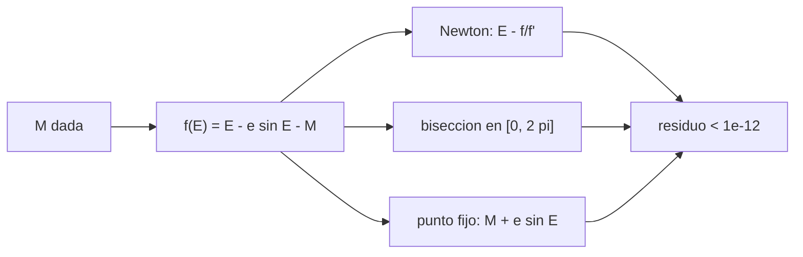

# B71-C14 — Ecuación de Kepler

<!-- nav:top -->
[🏠 Programa](../../../../README.md) · [📚 Bloque B71](../../../tronco-comun/B71-mecanica-orbital-fundamental.md) · [← Anterior: B71-C13 — Anomalías orbitales](../B71-C13-anomalias-orbitales/CLASE.md) · [Siguiente: B71-C15 — Velocidad de escape →](../B71-C15-velocidad-de-escape/CLASE.md)
<!-- /nav -->

## 1. Ubicación, nivel y alcance

Clase 14 del bloque B71. Nivel N3. La ecuación de Kepler `M = E − e sin E` liga el tiempo (a través de la anomalía media `M`) con la posición (a través de la anomalía excéntrica `E`) y no tiene solución en forma cerrada: se resuelve con métodos numéricos. Aquí comparas Newton, bisección y punto fijo en 2000 casos sintéticos, ves cómo elegir el valor inicial según `e` y resuelves la versión hiperbólica. Usas [C13](../B71-C13-anomalias-orbitales/CLASE.md). Todos los casos son sintéticos.

## 2. Por qué esta clase existe

Propagar una órbita kepleriana exige resolver esta ecuación miles de veces; un método que no converge en `e` alto rompe todo el cálculo. La decisión central: **¿qué solucionador y qué valor inicial usas para que converja siempre y con cuántas iteraciones?**

## 3. Lo que podrás hacer al terminar

1. Plantear `f(E) = E − e sin E − M = 0` y su derivada `1 − e cos E`.
2. Implementar Newton, bisección y punto fijo y medir su residuo e iteraciones.
3. Elegir el valor inicial según la excentricidad (`E₀ = M` o `E₀ = π`).
4. Detectar la lentitud del punto fijo para `e` cercana a 1.
5. Resolver la ecuación hiperbólica `M = e sinh H − H`.
6. Separar lo consultado (solo la `e` de Marte) de lo sintético (los 2000 casos).

La evidencia es la **informe de convergencia de tres solucionadores** del ejercicio 12 (sección 20).

## 4. Con qué llegas y cómo comprobarlo

1. ¿Qué es el método de Newton?
2. ¿Qué es el residuo de una ecuación?
3. ¿Qué es un punto fijo de una función?
4. ¿Qué es la anomalía media?
5. ¿Qué es una verificación por segunda vía?

<details>
<summary>Ver respuestas</summary>

1. Un método iterativo `x ← x − f(x)/f'(x)`. 2. El valor de `f` en la solución aproximada; ideal: 0. 3. Un valor `x` con `g(x) = x`. 4. `M = n(t − t_p)`, proporcional al tiempo desde el periapsis. 5. Calcular lo mismo con otro método y comparar.
</details>

Con cuatro o cinco aciertos, sigue; si no, repasa los prerrequisitos.

## 5. Un caso de contexto y casos de referencia

En 2000 pares `(M, e)` sintéticos (semilla 14, `e ≤ 0,999`), Newton con el valor inicial adecuado deja un residuo máximo de `8.9e-16` en `4.84` iteraciones de media y `9` como máximo; la bisección da `5.8e-15` en `50` iteraciones; el punto fijo no converge en 500 iteraciones en `13` casos. Es el **ejemplo conductor**; todos los casos son **sintéticos**.

## 6. Vocabulario

La **anomalía excéntrica** `E` y la **media** `M = E − e sin E`. El **residuo** es `f(E)` evaluado en la solución. **Newton** usa la derivada `1 − e cos E`. La **bisección** reduce a la mitad un intervalo con cambio de signo. El **punto fijo** itera `E ← M + e sin E`. La **ecuación hiperbólica** es `M = e sinh H − H`, con `H` la anomalía hiperbólica.

## 7. Modelo mental



*Descripción textual:* la misma ecuación se resuelve con tres métodos y todos se validan por el residuo; Newton es el más rápido, la bisección es segura y el punto fijo es lento cuando `e` es alta.

Analogía: buscar una calle a oscuras; Newton avanza guiado por la pendiente, la bisección parte la ciudad por la mitad cada vez y el punto fijo da pasos cortos que casi no avanzan si la calle es plana. Límite: la pendiente `1 − e cos E` puede ser casi cero y desorientar a Newton.

## 8. La explicación, paso a paso

### 8.1 La ecuación y su derivada

`f(E) = E − e sin E − M`, `f'(E) = 1 − e cos E`. Con `e < 1`, `f' > 0` y la solución es única en `[0, 2π]`. Si `e → 1` y `E → 0`, `f' → 0` y Newton se vuelve inestable.

### 8.2 Resultados en 2000 casos

- **Newton** (`E₀ = M` si `e < 0,8`, `E₀ = π` si no): residuo `8.9e-16`, iteraciones medias `4.84`, máximo `9`.
- **Bisección** en `[0, 2π]`: residuo `5.8e-15`, `50` iteraciones (para `10⁻¹⁴`), y difiere de Newton en `5.3e-15` rad.
- **Punto fijo**: `39.1` iteraciones de media, máximo `500` y `13` casos sin converger en 500.

### 8.3 El valor inicial

Con `E₀ = M` para todo `e`, Newton falla (residuo > `10⁻¹²`) en `1` casos de los 2000, por `e` alta con `M` pequeña. En el caso `M = 0,1 rad` el laboratorio muestra (iteraciones con `E₀ = π`, con `E₀ = M` y punto fijo): `e = 0,0935`: 5, 3, 11; `e = 0,74`: 8, 5, 70; `e = 0,99`: 8, 16, 70; `e = 0,999`: 8, 10, 68. `E₀ = π` converge siempre en ≤ 8 iteraciones.

### 8.4 El caso hiperbólico

`M = e sinh H − H` con `f' = e cosh H − 1 > 0` para `e > 1`. En 500 casos sintéticos (`e ∈ [1,01; 5]`, `M ∈ [−50, 50]`) el residuo relativo máximo es `4.8e-16` con `8` iteraciones como máximo, partiendo de `H₀ = asinh(M/e)`.

## 9. Magnitudes, símbolos y unidades

| Símbolo | Qué es | Unidad | Valor / nota |
|---|---|---|---|
| `M` | anomalía media | rad | 0–2π |
| `E` | anomalía excéntrica | rad | 0–2π |
| `e` | excentricidad | — | 0–0,999 (sintético) |
| `f(E)` | residuo | rad | 8.9e-16 (máx.) |
| `H` | anomalía hiperbólica | rad | caso `e > 1` |

## 10. Convenciones y referencias

Ángulos en radianes; sin dependencia de marco ni de unidades físicas. Tolerancia de parada `10⁻¹⁴` en `ΔE`; residuo validado `< 10⁻¹²`. Semilla 14 para los 2000 pares y para los 500 hiperbólicos. Solo la `e = 0,0935` de la tabla procede de la ficha de Marte; el resto es sintético.

## 11. De dónde sale lo que afirmamos

| ID | Fuente | Localizador | Respalda | Estado |
|---|---|---|---|---|
| S1 | NASA/NSSDC, Mars Fact Sheet — https://nssdc.gsfc.nasa.gov/planetary/factsheet/marsfact.html (consultada 2026-11-10) | ficha completa leída | masa 0,64169 × 10²⁴ kg; radio medio 3389,5 km; a = 227,956 × 10⁶ km; e = 0,0935; período sidéreo 686,980 d; inclinación 1,848°; afelio 249,261 y perihelio 206,650 × 10⁶ km; velocidad de escape 5,03 km/s | Consultada |
| — | Relaciones estándar de mecánica orbital de esta clase | — | las verifica el laboratorio con una segunda vía | No consultada en una fuente concreta |

Límites: no se consultó ningún algoritmo publicado (p. ej. valores iniciales de la literatura); los casos son sintéticos y el número de iteraciones depende del valor inicial elegido aquí.

## 12. Cómo ver el resultado

| Magnitud | Valor |
|---|---|
| residuo máximo de Newton | 8.9e-16 |
| iteraciones de Newton (media / máx.) | 4.84 / 9 |
| bisección: iteraciones | 50 |
| punto fijo sin converger | 13 de 2000 |
| hiperbólica: residuo máx. | 4.8e-16 |

Descripción larga: Newton converge en unas 5 iteraciones, la bisección en 50 siempre y el punto fijo falla en algunos casos de `e` alta.

## 13. Ejemplo trabajado

**Resolver `M = 0,1 rad` con `e = 0,74`.**

**Paso 1 · Inicio.** `E₀ = π`.

**Paso 2 · Iteración.** `E ← E − (E − 0,74 sin E − 0,1)/(1 − 0,74 cos E)`; converge en 8 iteraciones.

**Paso 3 · Resultado.** `E = 0,362219 rad`; residuo `8,3 × 10⁻¹⁷`. El punto fijo necesita 70 iteraciones para el mismo caso.

## 14. Distintas formas de describir el problema

**Por Newton:** `E ← E − f/f'`. **Por bisección:** intervalo. **Por punto fijo:** `E ← M + e sin E`. **Por residuo:** verificación común.

## 15. Práctica guiada

**Ejercicio 1 · con los pasos indicados.** Evalúa `f` y `f'` en `E = 1` para `e = 0,5`, `M = 0,8`. *Pasos:* sustituye.

<details><summary>Solución comentada</summary>

`f = 1 − 0,5·0,8415 − 0,8 = −0,2207`; `f' = 1 − 0,5·0,5403 = 0,7298`.
</details>

**Ejercicio 2 · con una pista.** Da un paso de Newton desde ese `E = 1`. *Pista:* `E − f/f'`.

<details><summary>Solución comentada</summary>

`E = 1 + 0,2207/0,7298 = 1,3024`.
</details>

**Ejercicio 3 · casi autónomo.** ¿Por qué la bisección siempre converge? Mira el cambio de signo de `f`.

<details><summary>Solución comentada</summary>

`f(0) = −M ≤ 0` y `f(2π) = 2π − M ≥ 0`, y `f` es continua y monótona: hay una única raíz y el intervalo se reduce a la mitad.
</details>

## 16. Práctica autónoma, transferencia e integrador

**Ejercicio 4 · autónomo.** ¿Cuántas iteraciones de bisección hacen falta para `10⁻¹⁴` desde un intervalo de 6,28?

<details><summary>Solución comentada</summary>

`log₂(6,28/10⁻¹⁴) ≈ 49,5`: 50.
</details>

**Ejercicio 5 · autónomo.** Con `e = 0,3` y `M = 0` ¿cuánto vale `E`?

<details><summary>Solución comentada</summary>

`E = 0`: `f(0) = 0`.
</details>

**Ejercicio 6 · autónomo.** En el punto fijo, la contracción vale `|e cos E|`. ¿Cuándo es lenta?

<details><summary>Solución comentada</summary>

Cuando `|e cos E|` está cerca de 1: `e` alta y `E` cerca de 0.
</details>

**Ejercicio 7 · autónomo.** Resuelve `M = e sinh H − H` con `e = 2`, `M = 0` .

<details><summary>Solución comentada</summary>

`H = 0`: `2·0 − 0 = 0`.
</details>

**Ejercicio 8 · autónomo.** Para `e = 0,999` y `M = 0,1`, compara el número de iteraciones de Newton con `E₀ = π` y el punto fijo (laboratorio).

<details><summary>Solución comentada</summary>

8 frente a 68.
</details>

**Ejercicio 9 · transferencia.** **Transferencia.** **Transferencia.** Un propagador usa `E₀ = M` para todas las órbitas y falla ocasionalmente en una órbita muy excéntrica. ¿Cómo lo corriges?

<details><summary>Solución comentada</summary>

Usa `E₀ = π` para `e ≥ 0,8` (o una aproximación mejor) y añade un tope de iteraciones con comprobación del residuo.
</details>

**Ejercicio 10 · transferencia.** **Transferencia.** **Transferencia.** Un colega tolera residuos de `10⁻⁶` rad en la ecuación de Kepler para un satélite en LEO. ¿Cuánta posición es eso?

<details><summary>Solución comentada</summary>

Con `r ≈ 7000 km`, `10⁻⁶ rad` de error en la anomalía equivale a ≈ 7 m (cota; órbita sintética circular).
</details>

**Ejercicio 11 · transferencia.** **Transferencia.** **Transferencia.** ¿Por qué se valida con el residuo y no solo comparando métodos?

<details><summary>Solución comentada</summary>

Dos métodos pueden compartir un fallo (p. ej. misma `f` mal escrita); el residuo exige que la solución satisfaga la ecuación original.
</details>

**Ejercicio 12 · integrador.** **Integrador.** **Integrador.** Elabora tu *informe de convergencia de tres solucionadores*: tabla de residuo e iteraciones para Newton, bisección y punto fijo, efecto del valor inicial, casos que fallan y solución hiperbólica.

<details><summary>Solución comentada</summary>

Secciones 8.1–8.4 y la salida del laboratorio.
</details>

## 17. Laboratorio: Newton, bisección y punto fijo

El script [ecuacion_kepler.py](ecuacion_kepler.py) resuelve la ecuación de Kepler elíptica en 2000 casos con tres métodos y la hiperbólica en 500 casos (**comprueba** residuo < 1e-12, acuerdo Newton–bisección < 1e-11 y que el punto fijo es el más lento).

**Datos:** solo `e = 0,0935` procede de la ficha de Marte (consultada); todos los pares `(M, e)` son **sintéticos** (semilla 14). **Predice antes de ejecutar:** ¿Cuántas iteraciones necesita la bisección para `10⁻¹⁴`? (50.) **Ejecución del 2026-11-10 (Python 3.12.9):**

```text
Python 3.12.9 (biblioteca estandar)
2000 pares (M, e) SINTETICOS (semilla 14), e en [0, 0.999]
  Newton (E0 = M si e < 0.8, E0 = pi si no): residuo maximo = 8.9e-16 ; iteraciones medias = 4.84 ; maximas = 9
  Biseccion: residuo maximo = 5.8e-15 ; iteraciones = 50 (fijas) ; diferencia maxima con Newton = 5.3e-15 rad
  Punto fijo: iteraciones medias = 39.1 ; maximas = 500 ; sin converger en 500 iteraciones: 13 casos
  Newton con E0 = M para todo e: casos con residuo > 1e-12 = 1
Caso M = 0.1 rad:  e    E [rad]   iter(E0=pi)  iter(E0=M)  iter(punto fijo)  converge   residuo
                0.0935  0.110291        5            3           11     si     0.0e+00
                0.7400  0.362219        8            5           70     si     8.3e-17
                0.9900  0.831660        8           16           70     si     2.8e-17
                0.9990  0.851551        8           10           68     si     2.8e-17
Hiperbolica M = e sinh H - H (500 casos SINTETICOS, e en [1.01, 5], M en [-50, 50]): residuo relativo maximo = 4.8e-16 ; iteraciones maximas = 8
Pruebas superadas.
```

```bash
python programa/clases/B71/B71-C14-ecuacion-de-kepler/ecuacion_kepler.py
```

**Límites:** no se estudian valores iniciales de la literatura ni aceleraciones de orden superior; el punto fijo se corta a 500 iteraciones.

## 18. Errores frecuentes y cómo corregirlos

**Usar `E₀ = M` siempre.** Se corrige con 8.3.

**Aceptar la solución sin comprobar el residuo.** Se corrige con 8.2.

**Olvidar que la ecuación hiperbólica usa `sinh`.** Se corrige con 8.4.

**Confundir `M` con `E`.** Se corrige con el ejemplo 13.

## 19. Cómo sabrás que vas bien

Tras la sección 8: ¿cuántas iteraciones esperabas para la bisección y cuántas obtuviste? Si dudas, repasa el ejemplo 13. Tras el laboratorio: ¿qué comprueba? (ver la sección 17).

## 20. Qué entregas y cómo se evalúa

El producto es tu **informe de convergencia de tres solucionadores** (ejercicio 12).

| Criterio | Inicial | En desarrollo | Logrado | Destacado |
|---|---|---|---|---|
| Conceptos | Los confunde | Parciales | Plantea y resuelve la ecuación | Explica los fallos |
| Cálculo | Sin unidades | Con errores | Residuo e iteraciones | Calcula casos nuevos |
| Numérico | Sin comprobar | Un caso | Tres métodos validados | Interpreta las diferencias |
| Fuentes | Sin fuente | Sin fecha | Fuentes con fecha y estado | Declara lo sintético |
| Límites | No los nombra | Uno | Tres | Discute qué falta del modelo |

**Condiciones críticas (no se compensan con promedio):** rotular los casos como sintéticos; validar siempre por residuo; citar solo lo consultado.

## 21. Ética, seguridad y límites

Clase educativa: los modelos son simplificados y sus datos son consultados, sintéticos o ilustrativos (rotulados); ningún resultado es una efeméride ni una predicción operativa ni sustituye a las herramientas de navegación de una misión. Accesibilidad: tablas equivalentes a las gráficas, fórmulas en texto, ejercicios sin conexión.

## 22. Para cerrar y seguir

Newton resuelve la ecuación de Kepler en 4.8 iteraciones de media con residuo `9e-16`, mientras que el punto fijo falla en `13` de 2000 casos. Queda una pregunta: ¿qué velocidad hace falta para dejar de estar ligado?

**Glosario español–inglés.** ecuación de Kepler · *Kepler's equation* · residuo · *residual* · bisección · *bisection method* · punto fijo · *fixed-point iteration*.

**Continuidad.** [B71-C15](../B71-C15-velocidad-de-escape/CLASE.md) estudia la velocidad de escape.

**Referencias:** ver sección 11.

<!-- nav:bottom -->
---

[← Anterior: B71-C13 — Anomalías orbitales](../B71-C13-anomalias-orbitales/CLASE.md) · [📚 Bloque B71](../../../tronco-comun/B71-mecanica-orbital-fundamental.md) · [Siguiente: B71-C15 — Velocidad de escape →](../B71-C15-velocidad-de-escape/CLASE.md)
<!-- /nav -->
