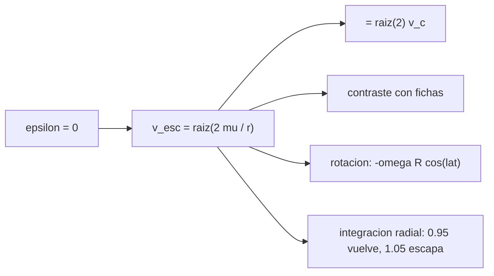

# B71-C15 — Velocidad de escape

<!-- nav:top -->
[🏠 Programa](../../../../README.md) · [📚 Bloque B71](../../../tronco-comun/B71-mecanica-orbital-fundamental.md) · [← Anterior: B71-C14 — Ecuación de Kepler](../B71-C14-ecuacion-de-kepler/CLASE.md) · [Siguiente: B71-C16 — Período orbital →](../../../tronco-comun/B71-mecanica-orbital-fundamental.md#b71-c16)
<!-- /nav -->

## 1. Ubicación, nivel y alcance

Clase 15 del bloque B71. Nivel N3. La velocidad de escape es la que hace nula la energía orbital en un punto: `v_esc = √(2μ/r)`. Aquí la calculas para la Tierra, Marte y la Luna, la contrastas con las fichas de la NASA, estimas lo que aporta la rotación terrestre, la calculas desde el Sol a 1 UA y la verificas lanzando cuerpos con 5 % más y 5 % menos en una integración radial. Usas [C04](../B71-C04-parametro-gravitacional/CLASE.md), [C05](../B71-C05-energia-orbital-especifica/CLASE.md) y [C09](../B71-C09-orbitas-parabolicas-e-hiperbolicas/CLASE.md). `μ` de Marte y la Luna es derivado.

## 2. Por qué esta clase existe

La velocidad de escape es el umbral entre una órbita cerrada y una trayectoria abierta. La decisión central: **¿qué velocidad hay que alcanzar para no volver y cuánto la reduce partir de una altura o de una superficie que gira?**

## 3. Lo que podrás hacer al terminar

1. Calcular `v_esc = √(2μ/r)` y reconocer `v_esc = √2 v_c`.
2. Contrastar con las velocidades de escape de las fichas de la NASA.
3. Estimar la contribución de la rotación en el ecuador y a una latitud ilustrativa.
4. Calcular el escape desde 400 km de altitud, desde GEO y desde el Sol a 1 UA.
5. Verificar con RK4 que con 0,95 `v_esc` el cuerpo regresa y con 1,05 `v_esc` se aleja.
6. Separar lo consultado (fichas, `μ`) de lo derivado y lo ilustrativo.

La evidencia es la **tabla de velocidades de escape con su contraste** del ejercicio 12 (sección 20).

## 4. Con qué llegas y cómo comprobarlo

1. ¿Qué es la energía potencial gravitatoria?
2. ¿Qué es la velocidad circular?
3. ¿Qué es la energía orbital específica?
4. ¿Qué es la velocidad de rotación de un punto del ecuador?
5. ¿Qué es una verificación por segunda vía?

<details>
<summary>Ver respuestas</summary>

1. `−μ/r`, con cero en el infinito. 2. `√(μ/r)`. 3. `v²/2 − μ/r`. 4. `2πR/T`, con `T` el período de rotación. 5. Calcular lo mismo con otro método y comparar.
</details>

Con cuatro o cinco aciertos, sigue; si no, repasa los prerrequisitos.

## 5. Un caso de contexto y casos de referencia

Con el radio ecuatorial de la ficha, la Tierra da `11179.87 m/s` (ficha: 11 186 m/s, diferencia `-5.5e-04`), Marte `5027.04 m/s` (5,03 km/s) y la Luna `2375.71 m/s` (2,38 km/s). Desde 400 km de altitud basta `10845.0 m/s`. Es el **ejemplo conductor**; `μ` de Marte y la Luna es **derivado**.

## 6. Vocabulario

La **velocidad de escape** `√(2μ/r)` anula la energía total. Es `√2` veces la **circular**. El **exceso hiperbólico** `v∞` es lo que sobra tras escapar. La **velocidad de rotación** `ωR cos φ` aporta en lanzamientos hacia el este. Se ignora la atmósfera.

## 7. Modelo mental



*Descripción textual:* anular la energía da el umbral; es `√2` veces la circular, se contrasta con las fichas, la rotación lo reduce algo y la integración confirma el umbral.

Analogía: lanzar una piedra hacia arriba; con poca velocidad vuelve, con la justa se frena justo en el infinito y con más se va. Límite: aquí no hay aire y la «piedra» no tiene propulsión durante el vuelo, a diferencia de un cohete real.

## 8. La explicación, paso a paso

### 8.1 Fórmula y comparación con las fichas

Igualando `v²/2 = μ/r`: `v_esc = √(2μ/r) = √2 v_c`. Tierra: `11179.87 m/s` (diferencia con la ficha `-5.5e-04`); Marte: `5027.04 m/s` (`-5.9e-04`); Luna: `2375.71 m/s` (`-1.8e-03`). Las diferencias son de redondeo de las fichas y, para Marte y la Luna, de `μ` derivado. La relación con la circular rasante terrestre (`7905.37 m/s`) cumple `√2 v_c` con diferencia `0e+00`.

### 8.2 Desde una altura y desde el Sol

A 400 km de altitud, `v_esc = 10845.01 m/s`; desde la distancia geoestacionaria, `4348.23 m/s`. Desde el Sol a 1 UA, `v_esc = 42121.9 m/s`, mientras la Tierra orbita a `29784.7 m/s` (ficha: 29,78 km/s, diferencia `1.6e-04`): faltan `12337.2 m/s`.

### 8.3 Rotación

En el ecuador la rotación aporta `ωR = 465.10 m/s`, el `4.16 %` de `v_esc`; a 28,5° de latitud (ilustrativa), `408.74 m/s`. Solo ayuda con lanzamiento hacia el este; no incluye pérdidas por gravedad ni arrastre, que dominan en un lanzamiento real.

### 8.4 Comprobación por integración

Lanzando radialmente desde el radio ecuatorial sin atmósfera, con `1,05 v_esc` el cuerpo está a `3229178 km` a los 10 días con `v = 3613.63 m/s`, igual a la de energía `3613.63` (`2e-07`), y `v∞ = 3579.3 m/s`. Con `0,95 v_esc` alcanza `65417 km` y regresa; el teórico es `65417 km` (`3e-07`).

## 9. Magnitudes, símbolos y unidades

| Símbolo | Qué es | Unidad | Valor / nota |
|---|---|---|---|
| `v_esc` | velocidad de escape | m/s | 11179.9 (Tierra, superficie) |
| `μ` | parámetro gravitacional | m³/s² | 3,986004 × 10¹⁴ (Tierra) |
| `r` | distancia al centro | m | 6,378137 × 10⁶ |
| `v_rot` | velocidad de rotación ecuatorial | m/s | 465.1 |
| `v∞` | exceso de velocidad | m/s | 3579.3 (con 1,05 `v_esc`) |

## 10. Convenciones y referencias

Marco inercial del cuerpo, SI; superficie esférica sin atmósfera ni relieve. Se usa el radio ecuatorial de la ficha de la Tierra (6378,137 km) y radios medios para Marte y la Luna. `μ` de la Tierra y del Sol, nominales de la IAU; `μ` de Marte y la Luna, derivado (`G·M`). La latitud de 28,5° y los factores 0,95 y 1,05 son ilustrativos.

## 11. De dónde sale lo que afirmamos

| ID | Fuente | Localizador | Respalda | Estado |
|---|---|---|---|---|
| S1 | NIST, CODATA 2022 (allascii.txt) — https://physics.nist.gov/cuu/Constants/Table/allascii.txt (consultada 2026-11-10) | líneas de la constante de gravitación y de la aceleración estándar | G = 6,674 30 × 10⁻¹¹ m³ kg⁻¹ s⁻² (incertidumbre 0,000 15 × 10⁻¹¹); gₙ = 9,806 65 m/s² (exacta) | Consultada |
| S2 | IAU 2015 Resolución B3, Mamajek et al., arXiv:1510.07674 — https://arxiv.org/abs/1510.07674 (PDF leído con PyMuPDF, consultada 2026-11-10) | tabla de constantes nominales | (GM)ˢᵘⁿ = 1,327 124 4 × 10²⁰ m³ s⁻² y (GM)ᵀⁱᵉʳʳᵃ = 3,986 004 × 10¹⁴ m³ s⁻² (nominales, exactos); R_ecuatorial de la Tierra = 6,3781 × 10⁶ m | Consultada |
| S3 | NASA/NSSDC, Earth Fact Sheet — https://nssdc.gsfc.nasa.gov/planetary/factsheet/earthfact.html (consultada 2026-11-10) | ficha completa leída | masa 5,9722 × 10²⁴ kg; radio medio 6371,000 km; radio ecuatorial 6378,137 km; rotación sidérea 23,9345 h; a = 149,598 × 10⁶ km; e = 0,0167; velocidad de escape 11,186 km/s; g media 9,820 m/s² | Consultada |
| S4 | NASA/NSSDC, Mars Fact Sheet — https://nssdc.gsfc.nasa.gov/planetary/factsheet/marsfact.html (consultada 2026-11-10) | ficha completa leída | masa 0,64169 × 10²⁴ kg; radio medio 3389,5 km; a = 227,956 × 10⁶ km; e = 0,0935; período sidéreo 686,980 d; inclinación 1,848°; afelio 249,261 y perihelio 206,650 × 10⁶ km; velocidad de escape 5,03 km/s | Consultada |
| S5 | NASA/NSSDC, Moon Fact Sheet — https://nssdc.gsfc.nasa.gov/planetary/factsheet/moonfact.html (consultada 2026-11-10) | ficha completa leída | masa 0,07346 × 10²⁴ kg; radio medio 1737,4 km; a = 0,3844 × 10⁶ km; e = 0,0549; período 27,3217 d; inclinación a la eclíptica 5,145°; velocidad de escape 2,38 km/s | Consultada |
| — | Relaciones estándar de mecánica orbital de esta clase | — | las verifica el laboratorio con una segunda vía | No consultada en una fuente concreta |

Límites: las velocidades de las fichas están redondeadas a 3–5 cifras; no se consultaron `μ` de seguimiento de Marte ni de la Luna. No se modelan pérdidas de un lanzamiento real.

## 12. Cómo ver el resultado

| Magnitud | Valor |
|---|---|
| `v_esc` Tierra / ficha | 11179.87 / 11 186 m/s |
| `v_esc` Marte / Luna | 5027.0 / 2375.7 m/s |
| rotación ecuatorial | 465.1 m/s (4.16 %) |
| escape desde el Sol a 1 UA | 42122 m/s |
| radio máximo con 0,95 `v_esc` | 65417 km |

Descripción larga: los tres cuerpos concuerdan con las fichas a menos del 0,2 %; la rotación aporta el 4 % y el umbral se confirma por integración.

## 13. Ejemplo trabajado

**Escape de Marte.**

**Paso 1 · `μ`.** `μ = G M = 6,6743 × 10⁻¹¹ × 0,64169 × 10²⁴ = 4,2828 × 10¹³ m³/s²` (derivado).

**Paso 2 · Radio.** `R = 3389,5 km`.

**Paso 3 · Velocidad.** `v_esc = √(2 × 4,2828 × 10¹³/3,3895 × 10⁶) = 5027.04 m/s`; la ficha da 5030 m/s (`-5.9e-04`).

## 14. Distintas formas de describir el problema

**Por energía:** `ε = 0`. **Por circular:** `√2 v_c`. **Por ficha:** valor tabulado. **Por integración:** umbral numérico.

## 15. Práctica guiada

**Ejercicio 1 · con los pasos indicados.** Calcula `v_esc` de un cuerpo con `μ = 10¹⁴` a `r = 10⁷ m`. *Pasos:* `√(2μ/r)`.

<details><summary>Solución comentada</summary>

`√(2 × 10⁷) = 4472 m/s`.
</details>

**Ejercicio 2 · con una pista.** Predice `v_esc` a 400 km. *Pista:* `√2 × 7668,6`.

<details><summary>Solución comentada</summary>

`10 845 m/s`.
</details>

**Ejercicio 3 · casi autónomo.** ¿Por qué `v_esc = √2 v_c`? Iguala las energías.

<details><summary>Solución comentada</summary>

`v_c²/2 − μ/r = −μ/(2r)`; para llegar a 0 hay que doblar `v²`: `v_esc² = 2 v_c²`.
</details>

## 16. Práctica autónoma, transferencia e integrador

**Ejercicio 4 · autónomo.** Calcula `v_esc` si el radio se cuadruplica.

<details><summary>Solución comentada</summary>

Se reduce a la mitad.
</details>

**Ejercicio 5 · autónomo.** Con `v_rot = 465 m/s`, ¿qué porcentaje de `v_esc` aporta?

<details><summary>Solución comentada</summary>

`465/11 180 = 4,2 %`.
</details>

**Ejercicio 6 · autónomo.** Calcula el `Δv` desde la órbita de la Tierra para escapar del Sol (laboratorio).

<details><summary>Solución comentada</summary>

`12337 m/s`.
</details>

**Ejercicio 7 · autónomo.** Si un cuerpo sale con `v = 1,05 v_esc`, ¿cuánto vale `v∞`?

<details><summary>Solución comentada</summary>

`√(1,1025 − 1) v_esc = 0,32 v_esc = 3579 m/s`.
</details>

**Ejercicio 8 · autónomo.** ¿Qué radio máximo alcanza un cuerpo lanzado con `0,95 v_esc`?

<details><summary>Solución comentada</summary>

`r_max = r₀/(1 − 0,9025) = 10,26 r₀ = 65 417 km` (con `r₀ = 6378,137 km`).
</details>

**Ejercicio 9 · transferencia.** **Transferencia.** **Transferencia.** Un colega dice que «para escapar de la Tierra hay que ir a 11,2 km/s en la superficie». ¿Qué omite?

<details><summary>Solución comentada</summary>

La atmósfera y las pérdidas por gravedad y arrastre; los vehículos reales no escapan por un impulso instantáneo desde la superficie.
</details>

**Ejercicio 10 · transferencia.** **Transferencia.** **Transferencia.** Un satélite en GEO necesita menos Δv para escapar que uno en LEO. ¿Es así?

<details><summary>Solución comentada</summary>

El escape desde GEO exige `√2 v_c(GEO) − v_c(GEO) = 1273 m/s` de impulso, frente a 3176 m/s desde 400 km; ambos son números de este modelo.
</details>

**Ejercicio 11 · transferencia.** **Transferencia.** **Transferencia.** ¿Se puede usar el `μ` derivado de la Luna para planear una misión lunar?

<details><summary>Solución comentada</summary>

No: su precisión no es la del valor de seguimiento, que no se consultó; solo sirve para orden de magnitud.
</details>

**Ejercicio 12 · integrador.** **Integrador.** **Integrador.** Elabora tu *tabla de velocidades de escape con su contraste*: Tierra, Marte, Luna, Sol a 1 UA y alturas dadas, con diferencia con las fichas, rotación y la verificación por integración.

<details><summary>Solución comentada</summary>

Secciones 8.1–8.4 y la salida del laboratorio.
</details>

## 17. Laboratorio: escape en tres cuerpos y verificación radial

El script [escape.py](escape.py) calcula `v_esc` para tres cuerpos y para el Sol a 1 UA, estima el aporte de la rotación e integra lanzamientos radiales con `0,95` y `1,05 v_esc` (**comprueba** diferencia con fichas < 5e-3, `√2 v_c` exacto y energía conservada).

**Datos:** `G`, `μ` e radio de la IAU/CODATA y fichas de la NASA (consultados); `μ` de Marte y la Luna **derivados**; los factores 0,95/1,05 y la latitud de 28,5° **ilustrativos**. **Predice antes de ejecutar:** ¿Qué porcentaje de `v_esc` aporta la rotación en el ecuador? (≈ 4 %.) **Ejecución del 2026-11-10 (Python 3.12.9):**

```text
Python 3.12.9 (biblioteca estandar)
 cuerpo   v_esc calculada [m/s]   ficha NASA [m/s]   diferencia relativa
 Tierra        11179.87              11186          -5.48e-04
 Marte          5027.04               5030          -5.88e-04
 Luna           2375.71               2380          -1.80e-03
sqrt(2) v_circular rasante (Tierra) = 11179.875 m/s ; dif = 0.0e+00
Sol a 1 UA: v_esc = 42121.9 m/s ; v_orbital = 29784.7 m/s (ficha 29780, dif 1.6e-04) ; falta 12337.2 m/s
Rotacion terrestre (ecuador, T sidereo 23.9345 h): 465.10 m/s = 4.16 % de v_esc ; a 28.5 grados de latitud (ilustrativa): 408.74 m/s
Escape desde 400 km de altitud: 10845.01 m/s ; desde la distancia geoestacionaria: 4348.23 m/s
Integracion radial RK4 (10 d, sin atmosfera, desde el radio ecuatorial):
  v = 1.05 v_esc: radio alcanzado en 10 d = 3229178 km (sigue alejandose) ; v final = 3613.63 m/s ; por energia = 3613.63 m/s ; dif = 1.9e-07 ; v_inf = 3579.3 m/s
  v = 0.95 v_esc: radio maximo = 65417 km ; teorico = 65417 km ; dif = 3.2e-07
Pruebas superadas.
```

```bash
python programa/clases/B71/B71-C15-velocidad-de-escape/escape.py
```

**Límites:** superficie esférica sin atmósfera; lanzamiento radial impulsivo; sin otros cuerpos.

## 18. Errores frecuentes y cómo corregirlos

**Confundir escape y velocidad orbital.** Se corrige con 8.1.

**Olvidar que la ficha es un valor redondeado.** Se corrige con 8.1.

**Sumar la rotación sin considerar la dirección.** Se corrige con 8.3.

**Presentar el escape impulsivo como un lanzamiento real.** Se corrige con la sección 10.

## 19. Cómo sabrás que vas bien

Tras la sección 8: ¿qué porcentaje esperabas para la rotación y cuál obtuviste? Si dudas, repasa el ejemplo 13. Tras el laboratorio: ¿qué comprueba? (ver la sección 17).

## 20. Qué entregas y cómo se evalúa

El producto es tu **tabla de velocidades de escape con su contraste** (ejercicio 12).

| Criterio | Inicial | En desarrollo | Logrado | Destacado |
|---|---|---|---|---|
| Conceptos | Los confunde | Parciales | Deduce `v_esc` | Explica los límites |
| Cálculo | Sin unidades | Con errores | Tabla con unidades | Calcula casos nuevos |
| Numérico | Sin comprobar | Un caso | Fichas e integración | Interpreta las diferencias |
| Fuentes | Sin fuente | Sin fecha | Fuentes con fecha y estado | Declara lo derivado e ilustrativo |
| Límites | No los nombra | Uno | Tres | Discute qué falta del modelo |

**Condiciones críticas (no se compensan con promedio):** rotular lo derivado e ilustrativo; declarar unidades y marco; no presentar el escape impulsivo como un lanzamiento real; citar solo lo consultado.

## 21. Ética, seguridad y límites

Clase educativa: los modelos son simplificados y sus datos son consultados, sintéticos o ilustrativos (rotulados); ningún resultado es una efeméride ni una predicción operativa ni sustituye a las herramientas de navegación de una misión. Accesibilidad: tablas equivalentes a las gráficas, fórmulas en texto, ejercicios sin conexión.

## 22. Para cerrar y seguir

`v_esc` coincide con las fichas a `-5e-04` en la Tierra, la rotación aporta el `4.2 %` y la integración confirma el umbral. Queda una pregunta: ¿cuánto dura una vuelta en cada órbita?

**Glosario español–inglés.** velocidad de escape · *escape velocity* · velocidad circular · *circular velocity* · exceso hiperbólico · *hyperbolic excess* · pérdidas por gravedad · *gravity losses*.

**Continuidad.** [B71-C16](../B71-C16-periodo-orbital/CLASE.md) estudia el período orbital.

**Referencias:** ver sección 11.

<!-- nav:bottom -->
---

[← Anterior: B71-C14 — Ecuación de Kepler](../B71-C14-ecuacion-de-kepler/CLASE.md) · [📚 Bloque B71](../../../tronco-comun/B71-mecanica-orbital-fundamental.md) · [Siguiente: B71-C16 — Período orbital →](../../../tronco-comun/B71-mecanica-orbital-fundamental.md#b71-c16)
<!-- /nav -->
