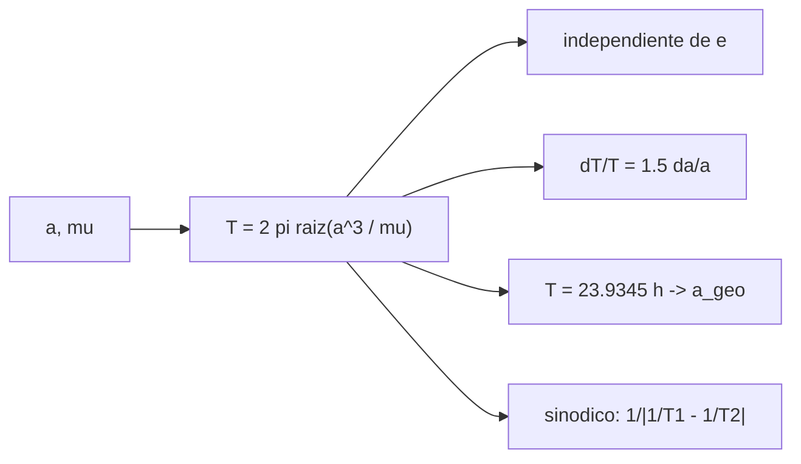

# B71-C16 — Período orbital

<!-- nav:top -->
[🏠 Programa](../../../../README.md) · [📚 Bloque B71](../../../tronco-comun/B71-mecanica-orbital-fundamental.md) · [← Anterior: B71-C15 — Velocidad de escape](../B71-C15-velocidad-de-escape/CLASE.md) · [Siguiente: B71-C17 — Movimientos en planos orbitales →](../B71-C17-movimientos-en-planos-orbitales/CLASE.md)
<!-- /nav -->

## 1. Ubicación, nivel y alcance

Clase 16 del bloque B71. Nivel N3. El período orbital `T = 2π√(a³/μ)` solo depende del semieje mayor: dos órbitas con el mismo `a` y distinta excentricidad tardan lo mismo. Aquí lo calculas, lo contrastas con los períodos de las fichas de la Tierra, Marte y la Luna, lo mides integrando órbitas de excentricidad 0, 0,3 y 0,7, estimas su sensibilidad a `a` y calculas el período sinódico Tierra–Marte. Usas [C01](../B71-C01-leyes-de-kepler/CLASE.md) y [C07](../B71-C07-orbitas-circulares/CLASE.md). Las órbitas LEO y de prueba son sintéticas.

## 2. Por qué esta clase existe

El período fija cuántas veces pasa un satélite por un punto y cada cuánto se alinean dos planetas. La decisión central: **¿qué semieje da un período dado, qué tan sensible es a errores en `a` y qué distingue el período sidéreo del sinódico?**

## 3. Lo que podrás hacer al terminar

1. Calcular `T = 2π√(a³/μ)` y compararlo con los períodos de las fichas.
2. Comprobar con RK4 que `T` no depende de `e`.
3. Estimar la sensibilidad `dT/T = 1,5 da/a` y verificarla.
4. Calcular el período sinódico `1/|1/T₁ − 1/T₂|` por dos vías.
5. Calcular vueltas por día de una órbita baja y relacionar `T` con la órbita geoestacionaria.
6. Separar lo consultado (fichas, `μ`) de lo sintético (órbitas de prueba).

La evidencia es la **tabla de períodos contrastados con las fichas** del ejercicio 12 (sección 20).

## 4. Con qué llegas y cómo comprobarlo

1. ¿Qué es la tercera ley de Kepler?
2. ¿Qué es el semieje mayor?
3. ¿Qué es el período sidéreo?
4. ¿Qué es una derivada logarítmica?
5. ¿Qué es una verificación por segunda vía?

<details>
<summary>Ver respuestas</summary>

1. `T² ∝ a³` para órbitas alrededor del mismo cuerpo. 2. La mitad del eje mayor de la elipse. 3. El tiempo en dar una vuelta respecto de las estrellas. 4. `dT/T = (p) da/a` si `T ∝ a^p`. 5. Calcular lo mismo con otro método y comparar.
</details>

Con cuatro o cinco aciertos, sigue; si no, repasa los prerrequisitos.

## 5. Un caso de contexto y casos de referencia

Con `μ` del Sol, la Tierra tiene `T = 365.2574 d` (ficha 365,256 d) y Marte `687.0476 d` (ficha 686,980 d); la Luna, con `G(M_T + M_L)`, `27.2845 d` (ficha 27,3217 d). Una órbita baja de 400 km da `92.560 min`. Es el **ejemplo conductor**; la órbita de 400 km es **sintética**.

## 6. Vocabulario

El **período sidéreo** es el de una vuelta respecto de las estrellas. El **período sinódico** `1/|1/T₁ − 1/T₂|` es el tiempo entre alineaciones de dos cuerpos vistos desde un tercero. El **período kepleriano** es el de dos cuerpos puntuales. La **sensibilidad** `dT/T = 1,5 da/a`. Un **día sidéreo** es `23,9345 h`.

## 7. Modelo mental



*Descripción textual:* el período solo depende de `a` y `μ`; de él salen la independencia de `e`, la sensibilidad, el radio geoestacionario y el período sinódico.

Analogía: dos corredores en pistas de distinta longitud; el sinódico es cada cuánto el rápido alcanza al lento. Límite: aquí las pistas son elipses y el «alcance» se mide en ángulo vistas desde el Sol.

## 8. La explicación, paso a paso

### 8.1 El período y las fichas

`T = 2π√(a³/μ)`. Tierra: `365.2574 d` frente a 365,2560 d (diferencia `3.8e-06`). Marte: `687.0476 d` frente a 686,9800 (`9.8e-05`; redondeo de `a`). Luna: `27.2845 d` frente a 27,3217 d (`-1.4e-03`): la diferencia de 0,14 % es la perturbación solar y la excentricidad, no incluidas.

### 8.2 Independencia de la excentricidad

Con `a = 12 000 km` la fórmula da `13082.263 s`; la integración RK4 da `13082.263`, `13082.263` y `13082.263` s para `e = 0`, `0,3` y `0,7`; diferencia máxima `5.3e-10`.

### 8.3 Órbitas bajas y geoestacionaria; sensibilidad

A 400 km: `T = 92.560 min`, o `15.558` vueltas por día solar. Con `T = 23,9345 h` el semieje es `42164204 m`, y para `a = 42 164,2 km`, `T = 23.9345 h`. Sensibilidad: `+1 km` en el semieje de 400 km cambia el período en `1.2291 s`; la fórmula lineal `1,5 T Δa/a` da `1.2290 s` (`4e-05`).

### 8.4 Período sinódico

Con los períodos sidéreos de las fichas, Tierra–Marte: `1/|1/365,256 − 1/686,980| = 779.93 d` (2,135 años); como tiempo para que la Tierra gane 360° sobre Marte, `779.93 d`. El mes sinódico lunar calculado con los períodos de las fichas es `29.531 d`.

## 9. Magnitudes, símbolos y unidades

| Símbolo | Qué es | Unidad | Valor / nota |
|---|---|---|---|
| `T` | período | s o d | 92.560 min (LEO 400 km) |
| `a` | semieje mayor | m | 149,598 × 10⁹ (Tierra) |
| `μ` | parámetro gravitacional | m³/s² | 1,3271244 × 10²⁰ (Sol) |
| `T_syn` | período sinódico | d | 779.93 (Tierra–Marte) |
| `dT/T` | sensibilidad relativa | — | 1,5 `da/a` |

## 10. Convenciones y referencias

Marco inercial del cuerpo central, SI; dos cuerpos puntuales. `μ` del Sol y de la Tierra, nominales de la IAU; para el par Tierra–Luna, `G(M_T + M_L)` con masas de fichas. Semiejes y períodos de las fichas; la órbita de 400 km y la de `a = 12 000 km` son sintéticas.

## 11. De dónde sale lo que afirmamos

| ID | Fuente | Localizador | Respalda | Estado |
|---|---|---|---|---|
| S1 | NIST, CODATA 2022 (allascii.txt) — https://physics.nist.gov/cuu/Constants/Table/allascii.txt (consultada 2026-11-10) | líneas de la constante de gravitación y de la aceleración estándar | G = 6,674 30 × 10⁻¹¹ m³ kg⁻¹ s⁻² (incertidumbre 0,000 15 × 10⁻¹¹); gₙ = 9,806 65 m/s² (exacta) | Consultada |
| S2 | IAU 2015 Resolución B3, Mamajek et al., arXiv:1510.07674 — https://arxiv.org/abs/1510.07674 (PDF leído con PyMuPDF, consultada 2026-11-10) | tabla de constantes nominales | (GM)ˢᵘⁿ = 1,327 124 4 × 10²⁰ m³ s⁻² y (GM)ᵀⁱᵉʳʳᵃ = 3,986 004 × 10¹⁴ m³ s⁻² (nominales, exactos); R_ecuatorial de la Tierra = 6,3781 × 10⁶ m | Consultada |
| S3 | NASA/NSSDC, Earth Fact Sheet — https://nssdc.gsfc.nasa.gov/planetary/factsheet/earthfact.html (consultada 2026-11-10) | ficha completa leída | masa 5,9722 × 10²⁴ kg; radio medio 6371,000 km; radio ecuatorial 6378,137 km; rotación sidérea 23,9345 h; a = 149,598 × 10⁶ km; e = 0,0167; velocidad de escape 11,186 km/s; g media 9,820 m/s² | Consultada |
| S4 | NASA/NSSDC, Mars Fact Sheet — https://nssdc.gsfc.nasa.gov/planetary/factsheet/marsfact.html (consultada 2026-11-10) | ficha completa leída | masa 0,64169 × 10²⁴ kg; radio medio 3389,5 km; a = 227,956 × 10⁶ km; e = 0,0935; período sidéreo 686,980 d; inclinación 1,848°; afelio 249,261 y perihelio 206,650 × 10⁶ km; velocidad de escape 5,03 km/s | Consultada |
| S5 | NASA/NSSDC, Moon Fact Sheet — https://nssdc.gsfc.nasa.gov/planetary/factsheet/moonfact.html (consultada 2026-11-10) | ficha completa leída | masa 0,07346 × 10²⁴ kg; radio medio 1737,4 km; a = 0,3844 × 10⁶ km; e = 0,0549; período 27,3217 d; inclinación a la eclíptica 5,145°; velocidad de escape 2,38 km/s | Consultada |
| — | Relaciones estándar de mecánica orbital de esta clase | — | las verifica el laboratorio con una segunda vía | No consultada en una fuente concreta |

Límites: los períodos de las fichas están redondeados a 6–7 cifras; el período real de la Luna difiere del kepleriano por perturbaciones (B72). El período sinódico se calcula a partir de períodos de fichas, no de observaciones de oposiciones.

## 12. Cómo ver el resultado

| Magnitud | Valor |
|---|---|
| `T` Tierra / Marte (calculado) | 365.2574 / 687.0476 d |
| `T` LEO 400 km | 92.560 min |
| independencia de `e` | 5.3e-10 |
| `dT` por +1 km (LEO) | 1.2291 s |
| período sinódico Tierra–Marte | 779.93 d |

Descripción larga: el período de los planetas coincide con las fichas a `10⁻⁴` o mejor; es el mismo para cualquier `e`; en LEO, un kilómetro más de altitud añade 1,2 s por vuelta.

## 13. Ejemplo trabajado

**Período a 400 km de altitud.**

**Paso 1 · Semieje.** `a = 6378,1 + 400 = 6778,1 km`.

**Paso 2 · Cociente.** `a³/μ = (6,7781 × 10⁶)³/3,986004 × 10¹⁴`.

**Paso 3 · Resultado.** `T = 2π√(…) = 92.560 min`, o 15.56 vueltas por día solar.

## 14. Distintas formas de describir el problema

**Por fórmula:** `T = 2π√(a³/μ)`. **Por movimiento medio:** `n = 2π/T`. **Por integración:** regreso al punto de partida. **Por alineación:** sinódico.

## 15. Práctica guiada

**Ejercicio 1 · con los pasos indicados.** Calcula `T` para `a = 7000 km`. *Pasos:* `2π√(a³/μ)`.

<details><summary>Solución comentada</summary>

`2π√(3,43 × 10²⁰/3,986 × 10¹⁴) = 5828 s = 97,1 min`.
</details>

**Ejercicio 2 · con una pista.** Predice `T` si `a` se duplica. *Pista:* `a^1,5`.

<details><summary>Solución comentada</summary>

Se multiplica por `2^1,5 = 2,83`.
</details>

**Ejercicio 3 · casi autónomo.** ¿Por qué `T` no depende de `e`? Usa `ε = −μ/(2a)`.

<details><summary>Solución comentada</summary>

Porque `T` es función de la energía, que solo depende de `a`.
</details>

## 16. Práctica autónoma, transferencia e integrador

**Ejercicio 4 · autónomo.** Calcula el sinódico de dos planetas con `T₁ = 1` y `T₂ = 2` años.

<details><summary>Solución comentada</summary>

`1/|1 − 0,5| = 2` años.
</details>

**Ejercicio 5 · autónomo.** Estima `ΔT` por un error de 10 m en `a` de una órbita de 7000 km (`T = 5828 s`).

<details><summary>Solución comentada</summary>

`1,5 × 5828 × 10/7 × 10⁶ = 0,012 s`.
</details>

**Ejercicio 6 · autónomo.** ¿Cuántas vueltas por día hace un satélite con `T = 100 min`?

<details><summary>Solución comentada</summary>

`1440/100 = 14,4`.
</details>

**Ejercicio 7 · autónomo.** Con `T = 12 h`, ¿qué `a`?

<details><summary>Solución comentada</summary>

`2,66 × 10⁷ m`.
</details>

**Ejercicio 8 · autónomo.** ¿Qué `T` tendría una órbita rasante en la Tierra?

<details><summary>Solución comentada</summary>

`2π√(R³/μ) ≈ 84,5 min` (sin atmósfera).
</details>

**Ejercicio 9 · transferencia.** **Transferencia.** **Transferencia.** Un colega usa el período sinódico para decir cuándo vuelve la Tierra a la misma posición respecto de Marte. ¿Qué ángulo mide?

<details><summary>Solución comentada</summary>

El de la configuración relativa (Sol–Tierra–Marte); no es el período de ninguno de los dos.
</details>

**Ejercicio 10 · transferencia.** **Transferencia.** **Transferencia.** La Luna calculada con dos cuerpos da 27,28 d y la ficha dice 27,32. ¿Cuál usas para un calendario?

<details><summary>Solución comentada</summary>

El de la ficha o la efeméride; el kepleriano ignora la perturbación solar (B72).
</details>

**Ejercicio 11 · transferencia.** **Transferencia.** **Transferencia.** Un error de 100 m en el semieje de una GEO, ¿qué error de período?

<details><summary>Solución comentada</summary>

`1,5 × 86 164 × 100/4,2164 × 10⁷ = 0,31 s` por vuelta (cálculo de este modelo).
</details>

**Ejercicio 12 · integrador.** **Integrador.** **Integrador.** Elabora tu *tabla de períodos contrastados con las fichas*: Tierra, Marte, Luna, LEO y GEO, independencia de `e`, sensibilidad y período sinódico, rotulando lo consultado y lo sintético.

<details><summary>Solución comentada</summary>

Secciones 8.1–8.4 y la salida del laboratorio.
</details>

## 17. Laboratorio: períodos, sensibilidad y sinódico

El script [periodo.py](periodo.py) calcula períodos en tres sistemas, mide el período integrando órbitas con `e` distintas, estima la sensibilidad a `a` y calcula el sinódico por dos vías (**comprueba** `T` independiente de `e` < 1e-6 y las dos vías del sinódico < 1e-9).

**Datos:** `μ` de la IAU y masas de las fichas (consultados); órbitas de 400 km y de `a = 12 000 km` **sintéticas**. **Predice antes de ejecutar:** ¿Qué período sinódico tiene Tierra–Marte? (≈ 780 d.) **Ejecución del 2026-11-10 (Python 3.12.9):**

```text
Python 3.12.9 (biblioteca estandar)
 sistema   T calculado [d]   T ficha [d]   dif relativa
 Tierra        365.2574     365.2560      3.76e-06
 Marte         687.0476     686.9800      9.85e-05
 Luna           27.2845      27.3217     -1.36e-03
LEO sintetica 400 km: T = 92.560 min (15.558 vueltas/dia solar) ; GEO a = 42164.2 km: T = 23.9345 h (rotacion sidera 23.9345 h)
a_geo desde 23.9345 h = 42164.204 km
T independiente de e (a = 12000 km): formula 13082.263 s ; RK4 e=0: 13082.263 ; e=0.3: 13082.263 ; e=0.7: 13082.263 ; dif max = 5.3e-10
Sensibilidad LEO: +1 km de semieje -> dT = 1.2291 s (lineal 1.5 T da/a = 1.2290 s ; dif 3.7e-05)
Periodo sinodico Tierra-Marte = 779.93 d (2.135 anios) ; segunda via 779.93 d
Mes sinodico (Luna-Sol) = 29.531 d
Pruebas superadas.
```

```bash
python programa/clases/B71/B71-C16-periodo-orbital/periodo.py
```

**Límites:** dos cuerpos; la Luna kepleriana difiere 0,14 % del dato de la ficha; no hay observación de oposiciones.

## 18. Errores frecuentes y cómo corregirlos

**Creer que `T` depende de `e`.** Se corrige con 8.2.

**Confundir período sidéreo y sinódico.** Se corrige con 8.4.

**Usar el día solar como período de rotación.** Se corrige con 8.3.

**Presentar `T` kepleriano de la Luna como el real.** Se corrige con 8.1.

## 19. Cómo sabrás que vas bien

Tras la sección 8: ¿qué sinódico esperabas y cuál obtuviste? Si dudas, repasa el ejemplo 13. Tras el laboratorio: ¿qué comprueba? (ver la sección 17).

## 20. Qué entregas y cómo se evalúa

El producto es tu **tabla de períodos contrastados con las fichas** (ejercicio 12).

| Criterio | Inicial | En desarrollo | Logrado | Destacado |
|---|---|---|---|---|
| Conceptos | Los confunde | Parciales | Aplica `T(a)` y el sinódico | Explica los límites |
| Cálculo | Sin unidades | Con errores | Tabla con unidades | Calcula casos nuevos |
| Numérico | Sin comprobar | Un caso | RK4 frente a fórmula | Interpreta las diferencias |
| Fuentes | Sin fuente | Sin fecha | Fuentes con fecha y estado | Declara lo sintético |
| Límites | No los nombra | Uno | Tres | Discute qué falta del modelo |

**Condiciones críticas (no se compensan con promedio):** rotular órbitas sintéticas; declarar unidades; no presentar el período kepleriano lunar como observado; citar solo lo consultado.

## 21. Ética, seguridad y límites

Clase educativa: los modelos son simplificados y sus datos son consultados, sintéticos o ilustrativos (rotulados); ningún resultado es una efeméride ni una predicción operativa ni sustituye a las herramientas de navegación de una misión. Accesibilidad: tablas equivalentes a las gráficas, fórmulas en texto, ejercicios sin conexión.

## 22. Para cerrar y seguir

El período depende solo de `a`: a 400 km son `92.56 min` y Tierra–Marte se alinean cada `780 d`. Queda una pregunta: ¿cómo se describe el movimiento dentro del plano orbital y en el espacio?

**Glosario español–inglés.** período orbital · *orbital period* · período sinódico · *synodic period* · período sidéreo · *sidereal period* · movimiento medio · *mean motion*.

**Continuidad.** [B71-C17](../B71-C17-movimientos-en-planos-orbitales/CLASE.md) estudia los movimientos en los planos orbitales.

**Referencias:** ver sección 11.

<!-- nav:bottom -->
---

[← Anterior: B71-C15 — Velocidad de escape](../B71-C15-velocidad-de-escape/CLASE.md) · [📚 Bloque B71](../../../tronco-comun/B71-mecanica-orbital-fundamental.md) · [Siguiente: B71-C17 — Movimientos en planos orbitales →](../B71-C17-movimientos-en-planos-orbitales/CLASE.md)
<!-- /nav -->
