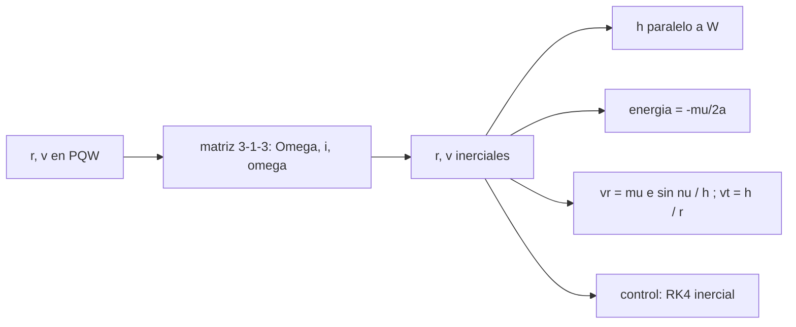

# B71-C17 — Movimientos en planos orbitales

<!-- nav:top -->
[🏠 Programa](../../../../README.md) · [📚 Bloque B71](../../../tronco-comun/B71-mecanica-orbital-fundamental.md) · [← Anterior: B71-C16 — Período orbital](../B71-C16-periodo-orbital/CLASE.md) · [Siguiente: B71-C18 — Maniobra de Hohmann →](../B71-C18-maniobra-de-hohmann/CLASE.md)
<!-- /nav -->

## 1. Ubicación, nivel y alcance

Clase 17 del bloque B71. Nivel N3. El movimiento de un satélite es plano: en el sistema perifocal (el del propio plano orbital) la posición y la velocidad se escriben con solo dos componentes. Para llevarlas al marco inercial se aplica una rotación 3‑1‑3 con `Ω`, `i` y `ω`. Aquí construyes esa transformación, compruebas que es una rotación (ortogonal, determinante +1), que conserva `h`, `ε` y las componentes radial y transversal, y la contrastas con una integración inercial. Usas [C11](../B71-C11-inclinacion-y-nodo-ascendente/CLASE.md) y [C12](../B71-C12-argumento-del-periapsis/CLASE.md). Los estados son sintéticos.

## 2. Por qué esta clase existe

Casi todo error de signo o de orden en una rotación aparece como un plano equivocado. La decisión central: **¿cómo pasas del plano orbital al marco inercial y cómo compruebas que la transformación es correcta?**

## 3. Lo que podrás hacer al terminar

1. Escribir `r` y `v` en el sistema perifocal (P, Q, W).
2. Construir la matriz 3‑1‑3 y comprobar que es ortogonal con determinante +1.
3. Verificar que `h` es paralelo a `W` y que `|h| = √(μp)`.
4. Verificar `ε = −μ/(2a)` y las componentes radial y transversal.
5. Contrastar el estado propagado por la fórmula con una integración inercial RK4.
6. Separar lo consultado (`μ`) de lo sintético (los estados).

La evidencia es la **ficha de transformación perifocal–inercial con invariantes** del ejercicio 12 (sección 20).

## 4. Con qué llegas y cómo comprobarlo

1. ¿Qué es una matriz ortogonal?
2. ¿Qué es una rotación respecto del eje z?
3. ¿Qué es el sistema perifocal?
4. ¿Qué componente de la velocidad es radial?
5. ¿Qué es una verificación por segunda vía?

<details>
<summary>Ver respuestas</summary>

1. Una matriz con `M Mᵀ = I`; conserva longitudes y ángulos. 2. Una transformación que gira los ejes x e y un ángulo, dejando z fijo. 3. Un sistema con `P` hacia el periapsis, `Q` a 90° en el plano y `W = P × Q` normal. 4. La proyección de `v` sobre `r̂`: `(r·v)/r`. 5. Calcular lo mismo con otro método y comparar.
</details>

Con cuatro o cinco aciertos, sigue; si no, repasa los prerrequisitos.

## 5. Un caso de contexto y casos de referencia

Una órbita sintética de `a = 12 000 km`, `e = 0,4`, `i = 63,4°`, `Ω = 20°`, `ω = 250°` y `ν = 75°` tiene en el marco inercial `|r| = 9134.343 km` y `|v| = 7352.442 m/s`; su `h` apunta a `i = 63.4000°`. En 500 estados sintéticos, la matriz es ortogonal con `4e-16` de error y `h` es paralelo a `W` con `3e-16`. Es el **ejemplo conductor**; órbita y estados son **sintéticos**.

## 6. Vocabulario

El **sistema perifocal** tiene ejes `P` (al periapsis), `Q` (en el plano, 90° adelante) y `W` (normal). La **rotación 3‑1‑3** es `R_z(Ω) R_x(i) R_z(ω)`. Una **matriz ortogonal** conserva longitudes y su determinante es ±1. La **velocidad radial** es `μ e sin ν/h` y la **transversal** `h/r`. Un **invariante** es una cantidad que la transformación no debe cambiar.

## 7. Modelo mental



*Descripción textual:* las coordenadas perifocales se rotan al marco inercial; los invariantes (`h`, energía, componentes) y una integración inercial comprueban que la rotación es correcta.

Analogía: dibujar una órbita en una hoja y luego inclinar y girar la hoja en el espacio; las distancias en la hoja no cambian. Límite: la hoja gira respecto de un marco inercial, no respecto de la Tierra que rota.

## 8. La explicación, paso a paso

### 8.1 El estado en el plano

`r = r(cos ν P + sin ν Q)`, `v = √(μ/p)(−sin ν P + (e + cos ν) Q)`, con `p = a(1 − e²)` y `r = p/(1 + e cos ν)`. El tercer eje `W = P × Q` es normal al plano y `h = √(μp) W`.

### 8.2 La rotación al marco inercial

La matriz `M = R_z(Ω) R_x(i) R_z(ω)` lleva los vectores perifocales al marco ECI idealizado. En 500 estados sintéticos (semilla 17) cumple `max|M Mᵀ − I| = 4.4e-16` y `|det M − 1| = 4.4e-16`: es una rotación propia.

### 8.3 Los invariantes

Tras rotar, `h/|h|` coincide con `M·ẑ` en `2.5e-16`, `|h| = √(μp)` en `6.6e-16`, `ε = −μ/(2a)` en `3.8e-15`, `v_r = μ e sin ν/h` en `8.2e-16` y `v_t = h/r` en `6.3e-16` (normalizados por `√(μ/p)`). Ninguna de estas cantidades depende de `Ω`, `i` ni `ω`.

### 8.4 Contraste con una integración inercial

Para la órbita de ejemplo, un RK4 inercial de 1 s (100 subpasos) desde `(r₀, v₀)` difiere de la fórmula evaluada en `ν = 75.04352°` (avance de `0.04352°`) en `8.0e-09 m` y `2.5e-12 m/s`. La derivada numérica de la posición coincide con la velocidad media en `5e-08` relativo.

## 9. Magnitudes, símbolos y unidades

| Símbolo | Qué es | Unidad | Valor / nota |
|---|---|---|---|
| `P`, `Q`, `W` | ejes perifocales | — | vectores unitarios |
| `M` | matriz 3‑1‑3 | — | ortogonal, det +1 |
| `Ω`, `i`, `ω` | ángulos de orientación | grados | 20°; 63,4°; 250° (sintéticos) |
| `v_r`, `v_t` | velocidades radial y transversal | m/s | `μ e sin ν/h`; `h/r` |
| `p` | semilado recto | m | `a(1 − e²)` |

## 10. Convenciones y referencias

Marco ECI idealizado (eje z hacia el polo, sin época real), SI; periapsis en `P`; sentido antihorario visto desde `+W`. `μ` de la IAU. Todos los estados (500 aleatorios con semilla 17 y la órbita de ejemplo) son sintéticos; `i = 63,4°` es ilustrativa.

## 11. De dónde sale lo que afirmamos

| ID | Fuente | Localizador | Respalda | Estado |
|---|---|---|---|---|
| S1 | IAU 2015 Resolución B3, Mamajek et al., arXiv:1510.07674 — https://arxiv.org/abs/1510.07674 (PDF leído con PyMuPDF, consultada 2026-11-10) | tabla de constantes nominales | (GM)ˢᵘⁿ = 1,327 124 4 × 10²⁰ m³ s⁻² y (GM)ᵀⁱᵉʳʳᵃ = 3,986 004 × 10¹⁴ m³ s⁻² (nominales, exactos); R_ecuatorial de la Tierra = 6,3781 × 10⁶ m | Consultada |
| — | Relaciones estándar de mecánica orbital de esta clase | — | las verifica el laboratorio con una segunda vía | No consultada en una fuente concreta |

Límites: no se usa ningún marco real (J2000, ITRF) ni se consultó su definición; sin precesión, nutación ni rotación terrestre.

## 12. Cómo ver el resultado

| Magnitud | Valor |
|---|---|
| `max|M Mᵀ − I|` | 4.4e-16 |
| `h` ∥ `W` | 2.5e-16 |
| energía frente a `−μ/(2a)` | 3.8e-15 |
| `|Δr|` en 1 s (RK4) | 8.0e-09 m |
| `|r|`, `|v|` ejemplo | 9134.343 km; 7352.442 m/s |

Descripción larga: la rotación es propia a precisión de máquina, los invariantes se conservan y la integración inercial coincide con la fórmula a nanómetros.

## 13. Ejemplo trabajado

**Posición en el plano para `ν = 75°`.**

**Paso 1 · Radio.** `p = 12 000 × 0,84 = 10 080 km`; `r = p/(1 + 0,4 cos 75°) = 9134.343 km`.

**Paso 2 · Perifocal.** `r_P = r cos 75°`, `r_Q = r sin 75°`, `r_W = 0`.

**Paso 3 · Inercial.** `r = M · (r_P, r_Q, 0)`; su módulo se conserva en `9134.343 km`.

## 14. Distintas formas de describir el problema

**Por componentes perifocales:** `(r cos ν, r sin ν)`. **Por matriz:** `M`. **Por invariantes:** `h`, `ε`. **Por integración:** RK4 inercial.

## 15. Práctica guiada

**Ejercicio 1 · con los pasos indicados.** Escribe `r` perifocal para `r = 10 000 km`, `ν = 60°`. *Pasos:* `r cos ν`, `r sin ν`.

<details><summary>Solución comentada</summary>

`(5000, 8660, 0) km`.
</details>

**Ejercicio 2 · con una pista.** Predice `v_t` en el periapsis. *Pista:* `h/r`.

<details><summary>Solución comentada</summary>

`v_t = h/r_p = √(μ(1 + e)/r_p)`; `v_r = 0`.
</details>

**Ejercicio 3 · casi autónomo.** ¿Por qué `det M = +1` y no −1? Piensa en reflexiones.

<details><summary>Solución comentada</summary>

Una rotación propia no invierte la orientación; un determinante −1 sería una reflexión y cambiaría el sentido de `h`.
</details>

## 16. Práctica autónoma, transferencia e integrador

**Ejercicio 4 · autónomo.** Con `Ω = 0`, `i = 90°`, `ω = 0`, ¿hacia dónde apunta `W`?

<details><summary>Solución comentada</summary>

Hacia `−ŷ`: `W = M ẑ = (0, −1, 0)` (órbita polar en el plano xz).
</details>

**Ejercicio 5 · autónomo.** Si `i = 0` y `Ω = 0`, ¿qué matriz queda?

<details><summary>Solución comentada</summary>

`R_z(ω)`: el plano coincide con el ecuatorial.
</details>

**Ejercicio 6 · autónomo.** Comprueba `|r|` conservada para `ν = 0` con `a = 10 000 km`, `e = 0,3`.

<details><summary>Solución comentada</summary>

`r = a(1 − e) = 7000 km` en el marco perifocal e inercial.
</details>

**Ejercicio 7 · autónomo.** Calcula `v_r` en `ν = 90°` con `h = 6,7 × 10¹⁰`, `e = 0,4`.

<details><summary>Solución comentada</summary>

`μ e/h = 3,986 × 10¹⁴ × 0,4/6,7 × 10¹⁰ = 2380 m/s`.
</details>

**Ejercicio 8 · autónomo.** ¿Qué pasa con `ω` y `Ω` si la órbita tiene `e = 0` e `i = 0`?

<details><summary>Solución comentada</summary>

Quedan indefinidos; solo `ω + Ω + ν` (longitud verdadera) tiene sentido (C12).
</details>

**Ejercicio 9 · transferencia.** **Transferencia.** **Transferencia.** Un colega rota con `R_z(ω) R_x(i) R_z(Ω)` (orden inverso). ¿Qué error introduce?

<details><summary>Solución comentada</summary>

Gira el plano y el periapsis en el orden equivocado: el plano queda mal orientado aunque la matriz siga siendo ortogonal. Los invariantes `h` y `ε` no lo detectan; sí lo detecta comparar `h/|h|` con la dirección esperada.
</details>

**Ejercicio 10 · transferencia.** **Transferencia.** **Transferencia.** ¿Basta comprobar que la matriz es ortogonal para validar la transformación?

<details><summary>Solución comentada</summary>

No: también hay que verificar el orden y los signos, p. ej. con la dirección de `h` e `i`, y con una integración independiente.
</details>

**Ejercicio 11 · transferencia.** **Transferencia.** **Transferencia.** Un marco inercial real tiene época y nutación. ¿Qué cambia respecto de este laboratorio?

<details><summary>Solución comentada</summary>

El eje z y el equinoccio dependen de la época; habría que declarar y consultar el marco (no consultado aquí).
</details>

**Ejercicio 12 · integrador.** **Integrador.** **Integrador.** Elabora tu *ficha de transformación perifocal–inercial con invariantes*: fórmulas, matriz, tabla de invariantes en 500 estados y contraste con RK4 inercial.

<details><summary>Solución comentada</summary>

Secciones 8.1–8.4 y la salida del laboratorio.
</details>

## 17. Laboratorio: del plano orbital al marco inercial

El script [planos_orbitales.py](planos_orbitales.py) rota 500 estados sintéticos del sistema perifocal al ECI, verifica ortogonalidad e invariantes y contrasta un estado con una integración RK4 inercial (**comprueba** ortogonalidad < 1e-12, invariantes < 1e-9 y `|Δr|` < 1e-3 m).

**Datos:** `μ` de la IAU (consultado); estados (semilla 17), órbita de ejemplo e `i = 63,4°` **sintéticos/ilustrativos**. **Predice antes de ejecutar:** ¿Con qué error será la matriz ortogonal? (Del orden de `10⁻¹⁶`.) **Ejecución del 2026-11-10 (Python 3.12.9):**

```text
Python 3.12.9 (biblioteca estandar)
500 estados SINTETICOS (semilla 17), a en [7000, 30000] km, e en [0, 0.8], i en [0, 180] grados:
  ortogonalidad de la matriz 3-1-3: max |M M^T - I| = 4.4e-16 ; |det - 1| = 4.4e-16
  h/|h| frente a W (z perifocal rotado): 2.5e-16 ; |h| frente a sqrt(mu p): 6.6e-16
  energia frente a -mu/(2a): 3.8e-15 ; v_radial = mu e sin nu/h: 8.2e-16 ; v_transversal = h/r: 6.3e-16 (normalizados por sqrt(mu/p))
Orbita de ejemplo SINTETICA a = 12000 km, e = 0.4, i = 63.4, RAAN = 20, omega = 250 grados, nu = 75 grados:
  |r| = 9134.343 km ; |v| = 7352.442 m/s ; inclinacion de h = 63.4000 grados
  tras 1 s: RK4 inercial frente a la formula en nu = 75.04352 grados (avance 0.04352): |dr| = 8.02e-09 m ; |dv| = 2.49e-12 m/s
  (r1 - r0)/dt frente a la velocidad media: diferencia relativa 5.0e-08
Pruebas superadas.
```

```bash
python programa/clases/B71/B71-C17-movimientos-en-planos-orbitales/planos_orbitales.py
```

**Límites:** marco ECI idealizado, sin precesión ni nutación; dos cuerpos.

## 18. Errores frecuentes y cómo corregirlos

**Rotar en orden inverso.** Se corrige con el ejercicio 9.

**Creer que la ortogonalidad prueba la corrección.** Se corrige con el ejercicio 10.

**Confundir `v_t` con el módulo de la velocidad.** Se corrige con 8.3.

**Presentar el marco idealizado como J2000.** Se corrige con la sección 10.

## 19. Cómo sabrás que vas bien

Tras la sección 8: ¿qué error de ortogonalidad esperabas y cuál obtuviste? Si dudas, repasa el ejemplo 13. Tras el laboratorio: ¿qué comprueba? (ver la sección 17).

## 20. Qué entregas y cómo se evalúa

El producto es tu **ficha de transformación perifocal–inercial con invariantes** (ejercicio 12).

| Criterio | Inicial | En desarrollo | Logrado | Destacado |
|---|---|---|---|---|
| Conceptos | Los confunde | Parciales | Construye y aplica la matriz | Explica el orden y los signos |
| Cálculo | Sin unidades | Con errores | Invariantes con unidades | Calcula casos nuevos |
| Numérico | Sin comprobar | Un caso | 500 casos e integración | Interpreta las diferencias |
| Fuentes | Sin fuente | Sin fecha | Fuentes con fecha y estado | Declara lo sintético |
| Límites | No los nombra | Uno | Tres | Discute qué falta del modelo |

**Condiciones críticas (no se compensan con promedio):** rotular estados y marco como sintéticos/idealizados; verificar orden y signos; citar solo lo consultado.

## 21. Ética, seguridad y límites

Clase educativa: los modelos son simplificados y sus datos son consultados, sintéticos o ilustrativos (rotulados); ningún resultado es una efeméride ni una predicción operativa ni sustituye a las herramientas de navegación de una misión. Accesibilidad: tablas equivalentes a las gráficas, fórmulas en texto, ejercicios sin conexión.

## 22. Para cerrar y seguir

La rotación 3‑1‑3 es ortogonal a `4e-16`, conserva `h`, `ε` y las componentes y coincide con la integración inercial a `8e-09 m`. Con el plano resuelto, queda una pregunta: ¿cómo se cambia de órbita con el mínimo impulso?

**Glosario español–inglés.** sistema perifocal · *perifocal frame* · matriz ortogonal · *orthogonal matrix* · velocidad transversal · *transverse velocity* · invariante · *invariant*.

**Continuidad.** [B71-C18](../B71-C18-maniobra-de-hohmann/CLASE.md) estudia la maniobra de Hohmann.

**Referencias:** ver sección 11.

<!-- nav:bottom -->
---

[← Anterior: B71-C16 — Período orbital](../B71-C16-periodo-orbital/CLASE.md) · [📚 Bloque B71](../../../tronco-comun/B71-mecanica-orbital-fundamental.md) · [Siguiente: B71-C18 — Maniobra de Hohmann →](../B71-C18-maniobra-de-hohmann/CLASE.md)
<!-- /nav -->
