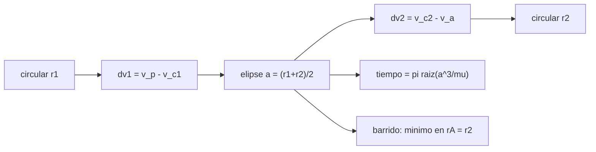

# B71-C18 — Maniobra de Hohmann

<!-- nav:top -->
[🏠 Programa](../../../../README.md) · [📚 Bloque B71](../../../tronco-comun/B71-mecanica-orbital-fundamental.md) · [← Anterior: B71-C17 — Movimientos en planos orbitales](../B71-C17-movimientos-en-planos-orbitales/CLASE.md) · [Siguiente: B71-C19 — Cambios de plano simples →](../B71-C19-cambios-de-plano-simples/CLASE.md)
<!-- /nav -->

## 1. Ubicación, nivel y alcance

Clase 18 del bloque B71. Nivel N3. La transferencia de Hohmann lleva un cuerpo entre dos órbitas circulares coplanares con dos impulsos tangentes sobre una elipse que toca ambas. Aquí calculas `Δv₁`, `Δv₂` y el tiempo de vuelo para LEO→GEO y, con órbitas planetarias circulares, para Tierra→Marte; barres una familia de transferencias para ver que Hohmann es el mínimo, y la comparas con la bielíptica. Usas [C05](../B71-C05-energia-orbital-especifica/CLASE.md) y [C07](../B71-C07-orbitas-circulares/CLASE.md). Las órbitas son idealizadas y los impulsos instantáneos.

## 2. Por qué esta clase existe

La Hohmann es la referencia de costo para cualquier cambio de órbita coplanar. La decisión central: **¿cuánto `Δv` y cuánto tiempo cuesta pasar de una circular a otra y cuándo conviene otra estrategia?**

## 3. Lo que podrás hacer al terminar

1. Calcular `Δv₁`, `Δv₂` y el tiempo de vuelo `π√(a³/μ)` de una Hohmann.
2. Aplicar la transferencia a LEO→GEO y a Tierra→Marte (aproximación circular).
3. Verificar con un barrido que la Hohmann minimiza el `Δv` en una familia de transferencias.
4. Comparar con la bielíptica y hallar el umbral de razón de radios.
5. Calcular el ángulo de fase necesario entre los dos cuerpos.
6. Separar lo consultado (`μ`, fichas) de lo ilustrativo (órbitas idealizadas).

La evidencia es la **ficha de Hohmann LEO→GEO y Tierra→Marte** del ejercicio 12 (sección 20).

## 4. Con qué llegas y cómo comprobarlo

1. ¿Qué es la ecuación vis‑viva?
2. ¿Qué es un impulso tangente?
3. ¿Qué es la velocidad circular?
4. ¿Qué es el tiempo de vuelo de media elipse?
5. ¿Qué es una verificación por segunda vía?

<details>
<summary>Ver respuestas</summary>

1. `v² = μ(2/r − 1/a)`. 2. Un cambio de velocidad en la dirección del movimiento. 3. `√(μ/r)`. 4. La mitad del período de la elipse de transferencia. 5. Calcular lo mismo con otro método y comparar.
</details>

Con cuatro o cinco aciertos, sigue; si no, repasa los prerrequisitos.

## 5. Un caso de contexto y casos de referencia

De una circular de 400 km a la geoestacionaria, Hohmann necesita `Δv₁ = 2397.5 m/s` y `Δv₂ = 1456.5 m/s` (total `3854.0 m/s`) en `5.291 h`. De la órbita de la Tierra a la de Marte (circulares, coplanares) serían `2945.2` y `2649.3 m/s` en `258.9 d`. Es el **ejemplo conductor**; las órbitas son **idealizadas**.

## 6. Vocabulario

La **transferencia de Hohmann** es la elipse tangente a las dos circulares. El **tiempo de vuelo** es medio período de la elipse. El **ángulo de fase** es el que debe separar a los cuerpos al salir. La **bielíptica** usa dos elipses con un apoápside intermedio `r_b`. Un **impulso tangente** cambia el módulo de la velocidad sin girarla.

## 7. Modelo mental



*Descripción textual:* dos impulsos tangentes enlazan las circulares a través de una elipse; el tiempo de vuelo es medio período y un barrido muestra que cualquier otro apoápside cuesta más.

Analogía: pasar de un carril interior de una pista a uno exterior con un acelerón al salir y otro al llegar. Límite: una nave no frena con rozamiento; todo cambio es por impulso.

## 8. La explicación, paso a paso

### 8.1 Fórmulas

Con `a = (r₁ + r₂)/2`: `v_p = √(μ(2/r₁ − 1/a))`, `v_a = √(μ(2/r₂ − 1/a))`, `Δv₁ = v_p − √(μ/r₁)`, `Δv₂ = √(μ/r₂) − v_a`, `t = π√(a³/μ)`.

### 8.2 LEO → GEO

`r₁ = 6778,1 km`, `r₂ = 42 164,2 km` (razón `6.2207`). La elipse tiene `a = 24471150 m`, `v_p = 10066.062 m/s` y `v_a = 1618.168 m/s`. `Δv₁ = 2397.484 m/s`, `Δv₂ = 1456.490 m/s`, total `3853.974 m/s`. El tiempo de vuelo es `5.2913 h`; la semivuelta integrada con RK4 da `5.2913 h` (`3e-12`).

### 8.3 El mínimo y Tierra → Marte

Un barrido de apogeos `r_A ∈ [r₂, 4r₂]` con circularización vectorial da el mínimo en `r_A/r₂ = 1.00` con `3853.974 m/s`; con `r_A = 2r₂` cuesta `5814 m/s` y con `r_A = 4r₂`, `6612 m/s`. Para Tierra→Marte con radios iguales a los semiejes de las fichas (razón `1.5238`): `Δv₁ = 2945.2 m/s`, `Δv₂ = 2649.3 m/s`, `t = 258.88 d`. El ángulo de fase de salida es `44.34°` con Marte por delante. Esta órbita coincide con la que describe la página de la NASA (perihelio en la órbita terrestre y afelio en la de Marte).

### 8.4 Hohmann frente a bielíptica

En unidades de `r₁ = 1`, `μ = 1`: razón 20, Hohmann `0.53473` frente a bielíptica mínima `0.50747`; razón 50, `0.51370` frente a `0.47350`; para la razón de Marte, Hohmann `0.18783` frente a `0.25635`: aquí la bielíptica pierde. El umbral donde la bielíptica con `r_b → ∞` iguala a Hohmann es `11.939`. La bielíptica ahorra `Δv` pero tarda mucho más.

## 9. Magnitudes, símbolos y unidades

| Símbolo | Qué es | Unidad | Valor / nota |
|---|---|---|---|
| `Δv₁`, `Δv₂` | impulsos de salida y llegada | m/s | 2397.5; 1456.5 (LEO→GEO) |
| `a` | semieje de la transferencia | m | 24471150 |
| `t` | tiempo de vuelo | s | 5.291 h |
| `r₂/r₁` | razón de radios | — | 6.2207 |
| `φ` | ángulo de fase | grados | 44.34 (Tierra→Marte) |

## 10. Convenciones y referencias

Marco inercial del cuerpo central, SI; órbitas circulares y coplanares; impulsos instantáneos y tangentes. `μ` de la IAU; semiejes y período de Marte, de las fichas. Las circulares de 400 km y geoestacionaria son sintéticas; las planetarias se aproximan a circulares con radio igual al semieje (la ficha da `e = 0,0935` para Marte).

## 11. De dónde sale lo que afirmamos

| ID | Fuente | Localizador | Respalda | Estado |
|---|---|---|---|---|
| S1 | IAU 2015 Resolución B3, Mamajek et al., arXiv:1510.07674 — https://arxiv.org/abs/1510.07674 (PDF leído con PyMuPDF, consultada 2026-11-10) | tabla de constantes nominales | (GM)ˢᵘⁿ = 1,327 124 4 × 10²⁰ m³ s⁻² y (GM)ᵀⁱᵉʳʳᵃ = 3,986 004 × 10¹⁴ m³ s⁻² (nominales, exactos); R_ecuatorial de la Tierra = 6,3781 × 10⁶ m | Consultada |
| S2 | NASA/NSSDC, Earth Fact Sheet — https://nssdc.gsfc.nasa.gov/planetary/factsheet/earthfact.html (consultada 2026-11-10) | ficha completa leída | masa 5,9722 × 10²⁴ kg; radio medio 6371,000 km; radio ecuatorial 6378,137 km; rotación sidérea 23,9345 h; a = 149,598 × 10⁶ km; e = 0,0167; velocidad de escape 11,186 km/s; g media 9,820 m/s² | Consultada |
| S3 | NASA/NSSDC, Mars Fact Sheet — https://nssdc.gsfc.nasa.gov/planetary/factsheet/marsfact.html (consultada 2026-11-10) | ficha completa leída | masa 0,64169 × 10²⁴ kg; radio medio 3389,5 km; a = 227,956 × 10⁶ km; e = 0,0935; período sidéreo 686,980 d; inclinación 1,848°; afelio 249,261 y perihelio 206,650 × 10⁶ km; velocidad de escape 5,03 km/s | Consultada |
| S4 | NASA, Basics of Space Flight, cap. 4-1 — https://science.nasa.gov/learn/basics-of-space-flight/chapter4-1/ (consultada 2026-11-10) | página leída | describe la órbita de transferencia de Hohmann (perihelio en la órbita terrestre, afelio en la de Marte) y el intercambio de energía orbital; no nombra las leyes de Kepler ni a Newton | Consultada |
| — | Relaciones estándar de mecánica orbital de esta clase | — | las verifica el laboratorio con una segunda vía | No consultada en una fuente concreta |

Límites: la página de la NASA se consultó solo para la descripción cualitativa de la Hohmann Tierra–Marte; los `Δv` de aquí son un cálculo idealizado y no son los de ninguna misión. No se modelan inclinación, excentricidad, esferas de influencia, pérdidas de gravedad ni tolerancias de ventana.

## 12. Cómo ver el resultado

| Magnitud | Valor |
|---|---|
| LEO→GEO total | 3854.0 m/s en 5.29 h |
| mínimo del barrido | rA/r₂ = 1.00 |
| Tierra→Marte | 2945 + 2649 m/s en 259 d |
| ángulo de fase | 44.3° |
| umbral bieliptica | 11.939 |

Descripción larga: la Hohmann LEO→GEO cuesta unos 3,85 km/s en cinco horas; el barrido confirma el mínimo; el umbral de la bielíptica es 11,94.

## 13. Ejemplo trabajado

**`Δv₁` de LEO a GEO.**

**Paso 1 · Datos.** `r₁ = 6778,1 km`, `a = 24471150 m`.

**Paso 2 · Vis‑viva.** `v_p = √(μ(2/r₁ − 1/a)) = 10066.062 m/s`; la circular es `7668,579 m/s`.

**Paso 3 · Impulso.** `Δv₁ = 2397.484 m/s`.

## 14. Distintas formas de describir el problema

**Por energía:** de `−μ/2r₁` a `−μ/2a`. **Por velocidades:** vis‑viva. **Por tiempo:** media elipse. **Por alternativa:** bielíptica.

## 15. Práctica guiada

**Ejercicio 1 · con los pasos indicados.** Calcula `a` para `r₁ = 7000 km`, `r₂ = 14 000 km`. *Pasos:* semisuma.

<details><summary>Solución comentada</summary>

`a = 10 500 km`.
</details>

**Ejercicio 2 · con una pista.** Predice `t` en horas para esa `a`. *Pista:* `π√(a³/μ)`.

<details><summary>Solución comentada</summary>

`π√(1,1576 × 10²¹/3,986 × 10¹⁴) = 5354 s = 1,49 h`.
</details>

**Ejercicio 3 · casi autónomo.** ¿Por qué el impulso es tangente? Piensa en cuál cambia más la energía por unidad de `Δv`.

<details><summary>Solución comentada</summary>

Cuando `Δv ∥ v`, `Δε = v Δv` es máximo; un impulso oblicuo malgasta parte.
</details>

## 16. Práctica autónoma, transferencia e integrador

**Ejercicio 4 · autónomo.** Si `r₂/r₁ = 1`, ¿cuánto cuesta la transferencia?

<details><summary>Solución comentada</summary>

0: no hay cambio.
</details>

**Ejercicio 5 · autónomo.** ¿Cuánto cuesta devolver (de GEO a LEO) la misma transferencia?

<details><summary>Solución comentada</summary>

Lo mismo, `3854 m/s`, con los impulsos en orden inverso (retrógrados).
</details>

**Ejercicio 6 · autónomo.** Con `Δv₂ = 1456,5 m/s` y `Δv₁ = 2397,5 m/s`, ¿qué porcentaje es el primero?

<details><summary>Solución comentada</summary>

62 %.
</details>

**Ejercicio 7 · autónomo.** ¿Qué ángulo recorre el cuerpo objetivo durante el tiempo de vuelo?

<details><summary>Solución comentada</summary>

`n₂ t`; para Marte, `360° × 258,88/686,98 = 135,7°`, de donde la fase de salida `180° − 135,7° = 44,3°`.
</details>

**Ejercicio 8 · autónomo.** Si `r₂/r₁ = 15`, ¿conviene la bielíptica?

<details><summary>Solución comentada</summary>

Sí en `Δv` (razón > 11,94) con `r_b` grande, a costa de mucho más tiempo.
</details>

**Ejercicio 9 · transferencia.** **Transferencia.** **Transferencia.** Un colega afirma que Hohmann es la trayectoria óptima para ir a Marte. ¿Qué matiz añades?

<details><summary>Solución comentada</summary>

Es óptima en `Δv` para dos impulsos entre circulares coplanares; con órbitas reales (excéntricas, inclinadas), con empuje continuo o con asistencias gravitatorias pueden existir mejores.
</details>

**Ejercicio 10 · transferencia.** **Transferencia.** **Transferencia.** ¿Qué ocurre si el impulso de llegada de LEO→GEO se omite?

<details><summary>Solución comentada</summary>

La nave queda en la elipse de transferencia (apoapsis en GEO, `v_a = 1618 m/s`); no circulariza.
</details>

**Ejercicio 11 · transferencia.** **Transferencia.** **Transferencia.** ¿Pueden usarse estos `Δv` para dimensionar un cohete?

<details><summary>Solución comentada</summary>

No: son cantidades ideales sin pérdidas de gravedad ni de arrastre, sin márgenes ni tolerancias, y solo sirven como referencia de orden de magnitud.
</details>

**Ejercicio 12 · integrador.** **Integrador.** **Integrador.** Elabora tu *ficha de Hohmann LEO→GEO y Tierra→Marte*: fórmulas, `Δv₁`, `Δv₂`, tiempos, barrido, ángulo de fase y comparación bielíptica, rotulando lo idealizado.

<details><summary>Solución comentada</summary>

Secciones 8.1–8.4 y la salida del laboratorio.
</details>

## 17. Laboratorio: Hohmann, barrido y bielíptica

El script [hohmann.py](hohmann.py) calcula la Hohmann LEO→GEO y Tierra→Marte, barre una familia de transferencias, mide el tiempo de vuelo con RK4 y busca el umbral de la bielíptica (**comprueba** mínimo en `r_A = r₂`, tiempo RK4 < 1e-6 y umbral 11,94).

**Datos:** `μ`, semiejes y períodos de la IAU y de las fichas (consultados); órbitas de 400 km, GEO y circulares planetarias **idealizadas**; razones 20 y 50 **ilustrativas**. **Predice antes de ejecutar:** ¿Cuánto cuesta LEO→GEO con Hohmann? (≈ 3,85 km/s.) **Ejecución del 2026-11-10 (Python 3.12.9):**

```text
Python 3.12.9 (biblioteca estandar)
LEO SINTETICA 400 km -> GEO (r1 = 6778.1 km, r2 = 42164.2 km, razon 6.2207):
  a_transf = 24471.150 km ; v_p = 10066.062 m/s ; v_a = 1618.168 m/s
  dv1 = 2397.484 m/s ; dv2 = 1456.490 m/s ; total = 3853.974 m/s
  tiempo de vuelo = 5.2913 h ; RK4 (semivuelta) = 5.2913 h ; dif = 2.9e-12
  barrido de apogeos rA/r2 en [1, 4]: minimo en rA/r2 = 1.00 con 3853.974 m/s (dif con Hohmann 2.4e-16) ; rA = 2 r2: 5814.2 ; rA = 4 r2: 6612.5 m/s
Tierra -> Marte (orbitas CIRCULARES coplanares con radio = semieje de la ficha; aproximacion):
  razon de radios = 1.5238 ; dv1 = 2945.2 m/s ; dv2 = 2649.3 m/s ; tiempo de vuelo = 258.88 d
  angulo de fase Marte-Tierra a la salida = 44.34 grados (Marte por delante)
Comparacion con la bieliptica (unidades de r1 = 1, mu = 1, v_c1 = 1):
  razon 20: Hohmann 0.53473 ; bieliptica minima 0.50747
  razon 50: Hohmann 0.51370 ; bieliptica minima 0.47350
  razon de Marte 1.524: Hohmann 0.18783 ; bieliptica minima 0.25635
  umbral (bieliptica con r_b -> infinito = Hohmann) en razon = 11.939
Pruebas superadas.
```

```bash
python programa/clases/B71/B71-C18-maniobra-de-hohmann/hohmann.py
```

**Límites:** impulsos instantáneos, dos cuerpos, órbitas circulares y coplanares; sin pérdidas ni márgenes.

## 18. Errores frecuentes y cómo corregirlos

**Usar la Hohmann con órbitas muy excéntricas o inclinadas.** Se corrige con 8.3.

**Sumar `Δv₁` y `Δv₂` sin valor absoluto.** Se corrige con 8.1.

**Creer que Hohmann siempre gana a la bielíptica.** Se corrige con 8.4.

**Presentar los `Δv` como los de una misión.** Se corrige con la sección 10.

## 19. Cómo sabrás que vas bien

Tras la sección 8: ¿qué costo esperabas para LEO→GEO y cuál obtuviste? Si dudas, repasa el ejemplo 13. Tras el laboratorio: ¿qué comprueba? (ver la sección 17).

## 20. Qué entregas y cómo se evalúa

El producto es tu **ficha de Hohmann LEO→GEO y Tierra→Marte** (ejercicio 12).

| Criterio | Inicial | En desarrollo | Logrado | Destacado |
|---|---|---|---|---|
| Conceptos | Los confunde | Parciales | Deduce `Δv` y tiempo | Explica los límites |
| Cálculo | Sin unidades | Con errores | Tablas con unidades | Calcula casos nuevos |
| Numérico | Sin comprobar | Un caso | Barrido y RK4 | Interpreta el umbral |
| Fuentes | Sin fuente | Sin fecha | Fuentes con fecha y estado | Declara lo idealizado |
| Límites | No los nombra | Uno | Tres | Discute qué falta del modelo |

**Condiciones críticas (no se compensan con promedio):** rotular órbitas y circulares como idealizadas/sintéticas; no presentar los `Δv` como los de una misión; citar solo lo consultado.

## 21. Ética, seguridad y límites

Clase educativa: los modelos son simplificados y sus datos son consultados, sintéticos o ilustrativos (rotulados); ningún resultado es una efeméride ni una predicción operativa ni sustituye a las herramientas de navegación de una misión. Accesibilidad: tablas equivalentes a las gráficas, fórmulas en texto, ejercicios sin conexión.

## 22. Para cerrar y seguir

LEO→GEO cuesta `3854 m/s` en `5.29 h` y el barrido confirma el mínimo; la bielíptica solo compensa por encima de la razón `11.94`. Queda una pregunta: ¿cuánto cuesta cambiar el plano?

**Glosario español–inglés.** transferencia de Hohmann · *Hohmann transfer* · impulso · *impulse / burn* · ángulo de fase · *phase angle* · transferencia bielíptica · *bi-elliptic transfer*.

**Continuidad.** [B71-C19](../B71-C19-cambios-de-plano-simples/CLASE.md) estudia los cambios de plano simples.

**Referencias:** ver sección 11.

<!-- nav:bottom -->
---

[← Anterior: B71-C17 — Movimientos en planos orbitales](../B71-C17-movimientos-en-planos-orbitales/CLASE.md) · [📚 Bloque B71](../../../tronco-comun/B71-mecanica-orbital-fundamental.md) · [Siguiente: B71-C19 — Cambios de plano simples →](../B71-C19-cambios-de-plano-simples/CLASE.md)
<!-- /nav -->
