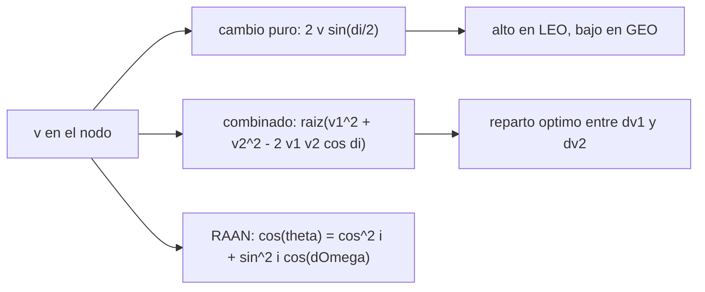

# B71-C19 — Cambios de plano simples

<!-- nav:top -->
[🏠 Programa](../../../../README.md) · [📚 Bloque B71](../../../tronco-comun/B71-mecanica-orbital-fundamental.md) · [← Anterior: B71-C18 — Maniobra de Hohmann](../B71-C18-maniobra-de-hohmann/CLASE.md) · [Siguiente: B71-C20 — Propagador kepleriano verificable →](../B71-C20-propagador-kepleriano-verificable/CLASE.md)
<!-- /nav -->

## 1. Ubicación, nivel y alcance

Clase 19 del bloque B71. Nivel N3. Cambiar el plano orbital cuesta `Δv = 2 v sin(Δi/2)`: mucho si la velocidad es alta y poco si es baja. Por eso conviene hacerlo lejos del cuerpo central y, mejor, combinado con otro impulso. Aquí calculas el costo de un cambio de plano de 28,5° (ilustrativo) en LEO y en GEO, lo combinas con la Hohmann, buscas el reparto óptimo entre los dos impulsos y calculas el costo de cambiar la ascensión recta del nodo. Usas [C11](../B71-C11-inclinacion-y-nodo-ascendente/CLASE.md) y [C18](../B71-C18-maniobra-de-hohmann/CLASE.md). Todos los casos son ilustrativos.

## 2. Por qué esta clase existe

Un cambio de plano mal ubicado puede costar más que todo el resto de la misión orbital. La decisión central: **¿dónde y cómo conviene cambiar el plano para gastar el mínimo `Δv`?**

## 3. Lo que podrás hacer al terminar

1. Calcular el `Δv` de un cambio de plano puro `2 v sin(Δi/2)`.
2. Calcular el `Δv` de un impulso que combina cambio de plano y de velocidad.
3. Comparar cuatro estrategias para LEO inclinada → GEO ecuatorial.
4. Hallar el reparto óptimo del cambio de inclinación entre dos impulsos.
5. Calcular el ángulo entre planos al cambiar la RAAN y su costo.
6. Separar lo consultado (`μ`, radio) de lo ilustrativo (inclinaciones y alturas).

La evidencia es la **ficha de coste de un cambio de plano** del ejercicio 12 (sección 20).

## 4. Con qué llegas y cómo comprobarlo

1. ¿Qué es la inclinación?
2. ¿Qué es el nodo ascendente?
3. ¿Qué es la ley de los cosenos?
4. ¿Qué es la velocidad circular?
5. ¿Qué es una verificación por segunda vía?

<details>
<summary>Ver respuestas</summary>

1. El ángulo entre el plano orbital y el ecuatorial. 2. El punto donde la órbita cruza el ecuador hacia el norte. 3. `c² = a² + b² − 2ab cos γ`. 4. `√(μ/r)`. 5. Calcular lo mismo con otro método y comparar.
</details>

Con cuatro o cinco aciertos, sigue; si no, repasa los prerrequisitos.

## 5. Un caso de contexto y casos de referencia

Un cambio de plano puro de 28,5° (ilustrativo) cuesta `3775.3 m/s` a 400 km de altitud y solo `1513.7 m/s` en GEO. Hacer toda la Hohmann coplanar y cambiar el plano en LEO sumaría `7629 m/s`; combinarlo en el segundo impulso, `4222 m/s`; con el reparto óptimo, `4196 m/s`. Es el **ejemplo conductor**; todos los valores de inclinación son **ilustrativos**.

## 6. Vocabulario

Un **cambio de plano puro** gira el vector velocidad sin cambiar su módulo. El **impulso combinado** cambia módulo y dirección a la vez. La **línea de nodos** es donde se hace el cambio. El **ángulo entre planos** al cambiar `Ω` es `θ` con `cos θ = cos² i + sin² i cos ΔΩ`. El **reparto óptimo** divide `Δi` entre los dos impulsos.

## 7. Modelo mental



*Descripción textual:* el cambio de plano cuesta más cuanto mayor es la velocidad; combinarlo con los impulsos de la Hohmann reparte el costo y un reparto óptimo lo minimiza; cambiar la RAAN es otro cambio de plano.

Analogía: girar un barco de gran velocidad cuesta más que girar uno que casi se detiene. Límite: un satélite no pierde velocidad en el giro; cambia su dirección, el módulo se conserva.

## 8. La explicación, paso a paso

### 8.1 Cambio puro

`Δv = 2 v sin(Δi/2)`. Para `Δi = 28,5°`: `3775.292 m/s` con `v = 7668.579 m/s` (400 km) y `1513.675 m/s` con `v = 3074.659 m/s` (GEO). El cálculo con vectores 3D da `3775.292 m/s` (diferencia `0e+00`). Un cambio de 60° cuesta exactamente `v` (`1.000000 v`). Para 1°, `Δv ≈ v Δi` con error relativo `1.3e-05`.

### 8.2 Cuatro estrategias LEO → GEO

Hohmann coplanar: `3854.0 m/s`. Con el plano cambiado en LEO: `7629.3 m/s`; en GEO tras la Hohmann: `5367.6 m/s`; todo el cambio en el segundo impulso (`Δv₁ = 2397.5`, `Δv₂ = 1824.1`): `4221.5 m/s`; todo en el primero: `6401.9 m/s`.

### 8.3 Reparto óptimo

Se reparte `Δi` en dos partes `Δi₁` y `Δi − Δi₁`. Un barrido de 0,01° y un refinado por sección áurea dan el óptimo en `Δi₁ = 2.231°` (barrido `2.23°`) con `4196.3 m/s`: ahorra `3433 m/s` frente a cambiar el plano en LEO y `25.2 m/s` frente a dejar todo para el segundo impulso.

### 8.4 Cambio de RAAN

Con `i = 51,6°` (ilustrativa) y `ΔΩ = 10°`, el ángulo entre planos es `θ = 7.8331°`, a pesar de que `ΔΩ = 10°`. Cuesta `1047.58 m/s` en LEO y `420.02 m/s` en GEO. Cambiar la RAAN con un impulso es caro en órbita baja; en la práctica se aprovecha la precesión natural (B72).

## 9. Magnitudes, símbolos y unidades

| Símbolo | Qué es | Unidad | Valor / nota |
|---|---|---|---|
| `Δi` | cambio de inclinación | grados | 28,5° (ilustrativo) |
| `v` | velocidad en el nodo | m/s | 7668.6 (LEO); 3074.7 (GEO) |
| `Δv` | costo del impulso | m/s | 3775.3; 1513.7 |
| `Δi₁` | parte del cambio en el primer impulso | grados | 2.231 (óptimo) |
| `θ` | ángulo entre planos al cambiar `Ω` | grados | 7.8331 |

## 10. Convenciones y referencias

Marco inercial geocéntrico, SI; impulsos instantáneos en la línea de nodos; órbitas circulares; la Hohmann LEO→GEO de C18. `μ` y radio de la IAU. Las inclinaciones de 28,5° y 51,6° y la altura de 400 km son ilustrativas y no pertenecen a ninguna base ni misión.

## 11. De dónde sale lo que afirmamos

| ID | Fuente | Localizador | Respalda | Estado |
|---|---|---|---|---|
| S1 | IAU 2015 Resolución B3, Mamajek et al., arXiv:1510.07674 — https://arxiv.org/abs/1510.07674 (PDF leído con PyMuPDF, consultada 2026-11-10) | tabla de constantes nominales | (GM)ˢᵘⁿ = 1,327 124 4 × 10²⁰ m³ s⁻² y (GM)ᵀⁱᵉʳʳᵃ = 3,986 004 × 10¹⁴ m³ s⁻² (nominales, exactos); R_ecuatorial de la Tierra = 6,3781 × 10⁶ m | Consultada |
| — | Relaciones estándar de mecánica orbital de esta clase | — | las verifica el laboratorio con una segunda vía | No consultada en una fuente concreta |

Límites: no se consultó ninguna misión real ni la inclinación de ningún sitio de lanzamiento. Los costos no incluyen pérdidas, márgenes ni el hecho de que los impulsos reales no son instantáneos.

## 12. Cómo ver el resultado

| Magnitud | Valor |
|---|---|
| cambio puro en LEO / GEO | 3775.3 / 1513.7 m/s |
| plano en LEO + Hohmann | 7629 m/s |
| todo en el 2.º impulso | 4222 m/s |
| reparto óptimo | 4196 m/s con 2.23° en el 1.º |
| RAAN 10° con `i = 51,6°` | `θ = 7.83°`; 1048 m/s en LEO |

Descripción larga: el mismo giro cuesta 2,5 veces menos en GEO que en LEO; combinarlo con la Hohmann ahorra más de 3 km/s y repartirlo de forma óptima ahorra otros 25 m/s.

## 13. Ejemplo trabajado

**Cambio de plano puro de 28,5° en GEO.**

**Paso 1 · Velocidad.** `v = √(μ/r) = 3074.659 m/s` con `r = 42 164,2 km`.

**Paso 2 · Fórmula.** `Δv = 2 v sin(14,25°)`.

**Paso 3 · Resultado.** `Δv = 1513.675 m/s`; en LEO sería `3775.292 m/s`.

## 14. Distintas formas de describir el problema

**Por geometría:** triángulo de velocidades. **Por fórmula:** `2 v sin(Δi/2)`. **Por combinación:** ley de los cosenos. **Por reparto:** mínimo de `Δv₁ + Δv₂`.

## 15. Práctica guiada

**Ejercicio 1 · con los pasos indicados.** Calcula el `Δv` de un cambio de plano de 10° con `v = 7 km/s`. *Pasos:* `2 v sin 5°`.

<details><summary>Solución comentada</summary>

`2 × 7000 × 0,08716 = 1220 m/s`.
</details>

**Ejercicio 2 · con una pista.** Predice si cuesta más en GEO o en LEO. *Pista:* depende de `v`.

<details><summary>Solución comentada</summary>

Más en LEO: `v` es mayor (7669 frente a 3075 m/s).
</details>

**Ejercicio 3 · casi autónomo.** ¿Por qué 60° cuesta exactamente `v`? Evalúa `2 sin 30°`.

<details><summary>Solución comentada</summary>

`2 × 0,5 = 1`.
</details>

## 16. Práctica autónoma, transferencia e integrador

**Ejercicio 4 · autónomo.** Con `v₁ = 7 km/s`, `v₂ = 10 km/s` y `Δi = 20°` ¿cuánto cuesta el impulso combinado?

<details><summary>Solución comentada</summary>

`√(49 + 100 − 140 cos 20°) = √(149 − 131,56) = 4,18 km/s`.
</details>

**Ejercicio 5 · autónomo.** Compáralo con el impulso sin plano.

<details><summary>Solución comentada</summary>

`10 − 7 = 3 km/s`: el plano añade 1,18 km/s.
</details>

**Ejercicio 6 · autónomo.** ¿Cuál es el ángulo entre planos si `ΔΩ = 180°` e `i = 30°`?

<details><summary>Solución comentada</summary>

`cos θ = cos² 30° − sin² 30° = 0,5`; `θ = 60°`.
</details>

**Ejercicio 7 · autónomo.** ¿Y si `i = 90°`?

<details><summary>Solución comentada</summary>

`cos θ = cos ΔΩ`: `θ = ΔΩ`.
</details>

**Ejercicio 8 · autónomo.** Si `ΔΩ` es pequeño y `i` también, ¿es barato cambiar la RAAN?

<details><summary>Solución comentada</summary>

Sí: `θ ≈ sin i ΔΩ`, pequeño; cambiar `Ω` es barato cerca del ecuador y caro en órbitas polares.
</details>

**Ejercicio 9 · transferencia.** **Transferencia.** **Transferencia.** Un colega cambia el plano en LEO antes de la transferencia a GEO. ¿Qué costo extra frente al reparto óptimo?

<details><summary>Solución comentada</summary>

Aproximadamente `3433 m/s` según este modelo.
</details>

**Ejercicio 10 · transferencia.** **Transferencia.** **Transferencia.** ¿Es siempre óptimo dejar todo el cambio para el apogeo?

<details><summary>Solución comentada</summary>

No: el reparto óptimo reserva ~2.2° para el primer impulso, porque el costo marginal en el perigeo es bajo cuando se combina con un impulso grande.
</details>

**Ejercicio 11 · transferencia.** **Transferencia.** **Transferencia.** ¿Pueden usarse estos costos para una misión real?

<details><summary>Solución comentada</summary>

No: los ángulos son ilustrativos, los impulsos instantáneos y no hay pérdidas ni márgenes; sirven para entender el orden de magnitud.
</details>

**Ejercicio 12 · integrador.** **Integrador.** **Integrador.** Elabora tu *ficha de coste de un cambio de plano*: cambio puro en dos altitudes, cuatro estrategias LEO→GEO, reparto óptimo y cambio de RAAN, rotulando lo ilustrativo.

<details><summary>Solución comentada</summary>

Secciones 8.1–8.4 y la salida del laboratorio.
</details>

## 17. Laboratorio: cambios de plano y su combinación con Hohmann

El script [cambio_plano.py](cambio_plano.py) calcula el cambio de plano puro y combinado, compara cuatro estrategias LEO→GEO, busca el reparto óptimo por barrido y sección áurea y calcula el costo de un cambio de RAAN (**comprueba** fórmula frente a vectores 3D < 1e-9 y barrido frente a refinado < 0,02°).

**Datos:** `μ` y radio de la IAU (consultados); 28,5°, 51,6°, 10° y 400 km **ilustrativos**. **Predice antes de ejecutar:** ¿Cuánto cuesta cambiar 28,5° en GEO? (≈ 1,5 km/s.) **Ejecución del 2026-11-10 (Python 3.12.9):**

```text
Python 3.12.9 (biblioteca estandar)
Cambio de plano ILUSTRATIVO de 28.5 grados: v_LEO(400 km) = 7668.579 m/s ; v_GEO = 3074.659 m/s
  puro en LEO = 3775.292 m/s ; en GEO = 1513.675 m/s ; vectorial LEO = 3775.292 (dif 0.0e+00)
  Hohmann coplanar LEO->GEO = 3853.974 m/s
Opciones para LEO(i = 28.5) -> GEO ecuatorial:
  Hohmann + plano puro en LEO     = 7629.3 m/s
  Hohmann + plano puro en GEO     = 5367.6 m/s
  todo el plano en el 2.o impulso = 4221.5 m/s (dv1 = 2397.5 ; dv2 = 1824.1)
  todo el plano en el 1.er impulso = 6401.9 m/s
  reparto optimo: 2.231 grados en el 1.er impulso (barrido 2.23) -> 4196.3 m/s ; ahorro frente a plano en LEO = 3433.0 m/s ; frente a todo en el 2.o = 25.2 m/s
Cambio de RAAN de 10 grados con i = 51.6 (ILUSTRATIVO): angulo entre planos = 7.8331 grados ; dv en LEO = 1047.58 m/s ; en GEO = 420.02 m/s
Un cambio de 60 grados cuesta 1.000000 v ; para 1 grado la aproximacion v di difiere 1.3e-05
Pruebas superadas.
```

```bash
python programa/clases/B71/B71-C19-cambios-de-plano-simples/cambio_plano.py
```

**Límites:** impulsos instantáneos, circulares, dos cuerpos; sin pérdidas ni márgenes.

## 18. Errores frecuentes y cómo corregirlos

**Cambiar el plano a baja altitud.** Se corrige con 8.1 y 8.2.

**Sumar aritméticamente `Δv` de plano y de velocidad.** Se corrige con 8.2.

**Creer que `Δi` y `ΔΩ` cuestan lo mismo.** Se corrige con 8.4.

**Presentar los valores ilustrativos como de una misión.** Se corrige con la sección 10.

## 19. Cómo sabrás que vas bien

Tras la sección 8: ¿qué costo esperabas en GEO y cuál obtuviste? Si dudas, repasa el ejemplo 13. Tras el laboratorio: ¿qué comprueba? (ver la sección 17).

## 20. Qué entregas y cómo se evalúa

El producto es tu **ficha de coste de un cambio de plano** (ejercicio 12).

| Criterio | Inicial | En desarrollo | Logrado | Destacado |
|---|---|---|---|---|
| Conceptos | Los confunde | Parciales | Aplica las fórmulas | Explica el reparto óptimo |
| Cálculo | Sin unidades | Con errores | Tablas con unidades | Calcula casos nuevos |
| Numérico | Sin comprobar | Un caso | Vectores y barrido | Interpreta el óptimo |
| Fuentes | Sin fuente | Sin fecha | Fuentes con fecha y estado | Declara lo ilustrativo |
| Límites | No los nombra | Uno | Tres | Discute qué falta del modelo |

**Condiciones críticas (no se compensan con promedio):** rotular inclinaciones y alturas como ilustrativas; no presentar los costos como los de una misión; citar solo lo consultado.

## 21. Ética, seguridad y límites

Clase educativa: los modelos son simplificados y sus datos son consultados, sintéticos o ilustrativos (rotulados); ningún resultado es una efeméride ni una predicción operativa ni sustituye a las herramientas de navegación de una misión. Accesibilidad: tablas equivalentes a las gráficas, fórmulas en texto, ejercicios sin conexión.

## 22. Para cerrar y seguir

El cambio de plano cuesta `3775 m/s` en LEO y `1514 m/s` en GEO; combinado y repartido de forma óptima, LEO inclinada→GEO cuesta `4196 m/s`. Queda una pregunta: ¿cómo se comprueba que un propagador kepleriano calcula bien todo esto en el tiempo?

**Glosario español–inglés.** cambio de plano · *plane change* · línea de nodos · *line of nodes* · impulso combinado · *combined burn* · reparto óptimo · *optimal split*.

**Continuidad.** [B71-C20](../B71-C20-propagador-kepleriano-verificable/CLASE.md) construye y verifica un propagador kepleriano.

**Referencias:** ver sección 11.

<!-- nav:bottom -->
---

[← Anterior: B71-C18 — Maniobra de Hohmann](../B71-C18-maniobra-de-hohmann/CLASE.md) · [📚 Bloque B71](../../../tronco-comun/B71-mecanica-orbital-fundamental.md) · [Siguiente: B71-C20 — Propagador kepleriano verificable →](../B71-C20-propagador-kepleriano-verificable/CLASE.md)
<!-- /nav -->
