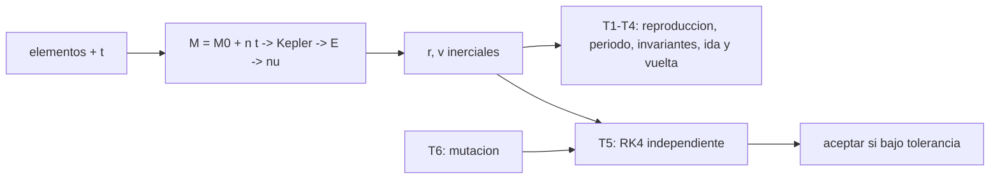

# B71-C20 — Propagador kepleriano verificable

<!-- nav:top -->
[🏠 Programa](../../../../README.md) · [📚 Bloque B71](../../../tronco-comun/B71-mecanica-orbital-fundamental.md) · [← Anterior: B71-C19 — Cambios de plano simples](../B71-C19-cambios-de-plano-simples/CLASE.md) · [Siguiente: B72-C01 — Limitaciones del problema de dos cuerpos →](../../B72/B72-C01-limitaciones-del-problema-de-dos-cuerpos/CLASE.md)
<!-- /nav -->

## 1. Ubicación, nivel y alcance

Clase 20 del bloque B71. Nivel N3. Un propagador kepleriano calcula el estado de un satélite en cualquier instante a partir de sus elementos: resuelve la ecuación de Kepler, obtiene la anomalía verdadera y rota al marco inercial. Lo que lo hace «verificable» es que cada resultado se somete a pruebas con tolerancias declaradas de antemano: reproducción del estado, retorno tras un período, conservación de invariantes, ida y vuelta en el tiempo y comparación con un integrador independiente. Aquí construyes y verificas uno con 30 órbitas sintéticas, y ves por qué los invariantes por sí solos no bastan. Usas [C13](../B71-C13-anomalias-orbitales/CLASE.md), [C14](../B71-C14-ecuacion-de-kepler/CLASE.md) y [C17](../B71-C17-movimientos-en-planos-orbitales/CLASE.md). No se usa ninguna efeméride.

## 2. Por qué esta clase existe

Un propagador que «parece funcionar» puede tener un error de tiempo que ningún invariante detecta. La decisión central: **¿qué pruebas, con qué tolerancias y contra qué referencia independiente demuestran que el propagador es correcto?**

## 3. Lo que podrás hacer al terminar

1. Implementar un propagador kepleriano de elementos a estado.
2. Declarar pruebas y tolerancias antes de ejecutar.
3. Verificar reproducción del estado, período exacto, invariantes e ida y vuelta.
4. Compararlo con un integrador RK4 independiente y reportar el error.
5. Mostrar con una mutación que los invariantes no detectan un error de tiempo.
6. Separar lo consultado (`μ`) de lo sintético (las 30 órbitas) y declarar lo no consultado.

La evidencia es la **informe de verificación del propagador con tolerancias** del ejercicio 12 (sección 20).

## 4. Con qué llegas y cómo comprobarlo

1. ¿Qué es la anomalía media y cómo avanza con el tiempo?
2. ¿Cómo se resuelve la ecuación de Kepler?
3. ¿Qué es un invariante orbital?
4. ¿Qué es un integrador independiente?
5. ¿Qué es una tolerancia declarada?

<details>
<summary>Ver respuestas</summary>

1. `M = M₀ + n t`, con `n = √(μ/a³)`. 2. Con Newton, partiendo de `E₀ = M` o `π`, hasta un residuo pequeño. 3. Una cantidad que no cambia en el movimiento: `h`, `ε`. 4. Un método que no comparte código ni fórmulas con el que se prueba (aquí RK4). 5. El valor máximo de error aceptable, fijado antes de ver el resultado.
</details>

Con cuatro o cinco aciertos, sigue; si no, repasa los prerrequisitos.

## 5. Un caso de contexto y casos de referencia

Con 30 órbitas sintéticas (semilla 20, `e ≤ 0,7`, `t` entre `−1,2 T` y `1,2 T`), el propagador reproduce el estado inicial con `0e+00 m`, vuelve tras un período con `8.2e-08 m`, conserva `h` y `ε` con `3e-15` e ida y vuelta con `3.4e-08 m`, y difiere de un RK4 independiente en `2.0e-05 m` y `2.7e-09 m/s`. Una versión con un Newton defectuoso pasa los invariantes (`3e-16`) pero falla por `5.5e+05 m` frente al RK4. Es el **ejemplo conductor**; todas las órbitas son **sintéticas**.

## 6. Vocabulario

Un **propagador** calcula el estado en un instante. Una **prueba de aceptación** fija una tolerancia antes de ejecutar. Un **integrador independiente** no comparte fórmulas con el sistema bajo prueba. Una **mutación** es un defecto introducido a propósito para ver si las pruebas lo detectan. Un **invariante** es una cantidad conservada. El **retroceso** propaga con `−t`.

## 7. Modelo mental



*Descripción textual:* los elementos se propagan con Kepler; seis pruebas con tolerancias fijadas de antemano decidieron si se acepta; la mutación demuestra que la comparación con un integrador independiente detecta lo que los invariantes no.

Analogía: comprobar una balanza con pesas patrón y con otra balanza; si solo compruebas que «marca lo mismo cada vez» no sabes si marca bien. Límite: aquí la «pesa patrón» es un integrador numérico, no una medición física.

## 8. La explicación, paso a paso

### 8.1 El propagador

Se calcula `n = √(μ/a³)`, `M = M₀ + n t`, `E` por Newton (tolerancia `10⁻¹⁴`, `E₀ = M` si `e < 0,8`, `π` si no), `ν`, `r = p/(1 + e cos ν)`, el estado perifocal y la rotación 3‑1‑3 (C17). Solo órbitas elípticas, dos cuerpos y sin perturbaciones.

### 8.2 Las pruebas se declaran antes

T1 reproducir el estado en `t = 0` (`10⁻⁹ m`); T2 volver tras un período (`10⁻⁴ m`); T3 conservar `h` y `ε` en 25 tiempos (`10⁻⁹`); T4 ida y vuelta (`10⁻⁶ m`); T5 comparar con RK4 de 20 000 pasos por período (`10⁻² m` y `10⁻⁶ m/s`); T6 una mutación debe fallar T5. Fijar las tolerancias antes evita ajustarlas al resultado.

### 8.3 Resultados

En 30 órbitas sintéticas: T1 `0.00e+00 m`; T2 `8.19e-08 m`; T3 `3.47e-15`; T4 `3.44e-08 m`; T5 posición `2.01e-05 m` y velocidad `2.70e-09 m/s`. Todas pasan. El error de T5 está dominado por el RK4, no por el propagador analítico.

### 8.4 La mutación

Con el Newton cortado a 2 iteraciones, el estado sigue siendo un punto válido de la órbita, así que `h` se conserva (`3.3e-16`) y T3 pasa; pero la posición difiere del RK4 en `5.53e+05 m`. Los invariantes verifican la forma de la órbita, no el instante en que el satélite está en cada punto; la referencia independiente es imprescindible. Qué no se verificó: ninguna efeméride real (JPL Horizons y SPICE **no se consultaron**), ningún marco de referencia real, ningún caso hiperbólico ni perturbado.

## 9. Magnitudes, símbolos y unidades

| Símbolo | Qué es | Unidad | Valor / nota |
|---|---|---|---|
| `el` | elementos `(a, e, i, Ω, ω, M₀)` | m, rad | sintéticos |
| `t` | tiempo de propagación | s | −1,2 T a 1,2 T |
| `n` | movimiento medio | rad/s | `√(μ/a³)` |
| `e5r`, `e5v` | diferencias con RK4 | m; m/s | 2.0e-05; 2.7e-09 |
| tolerancia | error máximo aceptado | m | declarada antes |

## 10. Convenciones y referencias

Marco inercial ECI idealizado, SI, dos cuerpos puntuales, sin perturbaciones; solo elipses. `μ` nominal de la IAU. Las 30 órbitas y los tiempos son sintéticos (semilla 20). Ninguna efeméride ni producto de JPL, SPICE, NTRS o IERS se usó. El RK4 usa 20 000 pasos por período.

## 11. De dónde sale lo que afirmamos

| ID | Fuente | Localizador | Respalda | Estado |
|---|---|---|---|---|
| S1 | IAU 2015 Resolución B3, Mamajek et al., arXiv:1510.07674 — https://arxiv.org/abs/1510.07674 (PDF leído con PyMuPDF, consultada 2026-11-10) | tabla de constantes nominales | (GM)ˢᵘⁿ = 1,327 124 4 × 10²⁰ m³ s⁻² y (GM)ᵀⁱᵉʳʳᵃ = 3,986 004 × 10¹⁴ m³ s⁻² (nominales, exactos); R_ecuatorial de la Tierra = 6,3781 × 10⁶ m | Consultada |
| — | Relaciones estándar de mecánica orbital de esta clase | — | las verifica el laboratorio con una segunda vía | No consultada en una fuente concreta |

Límites: no se consultaron JPL Horizons, SPICE, NTRS ni IERS; no hay comparación con efemérides reales ni con otro propagador de la literatura. La verificación vale para este modelo y estas órbitas sintéticas; no es una certificación.

## 12. Cómo ver el resultado

| Magnitud | Valor |
|---|---|
| T1–T2 | 0e+00 m; 8.2e-08 m |
| T3 invariantes | 3e-15 |
| T4 ida y vuelta | 3.4e-08 m |
| T5 frente a RK4 | 2.0e-05 m; 2.7e-09 m/s |
| T6 mutación | 5.5e+05 m (falla T5) |

Descripción larga: el propagador pasa las cinco pruebas con márgenes de varios órdenes y la versión mutada falla la comparación con RK4 aunque conserve los invariantes.

## 13. Ejemplo trabajado

**Aceptar o rechazar con una tolerancia.**

**Paso 1 · Declarar.** T5: posición `< 10⁻² m` frente a RK4.

**Paso 2 · Medir.** Máximo en 30 casos: `2.01e-05 m`.

**Paso 3 · Decidir.** `2.0e-05 < 10⁻²`: se acepta; la versión mutada da `5.5e+05 m` y se rechaza.

## 14. Distintas formas de describir el problema

**Por pruebas:** T1–T6. **Por referencia:** RK4 independiente. **Por invariantes:** `h`, `ε`. **Por mutación:** defecto inyectado.

## 15. Práctica guiada

**Ejercicio 1 · con los pasos indicados.** Calcula `n` para `a = 7000 km`. *Pasos:* `√(μ/a³)`.

<details><summary>Solución comentada</summary>

`√(3,986 × 10¹⁴/3,43 × 10²⁰) = 1,078 × 10⁻³ rad/s`.
</details>

**Ejercicio 2 · con una pista.** Predice cuánto debe valer T2 en teoría. *Pista:* un período devuelve `M`.

<details><summary>Solución comentada</summary>

Cero; el residuo `8.2e-08 m` es redondeo de `M` mod `2π`.
</details>

**Ejercicio 3 · casi autónomo.** ¿Por qué conviene fijar las tolerancias antes de ejecutar? Piensa en el sesgo.

<details><summary>Solución comentada</summary>

Para no ajustarlas al resultado obtenido; una tolerancia posterior no prueba nada.
</details>

## 16. Práctica autónoma, transferencia e integrador

**Ejercicio 4 · autónomo.** Si `e = 0,9` y el Newton usa `E₀ = M`, ¿qué prueba lo detectaría?

<details><summary>Solución comentada</summary>

T5 (o un residuo de Kepler > tolerancia); T3 no lo vería.
</details>

**Ejercicio 5 · autónomo.** ¿Por qué T4 (ida y vuelta) no basta para validar?

<details><summary>Solución comentada</summary>

Un error sistemático de tiempo se cancela al ir y volver; no prueba la corrección absoluta.
</details>

**Ejercicio 6 · autónomo.** Un RK4 con 200 pasos por período da `10⁴ m` de diferencia. ¿Falla el propagador?

<details><summary>Solución comentada</summary>

No necesariamente: el error dominante puede ser el integrador; hay que comprobar el orden de convergencia (C03).
</details>

**Ejercicio 7 · autónomo.** Con T5 = `2e-05 m`, ¿qué precisión de tiempo equivale a 7 km/s?

<details><summary>Solución comentada</summary>

`2e-05/7000 ≈ 3 × 10⁻⁹ s`.
</details>

**Ejercicio 8 · autónomo.** ¿Qué órbitas quedan fuera de esta verificación?

<details><summary>Solución comentada</summary>

Hiperbólicas, perturbadas (J₂, arrastre), con tercer cuerpo y en marcos reales.
</details>

**Ejercicio 9 · transferencia.** **Transferencia.** **Transferencia.** Un colega valida su propagador solo comparando con otro de su mismo código. ¿Qué falta?

<details><summary>Solución comentada</summary>

Independencia: ambos comparten el modelo y los errores; hace falta un integrador o una referencia ajena.
</details>

**Ejercicio 10 · transferencia.** **Transferencia.** **Transferencia.** ¿Qué diferencia hay entre «pasa las pruebas» y «está certificado»?

<details><summary>Solución comentada</summary>

Las pruebas dicen que cumple unas tolerancias en unos casos; una certificación exige requisitos, trazabilidad y revisión formal, que aquí no existen.
</details>

**Ejercicio 11 · transferencia.** **Transferencia.** **Transferencia.** ¿Cómo ampliarías la verificación a perturbaciones `J₂`?

<details><summary>Solución comentada</summary>

Añadiendo un modelo de referencia con esa fuerza en el integrador (B72), nuevas tolerancias y casos; no se hace aquí.
</details>

**Ejercicio 12 · integrador.** **Integrador.** **Integrador.** Elabora tu *informe de verificación del propagador con tolerancias*: pruebas T1–T6 con tolerancias declaradas, resultados, mutación y lista de lo consultado, lo sintético y lo no consultado.

<details><summary>Solución comentada</summary>

Secciones 8.1–8.4 y la salida del laboratorio.
</details>

## 17. Laboratorio: propagador kepleriano y su verificación

El script [propagador.py](propagador.py) propaga 30 órbitas sintéticas y ejecuta seis pruebas con tolerancias declaradas, incluida la comparación con RK4 y una mutación (**comprueba** T1–T5 dentro de tolerancia y T6 fuera). Tarda del orden de un minuto.

**Datos:** `μ` de la IAU (consultado); las 30 órbitas y los tiempos (semilla 20) **sintéticos**; JPL Horizons, SPICE, NTRS e IERS **no consultados**. **Predice antes de ejecutar:** ¿Pasará la versión con el Newton cortado la prueba de invariantes? (Sí, con 10⁻¹⁶; pero fallará T5.) **Ejecución del 2026-11-10 (Python 3.12.9):**

```text
Python 3.12.9 (biblioteca estandar)
30 orbitas SINTETICAS (semilla 20), t en [-1.2 T, 1.2 T]; dos cuerpos; sin efemerides
  T1 estado en t = 0 reproducido:                 max 0.00e+00 m   (tolerancia 1e-9)
  T2 un periodo exacto devuelve el estado:         max 8.19e-08 m   (tolerancia 1e-4)
  T3 invariantes h y epsilon en 25 tiempos:        max 3.47e-15     (tolerancia 1e-9)
  T4 ida y vuelta (+t, -t):                        max 3.44e-08 m   (tolerancia 1e-6)
  T5 frente a RK4 independiente (20000 pasos/T):   posicion 2.01e-05 m ; velocidad 2.70e-09 m/s   (tolerancias 1e-2 m ; 1e-6 m/s)
  T6 mutacion (Newton con 2 iteraciones): error frente a RK4 = 5.53e+05 m ; invariante h de la version mutada = 3.3e-16
Pruebas superadas.
```

```bash
python programa/clases/B71/B71-C20-propagador-kepleriano-verificable/propagador.py
```

**Límites:** solo elipses, dos cuerpos, marco idealizado; el RK4 de 20 000 pasos limita la resolución de T5.

## 18. Errores frecuentes y cómo corregirlos

**Validar solo con invariantes.** Se corrige con 8.4.

**Ajustar las tolerancias después de ver el resultado.** Se corrige con 8.2.

**Comparar con un código que comparte el modelo.** Se corrige con el ejercicio 9.

**Presentar la verificación como certificación.** Se corrige con el ejercicio 10.

## 19. Cómo sabrás que vas bien

Tras la sección 8: ¿qué error esperabas en T5 y cuál obtuviste? Si dudas, repasa el ejemplo 13. Tras el laboratorio: ¿qué comprueba? (ver la sección 17).

## 20. Qué entregas y cómo se evalúa

El producto es tu **informe de verificación del propagador con tolerancias** (ejercicio 12).

| Criterio | Inicial | En desarrollo | Logrado | Destacado |
|---|---|---|---|---|
| Conceptos | Los confunde | Parciales | Distingue invariantes y referencia | Explica los límites de la verificación |
| Cálculo | Sin unidades | Con errores | Tolerancias con unidades | Calcula casos nuevos |
| Numérico | Sin comprobar | Un caso | Seis pruebas y mutación | Interpreta las diferencias |
| Fuentes | Sin fuente | Sin fecha | Fuentes con fecha y estado | Declara lo no consultado |
| Límites | No los nombra | Uno | Tres | Discute qué falta del modelo |

**Condiciones críticas (no se compensan con promedio):** declarar las tolerancias antes de ejecutar; rotular órbitas sintéticas; no presentar la verificación como certificación ni como efeméride; citar solo lo consultado.

## 21. Ética, seguridad y límites

Clase educativa: los modelos son simplificados y sus datos son consultados, sintéticos o ilustrativos (rotulados); ningún resultado es una efeméride ni una predicción operativa ni sustituye a las herramientas de navegación de una misión. Accesibilidad: tablas equivalentes a las gráficas, fórmulas en texto, ejercicios sin conexión.

## 22. Para cerrar y seguir

El propagador pasa cinco pruebas con errores de `2e-05 m` frente a un integrador independiente, y la mutación falla con `6e+05 m` aunque conserve `h`. Con esto el bloque de mecánica orbital fundamental queda cerrado; las fuerzas que el modelo ignoró se tratan en el bloque siguiente.

**Glosario español–inglés.** propagador · *propagator* · prueba de aceptación · *acceptance test* · mutación · *mutation* · tolerancia · *tolerance*.

**Continuidad.** El bloque siguiente, [B72 — Perturbaciones y evolución de órbitas](../../../tronco-comun/B72-perturbaciones-y-evolucion-de-orbitas.md), añade las fuerzas que este modelo ignora.

**Referencias:** ver sección 11.

<!-- nav:bottom -->
---

[← Anterior: B71-C19 — Cambios de plano simples](../B71-C19-cambios-de-plano-simples/CLASE.md) · [📚 Bloque B71](../../../tronco-comun/B71-mecanica-orbital-fundamental.md) · [Siguiente: B72-C01 — Limitaciones del problema de dos cuerpos →](../../B72/B72-C01-limitaciones-del-problema-de-dos-cuerpos/CLASE.md)
<!-- /nav -->
