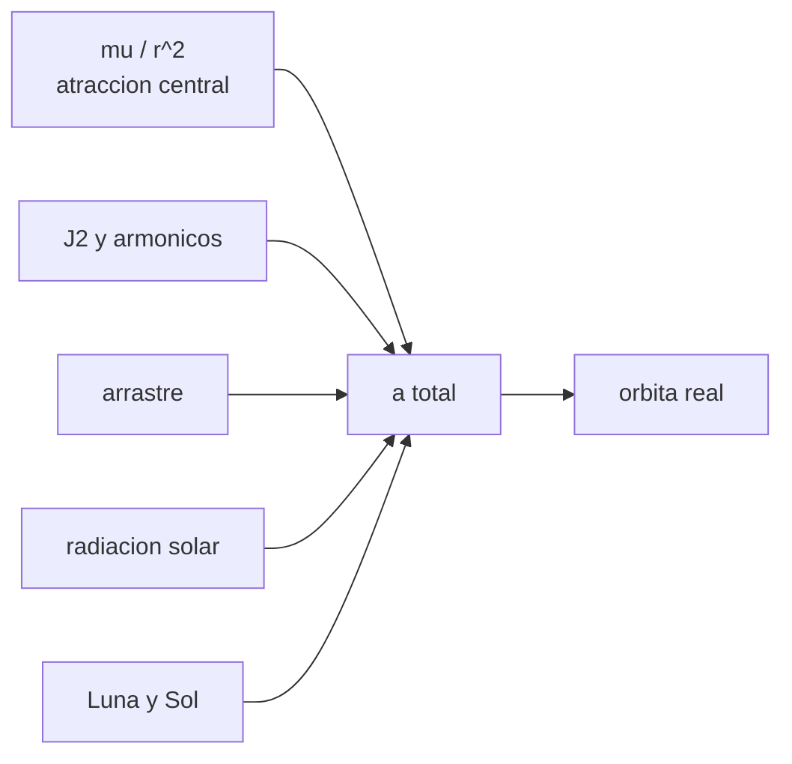

# B72-C01 — Limitaciones del problema de dos cuerpos

<!-- nav:top -->
[🏠 Programa](../../../../README.md) · [📚 Bloque B72](../../../tronco-comun/B72-perturbaciones-y-evolucion-de-orbitas.md) · [← Anterior: B71-C20 — Propagador kepleriano verificable](../../B71/B71-C20-propagador-kepleriano-verificable/CLASE.md) · [Siguiente: B72-C02 — Potencial gravitatorio no esférico →](../B72-C02-potencial-gravitatorio-no-esferico/CLASE.md)
<!-- /nav -->

## 1. Ubicación, nivel y alcance

Clase 1 del bloque B72. Nivel N3. El problema de dos cuerpos da órbitas cerradas y exactas, pero un satélite real sufre además la forma de la Tierra, la atmósfera, la luz del Sol y la atracción de la Luna y del Sol. Aquí comparas el tamaño de cada perturbación con la atracción central y mides cuánto se separa una órbita kepleriana de otra con J2. Abre el bloque y se apoya en la mecánica orbital de [B71](../../../tronco-comun/B71-mecanica-orbital-fundamental.md). La órbita es sintética.

## 2. Por qué esta clase existe

Un propagador kepleriano cabe en tres líneas y se usa en cualquier curso, pero ¿hasta cuándo se puede confiar en él? La decisión central: **¿cuál perturbación domina en cada altitud y en cuánto tiempo la solución de dos cuerpos deja de servir?**

## 3. Lo que podrás hacer al terminar

1. Escribir la aceleración de un satélite como atracción central más perturbaciones.
2. Estimar el orden de magnitud de J2, la Luna, el Sol, la presión de radiación y el arrastre relativos a `μ/r²`.
3. Propagar una órbita kepleriana y una órbita con J2 y medir su separación.
4. Comprobar el integrador contra la solución analítica sin perturbaciones.
5. Decidir qué perturbación mandar a incluir según la altitud.
6. Distinguir lo consultado de lo ilustrativo y de lo no consultado.

La evidencia es la **ficha de perturbaciones dominantes** del ejercicio 12 (sección 20).

## 4. Con qué llegas y cómo comprobarlo

1. ¿Qué es una órbita kepleriana?
2. ¿Qué es la aceleración central?
3. ¿Qué es un orden de magnitud?
4. ¿Qué es un integrador numérico?
5. ¿Qué es un valor no consultado?

<details>
<summary>Ver respuestas</summary>

1. La trayectoria cónica que resulta de la atracción de una masa puntual, con seis elementos constantes. 2. `μ/r²`, dirigida hacia el cuerpo central. 3. La potencia de diez más cercana a un valor. 4. Un algoritmo que avanza la solución de una ecuación diferencial paso a paso. 5. Uno que se usa como ilustración sin haberlo leído en una fuente.
</details>

Con cuatro o cinco aciertos, sigue; si no, repasa los prerrequisitos.

## 5. Un caso de contexto y casos de referencia

Una órbita baja de `6778,137 km` de semieje y `51,6°` de inclinación tarda `5553,6 s` por vuelta. Con solo `J2` en el modelo, tras `30` vueltas (`46,3 h`) la posición se aparta `1361,9 km` de la solución kepleriana. Es el **ejemplo conductor**. La órbita y los parámetros de área y arrastre son sintéticos.

## 6. Vocabulario

El **problema de dos cuerpos** es el movimiento de una masa puntual en el campo `-μ r/r³`. Una **perturbación** es cualquier aceleración adicional `a_p`. La **aceleración perturbadora relativa** es `a_p/(μ/r²)`. Un **elemento osculador** es el elemento kepleriano de la órbita que seguiría el satélite si las perturbaciones se apagaran en ese instante. El **error a lo largo de la trayectoria** (*along-track*) es la componente del error en la dirección de la velocidad.

## 7. Modelo mental: una cuerda tensa con pequeños tirones



*Descripción textual:* la aceleración total suma la atracción central y cuatro familias de perturbaciones; el resultado es la órbita real, que se aparta de la kepleriana.

Analogía: la órbita kepleriana es una cuerda tensa y cada perturbación un tirón pequeño que, repetido vuelta tras vuelta, acaba desplazando la cuerda entera. Límite: el modelo suma las aceleraciones y trata cada una como independiente; en la práctica el arrastre depende de la altitud que fija J2 y las perturbaciones se acoplan.

## 8. La explicación, paso a paso

### 8.1 La suma de aceleraciones

El movimiento se escribe `r̈ = −μ r/r³ + a_p`, con `μ = 3,986 004 × 10¹⁴ m³/s²` (valor nominal IAU 2015 B3) y `a_p` la suma de perturbaciones. Si `a_p = 0` los seis elementos son constantes.

### 8.2 Tamaño de cada perturbación

Se estiman con fórmulas de orden de magnitud: `J2`: `1,5 J2 μ R²/r⁴`; marea de un tercer cuerpo: `2 μ_p r/d³`; presión de radiación: `Cr (A/m) S/c`; arrastre: `½ ρ Cd (A/m) v²`. La irradiancia `S` se deriva de la luminosidad: `L/(4π UA²) = 1361,2 W/m²`.

| Órbita | `r` (km) | `μ/r²` (m/s²) | J2 | Luna | Sol | Presión solar | Arrastre |
|---|---|---|---|---|---|---|---|
| LEO | 6778,1 | 8,676 | 1,4e-03 | 1,3e-07 | 6,2e-08 | 6,8e-09 | 2,2e-07 |
| GPS | 26 560,0 | 0,565 | 9,4e-05 | 8,1e-06 | 3,7e-06 | 1,0e-07 | 0 |
| GEO | 42 164,0 | 0,224 | 3,7e-05 | 3,2e-05 | 1,5e-05 | 2,6e-07 | 0 |

(Valores relativos a `μ/r²`. El arrastre solo se calcula en LEO, con una densidad ilustrativa de `3 × 10⁻¹² kg/m³`.)

### 8.3 Cuánto se separa Kepler

Al propagar `30` vueltas con RK4 de paso `5 s`, la diferencia entre J2 y Kepler crece casi linealmente: `46,7 km` tras una vuelta, `232,9 km` tras cinco, `692,4 km` tras quince y `1361,9 km` tras treinta. Crece porque J2 cambia la frecuencia con la que se recorre la órbita y el nodo se desplaza; el error de posición es sobre todo *along-track*.

### 8.4 Lectura

En LEO manda J2 (tres órdenes de magnitud sobre las demás) y, según la altitud, el arrastre; en GEO la Luna y el Sol son comparables a J2. Ninguna perturbación es despreciable si la propagación dura muchos periodos: lo pequeño se acumula.

## 9. Magnitudes, símbolos y unidades

| Símbolo | Qué es | Unidad | Valor / nota |
|---|---|---|---|
| `μ` | parámetro gravitatorio de la Tierra | m³/s² | 3,986 004 × 10¹⁴ (IAU 2015) |
| `R_e` | radio ecuatorial | m | 6 378 137 |
| `J2` | achatamiento dinámico | — | 1082,63 × 10⁻⁶ (NSSDC) |
| `S` | irradiancia solar a 1 UA | W/m² | 1361,2 (derivada) |
| `A/m` | área sobre masa | m²/kg | 0,01 (ilustrativo) |
| `ρ` | densidad atmosférica | kg/m³ | 3 × 10⁻¹² (ilustrativa) |

## 10. Convenciones y referencias

Marco inercial geocéntrico con el ecuador de la fecha como plano de referencia; SI. `μ` de la IAU 2015, `J2` y radio de la ficha de la Tierra de la NASA; `S` derivada de `L` y de la distancia media (ambas de las fichas). La órbita, `A/m`, `Cr`, `Cd` y `ρ` son ilustrativos. Integrador RK4 de paso fijo con tolerancia de comprobación de `1 m` frente a la solución analítica.

## 11. De dónde sale lo que afirmamos

| ID | Fuente | Localizador | Respalda | Estado |
|---|---|---|---|---|
| S1 | NASA/NSSDC, Earth Fact Sheet — https://nssdc.gsfc.nasa.gov/planetary/factsheet/earthfact.html (consultada 2026-11-10) | ficha completa leída | masa 5,9722 × 10²⁴ kg; radio medio 6371,000 km; radio ecuatorial 6378,137 km; J2 = 1082,63 × 10⁻⁶; GM = 0,39860 × 10⁶ km³/s²; rotación sideral 23,9345 h; semieje mayor 149,598 × 10⁶ km; oblicuidad 23,44° | Consultada |
| S3 | NASA/NSSDC, Sun Fact Sheet — https://nssdc.gsfc.nasa.gov/planetary/factsheet/sunfact.html (consultada 2026-11-10) | ficha completa leída | masa 1,9884 × 10³⁰ kg; luminosidad 3,828 × 10²⁶ W; radio medio 695 700 km. La ficha no da la irradiancia solar total | Consultada |
| S7 | NIST CODATA 2022 — https://physics.nist.gov/cgi-bin/cuu/Value?c y ...?bg (consultadas 2026-11-10) | valores de c y de G | c = 299 792 458 m/s (exacta); G = 6,674 30(15) × 10⁻¹¹ m³ kg⁻¹ s⁻² | Consultada |
| S2 | NASA/NSSDC, Moon Fact Sheet — https://nssdc.gsfc.nasa.gov/planetary/factsheet/moonfact.html (consultada 2026-11-10) | ficha completa leída | masa 0,07346 × 10²⁴ kg; radio medio 1737,4 km; semieje mayor 0,3844 × 10⁶ km; periodo sideral 27,3217 d; excentricidad 0,0549; inclinación a la eclíptica 5,145° | Consultada |
| S8 | NASA JPL SSD, Planetary Satellite Physical Parameters — https://ssd.jpl.nasa.gov/sats/phys_par/ (consultada 2026-11-10) | filas de la Luna, Ío y Europa | GM Luna 4902,800 km³/s²; radio medio 1737,4 km; Ío GM 5959,91547 km³/s², radio 1821,49 km; Europa GM 3202,71210 km³/s², radio 1560,80 km (la página no muestra fecha) | Consultada |
| S13 | IAU 2015 Resolución B3 (Mamajek et al.) — https://arxiv.org/abs/1510.07674 y PDF https://arxiv.org/pdf/1510.07674 (consultadas 2026-11-10; PDF extraído con PyMuPDF) | tabla de constantes de conversión | (GM)N Tierra = 3,986 004 × 10¹⁴ m³ s⁻²; (GM)N Júpiter = 1,266 865 3 × 10¹⁷ m³ s⁻²; (GM)N Sol = 1,327 124 4 × 10²⁰ m³ s⁻²; R_e Tierra nominal 6,3781 × 10⁶ m | Consultada |
| — | Fórmulas de orden de magnitud de cada perturbación; coeficientes `Cr`, `Cd`, `A/m` y densidad | — | las verifica el laboratorio o se declaran ilustrativas | No consultada en una fuente concreta |

Límites: no se consultó ningún modelo de densidad ni de presión de radiación; las cifras de arrastre y de presión de radiación dependen de parámetros ilustrativos.

## 12. Cómo ver la separación entre Kepler y J2

| Magnitud | Valor |
|---|---|
| `J2/(μ/r²)` en LEO | 1,4e-03 |
| `|r_J2 − r_Kepler|` tras 1 vuelta | 46,7 km |
| tras 30 vueltas | 1361,9 km |
| `|RK4 − Kepler|` sin J2, 10 vueltas | 0,013 m |

Descripción larga: La diferencia crece de unas decenas de kilómetros en una vuelta a más de mil kilómetros en dos días; el integrador sin J2 reproduce Kepler al centímetro, de modo que la diferencia se debe a J2 y no al método.

## 13. Ejemplo trabajado: J2 relativa en LEO

**Paso 1 · Cociente.** `R_e/r = 6378,137/6778,137 = 0,94099`; `(R_e/r)² = 0,88546`.

**Paso 2 · Fórmula.** `1,5 J2 (R_e/r)² = 1,5 × 1,08263 × 10⁻³ × 0,88546 = 1,438 × 10⁻³`.

**Paso 3 · Lectura.** J2 vale `1,4 × 10⁻³` de la atracción central: `μ/r² = 8,676 m/s²` por eso J2 ≈ `0,0125 m/s²`.

## 14. Distintas formas de describir el efecto de las perturbaciones

**Por aceleración:** `a_p/(μ/r²)`. **Por elementos:** razones de variación de `a, e, i, Ω, ω, M`. **Por error de posición:** `|r − r_Kepler|` en km. **Por tiempo:** cuántas vueltas hasta alcanzar un umbral de error.

## 15. Práctica guiada

**Ejercicio 1 · con los pasos indicados.** Calcula `μ/r²` en GEO con `r = 42 164 km`. *Pasos:* `r = 4,2164 × 10⁷ m`; divide `3,986004 × 10¹⁴` entre `r²`.

<details><summary>Solución comentada</summary>

`r² = 1,7778 × 10¹⁵`; `μ/r² = 0,2242 m/s²`.
</details>

**Ejercicio 2 · con una pista.** Estima J2 relativa en GEO con `1,5 J2 (R_e/r)²`. *Pista:* `R_e/r = 0,15127`.

<details><summary>Solución comentada</summary>

`1,5 × 1,08263 × 10⁻³ × 0,022883 = 3,72 × 10⁻⁵`, como en la tabla.
</details>

**Ejercicio 3 · casi autónomo.** ¿Por qué el error de posición crece casi linealmente con las vueltas y no se mantiene acotado?

<details><summary>Solución comentada</summary>

Porque J2 cambia el periodo efectivo y el nodo; un pequeño error de fase se acumula en cada vuelta.
</details>

## 16. Práctica autónoma, transferencia e integrador

**Ejercicio 4 · autónomo.** Calcula la irradiancia `S` con `L = 3,828 × 10²⁶ W` y `UA = 1,49598 × 10¹¹ m`.

<details><summary>Solución comentada</summary>

`L/(4π UA²) = 3,828e26/(2,8123e23) = 1361 W/m²`.
</details>

**Ejercicio 5 · autónomo.** Con `Cr = 1,3`, `A/m = 0,01 m²/kg` y `S = 1361,2 W/m²`, calcula la aceleración por presión de radiación.

<details><summary>Solución comentada</summary>

`1,3 × 0,01 × 1361,2/299 792 458 = 5,9 × 10⁻⁸ m/s²`: unos `6,8 × 10⁻⁹` de `μ/r²` en LEO.
</details>

**Ejercicio 6 · autónomo.** Si el periodo es `5553,6 s`, ¿cuántas vueltas son `46,3 h`?

<details><summary>Solución comentada</summary>

`46,3 × 3600/5553,6 = 30,0` vueltas.
</details>

**Ejercicio 7 · autónomo.** ¿Qué perturbación crees dominante a `800 km` si la densidad es `10⁻¹³ kg/m³`? Razona con el orden de magnitud.

<details><summary>Solución comentada</summary>

J2 sigue dominando por tres órdenes: arrastre ≈ `½ ρ Cd (A/m) v²` ≈ `0,5 × 10⁻¹³ × 2,2 × 0,01 × (7450)² ≈ 6 × 10⁻⁸ m/s²` frente a `0,0125 m/s²` de J2.
</details>

**Ejercicio 8 · autónomo.** Un diseñador propaga una constelación GPS por `6 meses` con dos cuerpos. ¿Qué objetaría?

<details><summary>Solución comentada</summary>

Las perturbaciones lunisolares y J2 mueven el nodo y el perigeo; sin ellas el error crece sin límite.
</details>

**Ejercicio 9 · transferencia.** **Transferencia.** ¿Sirve la solución kepleriana para decidir si dos satélites se acercan dentro de `10 min`?

<details><summary>Solución comentada</summary>

Con aviso corto la separación kepleriana es pequeña frente a otros errores; para días no. El criterio depende del error aceptable.
</details>

**Ejercicio 10 · transferencia.** **Transferencia.** Un colega afirma que el error de `1362 km` mide la exactitud de un satélite real. Responde.

<details><summary>Solución comentada</summary>

No: es la diferencia entre dos modelos sintéticos, ninguno observado.
</details>

**Ejercicio 11 · transferencia.** **Transferencia.** Un satélite a `300 km` decae y otro a `1500 km` no. ¿Qué perturbación explica la diferencia y por qué J2 no?

<details><summary>Solución comentada</summary>

El arrastre: la densidad cae exponencialmente con la altitud; J2 depende de `1/r⁴` y es casi igual en ambos.
</details>

**Ejercicio 12 · integrador.** **Integrador.** Elabora tu *ficha de perturbaciones dominantes*: tabla para LEO, GPS y GEO con la perturbación dominante, la segunda, la separación Kepler–J2 a 1 y 30 vueltas y la lista de lo consultado, lo ilustrativo y lo no consultado.

<details><summary>Solución comentada</summary>

Secciones 8.2–8.4 y la salida del laboratorio.
</details>

## 17. Laboratorio: ¿cuánto miente Kepler?

El script [dos_cuerpos.py](dos_cuerpos.py) calcula las aceleraciones relativas en tres órbitas y compara una propagación kepleriana con una integrada con J2 (**comprueba** que RK4 sin J2 reproduce Kepler dentro de 1 m).

**Datos:** `μ` (IAU), `J2`, radios, masas y `L` consultados; la órbita, `A/m`, `Cr`, `Cd` y `ρ` **sintéticos o ilustrativos**. **Predice antes de ejecutar:** ¿crecerá el error linealmente con el número de vueltas? (sí, aproximadamente.) **Ejecución del 2026-11-10 (Python 3.12.9):**

```text
Python 3.12.9 (biblioteca estandar)
Marco inercial geocentrico; orbitas y parametros SINTETICOS o ILUSTRATIVOS
Irradiancia derivada S0 = L/(4 pi UA^2) = 1361.2 W/m2

Aceleraciones relativas a mu/r^2 (A/m = 0.01 m2/kg, Cr = 1.3, Cd = 2.2: ILUSTRATIVOS)
orbita      r [km]  central [m/s2]        J2      Luna       Sol       SRP  arrastre
LEO         6778.1      8.6760e+00   1.4e-03   1.3e-07   6.2e-08   6.8e-09   2.2e-07
GPS        26560.0      5.6504e-01   9.4e-05   8.1e-06   3.7e-06   1.0e-07   0.0e+00
GEO        42164.0      2.2421e-01   3.7e-05   3.2e-05   1.5e-05   2.6e-07   0.0e+00

Orbita sintetica: a = 6778.137 km, e = 0.01, i = 51.6 deg; periodo = 5553.6 s; paso RK4 = 5.0 s
Comprobacion sin J2, 10 orbitas: |RK4 - Kepler| = 1.30e-02 m

 orbitas    t [h]    |r_J2 - r_Kepler| [km]
       1     1.54                    46.748
       5     7.71                   232.918
      15    23.14                   692.382
      30    46.28                  1361.855
Pruebas superadas.
```

```bash
python programa/clases/B72/B72-C01-limitaciones-del-problema-de-dos-cuerpos/dos_cuerpos.py
```

**Límites:** solo J2 (sin J3, J4, arrastre ni terceros cuerpos), paso fijo; la órbita es sintética y el resultado no es una predicción para ningún satélite.

## 18. Errores frecuentes y cómo corregirlos

**Creer que Kepler es “la solución” y J2 un detalle.** Se corrige con 8.3: en dos días la diferencia pasa de mil kilómetros.

**Comparar aceleraciones sin dividir por la central.** Se corrige con 8.2: lo relevante es el cociente.

**Presentar la separación Kepler–J2 como error de un satélite real.** Se corrige con la sección 11 y el ejercicio 11.

**Olvidar que el arrastre y la presión de radiación usaron parámetros ilustrativos.** Se corrige con la sección 10.

## 19. Cómo sabrás que vas bien

Tras la sección 8: ¿qué perturbación esperabas dominante en LEO y cuál resultó? Si dudas, repasa el ejemplo 13. Tras el laboratorio: ¿qué comprueba el primer ensayo? (ver la sección 17).

## 20. Qué entregas y cómo se evalúa

El producto es tu **ficha de perturbaciones dominantes** (ejercicio 12).

| Criterio | Inicial | En desarrollo | Logrado | Destacado |
|---|---|---|---|---|
| Conceptos | Los confunde | Parciales | Suma perturbaciones y compara con `μ/r²` | Explica los límites |
| Cálculo | Sin unidades | Con errores | Tablas completas con unidades | Calcula casos nuevos |
| Numérico | Sin comprobar | Un caso | Contraste con una segunda vía | Interpreta las diferencias |
| Fuentes | Sin fuente | Sin fecha | Fuentes con fecha y estado | Declara lo ilustrativo y lo no consultado |
| Límites | No los nombra | Uno | Tres | Discute qué falta del modelo |

**Condiciones críticas (no se compensan con promedio):** rotular órbita, `A/m`, `Cr`, `Cd` y `ρ` como ilustrativos; no presentar una diferencia entre modelos como error observado; citar solo lo consultado.

## 21. Ética, seguridad y límites

Clase educativa: los modelos son simplificados y sus datos son sintéticos o ilustrativos; ningún resultado sustituye a un producto de determinación de órbita, a un servicio oficial de elementos ni a una decisión de operación de vuelo. Accesibilidad: tablas equivalentes a las gráficas, fórmulas en texto, ejercicios sin conexión.

## 22. Para cerrar y seguir

Una órbita baja se separa `1361,9 km` de la kepleriana en `30` vueltas según un modelo con J2 y datos sintéticos. Queda una pregunta: ¿cómo se describe el campo gravitatorio de un planeta que no es esférico?

**Glosario español–inglés.** perturbación · *perturbation*; problema de dos cuerpos · *two-body problem*; elemento osculador · *osculating element*; irradiancia · *irradiance*; error a lo largo de la trayectoria · *along-track error*.

**Continuidad.** [B72-C02](../B72-C02-potencial-gravitatorio-no-esferico/CLASE.md) desarrolla el potencial gravitatorio no esférico.

**Referencias:** ver sección 11.

<!-- nav:bottom -->
---

[← Anterior: B71-C20 — Propagador kepleriano verificable](../../B71/B71-C20-propagador-kepleriano-verificable/CLASE.md) · [📚 Bloque B72](../../../tronco-comun/B72-perturbaciones-y-evolucion-de-orbitas.md) · [Siguiente: B72-C02 — Potencial gravitatorio no esférico →](../B72-C02-potencial-gravitatorio-no-esferico/CLASE.md)
<!-- /nav -->
