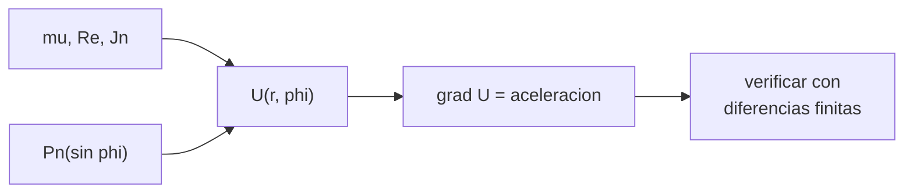

# B72-C02 — Potencial gravitatorio no esférico

<!-- nav:top -->
[🏠 Programa](../../../../README.md) · [📚 Bloque B72](../../../tronco-comun/B72-perturbaciones-y-evolucion-de-orbitas.md) · [← Anterior: B72-C01 — Limitaciones del problema de dos cuerpos](../B72-C01-limitaciones-del-problema-de-dos-cuerpos/CLASE.md) · [Siguiente: B72-C03 — Perturbación J2 terrestre →](../B72-C03-perturbacion-j2-terrestre/CLASE.md)
<!-- /nav -->

## 1. Ubicación, nivel y alcance

Clase 2 del bloque B72. Nivel N3. Un planeta achatado no atrae como un punto. Su potencial se desarrolla en armónicos zonales `J_n` que dependen de la latitud. Aquí escribes ese potencial, obtienes la aceleración como su gradiente y la verificas contra diferencias finitas. Sigue a [B72-C01](../B72-C01-limitaciones-del-problema-de-dos-cuerpos/CLASE.md) y prepara J2 ([C03](../B72-C03-perturbacion-j2-terrestre/CLASE.md)). Solo se consideran los términos zonales (simetría axial).

## 2. Por qué esta clase existe

Sin un potencial no hay perturbación gravitatoria que calcular, y los números de la bibliografía (J2, J3, J4) dependen de un convenio de signos y de un radio de referencia. La decisión central: **¿qué términos del potencial incluir y con qué radio y convenio, para que J2 signifique lo mismo en tu código y en la fuente?**

## 3. Lo que podrás hacer al terminar

1. Escribir el potencial zonal `U = μ/r [1 − Σ J_n (R/r)^n P_n(sin φ)]`.
2. Calcular `P_n` y su derivada por recurrencia, también en los polos.
3. Obtener la aceleración como gradiente del potencial.
4. Verificar el gradiente analítico contra diferencias finitas.
5. Comparar el tamaño de J2, J3 y J4 a 400 km según la latitud.
6. Distinguir lo consultado de lo ilustrativo y de lo no consultado.

La evidencia es la **tabla de armónicos zonales** del ejercicio 12 (sección 20).

## 4. Con qué llegas y cómo comprobarlo

1. ¿Qué es un potencial gravitatorio?
2. ¿Qué es un polinomio de Legendre?
3. ¿Qué es la latitud geocéntrica?
4. ¿Qué es una diferencia finita?
5. ¿Qué es un valor no consultado?

<details>
<summary>Ver respuestas</summary>

1. Una función escalar cuyo gradiente es la aceleración. 2. Una familia de polinomios `P_n(x)` ortogonales en `[−1, 1]`, base del desarrollo en armónicos. 3. El ángulo entre el vector de posición y el plano ecuatorial; `sin φ = z/r`. 4. Una aproximación de la derivada con `(f(x+h) − f(x−h))/(2h)`. 5. Uno que se usa como ilustración sin haberlo leído en una fuente.
</details>

Con cuatro o cinco aciertos, sigue; si no, repasa los prerrequisitos.

## 5. Un caso de contexto y casos de referencia

A `400 km` de altitud sobre el polo, J2 vale `2,88 × 10⁻³` de la atracción central y en el ecuador `1,44 × 10⁻³`: el doble. El gradiente analítico coincide con las diferencias finitas a `2,3 × 10⁻⁹` en 200 puntos al azar. Es el **ejemplo conductor**. El radio polar `6356,752 km` del ejemplo final es ilustrativo.

## 6. Vocabulario

Un **armónico zonal** `J_n` es el coeficiente de un término que solo depende de la latitud. **J2** mide el achatamiento dinámico. El **polinomio de Legendre** `P_n(s)` con `s = sin φ` da la forma del término. El **convenio de signos** aquí es el de `U` positivo, con `J_n` positivo para un achatamiento ecuatorial. El **gradiente** `∇U` es la aceleración gravitatoria.

## 7. Modelo mental: un balón de rugby sobre una mesa de billar



*Descripción textual:* los parámetros y los polinomios de Legendre construyen el potencial; su gradiente es la aceleración, que se verifica numéricamente.

Analogía: un balón achatado atrae más cerca de su ecuador: el potencial añade a la esfera un abultamiento que se “siente” distinto según la latitud. Límite: los términos zonales ignoran el potencial que depende de la longitud (sectoriales y teseales), que también perturba la órbita.

## 8. La explicación, paso a paso

### 8.1 El potencial zonal

Con `μ = 3,986 004 × 10¹⁴ m³/s²` y `R = 6 378 137 m`:

`U(r, φ) = μ/r [1 − Σ J_n (R/r)^n P_n(sin φ)]`, con `J2 = 1082,63 × 10⁻⁶` (ficha NSSDC), `J3 = −2,53881 × 10⁻⁶` y `J4 = −1,65597 × 10⁻⁶` (constantes WGS-72 del *Spacetrack Report No. 3*). Los `J3` y `J4` de WGS-72 se emplean con el `J2` y el radio de la ficha de la NASA; la mezcla es didáctica y no es un modelo gravitatorio consistente.

### 8.2 Gradiente

Cada término es `T_n = μ J_n R^n P_n(s)/r^{n+1}` con `s = z/r`. La aceleración es `−∇T_n`:

`∇T_n = μ J_n R^n [ −(n+1) P_n r_vec/r^{n+3} + P_n′(s) (ẑ − s r_vec/r)/r^{n+2} ]`.

`P_n` y `P_n′` se calculan por recurrencia (`P_n′ = P_{n−2}′ + (2n−1) P_{n−1}`), que no se rompe en los polos.

### 8.3 Verificación

El error relativo máximo entre el gradiente analítico y diferencias finitas centradas con `h = 5 m` en 200 puntos (semilla 72, `r` de 6600 a 43 000 km) es `2,31 × 10⁻⁹`. La forma general con `n = 2` coincide con la fórmula cerrada de J2 en `0` (diferencia relativa exacta).

### 8.4 Tamaño de los armónicos

A `r = R + 400 km`, las aceleraciones relativas a `μ/r²` son:

| Latitud | J2 | J3 | J4 |
|---|---|---|---|
| 0° | 1,438e-03 | 3,173e-06 | 2,434e-06 |
| 30° | 1,296e-03 | 3,765e-06 | 2,571e-06 |
| 60° | 2,187e-03 | 5,156e-06 | 3,166e-06 |
| 90° | 2,876e-03 | 8,461e-06 | 6,492e-06 |

J2 es unas `300` a `500` veces mayor que J3 y J4. En el ecuador la atracción vale `9,8142 m/s²` y en el polo (`6356,752 km`) `9,8323 m/s²`, sin término centrífugo.

### 8.5 Lectura

El achatamiento domina el campo no esférico; J3 y J4 importan para fenómenos finos como la órbita congelada ([C14](../B72-C14-orbitas-congeladas/CLASE.md)). Dos códigos que usen radios o convenios de signo distintos para `J2` no son comparables.

## 9. Magnitudes, símbolos y unidades

| Símbolo | Qué es | Unidad | Valor / nota |
|---|---|---|---|
| `U` | potencial gravitatorio | m²/s² | positivo |
| `J_n` | coeficiente zonal | — | J2 = 1082,63e-6; J3 = −2,53881e-6; J4 = −1,65597e-6 |
| `P_n` | polinomio de Legendre | — | argumento `sin φ` |
| `R` | radio de referencia | m | 6 378 137 |
| `φ` | latitud geocéntrica | rad | −90° a 90° |
| `h` | paso de la diferencia finita | m | 5 |

## 10. Convenciones y referencias

Marco fijo a la Tierra con el eje `z` polar; `U` positivo con `J_n` positivo para achatamiento ecuatorial. `J2`, radio ecuatorial y `μ` de las fichas NASA y de la IAU; `J3` y `J4` de WGS-72 (Spacetrack Report 3), cuyo radio es `6378,135 km`; el desajuste de `2 m` se ignora. El radio polar `6356,752 km` no se consultó.

## 11. De dónde sale lo que afirmamos

| ID | Fuente | Localizador | Respalda | Estado |
|---|---|---|---|---|
| S1 | NASA/NSSDC, Earth Fact Sheet — https://nssdc.gsfc.nasa.gov/planetary/factsheet/earthfact.html (consultada 2026-11-10) | ficha completa leída | masa 5,9722 × 10²⁴ kg; radio medio 6371,000 km; radio ecuatorial 6378,137 km; J2 = 1082,63 × 10⁻⁶; GM = 0,39860 × 10⁶ km³/s²; rotación sideral 23,9345 h; semieje mayor 149,598 × 10⁶ km; oblicuidad 23,44° | Consultada |
| S13 | IAU 2015 Resolución B3 (Mamajek et al.) — https://arxiv.org/abs/1510.07674 y PDF https://arxiv.org/pdf/1510.07674 (consultadas 2026-11-10; PDF extraído con PyMuPDF) | tabla de constantes de conversión | (GM)N Tierra = 3,986 004 × 10¹⁴ m³ s⁻²; (GM)N Júpiter = 1,266 865 3 × 10¹⁷ m³ s⁻²; (GM)N Sol = 1,327 124 4 × 10²⁰ m³ s⁻²; R_e Tierra nominal 6,3781 × 10⁶ m | Consultada |
| S9 | Hoots y Roehrich (1980), Spacetrack Report No. 3, paquete de T. S. Kelso (1988) — https://celestrak.org/NORAD/documentation/spacetrk.pdf (consultada 2026-11-10; texto extraído con PyMuPDF) | portada, introducción y bloque de constantes del programa de la sec. 11 | objetos casi terrestres (periodo < 225 min) y de espacio profundo (≥ 225 min); constantes WGS-72: J2 = 1,082616 × 10⁻³, J3 = −2,53881 × 10⁻⁶, J4 = −1,65597 × 10⁻⁶, KE = 0,0743669161 (radios terrestres)^{3/2}/min, radio 6378,135 km | Consultada |
| — | Radio polar 6356,752 km; fórmulas de recurrencia de Legendre y gradiente del potencial | — | las verifica el laboratorio con diferencias finitas | No consultada en una fuente concreta |

Límites: no se consultó ningún modelo de campo gravitatorio de alto grado (por ejemplo EGM2008) ni las Convenciones IERS; la mezcla de constantes NSSDC y WGS-72 es didáctica.

## 12. Cómo ver el campo no esférico

| Magnitud | Valor |
|---|---|
| `J2/(μ/r²)` a 400 km, ecuador | 1,438e-03 |
| `J2/(μ/r²)` a 400 km, polo | 2,876e-03 |
| error gradiente vs diferencias finitas | 2,31e-09 |
| atracción ecuador / polo | 9,8142 / 9,8323 m/s² |

Descripción larga: J2 es el doble de intensa sobre el polo que sobre el ecuador a la misma altitud; J3 y J4 son unas trescientas veces menores; y el gradiente analítico concuerda con la derivada numérica a nueve cifras.

## 13. Ejemplo trabajado: polinomios de Legendre

**Paso 1 · Recurrencia.** `P0 = 1`, `P1 = s`, `P2 = (3s² − 1)/2`, `P3 = (5s³ − 3s)/2`.

**Paso 2 · Derivada.** `P2′ = 3s`, `P3′ = (15s² − 3)/2`; en el polo `s = 1` valen `3` y `6`.

**Paso 3 · Lectura.** En el polo `P2 = 1`, en el ecuador `P2 = −1/2`; por eso J2 es mayor en el polo.

## 14. Distintas formas de describir el campo gravitatorio

**Por potencial:** `U(r, φ)`. **Por aceleración:** `∇U`. **Por coeficientes:** la lista `J_n`. **Por razón:** `J_n` relativo a la central en un punto. **Por superficie:** equipotenciales.

## 15. Práctica guiada

**Ejercicio 1 · con los pasos indicados.** Calcula `P2` en `φ = 30°`. *Pasos:* `s = 0,5`; `(3 × 0,25 − 1)/2`.

<details><summary>Solución comentada</summary>

`P2 = −0,125`.
</details>

**Ejercicio 2 · con una pista.** Calcula `P2′` y `P3` en `s = 0,5`. *Pista:* `P2′ = 3s`; `P3 = (5s³ − 3s)/2`.

<details><summary>Solución comentada</summary>

`P2′ = 1,5`; `P3 = (0,625 − 1,5)/2 = −0,4375`.
</details>

**Ejercicio 3 · casi autónomo.** ¿Por qué conviene la recurrencia y no `n(s·P_n − P_{n−1})/(s² − 1)` para `P_n′`?

<details><summary>Solución comentada</summary>

Porque esa fórmula divide por cero en los polos, donde `s = ±1`.
</details>

## 16. Práctica autónoma, transferencia e integrador

**Ejercicio 4 · autónomo.** Calcula el término `J2` del potencial en el ecuador a `r = R`: `−μ J2 P2(0)/R`.

<details><summary>Solución comentada</summary>

`P2(0) = −1/2`; el término es `+μ J2/(2R) = 3,986e14 × 1,08263e-3/(2 × 6,378137e6) = 3,383e4 m²/s²`; se suma a `μ/R` según el signo del desarrollo.
</details>

**Ejercicio 5 · autónomo.** ¿Qué cambia si cambias el radio de referencia de `6378,137` a `6378,135 km`?

<details><summary>Solución comentada</summary>

Cambia la relación `(R/r)²` en `6 × 10⁻⁷` relativo: despreciable aquí, pero hay que declararlo.
</details>

**Ejercicio 6 · autónomo.** Estima la razón J2/J3 a 400 km en el ecuador con la tabla.

<details><summary>Solución comentada</summary>

`1,438e-3/3,173e-6 = 453`.
</details>

**Ejercicio 7 · autónomo.** Si `h = 5000 m` en la diferencia finita, ¿qué le pasa al error?

<details><summary>Solución comentada</summary>

Crece como `h²`; se vería un error de truncamiento muy superior a `10⁻⁹`.
</details>

**Ejercicio 8 · autónomo.** Un código dice usar J2 pero con signo contrario. ¿Qué órbita sale mal?

<details><summary>Solución comentada</summary>

El nodo regresaría en sentido contrario y el perigeo avanzaría donde debía retroceder.
</details>

**Ejercicio 9 · transferencia.** **Transferencia.** ¿Puede un campo solo zonal producir una dependencia con la longitud?

<details><summary>Solución comentada</summary>

No: es simétrico respecto al eje; las diferencias en longitud exigen términos sectoriales y teseales.
</details>

**Ejercicio 10 · transferencia.** **Transferencia.** Un colega afirma que J3 es despreciable siempre. Responde.

<details><summary>Solución comentada</summary>

Es pequeño en aceleración, pero en las órbitas congeladas fija la excentricidad de equilibrio.
</details>

**Ejercicio 11 · transferencia.** **Transferencia.** Un compañero cita `J2 = 1,08263e-3` de un artículo con radio de `6378,137 km` y usa `R = 6371 km` en su código. ¿Qué error comete?

<details><summary>Solución comentada</summary>

Un error relativo de `2(6378,137−6371)/6371 ≈ 0,22 %` en el término `(R/r)²` y con ello en la aceleración de J2: el radio debe ser el de la definición del coeficiente.
</details>

**Ejercicio 12 · integrador.** **Integrador.** Elabora tu *tabla de armónicos zonales*: J2, J3 y J4 relativos a `μ/r²` a 400 km en cuatro latitudes, con la verificación del gradiente y la lista de lo consultado, lo ilustrativo y lo no consultado.

<details><summary>Solución comentada</summary>

Sección 8.4 y la salida del laboratorio.
</details>

## 17. Laboratorio: gradiente del potencial zonal

El script [potencial_zonal.py](potencial_zonal.py) implementa el potencial y su gradiente analítico y los compara con diferencias finitas en 200 puntos (**comprueba** un error relativo máximo menor que `1e-6` y la igualdad con la forma cerrada de J2).

**Datos:** `μ`, `J2`, `R` y `J3`, `J4` consultados; el radio polar y los puntos al azar (semilla 72) son **ilustrativos o sintéticos**. **Predice antes de ejecutar:** ¿en qué latitud es mayor J2 relativo? (en el polo.) **Ejecución del 2026-11-10 (Python 3.12.9):**

```text
Python 3.12.9 (biblioteca estandar)
Marco fijo a la Tierra, eje z polar. J2 de NSSDC; J3 y J4 de WGS-72 (Spacetrack Report 3)
Gradiente analitico vs diferencias finitas (200 puntos al azar, semilla 72): error relativo maximo = 2.31e-09
J2 en forma cerrada vs general: diferencia relativa = 0.00e+00

Aceleracion de cada armonico relativa a mu/r^2, r = Re + 400 km
 latitud          J2          J3          J4
       0   1.438e-03   3.173e-06   2.434e-06
      30   1.296e-03   3.765e-06   2.571e-06
      60   2.187e-03   5.156e-06   3.166e-06
      90   2.876e-03   8.461e-06   6.492e-06

Atraccion en el ecuador (r = Re): 9.8142 m/s2; en el polo (r = 6356.752 km): 9.8323 m/s2
(radio polar 6356.752 km: ILUSTRATIVO, no consultado; sin termino centrifugo)
Pruebas superadas.
```

```bash
python programa/clases/B72/B72-C02-potencial-gravitatorio-no-esferico/potencial_zonal.py
```

**Límites:** solo términos zonales; mezcla de constantes de dos orígenes; no es un modelo de campo de alto grado.

## 18. Errores frecuentes y cómo corregirlos

**Mezclar el convenio de signos del potencial.** Se corrige con la sección 10: aquí `U` es positivo.

**Usar la fórmula de `P_n′` con división por `s² − 1`.** Se corrige con 8.2: la recurrencia aditiva.

**Creer que J2 es igual en todas las latitudes.** Se corrige con 8.4.

**Olvidar declarar el radio de referencia.** Se corrige con la sección 10.

## 19. Cómo sabrás que vas bien

Tras la sección 8: ¿en qué latitud esperabas el máximo de J2? Si dudas, repasa el ejemplo 13. Tras el laboratorio: ¿qué comprueba el primer ensayo? (ver la sección 17).

## 20. Qué entregas y cómo se evalúa

El producto es tu **tabla de armónicos zonales** (ejercicio 12).

| Criterio | Inicial | En desarrollo | Logrado | Destacado |
|---|---|---|---|---|
| Conceptos | Los confunde | Parciales | Calcula potencial y gradiente | Explica los límites |
| Cálculo | Sin unidades | Con errores | Tablas completas con unidades | Calcula casos nuevos |
| Numérico | Sin comprobar | Un caso | Contraste con una segunda vía | Interpreta las diferencias |
| Fuentes | Sin fuente | Sin fecha | Fuentes con fecha y estado | Declara lo ilustrativo y lo no consultado |
| Límites | No los nombra | Uno | Tres | Discute qué falta del modelo |

**Condiciones críticas (no se compensan con promedio):** declarar el convenio de signos y el radio de referencia; rotular la mezcla de constantes NSSDC/WGS-72 y el radio polar como no consultados; citar solo lo consultado.

## 21. Ética, seguridad y límites

Clase educativa: los modelos son simplificados y sus datos son sintéticos o ilustrativos; ningún resultado sustituye a un producto de determinación de órbita, a un servicio oficial de elementos ni a una decisión de operación de vuelo. Accesibilidad: tablas equivalentes a las gráficas, fórmulas en texto, ejercicios sin conexión.

## 22. Para cerrar y seguir

J2 es el doble de intenso en el polo que en el ecuador (`2,88 × 10⁻³` frente a `1,44 × 10⁻³` a 400 km) y el gradiente analítico coincide con la derivada numérica a `2,3 × 10⁻⁹`. Queda una pregunta: ¿qué hace J2 con los elementos orbitales a largo plazo?

**Glosario español–inglés.** armónico zonal · *zonal harmonic*; polinomio de Legendre · *Legendre polynomial*; potencial gravitatorio · *gravitational potential*; achatamiento · *oblateness*; gradiente · *gradient*.

**Continuidad.** [B72-C03](../B72-C03-perturbacion-j2-terrestre/CLASE.md) estudia la perturbación J2 y sus tasas seculares.

**Referencias:** ver sección 11.

<!-- nav:bottom -->
---

[← Anterior: B72-C01 — Limitaciones del problema de dos cuerpos](../B72-C01-limitaciones-del-problema-de-dos-cuerpos/CLASE.md) · [📚 Bloque B72](../../../tronco-comun/B72-perturbaciones-y-evolucion-de-orbitas.md) · [Siguiente: B72-C03 — Perturbación J2 terrestre →](../B72-C03-perturbacion-j2-terrestre/CLASE.md)
<!-- /nav -->
