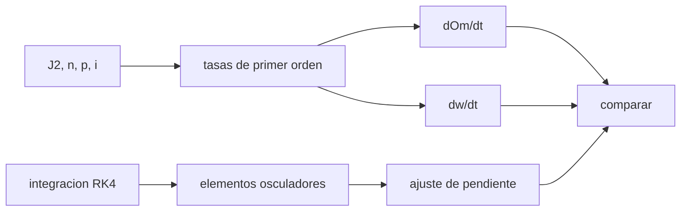

# B72-C03 — Perturbación J2 terrestre

<!-- nav:top -->
[🏠 Programa](../../../../README.md) · [📚 Bloque B72](../../../tronco-comun/B72-perturbaciones-y-evolucion-de-orbitas.md) · [← Anterior: B72-C02 — Potencial gravitatorio no esférico](../B72-C02-potencial-gravitatorio-no-esferico/CLASE.md) · [Siguiente: B72-C04 — Precesión del nodo orbital →](../B72-C04-precesion-del-nodo-orbital/CLASE.md)
<!-- /nav -->

## 1. Ubicación, nivel y alcance

Clase 3 del bloque B72. Nivel N3. J2 cambia lentamente tres elementos: el nodo `Ω`, el argumento del periapsis `ω` y la anomalía media. Aquí obtienes las tasas seculares de primer orden y las contrastas con la pendiente de los elementos osculadores en una integración con J2. Sigue a [B72-C02](../B72-C02-potencial-gravitatorio-no-esferico/CLASE.md) y abre las clases [C04](../B72-C04-precesion-del-nodo-orbital/CLASE.md) y [C05](../B72-C05-precesion-del-argumento-del-periapsis/CLASE.md). Las órbitas son sintéticas.

## 2. Por qué esta clase existe

J2 no cambia el semieje mayor ni la inclinación en promedio, pero hace girar el plano y el perigeo; con ello se diseñan órbitas heliosíncronas y Molniya. La decisión central: **¿cuánto se mueven `Ω` y `ω` por día en una órbita dada y cuánto confiar en la fórmula de primer orden?**

## 3. Lo que podrás hacer al terminar

1. Escribir las tasas seculares de `Ω`, `ω` y de la anomalía media por J2.
2. Calcularlas para una órbita baja, una heliosíncrona y una tipo Molniya.
3. Medirlas en una integración numérica ajustando una recta a los elementos osculadores.
4. Entender por qué la fórmula tiene un error del orden de `J2` y de las oscilaciones de corto periodo.
5. Reconocer cuándo `ω` es poco informativa (órbitas casi circulares o en la inclinación crítica).
6. Distinguir lo consultado de lo ilustrativo y de lo no consultado.

La evidencia es la **tabla de tasas seculares J2** del ejercicio 12 (sección 20).

## 4. Con qué llegas y cómo comprobarlo

1. ¿Qué es el nodo ascendente `Ω`?
2. ¿Qué es `ω`?
3. ¿Qué es un efecto secular?
4. ¿Qué es un ajuste por mínimos cuadrados?
5. ¿Qué es un valor no consultado?

<details>
<summary>Ver respuestas</summary>

1. La longitud del punto donde la órbita cruza el ecuador hacia el norte. 2. El ángulo del perigeo medido desde el nodo ascendente en el plano orbital. 3. Uno que crece de forma monótona con el tiempo, frente a los periódicos. 4. El método que elige la recta que minimiza la suma de los cuadrados de los residuos. 5. Uno que se usa como ilustración sin haberlo leído en una fuente.
</details>

Con cuatro o cinco aciertos, sigue; si no, repasa los prerrequisitos.

## 5. Un caso de contexto y casos de referencia

Una órbita baja de `6778,137 km`, `e = 0,02`, `i = 51,6°` pierde `5,006 °/día` de nodo según la fórmula y `5,001 °/día` según la integración numérica de 30 vueltas: una diferencia de `0,11 %`. Es el **ejemplo conductor**. Las órbitas son sintéticas.

## 6. Vocabulario

La **tasa secular** es la variación media por unidad de tiempo, sin las oscilaciones. La **regresión del nodo** es el giro de `Ω` hacia el oeste (`dΩ/dt < 0`) en órbitas progradas. La **precesión del perigeo** es la variación de `ω`. Un **elemento osculador** es el elemento instantáneo, con oscilaciones de corto periodo. El **desenrollado de fase** suma `2π` para evitar saltos al ajustar ángulos.

## 7. Modelo mental: una peonza que se tambalea



*Descripción textual:* la fórmula analítica da las tasas; la integración numérica da elementos osculadores de los que se ajusta una pendiente; ambas vías se comparan.

Analogía: como una peonza cuyo eje describe un cono lento mientras gira rápido, la órbita gira sobre sí misma y el plano precede lentamente. Límite: la fórmula es de primer orden en `J2` y promedia sobre la órbita; no incluye J3, J4, ni los términos de segundo orden.

## 8. La explicación, paso a paso

### 8.1 Tasas de primer orden

Con `n = √(μ/a³)`, `p = a(1 − e²)` y `f = n J2 (R/p)²`:

- `dΩ/dt = −(3/2) f cos i`
- `dω/dt = (3/4) f (5 cos² i − 1)`
- `dM/dt = n + (3/4) f √(1−e²) (3 cos² i − 1)`

con `μ = 3,986 004 × 10¹⁴ m³/s²`, `R = 6 378 137 m` y `J2 = 1082,63 × 10⁻⁶`.

### 8.2 Comparación con la integración

Se integra con RK4 (paso `10 s`; `2 s` en Molniya) y se ajusta una recta, con desenrollado de fase, a `Ω(t)` y `ω(t)` muestreados cada `60 s` (cada `60 s` en Molniya):

| Caso | `dΩ/dt` teor. | `dΩ/dt` num. | Error % | `dω/dt` teor. | `dω/dt` num. | Error % |
|---|---|---|---|---|---|---|
| baja 51,6° (`e = 0,02`) | −5,0063 | −5,0009 | 0,11 | 3,7443 | 3,7259 | 0,49 |
| heliosíncrona 98,2° | 0,9879 | 0,9844 | 0,35 | −3,1109 | −3,0592 | 1,66 |
| Molniya 63,4° | −0,1472 | −0,1338 | 9,10 | 0,0004 | 0,0011 | — |

(°/día; `e = 0,74` y 3 vueltas en Molniya.)

### 8.3 Por qué difieren

Los elementos osculadores oscilan con el periodo orbital con amplitudes que dependen de `J2` y, para `ω`, de `1/e`; con `e = 0,001` el ajuste de `ω` fallaba un `8 %`, y por eso se usó `e = 0,02`. Además `a` osculante difiere del medio en kilómetros.

### 8.4 Lectura

En órbita baja `Ω` retrocede unos `5 °/día` y `ω` avanza unos `3,7 °/día`. En la inclinación crítica `dω/dt` es casi nula (`4 × 10⁻⁴ °/día`). La fórmula de primer orden basta para el diseño de misión preliminar, no para efemérides.

## 9. Magnitudes, símbolos y unidades

| Símbolo | Qué es | Unidad | Valor / nota |
|---|---|---|---|
| `Ω` | nodo ascendente | rad (°/día) | regresa si `i < 90°` |
| `ω` | argumento del periapsis | rad (°/día) | avanza si `i < 63,4°` |
| `n` | movimiento medio | rad/s | `√(μ/a³)` |
| `p` | semilatus rectum | m | `a(1 − e²)` |
| `J2` | achatamiento | — | 1082,63e-6 |
| `f` | factor `n J2 (R/p)²` | rad/s | — |

## 10. Convenciones y referencias

Marco inercial del ecuador de la fecha; SI en el cálculo y °/día en las tablas. Elementos iniciales con `ν = 0`, `Ω = 30°`, `ω = 60°` (sintéticos). Pendiente por mínimos cuadrados con desenrollado de fase; tolerancia de comprobación `2 %` en las dos órbitas bajas. `J2`, `R` y `μ` de las fuentes de la sección 11.

## 11. De dónde sale lo que afirmamos

| ID | Fuente | Localizador | Respalda | Estado |
|---|---|---|---|---|
| S1 | NASA/NSSDC, Earth Fact Sheet — https://nssdc.gsfc.nasa.gov/planetary/factsheet/earthfact.html (consultada 2026-11-10) | ficha completa leída | masa 5,9722 × 10²⁴ kg; radio medio 6371,000 km; radio ecuatorial 6378,137 km; J2 = 1082,63 × 10⁻⁶; GM = 0,39860 × 10⁶ km³/s²; rotación sideral 23,9345 h; semieje mayor 149,598 × 10⁶ km; oblicuidad 23,44° | Consultada |
| S13 | IAU 2015 Resolución B3 (Mamajek et al.) — https://arxiv.org/abs/1510.07674 y PDF https://arxiv.org/pdf/1510.07674 (consultadas 2026-11-10; PDF extraído con PyMuPDF) | tabla de constantes de conversión | (GM)N Tierra = 3,986 004 × 10¹⁴ m³ s⁻²; (GM)N Júpiter = 1,266 865 3 × 10¹⁷ m³ s⁻²; (GM)N Sol = 1,327 124 4 × 10²⁰ m³ s⁻²; R_e Tierra nominal 6,3781 × 10⁶ m | Consultada |
| — | Fórmulas de las tasas seculares de J2 (primer orden) | — | las verifica el laboratorio con una integración independiente | No consultada en una fuente concreta |

Límites: las fórmulas seculares no se consultaron en un texto; se comprueban numéricamente. Para Molniya solo se integran tres vueltas, así que el error de `Ω` es mayor.

## 12. Cómo ver las tasas seculares

| Magnitud | Valor |
|---|---|
| `dΩ/dt` teórica, 51,6° | −5,0063 °/día |
| `dΩ/dt` numérica | −5,0009 °/día |
| error de `dΩ/dt` | 0,11 % |
| `dω/dt` teórica, 98,2° | −3,1109 °/día |

Descripción larga: La fórmula de primer orden reproduce el nodo de la integración numérica a menos del 1 % en las dos órbitas bajas; el argumento del periapsis se acerca al 2 %.

## 13. Ejemplo trabajado: el nodo de una órbita baja

**Paso 1 · Movimiento medio.** `a = 6778,137 km`: `n = √(3,986004e14/(6,778137e6)³) = 1,1284 × 10⁻³ rad/s`.

**Paso 2 · Factor.** `p = a(1 − 0,0004) = 6,77543e6 m`; `(R/p)² = 0,88619`; `f = 1,1284e-3 × 1,08263e-3 × 0,88619 = 1,0827 × 10⁻⁶ rad/s`.

**Paso 3 · Tasa.** `dΩ/dt = −1,5 × 1,0827e-6 × cos 51,6° = −1,0094e-6 rad/s = −5,0063 °/día`.

## 14. Distintas formas de describir las tasas seculares

**Por fórmula:** `dΩ/dt`, `dω/dt` en rad/s. **Por días:** °/día. **Por periodo:** días hasta una vuelta completa. **Por ajuste:** pendiente de los elementos osculadores. **Por error:** diferencia relativa entre teoría y número.

## 15. Práctica guiada

**Ejercicio 1 · con los pasos indicados.** Convierte `−1,0094 × 10⁻⁶ rad/s` a °/día. *Pasos:* multiplica por `86400` y por `180/π`.

<details><summary>Solución comentada</summary>

`−1,0094e-6 × 86400 × 57,2958 = −4,997 °/día` (con el redondeo del ejemplo; `−5,006` con más cifras).
</details>

**Ejercicio 2 · con una pista.** Calcula `5 cos² i − 1` para `i = 51,6°`. *Pista:* `cos 51,6° = 0,6212`.

<details><summary>Solución comentada</summary>

`5 × 0,3859 − 1 = 0,9295`: positivo, `ω` avanza.
</details>

**Ejercicio 3 · casi autónomo.** ¿Por qué `ω` retrocede en la heliosíncrona de `98,2°`?

<details><summary>Solución comentada</summary>

`cos² 98,2° = 0,0204`; `5 × 0,0204 − 1 = −0,898 < 0`.
</details>

## 16. Práctica autónoma, transferencia e integrador

**Ejercicio 4 · autónomo.** Estima el periodo de regresión del nodo de la órbita baja.

<details><summary>Solución comentada</summary>

`360/5,006 = 71,9 días`.
</details>

**Ejercicio 5 · autónomo.** ¿Qué pasa con `dΩ/dt` si `i = 90°`?

<details><summary>Solución comentada</summary>

Es cero: `cos 90° = 0`.
</details>

**Ejercicio 6 · autónomo.** Calcula `dω/dt` a `i = 63,4349°`.

<details><summary>Solución comentada</summary>

`5 cos² i = 1`; la tasa es cero.
</details>

**Ejercicio 7 · autónomo.** Si `a` aumenta de `6778` a `7078 km`, ¿qué factor cambia `f`?

<details><summary>Solución comentada</summary>

`f ∝ n/p² ∝ a^{−7/2}` (con `e` pequeño): factor `(6778/7078)^{3,5} = 0,86`.
</details>

**Ejercicio 8 · autónomo.** ¿Por qué un ajuste lineal a `ω` es poco fiable con `e = 0,001`?

<details><summary>Solución comentada</summary>

El perigeo está mal definido y `ω` oscila con amplitud `∝ 1/e`.
</details>

**Ejercicio 9 · transferencia.** **Transferencia.** Una operadora propone predecir la posición de un satélite a una semana con solo las tasas medias. Responde.

<details><summary>Solución comentada</summary>

El error de fase y las oscilaciones de corto periodo superan lo tolerable para efemérides; sirve para planificar.
</details>

**Ejercicio 10 · transferencia.** **Transferencia.** ¿Por qué la integración de Molniya con tres vueltas no valida la tasa de `ω`?

<details><summary>Solución comentada</summary>

La tasa es casi cero y menor que el ruido de las oscilaciones.
</details>

**Ejercicio 11 · transferencia.** **Transferencia.** ¿Prueba este laboratorio algo sobre un satélite real?

<details><summary>Solución comentada</summary>

No: las órbitas son sintéticas y el modelo solo tiene J2.
</details>

**Ejercicio 12 · integrador.** **Integrador.** Elabora tu *tabla de tasas seculares J2*: `dΩ/dt` y `dω/dt` teóricos y numéricos para tres órbitas, con el error y la lista de lo consultado, lo ilustrativo y lo no consultado.

<details><summary>Solución comentada</summary>

Sección 8.2 y la salida del laboratorio.
</details>

## 17. Laboratorio: tasas seculares de J2 frente a RK4

El script [j2_seculares.py](j2_seculares.py) integra tres órbitas con J2, ajusta una recta a `Ω(t)` y `ω(t)` y la compara con las tasas de primer orden (**comprueba** errores menores de `2 %` en las dos órbitas bajas).

**Datos:** `μ`, `J2` y `R` consultados; las órbitas y los elementos iniciales son **sintéticos**. **Predice antes de ejecutar:** ¿qué signo tendrá `dΩ/dt` en la heliosíncrona? (positivo, el nodo avanza hacia el este.) **Ejecución del 2026-11-10 (Python 3.12.9):**

```text
Python 3.12.9 (biblioteca estandar)
Orbitas SINTETICAS; J2 = 1082.63e-6 (NSSDC), mu = 3.986004e14 (IAU 2015); epoca de elementos: nu = 0
caso                     dOm teor    dOm num   err %    dw teor     dw num   err %   [deg/dia]
baja 51.6 deg             -5.0063    -5.0009    0.11     3.7443     3.7259    0.49
heliosincrona 98.2         0.9879     0.9844    0.35    -3.1109    -3.0592    1.66
Molniya 63.4 deg          -0.1472    -0.1338    9.10     0.0004     0.0011  176.75
Molniya: solo 3 vueltas de 12 h; con elementos osculadores muy oscilantes, la pendiente de omega (teorica casi nula) no es informativa y la de Omega tiene error mayor.
Pruebas superadas.
```

```bash
python programa/clases/B72/B72-C03-perturbacion-j2-terrestre/j2_seculares.py
```

**Límites:** solo J2, RK4 de paso fijo; en Molniya solo tres vueltas, de modo que la comparación es cualitativa.

## 18. Errores frecuentes y cómo corregirlos

**Creer que J2 cambia el semieje mayor en promedio.** Se corrige con 8.1: `a` e `i` no tienen tasa secular de primer orden.

**Ajustar `ω` en una órbita casi circular.** Se corrige con 8.3.

**Confundir elemento osculador con medio.** Se corrige con el vocabulario.

**Presentar las tasas como medidas de un satélite.** Se corrige con la sección 11.

## 19. Cómo sabrás que vas bien

Tras la sección 8: ¿qué signo esperabas para el nodo de la órbita baja y cuál obtuviste? Si dudas, repasa el ejemplo 13. Tras el laboratorio: ¿qué comprueba el criterio de `2 %`? (ver la sección 17).

## 20. Qué entregas y cómo se evalúa

El producto es tu **tabla de tasas seculares J2** (ejercicio 12).

| Criterio | Inicial | En desarrollo | Logrado | Destacado |
|---|---|---|---|---|
| Conceptos | Los confunde | Parciales | Calcula las tres tasas | Explica los límites |
| Cálculo | Sin unidades | Con errores | Tablas completas con unidades | Calcula casos nuevos |
| Numérico | Sin comprobar | Un caso | Contraste con una segunda vía | Interpreta las diferencias |
| Fuentes | Sin fuente | Sin fecha | Fuentes con fecha y estado | Declara lo ilustrativo y lo no consultado |
| Límites | No los nombra | Uno | Tres | Discute qué falta del modelo |

**Condiciones críticas (no se compensan con promedio):** rotular las órbitas como sintéticas; no presentar una tasa como medida de un satélite; citar solo lo consultado.

## 21. Ética, seguridad y límites

Clase educativa: los modelos son simplificados y sus datos son sintéticos o ilustrativos; ningún resultado sustituye a un producto de determinación de órbita, a un servicio oficial de elementos ni a una decisión de operación de vuelo. Accesibilidad: tablas equivalentes a las gráficas, fórmulas en texto, ejercicios sin conexión.

## 22. Para cerrar y seguir

El nodo de una órbita baja retrocede `5,006 °/día` y la integración numérica lo confirma a `0,11 %`. Queda una pregunta: ¿cómo se usa esa tasa de nodo para diseñar órbitas?

**Glosario español–inglés.** tasa secular · *secular rate*; regresión del nodo · *nodal regression*; precesión del perigeo · *apsidal precession*; elemento osculador · *osculating element*; ajuste por mínimos cuadrados · *least-squares fit*.

**Continuidad.** [B72-C04](../B72-C04-precesion-del-nodo-orbital/CLASE.md) profundiza en la precesión del nodo orbital.

**Referencias:** ver sección 11.

<!-- nav:bottom -->
---

[← Anterior: B72-C02 — Potencial gravitatorio no esférico](../B72-C02-potencial-gravitatorio-no-esferico/CLASE.md) · [📚 Bloque B72](../../../tronco-comun/B72-perturbaciones-y-evolucion-de-orbitas.md) · [Siguiente: B72-C04 — Precesión del nodo orbital →](../B72-C04-precesion-del-nodo-orbital/CLASE.md)
<!-- /nav -->
