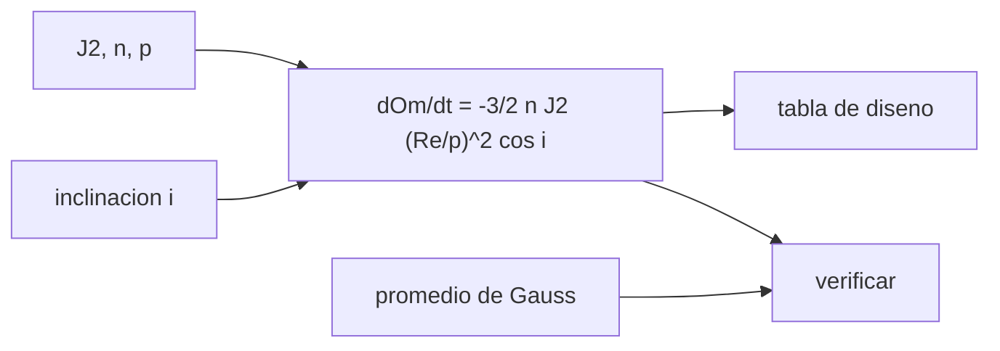

# B72-C04 — Precesión del nodo orbital

<!-- nav:top -->
[🏠 Programa](../../../../README.md) · [📚 Bloque B72](../../../tronco-comun/B72-perturbaciones-y-evolucion-de-orbitas.md) · [← Anterior: B72-C03 — Perturbación J2 terrestre](../B72-C03-perturbacion-j2-terrestre/CLASE.md) · [Siguiente: B72-C05 — Precesión del argumento del periapsis →](../B72-C05-precesion-del-argumento-del-periapsis/CLASE.md)
<!-- /nav -->

## 1. Ubicación, nivel y alcance

Clase 4 del bloque B72. Nivel N3. El nodo ascendente de una órbita gira por el achatamiento de la Tierra: hacia el oeste si la órbita es directa, hacia el este si es retrógrada, y no gira si pasa por los polos. Aquí calculas la tasa de precesión del nodo, la verificas con el promedio numérico de las ecuaciones de Gauss y la comparas entre altitudes, inclinaciones y con Marte. Sigue a [B72-C03](../B72-C03-perturbacion-j2-terrestre/CLASE.md) y prepara las órbitas heliosíncronas ([C13](../B72-C13-orbitas-heliosincronicas/CLASE.md)). Las órbitas son sintéticas.

## 2. Por qué esta clase existe

El nodo decide a qué hora local pasa un satélite sobre un lugar y cuándo su plano apunta al Sol. La decisión central: **¿qué altitud e inclinación hacen que el nodo avance o retroceda lo que necesita la misión?**

## 3. Lo que podrás hacer al terminar

1. Calcular `dΩ/dt = −(3/2) n J2 (R/p)² cos i`.
2. Verificarla con el promedio numérico de las ecuaciones de Gauss.
3. Construir una tabla de diseño por altitud e inclinación.
4. Obtener el periodo de regresión del nodo.
5. Comparar la tasa en la Tierra y en Marte.
6. Distinguir lo consultado de lo ilustrativo y de lo no consultado.

La evidencia es la **tabla de regresión del nodo** del ejercicio 12 (sección 20).

## 4. Con qué llegas y cómo comprobarlo

1. ¿Qué es una órbita directa?
2. ¿Qué es el nodo ascendente?
3. ¿Qué son las ecuaciones de Gauss?
4. ¿Qué es un promedio orbital?
5. ¿Qué es un valor no consultado?

<details>
<summary>Ver respuestas</summary>

1. La que gira en el sentido de rotación del planeta, con `i < 90°`. 2. El punto de la órbita donde el satélite cruza el ecuador hacia el norte. 3. Las ecuaciones que dan la variación de los elementos en función de las componentes de la aceleración perturbadora. 4. La media de una magnitud sobre una vuelta completa, ponderada por el tiempo. 5. Uno que se usa como ilustración sin haberlo leído en una fuente.
</details>

Con cuatro o cinco aciertos, sigue; si no, repasa los prerrequisitos.

## 5. Un caso de contexto y casos de referencia

A `400 km` y `51,6°`, el nodo regresa `5,002 °/día` y da una vuelta en `72,0 días`. A `98,2°` y `800 km` avanza `0,940 °/día`. El promedio numérico de Gauss reproduce la fórmula a `10⁻¹⁵`. Es el **ejemplo conductor**. Las órbitas son sintéticas.

## 6. Vocabulario

La **regresión del nodo** es `dΩ/dt < 0`. La **inclinación crítica del nodo** es `90°`, donde la tasa se anula. El **promedio de Gauss** es la media sobre la anomalía media de `dΩ/dt = r sin(ω+ν) W/(h sin i)`, con `W` la aceleración fuera del plano y `h = √(μp)`. El **periodo de regresión** es `360°/|dΩ/dt|`. La **tasa de diseño** es la que cumple un requisito de misión.

## 7. Modelo mental: una mesa que se desliza bajo el satélite



*Descripción textual:* la tasa depende de J2, del movimiento medio y de `cos i`; se tabula para el diseño y se verifica con el promedio numérico de Gauss.

Analogía: el plano orbital es una moneda que gira sobre una mesa inclinada: el achatamiento “tira” del nodo en un sentido que depende del lado hacia el que gira la órbita. Límite: la fórmula es secular y de primer orden en J2; el Sol, la Luna y J3 añaden efectos pequeños pero finitos.

## 8. La explicación, paso a paso

### 8.1 La fórmula

`dΩ/dt = −(3/2) n J2 (R/p)² cos i`, con `n = √(μ/a³)` y `p = a(1 − e²)`; `μ = 3,986 004 × 10¹⁴ m³/s²`, `R = 6 378 137 m` y `J2 = 1082,63 × 10⁻⁶`.

### 8.2 Verificación de Gauss

Se promedia `dΩ/dt` sobre `4000` puntos de anomalía media con la aceleración J2 completa (`e = 0,05`, `ω = 40°`):

| `a` (km) | `i` (°) | fórmula (°/día) | Gauss (°/día) | dif. relativa |
|---|---|---|---|---|
| 6778,137 | 51,6 | −5,02744 | −5,02744 | 1,6e-15 |
| 7078,137 | 98,2 | 0,99204 | 0,99204 | 1,4e-15 |
| 8378,137 | 28,5 | −3,38782 | −3,38782 | 5,2e-16 |
| 26 560,0 | 55,0 | −0,03898 | −0,03898 | 5,3e-16 |

La coincidencia a precisión de máquina indica que la fórmula cerrada es el promedio exacto del término de J2 de primer orden.

### 8.3 Tabla de diseño

Tasa del nodo en °/día para `e = 0`:

| `h` (km) | 0° | 28,5° | 51,6° | 63,4° | 90° | 98,2° | 120° |
|---|---|---|---|---|---|---|---|
| 400 | −8,053 | −7,077 | −5,002 | −3,606 | 0 | 1,149 | 4,027 |
| 800 | −6,589 | −5,791 | −4,093 | −2,950 | 0 | 0,940 | 3,295 |
| 1500 | −4,758 | −4,181 | −2,955 | −2,130 | 0 | 0,679 | 2,379 |
| 20 200 | −0,067 | −0,059 | −0,042 | −0,030 | 0 | 0,010 | 0,034 |

### 8.4 Dos casos

A `400 km` y `51,6°` el periodo de regresión es de `72,0 días`. En Marte, con `GM`, radio ecuatorial y `J2` de la ficha, a `400 km` y `51,6°` el nodo regresa `6,403 °/día`.

### 8.5 Lectura

La tasa cae como `a^{−7/2}`: a gran altitud casi no hay precesión. La heliosíncrona usa una inclinación retrógrada (`98,2°` a `800 km` da `0,940 °/día`) para que el nodo avance siguiendo al Sol (≈ `0,9856 °/día`, [C13](../B72-C13-orbitas-heliosincronicas/CLASE.md)).

## 9. Magnitudes, símbolos y unidades

| Símbolo | Qué es | Unidad | Valor / nota |
|---|---|---|---|
| `Ω` | nodo ascendente | rad (°/día) | — |
| `n` | movimiento medio | rad/s | `√(μ/a³)` |
| `p` | semilatus rectum | m | `a(1 − e²)` |
| `i` | inclinación | rad (°) | — |
| `W` | aceleración fuera del plano | m/s² | de J2 |
| `P_Ω` | periodo de regresión | días | 72,0 (400 km, 51,6°) |

## 10. Convenciones y referencias

Marco inercial del ecuador de la fecha; órbitas sintéticas; SI en el cálculo y °/día en las tablas. Gauss promediado con 4000 puntos de anomalía media. Marte con `GM = 0,042828 × 10⁶ km³/s²`, `R = 3396,2 km` y `J2 = 1960,45 × 10⁻⁶` de la ficha NSSDC.

## 11. De dónde sale lo que afirmamos

| ID | Fuente | Localizador | Respalda | Estado |
|---|---|---|---|---|
| S1 | NASA/NSSDC, Earth Fact Sheet — https://nssdc.gsfc.nasa.gov/planetary/factsheet/earthfact.html (consultada 2026-11-10) | ficha completa leída | masa 5,9722 × 10²⁴ kg; radio medio 6371,000 km; radio ecuatorial 6378,137 km; J2 = 1082,63 × 10⁻⁶; GM = 0,39860 × 10⁶ km³/s²; rotación sideral 23,9345 h; semieje mayor 149,598 × 10⁶ km; oblicuidad 23,44° | Consultada |
| S4 | NASA/NSSDC, Mars Fact Sheet — https://nssdc.gsfc.nasa.gov/planetary/factsheet/marsfact.html (consultada 2026-11-10) | ficha completa leída | J2 = 1960,45 × 10⁻⁶; radio ecuatorial 3396,2 km; GM = 0,042828 × 10⁶ km³/s²; semieje mayor 227,956 × 10⁶ km; periodo 686,980 d; densidad de superficie ~0,016 kg/m³ | Consultada |
| S13 | IAU 2015 Resolución B3 (Mamajek et al.) — https://arxiv.org/abs/1510.07674 y PDF https://arxiv.org/pdf/1510.07674 (consultadas 2026-11-10; PDF extraído con PyMuPDF) | tabla de constantes de conversión | (GM)N Tierra = 3,986 004 × 10¹⁴ m³ s⁻²; (GM)N Júpiter = 1,266 865 3 × 10¹⁷ m³ s⁻²; (GM)N Sol = 1,327 124 4 × 10²⁰ m³ s⁻²; R_e Tierra nominal 6,3781 × 10⁶ m | Consultada |
| S10 | NASA Earth Observatory, Catalog of Earth Satellite Orbits — https://science.nasa.gov/earth/earth-observatory/catalog-of-earth-satellite-orbits (consultada 2026-11-10) | página completa | órbitas heliosíncronas cruzan el ecuador a la misma hora solar local; la resistencia atmosférica es mayor con el Sol activo (reimpulsos ~4 veces al año con el Sol tranquilo y cada 2–3 semanas en el máximo) | Consultada |
| — | Ecuaciones de Gauss y fórmula secular del nodo | — | las verifica el laboratorio con una segunda vía (promedio numérico) | No consultada en una fuente concreta |

Límites: las ecuaciones de Gauss y la fórmula del nodo no se consultaron en un texto; la ficha de Marte da `J2`, radio y `GM` pero no se consultó el campo gravitatorio de Marte en detalle.

## 12. Cómo ver la regresión del nodo

| Magnitud | Valor |
|---|---|
| `dΩ/dt` a 400 km, 51,6° | −5,002 °/día |
| periodo de regresión | 72,0 días |
| `dΩ/dt` a 800 km, 98,2° | +0,940 °/día |
| `dΩ/dt` en Marte, 400 km, 51,6° | −6,403 °/día |

Descripción larga: La regresión disminuye con la altitud y con la inclinación hasta anularse a 90°; en las inclinaciones retrógradas el nodo avanza.

## 13. Ejemplo trabajado: el nodo en una órbita polar baja

**Paso 1 · Inclinación.** `i = 90°`: `cos i = 0`.

**Paso 2 · Tasa.** `dΩ/dt = −1,5 n J2 (R/p)² × 0 = 0`.

**Paso 3 · Lectura.** Un plano polar no precede por J2; fija su orientación respecto a las estrellas, no respecto al Sol.

## 14. Distintas formas de describir la precesión del nodo

**Por tasa:** °/día. **Por periodo:** días por vuelta. **Por fórmula:** en función de `a`, `e`, `i`. **Por tabla de diseño:** altitud × inclinación. **Por verificación:** promedio de Gauss.

## 15. Práctica guiada

**Ejercicio 1 · con los pasos indicados.** Calcula `cos 51,6°`. *Pasos:* convierte a radianes y usa la calculadora.

<details><summary>Solución comentada</summary>

`0,6211`.
</details>

**Ejercicio 2 · con una pista.** Calcula el periodo de regresión si la tasa es `−3,606 °/día`. *Pista:* `360/3,606`.

<details><summary>Solución comentada</summary>

`99,8 días`.
</details>

**Ejercicio 3 · casi autónomo.** ¿Por qué la tasa a `20 200 km` es unas `100` veces menor que a `400 km`?

<details><summary>Solución comentada</summary>

`a^{−7/2}`: `(26 578/6778)^{−3,5} ≈ 0,008`.
</details>

## 16. Práctica autónoma, transferencia e integrador

**Ejercicio 4 · autónomo.** ¿Qué signo tiene `dΩ/dt` a `120°`?

<details><summary>Solución comentada</summary>

Positivo: `cos 120° < 0`, el nodo avanza.
</details>

**Ejercicio 5 · autónomo.** Compara `dΩ/dt` en Marte y la Tierra a `400 km`, `51,6°`.

<details><summary>Solución comentada</summary>

`6,403/5,002 = 1,28`: Marte precede más rápido por su `J2` mayor y su menor radio.
</details>

**Ejercicio 6 · autónomo.** ¿Cómo cambia la tasa con `e` a `a` constante?

<details><summary>Solución comentada</summary>

Crece como `(1 − e²)^{−2}`: la órbita excéntrica precede más rápido.
</details>

**Ejercicio 7 · autónomo.** Una misión necesita `+0,9856 °/día` a `800 km`. ¿Basta `98,2°`?

<details><summary>Solución comentada</summary>

Da `0,940`; hace falta algo más de inclinación (ver C13).
</details>

**Ejercicio 8 · autónomo.** Explica por qué el promedio de Gauss coincide con la fórmula a `10⁻¹⁵`.

<details><summary>Solución comentada</summary>

Porque la fórmula se obtiene promediando exactamente ese término.
</details>

**Ejercicio 9 · transferencia.** **Transferencia.** Un equipo propone mantener el nodo de una órbita de `51,6°` fijo con un propulsor. ¿Es razonable?

<details><summary>Solución comentada</summary>

Exigiría corregir `5 °/día` de nodo: un coste de propulsión inviable; se diseña con la regresión.
</details>

**Ejercicio 10 · transferencia.** **Transferencia.** ¿Qué se pierde al suponer `e = 0` en una órbita con `e = 0,3`?

<details><summary>Solución comentada</summary>

Un factor `(1 − 0,09)^{−2} = 1,21` en la tasa.
</details>

**Ejercicio 11 · transferencia.** **Transferencia.** ¿Puede el nodo de una órbita lunar baja tratarse con esta fórmula?

<details><summary>Solución comentada</summary>

Con `J2` y `R` de la Luna sí, pero esta clase no los consultó; sería un cálculo nuevo con fuente propia.
</details>

**Ejercicio 12 · integrador.** **Integrador.** Elabora tu *tabla de regresión del nodo*: tasas por altitud e inclinación, periodo de regresión y la lista de lo consultado, lo ilustrativo y lo no consultado.

<details><summary>Solución comentada</summary>

Sección 8.3 y la salida del laboratorio.
</details>

## 17. Laboratorio: regresión del nodo

El script [nodo_precesion.py](nodo_precesion.py) calcula la tasa de nodo, la verifica con el promedio numérico de las ecuaciones de Gauss y tabula la tasa para varias altitudes e inclinaciones (**comprueba** una diferencia relativa menor que `1e-6`).

**Datos:** `μ`, `J2` y `R` de la Tierra y de Marte consultados; las órbitas son **sintéticas**. **Predice antes de ejecutar:** ¿cuál es la tasa a `90°`? (cero.) **Ejecución del 2026-11-10 (Python 3.12.9):**

```text
Python 3.12.9 (biblioteca estandar)
Orbitas SINTETICAS; J2 = 1082.63e-6 (NSSDC), mu = 3.986004e14 (IAU 2015), Re = 6378137 m

Verificacion: formula cerrada frente al promedio numerico de Gauss (e = 0.05, omega = 40 deg)
   a [km]  i [deg]  formula [deg/dia]  Gauss [deg/dia]  dif. relativa
 6778.137     51.6           -5.02744         -5.02744       1.59e-15
 7078.137     98.2            0.99204          0.99204       1.45e-15
 8378.137     28.5           -3.38782         -3.38782       5.24e-16
26560.000     55.0           -0.03898         -0.03898       5.34e-16

Tasa del nodo [deg/dia], e = 0 (tabla de diseno)
  h [km]       0.0      28.5      51.6      63.4      90.0      98.2     120.0
     400    -8.053    -7.077    -5.002    -3.606    -0.000     1.149     4.027
     800    -6.589    -5.791    -4.093    -2.950    -0.000     0.940     3.295
    1500    -4.758    -4.181    -2.955    -2.130    -0.000     0.679     2.379
   20200    -0.067    -0.059    -0.042    -0.030    -0.000     0.010     0.034

Periodo de regresion del nodo a 400 km y 51.6 deg: 72.0 dias
Marte, 400 km, 51.6 deg (GM, Re y J2 de la ficha NSSDC): -6.403 deg/dia
Pruebas superadas.
```

```bash
python programa/clases/B72/B72-C04-precesion-del-nodo-orbital/nodo_precesion.py
```

**Límites:** solo primer orden en J2; sin J3, J4, Sol ni Luna.

## 18. Errores frecuentes y cómo corregirlos

**Creer que el nodo siempre retrocede.** Se corrige con 8.3: avanza si `i > 90°`.

**Olvidar elevar `(R/p)` al cuadrado.** Se corrige con 8.1.

**Confundir la tasa en rad/s con °/día.** Se corrige con la sección 9.

**Usar la fórmula para altitudes muy bajas con `e` grande sin cuidado.** Se corrige con 8.5.

## 19. Cómo sabrás que vas bien

Tras la sección 8: ¿qué tasa esperabas a 90° y cuál obtuviste? Si dudas, repasa el ejemplo 13. Tras el laboratorio: ¿qué comprueba la diferencia de `1e-15`? (ver la sección 17).

## 20. Qué entregas y cómo se evalúa

El producto es tu **tabla de regresión del nodo** (ejercicio 12).

| Criterio | Inicial | En desarrollo | Logrado | Destacado |
|---|---|---|---|---|
| Conceptos | Los confunde | Parciales | Calcula y verifica la tasa del nodo | Explica los límites |
| Cálculo | Sin unidades | Con errores | Tablas completas con unidades | Calcula casos nuevos |
| Numérico | Sin comprobar | Un caso | Contraste con una segunda vía | Interpreta las diferencias |
| Fuentes | Sin fuente | Sin fecha | Fuentes con fecha y estado | Declara lo ilustrativo y lo no consultado |
| Límites | No los nombra | Uno | Tres | Discute qué falta del modelo |

**Condiciones críticas (no se compensan con promedio):** rotular las órbitas como sintéticas; no presentar la tasa como medida; citar solo lo consultado.

## 21. Ética, seguridad y límites

Clase educativa: los modelos son simplificados y sus datos son sintéticos o ilustrativos; ningún resultado sustituye a un producto de determinación de órbita, a un servicio oficial de elementos ni a una decisión de operación de vuelo. Accesibilidad: tablas equivalentes a las gráficas, fórmulas en texto, ejercicios sin conexión.

## 22. Para cerrar y seguir

El nodo de una órbita de `400 km` y `51,6°` regresa `5,002 °/día`, una vuelta cada `72,0 días`, según un modelo con J2. Queda una pregunta: ¿qué hace J2 con el perigeo?

**Glosario español–inglés.** regresión del nodo · *nodal regression*; ecuaciones de Gauss · *Gauss's planetary equations*; promedio orbital · *orbit average*; órbita retrógrada · *retrograde orbit*; semilatus rectum · *semi-latus rectum*.

**Continuidad.** [B72-C05](../B72-C05-precesion-del-argumento-del-periapsis/CLASE.md) estudia la precesión del argumento del periapsis.

**Referencias:** ver sección 11.

<!-- nav:bottom -->
---

[← Anterior: B72-C03 — Perturbación J2 terrestre](../B72-C03-perturbacion-j2-terrestre/CLASE.md) · [📚 Bloque B72](../../../tronco-comun/B72-perturbaciones-y-evolucion-de-orbitas.md) · [Siguiente: B72-C05 — Precesión del argumento del periapsis →](../B72-C05-precesion-del-argumento-del-periapsis/CLASE.md)
<!-- /nav -->
