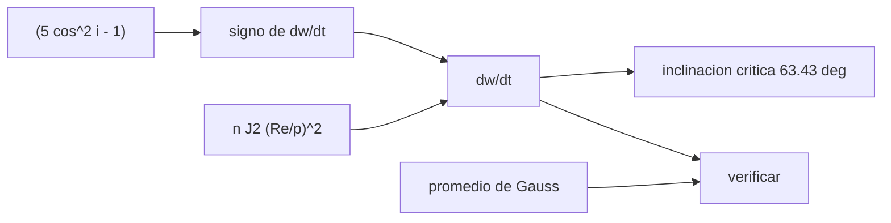

# B72-C05 — Precesión del argumento del periapsis

<!-- nav:top -->
[🏠 Programa](../../../../README.md) · [📚 Bloque B72](../../../tronco-comun/B72-perturbaciones-y-evolucion-de-orbitas.md) · [← Anterior: B72-C04 — Precesión del nodo orbital](../B72-C04-precesion-del-nodo-orbital/CLASE.md) · [Siguiente: B72-C06 — Arrastre atmosférico →](../B72-C06-arrastre-atmosferico/CLASE.md)
<!-- /nav -->

## 1. Ubicación, nivel y alcance

Clase 5 del bloque B72. Nivel N3. El perigeo de una órbita gira dentro de su plano por J2: avanza si la inclinación es menor que `63,43°` y retrocede si es mayor, y se queda quieto en la inclinación crítica. Aquí calculas la tasa de `ω`, la verificas con el promedio numérico de Gauss y la usas en una órbita tipo Molniya. Sigue a [B72-C04](../B72-C04-precesion-del-nodo-orbital/CLASE.md) y prepara las órbitas congeladas ([C14](../B72-C14-orbitas-congeladas/CLASE.md)). Las órbitas son sintéticas.

## 2. Por qué esta clase existe

Si el perigeo de una órbita muy excéntrica girara, el satélite dejaría de pasar por la región que interesa. La decisión central: **¿a qué inclinación el perigeo deja de moverse y cuánto se mueve en otras?**

## 3. Lo que podrás hacer al terminar

1. Calcular `dω/dt = (3/4) n J2 (R/p)² (5 cos² i − 1)`.
2. Deducir la inclinación crítica `acos(1/√5) = 63,4349°`.
3. Verificar la fórmula con el promedio de Gauss de la aceleración J2 completa.
4. Tabular la tasa por altitud e inclinación.
5. Aplicarla a una órbita tipo Molniya.
6. Distinguir lo consultado de lo ilustrativo y de lo no consultado.

La evidencia es la **ficha de precesión del perigeo** del ejercicio 12 (sección 20).

## 4. Con qué llegas y cómo comprobarlo

1. ¿Qué es el argumento del periapsis?
2. ¿Qué es una inclinación crítica?
3. ¿Qué es una órbita Molniya?
4. ¿Qué es el promedio de Gauss?
5. ¿Qué es un valor no consultado?

<details>
<summary>Ver respuestas</summary>

1. El ángulo del perigeo medido desde el nodo ascendente. 2. Aquella en la que la tasa secular de `ω` se anula. 3. Una órbita muy excéntrica de 12 h con apogeo alto sobre un hemisferio. 4. La media sobre una vuelta de la ecuación de Gauss para el elemento. 5. Uno que se usa como ilustración sin haberlo leído en una fuente.
</details>

Con cuatro o cinco aciertos, sigue; si no, repasa los prerrequisitos.

## 5. Un caso de contexto y casos de referencia

A `63,4349°` el perigeo de una órbita de `a = 26 600 km` y `e = 0,74` no se mueve; a `70°` retrocede `24,9 °/año`. A `400 km` y `51,6°` avanza `3,742 °/día`. Es el **ejemplo conductor**. Las órbitas son sintéticas.

## 6. Vocabulario

La **precesión del perigeo** es `dω/dt`. La **inclinación crítica** es la raíz de `5 cos² i = 1`: `63,4349°` (y `116,5651°`). La **órbita tipo Molniya** es una órbita de periodo cercano a `12 h`, `e ≈ 0,74` e inclinación crítica. El **factor `5 cos² i − 1`** fija el signo de la tasa. La **línea de ápsides** es la que une perigeo y apogeo.

## 7. Modelo mental: una elipse que gira en su plano



*Descripción textual:* el factor `5 cos² i − 1` decide el signo de la tasa y la nulidad en la inclinación crítica; el promedio de Gauss verifica la fórmula.

Analogía: como una elipse dibujada en un disco que se hace girar despacio, la línea de ápsides puede girar a favor, en contra o quedarse fija según la inclinación del disco. Límite: la fórmula es de primer orden; en la inclinación crítica los términos de J3 y de segundo orden dominan y `ω` oscila.

## 8. La explicación, paso a paso

### 8.1 La fórmula

`dω/dt = (3/4) n J2 (R/p)² (5 cos² i − 1)`, con `n = √(μ/a³)`, `p = a(1 − e²)`, `μ = 3,986 004 × 10¹⁴ m³/s²`, `R = 6 378 137 m` y `J2 = 1082,63 × 10⁻⁶`.

### 8.2 Inclinación crítica

`5 cos² i = 1` da `i = acos(1/√5) = 63,4349°`. Para `i < 63,4349°` la tasa es positiva; para `i` mayor, negativa; el laboratorio comprueba que a esa inclinación la tasa vale menos de `10⁻¹⁸ rad/s`.

### 8.3 Verificación de Gauss

Con `ω = 40°` y 20 000 puntos de anomalía media:

| `a` (km) | `e` | `i` (°) | fórmula (°/día) | Gauss (°/día) |
|---|---|---|---|---|
| 6778,137 | 0,05 | 51,6 | 3,76007 | 3,76007 |
| 7078,137 | 0,05 | 98,2 | −3,12397 | −3,12397 |
| 26 600,0 | 0,74 | 63,4 | 0,00040 | 0,00040 |
| 26 600,0 | 0,74 | 80,0 | −0,13955 | −0,13955 |

La diferencia relativa es menor de `3 × 10⁻¹³` en todos los casos.

### 8.4 Tabla de diseño

Tasa de `ω` en °/día, `e = 0,01`:

| `h` (km) | 0° | 30° | 51,6° | 63,43° | 80° | 90° | 98,2° |
|---|---|---|---|---|---|---|---|
| 400 | 16,110 | 11,076 | 3,742 | 0,000 | −3,420 | −4,027 | −3,618 |
| 800 | 13,181 | 9,062 | 3,062 | 0,000 | −2,798 | −3,295 | −2,960 |
| 1500 | 9,517 | 6,543 | 2,211 | 0,000 | −2,021 | −2,379 | −2,137 |

### 8.5 Molniya sintética

Con `a = 26 600 km` y `e = 0,74`: a `63,4349°`, `dω/dt = 0`; a `70°`, `−0,0682 °/día` (`−24,9 °/año`).

### 8.6 Lectura

Una órbita con perigeo sobre un hemisferio deseado solo conserva esa geometría si `i` está en la inclinación crítica. Por eso las órbitas tipo Molniya adoptan `63,4°`. En la práctica la tasa nunca es exactamente cero: J3 y los términos de orden superior la mueven.

## 9. Magnitudes, símbolos y unidades

| Símbolo | Qué es | Unidad | Valor / nota |
|---|---|---|---|
| `ω` | argumento del periapsis | rad (°/día) | — |
| `i_c` | inclinación crítica | ° | 63,4349 y 116,5651 |
| `e` | excentricidad | — | 0,74 (sintética) |
| `p` | semilatus rectum | m | `a(1 − e²)` |
| `n` | movimiento medio | rad/s | `√(μ/a³)` |
| `J2` | achatamiento | — | 1082,63e-6 |

## 10. Convenciones y referencias

Marco inercial del ecuador de la fecha; órbitas sintéticas; SI en el cálculo, °/día en las tablas. Gauss promediado con 20 000 puntos de anomalía media. `μ`, `R` y `J2` de las fuentes de la sección 11.

## 11. De dónde sale lo que afirmamos

| ID | Fuente | Localizador | Respalda | Estado |
|---|---|---|---|---|
| S1 | NASA/NSSDC, Earth Fact Sheet — https://nssdc.gsfc.nasa.gov/planetary/factsheet/earthfact.html (consultada 2026-11-10) | ficha completa leída | masa 5,9722 × 10²⁴ kg; radio medio 6371,000 km; radio ecuatorial 6378,137 km; J2 = 1082,63 × 10⁻⁶; GM = 0,39860 × 10⁶ km³/s²; rotación sideral 23,9345 h; semieje mayor 149,598 × 10⁶ km; oblicuidad 23,44° | Consultada |
| S13 | IAU 2015 Resolución B3 (Mamajek et al.) — https://arxiv.org/abs/1510.07674 y PDF https://arxiv.org/pdf/1510.07674 (consultadas 2026-11-10; PDF extraído con PyMuPDF) | tabla de constantes de conversión | (GM)N Tierra = 3,986 004 × 10¹⁴ m³ s⁻²; (GM)N Júpiter = 1,266 865 3 × 10¹⁷ m³ s⁻²; (GM)N Sol = 1,327 124 4 × 10²⁰ m³ s⁻²; R_e Tierra nominal 6,3781 × 10⁶ m | Consultada |
| — | Fórmula secular de `ω` y ecuaciones de Gauss | — | las verifica el laboratorio con una segunda vía (promedio numérico) | No consultada en una fuente concreta |

Límites: no se consultó ningún texto sobre órbitas Molniya ni sobre la inclinación crítica; el valor `63,4349°` se calcula aquí.

## 12. Cómo ver el giro del perigeo

| Magnitud | Valor |
|---|---|
| inclinación crítica | 63,4349° |
| `dω/dt` a 400 km, 51,6° | 3,742 °/día |
| `dω/dt` Molniya a 70° | −0,0682 °/día |
| diferencia fórmula–Gauss | < 3e-13 |

Descripción larga: El perigeo avanza en órbitas poco inclinadas, retrocede en las muy inclinadas y se detiene a 63,4349°; la fórmula coincide con el promedio numérico de Gauss.

## 13. Ejemplo trabajado: la inclinación crítica

**Paso 1 · Condición.** `5 cos² i − 1 = 0` implica `cos² i = 1/5`.

**Paso 2 · Raíz.** `cos i = 0,44721`.

**Paso 3 · Ángulo.** `i = acos(0,44721) = 63,4349°`.

## 14. Distintas formas de describir el giro del perigeo

**Por tasa:** °/día o °/año. **Por inclinación crítica:** `acos(1/√5)`. **Por periodo de rotación de la línea de ápsides:** `360/|dω/dt|`. **Por tabla de diseño.** **Por verificación de Gauss.**

## 15. Práctica guiada

**Ejercicio 1 · con los pasos indicados.** Calcula `cos² 51,6°`. *Pasos:* `0,6211²`.

<details><summary>Solución comentada</summary>

`0,3858`.
</details>

**Ejercicio 2 · con una pista.** Calcula `5 cos² i − 1` a `i = 98,2°`. *Pista:* `cos 98,2° = −0,1426`.

<details><summary>Solución comentada</summary>

`5 × 0,02034 − 1 = −0,898`.
</details>

**Ejercicio 3 · casi autónomo.** ¿Por qué la tasa de `ω` es cero a `116,5651°`?

<details><summary>Solución comentada</summary>

`cos² 116,5651° = 1/5` también.
</details>

## 16. Práctica autónoma, transferencia e integrador

**Ejercicio 4 · autónomo.** Estima el periodo de giro del perigeo a `51,6°`, `400 km`.

<details><summary>Solución comentada</summary>

`360/3,742 = 96,2 días`.
</details>

**Ejercicio 5 · autónomo.** Si `e` sube de 0,01 a 0,3 a `a` fijo, ¿cuánto cambia la tasa?

<details><summary>Solución comentada</summary>

Factor `(1 − 0,09)^{−2} = 1,21`.
</details>

**Ejercicio 6 · autónomo.** Explica por qué una Molniya sin inclinación crítica perdería su geometría.

<details><summary>Solución comentada</summary>

El apogeo se desplazaría al otro hemisferio con tasas de decenas de grados al año.
</details>

**Ejercicio 7 · autónomo.** Calcula `dω/dt` de la Molniya a `70°` en °/año.

<details><summary>Solución comentada</summary>

`−0,0682 × 365,25 = −24,9`.
</details>

**Ejercicio 8 · autónomo.** ¿Qué pasaría si el signo del factor se invirtiera en un código?

<details><summary>Solución comentada</summary>

El perigeo giraría al revés; una comparación con el promedio de Gauss lo detectaría.
</details>

**Ejercicio 9 · transferencia.** **Transferencia.** Un diseñador elige `65°` para una Molniya. ¿Qué espera?

<details><summary>Solución comentada</summary>

Tasa pequeña negativa; habrá que corregir el perigeo con maniobras a lo largo de la vida.
</details>

**Ejercicio 10 · transferencia.** **Transferencia.** ¿Basta la inclinación crítica para fijar el perigeo años?

<details><summary>Solución comentada</summary>

No: J3, el Sol y la Luna lo mueven; hace falta mantenimiento.
</details>

**Ejercicio 11 · transferencia.** **Transferencia.** ¿Prueba esta clase algo sobre un satélite real?

<details><summary>Solución comentada</summary>

No: las órbitas son sintéticas y la fórmula es de primer orden.
</details>

**Ejercicio 12 · integrador.** **Integrador.** Elabora tu *ficha de precesión del perigeo*: tasas por altitud e inclinación, inclinación crítica, caso Molniya y la lista de lo consultado, lo ilustrativo y lo no consultado.

<details><summary>Solución comentada</summary>

Secciones 8.2–8.5 y la salida del laboratorio.
</details>

## 17. Laboratorio: precesión del perigeo

El script [argumento_periapsis.py](argumento_periapsis.py) calcula la tasa de `ω`, la inclinación crítica y el caso Molniya, y verifica la fórmula con el promedio de Gauss (**comprueba** una diferencia relativa menor que `1e-5`).

**Datos:** `μ`, `J2` y `R` consultados; las órbitas y la excentricidad **sintéticas**. **Predice antes de ejecutar:** ¿cuál es la tasa a la inclinación crítica? (cero.) **Ejecución del 2026-11-10 (Python 3.12.9):**

```text
Python 3.12.9 (biblioteca estandar)
Orbitas SINTETICAS; J2 = 1082.63e-6 (NSSDC), mu = 3.986004e14 (IAU 2015), Re = 6378137 m

Inclinacion critica: acos(1/raiz(5)) = 63.4349 deg (y 116.5651 deg retrograda)

Verificacion: formula cerrada frente al promedio numerico de Gauss (omega = 40 deg)
   a [km]      e  i [deg]  formula [deg/dia]  Gauss [deg/dia]  dif. relativa
 6778.137   0.05     51.6            3.76007          3.76007       1.07e-14
 7078.137   0.05     98.2           -3.12397         -3.12397       1.95e-14
26600.000   0.74     63.4            0.00040          0.00040       2.90e-13
26600.000   0.74     80.0           -0.13955         -0.13955       2.19e-15

Tasa de omega [deg/dia], e = 0.01 (tabla de diseno)
  h [km]      0.00     30.00     51.60     63.43     80.00     90.00     98.20
     400    16.110    11.076     3.742     0.000    -3.420    -4.027    -3.618
     800    13.181     9.062     3.062     0.000    -2.798    -3.295    -2.960
    1500     9.517     6.543     2.211     0.000    -2.021    -2.379    -2.137
Tipo Molniya a = 26600 km, e = 0.74, i = 63.4349 deg: d(omega)/dt = 0.0000 deg/dia = 0.0 deg/ano
Tipo Molniya a = 26600 km, e = 0.74, i = 70.0000 deg: d(omega)/dt = -0.0682 deg/dia = -24.9 deg/ano
Pruebas superadas.
```

```bash
python programa/clases/B72/B72-C05-precesion-del-argumento-del-periapsis/argumento_periapsis.py
```

**Límites:** solo J2 de primer orden; en la inclinación crítica real dominan J3 y segundo orden.

## 18. Errores frecuentes y cómo corregirlos

**Creer que 63,4° garantiza un perigeo fijo para siempre.** Se corrige con 8.6.

**Olvidar la inclinación crítica retrógrada.** Se corrige con 8.2.

**Usar grados dentro de `cos` sin convertir.** Se corrige con la sección 9.

**Confundir `ω` con la longitud del perigeo.** Se corrige con el vocabulario.

## 19. Cómo sabrás que vas bien

Tras la sección 8: ¿qué signo esperabas para la heliosíncrona de 98,2° y cuál obtuviste? Si dudas, repasa el ejemplo 13. Tras el laboratorio: ¿qué comprueba el promedio de Gauss? (ver la sección 17).

## 20. Qué entregas y cómo se evalúa

El producto es tu **ficha de precesión del perigeo** (ejercicio 12).

| Criterio | Inicial | En desarrollo | Logrado | Destacado |
|---|---|---|---|---|
| Conceptos | Los confunde | Parciales | Calcula la tasa y la inclinación crítica | Explica los límites |
| Cálculo | Sin unidades | Con errores | Tablas completas con unidades | Calcula casos nuevos |
| Numérico | Sin comprobar | Un caso | Contraste con una segunda vía | Interpreta las diferencias |
| Fuentes | Sin fuente | Sin fecha | Fuentes con fecha y estado | Declara lo ilustrativo y lo no consultado |
| Límites | No los nombra | Uno | Tres | Discute qué falta del modelo |

**Condiciones críticas (no se compensan con promedio):** rotular las órbitas como sintéticas; no presentar la fórmula como medida; citar solo lo consultado.

## 21. Ética, seguridad y límites

Clase educativa: los modelos son simplificados y sus datos son sintéticos o ilustrativos; ningún resultado sustituye a un producto de determinación de órbita, a un servicio oficial de elementos ni a una decisión de operación de vuelo. Accesibilidad: tablas equivalentes a las gráficas, fórmulas en texto, ejercicios sin conexión.

## 22. Para cerrar y seguir

La inclinación crítica es `63,4349°` y a `70°` el perigeo de una Molniya sintética retrocede `24,9 °/año`. Queda una pregunta: ¿qué pasa con el arrastre en órbita baja?

**Glosario español–inglés.** precesión del perigeo · *apsidal precession*; inclinación crítica · *critical inclination*; línea de ápsides · *line of apsides*; órbita Molniya · *Molniya orbit*; argumento del periapsis · *argument of periapsis*.

**Continuidad.** [B72-C06](../B72-C06-arrastre-atmosferico/CLASE.md) estudia el arrastre atmosférico.

**Referencias:** ver sección 11.

<!-- nav:bottom -->
---

[← Anterior: B72-C04 — Precesión del nodo orbital](../B72-C04-precesion-del-nodo-orbital/CLASE.md) · [📚 Bloque B72](../../../tronco-comun/B72-perturbaciones-y-evolucion-de-orbitas.md) · [Siguiente: B72-C06 — Arrastre atmosférico →](../B72-C06-arrastre-atmosferico/CLASE.md)
<!-- /nav -->
