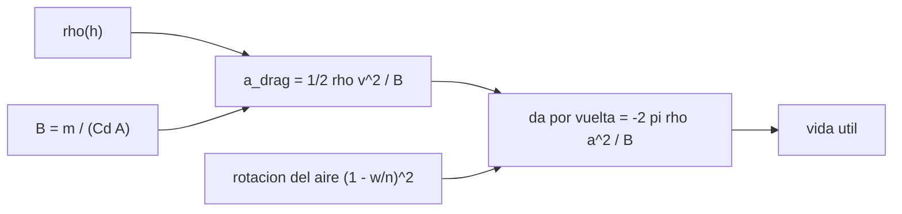

# B72-C06 — Arrastre atmosférico

<!-- nav:top -->
[🏠 Programa](../../../../README.md) · [📚 Bloque B72](../../../tronco-comun/B72-perturbaciones-y-evolucion-de-orbitas.md) · [← Anterior: B72-C05 — Precesión del argumento del periapsis](../B72-C05-precesion-del-argumento-del-periapsis/CLASE.md) · [Siguiente: B72-C07 — Modelos de densidad atmosférica →](../B72-C07-modelos-de-densidad-atmosferica/CLASE.md)
<!-- /nav -->

## 1. Ubicación, nivel y alcance

Clase 6 del bloque B72. Nivel N3. En órbita baja, el aire residual frena al satélite, le quita energía y lo hace bajar hasta reentrar. Aquí calculas la aceleración de arrastre, el coeficiente balístico, el decaimiento del semieje por vuelta y la vida útil orbital con una atmósfera exponencial ilustrativa. Sigue a [B72-C05](../B72-C05-precesion-del-argumento-del-periapsis/CLASE.md) y prepara los modelos de densidad ([C07](../B72-C07-modelos-de-densidad-atmosferica/CLASE.md)). La órbita y la atmósfera son sintéticas.

## 2. Por qué esta clase existe

Una estación o una constelación baja debe reimpulsarse y un satélite sin propulsión debe reentrar a tiempo. La decisión central: **¿cuánto baja un satélite por vuelta y en cuántos días reentra, según su masa, su área y la densidad del aire?**

## 3. Lo que podrás hacer al terminar

1. Calcular la aceleración de arrastre `½ ρ v² /B` y el coeficiente balístico `B = m/(Cd A)`.
2. Obtener el decaimiento del semieje por vuelta en órbita circular.
3. Contrastar la fórmula con una integración RK4 con atmósfera en rotación.
4. Corregir la fórmula por la rotación de la atmósfera.
5. Estimar la vida útil hasta `180 km` y su sensibilidad a la densidad.
6. Distinguir lo consultado de lo ilustrativo y de lo no consultado.

La evidencia es la **ficha de decaimiento orbital** del ejercicio 12 (sección 20).

## 4. Con qué llegas y cómo comprobarlo

1. ¿Qué es la resistencia aerodinámica?
2. ¿Qué es una altura de escala?
3. ¿Por qué un satélite acelera al perder energía?
4. ¿Qué es el semieje mayor?
5. ¿Qué es un valor no consultado?

<details>
<summary>Ver respuestas</summary>

1. Una fuerza opuesta a la velocidad relativa respecto al fluido, proporcional a `ρ v²`. 2. La distancia en la que la densidad cae por un factor `e`. 3. Baja a una órbita más rápida: el arrastre reduce el semieje y aumenta la velocidad orbital. 4. La mitad del eje mayor de la elipse; fija la energía orbital. 5. Uno que se usa como ilustración sin haberlo leído en una fuente.
</details>

Con cuatro o cinco aciertos, sigue; si no, repasa los prerrequisitos.

## 5. Un caso de contexto y casos de referencia

A `400 km`, con una atmósfera ilustrativa de `3 × 10⁻¹² kg/m³` y `B = 45,45 kg/m²`, el arrastre es `1,94 × 10⁻⁶ m/s²` y la integración baja el semieje `1008,9 m` en `60` vueltas (`92,6 h`). Es el **ejemplo conductor**. La densidad, `Cd` y las masas son ilustrativos.

## 6. Vocabulario

El **coeficiente balístico** `B = m/(Cd A)` (kg/m²) mide cuánto resiste un cuerpo al frenado: a mayor `B`, menos arrastre. La **densidad** `ρ` es la masa de aire por volumen. El **viento co-rotante** supone que el aire gira con la Tierra, por lo que la velocidad relativa es `v − ω × r`. El **decaimiento** es la pérdida de semieje. La **vida útil orbital** es el tiempo hasta alcanzar una altitud de reentrada (aquí `180 km`).

## 7. Modelo mental: un corredor contra el viento



*Descripción textual:* la densidad y el coeficiente balístico dan la aceleración; esta da el decaimiento por vuelta, corregido por la rotación del aire, y de él sale la vida útil.

Analogía: un corredor sufre más contra un viento fuerte y con una chaqueta ancha; un satélite ligero y plano frena más que uno macizo y compacto. Límite: el modelo usa una atmósfera exponencial con altura de escala constante, sin variación diurna ni solar, y un `Cd` fijo.

## 8. La explicación, paso a paso

### 8.1 Aceleración y coeficiente balístico

`a_drag = −½ ρ (Cd A/m) v_rel v_rel` y `B = m/(Cd A)`. Con `ρ(400 km) = 3 × 10⁻¹² kg/m³` (ilustrativa), `v = 7669 m/s`:

| `m` (kg) | `A` (m²) | `B` (kg/m²) | `a_drag` (m/s²) |
|---|---|---|---|
| 1000 | 10 | 45,45 | 1,941e-06 |
| 100 | 1 | 45,45 | 1,941e-06 |
| 10 | 0,1 | 45,45 | 1,941e-06 |
| 4 | 0,1 | 18,18 | 4,852e-06 |

Solo importa `B`: tres satélites con la misma relación `m/A` frenan igual.

### 8.2 Decaimiento por vuelta

En órbita circular, `Δa = −2π ρ a² /B` por vuelta. Con la rotación del aire se multiplica por `(1 − ω_T/n)²` (órbita ecuatorial directa), con `ω_T = 2π/23,9345 h` (periodo sideral NSSDC).

### 8.3 Verificación

Con `B = 45,45 kg/m²`, 60 vueltas, RK4 de `10 s`: la integración da `−1008,93 m`; la fórmula sin rotación `−1143,10 m` (diferencia `11,74 %`); con el factor `0,8752`, `−1000,50 m` (diferencia `0,84 %`).

### 8.4 Vida útil

Días hasta `180 km` con la atmósfera ilustrativa (sin el factor de rotación):

| `h₀` (km) | `B = 10` | `B = 45` | `B = 200` |
|---|---|---|---|
| 300 | 7,4 | 33,2 | 147,1 |
| 400 | 43,7 | 196,2 | 871,6 |
| 500 | 234,1 | 1052,9 | > 3650 (tope) |

Si la densidad se triplica, la vida de `400 km` con `B = 45` pasa de `196,2` a `65,5 días`.

### 8.5 Lectura

La vida útil depende exponencialmente de la altitud y casi inversamente de la densidad. Como la densidad varía mucho con la actividad solar ([C07](../B72-C07-modelos-de-densidad-atmosferica/CLASE.md)), la NASA indica que sus satélites de órbita baja se reimpulsan unas cuatro veces al año con el Sol tranquilo y cada dos o tres semanas en el máximo solar. Es información de la página consultada, no un resultado de este laboratorio.

## 9. Magnitudes, símbolos y unidades

| Símbolo | Qué es | Unidad | Valor / nota |
|---|---|---|---|
| `ρ` | densidad atmosférica | kg/m³ | 3e-12 a 400 km (ilustrativa) |
| `B` | coeficiente balístico | kg/m² | 45,45 |
| `Cd` | coeficiente de arrastre | — | 2,2 (ilustrativo) |
| `ω_T` | rotación sideral | rad/s | 7,2921e-5 |
| `H` | altura de escala | m | 60 000 (ilustrativa) |
| `Δa` | decaimiento por vuelta | m | −16,8 (B = 45,45, 400 km) |

## 10. Convenciones y referencias

Marco inercial geocéntrico con el ecuador de la fecha; atmósfera exponencial ilustrativa que gira con la Tierra; `μ`, `R` y la rotación sideral de las fuentes de la sección 11. `Cd = 2,2`, `ρ(400 km)`, `H = 60 km` y las masas y áreas son ilustrativos. Tolerancia de comprobación `3 %` entre fórmula con rotación e integración.

## 11. De dónde sale lo que afirmamos

| ID | Fuente | Localizador | Respalda | Estado |
|---|---|---|---|---|
| S1 | NASA/NSSDC, Earth Fact Sheet — https://nssdc.gsfc.nasa.gov/planetary/factsheet/earthfact.html (consultada 2026-11-10) | ficha completa leída | masa 5,9722 × 10²⁴ kg; radio medio 6371,000 km; radio ecuatorial 6378,137 km; J2 = 1082,63 × 10⁻⁶; GM = 0,39860 × 10⁶ km³/s²; rotación sideral 23,9345 h; semieje mayor 149,598 × 10⁶ km; oblicuidad 23,44° | Consultada |
| S10 | NASA Earth Observatory, Catalog of Earth Satellite Orbits — https://science.nasa.gov/earth/earth-observatory/catalog-of-earth-satellite-orbits (consultada 2026-11-10) | página completa | órbitas heliosíncronas cruzan el ecuador a la misma hora solar local; la resistencia atmosférica es mayor con el Sol activo (reimpulsos ~4 veces al año con el Sol tranquilo y cada 2–3 semanas en el máximo) | Consultada |
| S13 | IAU 2015 Resolución B3 (Mamajek et al.) — https://arxiv.org/abs/1510.07674 y PDF https://arxiv.org/pdf/1510.07674 (consultadas 2026-11-10; PDF extraído con PyMuPDF) | tabla de constantes de conversión | (GM)N Tierra = 3,986 004 × 10¹⁴ m³ s⁻²; (GM)N Júpiter = 1,266 865 3 × 10¹⁷ m³ s⁻²; (GM)N Sol = 1,327 124 4 × 10²⁰ m³ s⁻²; R_e Tierra nominal 6,3781 × 10⁶ m | Consultada |
| — | Ecuación del arrastre, coeficiente `Cd` y la fórmula del decaimiento circular | — | las verifica el laboratorio con una integración independiente | No consultada en una fuente concreta |

Límites: no se consultó ninguna densidad medida ni ningún modelo atmosférico; la página de la NASA se usó solo para el comportamiento cualitativo (más arrastre con el Sol activo).

## 12. Cómo ver el decaimiento

| Magnitud | Valor |
|---|---|
| `a_drag` a 400 km, `B = 45,45` | 1,941e-06 m/s² |
| `Δa` numérico, 60 vueltas | −1008,93 m |
| `Δa` fórmula con rotación | −1000,50 m |
| vida de 400 km, `B = 45` | 196,2 días |

Descripción larga: La fórmula circular con corrección de rotación reproduce la integración a menos del 1 %, y la vida útil se reduce a un tercio cuando la densidad se triplica.

## 13. Ejemplo trabajado: decaimiento por vuelta

**Paso 1 · Datos.** `a = 6778,137 km`, `ρ = 3e-12`, `B = 45,45`.

**Paso 2 · Fórmula.** `Δa = −2π × 3e-12 × (6,778137e6)²/45,45 = −19,05 m` por vuelta, sin rotación.

**Paso 3 · Con rotación.** `× 0,8752 = −16,7 m` por vuelta; en 60 vueltas `−1000 m`, como en la salida.

## 14. Distintas formas de describir el arrastre

**Por aceleración:** `½ ρ v²/B` en m/s². **Por coeficiente balístico:** `B` en kg/m². **Por decaimiento:** `Δa` por vuelta o por día. **Por vida útil:** días hasta la reentrada. **Por sensibilidad:** cociente de vidas útiles al cambiar `ρ`.

## 15. Práctica guiada

**Ejercicio 1 · con los pasos indicados.** Calcula `B` de un cubo de `4 kg` y área `0,1 m²` con `Cd = 2,2`. *Pasos:* `4/(2,2 × 0,1)`.

<details><summary>Solución comentada</summary>

`18,18 kg/m²`.
</details>

**Ejercicio 2 · con una pista.** Calcula `a_drag` con `ρ = 3e-12`, `v = 7669 m/s` y `B = 18,18`. *Pista:* `½ ρ v²/B`.

<details><summary>Solución comentada</summary>

`0,5 × 3e-12 × 5,881e7/18,18 = 4,85e-6 m/s²`.
</details>

**Ejercicio 3 · casi autónomo.** ¿Por qué tres satélites de 1000 kg/10 m², 100 kg/1 m² y 10 kg/0,1 m² frenan igual?

<details><summary>Solución comentada</summary>

Comparten `B = m/(Cd A) = 45,45 kg/m²`.
</details>

## 16. Práctica autónoma, transferencia e integrador

**Ejercicio 4 · autónomo.** Calcula el factor `(1 − ω_T/n)²` con `n = 1,1284e-3 rad/s`.

<details><summary>Solución comentada</summary>

`ω_T/n = 7,2921e-5/1,1284e-3 = 0,0646`; `(0,9354)² = 0,8750`.
</details>

**Ejercicio 5 · autónomo.** Si `ρ` se divide por 3, ¿qué le pasa a la vida útil?

<details><summary>Solución comentada</summary>

Se multiplica por `≈ 3`.
</details>

**Ejercicio 6 · autónomo.** ¿Qué pasa con `Δa` por vuelta si `B` se duplica?

<details><summary>Solución comentada</summary>

Se reduce a la mitad.
</details>

**Ejercicio 7 · autónomo.** Estima `Δa` por día con `−16,7 m/vuelta` y 15,56 vueltas/día.

<details><summary>Solución comentada</summary>

`≈ −260 m/día`.
</details>

**Ejercicio 8 · autónomo.** ¿Por qué la fórmula circular sobrestima `Δa` en un 12 % en la comparación?

<details><summary>Solución comentada</summary>

Ignora que el aire gira con la Tierra y reduce la velocidad relativa.
</details>

**Ejercicio 9 · transferencia.** **Transferencia.** Una empresa diseña un satélite de `B = 10 kg/m²` a `300 km`. ¿Qué espera?

<details><summary>Solución comentada</summary>

Una vida útil de pocos días con esta atmósfera; necesita propulsión continua (ilustrativo).
</details>

**Ejercicio 10 · transferencia.** **Transferencia.** Con el Sol activo la densidad sube 10 veces. ¿Cómo cambia el calendario de reimpulsos?

<details><summary>Solución comentada</summary>

Se vuelven unas diez veces más frecuentes; la NASA indica reimpulsos más frecuentes con el Sol activo.
</details>

**Ejercicio 11 · transferencia.** **Transferencia.** ¿Prueba el laboratorio la vida útil de un satélite real?

<details><summary>Solución comentada</summary>

No: la atmósfera, `Cd` y la órbita son ilustrativos.
</details>

**Ejercicio 12 · integrador.** **Integrador.** Elabora tu *ficha de decaimiento orbital*: `B`, `a_drag`, `Δa` por vuelta, vida útil para tres altitudes y la lista de lo consultado, lo ilustrativo y lo no consultado.

<details><summary>Solución comentada</summary>

Secciones 8.1–8.4 y la salida del laboratorio.
</details>

## 17. Laboratorio: decaimiento por arrastre

El script [arrastre.py](arrastre.py) calcula la aceleración de arrastre, integra una órbita circular con aire en rotación y compara el decaimiento con la fórmula, y estima la vida útil (**comprueba** que la fórmula con rotación coincide con RK4 dentro de `3 %`).

**Datos:** `μ`, `R` y la rotación sideral consultados; la densidad, `Cd`, la altura de escala, las masas y las áreas **ilustrativos o sintéticos**. **Predice antes de ejecutar:** ¿la fórmula sin rotación sobrestimará o subestimará el decaimiento? (lo sobrestima, un 12 %.) **Ejecución del 2026-11-10 (Python 3.12.9):**

```text
Python 3.12.9 (biblioteca estandar)
Atmosfera exponencial ILUSTRATIVA: rho(400 km) = 3.0e-12 kg/m3, H = 60 km, Cd = 2.2 (no son un modelo atmosferico)

Aceleracion de arrastre y coeficiente balistico a 400 km (v circular)
  m [kg]  A [m2]    B=m/(Cd A) [kg/m2]   a_drag [m/s2]
    1000   10.00                 45.45       1.941e-06
     100    1.00                 45.45       1.941e-06
      10    0.10                 45.45       1.941e-06
       4    0.10                 18.18       4.852e-06

Verificacion con B = 45.45 kg/m2, 60.0 vueltas (92.6 h), RK4 paso 10 s
  semieje: variacion numerica = -1008.93 m ; formula circular = -1143.10 m ; dif. relativa = 11.74%
  con el factor de rotacion (1 - omega/n)^2 = 0.8752 (orbita ecuatorial directa): formula = -1000.50 m ; dif. relativa = 0.84%
  (la diferencia restante viene de que rho cae con la altura mientras el semieje decae)

Vida util (hasta 180 km) en dias, orbita circular, atmosfera ilustrativa
 h0 [km]           B=10           B=45          B=200
     300            7.4           33.2          147.1
     400           43.7          196.2          871.6
     500          234.1         1052.9   >3650 (tope)

Si la densidad se triplica: la vida util de 400 km con B = 45 pasa de 196.2 a 65.5 dias
Pruebas superadas.
```

```bash
python programa/clases/B72/B72-C06-arrastre-atmosferico/arrastre.py
```

**Límites:** atmósfera exponencial con `H` constante, sin variación solar ni diurna; vida útil sin factor de rotación; no es una predicción de reentrada.

## 18. Errores frecuentes y cómo corregirlos

**Creer que la masa sola fija el arrastre.** Se corrige con 8.1: manda `B = m/(Cd A)`.

**Olvidar que el aire gira con la Tierra.** Se corrige con 8.2 y 8.3.

**Presentar la vida útil como predicción de reentrada.** Se corrige con la sección 11.

**Confundir `Δa` por vuelta con por día.** Se corrige con el ejercicio 7.

## 19. Cómo sabrás que vas bien

Tras la sección 8: ¿cuánto esperabas que bajara el semieje por vuelta y cuánto obtuviste? Si dudas, repasa el ejemplo 13. Tras el laboratorio: ¿qué comprueba el factor de rotación? (ver la sección 17).

## 20. Qué entregas y cómo se evalúa

El producto es tu **ficha de decaimiento orbital** (ejercicio 12).

| Criterio | Inicial | En desarrollo | Logrado | Destacado |
|---|---|---|---|---|
| Conceptos | Los confunde | Parciales | Calcula `B`, `a_drag` y `Δa` | Explica los límites |
| Cálculo | Sin unidades | Con errores | Tablas completas con unidades | Calcula casos nuevos |
| Numérico | Sin comprobar | Un caso | Contraste con una segunda vía | Interpreta las diferencias |
| Fuentes | Sin fuente | Sin fecha | Fuentes con fecha y estado | Declara lo ilustrativo y lo no consultado |
| Límites | No los nombra | Uno | Tres | Discute qué falta del modelo |

**Condiciones críticas (no se compensan con promedio):** rotular densidad, `Cd`, masas y áreas como ilustrativos; no presentar la vida útil como predicción; citar solo lo consultado.

## 21. Ética, seguridad y límites

Clase educativa: los modelos son simplificados y sus datos son sintéticos o ilustrativos; ningún resultado sustituye a un producto de determinación de órbita, a un servicio oficial de elementos ni a una decisión de operación de vuelo. Accesibilidad: tablas equivalentes a las gráficas, fórmulas en texto, ejercicios sin conexión.

## 22. Para cerrar y seguir

Un satélite de `B = 45,45 kg/m²` pierde `1008,9 m` de semieje en `60` vueltas a `400 km` con una atmósfera ilustrativa, y su vida útil cae a un tercio si la densidad se triplica. Queda una pregunta: ¿qué densidad usar y cómo varía con el Sol?

**Glosario español–inglés.** coeficiente balístico · *ballistic coefficient*; arrastre atmosférico · *atmospheric drag*; altura de escala · *scale height*; decaimiento orbital · *orbital decay*; vida útil orbital · *orbital lifetime*.

**Continuidad.** [B72-C07](../B72-C07-modelos-de-densidad-atmosferica/CLASE.md) estudia los modelos de densidad atmosférica.

**Referencias:** ver sección 11.

<!-- nav:bottom -->
---

[← Anterior: B72-C05 — Precesión del argumento del periapsis](../B72-C05-precesion-del-argumento-del-periapsis/CLASE.md) · [📚 Bloque B72](../../../tronco-comun/B72-perturbaciones-y-evolucion-de-orbitas.md) · [Siguiente: B72-C07 — Modelos de densidad atmosférica →](../B72-C07-modelos-de-densidad-atmosferica/CLASE.md)
<!-- /nav -->
