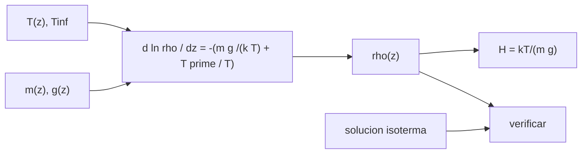

# B72-C07 — Modelos de densidad atmosférica

<!-- nav:top -->
[🏠 Programa](../../../../README.md) · [📚 Bloque B72](../../../tronco-comun/B72-perturbaciones-y-evolucion-de-orbitas.md) · [← Anterior: B72-C06 — Arrastre atmosférico](../B72-C06-arrastre-atmosferico/CLASE.md) · [Siguiente: B72-C08 — Presión de radiación solar →](../B72-C08-presion-de-radiacion-solar/CLASE.md)
<!-- /nav -->

## 1. Ubicación, nivel y alcance

Clase 7 del bloque B72. Nivel N3. La densidad atmosférica a 300–800 km cambia en órdenes de magnitud con la temperatura de la termosfera, y por eso con el Sol. Aquí construyes un modelo hidrostático ilustrativo con un perfil de temperatura tipo Bates, lo integras numéricamente, lo verificas contra la solución analítica isoterma y mides la sensibilidad a la temperatura. Sigue a [B72-C06](../B72-C06-arrastre-atmosferico/CLASE.md). El modelo no es operativo: sirve para entender qué hacen los modelos reales.

## 2. Por qué esta clase existe

El arrastre es tan incierto como la densidad que se le da. La decisión central: **¿cuánto puede variar la densidad a una altitud dada si cambia la temperatura de la termosfera, y qué incertidumbre hereda por eso un cálculo de decaimiento?**

## 3. Lo que podrás hacer al terminar

1. Escribir la ecuación hidrostática de la densidad con gravedad y masa media variables.
2. Integrarla numéricamente con RK4 y verificarla contra la solución analítica isoterma.
3. Calcular la altura de escala `H = kT/(mg)`.
4. Medir la sensibilidad de la densidad a la temperatura exosférica.
5. Explicar por qué un modelo ilustrativo no sustituye a uno operativo.
6. Distinguir lo consultado de lo ilustrativo y de lo no consultado.

La evidencia es la **ficha de sensibilidad de la densidad** del ejercicio 12 (sección 20).

## 4. Con qué llegas y cómo comprobarlo

1. ¿Qué es el equilibrio hidrostático?
2. ¿Qué es la termosfera?
3. ¿Qué es una altura de escala?
4. ¿Qué es un modelo isotermo?
5. ¿Qué es un valor no consultado?

<details>
<summary>Ver respuestas</summary>

1. El equilibrio entre el gradiente de presión y el peso del gas: `dP = −ρ g dz`. 2. La capa alta de la atmósfera, calentada por la radiación solar, donde la temperatura crece con la altura. 3. `H = kT/(m g)`: la distancia en la que la densidad cae por `e`. 4. Uno con temperatura constante, cuya densidad es una exponencial. 5. Uno que se usa como ilustración sin haberlo leído en una fuente.
</details>

Con cuatro o cinco aciertos, sigue; si no, repasa los prerrequisitos.

## 5. Un caso de contexto y casos de referencia

Con el mismo modelo, a `400 km` la densidad es `5,15 × 10⁻¹⁴ kg/m³` con `T∞ = 700 K` y `6,52 × 10⁻¹² kg/m³` con `1400 K`: un cociente de `126,6`. Es el **ejemplo conductor**. Las temperaturas, la base de `2,2 × 10⁻⁸ kg/m³` a `120 km` y la masa media son ilustrativas.

## 6. Vocabulario

La **temperatura exosférica** `T∞` es el valor asintótico de la temperatura. El **perfil de Bates** `T(z) = T∞ − (T∞ − T₀) e^{−s(z−z₀)}` describe cómo sube. La **masa media** `m(z)` decrece con la altitud al dominar los gases ligeros. La **altura de escala** `H = kT/(mg)`. Un **modelo empírico operativo** ajusta parámetros a datos reales de satélites; este no lo es.

## 7. Modelo mental: una columna de aire que se hincha y se encoge



*Descripción textual:* la temperatura, la masa media y la gravedad entran en la ecuación hidrostática; su integral da la densidad; la versión isoterma sirve de verificación.

Analogía: una columna de aire se comporta como un fuelle: si se calienta, se hincha y deja más gas a gran altura, y si se enfría, se encoge. Límite: un solo gas efectivo, sin variación diurna, geomagnética ni de composición real; las temperaturas no se asocian a un índice solar medido.

## 8. La explicación, paso a paso

### 8.1 La ecuación hidrostática

`d ln ρ/dz = −(m g/(k T) + (dT/dz)/T)`, con `g(z) = μ/(R+z)²`, `k = 1,380 649 × 10⁻²³ J/K` y `u = 1,660 539 068 92 × 10⁻²⁷ kg` (NIST CODATA 2022). Parámetros ilustrativos: `ρ(120 km) = 2,2 × 10⁻⁸ kg/m³`, `T(120 km) = 360 K`, `s = 0,025 km⁻¹`, masa media de `28 u` a `120 km` a `16 u` a `800 km`.

### 8.2 Verificación

Con `T = 800 K` y `m = 20 u` constantes la solución exacta es `ρ = ρ₀ exp[m μ/(k T) (1/(R+z) − 1/(R+z₀))]`. A `400 km`, RK4 de `250 m` da `1,080188 × 10⁻¹¹ kg/m³` y la fórmula, lo mismo, con una diferencia relativa de `2,9 × 10⁻¹⁴`.

### 8.3 Sensibilidad a la temperatura

Densidades en kg/m³ (ilustrativas):

| `T∞` (K) | 200 km | 300 km | 400 km | 500 km | 600 km | 800 km |
|---|---|---|---|---|---|---|
| 700 | 1,27e-10 | 1,95e-12 | 5,15e-14 | 1,98e-15 | 1,07e-16 | 8,31e-19 |
| 1000 | 2,35e-10 | 1,19e-11 | 9,28e-13 | 9,47e-14 | 1,23e-14 | 4,10e-16 |
| 1400 | 3,58e-10 | 4,05e-11 | 6,52e-12 | 1,28e-12 | 2,98e-13 | 2,62e-14 |

Cociente `1400 K/700 K`: `2,8` (200 km), `20,7` (300), `126,6` (400), `645,6` (500), `2770,4` (600), `31 506,3` (800).

### 8.4 Altura de escala

A `400 km` con `T∞ = 1000 K`: `T = 999 K` y `H = kT/(mg) = 41,5 km`.

### 8.5 Lectura

La sensibilidad crece con la altitud porque una temperatura mayor aumenta la altura de escala. Un cálculo de decaimiento hereda por eso una incertidumbre de uno o dos órdenes de magnitud si no se conoce la actividad solar. Los modelos operativos (por ejemplo, los empíricos tipo NRLMSISE) ajustan decenas de parámetros a mediciones; aquí no se usó ninguno y de la *U.S. Standard Atmosphere, 1976* solo se consultó el registro del resumen.

## 9. Magnitudes, símbolos y unidades

| Símbolo | Qué es | Unidad | Valor / nota |
|---|---|---|---|
| `k` | constante de Boltzmann | J/K | 1,380 649e-23 |
| `u` | unidad de masa atómica | kg | 1,660 539 068 92e-27 |
| `T∞` | temperatura exosférica | K | 700; 1000; 1400 (ilustrativas) |
| `m` | masa media | kg | 28 u → 16 u (ilustrativa) |
| `H` | altura de escala | m | 41,5e3 (400 km, 1000 K) |
| `ρ₀` | densidad a 120 km | kg/m³ | 2,2e-8 (ilustrativa) |

## 10. Convenciones y referencias

Atmósfera estática de un solo gas efectivo, integrada de `120 km` hacia arriba con RK4 de `250 m`; `μ` y `R` de las fuentes; `k` y `u` de NIST. Densidad base, temperatura base, perfil de Bates, masa media y las tres temperaturas son ilustrativos. Tolerancia de verificación isoterma `1e-9`.

## 11. De dónde sale lo que afirmamos

| ID | Fuente | Localizador | Respalda | Estado |
|---|---|---|---|---|
| S7 | NIST CODATA 2022 — https://physics.nist.gov/cgi-bin/cuu/Value?c, ...?bg, ...?k y ...?ukg (consultadas 2026-11-10) | valores de c, G, k y u | c = 299 792 458 m/s (exacta); G = 6,674 30(15) × 10⁻¹¹ m³ kg⁻¹ s⁻²; k = 1,380 649 × 10⁻²³ J/K (exacta); u = 1,660 539 068 92(52) × 10⁻²⁷ kg | Consultada |
| S1 | NASA/NSSDC, Earth Fact Sheet — https://nssdc.gsfc.nasa.gov/planetary/factsheet/earthfact.html (consultada 2026-11-10) | ficha completa leída | masa 5,9722 × 10²⁴ kg; radio medio 6371,000 km; radio ecuatorial 6378,137 km; J2 = 1082,63 × 10⁻⁶; GM = 0,39860 × 10⁶ km³/s²; rotación sideral 23,9345 h; semieje mayor 149,598 × 10⁶ km; oblicuidad 23,44° | Consultada |
| S13 | IAU 2015 Resolución B3 (Mamajek et al.) — https://arxiv.org/abs/1510.07674 y PDF https://arxiv.org/pdf/1510.07674 (consultadas 2026-11-10; PDF extraído con PyMuPDF) | tabla de constantes de conversión | (GM)N Tierra = 3,986 004 × 10¹⁴ m³ s⁻²; (GM)N Júpiter = 1,266 865 3 × 10¹⁷ m³ s⁻²; (GM)N Sol = 1,327 124 4 × 10²⁰ m³ s⁻²; R_e Tierra nominal 6,3781 × 10⁶ m | Consultada |
| S11 | NASA NTRS, U.S. Standard Atmosphere, 1976 — https://ntrs.nasa.gov/citations/19770009539 (consultada 2026-11-10) | solo el registro y el resumen | documento en cuatro partes con tablas de propiedades atmosféricas hasta 1000 km. No se consultaron sus tablas | Solo se consultó el resumen |
| — | Ecuación hidrostática, perfil de Bates, densidad y temperatura base y masa media | — | la ecuación se verifica con la solución isoterma; los demás parámetros son ilustrativos | No consultada en una fuente concreta |

Límites: de la U.S. Standard Atmosphere 1976 solo se consultó el registro del resumen, no sus tablas; ningún modelo empírico (NRLMSISE, JB2008) se consultó. `k` y `u` se consultaron en la página de NIST de CODATA 2022.

## 12. Cómo ver la sensibilidad de la densidad

| Magnitud | Valor |
|---|---|
| `ρ(400 km)`, 700 K | 5,15e-14 kg/m³ |
| `ρ(400 km)`, 1400 K | 6,52e-12 kg/m³ |
| cociente a 400 km | 126,6 |
| error isotermo | 2,9e-14 |

Descripción larga: Con las mismas condiciones en 120 km, duplicar la temperatura exosférica multiplica por más de cien la densidad a 400 km y por más de treinta mil a 800 km.

## 13. Ejemplo trabajado: la altura de escala

**Paso 1 · Datos.** `T = 999 K`, `m = 28 − 12 (400−120)/680 = 23,06 u`, `g = 8,676 m/s²` a 400 km.

**Paso 2 · Fórmula.** `H = kT/(m g) = 1,380649e-23 × 999/(23,06 × 1,66054e-27 × 8,676)`.

**Paso 3 · Resultado.** `H = 1,3792e-20/3,322e-25 = 4,15 × 10⁴ m = 41,5 km`, como en el laboratorio.

## 14. Distintas formas de describir la densidad atmosférica

**Por exponencial:** `ρ₀ e^{−Δz/H}`. **Por integral hidrostática:** con `T(z)` y `m(z)`. **Por cociente:** relación entre dos escenarios de temperatura. **Por tabla:** valores por altitud. **Por modelo empírico:** ajustes a datos (no usados aquí).

## 15. Práctica guiada

**Ejercicio 1 · con los pasos indicados.** Calcula `g` a `400 km` con `μ = 3,986004e14` y `R = 6378137 m`. *Pasos:* `μ/(6778137)²`.

<details><summary>Solución comentada</summary>

`8,676 m/s²`.
</details>

**Ejercicio 2 · con una pista.** Calcula `H` con `T = 1000 K`, `m = 20 u`, `g = 8,7 m/s²`. *Pista:* `kT/(m g)`.

<details><summary>Solución comentada</summary>

`1,3806e-20/(20 × 1,6605e-27 × 8,7) = 4,78e4 m`.
</details>

**Ejercicio 3 · casi autónomo.** ¿Por qué la sensibilidad a `T∞` crece con la altitud?

<details><summary>Solución comentada</summary>

La altura de escala aumenta con `T`, y el factor `exp(−Δz/H)` se acumula con la distancia.
</details>

## 16. Práctica autónoma, transferencia e integrador

**Ejercicio 4 · autónomo.** Calcula el cociente de densidades entre 300 y 400 km a `T∞ = 1000 K`.

<details><summary>Solución comentada</summary>

`1,19e-11/9,28e-13 = 12,8`.
</details>

**Ejercicio 5 · autónomo.** Con `H = 41,5 km`, ¿qué factor baja la densidad en `100 km`?

<details><summary>Solución comentada</summary>

`e^{−100/41,5} = 0,090`.
</details>

**Ejercicio 6 · autónomo.** ¿Por qué el modelo isotermo sirve de verificación aunque no sea realista?

<details><summary>Solución comentada</summary>

Tiene solución analítica exacta contra la que probar el integrador.
</details>

**Ejercicio 7 · autónomo.** Si el paso fuera de `5 km` en vez de `250 m`, ¿qué pasaría con el error?

<details><summary>Solución comentada</summary>

Crecería como `dz⁴`; la verificación isoterma dejaría de cumplir `1e-9`.
</details>

**Ejercicio 8 · autónomo.** ¿Qué le pasa a la vida útil de un satélite a 600 km si `T∞` pasa de 700 a 1400 K?

<details><summary>Solución comentada</summary>

La densidad sube `2770` veces: la vida útil cae en proporción similar.
</details>

**Ejercicio 9 · transferencia.** **Transferencia.** Una empresa usa este modelo para predecir una reentrada. Respóndele.

<details><summary>Solución comentada</summary>

No es operativo: sus parámetros son ilustrativos; hay que usar un modelo empírico y la actividad solar.
</details>

**Ejercicio 10 · transferencia.** **Transferencia.** ¿Puede la masa media sola explicar el crecimiento de `H` con la altitud?

<details><summary>Solución comentada</summary>

Contribuye: `H ∝ 1/m` y `m` baja de 28 u a 16 u; pero domina la temperatura.
</details>

**Ejercicio 11 · transferencia.** **Transferencia.** ¿Qué parte del laboratorio es una medición?

<details><summary>Solución comentada</summary>

Ninguna: todo es modelo; solo `k`, `u`, `μ` y `R` provienen de fuentes.
</details>

**Ejercicio 12 · integrador.** **Integrador.** Elabora tu *ficha de sensibilidad de la densidad*: tabla para tres temperaturas y seis altitudes, cociente, altura de escala, verificación isoterma y la lista de lo consultado, lo ilustrativo y lo no consultado.

<details><summary>Solución comentada</summary>

Secciones 8.2–8.4 y la salida del laboratorio.
</details>

## 17. Laboratorio: densidad hidrostática ilustrativa

El script [densidad_atmosferica.py](densidad_atmosferica.py) integra `ln ρ(z)` con RK4 para tres temperaturas exosféricas, verifica el integrador contra la solución isoterma analítica y calcula la altura de escala (**comprueba** una diferencia relativa menor que `1e-9`).

**Datos:** `k`, `u`, `μ` y `R` consultados; densidad y temperatura base, perfil de Bates, masa media y temperaturas **ilustrativos**. **Predice antes de ejecutar:** ¿en qué altitud será mayor el cociente entre 1400 K y 700 K? (en la más alta, 800 km.) **Ejecución del 2026-11-10 (Python 3.12.9):**

```text
Python 3.12.9 (biblioteca estandar)
Modelo ILUSTRATIVO: rho(120 km) = 2.2e-8 kg/m3, T(120 km) = 360 K, masa media 28 -> 16 u. No es un modelo operativo.

Verificacion isoterma (800 K, 20 u): rho(400 km) numerica = 1.080188e-11 ; analitica = 1.080188e-11 ; dif. relativa = 2.86e-14

Densidad [kg/m3] segun la temperatura exosferica (temperaturas ILUSTRATIVAS, no asociadas a un indice solar medido)
 T_inf [K]      200 km      300 km      400 km      500 km      600 km      800 km
       700    1.27e-10    1.95e-12    5.15e-14    1.98e-15    1.07e-16    8.31e-19
      1000    2.35e-10    1.19e-11    9.28e-13    9.47e-14    1.23e-14    4.10e-16
      1400    3.58e-10    4.05e-11    6.52e-12    1.28e-12    2.98e-13    2.62e-14

Cociente 1400 K / 700 K por altitud
  200 km: 2.8
  300 km: 20.7
  400 km: 126.6
  500 km: 645.6
  600 km: 2770.4
  800 km: 31506.3

Altura de escala a 400 km con T_inf = 1000 K: T = 999 K ; H = k T/(m g) = 41.5 km
Pruebas superadas.
```

```bash
python programa/clases/B72/B72-C07-modelos-de-densidad-atmosferica/densidad_atmosferica.py
```

**Límites:** un solo gas, sin variaciones diurna, estacional ni geomagnética; las cifras no son densidades medidas ni valores de un modelo operativo.

## 18. Errores frecuentes y cómo corregirlos

**Usar la exponencial con un solo `H` en todo el rango.** Se corrige con 8.1: `H` cambia con `T` y `m`.

**Creer que el modelo da la densidad real.** Se corrige con la sección 11.

**Olvidar que `g` disminuye con la altitud.** Se corrige con 8.1.

**Asociar las tres temperaturas a un índice solar medido.** Se corrige con la sección 10.

## 19. Cómo sabrás que vas bien

Tras la sección 8: ¿qué cociente esperabas a 400 km y cuál obtuviste? Si dudas, repasa el ejemplo 13. Tras el laboratorio: ¿qué comprueba la solución isoterma? (ver la sección 17).

## 20. Qué entregas y cómo se evalúa

El producto es tu **ficha de sensibilidad de la densidad** (ejercicio 12).

| Criterio | Inicial | En desarrollo | Logrado | Destacado |
|---|---|---|---|---|
| Conceptos | Los confunde | Parciales | Plantea y verifica la ecuación hidrostática | Explica los límites |
| Cálculo | Sin unidades | Con errores | Tablas completas con unidades | Calcula casos nuevos |
| Numérico | Sin comprobar | Un caso | Contraste con una segunda vía | Interpreta las diferencias |
| Fuentes | Sin fuente | Sin fecha | Fuentes con fecha y estado | Declara lo ilustrativo y lo no consultado |
| Límites | No los nombra | Uno | Tres | Discute qué falta del modelo |

**Condiciones críticas (no se compensan con promedio):** rotular el modelo, las temperaturas y los parámetros base como ilustrativos; no presentar densidades modeladas como medidas; citar solo lo consultado.

## 21. Ética, seguridad y límites

Clase educativa: los modelos son simplificados y sus datos son sintéticos o ilustrativos; ningún resultado sustituye a un producto de determinación de órbita, a un servicio oficial de elementos ni a una decisión de operación de vuelo. Accesibilidad: tablas equivalentes a las gráficas, fórmulas en texto, ejercicios sin conexión.

## 22. Para cerrar y seguir

A `400 km` la densidad de un modelo ilustrativo cambia `126,6` veces entre `700 K` y `1400 K`, y la incertidumbre en la temperatura se convierte en incertidumbre en el arrastre. Queda una pregunta: ¿cómo empuja la luz del Sol a un satélite?

**Glosario español–inglés.** densidad atmosférica · *atmospheric density*; temperatura exosférica · *exospheric temperature*; equilibrio hidrostático · *hydrostatic equilibrium*; perfil de Bates · *Bates profile*; termosfera · *thermosphere*.

**Continuidad.** [B72-C08](../B72-C08-presion-de-radiacion-solar/CLASE.md) estudia la presión de radiación solar.

**Referencias:** ver sección 11.

<!-- nav:bottom -->
---

[← Anterior: B72-C06 — Arrastre atmosférico](../B72-C06-arrastre-atmosferico/CLASE.md) · [📚 Bloque B72](../../../tronco-comun/B72-perturbaciones-y-evolucion-de-orbitas.md) · [Siguiente: B72-C08 — Presión de radiación solar →](../B72-C08-presion-de-radiacion-solar/CLASE.md)
<!-- /nav -->
