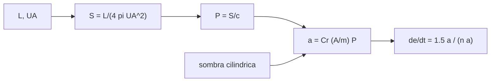

# B72-C08 — Presión de radiación solar

<!-- nav:top -->
[🏠 Programa](../../../../README.md) · [📚 Bloque B72](../../../tronco-comun/B72-perturbaciones-y-evolucion-de-orbitas.md) · [← Anterior: B72-C07 — Modelos de densidad atmosférica](../B72-C07-modelos-de-densidad-atmosferica/CLASE.md) · [Siguiente: B72-C09 — Perturbaciones solares →](../B72-C09-perturbaciones-solares/CLASE.md)
<!-- /nav -->

## 1. Ubicación, nivel y alcance

Clase 8 del bloque B72. Nivel N3. La luz del Sol empuja a un satélite: la presión de radiación es mínima pero actúa sin pausa, y en órbitas altas o con mucha área sobre masa deforma la excentricidad. Aquí calculas la irradiancia a partir de la luminosidad solar, la presión `S/c`, la aceleración según `A/m`, la sombra cilíndrica y el crecimiento de la excentricidad verificado con una integración. Sigue a [B72-C07](../B72-C07-modelos-de-densidad-atmosferica/CLASE.md). La órbita y los parámetros del satélite son sintéticos.

## 2. Por qué esta clase existe

En órbita geoestacionaria no hay arrastre, y el empuje solar domina las maniobras de mantenimiento de un satélite con paneles grandes; en una vela solar es el propulsor. La decisión central: **¿cuánto vale la aceleración por presión de radiación y cuánto deforma una órbita alta en semanas?**

## 3. Lo que podrás hacer al terminar

1. Derivar la irradiancia solar `L/(4π UA²)` con valores consultados.
2. Calcular la presión `S/c` y la aceleración `Cr (A/m) S/c`.
3. Escalar la irradiancia con el inverso del cuadrado de la distancia (Tierra y Marte).
4. Calcular la fracción de órbita en sombra con el modelo cilíndrico.
5. Verificar el crecimiento de la excentricidad `1,5 a_SRP t/(n a)` con una integración RK4.
6. Distinguir lo consultado de lo ilustrativo y de lo no consultado.

La evidencia es la **ficha de presión de radiación** del ejercicio 12 (sección 20).

## 4. Con qué llegas y cómo comprobarlo

1. ¿Qué es la irradiancia?
2. ¿Cuál es la relación entre presión y flujo de radiación?
3. ¿Qué es el cociente área sobre masa?
4. ¿Qué es una sombra cilíndrica?
5. ¿Qué es un valor no consultado?

<details>
<summary>Ver respuestas</summary>

1. La potencia de radiación por unidad de superficie perpendicular, en W/m². 2. `P = S/c` para absorción total; el doble si hay reflexión perfecta. 3. `A/m`: la superficie expuesta por kilogramo. 4. Un modelo donde la sombra de la Tierra es un cilindro de radio `R_e` paralelo a la luz solar. 5. Uno que se usa como ilustración sin haberlo leído en una fuente.
</details>

Con cuatro o cinco aciertos, sigue; si no, repasa los prerrequisitos.

## 5. Un caso de contexto y casos de referencia

Un satélite geoestacionario sintético de `A/m = 0,02 m²/kg` y `Cr = 1,3` sufre `1,18 × 10⁻⁷ m/s²` de radiación y, con el Sol fijo, su excentricidad crece `1,0 × 10⁻⁴` en `20 días`, que es lo que predice la teoría de primer orden. Es el **ejemplo conductor**. `A/m` y `Cr` son ilustrativos.

## 6. Vocabulario

La **irradiancia** `S` se mide en W/m². La **presión de radiación** es `P = S/c`. El **coeficiente de reflectividad** `Cr` va de `1` (absorbente) a `2` (espejo). La **sombra cilíndrica** es el modelo de eclipse más simple. La **excentricidad forzada** es el vector de excentricidad que crece por una fuerza casi constante.

## 7. Modelo mental: un viento de fotones



*Descripción textual:* la luminosidad y la distancia dan la irradiancia, de ella la presión y la aceleración; esta fuerza la excentricidad, y la sombra interrumpe el empuje.

Analogía: un velero en calma: el viento de fotones es débil, pero empuja sin pausa, y una vela grande sobre poca masa se mueve notablemente. Límite: la fuerza se toma con el Sol en dirección fija y sin sombra, `Cr` y `A/m` constantes y un satélite esférico equivalente; no hay forma ni orientación reales.

## 8. La explicación, paso a paso

### 8.1 Irradiancia y presión

La ficha del Sol da `L = 3,828 × 10²⁶ W` y la de la Tierra `UA = 149,598 × 10⁶ km`; entonces `S = L/(4π UA²) = 1361,16 W/m²`. Con `c = 299 792 458 m/s` (NIST), `P = S/c = 4,540 μPa`. La ficha del Sol no da la irradiancia y la página de SORCE consultada solo indica una variación del orden de `0,1 %` en el ciclo solar.

A la distancia media de Marte (`227,956 × 10⁶ km`), `S = 586,2 W/m²`, el `0,431` del valor terrestre, que coincide con `(UA/UA_Marte)²`.

### 8.2 Aceleración

`a = Cr (A/m) S/c`, con `Cr = 1,3` ilustrativo:

| Objeto (ilustrativo) | `A/m` (m²/kg) | `a` (m/s²) |
|---|---|---|
| satélite macizo | 0,005 | 2,951e-08 |
| satélite con paneles | 0,02 | 1,180e-07 |
| panel ligero | 0,2 | 1,180e-06 |
| vela solar | 1,0 | 5,902e-06 |

### 8.3 Sombra cilíndrica

Para `β = 0`, la fracción en sombra es `arcsin(R_e/r)/π`: `0,3901` en LEO (`36,1 min` por vuelta) y `0,0483` en GEO (`69,4 min`). El conteo numérico de muestras coincide a `10⁻³`.

### 8.4 Excentricidad forzada

Con el Sol en `+x` y GEO circular (`a = 42 164 km`, `n = 7,29 × 10⁻⁵ rad/s`), la teoría de primer orden da `|e| = 1,5 a_SRP t/(n a)`; RK4 con paso de `60 s` da `2,490e-05` a `5 días` (teoría `2,488e-05`), `4,980e-05` a `10` (`4,976e-05`), `7,470e-05` a `15` (`7,464e-05`) y `9,960e-05` a `20` (`9,952e-05`).

### 8.5 Lectura

La aceleración es `10⁻⁸`–`10⁻⁶ m/s²`, minúscula frente a `0,22 m/s²` de la gravedad en GEO, pero sin freno acumula el desplazamiento: en un año la excentricidad forzada sin compensación llegaría a décimas de milésima por mes. En la práctica el Sol se mueve y la excentricidad oscila (ver el ejercicio 9).

## 9. Magnitudes, símbolos y unidades

| Símbolo | Qué es | Unidad | Valor / nota |
|---|---|---|---|
| `S` | irradiancia solar a 1 UA | W/m² | 1361,16 (derivada) |
| `P` | presión de radiación | Pa | 4,540e-6 |
| `Cr` | reflectividad | — | 1,3 (ilustrativo) |
| `A/m` | área sobre masa | m²/kg | 0,02 (ilustrativo) |
| `a_SRP` | aceleración | m/s² | 1,180e-07 |
| `e` | excentricidad forzada | — | 9,96e-05 a 20 d |

## 10. Convenciones y referencias

Marco inercial geocéntrico; SI. `L`, `UA` y distancia de Marte de las fichas de la NASA; `c` de NIST. `Cr`, `A/m` y la órbita son ilustrativos o sintéticos. Sol fijo en `+x` durante 20 días (aproximación del laboratorio). Tolerancia de comprobación `3 %`.

## 11. De dónde sale lo que afirmamos

| ID | Fuente | Localizador | Respalda | Estado |
|---|---|---|---|---|
| S3 | NASA/NSSDC, Sun Fact Sheet — https://nssdc.gsfc.nasa.gov/planetary/factsheet/sunfact.html (consultada 2026-11-10) | ficha completa leída | masa 1,9884 × 10³⁰ kg; luminosidad 3,828 × 10²⁶ W; radio medio 695 700 km. La ficha no da la irradiancia solar total | Consultada |
| S1 | NASA/NSSDC, Earth Fact Sheet — https://nssdc.gsfc.nasa.gov/planetary/factsheet/earthfact.html (consultada 2026-11-10) | ficha completa leída | masa 5,9722 × 10²⁴ kg; radio medio 6371,000 km; radio ecuatorial 6378,137 km; J2 = 1082,63 × 10⁻⁶; GM = 0,39860 × 10⁶ km³/s²; rotación sideral 23,9345 h; semieje mayor 149,598 × 10⁶ km; oblicuidad 23,44° | Consultada |
| S4 | NASA/NSSDC, Mars Fact Sheet — https://nssdc.gsfc.nasa.gov/planetary/factsheet/marsfact.html (consultada 2026-11-10) | ficha completa leída | J2 = 1960,45 × 10⁻⁶; radio ecuatorial 3396,2 km; GM = 0,042828 × 10⁶ km³/s²; semieje mayor 227,956 × 10⁶ km; periodo 686,980 d; densidad de superficie ~0,016 kg/m³ | Consultada |
| S7 | NIST CODATA 2022 — https://physics.nist.gov/cgi-bin/cuu/Value?c, ...?bg, ...?k y ...?ukg (consultadas 2026-11-10) | valores de c, G, k y u | c = 299 792 458 m/s (exacta); G = 6,674 30(15) × 10⁻¹¹ m³ kg⁻¹ s⁻²; k = 1,380 649 × 10⁻²³ J/K (exacta); u = 1,660 539 068 92(52) × 10⁻²⁷ kg | Consultada |
| S16 | LASP/CU, SORCE TSI data — http://lasp.colorado.edu/sorce/data/tsi-data/ (consultada 2026-11-10) | página completa | variación de la irradiancia en el ciclo solar del orden de 0,1 %; no da un valor absoluto en W/m² | Consultada |
| S13 | IAU 2015 Resolución B3 (Mamajek et al.) — https://arxiv.org/abs/1510.07674 y PDF https://arxiv.org/pdf/1510.07674 (consultadas 2026-11-10; PDF extraído con PyMuPDF) | tabla de constantes de conversión | (GM)N Tierra = 3,986 004 × 10¹⁴ m³ s⁻²; (GM)N Júpiter = 1,266 865 3 × 10¹⁷ m³ s⁻²; (GM)N Sol = 1,327 124 4 × 10²⁰ m³ s⁻²; R_e Tierra nominal 6,3781 × 10⁶ m | Consultada |
| — | Fórmula `P = S/c`, modelo de sombra cilíndrica y teoría de primer orden de la excentricidad forzada | — | las verifica el laboratorio con una integración numérica | No consultada en una fuente concreta |

Límites: no se consultó ninguna medición absoluta de irradiancia ni la geometría de eclipses reales; la irradiancia se deriva de la luminosidad de la ficha del Sol.

## 12. Cómo ver la fuerza de la luz

| Magnitud | Valor |
|---|---|
| `S` a 1 UA | 1361,16 W/m² |
| `a_SRP` (A/m = 0,02) | 1,180e-07 m/s² |
| sombra en GEO | 0,0483 (69,4 min) |
| `e` a 20 días (num./teoría) | 9,960e-05 / 9,952e-05 |

Descripción larga: La luz solar acelera un satélite con paneles unos 10⁻⁷ m/s²; en GEO esa fuerza basta para que la excentricidad crezca 10⁻⁴ en 20 días, y la integración numérica coincide con la teoría.

## 13. Ejemplo trabajado: la aceleración de un satélite con paneles

**Paso 1 · Presión.** `P = 1361,16/299 792 458 = 4,540 × 10⁻⁶ Pa`.

**Paso 2 · Aceleración.** `a = 1,3 × 0,02 × 4,540e-6 = 1,180 × 10⁻⁷ m/s²`.

**Paso 3 · Lectura.** Es `5 × 10⁻⁷` de la gravedad en GEO, pero actúa todo el tiempo.

## 14. Distintas formas de describir la presión de radiación

**Por irradiancia:** `S` en W/m². **Por presión:** `P` en Pa. **Por aceleración:** `a` en m/s². **Por excentricidad forzada:** `e(t)`. **Por fracción de sombra:** `arcsin(R/r)/π`.

## 15. Práctica guiada

**Ejercicio 1 · con los pasos indicados.** Calcula `S` a `UA = 1,49598e11 m` con `L = 3,828e26 W`. *Pasos:* `4π UA²`; divide.

<details><summary>Solución comentada</summary>

`2,812e23`; `S = 1361,2 W/m²`.
</details>

**Ejercicio 2 · con una pista.** Calcula `P = S/c` con `S = 1361,16`. *Pista:* `c = 299 792 458`.

<details><summary>Solución comentada</summary>

`4,540e-6 Pa`.
</details>

**Ejercicio 3 · casi autónomo.** ¿Cuánto vale `a` con `A/m = 0,2` y `Cr = 1,3`?

<details><summary>Solución comentada</summary>

`1,3 × 0,2 × 4,540e-6 = 1,180e-6 m/s²`.
</details>

## 16. Práctica autónoma, transferencia e integrador

**Ejercicio 4 · autónomo.** Calcula la fracción de sombra en GEO con `R_e/r = 0,15127`.

<details><summary>Solución comentada</summary>

`arcsin(0,15127)/π = 0,1519/π = 0,0483`.
</details>

**Ejercicio 5 · autónomo.** ¿Cuántos minutos son si el periodo es `1436 min`?

<details><summary>Solución comentada</summary>

`0,0483 × 1436 = 69,4 min`.
</details>

**Ejercicio 6 · autónomo.** Calcula `S` en Marte desde la fórmula, usando el cociente de distancias.

<details><summary>Solución comentada</summary>

`1361,16 × (149,598/227,956)² = 586,2 W/m²`.
</details>

**Ejercicio 7 · autónomo.** Estima `e` a los `10 días` con `a_SRP = 1,18e-7`, `n a = 3074 m/s`.

<details><summary>Solución comentada</summary>

`1,5 × 1,18e-7 × 864 000/3074 = 4,98e-5`.
</details>

**Ejercicio 8 · autónomo.** ¿Por qué la excentricidad forzada no crece indefinidamente en la realidad?

<details><summary>Solución comentada</summary>

El Sol se desplaza respecto al satélite y el vector de excentricidad rota; el efecto es oscilatorio con periodo de un año.
</details>

**Ejercicio 9 · transferencia.** **Transferencia.** Un diseñador duplica el área de paneles. ¿Qué pasa con `e` a 20 días?

<details><summary>Solución comentada</summary>

Se duplica si `A/m` se duplica.
</details>

**Ejercicio 10 · transferencia.** **Transferencia.** ¿Por qué el modelo de sombra cilíndrica subestima el tiempo en eclipse?

<details><summary>Solución comentada</summary>

Ignora la penumbra; el tiempo real incluye el paso gradual.
</details>

**Ejercicio 11 · transferencia.** **Transferencia.** ¿Prueba el laboratorio la aceleración de un satélite real?

<details><summary>Solución comentada</summary>

No: `Cr`, `A/m` y la órbita son ilustrativos.
</details>

**Ejercicio 12 · integrador.** **Integrador.** Elabora tu *ficha de presión de radiación*: `S`, `P`, aceleración para cuatro `A/m`, sombra en LEO y GEO, `e(t)` y la lista de lo consultado, lo ilustrativo y lo no consultado.

<details><summary>Solución comentada</summary>

Secciones 8.1–8.4 y la salida del laboratorio.
</details>

## 17. Laboratorio: la fuerza de la luz

El script [presion_radiacion.py](presion_radiacion.py) deriva la irradiancia, calcula la aceleración por presión de radiación, mide la sombra cilíndrica con un conteo numérico e integra una órbita geoestacionaria para verificar `e(t)` (**comprueba** que `e` numérica y teórica difieren menos de `3 %`).

**Datos:** `L`, `UA`, la distancia de Marte y `c` consultados; `Cr`, `A/m` y la órbita **ilustrativos o sintéticos**. **Predice antes de ejecutar:** ¿qué fracción de la órbita pasa en sombra en GEO? (≈ 5 %.) **Ejecución del 2026-11-10 (Python 3.12.9):**

```text
Python 3.12.9 (biblioteca estandar)
S0 = L/(4 pi UA^2) = 1361.16 W/m2 (derivada de la luminosidad y de la distancia media); P0 = S0/c = 4.540 micro-Pa
A la distancia media de Marte: S = 586.2 W/m2 (cociente 0.431 = (UA/UA_Marte)^2 = 0.431)

Aceleracion por presion de radiacion, Cr = 1.3 (ILUSTRATIVO), a 1 UA
objeto (A/m ILUSTRATIVO)            A/m [m2/kg]      a [m/s2]
satelite macizo                           0.005     2.951e-08
satelite con paneles                      0.020     1.180e-07
panel ligero                              0.200     1.180e-06
vela solar                                1.000     5.902e-06

Sombra cilindrica (beta = 0): fraccion de la orbita y duracion
orbita      r [km]  fraccion analitica  fraccion numerica  duracion [min]
LEO         6778.1              0.3901             0.3901            36.1
GEO        42164.0              0.0483             0.0483            69.4

GEO sintetica, A/m = 0.02, Cr = 1.3: a_SRP = 1.180e-07 m/s2 ; Sol fijo en +x ; 20 dias, RK4 paso 60 s
  dias    |e| numerica    |e| teoria 1.5 a_SRP t/(n a)
     5       2.490e-05                       2.488e-05
    10       4.980e-05                       4.976e-05
    15       7.470e-05                       7.464e-05
    20       9.960e-05                       9.952e-05
Pruebas superadas.
```

```bash
python programa/clases/B72/B72-C08-presion-de-radiacion-solar/presion_radiacion.py
```

**Límites:** Sol fijo, sin sombra en la integración, `Cr` y `A/m` constantes; la irradiancia derivada puede diferir de las mediciones en una fracción de porcentaje.

## 18. Errores frecuentes y cómo corregirlos

**Creer que el efecto es despreciable porque la aceleración es pequeña.** Se corrige con 8.4: se acumula.

**Olvidar que `Cr` va de 1 a 2.** Se corrige con el vocabulario.

**Ignorar la sombra al promediar el empuje.** Se corrige con 8.3.

**Confundir irradiancia con presión.** Se corrige con 8.1.

## 19. Cómo sabrás que vas bien

Tras la sección 8: ¿qué aceleración esperabas para `A/m = 0,02` y cuál obtuviste? Si dudas, repasa el ejemplo 13. Tras el laboratorio: ¿qué comprueba la tabla de `e(t)`? (ver la sección 17).

## 20. Qué entregas y cómo se evalúa

El producto es tu **ficha de presión de radiación** (ejercicio 12).

| Criterio | Inicial | En desarrollo | Logrado | Destacado |
|---|---|---|---|---|
| Conceptos | Los confunde | Parciales | Calcula `S`, `P`, `a` y `e(t)` | Explica los límites |
| Cálculo | Sin unidades | Con errores | Tablas completas con unidades | Calcula casos nuevos |
| Numérico | Sin comprobar | Un caso | Contraste con una segunda vía | Interpreta las diferencias |
| Fuentes | Sin fuente | Sin fecha | Fuentes con fecha y estado | Declara lo ilustrativo y lo no consultado |
| Límites | No los nombra | Uno | Tres | Discute qué falta del modelo |

**Condiciones críticas (no se compensan con promedio):** rotular `Cr`, `A/m` y la órbita como ilustrativos; declarar que la irradiancia se derivó; citar solo lo consultado.

## 21. Ética, seguridad y límites

Clase educativa: los modelos son simplificados y sus datos son sintéticos o ilustrativos; ningún resultado sustituye a un producto de determinación de órbita, a un servicio oficial de elementos ni a una decisión de operación de vuelo. Accesibilidad: tablas equivalentes a las gráficas, fórmulas en texto, ejercicios sin conexión.

## 22. Para cerrar y seguir

La luz del Sol acelera un satélite sintético con paneles `1,18 × 10⁻⁷ m/s²` y hace crecer su excentricidad `10⁻⁴` en `20 días` en órbita geoestacionaria. Queda una pregunta: ¿cuánto pesa la atracción gravitatoria del propio Sol?

**Glosario español–inglés.** presión de radiación · *radiation pressure*; irradiancia · *irradiance*; coeficiente de reflectividad · *reflectivity coefficient*; sombra cilíndrica · *cylindrical shadow*; vela solar · *solar sail*.

**Continuidad.** [B72-C09](../B72-C09-perturbaciones-solares/CLASE.md) estudia las perturbaciones solares gravitatorias.

**Referencias:** ver sección 11.

<!-- nav:bottom -->
---

[← Anterior: B72-C07 — Modelos de densidad atmosférica](../B72-C07-modelos-de-densidad-atmosferica/CLASE.md) · [📚 Bloque B72](../../../tronco-comun/B72-perturbaciones-y-evolucion-de-orbitas.md) · [Siguiente: B72-C09 — Perturbaciones solares →](../B72-C09-perturbaciones-solares/CLASE.md)
<!-- /nav -->
