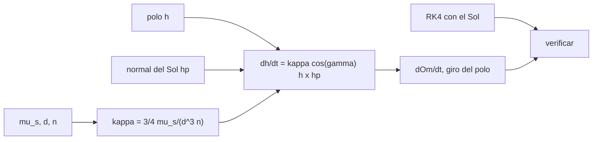

# B72-C09 — Perturbaciones solares

<!-- nav:top -->
[🏠 Programa](../../../../README.md) · [📚 Bloque B72](../../../tronco-comun/B72-perturbaciones-y-evolucion-de-orbitas.md) · [← Anterior: B72-C08 — Presión de radiación solar](../B72-C08-presion-de-radiacion-solar/CLASE.md) · [Siguiente: B72-C10 — Perturbaciones lunares →](../B72-C10-perturbaciones-lunares/CLASE.md)
<!-- /nav -->

## 1. Ubicación, nivel y alcance

Clase 9 del bloque B72. Nivel N3. El Sol atrae al satélite y a la Tierra casi igual; lo que perturba la órbita es la diferencia, la marea solar. Aquí calculas esa aceleración con la fórmula exacta y con la aproximación cuadrupolar, derivas la precesión del polo orbital por el Sol y la verificas con una integración de 180 días. Sigue a [B72-C08](../B72-C08-presion-de-radiacion-solar/CLASE.md) y prepara las perturbaciones lunares ([C10](../B72-C10-perturbaciones-lunares/CLASE.md)). El Sol se modela en órbita circular y el satélite es sintético.

## 2. Por qué esta clase existe

En órbitas altas el Sol y la Luna compiten con J2 y gobiernan la evolución de la inclinación y del nodo. La decisión central: **¿cuánto gira el plano de una órbita por la marea solar y qué fórmula sirve para predecirlo?**

## 3. Lo que podrás hacer al terminar

1. Escribir la aceleración de marea `μ_p [(d−r)/|d−r|³ − d/|d|³]`.
2. Compararla con la aproximación `2 μ_p r/d³`.
3. Deducir la precesión del polo orbital `dĥ/dt = κ cosγ (ĥ × ĥ_p)` con `κ = ¾ μ_p/(d³ n)`.
4. Verificarla con una integración RK4 de 180 días.
5. Explicar cuándo vale la fórmula simple de `dΩ/dt` promediada sobre el ciclo del nodo.
6. Distinguir lo consultado de lo ilustrativo y de lo no consultado.

La evidencia es la **ficha de marea solar** del ejercicio 12 (sección 20).

## 4. Con qué llegas y cómo comprobarlo

1. ¿Qué es una marea gravitatoria?
2. ¿Qué es una precesión?
3. ¿Qué es el momento angular orbital?
4. ¿Qué es un promedio sobre una órbita?
5. ¿Qué es un valor no consultado?

<details>
<summary>Ver respuestas</summary>

1. La diferencia entre la atracción en dos puntos, que estira el cuerpo. 2. Un giro lento de un eje alrededor de otro. 3. El vector `h = r × v`, perpendicular al plano orbital. 4. La media de una magnitud en una vuelta completa. 5. Uno que se usa como ilustración sin haberlo leído en una fuente.
</details>

Con cuatro o cinco aciertos, sigue; si no, repasa los prerrequisitos.

## 5. Un caso de contexto y casos de referencia

A `60 000 km`, `i = 40°`, el nodo de un satélite sintético gira `−0,2646°` en 180 días según RK4 y `−0,2621°` según la fórmula (`0,96 %` de diferencia). A GEO la marea solar es `3,34 × 10⁻⁶ m/s²`, `1,5 × 10⁻⁵` de la gravedad. Es el **ejemplo conductor**. El Sol está en una órbita circular simplificada.

## 6. Vocabulario

La **marea solar** es `a = μ_s [(d−r)/|d−r|³ − d/|d|³]`. La **aproximación cuadrupolar** es `2 μ_s r/d³` sobre la línea Sol-Tierra. El **polo orbital** `ĥ` es la dirección de `r × v`. La **precesión luni-solar** es el giro de `ĥ` alrededor de la normal de la órbita del perturbador. `κ` (rad/s) es el factor `¾ μ_p/(d³ n)`.

## 7. Modelo mental: un trompo empujado por un tercer cuerpo



*Descripción textual:* el factor `κ`, el polo orbital y la normal del Sol determinan el giro del polo; de él salen las tasas, que se verifican con la integración con el Sol.

Analogía: un trompo (el plano orbital) empujado por un tercer cuerpo gira lentamente alrededor del eje de la órbita de ese cuerpo. Límite: se promedia sobre las dos órbitas y se supone órbita circular del satélite y del Sol; los términos de segundo orden y la excentricidad no están.

## 8. La explicación, paso a paso

### 8.1 Marea solar

Con `μ_s = 1,3271244 × 10²⁰ m³/s²` (IAU 2015) y `d = 1 UA = 149,598 × 10⁶ km` (NSSDC), la aceleración máxima sobre la línea Sol-Tierra, exacta y cuadrupolar:

| Órbita | `r` (km) | exacta (m/s²) | `2 μ r/d³` (m/s²) | dif. relativa |
|---|---|---|---|---|
| LEO | 6778,1 | 5,3741e-07 | 5,3737e-07 | 6,8e-05 |
| GPS | 26 560,0 | 2,1062e-06 | 2,1057e-06 | 2,7e-04 |
| GEO | 42 164,0 | 3,3442e-06 | 3,3428e-06 | 4,2e-04 |
| 60 000 km | 60 000,0 | 4,7597e-06 | 4,7568e-06 | 6,0e-04 |

La aproximación es excelente (`≈ 3r/d`).

### 8.2 Precesión del polo

Para órbitas circulares y promediando sobre ambas: `dĥ/dt = κ cosγ (ĥ × ĥ_p)`, con `cosγ = ĥ · ĥ_p`, `κ = ¾ μ_s/(d³ n)` y `ĥ_p` la normal de la órbita del Sol (inclinada `23,44°` al ecuador, oblicuidad de la ficha de la Tierra). Resultados:

| `a` (km) | `i` (°) | `dΩ/dt` (°/año) | giro del polo (°/año) | periodo del polo (años) |
|---|---|---|---|---|
| 26 560 | 55,0 | −0,2007 | 0,1644 | 1146,4 |
| 42 164 | 0,5 | 30,3213 | 0,2646 | 530,3 |
| 42 164 | 10,0 | 0,9597 | 0,1666 | 502,1 |
| 60 000 | 40,0 | −0,5318 | 0,3419 | 300,1 |

`dΩ/dt` no tiene sentido físico con `i` tan pequeño (nodo mal definido); lo informativo es el giro del polo.

### 8.3 Verificación

Con RK4 de `600 s`, `180 días`, `a = 60 000 km`, `i = 40°`, `e = 0`: `ΔΩ` numérico `−0,2646°`, fórmula `−0,2621°` (`0,96 %`); giro del polo numérico `0,17010°`, fórmula `0,16848°`.

### 8.4 La fórmula simple

La expresión de libro `dΩ/dt = −¾ (μ_s/(d³ n)) cos i (3 cos²ε − 1)/2` es el promedio de la fórmula vectorial cuando el nodo ha dado una vuelta completa en torno al eje terrestre. En 180 días el nodo apenas se mueve y la fórmula simple no vale: para `a = 60 000 km` daría `−0,731°` por año, frente a `−0,532°` de la fórmula vectorial.

### 8.5 Lectura

La marea solar no es despreciable en órbitas altas (`10⁻⁶ m/s²` en GEO), pero actúa lentamente: el polo tarda siglos en dar una vuelta. Para predicciones de años, hay que integrar.

## 9. Magnitudes, símbolos y unidades

| Símbolo | Qué es | Unidad | Valor / nota |
|---|---|---|---|
| `μ_s` | parámetro gravitatorio del Sol | m³/s² | 1,3271244e20 |
| `d` | distancia Sol-Tierra | m | 1,49598e11 |
| `ε` | oblicuidad | ° | 23,44 |
| `κ` | factor de precesión | rad/s | `¾ μ_s/(d³ n)` |
| `ĥ` | polo orbital | — | vector unitario |
| `γ` | ángulo entre `ĥ` y `ĥ_p` | ° | — |

## 10. Convenciones y referencias

Marco inercial del ecuador de la fecha; el Sol en órbita circular de radio `1 UA` y plano inclinado `ε` al ecuador, con nodo en `+x`; `n_s = √(μ_s/UA³)`. Satélite circular sintético con `Ω = 0` inicial. RK4 de `600 s`. Tolerancia de comprobación `5 %`.

## 11. De dónde sale lo que afirmamos

| ID | Fuente | Localizador | Respalda | Estado |
|---|---|---|---|---|
| S3 | NASA/NSSDC, Sun Fact Sheet — https://nssdc.gsfc.nasa.gov/planetary/factsheet/sunfact.html (consultada 2026-11-10) | ficha completa leída | masa 1,9884 × 10³⁰ kg; luminosidad 3,828 × 10²⁶ W; radio medio 695 700 km. La ficha no da la irradiancia solar total | Consultada |
| S1 | NASA/NSSDC, Earth Fact Sheet — https://nssdc.gsfc.nasa.gov/planetary/factsheet/earthfact.html (consultada 2026-11-10) | ficha completa leída | masa 5,9722 × 10²⁴ kg; radio medio 6371,000 km; radio ecuatorial 6378,137 km; J2 = 1082,63 × 10⁻⁶; GM = 0,39860 × 10⁶ km³/s²; rotación sideral 23,9345 h; semieje mayor 149,598 × 10⁶ km; oblicuidad 23,44° | Consultada |
| S13 | IAU 2015 Resolución B3 (Mamajek et al.) — https://arxiv.org/abs/1510.07674 y PDF https://arxiv.org/pdf/1510.07674 (consultadas 2026-11-10; PDF extraído con PyMuPDF) | tabla de constantes de conversión | (GM)N Tierra = 3,986 004 × 10¹⁴ m³ s⁻²; (GM)N Júpiter = 1,266 865 3 × 10¹⁷ m³ s⁻²; (GM)N Sol = 1,327 124 4 × 10²⁰ m³ s⁻²; R_e Tierra nominal 6,3781 × 10⁶ m | Consultada |
| — | Fórmula de la precesión luni-solar `dĥ/dt = κ cosγ (ĥ × ĥ_p)` y el promedio cuadrupolar | — | la verifica el laboratorio con una integración independiente | No consultada en una fuente concreta |

Límites: `μ_s` viene de la resolución de la IAU; las fórmulas de la teoría de tercer cuerpo no se consultaron en un texto; no se usó ninguna efeméride del Sol.

## 12. Cómo ver la marea solar

| Magnitud | Valor |
|---|---|
| marea solar en GEO | 3,34e-06 m/s² |
| `ΔΩ` a 60 000 km, 180 d (num./fórmula) | −0,2646° / −0,2621° |
| giro del polo (num./fórmula) | 0,17010° / 0,16848° |
| periodo del polo a 60 000 km | 300,1 años |

Descripción larga: La fórmula vectorial reproduce el desplazamiento del nodo a menos del 1 % y el giro del polo a un 1 %; el polo completa una vuelta en siglos.

## 13. Ejemplo trabajado: el factor κ

**Paso 1 · Movimiento medio.** `n = √(3,986004e14/(6e7)³) = 4,30 × 10⁻⁵ rad/s` a 60 000 km.

**Paso 2 · `μ_s/d³`.** `1,3271244e20/(1,49598e11)³ = 3,964 × 10⁻¹⁴ s⁻²`.

**Paso 3 · κ.** `κ = 0,75 × 3,964e-14/4,30e-5 = 6,9 × 10⁻¹⁰ rad/s`; por año `0,0218 rad = 1,25°`.

## 14. Distintas formas de describir la marea solar

**Por aceleración:** exacta y `2 μ r/d³`. **Por precesión:** `dĥ/dt` con `κ cosγ`. **Por tasa del nodo:** `dΩ/dt` instantánea o promediada. **Por periodo del polo:** `2π/(κ |cosγ|)`. **Por verificación:** RK4.

## 15. Práctica guiada

**Ejercicio 1 · con los pasos indicados.** Calcula `2 μ_s r/d³` en GEO con `μ_s/d³ = 3,964e-14`. *Pasos:* `2 × 3,964e-14 × 4,2164e7`.

<details><summary>Solución comentada</summary>

`3,343e-6 m/s²`.
</details>

**Ejercicio 2 · con una pista.** Calcula el cociente con la gravedad en GEO (`0,2242 m/s²`). *Pista:* divide.

<details><summary>Solución comentada</summary>

`1,49e-5`.
</details>

**Ejercicio 3 · casi autónomo.** ¿Por qué la aproximación cuadrupolar es tan buena?

<details><summary>Solución comentada</summary>

El error relativo es `≈ 3 r/d`, del orden de `10⁻⁴` en GEO.
</details>

## 16. Práctica autónoma, transferencia e integrador

**Ejercicio 4 · autónomo.** Calcula `κ` en GEO con `n = 7,292e-5`.

<details><summary>Solución comentada</summary>

`0,75 × 3,964e-14/7,292e-5 = 4,08e-10 rad/s`.
</details>

**Ejercicio 5 · autónomo.** ¿Cuánto gira el polo de una órbita casi ecuatorial en un año?

<details><summary>Solución comentada</summary>

`κ cosγ sinγ ×` un año `= 0,2646°`.
</details>

**Ejercicio 6 · autónomo.** ¿Por qué `dΩ/dt` vale `30,3213°/año` a `i = 0,5°` y no es físico?

<details><summary>Solución comentada</summary>

El nodo está mal definido en órbitas casi ecuatoriales: `dΩ ∝ 1/sin i`.
</details>

**Ejercicio 7 · autónomo.** ¿Por qué la fórmula simple no sirve para 180 días?

<details><summary>Solución comentada</summary>

Es un promedio sobre una vuelta del nodo, que tarda siglos.
</details>

**Ejercicio 8 · autónomo.** ¿Qué órbita tiene la mayor marea solar relativa, LEO o GEO?

<details><summary>Solución comentada</summary>

GEO: la aceleración crece con `r` y la gravedad decrece.
</details>

**Ejercicio 9 · transferencia.** **Transferencia.** Un equipo propone ignorar el Sol para una misión de 3 años en 60 000 km. ¿Qué responde?

<details><summary>Solución comentada</summary>

El nodo se desplazaría `≈ 1,6°` en tres años según la fórmula; depende de la tolerancia.
</details>

**Ejercicio 10 · transferencia.** **Transferencia.** Compara la marea solar con la presión de radiación (C08) en GEO.

<details><summary>Solución comentada</summary>

Solar gravitatoria `3,3e-6 m/s²` frente a SRP `1,2e-7 m/s²` con `A/m = 0,02`: unas 28 veces mayor.
</details>

**Ejercicio 11 · transferencia.** **Transferencia.** ¿Prueba el laboratorio algo sobre el Sol real?

<details><summary>Solución comentada</summary>

No: el Sol está en una órbita circular simplificada.
</details>

**Ejercicio 12 · integrador.** **Integrador.** Elabora tu *ficha de marea solar*: aceleración exacta y cuadrupolar en cuatro órbitas, giro del polo, verificación numérica y la lista de lo consultado, lo ilustrativo y lo no consultado.

<details><summary>Solución comentada</summary>

Secciones 8.1–8.3 y la salida del laboratorio.
</details>

## 17. Laboratorio: marea solar y precesión del polo

El script [perturbaciones_solares.py](perturbaciones_solares.py) compara la marea exacta y la cuadrupolar, calcula la precesión del polo orbital por el Sol y la verifica con 180 días de RK4 (**comprueba** `ΔΩ` dentro de `5 %`).

**Datos:** `μ_s`, `μ`, `UA` y oblicuidad consultados; la órbita del satélite y la geometría del Sol **sintéticas o simplificadas**. **Predice antes de ejecutar:** ¿qué órbita sufre la mayor aceleración de marea en m/s²? (la de mayor `r`.) **Ejecución del 2026-11-10 (Python 3.12.9):**

```text
Python 3.12.9 (biblioteca estandar)
Sol en orbita circular de radio 1 UA inclinada 23.44 deg al ecuador (modelo SIMPLIFICADO; satelite SINTETICO)

Marea solar: aceleracion maxima (sobre la linea Sol-Tierra) exacta vs 2 mu r/d^3
orbita          r [km]   exacta [m/s2]    2 mu r/d^3  dif. relativa
LEO             6778.1      5.3741e-07    5.3737e-07       6.80e-05
GPS            26560.0      2.1062e-06    2.1057e-06       2.66e-04
GEO            42164.0      3.3442e-06    3.3428e-06       4.23e-04
60000 km       60000.0      4.7597e-06    4.7568e-06       6.02e-04

Precesion del polo orbital por el Sol (formula vectorial): dOmega/dt, |dh/dt| (giro del polo)
   a [km]  i [deg]  dOm [deg/ano]  |dh/dt| [deg/ano]  periodo del polo [anos]
    26560     55.0        -0.2007             0.1644                   1146.4
    42164      0.5        30.3213             0.2646                    530.3
    42164     10.0         0.9597             0.1666                    502.1
    60000     40.0        -0.5318             0.3419                    300.1

Verificacion numerica (RK4, paso 600 s, 180 dias): a = 60000 km, i = 40 deg, e = 0
  dOmega: numerico = -0.2646 deg ; formula = -0.2621 deg
  giro del polo: numerico = 0.17010 deg ; formula = 0.16848 deg
  diferencia relativa de dOmega = 0.96%
Pruebas superadas.
```

```bash
python programa/clases/B72/B72-C09-perturbaciones-solares/perturbaciones_solares.py
```

**Límites:** Sol en órbita circular, satélite circular, sin J2 ni Luna; promedio de primer orden.

## 18. Errores frecuentes y cómo corregirlos

**Creer que el Sol atrae al satélite con `μ_s/d²`.** Se corrige con 8.1: solo importa la diferencia.

**Aplicar la fórmula simple del nodo a intervalos cortos.** Se corrige con 8.4.

**Interpretar `dΩ/dt` a baja inclinación.** Se corrige con 8.2.

**Olvidar el plano del Sol.** Se corrige con la sección 10.

## 19. Cómo sabrás que vas bien

Tras la sección 8: ¿qué aceleración esperabas en GEO y cuál obtuviste? Si dudas, repasa el ejemplo 13. Tras el laboratorio: ¿qué comprueba el criterio de `5 %`? (ver la sección 17).

## 20. Qué entregas y cómo se evalúa

El producto es tu **ficha de marea solar** (ejercicio 12).

| Criterio | Inicial | En desarrollo | Logrado | Destacado |
|---|---|---|---|---|
| Conceptos | Los confunde | Parciales | Calcula la marea y la precesión del polo | Explica los límites |
| Cálculo | Sin unidades | Con errores | Tablas completas con unidades | Calcula casos nuevos |
| Numérico | Sin comprobar | Un caso | Contraste con una segunda vía | Interpreta las diferencias |
| Fuentes | Sin fuente | Sin fecha | Fuentes con fecha y estado | Declara lo ilustrativo y lo no consultado |
| Límites | No los nombra | Uno | Tres | Discute qué falta del modelo |

**Condiciones críticas (no se compensan con promedio):** rotular el satélite y el modelo del Sol como sintéticos y simplificados; no usar la fórmula promediada en intervalos cortos; citar solo lo consultado.

## 21. Ética, seguridad y límites

Clase educativa: los modelos son simplificados y sus datos son sintéticos o ilustrativos; ningún resultado sustituye a un producto de determinación de órbita, a un servicio oficial de elementos ni a una decisión de operación de vuelo. Accesibilidad: tablas equivalentes a las gráficas, fórmulas en texto, ejercicios sin conexión.

## 22. Para cerrar y seguir

La marea solar en GEO vale `3,34 × 10⁻⁶ m/s²` y hace girar el polo de una órbita sintética `0,17°` en 180 días. Queda una pregunta: ¿cuánto pesa la Luna, más cercana y más variable?

**Glosario español–inglés.** marea gravitatoria · *tidal force*; precesión luni-solar · *lunisolar precession*; polo orbital · *orbit pole*; aproximación cuadrupolar · *quadrupole approximation*; tercer cuerpo · *third body*.

**Continuidad.** [B72-C10](../B72-C10-perturbaciones-lunares/CLASE.md) estudia las perturbaciones lunares.

**Referencias:** ver sección 11.

<!-- nav:bottom -->
---

[← Anterior: B72-C08 — Presión de radiación solar](../B72-C08-presion-de-radiacion-solar/CLASE.md) · [📚 Bloque B72](../../../tronco-comun/B72-perturbaciones-y-evolucion-de-orbitas.md) · [Siguiente: B72-C10 — Perturbaciones lunares →](../B72-C10-perturbaciones-lunares/CLASE.md)
<!-- /nav -->
