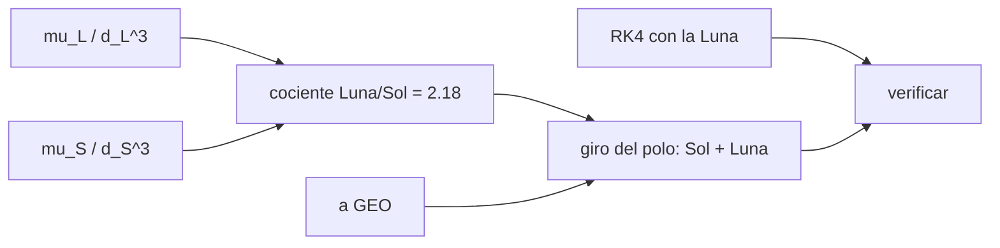

# B72-C10 — Perturbaciones lunares

<!-- nav:top -->
[🏠 Programa](../../../../README.md) · [📚 Bloque B72](../../../tronco-comun/B72-perturbaciones-y-evolucion-de-orbitas.md) · [← Anterior: B72-C09 — Perturbaciones solares](../B72-C09-perturbaciones-solares/CLASE.md) · [Siguiente: B72-C11 — Resonancias orbitales — Perturbaciones y evolución de órbitas →](../B72-C11-resonancias-orbitales-perturbaciones-y-evolucion-de-orbitas/CLASE.md)
<!-- /nav -->

## 1. Ubicación, nivel y alcance

Clase 10 del bloque B72. Nivel N3. La Luna es mucho menos masiva que el Sol, pero está tan cerca que su marea es más del doble que la solar. Aquí comparas ambas, verificas con una integración la precesión del polo orbital por la Luna y estimas la deriva de la inclinación de una órbita geoestacionaria por Sol y Luna. Sigue a [B72-C09](../B72-C09-perturbaciones-solares/CLASE.md) y prepara las resonancias ([C11](../B72-C11-resonancias-orbitales-perturbaciones-y-evolucion-de-orbitas/CLASE.md)). La Luna se modela en una órbita circular simplificada.

## 2. Por qué esta clase existe

Un satélite geoestacionario sin maniobras de inclinación deriva de su plano ecuatorial algo menos de un grado por año, y el combustible de ese mantenimiento fija su vida útil. La decisión central: **¿cuánto contribuye cada cuerpo a la deriva de la inclinación y cuánto de ese resultado depende de simplificar la órbita lunar?**

## 3. Lo que podrás hacer al terminar

1. Comparar `μ/d³` de la Luna y del Sol.
2. Verificar con RK4 la precesión del polo orbital por la Luna.
3. Estimar la deriva de inclinación geoestacionaria por Sol y Luna.
4. Explicar por qué la contribución lunar varía en el ciclo de 18,6 años.
5. Reconocer qué simplifica el modelo (plano lunar fijo a la oblicuidad).
6. Distinguir lo consultado de lo ilustrativo y de lo no consultado.

La evidencia es la **ficha de deriva lunisolar** del ejercicio 12 (sección 20).

## 4. Con qué llegas y cómo comprobarlo

1. ¿Cuál es el periodo sideral de la Luna?
2. ¿Qué es la inclinación geoestacionaria?
3. ¿Qué es una marea?
4. ¿Qué es un promedio sobre una órbita?
5. ¿Qué es un valor no consultado?

<details>
<summary>Ver respuestas</summary>

1. Unos `27,3217 días`. 2. El ángulo entre el plano orbital y el ecuador; una órbita geoestacionaria ideal tiene `i = 0`. 3. La diferencia de atracción entre dos puntos del satélite o del planeta. 4. La media de una magnitud en una vuelta completa. 5. Uno que se usa como ilustración sin haberlo leído en una fuente.
</details>

Con cuatro o cinco aciertos, sigue; si no, repasa los prerrequisitos.

## 5. Un caso de contexto y casos de referencia

El coeficiente de marea `μ/d³` de la Luna es `2,178` veces el del Sol (`8,63 × 10⁻¹⁴` frente a `3,96 × 10⁻¹⁴ s⁻²`). En una órbita geoestacionaria sintética el polo gira `0,265 °/año` por el Sol, `0,576 °/año` por la Luna y `0,841 °/año` en total en el modelo simplificado. Es el **ejemplo conductor**. El plano lunar fijo a `23,44°` es una simplificación.

## 6. Vocabulario

La **deriva de inclinación** es la rotación del polo orbital respecto al polo terrestre. El **ciclo de 18,6 años** es la regresión del nodo de la órbita lunar sobre la eclíptica, que hace variar su inclinación al ecuador entre `18,3°` y `28,6°`; no se consultó, se menciona como contexto. La **corrección norte-sur** es la maniobra que devuelve la inclinación a cero. La **órbita lunar simplificada** es circular y con plano a `23,44°` fijo.

## 7. Modelo mental: dos remolcadores con fuerzas distintas



*Descripción textual:* los coeficientes de marea de la Luna y del Sol dan su cociente; sumados dan el giro del polo en GEO; la integración con la Luna verifica la fórmula.

Analogía: un remolcador pequeño pero pegado al barco (la Luna) empuja más que uno enorme y lejano (el Sol). Límite: el plano lunar real oscila de `18,3°` a `28,6°` respecto al ecuador y su nodo regresa en `18,6 años`; el modelo lo ignora.

## 8. La explicación, paso a paso

### 8.1 Cociente de marea

Con `μ_Luna = 4902,800 km³/s²` (JPL SSD), `d = 0,3844 × 10⁶ km` (ficha de la Luna), `μ_s = 1,3271244 × 10²⁰ m³/s²` y `1 UA`: `μ/d³` vale `8,6317 × 10⁻¹⁴ s⁻²` (Luna) y `3,9640 × 10⁻¹⁴ s⁻²` (Sol); el cociente es `2,178`. El periodo sideral de la Luna es `27,3217 días`, que da `n = 2,6617 × 10⁻⁶ rad/s`.

### 8.2 Verificación con la Luna

Misma configuración que C09 pero con la Luna (`180 días`, RK4 de `600 s`, `a = 60 000 km`, `i = 40°`, `e = 0`): `ΔΩ` numérico `−0,5871°`, fórmula `−0,5707°` (`2,86 %`); giro del polo numérico `0,37737°`, fórmula `0,36686°`.

La diferencia es mayor que con el Sol (`0,96 %`) porque la Luna da seis vueltas en el intervalo y la fórmula promedia sobre ellas.

### 8.3 Deriva geoestacionaria

Con la fórmula vectorial, `a = 42 164 km`, `i₀ = 0,5°`:

| Perturbador | giro del polo (°/año) |
|---|---|
| Sol | 0,265 |
| Luna (plano a 23,44°, simplificada) | 0,576 |
| Suma | 0,841 |

El valor de la suma es del orden de `0,8–0,9 °/año` que suele citarse en la bibliografía de mantenimiento geoestacionario; esa cifra no se consultó aquí.

### 8.4 Lectura

La Luna aporta unas dos tercias partes de la deriva. Como su plano oscila en el ciclo de `18,6 años`, la contribución lunar real varía por encima y por debajo del valor medio simplificado; para gestionar combustible hay que usar la inclinación lunar de cada año.

## 9. Magnitudes, símbolos y unidades

| Símbolo | Qué es | Unidad | Valor / nota |
|---|---|---|---|
| `μ_L` | parámetro gravitatorio de la Luna | m³/s² | 4,9028e12 |
| `d_L` | distancia media Tierra-Luna | m | 3,844e8 |
| `T_L` | periodo sideral | s | 2 360 591 |
| `μ_L/d_L³` | coeficiente de marea lunar | s⁻² | 8,6317e-14 |
| `μ_s/d³` | coeficiente de marea solar | s⁻² | 3,9640e-14 |
| giro del polo GEO | deriva de inclinación | °/año | 0,841 (simplificada) |

## 10. Convenciones y referencias

Marco inercial del ecuador de la fecha; la Luna en órbita circular de radio `384 400 km`, periodo sideral `27,3217 d` y plano a `23,44°` del ecuador (simplificación); el Sol como en C09. Satélite circular sintético con `Ω = 0` inicial. RK4 de `600 s`. Tolerancia de comprobación `8 %`.

## 11. De dónde sale lo que afirmamos

| ID | Fuente | Localizador | Respalda | Estado |
|---|---|---|---|---|
| S2 | NASA/NSSDC, Moon Fact Sheet — https://nssdc.gsfc.nasa.gov/planetary/factsheet/moonfact.html (consultada 2026-11-10) | ficha completa leída | masa 0,07346 × 10²⁴ kg; radio medio 1737,4 km; semieje mayor 0,3844 × 10⁶ km; periodo sideral 27,3217 d; excentricidad 0,0549; inclinación a la eclíptica 5,145° | Consultada |
| S8 | NASA JPL SSD, Planetary Satellite Physical Parameters — https://ssd.jpl.nasa.gov/sats/phys_par/ (consultada 2026-11-10) | filas de la Luna, Ío y Europa | GM Luna 4902,800 km³/s²; radio medio 1737,4 km; Ío GM 5959,91547 km³/s², radio 1821,49 km; Europa GM 3202,71210 km³/s², radio 1560,80 km (la página no muestra fecha) | Consultada |
| S3 | NASA/NSSDC, Sun Fact Sheet — https://nssdc.gsfc.nasa.gov/planetary/factsheet/sunfact.html (consultada 2026-11-10) | ficha completa leída | masa 1,9884 × 10³⁰ kg; luminosidad 3,828 × 10²⁶ W; radio medio 695 700 km. La ficha no da la irradiancia solar total | Consultada |
| S1 | NASA/NSSDC, Earth Fact Sheet — https://nssdc.gsfc.nasa.gov/planetary/factsheet/earthfact.html (consultada 2026-11-10) | ficha completa leída | masa 5,9722 × 10²⁴ kg; radio medio 6371,000 km; radio ecuatorial 6378,137 km; J2 = 1082,63 × 10⁻⁶; GM = 0,39860 × 10⁶ km³/s²; rotación sideral 23,9345 h; semieje mayor 149,598 × 10⁶ km; oblicuidad 23,44° | Consultada |
| S13 | IAU 2015 Resolución B3 (Mamajek et al.) — https://arxiv.org/abs/1510.07674 y PDF https://arxiv.org/pdf/1510.07674 (consultadas 2026-11-10; PDF extraído con PyMuPDF) | tabla de constantes de conversión | (GM)N Tierra = 3,986 004 × 10¹⁴ m³ s⁻²; (GM)N Júpiter = 1,266 865 3 × 10¹⁷ m³ s⁻²; (GM)N Sol = 1,327 124 4 × 10²⁰ m³ s⁻²; R_e Tierra nominal 6,3781 × 10⁶ m | Consultada |
| — | Fórmula de la precesión luni-solar, ciclo de 18,6 años y deriva geoestacionaria típica de `0,8–0,9 °/año` | — | la fórmula se verifica numéricamente; el ciclo y la cifra bibliográfica se citan como contexto | No consultada en una fuente concreta |

Límites: no se consultó ninguna efeméride lunar ni el ciclo de 18,6 años; la cifra típica de deriva geoestacionaria no se consultó. La ficha de la Luna da inclinación a la eclíptica `5,145°`, pero el modelo usa `23,44°` al ecuador como promedio simplificado.

## 12. Cómo ver la deriva lunisolar

| Magnitud | Valor |
|---|---|
| cociente `μ/d³` Luna/Sol | 2,178 |
| `ΔΩ` Luna, 180 d (num./fórmula) | −0,5871° / −0,5707° |
| giro del polo GEO por la Luna | 0,576 °/año |
| giro total (Sol+Luna) | 0,841 °/año |

Descripción larga: La marea de la Luna supera en más del doble a la del Sol y aporta unos dos tercios de la deriva de inclinación geoestacionaria en el modelo simplificado.

## 13. Ejemplo trabajado: el cociente de marea

**Paso 1 · Luna.** `μ_L/d_L³ = 4,9028e12/(3,844e8)³ = 4,9028e12/5,680e25 = 8,632e-14`.

**Paso 2 · Sol.** `μ_s/UA³ = 1,3271244e20/3,3478e33 = 3,964e-14`.

**Paso 3 · Cociente.** `8,632/3,964 = 2,178`.

## 14. Distintas formas de describir la deriva lunisolar

**Por coeficiente de marea:** `μ/d³`. **Por cociente:** Luna/Sol. **Por giro del polo:** °/año. **Por suma vectorial** de los dos efectos (aquí sumados como escalares por simplicidad, con el mismo plano). **Por maniobras:** combustible para devolver `i` a cero.

## 15. Práctica guiada

**Ejercicio 1 · con los pasos indicados.** Calcula `d_L³` con `d_L = 3,844e8 m`. *Pasos:* `3,844³ × 10²⁴`.

<details><summary>Solución comentada</summary>

`5,680e25 m³`.
</details>

**Ejercicio 2 · con una pista.** Calcula `μ_L/d_L³`. *Pista:* `4,9028e12/5,680e25`.

<details><summary>Solución comentada</summary>

`8,63e-14 s⁻²`.
</details>

**Ejercicio 3 · casi autónomo.** ¿Por qué la Luna supera al Sol en marea aunque tenga una masa mucho menor?

<details><summary>Solución comentada</summary>

La marea escala con `1/d³`: la Luna está unas 389 veces más cerca.
</details>

## 16. Práctica autónoma, transferencia e integrador

**Ejercicio 4 · autónomo.** Calcula `n` lunar con `T = 27,3217 d`.

<details><summary>Solución comentada</summary>

`2π/(27,3217 × 86400) = 2,662e-6 rad/s`.
</details>

**Ejercicio 5 · autónomo.** ¿Cuántas vueltas da la Luna en 180 días?

<details><summary>Solución comentada</summary>

`180/27,3217 = 6,59`.
</details>

**Ejercicio 6 · autónomo.** Si la contribución lunar sube a `0,7 °/año`, ¿cuál es la suma con la solar?

<details><summary>Solución comentada</summary>

`0,7 + 0,265 = 0,965 °/año`.
</details>

**Ejercicio 7 · autónomo.** ¿Cuántos años tarda en acumular `5°` de inclinación con `0,841 °/año`?

<details><summary>Solución comentada</summary>

`5/0,841 = 5,9 años` (ordenes de magnitud; sin corregir).
</details>

**Ejercicio 8 · autónomo.** ¿Qué efecto tiene ignorar el ciclo de 18,6 años?

<details><summary>Solución comentada</summary>

Sobreestima la deriva en años de plano lunar bajo y la subestima en los de plano alto.
</details>

**Ejercicio 9 · transferencia.** **Transferencia.** Un operador pregunta si puede usar `0,841 °/año` como especificación de combustible para toda la vida del satélite. Responde.

<details><summary>Solución comentada</summary>

No: es un valor medio simplificado; hace falta la geometría lunar de cada año y la corrección real.
</details>

**Ejercicio 10 · transferencia.** **Transferencia.** ¿Es lícito sumar los giros del Sol y de la Luna como escalares?

<details><summary>Solución comentada</summary>

Solo si los planos son casi iguales; en general se suman como vectores.
</details>

**Ejercicio 11 · transferencia.** **Transferencia.** ¿Prueba el laboratorio la deriva de un satélite real?

<details><summary>Solución comentada</summary>

No: usa una órbita circular sintética y planos simplificados.
</details>

**Ejercicio 12 · integrador.** **Integrador.** Elabora tu *ficha de deriva lunisolar*: cociente Luna/Sol, verificación con RK4, deriva de inclinación en GEO y la lista de lo consultado, lo ilustrativo y lo no consultado.

<details><summary>Solución comentada</summary>

Secciones 8.1–8.3 y la salida del laboratorio.
</details>

## 17. Laboratorio: marea lunar y deriva geoestacionaria

El script [perturbaciones_lunares.py](perturbaciones_lunares.py) compara la marea de la Luna y del Sol, verifica con RK4 de 180 días la precesión del polo por la Luna y estima la deriva de inclinación geoestacionaria (**comprueba** `ΔΩ` dentro de `8 %`).

**Datos:** `μ_L`, `d_L`, periodo sideral, `μ_s`, `UA` y oblicuidad consultados; órbita lunar circular simplificada y satélite **sintético**. **Predice antes de ejecutar:** ¿quién domina la deriva de inclinación en GEO, la Luna o el Sol? (la Luna.) **Ejecución del 2026-11-10 (Python 3.12.9):**

```text
Python 3.12.9 (biblioteca estandar)
mu/d^3 Sol = 3.9640e-14 s^-2 ; Luna = 8.6317e-14 s^-2 ; cociente Luna/Sol = 2.178
Movimiento medio lunar (periodo sideral 27.3217 d) = 2.6617e-06 rad/s

Verificacion numerica (RK4, paso 600 s, 180 dias): solo Luna, a = 60000 km, i = 40 deg, e = 0
  dOmega: numerico = -0.5871 deg ; formula = -0.5707 deg
  giro del polo: numerico = 0.37737 deg ; formula = 0.36686 deg
  diferencia relativa de dOmega = 2.86%

Deriva de la inclinacion (giro del polo) de una orbita circular geoestacionaria, i0 = 0.5 deg
  Sol : |dh/dt| = 0.265 deg/ano
  Luna: |dh/dt| = 0.576 deg/ano  (plano lunar a 23.44 deg: valor MEDIO simplificado)
  Suma: 0.841 deg/ano
  La amplitud real de la parte lunar varia con el ciclo de 18.6 anos: no se modela aqui.
Pruebas superadas.
```

```bash
python programa/clases/B72/B72-C10-perturbaciones-lunares/perturbaciones_lunares.py
```

**Límites:** plano lunar fijo, órbita circular, sin J2 ni excentricidad; la deriva real depende del año dentro del ciclo de 18,6 años.

## 18. Errores frecuentes y cómo corregirlos

**Creer que el Sol domina por su masa.** Se corrige con 8.1: manda `μ/d³`.

**Usar la inclinación de la ficha de la Luna (5,145°) como si fuera al ecuador.** Se corrige con la sección 10: es respecto a la eclíptica.

**Presentar `0,841 °/año` como valor de ingeniería.** Se corrige con 8.4.

**Sumar escalarmente sin comprobar planos.** Se corrige con la forma 14.

## 19. Cómo sabrás que vas bien

Tras la sección 8: ¿cuál es el cociente de marea Luna/Sol y qué obtuviste? Si dudas, repasa el ejemplo 13. Tras el laboratorio: ¿qué comprueba el criterio de `8 %`? (ver la sección 17).

## 20. Qué entregas y cómo se evalúa

El producto es tu **ficha de deriva lunisolar** (ejercicio 12).

| Criterio | Inicial | En desarrollo | Logrado | Destacado |
|---|---|---|---|---|
| Conceptos | Los confunde | Parciales | Compara las mareas y estima la deriva | Explica los límites |
| Cálculo | Sin unidades | Con errores | Tablas completas con unidades | Calcula casos nuevos |
| Numérico | Sin comprobar | Un caso | Contraste con una segunda vía | Interpreta las diferencias |
| Fuentes | Sin fuente | Sin fecha | Fuentes con fecha y estado | Declara lo ilustrativo y lo no consultado |
| Límites | No los nombra | Uno | Tres | Discute qué falta del modelo |

**Condiciones críticas (no se compensan con promedio):** rotular el plano lunar fijo como simplificación; no presentar `0,841 °/año` como valor de ingeniería; citar solo lo consultado.

## 21. Ética, seguridad y límites

Clase educativa: los modelos son simplificados y sus datos son sintéticos o ilustrativos; ningún resultado sustituye a un producto de determinación de órbita, a un servicio oficial de elementos ni a una decisión de operación de vuelo. Accesibilidad: tablas equivalentes a las gráficas, fórmulas en texto, ejercicios sin conexión.

## 22. Para cerrar y seguir

La marea lunar es `2,18` veces la solar y en una órbita geoestacionaria sintética hace derivar la inclinación `0,576 °/año` frente a `0,265` del Sol, en un modelo con plano lunar simplificado. Queda una pregunta: ¿qué pasa cuando los periodos de dos movimientos están en razón de números enteros?

**Glosario español–inglés.** deriva de inclinación · *inclination drift*; corrección norte-sur · *north-south station-keeping*; marea lunar · *lunar tide*; ciclo de 18,6 años · *18.6-year cycle*; polo orbital · *orbit pole*.

**Continuidad.** [B72-C11](../B72-C11-resonancias-orbitales-perturbaciones-y-evolucion-de-orbitas/CLASE.md) estudia las resonancias orbitales.

**Referencias:** ver sección 11.

<!-- nav:bottom -->
---

[← Anterior: B72-C09 — Perturbaciones solares](../B72-C09-perturbaciones-solares/CLASE.md) · [📚 Bloque B72](../../../tronco-comun/B72-perturbaciones-y-evolucion-de-orbitas.md) · [Siguiente: B72-C11 — Resonancias orbitales — Perturbaciones y evolución de órbitas →](../B72-C11-resonancias-orbitales-perturbaciones-y-evolucion-de-orbitas/CLASE.md)
<!-- /nav -->
