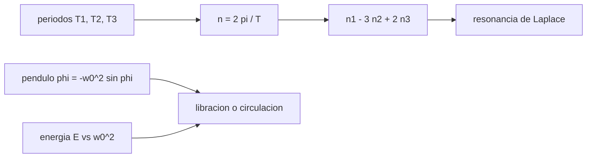

# B72-C11 — Resonancias orbitales — Perturbaciones y evolución de órbitas

<!-- nav:top -->
[🏠 Programa](../../../../README.md) · [📚 Bloque B72](../../../tronco-comun/B72-perturbaciones-y-evolucion-de-orbitas.md) · [← Anterior: B72-C10 — Perturbaciones lunares](../B72-C10-perturbaciones-lunares/CLASE.md) · [Siguiente: B72-C12 — Variaciones de elementos osculadores →](../B72-C12-variaciones-de-elementos-osculadores/CLASE.md)
<!-- /nav -->

## 1. Ubicación, nivel y alcance

Clase 11 del bloque B72. Nivel N3. Cuando dos movimientos periódicos tienen periodos en razón de números enteros pequeños, sus pequeñas perturbaciones se suman en fase y producen efectos grandes. Aquí compruebas la resonancia de Laplace de Ío, Europa y Ganímedes con periodos de la ficha de la NASA, calculas semiejes de órbitas resonantes con la rotación terrestre y estudias el péndulo que modela una resonancia. Sigue a [B72-C10](../B72-C10-perturbaciones-lunares/CLASE.md) y prepara la variación de elementos osculadores ([C12](../B72-C12-variaciones-de-elementos-osculadores/CLASE.md)). El péndulo es sintético.

## 2. Por qué esta clase existe

Una resonancia mantiene a los satélites de Júpiter en equilibrio dinámico y obliga a gestionar un satélite geoestacionario, que se desplaza hacia dos puntos de equilibrio por el campo no esférico. La decisión central: **¿cómo se reconoce una resonancia, qué órbitas la cumplen con la rotación terrestre y cuándo un sistema libra en vez de circular?**

## 3. Lo que podrás hacer al terminar

1. Calcular el movimiento medio a partir del periodo y los cocientes de periodos.
2. Comprobar la relación de Laplace `n₁ − 3n₂ + 2n₃ ≈ 0`.
3. Calcular el semieje de una órbita con `q` vueltas por día sideral.
4. Integrar el péndulo de resonancia y comparar su periodo de libración con la serie.
5. Clasificar condiciones iniciales como libración o circulación con la energía.
6. Distinguir lo consultado de lo ilustrativo y de lo no consultado.

La evidencia es la **ficha de resonancias** del ejercicio 12 (sección 20).

## 4. Con qué llegas y cómo comprobarlo

1. ¿Qué es el movimiento medio `n`?
2. ¿Qué es una resonancia de movimiento medio?
3. ¿Qué es un ángulo resonante?
4. ¿Qué es un péndulo?
5. ¿Qué es un valor no consultado?

<details>
<summary>Ver respuestas</summary>

1. La velocidad angular media `2π/T` de un cuerpo en su órbita. 2. La razón de dos movimientos medios es una fracción de enteros pequeños. 3. Una combinación de longitudes y ápsides que varía lentamente en la resonancia. 4. Un sistema con ecuación `φ̈ = −ω₀² sin φ`, que libra o gira. 5. Uno que se usa como ilustración sin haberlo leído en una fuente.
</details>

Con cuatro o cinco aciertos, sigue; si no, repasa los prerrequisitos.

## 5. Un caso de contexto y casos de referencia

Con los periodos de la ficha de los satélites de Júpiter, `n_Ío − 3 n_Europa + 2 n_Ganímedes = −2,9 × 10⁻⁵ °/día`, `1,4 × 10⁻⁷` de `n_Ío`: casi exacto. En la Tierra, una órbita con dos vueltas por día sideral tiene `a = 26 561,8 km`. Es el **ejemplo conductor**. El péndulo y sus condiciones iniciales son sintéticos.

## 6. Vocabulario

La **resonancia de movimiento medio** `p:q` cumple `p n₁ ≈ q n₂`. La **relación de Laplace** `n₁ − 3n₂ + 2n₃ = 0` liga tres satélites. El **ángulo resonante** `φ` libra alrededor de un valor en la resonancia. El **péndulo de resonancia** es el modelo `φ̈ = −ω₀² sin φ`. La **separatriz** separa la libración de la circulación; su energía es `E = ω₀²`.

## 7. Modelo mental: empujar un columpio en fase



*Descripción textual:* los periodos dan los movimientos medios; su combinación de Laplace prueba la resonancia; el péndulo y su energía clasifican la libración y la circulación.

Analogía: empujar un columpio en el momento justo suma pequeños empujones; si el ritmo coincide, la amplitud crece o se mantiene. Límite: el péndulo es un modelo de una sola resonancia aislada; las resonancias reales se solapan y su ángulo resonante exige elementos que no se calculan aquí.

## 8. La explicación, paso a paso

### 8.1 La resonancia de Laplace

Con los periodos de la ficha NSSDC de los satélites galileanos (en días): Ío `1,769138`, Europa `3,551181`, Ganímedes `7,154553`, Calisto `16,689017`:

| Satélite | `T` (d) | `n` (°/día) |
|---|---|---|
| Ío | 1,769138 | 203,488931 |
| Europa | 3,551181 | 101,374726 |
| Ganímedes | 7,154553 | 50,317609 |
| Calisto | 16,689017 | 21,571073 |

Cocientes: `T_Ío/T_Eur = 0,49818`, `T_Eur/T_Gan = 0,49635`, `T_Gan/T_Cal = 0,42870`. La relación de Laplace da `−2,9 × 10⁻⁵ °/día`. Calisto no participa: `n_Gan/n_Cal = 2,3326`.

### 8.2 Resonancias con la rotación terrestre

Con la rotación sideral `23,9345 h` (ficha de la Tierra) y `μ` de la IAU:

| `q` (vueltas/día sideral) | periodo (h) | `a` (km) | altitud (km) |
|---|---|---|---|
| 1 | 23,9345 | 42 164,2 | 35 786,1 |
| 2 | 11,9672 | 26 561,8 | 20 183,6 |
| 3 | 7,9782 | 20 270,4 | 13 892,3 |
| 15 | 1,5956 | 6932,4 | 554,3 |

La resonancia `1:1` es la órbita geoestacionaria; la `15:1` define la altitud en que la traza se repite cada día.

### 8.3 El péndulo de resonancia

`φ̈ = −ω₀² sin φ`. Período de libración `T/T₀` (con `T₀ = 2π/ω₀`):

| amplitud (°) | RK4 | serie `1 + θ²/16 + 11θ⁴/3072` | dif. relativa |
|---|---|---|---|
| 10 | 1,001907 | 1,001907 | 6,6e-09 |
| 30 | 1,017409 | 1,017404 | 4,9e-06 |
| 60 | 1,073182 | 1,072845 | 3,1e-04 |
| 90 | 1,180341 | 1,176012 | 3,7e-03 |

El periodo crece con la amplitud; la serie truncada pierde precisión hacia `90°`.

### 8.4 Separatriz

Con `E = φ̇²/2 − ω₀² cos φ`: si `E < ω₀²` libra; si `E > ω₀²` circula. Condiciones: `φ̇₀ = 1,99 ω₀` libra (`E = 0,9801`), `2,01 ω₀` circula (`E = 1,0200`). La semianchura máxima en velocidad es `2 ω₀`.

### 8.5 Lectura

Una resonancia no es una coincidencia numérica: exige un ángulo que libre. La razón de periodos casi entera es condición necesaria, no suficiente. Para mostrarlo en un sistema real hay que calcular el ángulo resonante con elementos medidos; el laboratorio solo prueba la combinación de movimientos medios.

## 9. Magnitudes, símbolos y unidades

| Símbolo | Qué es | Unidad | Valor / nota |
|---|---|---|---|
| `T` | periodo orbital | d | 1,769138 (Ío) |
| `n` | movimiento medio | °/día | 203,488931 (Ío) |
| `q` | vueltas por día sideral | — | 1; 2; 3; 15 |
| `ω₀` | frecuencia del péndulo | — | 1 (unidad adimensional) |
| `E` | energía del péndulo | — | umbral `ω₀² = 1` |
| `φ` | ángulo resonante | rad | libra o circula |

## 10. Convenciones y referencias

Movimientos medios con `n = 360°/T`; periodos de la ficha NSSDC de los satélites de Júpiter; órbitas circulares con `μ` de la IAU y rotación sideral de la ficha de la Tierra. Péndulo en unidades adimensionales (`ω₀ = 1`), RK4 de paso `10⁻³`. Tolerancias: Laplace `10⁻³` de `n_Ío`; libración `10⁻³` hasta `60°`.

## 11. De dónde sale lo que afirmamos

| ID | Fuente | Localizador | Respalda | Estado |
|---|---|---|---|---|
| S15 | NASA/NSSDC, Jovian Satellite Fact Sheet — https://nssdc.gsfc.nasa.gov/planetary/factsheet/joviansatfact.html (consultada 2026-11-10) | tabla completa | semieje (10³ km) y periodo (d): Ío 421,8 y 1,769138; Europa 671,1 y 3,551181; Ganímedes 1070,4 y 7,154553; Calisto 1882,7 y 16,689017 | Consultada |
| S1 | NASA/NSSDC, Earth Fact Sheet — https://nssdc.gsfc.nasa.gov/planetary/factsheet/earthfact.html (consultada 2026-11-10) | ficha completa leída | masa 5,9722 × 10²⁴ kg; radio medio 6371,000 km; radio ecuatorial 6378,137 km; J2 = 1082,63 × 10⁻⁶; GM = 0,39860 × 10⁶ km³/s²; rotación sideral 23,9345 h; semieje mayor 149,598 × 10⁶ km; oblicuidad 23,44° | Consultada |
| S13 | IAU 2015 Resolución B3 (Mamajek et al.) — https://arxiv.org/abs/1510.07674 y PDF https://arxiv.org/pdf/1510.07674 (consultadas 2026-11-10; PDF extraído con PyMuPDF) | tabla de constantes de conversión | (GM)N Tierra = 3,986 004 × 10¹⁴ m³ s⁻²; (GM)N Júpiter = 1,266 865 3 × 10¹⁷ m³ s⁻²; (GM)N Sol = 1,327 124 4 × 10²⁰ m³ s⁻²; R_e Tierra nominal 6,3781 × 10⁶ m | Consultada |
| — | Teoría del péndulo de resonancia y fórmula de la serie del periodo | — | las verifica el laboratorio con RK4 | No consultada en una fuente concreta |

Límites: no se consultó ningún ángulo resonante medido ni efemérides de los satélites; el hecho de que la relación de Laplace sea una resonancia dinámica (y no solo numérica) se cita como contexto, no se demuestra aquí.

## 12. Cómo ver la resonancia de Laplace

| Magnitud | Valor |
|---|---|
| `n_Ío − 3 n_Europa + 2 n_Ganímedes` | −2,9e-05 °/día |
| órbita 2:1, `a` | 26 561,8 km |
| órbita 1:1, `a` | 42 164,2 km |
| `T/T₀` a 60° | 1,073182 |

Descripción larga: Los tres satélites galileanos interiores cumplen la combinación de Laplace con una parte en diez millones; las órbitas resonantes con la rotación terrestre quedan a 42 164, 26 562 y 6932 km, y el periodo de libración del péndulo aumenta con la amplitud.

## 13. Ejemplo trabajado: la relación de Laplace

**Paso 1 · Movimientos medios.** `n_Ío = 360/1,769138 = 203,4889`; `n_Eur = 101,3747`; `n_Gan = 50,3176` °/día.

**Paso 2 · Combinación.** `203,4889 − 3 × 101,3747 + 2 × 50,3176 = 203,4889 − 304,1242 + 100,6352`.

**Paso 3 · Resultado.** `≈ −0,0001 °/día` con estas cifras redondeadas; con las exactas, `−2,9 × 10⁻⁵ °/día`.

## 14. Distintas formas de describir una resonancia

**Por cociente de periodos:** `T₁/T₂ ≈ q/p`. **Por combinación de movimientos medios:** `p n₁ − q n₂`. **Por ángulo resonante:** libración alrededor de un valor. **Por semieje:** `a` de la órbita resonante. **Por energía del péndulo:** `E` frente a `ω₀²`.

## 15. Práctica guiada

**Ejercicio 1 · con los pasos indicados.** Calcula `n` de Europa en °/día con `T = 3,551181 d`. *Pasos:* `360/3,551181`.

<details><summary>Solución comentada</summary>

`101,3747 °/día`.
</details>

**Ejercicio 2 · con una pista.** Calcula `T_Ío/T_Europa`. *Pista:* `1,769138/3,551181`.

<details><summary>Solución comentada</summary>

`0,49818`: casi `1/2`.
</details>

**Ejercicio 3 · casi autónomo.** ¿Por qué `n_Ío/n_Europa ≈ 2` y `n_Eur/n_Gan ≈ 2` implican `n₁ − 3n₂ + 2n₃ ≈ 0`?

<details><summary>Solución comentada</summary>

Con `n₁ = 2n₂` y `n₂ = 2n₃`: `4n₃ − 6n₃ + 2n₃ = 0`.
</details>

## 16. Práctica autónoma, transferencia e integrador

**Ejercicio 4 · autónomo.** Calcula el semieje para `q = 2` con `T = 11,9672 h`.

<details><summary>Solución comentada</summary>

`a = (μ T²/4π²)^{1/3} = 2,6562e7 m`.
</details>

**Ejercicio 5 · autónomo.** ¿A qué altitud pasa un satélite 15 veces al día sobre una misma longitud?

<details><summary>Solución comentada</summary>

`≈ 554 km` (sin corregir por J2).
</details>

**Ejercicio 6 · autónomo.** ¿Por qué una razón de periodos de `0,4982` no basta para afirmar una resonancia dinámica?

<details><summary>Solución comentada</summary>

Falta comprobar que el ángulo resonante libra.
</details>

**Ejercicio 7 · autónomo.** Si la energía del péndulo es `E = 1,5`, ¿libra o circula?

<details><summary>Solución comentada</summary>

Circula (`E > 1`).
</details>

**Ejercicio 8 · autónomo.** ¿Cómo cambia el periodo de libración al doblar la amplitud de `30°` a `60°`?

<details><summary>Solución comentada</summary>

Pasa de `1,0174` a `1,0732` veces `T₀`.
</details>

**Ejercicio 9 · transferencia.** **Transferencia.** Un operador dice que su satélite está en resonancia `2:1` con la Tierra a `a = 26 000 km`. ¿Qué compruebas?

<details><summary>Solución comentada</summary>

El periodo de `a = 26 000 km` es `11,6 h`, no `11,967 h`: no está en resonancia exacta.
</details>

**Ejercicio 10 · transferencia.** **Transferencia.** ¿Por qué Calisto no está en la cadena?

<details><summary>Solución comentada</summary>

Su `n` no cumple una razón simple con los otros (`2,3326`).
</details>

**Ejercicio 11 · transferencia.** **Transferencia.** ¿Prueba el laboratorio la dinámica de los satélites de Júpiter?

<details><summary>Solución comentada</summary>

No: solo la combinación de movimientos medios con periodos de la ficha.
</details>

**Ejercicio 12 · integrador.** **Integrador.** Elabora tu *ficha de resonancias*: movimientos medios, combinación de Laplace, semiejes resonantes con la Tierra, periodos de libración y la lista de lo consultado, lo ilustrativo y lo no consultado.

<details><summary>Solución comentada</summary>

Secciones 8.1–8.4 y la salida del laboratorio.
</details>

## 17. Laboratorio: resonancias en cifras

El script [resonancias.py](resonancias.py) calcula los movimientos medios de los satélites galileanos y la combinación de Laplace, los semiejes de órbitas resonantes con la rotación terrestre y el periodo de libración y la separatriz de un péndulo (**comprueba** `|n₁−3n₂+2n₃| < 10⁻³ n₁` y el periodo del péndulo dentro de `10⁻³` hasta `60°`).

**Datos:** Periodos de la ficha NSSDC, rotación sideral y `μ` consultados; amplitudes del péndulo y energías **sintéticas**. **Predice antes de ejecutar:** ¿la combinación de Laplace será cero exactamente? (no: ≈ 10⁻⁷ de `n_Ío` con estos datos.) **Ejecución del 2026-11-10 (Python 3.12.9):**

```text
Python 3.12.9 (biblioteca estandar)

Movimiento medio [grados/dia] con los periodos de la ficha NSSDC
  Io          1.769138 d    203.488931 deg/d
  Europa      3.551181 d    101.374726 deg/d
  Ganimedes   7.154553 d     50.317609 deg/d
  Calisto    16.689017 d     21.571073 deg/d
Cocientes de periodos: Io/Europa = 0.49818 ; Europa/Ganimedes = 0.49635 ; Ganimedes/Calisto = 0.42870
n_Io - 3 n_Europa + 2 n_Ganimedes = -0.000029 deg/d  (1.41e-07 de n_Io)
Calisto no participa: n_Ganimedes/n_Calisto = 2.3326

Orbitas con q vueltas por dia sideral (rotacion 23.9345 h, NSSDC), circulares, mu IAU
   q   periodo [h]      a [km]    h sobre 6378.137 km [km]
   1       23.9345     42164.2                     35786.1
   2       11.9672     26561.8                     20183.6
   3        7.9782     20270.4                     13892.3
  15        1.5956      6932.4                       554.3

Periodo de libracion T/T0 del pendulo de resonancia (T0 = 2 pi / w0) frente a la amplitud
 amplitud [deg]    RK4 T/T0   serie T/T0  dif. relativa
             10    1.001907     1.001907       6.62e-09
             30    1.017409     1.017404       4.85e-06
             60    1.073182     1.072845       3.14e-04
             90    1.180341     1.176012       3.67e-03

Separatriz: energia E = phi'^2/2 - w0^2 cos(phi); libra si E < w0^2, circula si E > w0^2
  phi0 =   0.0 deg, phi'0 = 1.50 w0 -> E = +0.1250 -> libra
  phi0 =   0.0 deg, phi'0 = 1.99 w0 -> E = +0.9801 -> libra
  phi0 =   0.0 deg, phi'0 = 2.01 w0 -> E = +1.0200 -> circula
  phi0 =  90.0 deg, phi'0 = 1.00 w0 -> E = +0.5000 -> libra
Semianchura maxima de la resonancia en velocidad: |phi'|max = 2 w0 = 2.0 w0
Pruebas superadas.
```

```bash
python programa/clases/B72/B72-C11-resonancias-orbitales-perturbaciones-y-evolucion-de-orbitas/resonancias.py
```

**Límites:** solo movimientos medios y un péndulo ideal; sin ángulo resonante, sin masas ni excentricidades.

## 18. Errores frecuentes y cómo corregirlos

**Creer que una razón casi entera prueba una resonancia.** Se corrige con 8.5.

**Usar el día solar en vez del sideral.** Se corrige con 8.2.

**Olvidar que el periodo de libración depende de la amplitud.** Se corrige con 8.3.

**Confundir la separatriz con el equilibrio estable.** Se corrige con 8.4.

## 19. Cómo sabrás que vas bien

Tras la sección 8: ¿qué esperabas para la combinación de Laplace y qué obtuviste? Si dudas, repasa el ejemplo 13. Tras el laboratorio: ¿qué comprueba el criterio de Laplace? (ver la sección 17).

## 20. Qué entregas y cómo se evalúa

El producto es tu **ficha de resonancias** (ejercicio 12).

| Criterio | Inicial | En desarrollo | Logrado | Destacado |
|---|---|---|---|---|
| Conceptos | Los confunde | Parciales | Calcula movimientos medios y reconoce la resonancia | Explica los límites |
| Cálculo | Sin unidades | Con errores | Tablas completas con unidades | Calcula casos nuevos |
| Numérico | Sin comprobar | Un caso | Contraste con una segunda vía | Interpreta las diferencias |
| Fuentes | Sin fuente | Sin fecha | Fuentes con fecha y estado | Declara lo ilustrativo y lo no consultado |
| Límites | No los nombra | Uno | Tres | Discute qué falta del modelo |

**Condiciones críticas (no se compensan con promedio):** rotular el péndulo como modelo sintético; no presentar la cercanía numérica como prueba de resonancia dinámica; citar solo lo consultado.

## 21. Ética, seguridad y límites

Clase educativa: los modelos son simplificados y sus datos son sintéticos o ilustrativos; ningún resultado sustituye a un producto de determinación de órbita, a un servicio oficial de elementos ni a una decisión de operación de vuelo. Accesibilidad: tablas equivalentes a las gráficas, fórmulas en texto, ejercicios sin conexión.

## 22. Para cerrar y seguir

La combinación de Laplace de Ío, Europa y Ganímedes es `1,4 × 10⁻⁷` de `n_Ío` con los periodos de la ficha, y una órbita `2:1` con la Tierra tiene `a = 26 561,8 km`. Queda una pregunta: ¿cómo cambian los elementos mientras actúan estas perturbaciones?

**Glosario español–inglés.** resonancia de movimiento medio · *mean-motion resonance*; relación de Laplace · *Laplace relation*; ángulo resonante · *resonant angle*; libración · *libration*; separatriz · *separatrix*.

**Continuidad.** [B72-C12](../B72-C12-variaciones-de-elementos-osculadores/CLASE.md) estudia las variaciones de elementos osculadores.

**Referencias:** ver sección 11.

<!-- nav:bottom -->
---

[← Anterior: B72-C10 — Perturbaciones lunares](../B72-C10-perturbaciones-lunares/CLASE.md) · [📚 Bloque B72](../../../tronco-comun/B72-perturbaciones-y-evolucion-de-orbitas.md) · [Siguiente: B72-C12 — Variaciones de elementos osculadores →](../B72-C12-variaciones-de-elementos-osculadores/CLASE.md)
<!-- /nav -->
