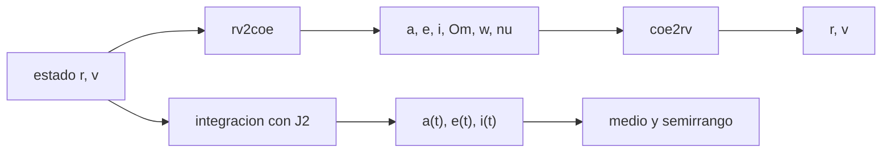

# B72-C12 — Variaciones de elementos osculadores

<!-- nav:top -->
[🏠 Programa](../../../../README.md) · [📚 Bloque B72](../../../tronco-comun/B72-perturbaciones-y-evolucion-de-orbitas.md) · [← Anterior: B72-C11 — Resonancias orbitales — Perturbaciones y evolución de órbitas](../B72-C11-resonancias-orbitales-perturbaciones-y-evolucion-de-orbitas/CLASE.md) · [Siguiente: B72-C13 — Órbitas heliosincrónicas →](../B72-C13-orbitas-heliosincronicas/CLASE.md)
<!-- /nav -->

## 1. Ubicación, nivel y alcance

Clase 12 del bloque B72. Nivel N3. Los elementos osculadores son los de la órbita kepleriana tangente a la real en cada instante; bajo una perturbación oscilan alrededor de un valor medio. Aquí conviertes estado y elementos en ambos sentidos, mides las oscilaciones de `a`, `e` e `i` en una integración con J2 y las comparas con la amplitud de primer orden. Sigue a [B72-C11](../B72-C11-resonancias-orbitales-perturbaciones-y-evolucion-de-orbitas/CLASE.md) y prepara las órbitas heliosíncronas ([C13](../B72-C13-orbitas-heliosincronicas/CLASE.md)). La órbita es sintética.

## 2. Por qué esta clase existe

Un catálogo publica elementos de un instante; usarlos como si fueran constantes introduce errores de kilómetros. La decisión central: **¿cuánto difiere un elemento osculador del medio y qué error de fase o de periodo produce usar el equivocado?**

## 3. Lo que podrás hacer al terminar

1. Convertir estado en elementos y elementos en estado.
2. Comprobar la conversión con un error de ida y vuelta de `10⁻¹⁵`.
3. Medir el mínimo, el máximo y el valor medio de `a`, `e` e `i` bajo J2.
4. Comparar el semirrango de `a` con la amplitud de primer orden `3/2 J2 R² sin² i/a`.
5. Estimar el error de periodo al usar el semieje osculador en vez del medio.
6. Distinguir lo consultado de lo ilustrativo y de lo no consultado.

La evidencia es la **ficha de osculador y medio** del ejercicio 12 (sección 20).

## 4. Con qué llegas y cómo comprobarlo

1. ¿Qué son los seis elementos keplerianos?
2. ¿Qué es un elemento osculador?
3. ¿Qué es un elemento medio?
4. ¿Qué es el vector de excentricidad?
5. ¿Qué es un valor no consultado?

<details>
<summary>Ver respuestas</summary>

1. `a, e, i, Ω, ω` y una anomalía: definen una órbita de dos cuerpos. 2. El del conjunto de elementos que corresponde al estado instantáneo. 3. El promedio de un osculador sobre las oscilaciones de corto periodo. 4. `e⃗ = [(v² − μ/r) r − (r·v) v]/μ`, que apunta al perigeo. 5. Uno que se usa como ilustración sin haberlo leído en una fuente.
</details>

Con cuatro o cinco aciertos, sigue; si no, repasa los prerrequisitos.

## 5. Un caso de contexto y casos de referencia

En una órbita sintética de `7000 km`, `e = 0,01`, `i = 40°` bajo J2, el semieje osculador oscila `3,969 km` alrededor de su media (`7001,936 km`) mientras la fórmula de primer orden da `3,899 km`. Usar el valor inicial en vez del medio cambia el periodo `2,42 s`. Es el **ejemplo conductor**. La órbita es sintética.

## 6. Vocabulario

El **elemento osculador** corresponde al estado `(r, v)` de un instante. El **elemento medio** es su promedio sobre las oscilaciones de corto periodo. Las **variaciones de corto periodo** tienen el periodo orbital (o su mitad). El **semirrango** es `(máx − mín)/2`. La **conversión ida y vuelta** es la prueba `estado → elementos → estado`.

## 7. Modelo mental: una pelota que rebota alrededor de su nivel medio



*Descripción textual:* el estado se convierte en elementos y vuelve a estado como prueba; la integración con J2 genera series de elementos osculadores de las que se obtienen el valor medio y el semirrango.

Analogía: una pelota que rebota alrededor de su nivel medio: el osculador es su altura instantánea, el medio su nivel promedio. Límite: la amplitud de Kozai es de primer orden y solo vale para el término en `cos 2u` de órbitas casi circulares; los términos de `e` y los de largo periodo no están.

## 8. La explicación, paso a paso

### 8.1 Conversión de ida y vuelta

`rv2coe` calcula `a = 1/(2/r − v²/μ)`, `e⃗`, `i = acos(h_z/h)`, `Ω`, `ω` y `ν`; `coe2rv` los reconstruye. En 1000 estados al azar (semilla 72, `a` de 6800 a 45 000 km, `e` de 0,0005 a 0,9, `i` de 1° a 179°), el error relativo máximo de ida y vuelta es `4,5 × 10⁻¹⁵`.

### 8.2 Oscilaciones de corto periodo

Órbita sintética `a₀ = 7000 km`, `e₀ = 0,01`, `i₀ = 40°`, periodo `5828,5 s`, 10 vueltas, RK4 de `10 s`:

| Elemento | inicial | medio | mínimo | máximo | semirrango |
|---|---|---|---|---|---|
| `a` (km) | 7000,000 | 7001,936 | 6997,999 | 7005,938 | 3,969 |
| `e` | 0,010000 | 0,009730 | 0,008986 | 0,010489 | 0,000752 |
| `i` (°) | 40,00000 | 40,00961 | 39,99040 | 40,02876 | 0,01918 |

### 8.3 Amplitud de primer orden

Para una órbita casi circular, el término dominante de `a` es `(3/2) J2 R² sin² i /a · cos 2u`, con `u = ω + ν`. Con los números de la tabla: `3,899 km`, frente a `3,969 km` observados (diferencia de `1,8 %`).

### 8.4 Error al confundir osculador y medio

El semieje inicial difiere del medio en `−1,936 km`, y el periodo calculado con `a` osculador inicial difiere del calculado con el medio en `−2,42 s` por vuelta, es decir `4 × 10⁻⁴` del periodo: tras 100 vueltas el error de fase sería de unos 4 minutos.

### 8.5 Lectura

Para propagar con un modelo medio hay que partir de elementos medios; para una efeméride exacta, de osculadores del mismo modelo. Mezclar ambos es una fuente clásica de error. El conjunto de elementos del catálogo de dos líneas contiene elementos medios del modelo SGP4 ([C21](../B72-C21-propagador-sgp4-y-teoria-general-de-perturbaciones/CLASE.md)), no osculadores.

## 9. Magnitudes, símbolos y unidades

| Símbolo | Qué es | Unidad | Valor / nota |
|---|---|---|---|
| `a` | semieje mayor | m (km) | 7000 (inicial) |
| `e⃗` | vector de excentricidad | — | apunta al perigeo |
| `u` | argumento de la latitud `ω + ν` | rad | — |
| `δa` | amplitud en `a` | km | 3,969 (observada) |
| `T` | periodo | s | 5828,5 |
| `J2` | achatamiento | — | 1082,63e-6 |

## 10. Convenciones y referencias

Marco inercial del ecuador de la fecha; órbita sintética; J2 solo; RK4 de `10 s`, elementos muestreados cada `60 s`. `μ`, `R` y `J2` de las fuentes de la sección 11. Tolerancias: ida y vuelta `10⁻⁹`; semirrango de `a` dentro de `10 %` de la amplitud de primer orden.

## 11. De dónde sale lo que afirmamos

| ID | Fuente | Localizador | Respalda | Estado |
|---|---|---|---|---|
| S1 | NASA/NSSDC, Earth Fact Sheet — https://nssdc.gsfc.nasa.gov/planetary/factsheet/earthfact.html (consultada 2026-11-10) | ficha completa leída | masa 5,9722 × 10²⁴ kg; radio medio 6371,000 km; radio ecuatorial 6378,137 km; J2 = 1082,63 × 10⁻⁶; GM = 0,39860 × 10⁶ km³/s²; rotación sideral 23,9345 h; semieje mayor 149,598 × 10⁶ km; oblicuidad 23,44° | Consultada |
| S13 | IAU 2015 Resolución B3 (Mamajek et al.) — https://arxiv.org/abs/1510.07674 y PDF https://arxiv.org/pdf/1510.07674 (consultadas 2026-11-10; PDF extraído con PyMuPDF) | tabla de constantes de conversión | (GM)N Tierra = 3,986 004 × 10¹⁴ m³ s⁻²; (GM)N Júpiter = 1,266 865 3 × 10¹⁷ m³ s⁻²; (GM)N Sol = 1,327 124 4 × 10²⁰ m³ s⁻²; R_e Tierra nominal 6,3781 × 10⁶ m | Consultada |
| S12 | Kelso, T. S. (1998), «Frequently Asked Questions: Two-Line Element Set Format», Satellite Times — https://celestrak.org/columns/v04n03/ (consultada 2026-11-10) | artículo completo | formato de dos líneas con campos y suma de comprobación; la línea 2 contiene elementos medios para SGP4/SDP4 | Consultada |
| — | Fórmulas de conversión estado-elementos y amplitud de corto periodo de primer orden | — | las verifica el laboratorio con una integración y un ida y vuelta | No consultada en una fuente concreta |

Límites: no se consultó la teoría de Kozai ni la de Brouwer en un texto; del artículo de Kelso sobre el formato de dos líneas solo se usó que los elementos de la línea 2 son medios para SGP4/SDP4.

## 12. Cómo ver el osculador y el medio

| Magnitud | Valor |
|---|---|
| error de ida y vuelta | 4,5e-15 |
| semirrango de `a` (observado) | 3,969 km |
| semirrango de `a` (primer orden) | 3,899 km |
| error de periodo por usar el osculador | 2,42 s por vuelta |

Descripción larga: El semieje osculador oscila casi cuatro kilómetros alrededor de su media; la fórmula de primer orden lo reproduce a menos del 2 % y usar el valor equivocado desplaza el periodo en unos segundos por vuelta.

## 13. Ejemplo trabajado: semirrango de la oscilación

**Paso 1 · Datos.** `J2 = 1,08263e-3`, `R = 6,378137e6 m`, `a = 7,0e6 m`, `i = 40°`: `sin² i = 0,4132`.

**Paso 2 · Amplitud.** `1,5 × 1,08263e-3 × 4,0680e13 × 0,4132/7,0e6 = 3,899e3 m`.

**Paso 3 · Lectura.** El semirrango observado, `3,969 km`, es un `1,8 %` mayor: el resto viene de los términos en `e`.

## 14. Distintas formas de describir un elemento orbital

**Osculador:** del estado instantáneo. **Medio:** promedio sobre el corto periodo. **Semirrango:** amplitud de la oscilación. **Por vector:** `e⃗` y `h⃗`. **Por serie temporal:** `a(t)`.

## 15. Práctica guiada

**Ejercicio 1 · con los pasos indicados.** Calcula `a` osculador de un estado con `r = 7000 km` y `v = 7,5 km/s`. *Pasos:* `v² = 56,25e6 m²/s²`; `2/r − v²/μ`.

<details><summary>Solución comentada</summary>

`2/7e6 − 5,625e7/3,986e14 = 2,857e-7 − 1,411e-7 = 1,446e-7`; `a = 6,915e6 m`.
</details>

**Ejercicio 2 · con una pista.** Calcula `sin² 40°`. *Pista:* `sin 40° = 0,6428`.

<details><summary>Solución comentada</summary>

`0,4132`.
</details>

**Ejercicio 3 · casi autónomo.** ¿Qué mide la prueba de ida y vuelta?

<details><summary>Solución comentada</summary>

Que las dos conversiones son inversas entre sí; no que sean correctas físicamente.
</details>

## 16. Práctica autónoma, transferencia e integrador

**Ejercicio 4 · autónomo.** Calcula el periodo con `a = 7,001936e6 m`.

<details><summary>Solución comentada</summary>

`T = 2π√(a³/μ) ≈ 5831 s`.
</details>

**Ejercicio 5 · autónomo.** ¿Cuánto cambia el periodo si `a` cambia 1,936 km?

<details><summary>Solución comentada</summary>

`dT/T = 1,5 da/a = 4,1e-4`; `≈ 2,4 s`.
</details>

**Ejercicio 6 · autónomo.** Si el semirrango de `e` es `7,5e-4`, ¿qué posición del perigeo cambia?

<details><summary>Solución comentada</summary>

`a δe = 7000 km × 7,5e-4 = 5,3 km` en distancia al perigeo.
</details>

**Ejercicio 7 · autónomo.** Explica por qué `i` oscila con amplitud tan pequeña.

<details><summary>Solución comentada</summary>

La perturbación fuera del plano es pequeña frente al momento angular: `δi ∼ J2 (R/a)² sin i cos i`, del orden de `10⁻²` grados.
</details>

**Ejercicio 8 · autónomo.** ¿Qué pasa con la amplitud en `a` si la órbita fuera ecuatorial?

<details><summary>Solución comentada</summary>

El término `sin² i` la anula; queda el término de `e`.
</details>

**Ejercicio 9 · transferencia.** **Transferencia.** Un equipo toma elementos medios de un catálogo y los integra como si fueran osculadores. ¿Qué error espera?

<details><summary>Solución comentada</summary>

Un desplazamiento de varios kilómetros en `a` y segundos en el periodo, con deriva de fase.
</details>

**Ejercicio 10 · transferencia.** **Transferencia.** Un equipo compara dos propagadores partiendo del mismo estado osculador pero con modelos de fuerza distintos. ¿Es una comparación justa?

<details><summary>Solución comentada</summary>

Sí en el estado inicial, pero las medias difieren y el error de fase crece; hay que declarar el modelo.
</details>

**Ejercicio 11 · transferencia.** **Transferencia.** ¿Es el laboratorio una medición de una órbita real?

<details><summary>Solución comentada</summary>

No: la órbita es sintética.
</details>

**Ejercicio 12 · integrador.** **Integrador.** Elabora tu *ficha de osculador y medio*: conversión, tabla de mínimo, máximo, medio y semirrango, amplitud de primer orden, error de periodo y la lista de lo consultado, lo ilustrativo y lo no consultado.

<details><summary>Solución comentada</summary>

Secciones 8.1–8.4 y la salida del laboratorio.
</details>

## 17. Laboratorio: osculadores y medios

El script [elementos_osculadores.py](elementos_osculadores.py) convierte estado y elementos en ambos sentidos con 1000 casos y mide las oscilaciones de `a`, `e` e `i` bajo J2 en 10 vueltas (**comprueba** el ida y vuelta menor que `1e-9` y el semirrango de `a` dentro de `10 %` de la fórmula de primer orden).

**Datos:** `μ`, `R` y `J2` consultados; la órbita y los estados al azar **sintéticos**. **Predice antes de ejecutar:** ¿cuántas veces por vuelta oscila `a`? (dos, por el término en `cos 2u`.) **Ejecución del 2026-11-10 (Python 3.12.9):**

```text
Python 3.12.9 (biblioteca estandar)
Orbitas SINTETICAS; J2 = 1082.63e-6 (NSSDC), mu = 3.986004e14 (IAU 2015)

Ida y vuelta estado->elementos->estado (1000 casos, semilla 72): error relativo maximo = 4.47e-15

Orbita: a0 = 7000.0 km, e0 = 0.01, i0 = 40 deg ; periodo = 5828.5 s ; 10 vueltas ; RK4 paso 10 s
elemento         inicial         medio        minimo        maximo    semirrango
a [km]          7000.000      7001.936      6997.999      7005.938         3.969
e               0.010000      0.009730      0.008986      0.010489      0.000752
i [deg]         40.00000      40.00961      39.99040      40.02876       0.01918

Amplitud de primer orden del termino en cos(2u) de a (Kozai): 3/2 J2 Re^2 sin^2(i)/a = 3.899 km
  semirrango observado de a = 3.969 km
Diferencia a_inicial - a_medio = -1.936 km -> el periodo calculado con a_osculador inicial difiere del medio en -2.42 s
Pruebas superadas.
```

```bash
python programa/clases/B72/B72-C12-variaciones-de-elementos-osculadores/elementos_osculadores.py
```

**Límites:** solo J2, RK4 de paso fijo; la amplitud de primer orden vale solo para órbitas casi circulares.

## 18. Errores frecuentes y cómo corregirlos

**Usar el valor osculador como si fuera constante.** Se corrige con 8.4.

**Mezclar elementos medios y osculadores.** Se corrige con 8.5.

**Creer que la prueba de ida y vuelta valida la física.** Se corrige con el ejercicio 3.

**Ignorar el semirrango al comparar propagadores.** Se corrige con 8.2.

## 19. Cómo sabrás que vas bien

Tras la sección 8: ¿qué semirrango esperabas para `a` y cuál obtuviste? Si dudas, repasa el ejemplo 13. Tras el laboratorio: ¿qué comprueba el ida y vuelta? (ver la sección 17).

## 20. Qué entregas y cómo se evalúa

El producto es tu **ficha de osculador y medio** (ejercicio 12).

| Criterio | Inicial | En desarrollo | Logrado | Destacado |
|---|---|---|---|---|
| Conceptos | Los confunde | Parciales | Distingue osculador y medio y convierte | Explica los límites |
| Cálculo | Sin unidades | Con errores | Tablas completas con unidades | Calcula casos nuevos |
| Numérico | Sin comprobar | Un caso | Contraste con una segunda vía | Interpreta las diferencias |
| Fuentes | Sin fuente | Sin fecha | Fuentes con fecha y estado | Declara lo ilustrativo y lo no consultado |
| Límites | No los nombra | Uno | Tres | Discute qué falta del modelo |

**Condiciones críticas (no se compensan con promedio):** rotular la órbita como sintética; no mezclar elementos medios y osculadores; citar solo lo consultado.

## 21. Ética, seguridad y límites

Clase educativa: los modelos son simplificados y sus datos son sintéticos o ilustrativos; ningún resultado sustituye a un producto de determinación de órbita, a un servicio oficial de elementos ni a una decisión de operación de vuelo. Accesibilidad: tablas equivalentes a las gráficas, fórmulas en texto, ejercicios sin conexión.

## 22. Para cerrar y seguir

El semieje osculador de una órbita sintética bajo J2 oscila `3,969 km` y usar el valor inicial en lugar del medio desplaza el periodo `2,42 s` por vuelta. Queda una pregunta: ¿qué órbita se diseña usando esa precesión del nodo?

**Glosario español–inglés.** elemento osculador · *osculating element*; elemento medio · *mean element*; variación de corto periodo · *short-period variation*; vector de excentricidad · *eccentricity vector*; ida y vuelta · *round trip*.

**Continuidad.** [B72-C13](../B72-C13-orbitas-heliosincronicas/CLASE.md) estudia las órbitas heliosíncronas.

**Referencias:** ver sección 11.

<!-- nav:bottom -->
---

[← Anterior: B72-C11 — Resonancias orbitales — Perturbaciones y evolución de órbitas](../B72-C11-resonancias-orbitales-perturbaciones-y-evolucion-de-orbitas/CLASE.md) · [📚 Bloque B72](../../../tronco-comun/B72-perturbaciones-y-evolucion-de-orbitas.md) · [Siguiente: B72-C13 — Órbitas heliosincrónicas →](../B72-C13-orbitas-heliosincronicas/CLASE.md)
<!-- /nav -->
