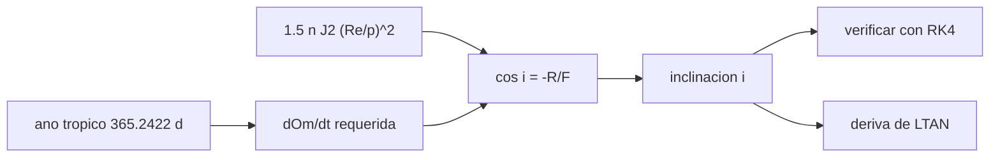

# B72-C13 — Órbitas heliosincrónicas

<!-- nav:top -->
[🏠 Programa](../../../../README.md) · [📚 Bloque B72](../../../tronco-comun/B72-perturbaciones-y-evolucion-de-orbitas.md) · [← Anterior: B72-C12 — Variaciones de elementos osculadores](../B72-C12-variaciones-de-elementos-osculadores/CLASE.md) · [Siguiente: B72-C14 — Órbitas congeladas →](../B72-C14-orbitas-congeladas/CLASE.md)
<!-- /nav -->

## 1. Ubicación, nivel y alcance

Clase 13 del bloque B72. Nivel N3. Una órbita heliosíncrona es aquella cuyo nodo avanza `360°` al año, lo mismo que la Tierra gira alrededor del Sol, de modo que el satélite cruza el ecuador siempre a la misma hora solar local. Aquí despejas la inclinación que lo logra, la verificas con una integración, calculas la altitud máxima posible y la deriva de la hora local por un error de inclinación. Sigue a [B72-C12](../B72-C12-variaciones-de-elementos-osculadores/CLASE.md) y aplica la tasa de [C04](../B72-C04-precesion-del-nodo-orbital/CLASE.md). Las órbitas son sintéticas.

## 2. Por qué esta clase existe

La misma hora local de paso significa la misma iluminación en cada imagen: es lo que usan las misiones de observación de la Tierra. La decisión central: **¿qué inclinación corresponde a cada altitud y cuánta deriva de hora local produce un error de inclinación?**

## 3. Lo que podrás hacer al terminar

1. Calcular la tasa de nodo requerida `360°/año tropical`.
2. Despejar `cos i = −Ω̇_req /(1,5 n J2 (R/p)²)` para cada altitud.
3. Hallar la altitud máxima de una órbita heliosíncrona circular.
4. Verificar la inclinación con una integración RK4 con J2.
5. Calcular la deriva de la hora solar local por un error de inclinación.
6. Distinguir lo consultado de lo ilustrativo y de lo no consultado.

La evidencia es la **tabla de órbitas heliosíncronas** del ejercicio 12 (sección 20).

## 4. Con qué llegas y cómo comprobarlo

1. ¿Qué es la hora solar local del nodo ascendente (LTAN)?
2. ¿Qué es un año tropical?
3. ¿Cuál es la fórmula de la tasa de nodo?
4. ¿Por qué una heliosíncrona es retrógrada?
5. ¿Qué es un valor no consultado?

<details>
<summary>Ver respuestas</summary>

1. La hora solar local a la que el satélite cruza el ecuador hacia el norte. 2. El tiempo entre dos pasos del Sol por el equinoccio: `365,2422 días`. 3. `dΩ/dt = −1,5 n J2 (R/p)² cos i`. 4. Porque el nodo debe avanzar y eso exige `cos i < 0`. 5. Uno que se usa como ilustración sin haberlo leído en una fuente.
</details>

Con cuatro o cinco aciertos, sigue; si no, repasa los prerrequisitos.

## 5. Un caso de contexto y casos de referencia

A `700 km` de altitud, la inclinación heliosíncrona es `98,188°` y el periodo `98,77 min`; la integración con J2 da `0,98998 °/día` contra los `0,98565 °/día` requeridos (`0,44 %`). La altitud máxima circular es `5974 km`. Es el **ejemplo conductor**. Las órbitas son sintéticas y el año tropical no se consultó.

## 6. Vocabulario

La **órbita heliosíncrona** cumple `dΩ/dt = 2π/año tropical`. La **LTAN** es la hora local del nodo ascendente. La **inclinación heliosíncrona** satisface `cos i < 0`. La **altitud máxima** es aquella en que `cos i = −1`. La **deriva de LTAN** es el cambio de la hora local por un error en `i` o `a`.

## 7. Modelo mental: un reloj de sol que gira con la Tierra



*Descripción textual:* el año tropical fija la tasa de nodo requerida; con el factor de J2 se despeja la inclinación, que se verifica con RK4 y se usa para estimar la deriva de la hora local.

Analogía: el plano orbital es la aguja de un reloj de sol que gira un día completo cada año al compás de la Tierra: así la sombra cae siempre igual. Límite: la fórmula es de primer orden, y las inclinaciones reales se ajustan además con el arrastre y la excentricidad; el año tropical se tomó como valor de laboratorio.

## 8. La explicación, paso a paso

### 8.1 La condición

El nodo debe avanzar `2π` rad por año tropical: `Ω̇_req = 2π/(365,2422 d) = 0,98565 °/día` (el año tropical no se consultó; con el periodo orbital sideral de la ficha de la Tierra, `365,256 d`, se obtiene `0,98561 °/día`, una diferencia relativa de `3,8 × 10⁻⁵`).

### 8.2 La inclinación

`dΩ/dt = −1,5 n J2 (R/p)² cos i`, así que `cos i = −Ω̇_req /(1,5 n J2 (R/p)²)`. Con `μ`, `R` y `J2` de las fuentes de la sección 11:

| `h` (km) | `a` (km) | `i` (°) | periodo (min) |
|---|---|---|---|
| 100 | 6478,1 | 95,996 | 86,48 |
| 400 | 6778,1 | 97,030 | 92,56 |
| 600 | 6978,1 | 97,788 | 96,69 |
| 700 | 7078,1 | 98,188 | 98,77 |
| 800 | 7178,1 | 98,603 | 100,87 |
| 1000 | 7378,1 | 99,479 | 105,12 |
| 1500 | 7878,1 | 101,957 | 115,98 |

La página de órbitas de la NASA ilustra este caso con `100 km` y una inclinación de `96°`, coherente con `95,996°`; esa altitud no es operativa y la página la presenta como ejemplo.

### 8.3 Altitud máxima

Como la tasa cae como `a^{−7/2}`, existe un `a_max` donde `cos i = −1`: `12 353 km` de radio, `5974 km` de altitud (circular). Por encima no hay heliosíncronas.

### 8.4 Verificación

RK4 con J2 (paso `10 s`, 6 días, `h = 700 km`, `i = 98,188°`): la pendiente del nodo es `0,98998 °/día`, la requerida `0,98565 °/día`, diferencia `0,44 %` (efecto de los osculadores y del paso).

### 8.5 Deriva de la hora local

`d(Ω̇)/di = 1,5 n J2 (R/p)² sin i`. Con `h = 700 km`:

| error `Δi` (°) | `Δ(Ω̇)` (°/día) | deriva de LTAN (min/año) |
|---|---|---|
| 0,01 | 0,001196 | 1,75 |
| 0,05 | 0,005978 | 8,73 |
| 0,10 | 0,011956 | 17,47 |

(`1°` de longitud del nodo equivale a `4 min` de hora solar local.)

### 8.6 Lectura

Un error de décimas de grado en la inclinación se traduce en minutos de deriva por año; por eso las misiones corrigen la inclinación periódicamente. La NASA señala que sus satélites de órbita baja ajustan su inclinación cada uno o dos años; es información cualitativa de la página consultada.

## 9. Magnitudes, símbolos y unidades

| Símbolo | Qué es | Unidad | Valor / nota |
|---|---|---|---|
| `Ω̇_req` | tasa de nodo requerida | °/día | 0,98565 |
| `i` | inclinación heliosíncrona | ° | 98,188 (700 km) |
| `h_max` | altitud máxima | km | 5974 |
| `P` | periodo orbital | min | 98,77 (700 km) |
| LTAN | hora local del nodo ascendente | h | — |
| `Δ(Ω̇)` | error de tasa por `Δi` | °/día | 0,011956 (0,1°) |

## 10. Convenciones y referencias

Marco inercial del ecuador de la fecha; órbitas circulares sintéticas; el año tropical `365,2422 d` es un valor de laboratorio no consultado; `μ`, `R` y `J2` de las fuentes de la sección 11. RK4 de `10 s`; tolerancia de comprobación `1 %`.

## 11. De dónde sale lo que afirmamos

| ID | Fuente | Localizador | Respalda | Estado |
|---|---|---|---|---|
| S1 | NASA/NSSDC, Earth Fact Sheet — https://nssdc.gsfc.nasa.gov/planetary/factsheet/earthfact.html (consultada 2026-11-10) | ficha completa leída | masa 5,9722 × 10²⁴ kg; radio medio 6371,000 km; radio ecuatorial 6378,137 km; J2 = 1082,63 × 10⁻⁶; GM = 0,39860 × 10⁶ km³/s²; rotación sideral 23,9345 h; semieje mayor 149,598 × 10⁶ km; oblicuidad 23,44° | Consultada |
| S13 | IAU 2015 Resolución B3 (Mamajek et al.) — https://arxiv.org/abs/1510.07674 y PDF https://arxiv.org/pdf/1510.07674 (consultadas 2026-11-10; PDF extraído con PyMuPDF) | tabla de constantes de conversión | (GM)N Tierra = 3,986 004 × 10¹⁴ m³ s⁻²; (GM)N Júpiter = 1,266 865 3 × 10¹⁷ m³ s⁻²; (GM)N Sol = 1,327 124 4 × 10²⁰ m³ s⁻²; R_e Tierra nominal 6,3781 × 10⁶ m | Consultada |
| S10 | NASA Earth Observatory, Catalog of Earth Satellite Orbits — https://science.nasa.gov/earth/earth-observatory/catalog-of-earth-satellite-orbits (consultada 2026-11-10) | página completa | órbitas heliosíncronas cruzan el ecuador a la misma hora solar local; la resistencia atmosférica es mayor con el Sol activo (reimpulsos ~4 veces al año con el Sol tranquilo y cada 2–3 semanas en el máximo) | Consultada |
| — | Año tropical de 365,2422 días y fórmula de la inclinación heliosíncrona | — | la fórmula se verifica con RK4; el año tropical se declara de laboratorio | No consultada en una fuente concreta |

Límites: la página de la NASA no da la relación entre nodo y altitud; solo ilustra el concepto con `100 km` y `96°`. No se consultó ninguna misión heliosíncrona concreta.

## 12. Cómo ver la inclinación heliosíncrona

| Magnitud | Valor |
|---|---|
| `i` a 700 km | 98,188° |
| periodo a 700 km | 98,77 min |
| altitud máxima | 5974 km |
| deriva LTAN con `Δi = 0,1°` | 17,47 min/año |

Descripción larga: La inclinación crece de 96° a 100 km a 102° a 1500 km; un error de una décima de grado desplaza la hora local unos 17 minutos por año; por encima de 5974 km no existe solución circular.

## 13. Ejemplo trabajado: la inclinación a 700 km

**Paso 1 · Factor.** `n = 1,0605e-3 rad/s`, `(R/a)² = 0,8118`, `1,5 n J2 (R/a)² = 1,3979e-6 rad/s = 6,9202 °/día`.

**Paso 2 · Coseno.** `cos i = −0,98565/6,9202 = −0,14243`.

**Paso 3 · Inclinación.** `i = acos(−0,14243) = 98,19°`, como el laboratorio (`98,188°`).

## 14. Distintas formas de describir una órbita heliosíncrona

**Por tasa:** `0,98565 °/día`. **Por inclinación:** `i(h)`. **Por periodo y LTAN.** **Por altitud máxima.** **Por deriva:** minutos por año por cada décima de grado.

## 15. Práctica guiada

**Ejercicio 1 · con los pasos indicados.** Calcula `360/365,2422`. *Pasos:* divide.

<details><summary>Solución comentada</summary>

`0,98565 °/día`.
</details>

**Ejercicio 2 · con una pista.** Calcula `acos(−0,14243)`. *Pista:* `acos(0,14243) = 81,81°`.

<details><summary>Solución comentada</summary>

`180° − 81,81° = 98,19°`.
</details>

**Ejercicio 3 · casi autónomo.** ¿Por qué una heliosíncrona es retrógrada?

<details><summary>Solución comentada</summary>

Porque `dΩ/dt > 0` exige `cos i < 0`.
</details>

## 16. Práctica autónoma, transferencia e integrador

**Ejercicio 4 · autónomo.** ¿Cómo cambia `i` si sube la altitud?

<details><summary>Solución comentada</summary>

Crece: la tasa de J2 cae y se necesita más `|cos i|`.
</details>

**Ejercicio 5 · autónomo.** ¿Cuánto es la diferencia entre usar 365,2422 y 365,256 días?

<details><summary>Solución comentada</summary>

`3,8 × 10⁻⁵` relativa: `≈ 0,05 min/año` de LTAN.
</details>

**Ejercicio 6 · autónomo.** ¿A cuántos minutos de LTAN equivalen `5°` de longitud del nodo?

<details><summary>Solución comentada</summary>

`20 min`.
</details>

**Ejercicio 7 · autónomo.** ¿Qué altitud no puede superar una heliosíncrona circular?

<details><summary>Solución comentada</summary>

`5974 km`.
</details>

**Ejercicio 8 · autónomo.** Si un satélite está a `98,0°` en vez de `98,188°`, ¿en qué sentido deriva el LTAN?

<details><summary>Solución comentada</summary>

`Δi = −0,188°`: la tasa de nodo se desvía unos `0,022 °/día`; el LTAN deriva `≈ 33 min/año`.
</details>

**Ejercicio 9 · transferencia.** **Transferencia.** Una misión quiere LTAN 10:30 estable ±15 min en 5 años. ¿Qué precisión de inclinación necesita?

<details><summary>Solución comentada</summary>

`15 min en 5 años = 3 min/año`, es decir `Δi ≈ 0,017°`.
</details>

**Ejercicio 10 · transferencia.** **Transferencia.** ¿Puede una misión de `h = 20 000 km` ser heliosíncrona?

<details><summary>Solución comentada</summary>

No: supera `5974 km`.
</details>

**Ejercicio 11 · transferencia.** **Transferencia.** ¿Prueba el laboratorio la inclinación de una misión concreta?

<details><summary>Solución comentada</summary>

No: las órbitas son sintéticas y el año tropical es un valor de laboratorio.
</details>

**Ejercicio 12 · integrador.** **Integrador.** Elabora tu *tabla de órbitas heliosíncronas*: `i` y periodo por altitud, altitud máxima, verificación con RK4, deriva de LTAN y la lista de lo consultado, lo ilustrativo y lo no consultado.

<details><summary>Solución comentada</summary>

Secciones 8.2–8.5 y la salida del laboratorio.
</details>

## 17. Laboratorio: inclinación heliosíncrona

El script [heliosincronicas.py](heliosincronicas.py) calcula la inclinación y el periodo por altitud, la altitud máxima, verifica con RK4 la tasa de nodo a `700 km` y estima la deriva de LTAN (**comprueba** que la tasa numérica coincide con la requerida dentro de `1 %`).

**Datos:** `μ`, `R`, `J2` y la ficha de la Tierra consultados; el año tropical de `365,2422 d` es un **valor de laboratorio no consultado**; las órbitas son **sintéticas**. **Predice antes de ejecutar:** ¿qué inclinación esperas a 700 km? (≈ 98°.) **Ejecución del 2026-11-10 (Python 3.12.9):**

```text
Python 3.12.9 (biblioteca estandar)
Orbitas SINTETICAS; J2 = 1082.63e-6 (NSSDC), mu = 3.986004e14 (IAU 2015), Re = 6378137 m
Nodo requerido: 360 deg / ano tropico (365.2422 d, NO consultado) = 0.98565 deg/dia
  con el periodo sideral de la ficha (365.256 d): 0.98561 deg/dia (diferencia 3.78e-05)

Inclinacion heliosincrona (e = 0)
  h [km]    a [km]   i [deg]  periodo [min]
     100    6478.1    95.996          86.48
     400    6778.1    97.030          92.56
     600    6978.1    97.788          96.69
     700    7078.1    98.188          98.77
     800    7178.1    98.603         100.87
    1000    7378.1    99.479         105.12
    1500    7878.1   101.957         115.98

El radio orbital maximo con |cos i| <= 1 es a = 12353 km (altitud 5974 km, e = 0): por encima no existe heliosincrona

Verificacion RK4 (6 dias, h = 700 km, i = 98.188 deg): pendiente del nodo = 0.98998 deg/dia ; requerida = 0.98565 deg/dia ; dif. = 0.44%

Deriva de la hora solar local del nodo con un error de inclinacion, h = 700 km
 error di [deg]   d(dOm/dt) [deg/dia]   deriva LTAN [min/ano]
           0.01              0.001196                    1.75
           0.05              0.005978                    8.73
           0.10              0.011956                   17.47
(1 grado de longitud del nodo equivale a 4 minutos de hora solar local)
Pruebas superadas.
```

```bash
python programa/clases/B72/B72-C13-orbitas-heliosincronicas/heliosincronicas.py
```

**Límites:** solo J2 de primer orden y órbita circular; sin arrastre, J3 ni lunisolares; el año tropical no se consultó.

## 18. Errores frecuentes y cómo corregirlos

**Usar el año sideral en lugar del tropical.** Se corrige con 8.1: la diferencia es pequeña pero real.

**Creer que cualquier altitud admite heliosíncrona.** Se corrige con 8.3.

**Olvidar que `i > 90°`.** Se corrige con 8.2.

**Ignorar la deriva por error de inclinación.** Se corrige con 8.5.

## 19. Cómo sabrás que vas bien

Tras la sección 8: ¿qué inclinación esperabas a 700 km y cuál obtuviste? Si dudas, repasa el ejemplo 13. Tras el laboratorio: ¿qué comprueba la pendiente numérica? (ver la sección 17).

## 20. Qué entregas y cómo se evalúa

El producto es tu **tabla de órbitas heliosíncronas** (ejercicio 12).

| Criterio | Inicial | En desarrollo | Logrado | Destacado |
|---|---|---|---|---|
| Conceptos | Los confunde | Parciales | Calcula la inclinación y la altitud máxima | Explica los límites |
| Cálculo | Sin unidades | Con errores | Tablas completas con unidades | Calcula casos nuevos |
| Numérico | Sin comprobar | Un caso | Contraste con una segunda vía | Interpreta las diferencias |
| Fuentes | Sin fuente | Sin fecha | Fuentes con fecha y estado | Declara lo ilustrativo y lo no consultado |
| Límites | No los nombra | Uno | Tres | Discute qué falta del modelo |

**Condiciones críticas (no se compensan con promedio):** rotular el año tropical como valor de laboratorio no consultado y las órbitas como sintéticas; no presentar la tabla como diseño de una misión; citar solo lo consultado.

## 21. Ética, seguridad y límites

Clase educativa: los modelos son simplificados y sus datos son sintéticos o ilustrativos; ningún resultado sustituye a un producto de determinación de órbita, a un servicio oficial de elementos ni a una decisión de operación de vuelo. Accesibilidad: tablas equivalentes a las gráficas, fórmulas en texto, ejercicios sin conexión.

## 22. Para cerrar y seguir

A `700 km` la inclinación heliosíncrona es `98,188°` y un error de `0,1°` desplaza la hora local `17,5 minutos` al año, según un modelo con J2 y un año tropical de laboratorio. Queda una pregunta: ¿puede una órbita mantener fijo su perigeo?

**Glosario español–inglés.** órbita heliosíncrona · *sun-synchronous orbit*; hora solar local · *local solar time*; año tropical · *tropical year*; inclinación retrógrada · *retrograde inclination*; deriva · *drift*.

**Continuidad.** [B72-C14](../B72-C14-orbitas-congeladas/CLASE.md) estudia las órbitas congeladas.

**Referencias:** ver sección 11.

<!-- nav:bottom -->
---

[← Anterior: B72-C12 — Variaciones de elementos osculadores](../B72-C12-variaciones-de-elementos-osculadores/CLASE.md) · [📚 Bloque B72](../../../tronco-comun/B72-perturbaciones-y-evolucion-de-orbitas.md) · [Siguiente: B72-C14 — Órbitas congeladas →](../B72-C14-orbitas-congeladas/CLASE.md)
<!-- /nav -->
