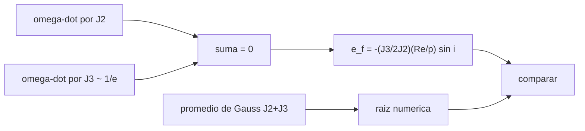

# B72-C14 — Órbitas congeladas

<!-- nav:top -->
[🏠 Programa](../../../../README.md) · [📚 Bloque B72](../../../tronco-comun/B72-perturbaciones-y-evolucion-de-orbitas.md) · [← Anterior: B72-C13 — Órbitas heliosincrónicas](../B72-C13-orbitas-heliosincronicas/CLASE.md) · [Siguiente: B72-C15 — Aproximaciones perturbativas →](../B72-C15-aproximaciones-perturbativas/CLASE.md)
<!-- /nav -->

## 1. Ubicación, nivel y alcance

Clase 14 del bloque B72. Nivel N3. Una órbita congelada es aquella cuya excentricidad y cuyo argumento del perigeo casi no varían en promedio, de modo que el satélite pasa por cada latitud siempre a la misma altitud. La condición sale de equilibrar el efecto de J2 sobre `ω` con el de J3. Aquí obtienes la excentricidad congelada, la contrastas con la raíz numérica de las ecuaciones de Gauss promediadas y ves cómo cambia el signo de `dω/dt` con `e`. Sigue a [B72-C13](../B72-C13-orbitas-heliosincronicas/CLASE.md) y usa el potencial de [C02](../B72-C02-potencial-gravitatorio-no-esferico/CLASE.md). Las órbitas son sintéticas.

## 2. Por qué esta clase existe

Un altímetro o un radar que observa la misma traza necesita pasar por cada latitud a la misma altitud; si el perigeo girara, la altitud sobre un punto cambiaría decenas de kilómetros. La decisión central: **¿qué excentricidad y argumento del perigeo congelan la órbita para una inclinación y altitud dadas?**

## 3. Lo que podrás hacer al terminar

1. Escribir la condición `dω/dt = 0` con J2 y J3.
2. Obtener `e_f = −(J3/(2J2)) (R/p) sin i` para `ω = 90°`.
3. Calcular el promedio de Gauss de `de/dt` y `dω/dt` con las aceleraciones zonales completas.
4. Encontrar `e_f` como raíz numérica y compararla con la fórmula.
5. Reconocer el cambio de signo de `dω/dt` con `e`.
6. Distinguir lo consultado de lo ilustrativo y de lo no consultado.

La evidencia es la **ficha de órbita congelada** del ejercicio 12 (sección 20).

## 4. Con qué llegas y cómo comprobarlo

1. ¿Qué es el armónico J3?
2. ¿Qué es una raíz numérica?
3. ¿Qué es la excentricidad?
4. ¿Cuál es la tasa de `ω` por J2?
5. ¿Qué es un valor no consultado?

<details>
<summary>Ver respuestas</summary>

1. El coeficiente zonal de tercer grado, asimétrico entre hemisferios (“forma de pera”). 2. Un valor que anula una función, hallado por bisección. 3. El parámetro que mide cuánto se aparta la elipse del círculo. 4. `(3/4) n J2 (R/p)² (5 cos² i − 1)`. 5. Uno que se usa como ilustración sin haberlo leído en una fuente.
</details>

Con cuatro o cinco aciertos, sigue; si no, repasa los prerrequisitos.

## 5. Un caso de contexto y casos de referencia

A `700 km` y `98,188°` (heliosíncrona), la excentricidad congelada con `ω = 90°` vale `0,001046`, y la raíz numérica de las ecuaciones de Gauss con J2 y J3 coincide (`0,00 %` en cuatro cifras). Con solo J2, `dω/dt = −3,1094 °/día`; con J3 y `e = 0,001` baja a `0,1424 °/día`. Es el **ejemplo conductor**. Las órbitas son sintéticas.

## 6. Vocabulario

La **órbita congelada** tiene `ė ≈ 0` y `ω̇ ≈ 0` en promedio. La **excentricidad congelada** `e_f` cumple `ω̇_J2 + ω̇_J3 = 0`. El **efecto de J3** crece como `1/e` en `ω̇` y es proporcional a `cos ω` en `ė`. El **promedio de Gauss** es la media sobre la anomalía media de las ecuaciones de variación con las aceleraciones J2 y J3.

## 7. Modelo mental: dos fuerzas que se equilibran en la cima de un péndulo



*Descripción textual:* los efectos de J2 y J3 sobre `ω̇` se cancelan en `e_f`; el promedio de Gauss da una raíz numérica con la que se compara.

Analogía: como un péndulo invertido equilibrado en la cima por dos fuerzas opuestas, el perigeo se queda quieto cuando el empuje de J3 compensa el giro de J2. Límite: es una teoría promedio de primer orden con solo J2 y J3; J4 y el segundo orden desplazan `e_f` y el arrastre y la presión de radiación la perturban.

## 8. La explicación, paso a paso

### 8.1 La condición

Con `ω = 90°`, `de/dt = 0` (el efecto de J3 sobre `e` es proporcional a `cos ω`). Para `ω̇ = 0`, el término de J3 (`∝ 1/e`) debe compensar el de J2:

`e_f = −(J3/(2 J2)) (R/p) sin i`.

Con `J2 = 1082,63 × 10⁻⁶` (ficha NSSDC) y `J3 = −2,53881 × 10⁻⁶` (*Spacetrack Report No. 3*), `J3/(2 J2) = −1,172520 × 10⁻³`.

### 8.2 Fórmula frente a raíz numérica

La raíz de `ω̇ = 0` se halla por bisección sobre el promedio de Gauss de las aceleraciones zonales J2 y J3:

| `h` (km) | `i` (°) | `e` fórmula | `e` numérica | dif. relativa |
|---|---|---|---|---|
| 700 | 98,188 | 0,001046 | 0,001046 | 0,00 % |
| 800 | 98,603 | 0,001030 | 0,001030 | 0,00 % |
| 500 | 97,400 | 0,001078 | 0,001078 | 0,00 % |
| 1300 | 66,000 | 0,000890 | 0,000890 | 0,00 % |

### 8.3 Signo de `dω/dt` con `e`

A `700 km`, `98,188°`, `ω = 90°`:

| `e` | `ω̇` solo J2 (°/día) | `ω̇` J2+J3 (°/día) | `ė` (1/día) |
|---|---|---|---|
| 0,0005 | −3,1094 | 3,3942 | ≈ 0 |
| 0,0010 | −3,1094 | 0,1424 | ≈ 0 |
| 0,0015 | −3,1094 | −0,9415 | ≈ 0 |
| 0,0030 | −3,1094 | −2,0255 | ≈ 0 |

`ω̇` cambia de signo entre `e = 0,0010` y `0,0015`, cerca de `e_f = 0,001046`.

### 8.4 Lectura

El efecto de J3 es mínimo en aceleración (`~10⁻⁶` de la central) pero, al ser inversamente proporcional a `e`, domina cuando la órbita es casi circular. Esa es la lógica de las órbitas congeladas de observación de la Tierra: elegir `e` y `ω` que anulan el giro. En una órbita real los términos de orden superior (J4, J5), el arrastre y la dependencia con la longitud desplazan el equilibrio y obligan a mantenimiento.

## 9. Magnitudes, símbolos y unidades

| Símbolo | Qué es | Unidad | Valor / nota |
|---|---|---|---|
| `e_f` | excentricidad congelada | — | 0,001046 (700 km) |
| `ω` | argumento del perigeo | ° | 90 (congelada) |
| `J3` | armónico de tercer grado | — | −2,53881e-6 (WGS-72) |
| `J2` | achatamiento | — | 1082,63e-6 |
| `p` | semilatus rectum | m | `a(1 − e²)` |
| `ω̇` | tasa del perigeo | °/día | 3,3942 → −2,0255 |

## 10. Convenciones y referencias

Marco inercial del ecuador de la fecha; órbitas circulares casi, sintéticas; promedio de Gauss con 600–1500 puntos de anomalía media y bisección de 22 pasos. Se usan `J2` de la ficha NASA y `J3` de WGS-72 (Spacetrack Report 3), cuyo radio es `6378,135 km`; el desajuste se ignora. `ω = 90°` fijo.

## 11. De dónde sale lo que afirmamos

| ID | Fuente | Localizador | Respalda | Estado |
|---|---|---|---|---|
| S1 | NASA/NSSDC, Earth Fact Sheet — https://nssdc.gsfc.nasa.gov/planetary/factsheet/earthfact.html (consultada 2026-11-10) | ficha completa leída | masa 5,9722 × 10²⁴ kg; radio medio 6371,000 km; radio ecuatorial 6378,137 km; J2 = 1082,63 × 10⁻⁶; GM = 0,39860 × 10⁶ km³/s²; rotación sideral 23,9345 h; semieje mayor 149,598 × 10⁶ km; oblicuidad 23,44° | Consultada |
| S9 | Hoots y Roehrich (1980), Spacetrack Report No. 3, paquete de T. S. Kelso (1988) — https://celestrak.org/NORAD/documentation/spacetrk.pdf (consultada 2026-11-10; texto extraído con PyMuPDF) | portada, introducción y bloque de constantes del programa de la sec. 11 | objetos casi terrestres (periodo < 225 min) y de espacio profundo (≥ 225 min); constantes WGS-72: J2 = 1,082616 × 10⁻³, J3 = −2,53881 × 10⁻⁶, J4 = −1,65597 × 10⁻⁶, KE = 0,0743669161 (radios terrestres)^{3/2}/min, radio 6378,135 km | Consultada |
| S13 | IAU 2015 Resolución B3 (Mamajek et al.) — https://arxiv.org/abs/1510.07674 y PDF https://arxiv.org/pdf/1510.07674 (consultadas 2026-11-10; PDF extraído con PyMuPDF) | tabla de constantes de conversión | (GM)N Tierra = 3,986 004 × 10¹⁴ m³ s⁻²; (GM)N Júpiter = 1,266 865 3 × 10¹⁷ m³ s⁻²; (GM)N Sol = 1,327 124 4 × 10²⁰ m³ s⁻²; R_e Tierra nominal 6,3781 × 10⁶ m | Consultada |
| — | Fórmula de la excentricidad congelada, ecuaciones de Gauss y signo del efecto de J3 | — | las verifica el laboratorio con una raíz numérica independiente | No consultada en una fuente concreta |

Límites: no se consultó ninguna misión con órbita congelada ni la teoría de Brouwer; el valor de J3 viene de WGS-72, no de un modelo actual.

## 12. Cómo ver la excentricidad congelada

| Magnitud | Valor |
|---|---|
| `e_f` a 700 km, 98,188° | 0,001046 |
| `ω̇` solo J2 | −3,1094 °/día |
| `ω̇` J2+J3, `e = 0,001` | 0,1424 °/día |
| dif. fórmula–raíz | 0,00 % |

Descripción larga: La excentricidad congelada es del orden de 10⁻³ y depende de la razón J3/(2 J2); el efecto de J3 invierte el signo del giro del perigeo para excentricidades mayores que la congelada.

## 13. Ejemplo trabajado: la excentricidad congelada a 700 km

**Paso 1 · Datos.** `J3/(2 J2) = −1,17252e-3`, `R/a = 6378137/7078137 = 0,90110`, `sin 98,188° = 0,98986`.

**Paso 2 · Producto.** `e_f = 1,17252e-3 × 0,90110 × 0,98986`.

**Paso 3 · Resultado.** `e_f = 1,0458e-3`, como en el laboratorio.

## 14. Distintas formas de describir una órbita congelada

**Por condición:** `ω̇ = 0`, `ė = 0`. **Por fórmula:** `e_f(i, a)`. **Por raíz numérica** del promedio de Gauss. **Por altitud sobre la latitud:** constante. **Por signo de `ω̇`** frente a `e`.

## 15. Práctica guiada

**Ejercicio 1 · con los pasos indicados.** Calcula `R/a` a `h = 700 km`. *Pasos:* `6378,137/7078,137`.

<details><summary>Solución comentada</summary>

`0,90110`.
</details>

**Ejercicio 2 · con una pista.** Calcula `e_f` si `i = 90°`, `a = 7078 km`. *Pista:* `sin 90° = 1`.

<details><summary>Solución comentada</summary>

`1,17252e-3 × 0,9011 = 1,0566e-3`.
</details>

**Ejercicio 3 · casi autónomo.** ¿Por qué `e_f` es positiva para `ω = 90°`?

<details><summary>Solución comentada</summary>

`J3 < 0` y `sin i > 0`: `−J3/(2J2) > 0`.
</details>

## 16. Práctica autónoma, transferencia e integrador

**Ejercicio 4 · autónomo.** ¿Qué pasa con `e_f` si sube la altitud?

<details><summary>Solución comentada</summary>

Baja ligeramente: `e_f ∝ R/p`.
</details>

**Ejercicio 5 · autónomo.** ¿Qué signo tendría `e_f` con `ω = 270°`?

<details><summary>Solución comentada</summary>

Negativo: no existe; para `ω = 270°` la órbita congelada exigiría `J3 > 0`.
</details>

**Ejercicio 6 · autónomo.** Calcula la diferencia de altitud entre perigeo y apogeo si `a = 7078 km`, `e = 0,001`.

<details><summary>Solución comentada</summary>

`2 a e = 14,2 km`.
</details>

**Ejercicio 7 · autónomo.** ¿Por qué `ė = 0` en `ω = 90°`?

<details><summary>Solución comentada</summary>

El efecto de J3 sobre `e` es proporcional a `cos ω`.
</details>

**Ejercicio 8 · autónomo.** ¿Qué magnitud domina `ω̇` para `e = 0,0003`: J2 o J3?

<details><summary>Solución comentada</summary>

J3: crece como `1/e`.
</details>

**Ejercicio 9 · transferencia.** **Transferencia.** Un equipo elige `e = 0,003` y `ω = 90°`. ¿Qué espera para `ω̇`?

<details><summary>Solución comentada</summary>

Un giro de `≈ −2 °/día`: la órbita deja de estar congelada.
</details>

**Ejercicio 10 · transferencia.** **Transferencia.** Un equipo usa `J3 = +2,5e-6` por error de signo. ¿Qué órbita calcula?

<details><summary>Solución comentada</summary>

Una `e_f` negativa: la solución con `ω = 270°` en lugar de `90°`.
</details>

**Ejercicio 11 · transferencia.** **Transferencia.** ¿Es el laboratorio una predicción para una misión real?

<details><summary>Solución comentada</summary>

No: las órbitas son sintéticas y la teoría es de primer orden.
</details>

**Ejercicio 12 · integrador.** **Integrador.** Elabora tu *ficha de órbita congelada*: `e_f` para cuatro órbitas, tabla de signo de `ω̇` y la lista de lo consultado, lo ilustrativo y lo no consultado.

<details><summary>Solución comentada</summary>

Secciones 8.2–8.3 y la salida del laboratorio.
</details>

## 17. Laboratorio: excentricidad congelada

El script [orbitas_congeladas.py](orbitas_congeladas.py) halla por bisección la excentricidad que anula el promedio de Gauss de `dω/dt` con J2 y J3 y la compara con la fórmula, y muestra el cambio de signo de `ω̇` con `e` (**comprueba** que difieren menos de `5 %`).

**Datos:** `J2`, `R` y `μ` consultados; `J3` de WGS-72 consultado; las órbitas **sintéticas**. **Predice antes de ejecutar:** ¿cuánto valdrá `e_f` aproximadamente? (del orden de `10⁻³`.) **Ejecución del 2026-11-10 (Python 3.12.9):**

```text
Python 3.12.9 (biblioteca estandar)
Orbitas SINTETICAS; J2 = 1082.63e-6 (NSSDC); J3 = -2.53881e-6 (WGS-72, Spacetrack Report 3); omega = 90 deg
J3/(2 J2) = -1.172520e-03

Excentricidad congelada: formula de primer orden frente a la raiz numerica de d(omega)/dt = 0
  h [km]  i [deg]    e formula   e numerica  dif. relativa
     700   98.188     0.001046     0.001046          0.00%
     800   98.603     0.001030     0.001030          0.00%
     500   97.400     0.001078     0.001078          0.00%
    1300   66.000     0.000890     0.000890          0.00%

Tasas promediadas en h = 700 km, i = 98.188 deg, omega = 90 deg [deg/dia]: signo de domega/dt con e
         e   domega/dt solo J2   domega/dt J2+J3     de/dt J2+J3
    0.0005             -3.1094            3.3942       -5.13e-18
    0.0010             -3.1094            0.1424       -1.38e-17
    0.0015             -3.1094           -0.9415        8.87e-18
    0.0030             -3.1094           -2.0255        7.92e-18
En omega = 90 deg, de/dt = 0 y domega/dt cambia de signo con e: ahi esta la orbita congelada.
Pruebas superadas.
```

```bash
python programa/clases/B72/B72-C14-orbitas-congeladas/orbitas_congeladas.py
```

**Límites:** promedio de primer orden con J2 y J3; sin J4, arrastre, ni segundo orden.

## 18. Errores frecuentes y cómo corregirlos

**Creer que J3 es siempre despreciable.** Se corrige con 8.4.

**Usar un signo equivocado de J3.** Se corrige con 8.1 y el ejercicio 10.

**Esperar `ω̇ = 0` con cualquier excentricidad.** Se corrige con 8.3.

**Presentar `e_f` como valor operativo.** Se corrige con la sección 11.

## 19. Cómo sabrás que vas bien

Tras la sección 8: ¿qué orden de magnitud esperabas para `e_f` y cuál obtuviste? Si dudas, repasa el ejemplo 13. Tras el laboratorio: ¿qué comprueba la raíz numérica? (ver la sección 17).

## 20. Qué entregas y cómo se evalúa

El producto es tu **ficha de órbita congelada** (ejercicio 12).

| Criterio | Inicial | En desarrollo | Logrado | Destacado |
|---|---|---|---|---|
| Conceptos | Los confunde | Parciales | Obtiene la excentricidad congelada | Explica los límites |
| Cálculo | Sin unidades | Con errores | Tablas completas con unidades | Calcula casos nuevos |
| Numérico | Sin comprobar | Un caso | Contraste con una segunda vía | Interpreta las diferencias |
| Fuentes | Sin fuente | Sin fecha | Fuentes con fecha y estado | Declara lo ilustrativo y lo no consultado |
| Límites | No los nombra | Uno | Tres | Discute qué falta del modelo |

**Condiciones críticas (no se compensan con promedio):** rotular las órbitas como sintéticas; declarar el origen WGS-72 de J3; no presentar `e_f` como valor operativo; citar solo lo consultado.

## 21. Ética, seguridad y límites

Clase educativa: los modelos son simplificados y sus datos son sintéticos o ilustrativos; ningún resultado sustituye a un producto de determinación de órbita, a un servicio oficial de elementos ni a una decisión de operación de vuelo. Accesibilidad: tablas equivalentes a las gráficas, fórmulas en texto, ejercicios sin conexión.

## 22. Para cerrar y seguir

La excentricidad congelada a `700 km` y `98,188°` es `0,001046`, y la raíz numérica del promedio de Gauss con J2 y J3 coincide con la fórmula de primer orden. Queda una pregunta: ¿qué significa “primer orden” y cuándo falla?

**Glosario español–inglés.** órbita congelada · *frozen orbit*; excentricidad congelada · *frozen eccentricity*; armónico J3 · *J3 harmonic*; bisección · *bisection*; promedio de Gauss · *Gauss averaging*.

**Continuidad.** [B72-C15](../B72-C15-aproximaciones-perturbativas/CLASE.md) trata las aproximaciones perturbativas y su error.

**Referencias:** ver sección 11.

<!-- nav:bottom -->
---

[← Anterior: B72-C13 — Órbitas heliosincrónicas](../B72-C13-orbitas-heliosincronicas/CLASE.md) · [📚 Bloque B72](../../../tronco-comun/B72-perturbaciones-y-evolucion-de-orbitas.md) · [Siguiente: B72-C15 — Aproximaciones perturbativas →](../B72-C15-aproximaciones-perturbativas/CLASE.md)
<!-- /nav -->
