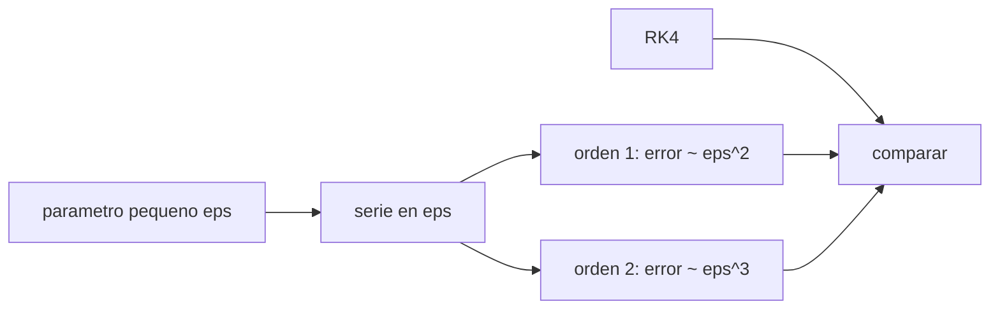

# B72-C15 — Aproximaciones perturbativas

<!-- nav:top -->
[🏠 Programa](../../../../README.md) · [📚 Bloque B72](../../../tronco-comun/B72-perturbaciones-y-evolucion-de-orbitas.md) · [← Anterior: B72-C14 — Órbitas congeladas](../B72-C14-orbitas-congeladas/CLASE.md) · [Siguiente: B72-C16 — Modelado de mareas →](../B72-C16-modelado-de-mareas/CLASE.md)
<!-- /nav -->

## 1. Ubicación, nivel y alcance

Clase 15 del bloque B72. Nivel N3. Casi todas las fórmulas de esta unidad son aproximaciones perturbativas: se desarrolla la solución en potencias de un parámetro pequeño y se conservan los primeros términos. Aquí ves el método en un sistema de juguete, el oscilador de Duffing, con el desarrollo de Lindstedt–Poincaré, y mides en una órbita cómo el error de la tasa de nodo de primer orden crece con el parámetro pequeño `k J2`. Sigue a [B72-C14](../B72-C14-orbitas-congeladas/CLASE.md) y prepara la integración numérica ([C18](../B72-C18-integracion-numerica-perturbada/CLASE.md)). Los sistemas son sintéticos.

## 2. Por qué esta clase existe

Una fórmula de primer orden se usa mucho tiempo sin preguntar cuándo deja de valer. La decisión central: **¿cómo saber cuándo basta un desarrollo de primer orden y cómo se estima su error?**

## 3. Lo que podrás hacer al terminar

1. Describir un desarrollo en potencias de un parámetro pequeño.
2. Obtener la frecuencia de Lindstedt–Poincaré de primer y segundo orden de un oscilador de Duffing.
3. Verificar que el error de cada orden escala como `ε²` y `ε³`.
4. Medir el error relativo de la tasa de nodo de primer orden frente a una integración con J2 escalado.
5. Muestrear en un cruce del nodo para eliminar las oscilaciones de corto periodo.
6. Distinguir lo consultado de lo ilustrativo y de lo no consultado.

La evidencia es la **tabla de error perturbativo** del ejercicio 12 (sección 20).

## 4. Con qué llegas y cómo comprobarlo

1. ¿Qué es un parámetro pequeño?
2. ¿Qué es un término secular?
3. ¿Qué es un oscilador de Duffing?
4. ¿Qué es el error relativo?
5. ¿Qué es un valor no consultado?

<details>
<summary>Ver respuestas</summary>

1. Un número `ε ≪ 1` cuyas potencias ordenan los términos de un desarrollo. 2. Uno que crece con el tiempo y arruina un desarrollo ingenuo. 3. Un oscilador con un término cúbico: `x″ + x + ε x³ = 0`. 4. `|aproximado − exacto| / |exacto|`. 5. Uno que se usa como ilustración sin haberlo leído en una fuente.
</details>

Con cuatro o cinco aciertos, sigue; si no, repasa los prerrequisitos.

## 5. Un caso de contexto y casos de referencia

Con `ε = 0,1`, la frecuencia del oscilador de Duffing es `1,036717` (RK4), `1,037500` (primer orden, error `7,8 × 10⁻⁴`) y `1,036680` (segundo orden, error `3,7 × 10⁻⁵`). En una órbita de `60°` con J2 normal, la tasa de nodo de primer orden difiere un `0,41 %` de la integración. Es el **ejemplo conductor**. Los sistemas son sintéticos.

## 6. Vocabulario

Un **desarrollo perturbativo** es una serie en un parámetro pequeño `ε`. El **método de Lindstedt–Poincaré** reescala el tiempo para eliminar términos seculares. El **orden** de la aproximación es la potencia de `ε` que se conserva. El **error de truncamiento** es del orden de la primera potencia omitida. El **muestreo estroboscópico** toma una medida por vuelta en la misma fase.

## 7. Modelo mental: un mapa que corrige curvas con más detalle



*Descripción textual:* un parámetro pequeño ordena la serie; cada orden reduce el error en una potencia de `ε`; la integración numérica sirve de referencia para comparar.

Analogía: como un mapa que primero dibuja la carretera principal y luego añade curvas más finas, cada orden añade detalle y reduce la desviación. Límite: el desarrollo solo converge o es asintótico para `ε` pequeño; para `ε = 1` la aproximación de orden 1 falla un 4 % en el juguete y la serie puede no mejorar con más términos.

## 8. La explicación, paso a paso

### 8.1 El oscilador de Duffing

`x″ + x + ε x³ = 0`, `x(0) = 1`, `x′(0) = 0`. El desarrollo de Lindstedt–Poincaré da la frecuencia `ω = 1 + 3ε/8 − 21ε²/256 + …`. RK4 con paso `2 × 10⁻⁴` mide el periodo a partir del primer cruce por cero.

| `ε` | `ω` RK4 | orden 1 | err₁ | orden 2 | err₂ | err₁/ε² | err₂/ε³ |
|---|---|---|---|---|---|---|---|
| 0,01 | 1,003742 | 1,003750 | 8,16e-06 | 1,003742 | 3,93e-08 | 0,0816 | 0,0393 |
| 0,05 | 1,018550 | 1,018750 | 2,00e-04 | 1,018545 | 4,79e-06 | 0,0801 | 0,0383 |
| 0,10 | 1,036717 | 1,037500 | 7,83e-04 | 1,036680 | 3,72e-05 | 0,0783 | 0,0372 |
| 0,30 | 1,106018 | 1,112500 | 6,48e-03 | 1,105117 | 9,01e-04 | 0,0720 | 0,0334 |
| 1,00 | 1,317776 | 1,375000 | 5,72e-02 | 1,292969 | 2,48e-02 | 0,0572 | 0,0248 |

Los cocientes `err₁/ε²` y `err₂/ε³` son casi constantes para `ε` pequeño: el error de primer orden escala como `ε²` y el de segundo como `ε³`. Para `ε = 1` el segundo orden mejora al primero (`0,025` frente a `0,057`), pero ambos son poco precisos y los cocientes ya no son constantes.

### 8.2 La órbita: J2 como parámetro pequeño

Órbita circular sintética de `7078,137 km`, `i = 60°`. Se integra con J2 multiplicado por `k` y se muestrea `Ω` en cada cruce del nodo ascendente (así el término de corto periodo cancela):

| `k` | primer orden (°/día) | RK4 estroboscópico (°/día) | dif. relativa | dif./(k J2) |
|---|---|---|---|---|
| 1 | −3,46033 | −3,47462 | 4,13e-03 | 3,815 |
| 10 | −34,60333 | −36,06122 | 4,21e-02 | 3,892 |
| 30 | −103,80998 | −117,53382 | 1,32e-01 | 4,070 |

La diferencia relativa es proporcional a `k J2` (cociente casi constante `≈ 3,8–4,1`): la fórmula de primer orden tiene un error relativo de orden `J2` que proviene de los términos de segundo orden.

### 8.3 Lectura

Con J2 real (`k = 1`) el error es del `0,4 %`: más que suficiente para planificar misiones, pero no para efemérides. Si se triplicara J2 (como en un planeta más achatado, o para una órbita muy baja), el error sería del `13 %` con `k = 30`. El método da además una regla práctica: si el error del primer orden escala con `ε`, el siguiente orden lo reduce a `ε²`.

## 9. Magnitudes, símbolos y unidades

| Símbolo | Qué es | Unidad | Valor / nota |
|---|---|---|---|
| `ε` | parámetro pequeño | — | 0,01 a 1 (juguete); `k J2` (órbita) |
| `ω` | frecuencia del oscilador | — | 1,036717 (ε = 0,1) |
| err₁ | error de primer orden | — | 7,83e-04 (ε = 0,1) |
| err₂ | error de segundo orden | — | 3,72e-05 (ε = 0,1) |
| `k` | factor de J2 | — | 1; 10; 30 |
| `dΩ/dt` | tasa de nodo | °/día | −3,46 (primer orden) |

## 10. Convenciones y referencias

Duffing adimensional con RK4 de paso `2 × 10⁻⁴` y periodo por cruce por cero. Órbita: marco inercial del ecuador de la fecha, SI en el cálculo y °/día en las tablas; RK4 de `10 s`, 25 vueltas, `Ω` interpolado en cada cruce del nodo ascendente. `μ`, `R` y `J2` de las fuentes de la sección 11; `k` es un factor didáctico, no una propiedad de la Tierra.

## 11. De dónde sale lo que afirmamos

| ID | Fuente | Localizador | Respalda | Estado |
|---|---|---|---|---|
| S1 | NASA/NSSDC, Earth Fact Sheet — https://nssdc.gsfc.nasa.gov/planetary/factsheet/earthfact.html (consultada 2026-11-10) | ficha completa leída | masa 5,9722 × 10²⁴ kg; radio medio 6371,000 km; radio ecuatorial 6378,137 km; J2 = 1082,63 × 10⁻⁶; GM = 0,39860 × 10⁶ km³/s²; rotación sideral 23,9345 h; semieje mayor 149,598 × 10⁶ km; oblicuidad 23,44° | Consultada |
| S13 | IAU 2015 Resolución B3 (Mamajek et al.) — https://arxiv.org/abs/1510.07674 y PDF https://arxiv.org/pdf/1510.07674 (consultadas 2026-11-10; PDF extraído con PyMuPDF) | tabla de constantes de conversión | (GM)N Tierra = 3,986 004 × 10¹⁴ m³ s⁻²; (GM)N Júpiter = 1,266 865 3 × 10¹⁷ m³ s⁻²; (GM)N Sol = 1,327 124 4 × 10²⁰ m³ s⁻²; R_e Tierra nominal 6,3781 × 10⁶ m | Consultada |
| — | Desarrollo de Lindstedt–Poincaré del oscilador de Duffing y teoría de segundo orden de J2 | — | el desarrollo se verifica con RK4; la teoría de segundo orden de J2 no se desarrolla aquí | No consultada en una fuente concreta |

Límites: no se consultó ningún texto de métodos perturbativos; las fórmulas se verifican numéricamente. El factor `k` de J2 no corresponde a ningún cuerpo real.

## 12. Cómo ver el error perturbativo

| Magnitud | Valor |
|---|---|
| err₁ / ε² (ε = 0,1) | 0,0783 |
| err₂ / ε³ (ε = 0,1) | 0,0372 |
| error de tasa de nodo, `k = 1` | 0,41 % |
| error de tasa de nodo, `k = 30` | 13,2 % |

Descripción larga: El error del primer orden cae como el cuadrado del parámetro pequeño y el del segundo como el cubo; en la órbita el error de la tasa de nodo es proporcional a `k J2`.

## 13. Ejemplo trabajado: frecuencia a ε = 0,1

**Paso 1 · Primer orden.** `1 + 3 × 0,1/8 = 1,0375`.

**Paso 2 · Segundo orden.** `1,0375 − 21 × 0,01/256 = 1,0375 − 0,00082 = 1,03668`.

**Paso 3 · Comparación.** RK4 da `1,036717`: errores `7,8 × 10⁻⁴` (orden 1) y `3,7 × 10⁻⁵` (orden 2).

## 14. Distintas formas de describir una aproximación perturbativa

**Por serie:** potencias de `ε`. **Por error de truncamiento:** primera potencia omitida. **Por cociente:** `err/ε^{n+1}` casi constante. **Por comparación numérica:** contra RK4. **Por muestreo estroboscópico.**

## 15. Práctica guiada

**Ejercicio 1 · con los pasos indicados.** Calcula la frecuencia de primer orden para `ε = 0,05`. *Pasos:* `1 + 3 × 0,05/8`.

<details><summary>Solución comentada</summary>

`1,01875`.
</details>

**Ejercicio 2 · con una pista.** Calcula el término de segundo orden `21ε²/256` para `ε = 0,05`. *Pista:* `ε² = 0,0025`.

<details><summary>Solución comentada</summary>

`2,05e-4`: `ω₂ = 1,018545`.
</details>

**Ejercicio 3 · casi autónomo.** ¿Qué indica que `err₁/ε²` sea casi constante?

<details><summary>Solución comentada</summary>

Que el error de primer orden es `∼ ε²`.
</details>

## 16. Práctica autónoma, transferencia e integrador

**Ejercicio 4 · autónomo.** Si `ε` se divide por 10, ¿cuánto se reduce el error de segundo orden?

<details><summary>Solución comentada</summary>

Un factor `10³ = 1000`.
</details>

**Ejercicio 5 · autónomo.** ¿Por qué se muestrea `Ω` en el cruce del nodo y no cada 60 s?

<details><summary>Solución comentada</summary>

Para eliminar las oscilaciones de corto periodo, que dependen de la fase.
</details>

**Ejercicio 6 · autónomo.** Calcula `k J2` para `k = 10`.

<details><summary>Solución comentada</summary>

`1,08263e-2`.
</details>

**Ejercicio 7 · autónomo.** ¿Cuánto se espera de error relativo con `k = 3` si `dif./(k J2) ≈ 3,9`?

<details><summary>Solución comentada</summary>

`3,9 × 3,2479e-3 = 1,27e-2`.
</details>

**Ejercicio 8 · autónomo.** ¿Por qué la serie de Duffing pierde eficacia a `ε = 1`?

<details><summary>Solución comentada</summary>

El parámetro ya no es pequeño; los términos sucesivos no decrecen.
</details>

**Ejercicio 9 · transferencia.** **Transferencia.** Un ingeniero afirma que con el segundo orden basta siempre. Responde.

<details><summary>Solución comentada</summary>

Solo si `ε` es pequeño; hay que medir el error con una referencia numérica.
</details>

**Ejercicio 10 · transferencia.** **Transferencia.** Si tu fórmula de primer orden da `−3,46 °/día` y la integración `−3,47`, ¿cuál es el error en grados por año?

<details><summary>Solución comentada</summary>

`0,0143 °/día × 365,25 = 5,2 °/año`.
</details>

**Ejercicio 11 · transferencia.** **Transferencia.** ¿Prueba el laboratorio la teoría de segundo orden de J2?

<details><summary>Solución comentada</summary>

No: la teoría de segundo orden de J2 no se desarrolla ni se verifica aquí.
</details>

**Ejercicio 12 · integrador.** **Integrador.** Elabora tu *tabla de error perturbativo*: errores de orden 1 y 2 del Duffing, error relativo de la tasa de nodo para tres valores de `k` y la lista de lo consultado, lo ilustrativo y lo no consultado.

<details><summary>Solución comentada</summary>

Secciones 8.1–8.2 y la salida del laboratorio.
</details>

## 17. Laboratorio: error de un desarrollo perturbativo

El script [aproximaciones_perturbativas.py](aproximaciones_perturbativas.py) mide el error de las frecuencias de primer y segundo orden de un oscilador de Duffing frente a RK4 y el error relativo de la tasa de nodo de primer orden frente a una integración con J2 escalado (**comprueba** que el segundo orden mejora al primero para `ε ≤ 0,1`).

**Datos:** `μ`, `R` y `J2` consultados; el oscilador, `ε`, `k` y la órbita **sintéticos**. **Predice antes de ejecutar:** ¿cuánto crecerá el error de la tasa de nodo al multiplicar J2 por 10? (aproximadamente diez veces.) **Ejecución del 2026-11-10 (Python 3.12.9):**

```text
Python 3.12.9 (biblioteca estandar)
Parte 1: oscilador de Duffing x'' + x + eps x^3 = 0, x(0) = 1, x'(0) = 0 (sistema SINTETICO, adimensional)
    eps   omega RK4    orden 1      err1    orden 2      err2  err1/eps^2  err2/eps^3
   0.01    1.003742   1.003750  8.16e-06   1.003742  3.93e-08      0.0816      0.0393
   0.05    1.018550   1.018750  2.00e-04   1.018545  4.79e-06      0.0801      0.0383
   0.10    1.036717   1.037500  7.83e-04   1.036680  3.72e-05      0.0783      0.0372
   0.30    1.106018   1.112500  6.48e-03   1.105117  9.01e-04      0.0720      0.0334
   1.00    1.317776   1.375000  5.72e-02   1.292969  2.48e-02      0.0572      0.0248

Parte 2: tasa del nodo, orbita circular SINTETICA a = 7078.137 km, i = 60 deg, J2 multiplicado por k
    k  primer orden [deg/dia]   RK4 estroboscopico [deg/dia]  dif. relativa  dif./(k J2)
    1                -3.46033                       -3.47462       4.13e-03        3.815
   10               -34.60333                      -36.06122       4.21e-02        3.892
   30              -103.80998                     -117.53382       1.32e-01        4.070
El cociente dif./(k J2) casi constante indica error relativo proporcional al parametro pequeno k J2.
Pruebas superadas.
```

```bash
python programa/clases/B72/B72-C15-aproximaciones-perturbativas/aproximaciones_perturbativas.py
```

**Límites:** el oscilador es un juguete; la tasa de nodo es de primer orden y el 'exacto' es RK4 con paso fijo; `k` no representa ningún cuerpo.

## 18. Errores frecuentes y cómo corregirlos

**Creer que más términos siempre mejoran.** Se corrige con 8.1 (`ε = 1`).

**Ajustar la tasa a elementos osculadores en fases aleatorias.** Se corrige con 8.2.

**Confundir error absoluto con relativo.** Se corrige con la sección 9.

**Presentar el factor `k` como propiedad física.** Se corrige con la sección 10.

## 19. Cómo sabrás que vas bien

Tras la sección 8: ¿cuánto esperabas que bajara el error al pasar de orden 1 a 2 y cuánto bajó? Si dudas, repasa el ejemplo 13. Tras el laboratorio: ¿qué comprueba el cociente `err/ε^{n+1}`? (ver la sección 17).

## 20. Qué entregas y cómo se evalúa

El producto es tu **tabla de error perturbativo** (ejercicio 12).

| Criterio | Inicial | En desarrollo | Logrado | Destacado |
|---|---|---|---|---|
| Conceptos | Los confunde | Parciales | Distingue el orden y estima el error | Explica los límites |
| Cálculo | Sin unidades | Con errores | Tablas completas con unidades | Calcula casos nuevos |
| Numérico | Sin comprobar | Un caso | Contraste con una segunda vía | Interpreta las diferencias |
| Fuentes | Sin fuente | Sin fecha | Fuentes con fecha y estado | Declara lo ilustrativo y lo no consultado |
| Límites | No los nombra | Uno | Tres | Discute qué falta del modelo |

**Condiciones críticas (no se compensan con promedio):** rotular el oscilador y el factor `k` como sintéticos; no atribuir la teoría de segundo orden de J2 a este laboratorio; citar solo lo consultado.

## 21. Ética, seguridad y límites

Clase educativa: los modelos son simplificados y sus datos son sintéticos o ilustrativos; ningún resultado sustituye a un producto de determinación de órbita, a un servicio oficial de elementos ni a una decisión de operación de vuelo. Accesibilidad: tablas equivalentes a las gráficas, fórmulas en texto, ejercicios sin conexión.

## 22. Para cerrar y seguir

El error de primer orden del oscilador cae como `ε²` y, en una órbita, la tasa de nodo de primer orden difiere `0,41 %` de la integración con J2 real. Queda una pregunta: ¿qué se pierde y qué se gana al integrar numéricamente en lugar de promediar?

**Glosario español–inglés.** desarrollo perturbativo · *perturbation expansion*; método de Lindstedt–Poincaré · *Lindstedt–Poincaré method*; término secular · *secular term*; error de truncamiento · *truncation error*; oscilador de Duffing · *Duffing oscillator*.

**Continuidad.** [B72-C16](../B72-C16-modelado-de-mareas/CLASE.md) estudia la integración numérica perturbada.

**Referencias:** ver sección 11.

<!-- nav:bottom -->
---

[← Anterior: B72-C14 — Órbitas congeladas](../B72-C14-orbitas-congeladas/CLASE.md) · [📚 Bloque B72](../../../tronco-comun/B72-perturbaciones-y-evolucion-de-orbitas.md) · [Siguiente: B72-C16 — Modelado de mareas →](../B72-C16-modelado-de-mareas/CLASE.md)
<!-- /nav -->
