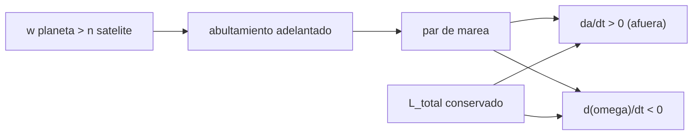

# B72-C16 — Modelado de mareas

<!-- nav:top -->
[🏠 Programa](../../../../README.md) · [📚 Bloque B72](../../../tronco-comun/B72-perturbaciones-y-evolucion-de-orbitas.md) · [← Anterior: B72-C15 — Aproximaciones perturbativas](../B72-C15-aproximaciones-perturbativas/CLASE.md) · [Siguiente: B72-C17 — Efectos relativistas orbitales →](../B72-C17-efectos-relativistas-orbitales/CLASE.md)
<!-- /nav -->

## 1. Ubicación, nivel y alcance

Clase 16 del bloque B72. Nivel N3. Un satélite deforma el planeta que orbita con su marea, y como el planeta gira más rápido que el satélite, el abultamiento se adelanta y devuelve un par que cambia el semieje y frena la rotación. Aquí calculas el radio síncrono, la aceleración de marea y la marea de equilibrio, la tasa de variación del semieje con un modelo de `k₂/Q` constante, integras `da/dt` y haces el balance de momento angular del sistema Tierra–Luna. Sigue a [B72-C15](../B72-C15-aproximaciones-perturbativas/CLASE.md) y prepara el calentamiento por marea ([B65-C06](../../../tronco-comun/B65-geofisica-de-interiores-planetarios.md)). `k₂/Q`, `h₂` y el momento de inercia son ilustrativos.

## 2. Por qué esta clase existe

La marea alarga el día, aleja a la Luna y calienta a Ío y Europa; en un satélite bajo el radio síncrono (como Fobos) hace lo contrario y lo acerca. La decisión central: **¿hacia dónde y a qué velocidad cambia el semieje por la marea, según esté el satélite dentro o fuera del radio síncrono?**

## 3. Lo que podrás hacer al terminar

1. Calcular el radio síncrono `(μ/ω²)^{1/3}` y situar un satélite respecto a él.
2. Calcular la aceleración de marea en la superficie y la marea de equilibrio.
3. Evaluar `da/dt = 3 (k₂/Q)(m/M)(R/a)⁵ n a`.
4. Integrar `da/dt ∝ a^{−11/2}` y verificar el integrador con la solución analítica.
5. Hacer el balance de momento angular y estimar el alargamiento del día.
6. Distinguir lo consultado de lo ilustrativo y de lo no consultado.

La evidencia es la **ficha de marea orbital** del ejercicio 12 (sección 20).

## 4. Con qué llegas y cómo comprobarlo

1. ¿Qué es el radio síncrono?
2. ¿Qué es un número de Love `k₂`?
3. ¿Qué es el factor de calidad `Q`?
4. ¿Qué es el momento angular?
5. ¿Qué es un valor no consultado?

<details>
<summary>Ver respuestas</summary>

1. El semieje cuya velocidad angular iguala la rotación del planeta. 2. Un parámetro adimensional de la respuesta elástica del planeta a una marea. 3. El inverso de la disipación por ciclo de marea: `Q` grande significa poca disipación. 4. `L = I ω` para la rotación y `m √(μ a)` para la órbita; su suma se conserva. 5. Uno que se usa como ilustración sin haberlo leído en una fuente.
</details>

Con cuatro o cinco aciertos, sigue; si no, repasa los prerrequisitos.

## 5. Un caso de contexto y casos de referencia

La Luna está a `9,12` radios síncronos de la Tierra, así que la marea la aleja. Con `k₂/Q = 0,01` ilustrativo, `da/dt = 4,73 × 10⁻¹⁰ m/s = 1,49 cm/año`, y el balance de momento angular alarga el día `0,82 ms` por siglo. Es el **ejemplo conductor**. `k₂/Q`, `h₂` e `I` son ilustrativos.

## 6. Vocabulario

La **marea de equilibrio** es la deformación estática que seguiría el potencial de marea. El **retardo de marea** es el adelanto del abultamiento respecto al satélite. `k₂/Q` es la razón entre la respuesta elástica y la disipación. El **par de marea** transfiere momento angular de la rotación a la órbita. El **radio síncrono** divide a los satélites que se alejan de los que se acercan.

## 7. Modelo mental: una ola que se adelanta y empuja



*Descripción textual:* si el planeta gira más rápido que el satélite, el abultamiento se adelanta y genera un par que sube el semieje y frena la rotación; el momento angular total se conserva.

Analogía: una ola que se adelanta al barco lo empuja hacia adelante: el abultamiento que adelanta a la Luna la arrastra hacia una órbita más alta y frena a la Tierra. Límite: el modelo de `Q` constante es aproximado: en la Tierra real la disipación está concentrada en los océanos y depende de la geometría de las costas.

## 8. La explicación, paso a paso

### 8.1 Radio síncrono

Con `μ = 3,986004 × 10¹⁴ m³/s²` (IAU) y la rotación sideral `23,9345 h` (ficha de la Tierra): `a_sinc = (μ/ω²)^{1/3} = 42 164,2 km`. La Luna (`384 400 km`, ficha de la Luna) está a `9,12 a_sinc`: fuera del radio síncrono, la marea la aleja.

### 8.2 Aceleración y marea de equilibrio

La aceleración de marea lunar en la superficie, `2 μ_L R/d³`, con `μ_L = 4902,800 km³/s²` (JPL), vale `1,101 × 10⁻⁶ m/s²` (`1,12 × 10⁻⁷ g`). La marea de equilibrio con `h₂ = 0,6` (ilustrativo) es `(3/2) h₂ (m/M)(R/d)³ R = 0,323 m`.

### 8.3 Variación del semieje

`da/dt = 3 (k₂/Q) (m/M) (R/a)⁵ n a`. Con `m/M = 0,0123`, `R = 6378,137 km`, `n = 2,6617 × 10⁻⁶ rad/s` y `k₂/Q = 0,01` (ilustrativo): `4,726 × 10⁻¹⁰ m/s = 1,49 cm/año`. Para obtener `3,8 cm/año` (cifra de medidas láser lunares, no consultada) haría falta `k₂/Q = 0,0255`.

### 8.4 Integración

Con `da/dt = C a^{−11/2}` la solución es `a^{13/2} = a₀^{13/2} + (13/2) C t`. Hacia atrás, el tiempo para pasar de `a₀` a `0,5 a₀` es `3,9217 Ga` por RK4 y `3,9217 Ga` por la fórmula (diferencia `1,7 × 10⁻⁸`). Es un ejercicio matemático con `k₂/Q` constante, no una historia de la Luna.

### 8.5 Balance de momento angular

El momento angular orbital ganado por la Luna es `dL/dt = m √μ /(2 √a) · da/dt = 1,768 × 10¹⁶ kg m²/s²`. Con `I = 0,33 M R²` (ilustrativo), la rotación terrestre pierde `dω/dt = −2,210 × 10⁻²² rad/s²`, es decir, el día alarga `0,82 ms` por siglo con esta sola marea.

### 8.6 Lectura

El signo de `da/dt` lo fija la posición respecto al radio síncrono: positivo fuera, negativo dentro. La magnitud depende de `k₂/Q`, que se mide, no se deduce; aquí es un parámetro ilustrativo. El calentamiento de un satélite por marea (Ío, Europa) es la disipación asociada y se tratará en B65-C06.

## 9. Magnitudes, símbolos y unidades

| Símbolo | Qué es | Unidad | Valor / nota |
|---|---|---|---|
| `a_sinc` | radio síncrono | km | 42 164,2 |
| `k₂/Q` | razón elástica sobre disipación | — | 0,01 (ilustrativo) |
| `h₂` | número de Love de deformación | — | 0,6 (ilustrativo) |
| `da/dt` | variación del semieje | m/s | 4,726e-10 |
| `dL/dt` | momento angular ganado | kg m²/s² | 1,768e16 |
| `I` | momento de inercia | kg m² | 0,33 M R² (ilustrativo) |

## 10. Convenciones y referencias

Sistema Tierra–Luna con órbita circular y Luna en el plano ecuatorial; masas, radio y distancia de las fichas de la NASA; `μ_L` del JPL; `μ` de la IAU. `k₂/Q`, `h₂` y `I` son ilustrativos. Año de `365,25 d`. RK4 con paso variable de `10¹³ s` hacia atrás; tolerancia de comprobación `10⁻⁶`.

## 11. De dónde sale lo que afirmamos

| ID | Fuente | Localizador | Respalda | Estado |
|---|---|---|---|---|
| S1 | NASA/NSSDC, Earth Fact Sheet — https://nssdc.gsfc.nasa.gov/planetary/factsheet/earthfact.html (consultada 2026-11-10) | ficha completa leída | masa 5,9722 × 10²⁴ kg; radio medio 6371,000 km; radio ecuatorial 6378,137 km; J2 = 1082,63 × 10⁻⁶; GM = 0,39860 × 10⁶ km³/s²; rotación sideral 23,9345 h; semieje mayor 149,598 × 10⁶ km; oblicuidad 23,44° | Consultada |
| S2 | NASA/NSSDC, Moon Fact Sheet — https://nssdc.gsfc.nasa.gov/planetary/factsheet/moonfact.html (consultada 2026-11-10) | ficha completa leída | masa 0,07346 × 10²⁴ kg; radio medio 1737,4 km; semieje mayor 0,3844 × 10⁶ km; periodo sideral 27,3217 d; excentricidad 0,0549; inclinación a la eclíptica 5,145° | Consultada |
| S8 | NASA JPL SSD, Planetary Satellite Physical Parameters — https://ssd.jpl.nasa.gov/sats/phys_par/ (consultada 2026-11-10) | filas de la Luna, Ío y Europa | GM Luna 4902,800 km³/s²; radio medio 1737,4 km; Ío GM 5959,91547 km³/s², radio 1821,49 km; Europa GM 3202,71210 km³/s², radio 1560,80 km (la página no muestra fecha) | Consultada |
| S13 | IAU 2015 Resolución B3 (Mamajek et al.) — https://arxiv.org/abs/1510.07674 y PDF https://arxiv.org/pdf/1510.07674 (consultadas 2026-11-10; PDF extraído con PyMuPDF) | tabla de constantes de conversión | (GM)N Tierra = 3,986 004 × 10¹⁴ m³ s⁻²; (GM)N Júpiter = 1,266 865 3 × 10¹⁷ m³ s⁻²; (GM)N Sol = 1,327 124 4 × 10²⁰ m³ s⁻²; R_e Tierra nominal 6,3781 × 10⁶ m | Consultada |
| — | Modelo de `Q` constante y fórmula `da/dt`; `k₂/Q` terrestre, `h₂`, factor de inercia y el ritmo de 3,8 cm/año | — | la integral se verifica analíticamente; el resto son parámetros ilustrativos o cifras no consultadas | No consultada en una fuente concreta |

Límites: no se consultó ninguna medida láser lunar ni ningún valor de `k₂` o `Q` de la Tierra; la disipación oceánica real no se modela.

## 12. Cómo ver el efecto de la marea

| Magnitud | Valor |
|---|---|
| `a_sinc` | 42 164,2 km |
| `da/dt` (k₂/Q = 0,01) | 1,49 cm/año |
| marea de equilibrio (h₂ = 0,6) | 0,323 m |
| alargamiento del día | 0,82 ms/siglo |

Descripción larga: La Luna orbita a 9 radios síncronos: la marea de la Tierra la aleja a 1,5 cm por año con un k₂/Q de laboratorio y alarga el día algo menos de un milisegundo por siglo.

## 13. Ejemplo trabajado: la aceleración de marea

**Paso 1 · Datos.** `μ_L = 4,9028e12 m³/s²`, `R = 6,378137e6 m`, `d = 3,844e8 m`.

**Paso 2 · Fórmula.** `2 μ_L R/d³ = 2 × 4,9028e12 × 6,378137e6/(5,680e25)`.

**Paso 3 · Resultado.** `1,101 × 10⁻⁶ m/s²`, el `1,12 × 10⁻⁷` de `g`.

## 14. Distintas formas de describir el efecto de marea

**Por aceleración:** `2 μ R/d³`. **Por altura:** marea de equilibrio. **Por tasa:** `da/dt`. **Por conservación:** `dL_orb/dt = −dL_rot/dt`. **Por radio síncrono:** dentro o fuera.

## 15. Práctica guiada

**Ejercicio 1 · con los pasos indicados.** Calcula `(R/a)⁵` con `R/a = 0,016592`. *Pasos:* `0,016592² = 2,753e-4`; sigue.

<details><summary>Solución comentada</summary>

`(0,016592)⁵ = 1,258e-9`.
</details>

**Ejercicio 2 · con una pista.** Calcula `m/M` con `m = 0,07346e24`, `M = 5,9722e24`. *Pista:* divide.

<details><summary>Solución comentada</summary>

`0,01230`.
</details>

**Ejercicio 3 · casi autónomo.** ¿Por qué la Luna se aleja y no se acerca?

<details><summary>Solución comentada</summary>

Está fuera del radio síncrono: `ω_Tierra > n_Luna`, así que el abultamiento se adelanta.
</details>

## 16. Práctica autónoma, transferencia e integrador

**Ejercicio 4 · autónomo.** ¿Hacia dónde evolucionaría un satélite a `0,5 a_sinc`?

<details><summary>Solución comentada</summary>

Hacia adentro: `n > ω` y el abultamiento queda detrás.
</details>

**Ejercicio 5 · autónomo.** Si `k₂/Q` se duplica, ¿cómo cambia `da/dt`?

<details><summary>Solución comentada</summary>

Se duplica.
</details>

**Ejercicio 6 · autónomo.** Si la Luna estuviera a la mitad de distancia, ¿cómo cambia `da/dt`?

<details><summary>Solución comentada</summary>

Se multiplica por `2^{11/2} = 45,3`.
</details>

**Ejercicio 7 · autónomo.** Calcula `1,5 h₂ (m/M)(R/d)³ R` con `h₂ = 0,6`.

<details><summary>Solución comentada</summary>

`0,323 m`.
</details>

**Ejercicio 8 · autónomo.** ¿Por qué el día alarga cuando la Luna sube?

<details><summary>Solución comentada</summary>

El momento angular que gana la Luna lo pierde la rotación terrestre.
</details>

**Ejercicio 9 · transferencia.** **Transferencia.** Un colega usa `da/dt` constante para estimar el origen de la Luna. ¿Qué objeta?

<details><summary>Solución comentada</summary>

`da/dt ∝ a^{−11/2}` no es constante: crece cuando está más cerca; y `k₂/Q` ha cambiado con la historia.
</details>

**Ejercicio 10 · transferencia.** **Transferencia.** Un estudiante dice que `3,9 Ga` es la edad de la Luna. Respóndele.

<details><summary>Solución comentada</summary>

No: es un ejercicio con `k₂/Q` constante e ilustrativo; no es una edad.
</details>

**Ejercicio 11 · transferencia.** **Transferencia.** ¿Prueba el laboratorio el ritmo real de alejamiento de la Luna?

<details><summary>Solución comentada</summary>

No: `k₂/Q` es ilustrativo y la cifra medida no se consultó.
</details>

**Ejercicio 12 · integrador.** **Integrador.** Elabora tu *ficha de marea orbital*: radio síncrono, aceleración, marea de equilibrio, `da/dt`, tiempo de integración, balance de momento angular y la lista de lo consultado, lo ilustrativo y lo no consultado.

<details><summary>Solución comentada</summary>

Secciones 8.1–8.5 y la salida del laboratorio.
</details>

## 17. Laboratorio: marea Tierra–Luna

El script [mareas.py](mareas.py) calcula el radio síncrono, la aceleración de marea, `da/dt` con `k₂/Q` ilustrativo, integra `a^{−11/2}` con RK4 y verifica con la solución analítica, y hace el balance de momento angular (**comprueba** una diferencia menor que `1e-6`).

**Datos:** Masas, radios, distancia, periodos y `μ` consultados; `k₂/Q`, `h₂` y `I` **ilustrativos**; el ritmo medido de alejamiento **no consultado**. **Predice antes de ejecutar:** ¿se aleja o se acerca la Luna? (se aleja: está fuera del radio síncrono.) **Ejecución del 2026-11-10 (Python 3.12.9):**

```text
Python 3.12.9 (biblioteca estandar)
ILUSTRATIVOS: k2/Q = 0.01, h2 = 0.6, I = 0.33 M R^2. Datos de masa, radio, distancia y periodos de las fichas NSSDC.

Radio sincrono de la Tierra: a_sinc = (mu/w^2)^(1/3) = 42164.2 km ; a_Luna/a_sinc = 9.12 (la Luna esta fuera: la marea la aleja)

Aceleracion de marea lunar en la superficie: 2 mu_L R/d^3 = 1.101e-06 m/s2 = 1.12e-07 g
Marea de equilibrio ILUSTRATIVA (h2 = 0.6): (3/2) h2 (m/M) (R/d)^3 R = 0.323 m

da/dt hoy = 3 (k2/Q)(m/M)(R/a)^5 n a = 4.726e-10 m/s = 1.49 cm/ano
(k2/Q que daria 3.8 cm/ano, cifra de medidas laser lunares NO consultada: 0.0255)

Tiempo para que a pase de a0 a 0.5 a0 (hacia atras, k2/Q constante): numerico = 3.9217 Ga ; analitico = 3.9217 Ga ; dif. = 1.72e-08

Momento angular orbital ganado por la Luna: dL/dt = 1.768e+16 kg m2/s2
Perdido por la rotacion terrestre: d(omega)/dt = -2.210e-22 rad/s2 -> el dia sideral crece 0.82 ms por siglo (solo esta marea y k2/Q ilustrativo)
Pruebas superadas.
```

```bash
python programa/clases/B72/B72-C16-modelado-de-mareas/mareas.py
```

**Límites:** `Q` constante, órbita circular y ecuatorial, un solo satélite; no se modela la disipación oceánica real ni la excentricidad.

## 18. Errores frecuentes y cómo corregirlos

**Creer que la marea siempre aleja al satélite.** Se corrige con 8.1 y 8.6.

**Tratar `da/dt` como constante.** Se corrige con 8.4.

**Presentar los 3,9 Ga como edad.** Se corrige con 8.4.

**Olvidar que `k₂/Q` es un parámetro medido.** Se corrige con la sección 11.

## 19. Cómo sabrás que vas bien

Tras la sección 8: ¿hacia dónde esperabas que cambiara el semieje y qué obtuviste? Si dudas, repasa el ejemplo 13. Tras el laboratorio: ¿qué comprueba el tiempo analítico? (ver la sección 17).

## 20. Qué entregas y cómo se evalúa

El producto es tu **ficha de marea orbital** (ejercicio 12).

| Criterio | Inicial | En desarrollo | Logrado | Destacado |
|---|---|---|---|---|
| Conceptos | Los confunde | Parciales | Calcula `da/dt` y el balance de momento angular | Explica los límites |
| Cálculo | Sin unidades | Con errores | Tablas completas con unidades | Calcula casos nuevos |
| Numérico | Sin comprobar | Un caso | Contraste con una segunda vía | Interpreta las diferencias |
| Fuentes | Sin fuente | Sin fecha | Fuentes con fecha y estado | Declara lo ilustrativo y lo no consultado |
| Límites | No los nombra | Uno | Tres | Discute qué falta del modelo |

**Condiciones críticas (no se compensan con promedio):** rotular `k₂/Q`, `h₂` e `I` como ilustrativos; no presentar `3,9 Ga` como edad ni `1,49 cm/año` como medida; citar solo lo consultado.

## 21. Ética, seguridad y límites

Clase educativa: los modelos son simplificados y sus datos son sintéticos o ilustrativos; ningún resultado sustituye a un producto de determinación de órbita, a un servicio oficial de elementos ni a una decisión de operación de vuelo. Accesibilidad: tablas equivalentes a las gráficas, fórmulas en texto, ejercicios sin conexión.

## 22. Para cerrar y seguir

Con `k₂/Q = 0,01` ilustrativo, la Luna se aleja `1,49 cm/año` y el día alarga `0,82 ms` por siglo; el signo depende de estar fuera del radio síncrono. Queda una pregunta: ¿qué otros efectos pequeños, como la relatividad, afectan a una órbita?

**Glosario español–inglés.** marea de equilibrio · *equilibrium tide*; radio síncrono · *synchronous radius*; número de Love · *Love number*; factor de calidad · *quality factor*; par de marea · *tidal torque*.

**Continuidad.** [B72-C17](../B72-C17-efectos-relativistas-orbitales/CLASE.md) estudia los efectos relativistas orbitales.

**Referencias:** ver sección 11.

<!-- nav:bottom -->
---

[← Anterior: B72-C15 — Aproximaciones perturbativas](../B72-C15-aproximaciones-perturbativas/CLASE.md) · [📚 Bloque B72](../../../tronco-comun/B72-perturbaciones-y-evolucion-de-orbitas.md) · [Siguiente: B72-C17 — Efectos relativistas orbitales →](../B72-C17-efectos-relativistas-orbitales/CLASE.md)
<!-- /nav -->
