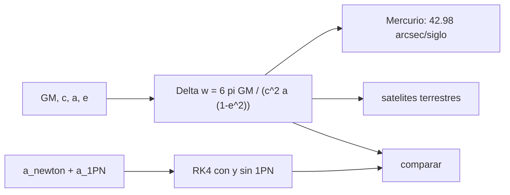

# B72-C17 — Efectos relativistas orbitales

<!-- nav:top -->
[🏠 Programa](../../../../README.md) · [📚 Bloque B72](../../../tronco-comun/B72-perturbaciones-y-evolucion-de-orbitas.md) · [← Anterior: B72-C16 — Modelado de mareas](../B72-C16-modelado-de-mareas/CLASE.md) · [Siguiente: B72-C18 — Integración numérica perturbada →](../B72-C18-integracion-numerica-perturbada/CLASE.md)
<!-- /nav -->

## 1. Ubicación, nivel y alcance

Clase 17 del bloque B72. Nivel N3. La relatividad general añade a la gravedad newtoniana una corrección pequeña que hace avanzar el periapsis de toda órbita ligada. En Mercurio es la famosa anomalía de `43` segundos de arco por siglo; en un satélite terrestre es de unos milisegundos de arco al año. Aquí calculas el avance por órbita, lo verificas integrando la aceleración post-newtoniana de Schwarzschild con y sin la corrección, y lo comparas con satélites terrestres sintéticos. Sigue a [B72-C16](../B72-C16-modelado-de-mareas/CLASE.md) y prepara la integración numérica ([C18](../B72-C18-integracion-numerica-perturbada/CLASE.md)). Los satélites son sintéticos.

## 2. Por qué esta clase existe

La corrección relativista es un test histórico de la teoría y, en navegación por satélite, un término que los modelos de precisión no pueden ignorar. La decisión central: **¿cuánto vale el avance relativista del periapsis, cuándo es relevante y qué parte de la relatividad queda fuera de este cálculo?**

## 3. Lo que podrás hacer al terminar

1. Calcular `Δω = 6π GM/(c² a (1−e²))` por órbita.
2. Aplicarlo a Mercurio y comparar con `43″/siglo`.
3. Verificar la fórmula con una integración RK4 de la aceleración post-newtoniana, con y sin término relativista.
4. Estimar el avance secular del perigeo de satélites terrestres sintéticos.
5. Reconocer qué efectos relativistas (Lense–Thirring, geodésico) no se calculan aquí.
6. Distinguir lo consultado de lo ilustrativo y de lo no consultado.

La evidencia es la **ficha de efectos relativistas** del ejercicio 12 (sección 20).

## 4. Con qué llegas y cómo comprobarlo

1. ¿Qué es el periapsis?
2. ¿Qué es un segundo de arco?
3. ¿Qué es una corrección post-newtoniana?
4. ¿Qué es una partícula de prueba?
5. ¿Qué es un valor no consultado?

<details>
<summary>Ver respuestas</summary>

1. El punto de la órbita más cercano al cuerpo central. 2. `1/3600` de grado, `4,848 × 10⁻⁶ rad`. 3. Un término de orden `v²/c²` añadido a la gravedad newtoniana. 4. Un cuerpo de masa despreciable que no perturba al campo. 5. Uno que se usa como ilustración sin haberlo leído en una fuente.
</details>

Con cuatro o cinco aciertos, sigue; si no, repasa los prerrequisitos.

## 5. Un caso de contexto y casos de referencia

Para Mercurio, la fórmula da `0,10352″` por órbita y `42,98″` por siglo, y la integración con y sin el término relativista reproduce el avance por órbita (`5,0186 × 10⁻⁷ rad`) con diferencia menor de `0,01 %`. En un satélite a `500 km` el perigeo avanza `13,9″` por año. Es el **ejemplo conductor**. Los satélites terrestres son sintéticos.

## 6. Vocabulario

El **avance relativista del periapsis** es `Δω` por órbita. La **aceleración de Schwarzschild post-newtoniana** es `a = −GM r/r³ + (GM/(c² r³)) [(4GM/r − v²) r + 4 (r·v) v]`. La **precesión de Lense–Thirring** (arrastre de marcos por la rotación del cuerpo) y la **precesión geodésica** de un giroscopio no se calculan aquí. Un **mas** es un milisegundo de arco.

## 7. Modelo mental: una rosetón que se dibuja con la elipse



*Descripción textual:* la fórmula del avance se aplica a Mercurio y a satélites; la integración con y sin el término post-newtoniano la verifica.

Analogía: la elipse no se cierra del todo: cada vuelta se desplaza un poco, y tras muchas vueltas dibuja una roseta. Límite: es una partícula de prueba en un campo esférico (Schwarzschild); no incluye la rotación del cuerpo central ni las perturbaciones de otros cuerpos, que dominan el movimiento real de Mercurio.

## 8. La explicación, paso a paso

### 8.1 La fórmula

`Δω = 6π GM/(c² a (1−e²))` rad por órbita, con `GM_Sol = 1,3271244 × 10²⁰ m³/s²` (IAU 2015), `c = 299 792 458 m/s` (NIST), `a = 57,909 × 10⁹ m`, `e = 0,2056` y `T = 87,969 d` (ficha de Mercurio):

- por órbita: `5,0186 × 10⁻⁷ rad = 0,10352″`;
- órbitas por siglo: `415,20`;
- por siglo: `42,98″`.

Will (2014) cita el valor moderno del avance anómalo como `43″` por siglo. La ficha de Mercurio no da la precesión del perihelio; el avance observado total incluye además efectos newtonianos que esta clase no calcula.

### 8.2 Verificación numérica

Se integran 12 órbitas con RK4 (2500 pasos por órbita) con la aceleración de Schwarzschild y sin ella, y se resta el ángulo del vector de excentricidad: el avance por órbita es `5,0186 × 10⁻⁷ rad`, igual al de la fórmula (diferencia `0,00 %` en tres cifras).

### 8.3 Satélites terrestres sintéticos

El avance secular en un satélite en torno a la Tierra, `3 GM n/(c² a (1−e²))`:

| Caso | `a` (km) | `e` | ″/año | mas/año |
|---|---|---|---|---|
| baja 500 km | 6878,1 | 0,001 | 13,9360 | 13 936,0 |
| GPS | 26 560,0 | 0,010 | 0,4757 | 475,7 |
| GEO | 42 164,0 | 0,001 | 0,1498 | 149,8 |
| Molniya | 26 600,0 | 0,740 | 1,0473 | 1047,3 |

### 8.4 Lo que falta

La rotación de la Tierra añade el arrastre de marcos (Lense–Thirring) y un giroscopio sufre la precesión geodésica; ninguno se calculó ni se consultó en esta clase. Frente a J2 (`3,7 °/día` de precesión del perigeo en órbita baja), el término relativista es unas `3 × 10⁵` veces menor, pero se acumula y aparece en los modelos de precisión.

### 8.5 Lectura

El avance relativista es proporcional a `1/a^{5/2}` en el satélite y diminuto frente al de J2; en Mercurio, donde no hay achatamiento ni atmósfera, es un efecto aislable y verificable. Por eso fue una prueba histórica de la teoría.

## 9. Magnitudes, símbolos y unidades

| Símbolo | Qué es | Unidad | Valor / nota |
|---|---|---|---|
| `GM` | parámetro gravitatorio | m³/s² | 1,3271244e20 (Sol) |
| `c` | velocidad de la luz | m/s | 299 792 458 |
| `Δω` | avance por órbita | rad | 5,0186e-07 (Mercurio) |
| `a` | semieje mayor | m | 5,7909e10 (Mercurio) |
| `e` | excentricidad | — | 0,2056 (Mercurio) |
| ″ | segundo de arco | rad | 4,848e-6 |

## 10. Convenciones y referencias

Marco inercial centrado en el cuerpo; partícula de prueba; aceleración 1PN de Schwarzschild; SI. Mercurio con datos de la ficha de la NASA y `GM` de la IAU. Satélites terrestres sintéticos con `GM = 3,986004 × 10¹⁴ m³/s²`. RK4 con 2500 pasos por órbita y 12 órbitas; tolerancia de comprobación `3 %`.

## 11. De dónde sale lo que afirmamos

| ID | Fuente | Localizador | Respalda | Estado |
|---|---|---|---|---|
| S6 | NASA/NSSDC, Mercury Fact Sheet — https://nssdc.gsfc.nasa.gov/planetary/factsheet/mercuryfact.html (consultada 2026-11-10) | ficha completa leída | semieje mayor 57,909 × 10⁶ km; excentricidad 0,2056; periodo sideral 87,969 d. La ficha no da la precesión del perihelio | Consultada |
| S7 | NIST CODATA 2022 — https://physics.nist.gov/cgi-bin/cuu/Value?c, ...?bg, ...?k y ...?ukg (consultadas 2026-11-10) | valores de c, G, k y u | c = 299 792 458 m/s (exacta); G = 6,674 30(15) × 10⁻¹¹ m³ kg⁻¹ s⁻²; k = 1,380 649 × 10⁻²³ J/K (exacta); u = 1,660 539 068 92(52) × 10⁻²⁷ kg | Consultada |
| S13 | IAU 2015 Resolución B3 (Mamajek et al.) — https://arxiv.org/abs/1510.07674 y PDF https://arxiv.org/pdf/1510.07674 (consultadas 2026-11-10; PDF extraído con PyMuPDF) | tabla de constantes de conversión | (GM)N Tierra = 3,986 004 × 10¹⁴ m³ s⁻²; (GM)N Júpiter = 1,266 865 3 × 10¹⁷ m³ s⁻²; (GM)N Sol = 1,327 124 4 × 10²⁰ m³ s⁻²; R_e Tierra nominal 6,3781 × 10⁶ m | Consultada |
| S14 | Will, C. M. (2014), «The Confrontation between General Relativity and Experiment», Living Reviews in Relativity — https://arxiv.org/abs/1403.7377 (PDF consultado 2026-11-10; texto extraído con PyMuPDF) | sección sobre el perihelio de Mercurio | el avance anómalo del perihelio de Mercurio es hoy de 43 segundos de arco por siglo | Consultada |
| — | Fórmula `6π GM/(c² a (1−e²))`, aceleración de Schwarzschild 1PN y el avance secular `3 GM n/(...)` de un satélite | — | la fórmula se verifica con la integración del laboratorio; Lense–Thirring y geodésica no se consultaron ni calcularon | No consultada en una fuente concreta |

Límites: de Will (2014) solo se usó la cifra de `43″/siglo` del avance anómalo; no se consultó la deducción ni las demás pruebas. La ficha de Mercurio no da la precesión observada.

## 12. Cómo ver el avance relativista

| Magnitud | Valor |
|---|---|
| `Δω` de Mercurio | 0,10352″/órbita |
| `Δω` por siglo | 42,98″ |
| diferencia numérica–fórmula | < 0,01 % |
| perigeo a 500 km | 13,9″/año |

Descripción larga: La fórmula da 42,98 segundos de arco por siglo en Mercurio, que concuerda con los 43 citados por Will, y la integración numérica reproduce el avance por órbita.

## 13. Ejemplo trabajado: el avance de Mercurio por órbita

**Paso 1 · Numerador.** `6π GM = 6π × 1,3271244e20 = 2,5014e21`.

**Paso 2 · Denominador.** `c² a (1−e²) = 8,98755e16 × 5,7909e10 × 0,95773 = 4,9847e27`.

**Paso 3 · Cociente.** `Δω = 5,0188e-7 rad = 0,1035″` por órbita; por siglo `× 415,2 = 42,98″`.

## 14. Distintas formas de describir el avance relativista

**Por órbita:** `Δω`. **Por siglo:** `Δω × órbitas`. **Por tasa:** `Δω/T`. **Por aceleración:** término 1PN. **Por comparación:** con J2 u otras perturbaciones.

## 15. Práctica guiada

**Ejercicio 1 · con los pasos indicados.** Calcula `1 − e²` con `e = 0,2056`. *Pasos:* `0,2056² = 0,04227`.

<details><summary>Solución comentada</summary>

`0,95773`.
</details>

**Ejercicio 2 · con una pista.** Convierte `5,0186e-7 rad` a segundos de arco. *Pista:* multiplica por `206 265`.

<details><summary>Solución comentada</summary>

`0,10352″`.
</details>

**Ejercicio 3 · casi autónomo.** Calcula las órbitas por siglo de Mercurio. *Pista:* `36 525/87,969`.

<details><summary>Solución comentada</summary>

`415,2`.
</details>

## 16. Práctica autónoma, transferencia e integrador

**Ejercicio 4 · autónomo.** ¿Por qué el avance es mayor cuanto menor es `a`?

<details><summary>Solución comentada</summary>

Crece como `1/a` por órbita (y la órbita es más frecuente).
</details>

**Ejercicio 5 · autónomo.** ¿Qué pasa con el avance si `e` pasa de `0,2` a `0,74` a `a` fijo?

<details><summary>Solución comentada</summary>

Se multiplica por `(1−0,04)/(1−0,5476) = 2,12`.
</details>

**Ejercicio 6 · autónomo.** Calcula el cociente entre el avance de un satélite a 500 km (13,9″/año) y el precesión de J2 (3,7°/día).

<details><summary>Solución comentada</summary>

`13,9″/año = 3,86e-3°/año`; `3,7°/día = 1351°/año`: cociente `2,9e-6`.
</details>

**Ejercicio 7 · autónomo.** ¿Por qué este avance de `43″` no es el avance total observado de Mercurio?

<details><summary>Solución comentada</summary>

Porque el avance observado incluye efectos newtonianos (perturbaciones planetarias y del marco de referencia) que esta clase no calcula.
</details>

**Ejercicio 8 · autónomo.** ¿Qué hace la resta con y sin término relativista?

<details><summary>Solución comentada</summary>

Elimina el error numérico del integrador, que es común a ambas.
</details>

**Ejercicio 9 · transferencia.** **Transferencia.** Un equipo de navegación omite la relatividad en una órbita GPS. ¿Qué error de perigeo acumula en 10 años?

<details><summary>Solución comentada</summary>

`0,4757″ × 10 = 4,757″`, unos `0,02 mrad` de ángulo; en posición `a × 2,3e-5 ≈ 0,6 km` en el perigeo.
</details>

**Ejercicio 10 · transferencia.** **Transferencia.** Un divulgador dice que 43″/siglo es todo el avance de Mercurio. Respóndele.

<details><summary>Solución comentada</summary>

Es la parte anómala, la que la gravedad newtoniana con las perturbaciones planetarias no explicaba; el total observado incluye efectos newtonianos que esta clase no calcula.
</details>

**Ejercicio 11 · transferencia.** **Transferencia.** ¿Calcula el laboratorio el arrastre de marcos?

<details><summary>Solución comentada</summary>

No: Lense–Thirring y geodésica no se calcularon.
</details>

**Ejercicio 12 · integrador.** **Integrador.** Elabora tu *ficha de efectos relativistas*: avance por órbita y por siglo en Mercurio, verificación numérica, tabla de satélites y la lista de lo consultado, lo ilustrativo y lo no consultado.

<details><summary>Solución comentada</summary>

Secciones 8.1–8.3 y la salida del laboratorio.
</details>

## 17. Laboratorio: avance relativista del periapsis

El script [relatividad_orbital.py](relatividad_orbital.py) calcula el avance de Mercurio y de satélites terrestres sintéticos y lo verifica integrando la aceleración post-newtoniana con y sin el término relativista (**comprueba** una diferencia menor de `3 %` y que el resultado de Mercurio esté a `0,5″` de los `43″` citados).

**Datos:** `GM`, `c`, `a`, `e` y `T` de Mercurio consultados; los satélites terrestres **sintéticos**; la cifra de `43″` consultada en Will (2014). **Predice antes de ejecutar:** ¿cuánto avanza Mercurio por siglo? (≈ 43″.) **Ejecución del 2026-11-10 (Python 3.12.9):**

```text
Python 3.12.9 (biblioteca estandar)
Aceleracion post-newtoniana de Schwarzschild para una particula de prueba (sin Lense-Thirring ni geodesica)

Mercurio (a = 57.909e9 m, e = 0.2056, T = 87.969 d): avance por orbita = 5.0186e-07 rad = 0.10352 arcsec
  orbitas por siglo = 415.20 ; avance = 42.98 arcsec/siglo
  Valor moderno del avance anomalo citado por Will (2014): 43 arcsec/siglo

Integracion RK4 de 12 orbitas (2500 pasos por orbita), con y sin termino relativista:
  avance por orbita: numerico = 5.0186e-07 rad ; formula = 5.0186e-07 rad ; dif. relativa = 0.00%

Satelites terrestres SINTETICOS: avance relativista del perigeo
caso                      a [km]       e    [arcsec/ano]     [mas/ano]
baja 500 km               6878.1   0.001         13.9360       13936.0
GPS                      26560.0   0.010          0.4757         475.7
GEO                      42164.0   0.001          0.1498         149.8
Molniya                  26600.0   0.740          1.0473        1047.3
Lense-Thirring y precesion geodesica: NO calculadas ni consultadas en esta clase.
Pruebas superadas.
```

```bash
python programa/clases/B72/B72-C17-efectos-relativistas-orbitales/relatividad_orbital.py
```

**Límites:** partícula de prueba en Schwarzschild; sin rotación, sin perturbaciones planetarias; Lense–Thirring y geodésica no calculadas.

## 18. Errores frecuentes y cómo corregirlos

**Creer que 43″ es todo el avance de Mercurio.** Se corrige con 8.1.

**Confundir `6π` por órbita con `3` por unidad de `n`.** Se corrige con 8.3: `Δω/T = 3 GM n/(...)` con `n = 2π/T`.

**Omitir el factor `1 − e²`.** Se corrige con el ejemplo 13.

**Pensar que los satélites miden hoy esto sin modelo.** Se corrige con la sección 11.

## 19. Cómo sabrás que vas bien

Tras la sección 8: ¿qué avance esperabas para Mercurio y cuál obtuviste? Si dudas, repasa el ejemplo 13. Tras el laboratorio: ¿qué comprueba la resta con y sin término relativista? (ver la sección 17).

## 20. Qué entregas y cómo se evalúa

El producto es tu **ficha de efectos relativistas** (ejercicio 12).

| Criterio | Inicial | En desarrollo | Logrado | Destacado |
|---|---|---|---|---|
| Conceptos | Los confunde | Parciales | Calcula el avance y distingue sus alcances | Explica los límites |
| Cálculo | Sin unidades | Con errores | Tablas completas con unidades | Calcula casos nuevos |
| Numérico | Sin comprobar | Un caso | Contraste con una segunda vía | Interpreta las diferencias |
| Fuentes | Sin fuente | Sin fecha | Fuentes con fecha y estado | Declara lo ilustrativo y lo no consultado |
| Límites | No los nombra | Uno | Tres | Discute qué falta del modelo |

**Condiciones críticas (no se compensan con promedio):** rotular los satélites como sintéticos; no atribuir al laboratorio Lense–Thirring ni la geodésica; no presentar 43″ como el avance total; citar solo lo consultado.

## 21. Ética, seguridad y límites

Clase educativa: los modelos son simplificados y sus datos son sintéticos o ilustrativos; ningún resultado sustituye a un producto de determinación de órbita, a un servicio oficial de elementos ni a una decisión de operación de vuelo. Accesibilidad: tablas equivalentes a las gráficas, fórmulas en texto, ejercicios sin conexión.

## 22. Para cerrar y seguir

El avance relativista de Mercurio es `0,10352″` por órbita y `42,98″` por siglo, y la integración con y sin el término 1PN lo reproduce. Queda una pregunta: ¿cómo se integran numéricamente todas estas aceleraciones a la vez?

**Glosario español–inglés.** avance del periapsis · *periapsis advance*; post-newtoniano · *post-Newtonian*; arrastre de marcos · *frame dragging*; partícula de prueba · *test particle*; segundo de arco · *arcsecond*.

**Continuidad.** [B72-C18](../B72-C18-integracion-numerica-perturbada/CLASE.md) estudia la integración numérica perturbada.

**Referencias:** ver sección 11.

<!-- nav:bottom -->
---

[← Anterior: B72-C16 — Modelado de mareas](../B72-C16-modelado-de-mareas/CLASE.md) · [📚 Bloque B72](../../../tronco-comun/B72-perturbaciones-y-evolucion-de-orbitas.md) · [Siguiente: B72-C18 — Integración numérica perturbada →](../B72-C18-integracion-numerica-perturbada/CLASE.md)
<!-- /nav -->
