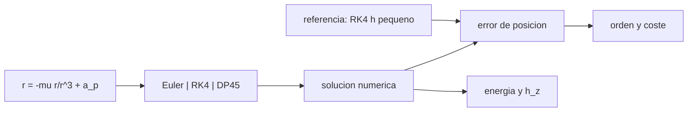

# B72-C18 — Integración numérica perturbada

<!-- nav:top -->
[🏠 Programa](../../../../README.md) · [📚 Bloque B72](../../../tronco-comun/B72-perturbaciones-y-evolucion-de-orbitas.md) · [← Anterior: B72-C17 — Efectos relativistas orbitales](../B72-C17-efectos-relativistas-orbitales/CLASE.md) · [Siguiente: B72-C19 — Análisis de sensibilidad orbital →](../B72-C19-analisis-de-sensibilidad-orbital/CLASE.md)
<!-- /nav -->

## 1. Ubicación, nivel y alcance

Clase 18 del bloque B72. Nivel N3. Cuando las perturbaciones no admiten fórmulas cerradas, la órbita se integra numéricamente: el método de Cowell suma todas las aceleraciones y avanza paso a paso. Aquí comparas Euler, RK4 de paso fijo y Dormand–Prince 5(4) de paso adaptativo, mides el orden de convergencia, el coste frente a la tolerancia y la conservación de la energía y del momento angular, que son integrales exactas del problema con J2. Sigue a [B72-C17](../B72-C17-efectos-relativistas-orbitales/CLASE.md) y prepara el análisis de sensibilidad ([C19](../B72-C19-analisis-de-sensibilidad-orbital/CLASE.md)). La órbita es sintética.

## 2. Por qué esta clase existe

Un integrador mal elegido da una órbita que parece correcta y está equivocada en kilómetros. La decisión central: **¿qué método, paso o tolerancia da el error de posición que necesita la tarea al menor coste, y cómo saber que no engaña?**

## 3. Lo que podrás hacer al terminar

1. Escribir el método de Cowell como un sistema de seis ecuaciones.
2. Implementar Euler, RK4 y Dormand–Prince 5(4).
3. Medir el orden de convergencia de RK4 con una referencia de paso pequeño.
4. Relacionar la tolerancia del paso adaptativo con el número de pasos y el error.
5. Usar la energía y la componente z del momento angular como pruebas de coherencia.
6. Distinguir lo consultado de lo ilustrativo y de lo no consultado.

La evidencia es la **ficha de integrador** del ejercicio 12 (sección 20).

## 4. Con qué llegas y cómo comprobarlo

1. ¿Qué es una ecuación diferencial ordinaria?
2. ¿Qué es el orden de un método?
3. ¿Qué es un integral de movimiento?
4. ¿Qué es un paso adaptativo?
5. ¿Qué es un valor no consultado?

<details>
<summary>Ver respuestas</summary>

1. Una ecuación que relaciona una función con sus derivadas respecto a una variable. 2. El exponente `p` tal que el error global escala como `h^p`. 3. Una magnitud que se conserva a lo largo de la solución. 4. Un paso que se reduce o amplía según una estimación del error local. 5. Uno que se usa como ilustración sin haberlo leído en una fuente.
</details>

Con cuatro o cinco aciertos, sigue; si no, repasa los prerrequisitos.

## 5. Un caso de contexto y casos de referencia

En una órbita sintética de `7500 km`, `e = 0,1` con J2, Euler explícito de `1 s` se desvía `10 448 km` en `9 h` y pierde `5,6 %` de energía; RK4 de `7,5 s` queda a `2,1 cm` de la referencia con `2,5 × 10⁻¹¹` de deriva de energía. Es el **ejemplo conductor**. La órbita es sintética.

## 6. Vocabulario

El **método de Cowell** integra directamente `r̈ = −μ r/r³ + a_p`. **Euler explícito** es de orden 1. **RK4** es de orden 4. **Dormand–Prince 5(4)** es un par encajado de órdenes 5 y 4 cuya diferencia estima el error local. Las **integrales de movimiento** de un campo axisimétrico son la energía `½v² − U` y `h_z = x v_y − y v_x`. La **tolerancia** `rtol` acota el error local relativo del paso adaptativo.

## 7. Modelo mental: caminar con pasos pequeños o grandes



*Descripción textual:* la ecuación del movimiento se integra con tres métodos; el resultado se compara con una referencia de paso pequeño y se controla con la energía y el momento angular.

Analogía: caminar hacia una meta con pasos largos ahorra tiempo pero se aleja del camino en las curvas; los pasos cortos siguen la curva pero cuestan más. Límite: la referencia es otro integrador (RK4 de `1,25 s`), no la solución exacta, y la tolerancia local no garantiza el error global.

## 8. La explicación, paso a paso

### 8.1 El sistema

Con `s = (x, y, z, vx, vy, vz)`: `ṡ = (v, −μ r/r³ + a_J2)`, con `μ = 3,986004 × 10¹⁴ m³/s²`, `R = 6 378 137 m` y `J2 = 1082,63 × 10⁻⁶`. La energía `E = ½v² − U` con `U = μ/r [1 − J2 (R/r)² P₂(z/r)]` y `h_z` se conservan exactamente en el problema axisimétrico.

### 8.2 La prueba

Órbita sintética: `a = 7500 km`, `e = 0,1`, `i = 55°`, periodo `6464,0 s`; se integran `32 400 s` (`5,01` vueltas, `9 h`). La referencia es RK4 con `h = 1,25 s` (deriva de energía `3,1 × 10⁻¹⁵`, de `h_z` `5,9 × 10⁻¹⁵`).

### 8.3 Euler

Con `h = 1 s`, Euler explícito termina a `10 448,3 km` de la referencia con una deriva de energía de `5,56 × 10⁻²`: no es utilizable.

### 8.4 RK4

| `h` (s) | pasos | error (m) | orden | `ΔE/E₀` | `Δh_z/h_z0` |
|---|---|---|---|---|---|
| 60,0 | 540 | 2,2560e+02 | — | 8,16e-07 | 3,67e-07 |
| 30,0 | 1080 | 9,1600e+00 | 4,62 | 2,55e-08 | 1,15e-08 |
| 15,0 | 2160 | 4,1844e-01 | 4,45 | 8,00e-10 | 3,58e-10 |
| 7,5 | 4320 | 2,1333e-02 | 4,29 | 2,51e-11 | 1,12e-11 |

El orden medido se acerca a 4 desde arriba al reducir `h`.

### 8.5 Dormand–Prince adaptativo

| `rtol` | pasos aceptados | error (m) | `ΔE/E₀` |
|---|---|---|---|
| 1e-05 | 102 | 3,4918e+04 | 1,80e-04 |
| 1e-07 | 264 | 2,1476e+01 | 1,63e-07 |
| 1e-09 | 678 | 9,7054e-01 | 5,16e-09 |
| 1e-11 | 1738 | 1,0734e-02 | 5,52e-11 |

La referencia RK4 de `1,25 s` tiene un error estimado de `~10⁻⁵ m` (extrapolando el orden 4). El error global es mucho mayor que la tolerancia local: con `rtol = 10⁻⁹` quedan `0,97 m`.

### 8.6 Lectura

Con el paso adaptativo se logra `1 cm` en `1738` pasos y con RK4 de paso fijo `2 cm` en `4320`. La energía y `h_z` detectan el error pero no lo cuantifican: una deriva pequeña es condición necesaria, no suficiente. Siempre hay que compararse con una referencia de mayor precisión o con otro método.

## 9. Magnitudes, símbolos y unidades

| Símbolo | Qué es | Unidad | Valor / nota |
|---|---|---|---|
| `h` | paso de integración | s | 60; 30; 15; 7,5 |
| `rtol` | tolerancia relativa | — | 1e-5 a 1e-11 |
| `E` | energía por unidad de masa | m²/s² | se conserva |
| `h_z` | componente z del momento angular | m²/s | se conserva |
| `p` | orden del método | — | 4,3–4,6 (RK4 medido) |
| error | distancia a la referencia | m | 2,1e-02 (RK4, 7,5 s) |

## 10. Convenciones y referencias

Marco inercial del ecuador de la fecha; órbita sintética con solo J2; tiempo de integración `32 400 s` (múltiplo de todos los pasos). Referencia: RK4 con `h = 1,25 s`. Dormand–Prince con coeficientes estándar, factor de seguridad `0,9`, tolerancias absolutas `1 m` en posición y `10⁻³ m/s` en velocidad multiplicadas por `rtol`. `μ`, `R` y `J2` de las fuentes de la sección 11.

## 11. De dónde sale lo que afirmamos

| ID | Fuente | Localizador | Respalda | Estado |
|---|---|---|---|---|
| S1 | NASA/NSSDC, Earth Fact Sheet — https://nssdc.gsfc.nasa.gov/planetary/factsheet/earthfact.html (consultada 2026-11-10) | ficha completa leída | masa 5,9722 × 10²⁴ kg; radio medio 6371,000 km; radio ecuatorial 6378,137 km; J2 = 1082,63 × 10⁻⁶; GM = 0,39860 × 10⁶ km³/s²; rotación sideral 23,9345 h; semieje mayor 149,598 × 10⁶ km; oblicuidad 23,44° | Consultada |
| S13 | IAU 2015 Resolución B3 (Mamajek et al.) — https://arxiv.org/abs/1510.07674 y PDF https://arxiv.org/pdf/1510.07674 (consultadas 2026-11-10; PDF extraído con PyMuPDF) | tabla de constantes de conversión | (GM)N Tierra = 3,986 004 × 10¹⁴ m³ s⁻²; (GM)N Júpiter = 1,266 865 3 × 10¹⁷ m³ s⁻²; (GM)N Sol = 1,327 124 4 × 10²⁰ m³ s⁻²; R_e Tierra nominal 6,3781 × 10⁶ m | Consultada |
| — | Coeficientes de Dormand–Prince y método de Cowell; orden de convergencia de RK4 | — | los verifica el laboratorio con convergencia y conservación de integrales | No consultada en una fuente concreta |

Límites: no se consultó ningún texto de integración numérica ni el artículo original de Dormand y Prince; los coeficientes se verifican por el comportamiento del método.

## 12. Cómo ver el orden de convergencia

| Magnitud | Valor |
|---|---|
| error de Euler, `h = 1 s` | 10 448 km |
| error RK4, `h = 7,5 s` | 2,13e-02 m |
| orden medio RK4 | 4,3–4,6 |
| DP45, `rtol = 1e-11` | 1738 pasos, 1,07e-02 m |

Descripción larga: Euler falla por miles de kilómetros, RK4 converge con orden cuatro hasta centímetros con 4320 pasos y Dormand–Prince alcanza un centímetro con 1738 pasos aceptados.

## 13. Ejemplo trabajado: estimar el orden

**Paso 1 · Errores.** `h = 30 s`: `9,16 m`; `h = 15 s`: `0,41844 m`.

**Paso 2 · Cociente.** `9,16/0,41844 = 21,89`.

**Paso 3 · Orden.** `log₂(21,89) = 4,45`.

## 14. Distintas formas de describir la calidad de una integración

**Por error de posición** frente a la referencia. **Por orden de convergencia.** **Por coste** (pasos). **Por conservación** de `E` y `h_z`. **Por tolerancia local.**

## 15. Práctica guiada

**Ejercicio 1 · con los pasos indicados.** Calcula el orden con errores `225,6 m` (60 s) y `9,16 m` (30 s). *Pasos:* `log₂(225,6/9,16)`.

<details><summary>Solución comentada</summary>

`log₂(24,63) = 4,62`.
</details>

**Ejercicio 2 · con una pista.** Si un método de orden 4 con `h = 10 s` da `1 m`, ¿qué error espera con `h = 5 s`? *Pista:* factor `2⁻⁴`.

<details><summary>Solución comentada</summary>

`0,0625 m`.
</details>

**Ejercicio 3 · casi autónomo.** ¿Por qué la energía se conserva en el problema con J2?

<details><summary>Solución comentada</summary>

Porque el campo es estático y conservativo.
</details>

## 16. Práctica autónoma, transferencia e integrador

**Ejercicio 4 · autónomo.** ¿Qué integral adicional se conserva y por qué?

<details><summary>Solución comentada</summary>

`h_z`: el campo es axisimétrico respecto al eje `z`.
</details>

**Ejercicio 5 · autónomo.** ¿Cuántas evaluaciones de aceleración por paso usa RK4? ¿Y DP45?

<details><summary>Solución comentada</summary>

RK4: 4. DP45 tal como está implementado aquí: 7 por intento de paso (con la propiedad FSAL bastarían 6).
</details>

**Ejercicio 6 · autónomo.** Si el error global es mucho mayor que `rtol`, ¿qué significa?

<details><summary>Solución comentada</summary>

Que la tolerancia controla el error local, no el global.
</details>

**Ejercicio 7 · autónomo.** Calcula el cociente de pasos entre `rtol = 1e-11` y `1e-9`.

<details><summary>Solución comentada</summary>

`1738/678 = 2,56`.
</details>

**Ejercicio 8 · autónomo.** ¿Por qué la referencia RK4 de `1,25 s` es aceptable para medir errores de `1 cm`?

<details><summary>Solución comentada</summary>

Su error estimado es `~10⁻⁵ m`, tres órdenes por debajo.
</details>

**Ejercicio 9 · transferencia.** **Transferencia.** Un equipo usa Euler con `h = 0,01 s` y dice que es suficiente. ¿Qué miden?

<details><summary>Solución comentada</summary>

Que el error sigue siendo de primer orden: lo reduce linealmente pero son `3,24 × 10⁶` pasos, unos `750` veces los de RK4 de `7,5 s`; además no conserva `E`.
</details>

**Ejercicio 10 · transferencia.** **Transferencia.** Un equipo reporta una deriva de energía de `10⁻¹²` y concluye que la posición tiene error `< 1 mm`. ¿Es válido?

<details><summary>Solución comentada</summary>

No: la energía es una condición necesaria; el error de fase puede ser mayor.
</details>

**Ejercicio 11 · transferencia.** **Transferencia.** ¿Prueba el laboratorio la integración de una órbita real?

<details><summary>Solución comentada</summary>

No: la órbita es sintética y el modelo solo tiene J2.
</details>

**Ejercicio 12 · integrador.** **Integrador.** Elabora tu *ficha de integrador*: orden medido de RK4, coste y error de DP45 por tolerancia, errores de Euler y la lista de lo consultado, lo ilustrativo y lo no consultado.

<details><summary>Solución comentada</summary>

Secciones 8.3–8.5 y la salida del laboratorio.
</details>

## 17. Laboratorio: Euler, RK4 y Dormand–Prince

El script [integracion_numerica.py](integracion_numerica.py) integra una órbita con J2 con tres métodos, mide el orden de RK4 respecto a una referencia, el coste de Dormand–Prince y la deriva de energía y de `h_z` (**comprueba** un orden medido entre `3,5` y `5,0` y un error de DP45 con `rtol = 1e-11` menor de `0,1 m`).

**Datos:** `μ`, `R` y `J2` consultados; la órbita, los pasos y las tolerancias **sintéticos**. **Predice antes de ejecutar:** ¿qué orden medirás para RK4? (≈ 4.) **Ejecución del 2026-11-10 (Python 3.12.9):**

```text
Python 3.12.9 (biblioteca estandar)
Orbita SINTETICA a = 7500 km, e = 0.1, i = 55 deg, solo J2 ; periodo kepleriano = 6464.0 s ; 5.01 vueltas (9.00 h)
Referencia: RK4 con h = 1.25 s ; |E - E0|/|E0| = 3.08e-15 ; |h_z - h_z0|/|h_z0| = 5.87e-15

Euler explicito (NO usar): h = 1 s
  error de posicion = 10448.3 km ; deriva de energia = 5.56e-02

RK4 de paso fijo: error de posicion frente a la referencia
   h [s]   pasos     error [m]   orden       dE/E0     dhz/hz0
    60.0     540    2.2560e+02       -    8.16e-07    3.67e-07
    30.0    1080    9.1600e+00    4.62    2.55e-08    1.15e-08
    15.0    2160    4.1844e-01    4.45    8.00e-10    3.58e-10
     7.5    4320    2.1333e-02    4.29    2.51e-11    1.12e-11

Dormand-Prince 5(4) adaptativo: coste y error frente a la tolerancia relativa
     rtol  pasos aceptados     error [m]       dE/E0
    1e-05              102    3.4918e+04    1.80e-04
    1e-07              264    2.1476e+01    1.63e-07
    1e-09              678    9.7054e-01    5.16e-09
    1e-11             1738    1.0734e-02    5.52e-11
(la referencia RK4 con h = 1.25 s tiene un error estimado de ~1e-5 m, extrapolando el orden 4 de la tabla anterior)
Pruebas superadas.
```

```bash
python programa/clases/B72/B72-C18-integracion-numerica-perturbada/integracion_numerica.py
```

**Límites:** la referencia es otro integrador; un solo problema y una sola órbita; sin arrastre ni terceros cuerpos.

## 18. Errores frecuentes y cómo corregirlos

**Usar Euler “porque es sencillo”.** Se corrige con 8.3.

**Confiar en la conservación de la energía como prueba de exactitud.** Se corrige con el ejercicio 10.

**Confundir la tolerancia local con el error global.** Se corrige con 8.5.

**Comparar con una referencia que no es más precisa.** Se corrige con la convención de 8.2.

## 19. Cómo sabrás que vas bien

Tras la sección 8: ¿qué orden esperabas para RK4 y cuál medías? Si dudas, repasa el ejemplo 13. Tras el laboratorio: ¿qué comprueba la convergencia? (ver la sección 17).

## 20. Qué entregas y cómo se evalúa

El producto es tu **ficha de integrador** (ejercicio 12).

| Criterio | Inicial | En desarrollo | Logrado | Destacado |
|---|---|---|---|---|
| Conceptos | Los confunde | Parciales | Elige método y estima el error | Explica los límites |
| Cálculo | Sin unidades | Con errores | Tablas completas con unidades | Calcula casos nuevos |
| Numérico | Sin comprobar | Un caso | Contraste con una segunda vía | Interpreta las diferencias |
| Fuentes | Sin fuente | Sin fecha | Fuentes con fecha y estado | Declara lo ilustrativo y lo no consultado |
| Límites | No los nombra | Uno | Tres | Discute qué falta del modelo |

**Condiciones críticas (no se compensan con promedio):** rotular la órbita como sintética; indicar que la referencia es otro integrador; no confundir conservación de integrales con exactitud; citar solo lo consultado.

## 21. Ética, seguridad y límites

Clase educativa: los modelos son simplificados y sus datos son sintéticos o ilustrativos; ningún resultado sustituye a un producto de determinación de órbita, a un servicio oficial de elementos ni a una decisión de operación de vuelo. Accesibilidad: tablas equivalentes a las gráficas, fórmulas en texto, ejercicios sin conexión.

## 22. Para cerrar y seguir

RK4 de `7,5 s` queda a `2,1 cm` de una referencia en `9 h` de una órbita sintética con J2, mientras Euler se desvía `10 448 km`. Queda una pregunta: ¿cuánto cambia el resultado al cambiar un poco las condiciones iniciales o un parámetro?

**Glosario español–inglés.** método de Cowell · *Cowell's method*; paso adaptativo · *adaptive step*; tolerancia · *tolerance*; orden de convergencia · *order of convergence*; integral de movimiento · *integral of motion*.

**Continuidad.** [B72-C19](../B72-C19-analisis-de-sensibilidad-orbital/CLASE.md) estudia el análisis de sensibilidad orbital.

**Referencias:** ver sección 11.

<!-- nav:bottom -->
---

[← Anterior: B72-C17 — Efectos relativistas orbitales](../B72-C17-efectos-relativistas-orbitales/CLASE.md) · [📚 Bloque B72](../../../tronco-comun/B72-perturbaciones-y-evolucion-de-orbitas.md) · [Siguiente: B72-C19 — Análisis de sensibilidad orbital →](../B72-C19-analisis-de-sensibilidad-orbital/CLASE.md)
<!-- /nav -->
