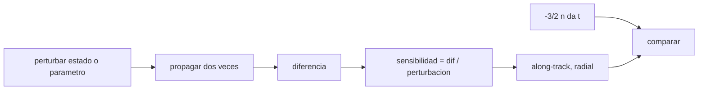

# B72-C19 — Análisis de sensibilidad orbital

<!-- nav:top -->
[🏠 Programa](../../../../README.md) · [📚 Bloque B72](../../../tronco-comun/B72-perturbaciones-y-evolucion-de-orbitas.md) · [← Anterior: B72-C18 — Integración numérica perturbada](../B72-C18-integracion-numerica-perturbada/CLASE.md) · [Siguiente: B72-C20 — Comparación de propagadores de fidelidad distinta →](../B72-C20-comparacion-de-propagadores-de-fidelidad-distinta/CLASE.md)
<!-- /nav -->

## 1. Ubicación, nivel y alcance

Clase 19 del bloque B72. Nivel N3. El análisis de sensibilidad mide cuánto cambia el estado futuro de un satélite cuando cambia un poco el estado inicial o un parámetro del modelo. Con diferencias finitas obtienes cuánto crece el error a lo largo de la trayectoria por un error de semieje, compruebas la linealidad de la respuesta a una perturbación de velocidad y mides cómo crece, con el tiempo, el error causado por el coeficiente balístico. Sigue a [B72-C18](../B72-C18-integracion-numerica-perturbada/CLASE.md) y prepara la comparación de propagadores ([C20](../B72-C20-comparacion-de-propagadores-de-fidelidad-distinta/CLASE.md)). La órbita y la atmósfera son sintéticas.

## 2. Por qué esta clase existe

Las incertidumbres de la órbita inicial y de los parámetros determinan cuánto tiempo vale una predicción. La decisión central: **¿cómo crece con el tiempo el error de posición por cada fuente de incertidumbre y cuál de ellas manda?**

## 3. Lo que podrás hacer al terminar

1. Estimar sensibilidades por diferencias finitas.
2. Explicar el crecimiento lineal en `t` del error a lo largo de la trayectoria por un error de semieje: `−3/2 n δa t`.
3. Comprobar la linealidad de la respuesta a una perturbación de velocidad pequeña.
4. Medir el crecimiento del error por el coeficiente balístico.
5. Distinguir error a lo largo de la trayectoria de error radial.
6. Distinguir lo consultado de lo ilustrativo y de lo no consultado.

La evidencia es la **ficha de sensibilidad orbital** del ejercicio 12 (sección 20).

## 4. Con qué llegas y cómo comprobarlo

1. ¿Qué es una diferencia finita?
2. ¿Qué es el error a lo largo de la trayectoria?
3. ¿Por qué un error de semieje crece con el tiempo?
4. ¿Qué es linealidad?
5. ¿Qué es un valor no consultado?

<details>
<summary>Ver respuestas</summary>

1. La aproximación de una derivada con la diferencia de dos evaluaciones: `(f(x+δ) − f(x))/δ`. 2. La componente del error en la dirección de la velocidad. 3. Porque cambia el movimiento medio `n`, y el satélite se adelanta o se retrasa. 4. Que duplicar la perturbación duplica la respuesta. 5. Uno que se usa como ilustración sin haberlo leído en una fuente.
</details>

Con cuatro o cinco aciertos, sigue; si no, repasa los prerrequisitos.

## 5. Un caso de contexto y casos de referencia

Un error de `1 m` en el semieje de una órbita baja produce `−714,9 m` de error a lo largo de la trayectoria en `5 días`, frente a `−717,2 m` de la fórmula `−3/2 n δa t` (`0,31 %`), y menos de `1,3 m` de error radial. Un `10 %` más de coeficiente balístico da `−9595 m` a los 5 días. Es el **ejemplo conductor**. La órbita y la atmósfera son sintéticas.

## 6. Vocabulario

La **sensibilidad** es la derivada del estado final respecto a un parámetro. La **matriz de transición de estado** reúne las sensibilidades respecto al estado inicial. El **error radial** es la componente del error en la dirección radial. El **crecimiento secular** es el que aumenta con `t`. La **linealidad** de la respuesta permite propagar covarianzas con la matriz de transición.

## 7. Modelo mental: dos relojes con ritmo apenas distinto



*Descripción textual:* se propagan dos órbitas con una perturbación mínima, se toma la diferencia y se descompone en dirección de la trayectoria y radial; se compara con la fórmula analítica.

Analogía: dos relojes con ritmo casi igual: la diferencia de hora crece linealmente con el tiempo, aunque cada lectura individual parezca correcta. Límite: las diferencias finitas dependen del tamaño de la perturbación (truncamiento si es grande, redondeo si es pequeña) y la linealidad solo vale para perturbaciones pequeñas.

## 8. La explicación, paso a paso

### 8.1 Montaje

Órbita sintética: `a = 6878,137 km`, `e = 0,001`, `i = 51,6°`, `n = 1,1068 × 10⁻³ rad/s`, con J2 y, en la parte 3, arrastre con una atmósfera exponencial ilustrativa (`ρ(400 km) = 3 × 10⁻¹² kg/m³`, `H = 60 km`) y `B = 45 kg/m²`. RK4 de `20 s`. Se propaga el estado nominal y el perturbado y se resta; el error se proyecta sobre la velocidad nominal (*along-track*) y sobre la dirección radial.

### 8.2 Error de semieje

Con `δa = +1 m` y sin arrastre:

| `t` (días) | along-track (m) | `−3/2 n δa t` (m) | dif. relativa | error radial (m) |
|---|---|---|---|---|
| 1 | −141,4 | −143,4 | 1,44 % | 0,91 |
| 3 | −432,0 | −430,3 | 0,40 % | 1,23 |
| 5 | −714,9 | −717,2 | 0,31 % | 0,55 |

El error radial se mantiene en metros (oscila); el de la trayectoria crece linealmente: `δn = −3/2 n δa/a` acumula `δn · a · t`.

### 8.3 Linealidad

Una perturbación de velocidad a lo largo de la trayectoria de `1`, `2` y `4 mm/s` da `255,726`, `511,452` y `1022,905 m` en un día. La razón `|δr|/δv` es `255 726 s` en los tres casos y la desviación de la linealidad es `1,5 × 10⁻⁷`.

### 8.4 Coeficiente balístico

Con arrastre, `+10 %` en `B`:

| `t` (días) | along-track (m) | cociente con 1 día | `t²` relativo |
|---|---|---|---|
| 1 | −382,64 | 1,00 | 1 |
| 3 | −3450,02 | 9,02 | 9 |
| 5 | −9595,06 | 25,08 | 25 |

El error crece como `t²` porque el decaimiento acumulado (cuadrático) es lo que cambia. Es un resultado del modelo atmosférico ilustrativo.

### 8.5 Lectura

Un error de `1 m` en `a` o de `1 mm/s` en la velocidad son típicos de una buena determinación de órbita y, sin embargo, dan cientos de metros en un día. Por eso la predicción orbital se limita a días en órbita baja con arrastre incierto, y por eso se usa la matriz de transición para propagar la covarianza. La sensibilidad depende del modelo de fuerzas: aquí es el de un modelo ilustrativo.

## 9. Magnitudes, símbolos y unidades

| Símbolo | Qué es | Unidad | Valor / nota |
|---|---|---|---|
| `δa` | error de semieje | m | 1 |
| `δv` | error de velocidad | m/s | 1e-3 a 4e-3 |
| `B` | coeficiente balístico | kg/m² | 45; 49,5 (+10 %) |
| `s` | error a lo largo de la trayectoria | m | −714,9 (5 d) |
| `n` | movimiento medio | rad/s | 1,1068e-3 |
| `Φ` | matriz de transición | — | sensibilidad del estado |

## 10. Convenciones y referencias

Marco inercial del ecuador de la fecha; órbita y atmósfera sintéticas; RK4 de `20 s`; *along-track* = componente sobre la velocidad nominal; diferencias hacia adelante con perturbaciones de `1 m`, `1–4 mm/s` y `10 %`. Tolerancias de comprobación: `5 %` en la fórmula de semieje y `10⁻³` en la linealidad.

## 11. De dónde sale lo que afirmamos

| ID | Fuente | Localizador | Respalda | Estado |
|---|---|---|---|---|
| S1 | NASA/NSSDC, Earth Fact Sheet — https://nssdc.gsfc.nasa.gov/planetary/factsheet/earthfact.html (consultada 2026-11-10) | ficha completa leída | masa 5,9722 × 10²⁴ kg; radio medio 6371,000 km; radio ecuatorial 6378,137 km; J2 = 1082,63 × 10⁻⁶; GM = 0,39860 × 10⁶ km³/s²; rotación sideral 23,9345 h; semieje mayor 149,598 × 10⁶ km; oblicuidad 23,44° | Consultada |
| S13 | IAU 2015 Resolución B3 (Mamajek et al.) — https://arxiv.org/abs/1510.07674 y PDF https://arxiv.org/pdf/1510.07674 (consultadas 2026-11-10; PDF extraído con PyMuPDF) | tabla de constantes de conversión | (GM)N Tierra = 3,986 004 × 10¹⁴ m³ s⁻²; (GM)N Júpiter = 1,266 865 3 × 10¹⁷ m³ s⁻²; (GM)N Sol = 1,327 124 4 × 10²⁰ m³ s⁻²; R_e Tierra nominal 6,3781 × 10⁶ m | Consultada |
| — | Fórmula `−3/2 n δa t`, teoría de la matriz de transición y modelo atmosférico del arrastre | — | la fórmula se verifica con el laboratorio; la atmósfera es ilustrativa | No consultada en una fuente concreta |

Límites: no se consultó ninguna determinación de órbita real ni una covarianza publicada; los valores `1 m` y `1 mm/s` son perturbaciones de laboratorio, no incertidumbres de ninguna misión.

## 12. Cómo ver el crecimiento del error

| Magnitud | Valor |
|---|---|
| along-track por `δa = 1 m`, 5 d | −714,9 m |
| fórmula `−3/2 n δa t` | −717,2 m |
| desviación de linealidad | 1,5e-07 |
| along-track por `+10 %` en `B`, 5 d | −9595 m |

Descripción larga: Un metro de error en el semieje crece a unos 700 metros en cinco días; la respuesta a perturbaciones de velocidad es lineal a siete cifras y el error por coeficiente balístico crece como t² en el modelo ilustrativo.

## 13. Ejemplo trabajado: la fórmula −3/2 n δa t

**Paso 1 · Datos.** `n = 1,1068e-3 rad/s`, `δa = 1 m`, `t = 5 días = 432 000 s`.

**Paso 2 · Producto.** `1,5 × 1,1068e-3 × 1 × 432 000 = 717,2 m`.

**Paso 3 · Signo.** `δa > 0` hace el movimiento medio menor: el satélite se retrasa, error negativo.

## 14. Distintas formas de describir la sensibilidad

**Por derivada:** `∂s/∂a₀`. **Por razón:** `|δr|/δv` en segundos. **Por fórmula analítica:** `−3/2 n t`. **Por matriz de transición.** **Por porcentaje de parámetro.**

## 15. Práctica guiada

**Ejercicio 1 · con los pasos indicados.** Calcula `1,5 n t` con `n = 1,1068e-3` y `t = 86 400 s`. *Pasos:* `1,5 × 1,1068e-3 × 86 400`.

<details><summary>Solución comentada</summary>

`143,4 m` por metro de `δa`.
</details>

**Ejercicio 2 · con una pista.** Si `δa = 3 m`, ¿cuánto vale el error a lo largo de la trayectoria en 2 días?

<details><summary>Solución comentada</summary>

`3 × 143,4 × 2 = 860 m` (en valor absoluto).
</details>

**Ejercicio 3 · casi autónomo.** ¿Por qué el error radial no crece?

<details><summary>Solución comentada</summary>

Un `δa` no cambia el tamaño medio de la órbita en la dirección radial; solo cambia el periodo.
</details>

## 16. Práctica autónoma, transferencia e integrador

**Ejercicio 4 · autónomo.** Calcula `δn` para `δa = 1 m`: `−1,5 n δa/a`.

<details><summary>Solución comentada</summary>

`−1,5 × 1,1068e-3/6 878 137 = −2,41e-10 rad/s`.
</details>

**Ejercicio 5 · autónomo.** Con `|δr|/δv = 255 726 s`, ¿cuántos metros da un error de `0,5 mm/s`?

<details><summary>Solución comentada</summary>

`127,9 m` a 1 día.
</details>

**Ejercicio 6 · autónomo.** ¿Qué indica una desviación de linealidad de `1,5e-7`?

<details><summary>Solución comentada</summary>

Que las perturbaciones usadas están en el régimen lineal.
</details>

**Ejercicio 7 · autónomo.** Si se usara `δv = 100 m/s`, ¿esperaría linealidad?

<details><summary>Solución comentada</summary>

No: las perturbaciones grandes dejan el régimen lineal.
</details>

**Ejercicio 8 · autónomo.** Un `10 %` más de `B` da `−382,6 m` en un día. ¿Cuánto da un `1 %`?

<details><summary>Solución comentada</summary>

`≈ −38 m` si la respuesta es lineal en el parámetro.
</details>

**Ejercicio 9 · transferencia.** **Transferencia.** Un equipo dice que su error de semieje es de `10 cm` y que predice a 10 días con `100 m`. ¿Es plausible sin arrastre?

<details><summary>Solución comentada</summary>

`0,1 × 1,5 × n × 864 000 = 143,4 × 10 × 0,1 = 143 m`: del orden dicho.
</details>

**Ejercicio 10 · transferencia.** **Transferencia.** ¿Por qué no sirve extrapolar los `−9595 m` de 5 días para predecir una reentrada?

<details><summary>Solución comentada</summary>

Porque el modelo de atmósfera es ilustrativo y la respuesta es no lineal en la altitud.
</details>

**Ejercicio 11 · transferencia.** **Transferencia.** ¿Prueba el laboratorio la incertidumbre de una misión concreta?

<details><summary>Solución comentada</summary>

No: la órbita, la atmósfera y las perturbaciones son sintéticas.
</details>

**Ejercicio 12 · integrador.** **Integrador.** Elabora tu *ficha de sensibilidad orbital*: error a lo largo de la trayectoria por `δa` a 1, 3 y 5 días con la fórmula, linealidad ante `δv`, efecto del `+10 %` en `B` y la lista de lo consultado, lo ilustrativo y lo no consultado.

<details><summary>Solución comentada</summary>

Secciones 8.2–8.4 y la salida del laboratorio.
</details>

## 17. Laboratorio: sensibilidad por diferencias finitas

El script [sensibilidad_orbital.py](sensibilidad_orbital.py) propaga dos órbitas con una perturbación mínima, mide el error a lo largo de la trayectoria y radial, comprueba la fórmula `−3/2 n δa t` y la linealidad, y mide el efecto de `+10 %` en `B` (**comprueba** la fórmula dentro de `5 %` y la linealidad dentro de `10⁻³`).

**Datos:** `μ`, `R` y `J2` consultados; la órbita, la atmósfera, `B` y las perturbaciones **sintéticos o ilustrativos**. **Predice antes de ejecutar:** ¿crece el error radial como el de la trayectoria? (no: se mantiene en metros.) **Ejecución del 2026-11-10 (Python 3.12.9):**

```text
Python 3.12.9 (biblioteca estandar)
Orbita SINTETICA a = 6878.137 km, e = 0.001, i = 51.6 deg ; n = 1.1068e-03 rad/s ; J2 y arrastre ILUSTRATIVO (B = 45 kg/m2) ; RK4 paso 20 s

(1) da = +1 m, sin arrastre: error a lo largo de la trayectoria frente a -3/2 n da t
 t [dias]   along-track [m]   -1.5 n da t [m]  dif. relativa  |error radial| [m]
        1            -141.4            -143.4          1.44%                0.91
        3            -432.0            -430.3          0.40%                1.23
        5            -714.9            -717.2          0.31%                0.55

(2) Perturbacion de velocidad a lo largo de la trayectoria, 1 dia: linealidad
  dv [m/s]    |dr| a 1 dia [m]     |dr|/dv [s]
     1e-03             255.726        255726.1
     2e-03             511.452        255726.2
     4e-03            1022.905        255726.3
Desviacion de la linealidad (|dr(2dv)|/(2|dr(dv)|) - 1) = 1.50e-07

(3) Con arrastre: +10 % en B, error a lo largo de la trayectoria
 t [dias]   along-track [m]  cociente con t=1 d  t^2 relativo
        1           -382.64                1.00             1
        3          -3450.02                9.02             9
        5          -9595.06               25.08            25
Con arrastre el error crece mas deprisa que t (tendiendo a t^2 si la densidad cambia poco); el valor depende de la atmosfera ilustrativa.
Pruebas superadas.
```

```bash
python programa/clases/B72/B72-C19-analisis-de-sensibilidad-orbital/sensibilidad_orbital.py
```

**Límites:** diferencias hacia adelante con perturbaciones elegidas a mano; una sola órbita; la atmósfera es ilustrativa.

## 18. Errores frecuentes y cómo corregirlos

**Medir el error solo en módulo, sin descomponerlo.** Se corrige con 8.2.

**Usar perturbaciones demasiado grandes.** Se corrige con 8.3.

**Extrapolar linealmente el efecto del arrastre.** Se corrige con 8.4.

**Confundir la perturbación del laboratorio con una incertidumbre real.** Se corrige con la sección 11.

## 19. Cómo sabrás que vas bien

Tras la sección 8: ¿cuánto esperabas que valiera el error a los cinco días y cuánto obtuviste? Si dudas, repasa el ejemplo 13. Tras el laboratorio: ¿qué comprueba la desviación de linealidad? (ver la sección 17).

## 20. Qué entregas y cómo se evalúa

El producto es tu **ficha de sensibilidad orbital** (ejercicio 12).

| Criterio | Inicial | En desarrollo | Logrado | Destacado |
|---|---|---|---|---|
| Conceptos | Los confunde | Parciales | Calcula y descompone sensibilidades | Explica los límites |
| Cálculo | Sin unidades | Con errores | Tablas completas con unidades | Calcula casos nuevos |
| Numérico | Sin comprobar | Un caso | Contraste con una segunda vía | Interpreta las diferencias |
| Fuentes | Sin fuente | Sin fecha | Fuentes con fecha y estado | Declara lo ilustrativo y lo no consultado |
| Límites | No los nombra | Uno | Tres | Discute qué falta del modelo |

**Condiciones críticas (no se compensan con promedio):** rotular la órbita, la atmósfera y las perturbaciones como sintéticas; no atribuirlas a una misión real; citar solo lo consultado.

## 21. Ética, seguridad y límites

Clase educativa: los modelos son simplificados y sus datos son sintéticos o ilustrativos; ningún resultado sustituye a un producto de determinación de órbita, a un servicio oficial de elementos ni a una decisión de operación de vuelo. Accesibilidad: tablas equivalentes a las gráficas, fórmulas en texto, ejercicios sin conexión.

## 22. Para cerrar y seguir

Un metro de error en el semieje produce `−714,9 m` a lo largo de la trayectoria en cinco días, y un `10 %` más de coeficiente balístico produce `−9595 m`, en un modelo sintético. Queda una pregunta: ¿cómo se comparan propagadores de distinta fidelidad?

**Glosario español–inglés.** sensibilidad · *sensitivity*; matriz de transición de estado · *state transition matrix*; error a lo largo de la trayectoria · *along-track error*; diferencia finita · *finite difference*; linealidad · *linearity*.

**Continuidad.** [B72-C20](../B72-C20-comparacion-de-propagadores-de-fidelidad-distinta/CLASE.md) estudia la comparación de propagadores de fidelidad distinta.

**Referencias:** ver sección 11.

<!-- nav:bottom -->
---

[← Anterior: B72-C18 — Integración numérica perturbada](../B72-C18-integracion-numerica-perturbada/CLASE.md) · [📚 Bloque B72](../../../tronco-comun/B72-perturbaciones-y-evolucion-de-orbitas.md) · [Siguiente: B72-C20 — Comparación de propagadores de fidelidad distinta →](../B72-C20-comparacion-de-propagadores-de-fidelidad-distinta/CLASE.md)
<!-- /nav -->
