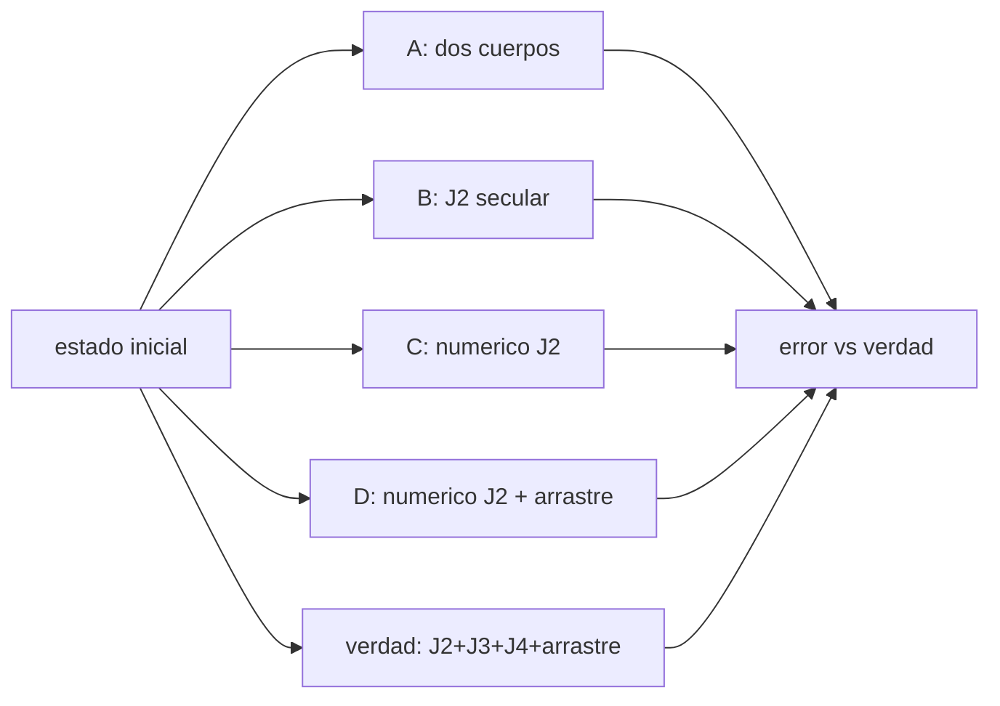

# B72-C20 — Comparación de propagadores de fidelidad distinta

<!-- nav:top -->
[🏠 Programa](../../../../README.md) · [📚 Bloque B72](../../../tronco-comun/B72-perturbaciones-y-evolucion-de-orbitas.md) · [← Anterior: B72-C19 — Análisis de sensibilidad orbital](../B72-C19-analisis-de-sensibilidad-orbital/CLASE.md) · [Siguiente: B72-C21 — Propagador SGP4 y teoría general de perturbaciones →](../B72-C21-propagador-sgp4-y-teoria-general-de-perturbaciones/CLASE.md)
<!-- /nav -->

## 1. Ubicación, nivel y alcance

Clase 20 del bloque B72. Nivel N3. Un propagador es más o menos fiel según qué fuerzas incluye y cómo las integra. Aquí armas una escalera de fidelidad (dos cuerpos analítico, J2 secular analítico, numérico con J2 y numérico con J2 y arrastre) y mides el error de cada peldaño frente a una verdad sintética con J2, J3, J4 y arrastre. Sigue a [B72-C19](../B72-C19-analisis-de-sensibilidad-orbital/CLASE.md) y prepara el propagador SGP4 ([C21](../B72-C21-propagador-sgp4-y-teoria-general-de-perturbaciones/CLASE.md)). La órbita, la atmósfera y la verdad son sintéticas; la verdad no es una observación.

## 2. Por qué esta clase existe

La fidelidad cuesta cálculo y datos: un propagador analítico es instantáneo pero erra por miles de kilómetros en días; uno numérico con muchas fuerzas es lento. La decisión central: **¿qué propagador basta para una tarea, según el horizonte de predicción y el error aceptable?**

## 3. Lo que podrás hacer al terminar

1. Describir la escalera de fidelidad de cuatro propagadores.
2. Implementar dos cuerpos analítico y J2 secular analítico.
3. Implementar un propagador numérico con zonales y arrastre.
4. Medir el error de posición de cada uno frente a una verdad sintética en 1, 3 y 7 días.
5. Explicar por qué un propagador secular alimentado con elementos osculadores puede ser peor de lo esperado.
6. Distinguir lo consultado de lo ilustrativo y de lo no consultado.

La evidencia es la **ficha de fidelidad de propagadores** del ejercicio 12 (sección 20).

## 4. Con qué llegas y cómo comprobarlo

1. ¿Qué es un propagador?
2. ¿Qué diferencia un modelo analítico de uno numérico?
3. ¿Qué es un elemento medio?
4. ¿Qué es una verdad sintética?
5. ¿Qué es un valor no consultado?

<details>
<summary>Ver respuestas</summary>

1. Un algoritmo que calcula el estado futuro de un satélite a partir del estado inicial y un modelo de fuerzas. 2. El analítico evalúa fórmulas; el numérico integra ecuaciones diferenciales paso a paso. 3. El promedio de un elemento osculador sobre el corto periodo. 4. Una solución de referencia calculada con un modelo, no medida. 5. Uno que se usa como ilustración sin haberlo leído en una fuente.
</details>

Con cuatro o cinco aciertos, sigue; si no, repasa los prerrequisitos.

## 5. Un caso de contexto y casos de referencia

En una órbita sintética de `6878 km`, a los 7 días el error frente a la verdad (J2+J3+J4+arrastre) es `4200,6 km` con dos cuerpos, `3248,7 km` con J2 secular, `236,7 km` con J2 numérico y `24,4 km` con J2 y arrastre numérico. Es el **ejemplo conductor**. Todo es sintético, la verdad no es una observación.

## 6. Vocabulario

La **fidelidad** de un propagador es cuánto se parece su modelo de fuerzas y su integración a la realidad (o a una referencia). La **verdad sintética** es la solución de un modelo más completo que se toma como referencia. El **propagador secular** avanza elementos medios con tasas de variación lineal. La **escalera de fidelidad** ordena propagadores del más simple al más completo.

## 7. Modelo mental: mapas de escala distinta



*Descripción textual:* un mismo estado inicial se propaga con cuatro modelos y con una verdad más completa; se compara el error de posición de cada uno.

Analogía: como mapas de escalas distintas del mismo terreno: el de país orienta pero erra por kilómetros; el de calle exige más datos y más tinta. Límite: la verdad es un modelo con J2, J3, J4 y un arrastre ilustrativo; sin terceros cuerpos, radiación solar ni armónicos tesserales, y no es una medición.

## 8. La explicación, paso a paso

### 8.1 Los cuatro propagadores y la verdad

Órbita sintética: `a = 6878,137 km`, `e = 0,01`, `i = 51,6°`, `Ω = 40°`, `ω = 30°`, `M = 0`. Se usa `μ = 3,986004 × 10¹⁴ m³/s²`, `R = 6 378 137 m`, `J2 = 1082,63 × 10⁻⁶`, `J3` y `J4` de WGS-72 (*Spacetrack Report 3*) y arrastre con `B = 45 kg/m²` en una atmósfera ilustrativa de `3 × 10⁻¹² kg/m³` a `400 km` y `H = 60 km`.

- **A.** Dos cuerpos analítico.
- **B.** J2 secular analítico: `Ω̇`, `ω̇` y `Ṁ` de primer orden con elementos iniciales tratados como medios.
- **C.** Numérico con J2 (RK4, `20 s`).
- **D.** Numérico con J2 y arrastre.
- **Verdad.** Numérico con J2, J3, J4 y arrastre.

### 8.2 Resultados

Error de posición respecto a la verdad (km):

| Propagador | 1 día | 3 días | 7 días | evaluaciones de aceleración |
|---|---|---|---|---|
| A dos cuerpos | 605,286 | 1774,667 | 4200,570 | 0 |
| B J2 secular | 432,028 | 1346,361 | 3248,749 | 0 |
| C numérico J2 | 2,987 | 37,222 | 236,702 | 120 960 |
| D numérico J2 + arrastre | 2,302 | 10,988 | 24,433 | 120 960 |
| verdad | — | — | — | 120 960 |

### 8.3 Por qué B queda tan lejos

B usa las tasas de J2 pero parte de los elementos osculadores como si fueran medios, y el semieje osculador difiere del medio en kilómetros: con `δa` de 2 a 3 km (orden de la oscilación de C12), el error a lo largo de la trayectoria `1,5 n δa t` alcanza `280–430 km` en un día, del orden de los `432 km` de la tabla ([C12](../B72-C12-variaciones-de-elementos-osculadores/CLASE.md) y [C19](../B72-C19-analisis-de-sensibilidad-orbital/CLASE.md)). La precesión secular es correcta, pero el error de fase domina. Un propagador secular exige elementos medios.

### 8.4 Qué aporta cada peldaño

A→C: `2,987 km` a 1 día frente a `605 km`: J2 es el salto más grande y exige integración numérica con osculadores. C→D: el arrastre reduce el error a 7 días de `236,7` a `24,4 km`. El resto (`24,4 km`) viene de J3 y J4 (y de la dinámica no lineal del arrastre con las zonales): son los peldaños siguientes de la escalera.

### 8.5 Lectura

Con arrastre y 7 días, un propagador sin las fuerzas dominantes falla por decenas de kilómetros o más. El coste computacional de C, D y la verdad es el mismo en este montaje porque el tiempo lo domina el paso fijo, pero un propagador analítico (A, B) tarda microsegundos. La elección depende del horizonte y del error aceptable; ninguno de los errores de la tabla es un error de un satélite real.

## 9. Magnitudes, símbolos y unidades

| Símbolo | Qué es | Unidad | Valor / nota |
|---|---|---|---|
| error | distancia a la verdad | km | 4200,570 (A, 7 d) |
| `B` | coeficiente balístico | kg/m² | 45 (ilustrativo) |
| `J3`, `J4` | armónicos zonales | — | −2,53881e-6; −1,65597e-6 |
| `dt` | paso de RK4 | s | 20 |
| eval. | evaluaciones de aceleración | — | 120 960 |
| `t` | horizonte | días | 1; 3; 7 |

## 10. Convenciones y referencias

Marco inercial del ecuador de la fecha; SI; órbita, atmósfera y `B` sintéticas o ilustrativas; verdad numérica con J2, J3, J4 y arrastre (no es una observación). `J2` de la ficha NASA; `J3` y `J4` de WGS-72. Propagador B con elementos iniciales tratados como medios (didáctico). RK4 de `20 s`; tolerancia de comprobación: orden estricto `A > B > C > D` a 7 días.

## 11. De dónde sale lo que afirmamos

| ID | Fuente | Localizador | Respalda | Estado |
|---|---|---|---|---|
| S1 | NASA/NSSDC, Earth Fact Sheet — https://nssdc.gsfc.nasa.gov/planetary/factsheet/earthfact.html (consultada 2026-11-10) | ficha completa leída | masa 5,9722 × 10²⁴ kg; radio medio 6371,000 km; radio ecuatorial 6378,137 km; J2 = 1082,63 × 10⁻⁶; GM = 0,39860 × 10⁶ km³/s²; rotación sideral 23,9345 h; semieje mayor 149,598 × 10⁶ km; oblicuidad 23,44° | Consultada |
| S9 | Hoots y Roehrich (1980), Spacetrack Report No. 3, paquete de T. S. Kelso (1988) — https://celestrak.org/NORAD/documentation/spacetrk.pdf (consultada 2026-11-10; texto extraído con PyMuPDF) | portada, introducción y bloque de constantes del programa de la sec. 11 | objetos casi terrestres (periodo < 225 min) y de espacio profundo (≥ 225 min); constantes WGS-72: J2 = 1,082616 × 10⁻³, J3 = −2,53881 × 10⁻⁶, J4 = −1,65597 × 10⁻⁶, KE = 0,0743669161 (radios terrestres)^{3/2}/min, radio 6378,135 km | Consultada |
| S13 | IAU 2015 Resolución B3 (Mamajek et al.) — https://arxiv.org/abs/1510.07674 y PDF https://arxiv.org/pdf/1510.07674 (consultadas 2026-11-10; PDF extraído con PyMuPDF) | tabla de constantes de conversión | (GM)N Tierra = 3,986 004 × 10¹⁴ m³ s⁻²; (GM)N Júpiter = 1,266 865 3 × 10¹⁷ m³ s⁻²; (GM)N Sol = 1,327 124 4 × 10²⁰ m³ s⁻²; R_e Tierra nominal 6,3781 × 10⁶ m | Consultada |
| — | Fórmulas secular de J2 y dos cuerpos; modelo de arrastre y valores `B` y `ρ` | — | las verifica el laboratorio contra la verdad sintética | No consultada en una fuente concreta |

Límites: no se consultó ningún propagador operativo ni datos de seguimiento; los errores no representan los de un satélite real. Los valores `J3` y `J4` son de WGS-72.

## 12. Cómo ver la escalera de fidelidad

| Magnitud | Valor |
|---|---|
| error A a 7 d | 4200,570 km |
| error B a 7 d | 3248,749 km |
| error C a 7 d | 236,702 km |
| error D a 7 d | 24,433 km |

Descripción larga: Cada peldaño de fidelidad reduce el error de posición: de miles de kilómetros con dos cuerpos a decenas de kilómetros con J2 y arrastre numéricos, siempre respecto a una verdad sintética.

## 13. Ejemplo trabajado: el salto de A a C

**Paso 1 · Error A.** `605,286 km` a 1 día.

**Paso 2 · Error C.** `2,987 km` a 1 día.

**Paso 3 · Cociente.** `605,286/2,987 = 202,6`: J2 numérico reduce el error 200 veces en un día.

## 14. Distintas formas de describir la fidelidad

**Por modelo de fuerzas:** qué términos incluye. **Por error de posición** a un horizonte. **Por coste:** evaluaciones. **Por tipo:** analítico, semi-analítico, numérico. **Por referencia:** verdad sintética u observación.

## 15. Práctica guiada

**Ejercicio 1 · con los pasos indicados.** Calcula el cociente de errores A/B a 7 días. *Pasos:* `4200,570/3248,749`.

<details><summary>Solución comentada</summary>

`1,29`.
</details>

**Ejercicio 2 · con una pista.** Calcula el cociente de errores C/D a 7 días. *Pista:* `236,702/24,433`.

<details><summary>Solución comentada</summary>

`9,69`.
</details>

**Ejercicio 3 · casi autónomo.** ¿Qué fuerza distingue D de la verdad?

<details><summary>Solución comentada</summary>

J3 y J4.
</details>

## 16. Práctica autónoma, transferencia e integrador

**Ejercicio 4 · autónomo.** ¿Por qué B es peor que C aunque ambos usan J2?

<details><summary>Solución comentada</summary>

B parte de osculadores como medios y no integra: acumula error de fase.
</details>

**Ejercicio 5 · autónomo.** Si se corrigiera el semieje inicial de B al medio, ¿qué esperarías?

<details><summary>Solución comentada</summary>

Un error mucho menor, dominado por los términos de corto periodo.
</details>

**Ejercicio 6 · autónomo.** ¿Qué error de 7 días tiene D respecto al de A, en porcentaje?

<details><summary>Solución comentada</summary>

`24,433/4200,570 = 0,58 %`.
</details>

**Ejercicio 7 · autónomo.** ¿Cuántas evaluaciones por día usa el propagador numérico con `dt = 20 s`?

<details><summary>Solución comentada</summary>

`86 400/20 × 4 = 17 280`.
</details>

**Ejercicio 8 · autónomo.** ¿Qué horizonte de 1 día permite A si se admite 1000 km?

<details><summary>Solución comentada</summary>

Solo hasta unas 1,6 días (`605 km/día`).
</details>

**Ejercicio 9 · transferencia.** **Transferencia.** Un equipo debe predecir pasos sobre una estación a 3 días con 5 km de error. ¿Qué peldaño elige?

<details><summary>Solución comentada</summary>

Ninguno de la tabla alcanza 5 km a 3 días; D da `11 km`: haría falta J3/J4 y mejores parámetros.
</details>

**Ejercicio 10 · transferencia.** **Transferencia.** Un divulgador dice que D es “exacto”. Respóndele.

<details><summary>Solución comentada</summary>

Es la más fiel de los cuatro, pero tiene `24 km` de error frente a un modelo más completo; ninguno es una medición.
</details>

**Ejercicio 11 · transferencia.** **Transferencia.** ¿Representa la tabla el error de un satélite real?

<details><summary>Solución comentada</summary>

No: la órbita, la atmósfera y la verdad son sintéticas.
</details>

**Ejercicio 12 · integrador.** **Integrador.** Elabora tu *ficha de fidelidad de propagadores*: tabla de errores a 1, 3 y 7 días de los cuatro propagadores, explicación del peor resultado de B y la lista de lo consultado, lo ilustrativo y lo no consultado.

<details><summary>Solución comentada</summary>

Secciones 8.2–8.4 y la salida del laboratorio.
</details>

## 17. Laboratorio: escalera de fidelidad

El script [comparar_propagadores.py](comparar_propagadores.py) propaga una órbita con cuatro modelos y con una verdad sintética de J2, J3, J4 y arrastre y mide el error de posición a 1, 3 y 7 días (**comprueba** el orden `A > B > C > D` a 7 días).

**Datos:** `μ`, `R`, `J2` y `J3`, `J4` (WGS-72) consultados; la órbita, `B` y la atmósfera **sintéticas o ilustrativas**; la verdad **no es una observación**. **Predice antes de ejecutar:** ¿cuál propagador tendrá el menor error? (D, el numérico con J2 y arrastre.) **Ejecución del 2026-11-10 (Python 3.12.9):**

```text
Python 3.12.9 (biblioteca estandar)
Orbita SINTETICA a = 6878.137 km, e = 0.01, i = 51.6 deg ; B = 45.0 kg/m2 y atmosfera ILUSTRATIVOS ; RK4 paso 20 s

Error de posicion respecto a la verdad sintetica (J2+J3+J4+arrastre) [km]
propagador                               1 dia    3 dias    7 dias    evaluaciones
A  dos cuerpos (analitico)             605.286  1774.667  4200.570               0
B  J2 secular (analitico)              432.028  1346.361  3248.749               0
C  numerico J2                           2.987    37.222   236.702          120960
D  numerico J2 + arrastre                2.302    10.988    24.433          120960
verdad: numerico J2+J3+J4+arrastre           -         -         -          120960

Orden de fidelidad a 7 dias: A 4200.6 km > B 3248.7 km > C 236.7 km > D 24.43 km
Pruebas superadas.
```

```bash
python programa/clases/B72/B72-C20-comparacion-de-propagadores-de-fidelidad-distinta/comparar_propagadores.py
```

**Límites:** sin terceros cuerpos, radiación solar ni armónicos tesserales; una sola órbita; paso fijo; la verdad es un modelo.

## 18. Errores frecuentes y cómo corregirlos

**Creer que un propagador secular alimentado con osculadores es fiel.** Se corrige con 8.3.

**Interpretar los errores como los de un satélite real.** Se corrige con la sección 11.

**Comparar propagadores sin declarar la referencia.** Se corrige con la sección 10.

**Ignorar el coste de cada peldaño.** Se corrige con 8.5.

## 19. Cómo sabrás que vas bien

Tras la sección 8: ¿qué propagador esperabas más fiel y cuál lo fue? Si dudas, repasa el ejemplo 13. Tras el laboratorio: ¿qué comprueba el orden de la escalera? (ver la sección 17).

## 20. Qué entregas y cómo se evalúa

El producto es tu **ficha de fidelidad de propagadores** (ejercicio 12).

| Criterio | Inicial | En desarrollo | Logrado | Destacado |
|---|---|---|---|---|
| Conceptos | Los confunde | Parciales | Ordena propagadores y mide su error | Explica los límites |
| Cálculo | Sin unidades | Con errores | Tablas completas con unidades | Calcula casos nuevos |
| Numérico | Sin comprobar | Un caso | Contraste con una segunda vía | Interpreta las diferencias |
| Fuentes | Sin fuente | Sin fecha | Fuentes con fecha y estado | Declara lo ilustrativo y lo no consultado |
| Límites | No los nombra | Uno | Tres | Discute qué falta del modelo |

**Condiciones críticas (no se compensan con promedio):** declarar que la verdad es sintética; rotular órbita, `B` y atmósfera como ilustrativos; no presentar los errores como los de un satélite real; citar solo lo consultado.

## 21. Ética, seguridad y límites

Clase educativa: los modelos son simplificados y sus datos son sintéticos o ilustrativos; ningún resultado sustituye a un producto de determinación de órbita, a un servicio oficial de elementos ni a una decisión de operación de vuelo. Accesibilidad: tablas equivalentes a las gráficas, fórmulas en texto, ejercicios sin conexión.

## 22. Para cerrar y seguir

Frente a una verdad sintética, el error a 7 días baja de `4200,6 km` con dos cuerpos a `24,4 km` con J2 y arrastre numéricos, y el propagador secular con osculadores como medios acumula `3248,7 km`. Queda una pregunta: ¿cómo funciona el propagador que usan los catálogos públicos de dos líneas?

**Glosario español–inglés.** fidelidad · *fidelity*; propagador · *propagator*; verdad sintética · *synthetic truth*; propagador secular · *secular propagator*; horizonte de predicción · *prediction horizon*.

**Continuidad.** [B72-C21](../B72-C21-propagador-sgp4-y-teoria-general-de-perturbaciones/CLASE.md) estudia el propagador SGP4 y la teoría general de perturbaciones.

**Referencias:** ver sección 11.

<!-- nav:bottom -->
---

[← Anterior: B72-C19 — Análisis de sensibilidad orbital](../B72-C19-analisis-de-sensibilidad-orbital/CLASE.md) · [📚 Bloque B72](../../../tronco-comun/B72-perturbaciones-y-evolucion-de-orbitas.md) · [Siguiente: B72-C21 — Propagador SGP4 y teoría general de perturbaciones →](../B72-C21-propagador-sgp4-y-teoria-general-de-perturbaciones/CLASE.md)
<!-- /nav -->
