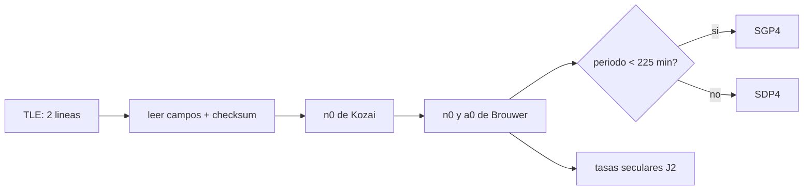

# B72-C21 — Propagador SGP4 y teoría general de perturbaciones

<!-- nav:top -->
[🏠 Programa](../../../../README.md) · [📚 Bloque B72](../../../tronco-comun/B72-perturbaciones-y-evolucion-de-orbitas.md) · [← Anterior: B72-C20 — Comparación de propagadores de fidelidad distinta](../B72-C20-comparacion-de-propagadores-de-fidelidad-distinta/CLASE.md) · [Siguiente: B73-C01 — Problema restringido de tres cuerpos →](../../../tronco-comun/B73-mecanica-celeste-resonancias-y-caos.md#b73-c01)
<!-- /nav -->

## 1. Ubicación, nivel y alcance

Clase 21 del bloque B72. Nivel N3. Los catálogos públicos de objetos en órbita publican conjuntos de elementos de dos líneas pensados para un propagador concreto: SGP4 para órbitas de periodo menor de `225 min` y SDP4 para las demás. Esos elementos son medios, no osculadores, y solo dan buenos resultados con el propagador con el que se generaron. Aquí lees un conjunto sintético, verificas su suma de comprobación, conviertes el movimiento medio de Kozai al de Brouwer con las constantes WGS-72 y comparas las tasas seculares de J2 con las de [C03](../B72-C03-perturbacion-j2-terrestre/CLASE.md). No es una implementación de SGP4 completo. Sigue a [B72-C20](../B72-C20-comparacion-de-propagadores-de-fidelidad-distinta/CLASE.md). Esta clase estaba programada por la ampliación `0.2.0` y ahora está redactada. Esta clase estaba programada por la ampliación `0.2.0` y ahora está redactada.

## 2. Por qué esta clase existe

Un error clásico es tomar los elementos de dos líneas como elementos keplerianos y propagarlos con dos cuerpos: el error es de kilómetros en minutos. La decisión central: **¿qué propagador corresponde a un conjunto de elementos y qué transformaciones previas exige antes de usarlo?**

## 3. Lo que podrás hacer al terminar

1. Leer los campos de una línea 2 y validar la suma de comprobación.
2. Convertir el movimiento medio de Kozai (publicado) a Brouwer con la inicialización de SGP4.
3. Aplicar el umbral de `225 min` para elegir SGP4 o SDP4.
4. Calcular las tasas seculares de J2 con las constantes WGS-72 y compararlas con las de C03.
5. Explicar la diferencia entre un elemento medio de SGP4 y uno osculador.
6. Distinguir lo consultado de lo ilustrativo y de lo no consultado.

La evidencia es la **ficha de elementos de dos líneas** del ejercicio 12 (sección 20).

## 4. Con qué llegas y cómo comprobarlo

1. ¿Qué es un elemento medio?
2. ¿Qué es una teoría general de perturbaciones?
3. ¿Qué es una suma de comprobación?
4. ¿Qué son k₂ y WGS-72?
5. ¿Qué es un valor no consultado?

<details>
<summary>Ver respuestas</summary>

1. El promedio de un osculador sobre las oscilaciones de corto periodo. 2. Un desarrollo analítico de las perturbaciones con parámetros ajustados a observaciones, no una integración numérica. 3. Un dígito calculado a partir de los demás que detecta errores de transcripción. 4. `k₂ = J₂/2` en unidades de radio terrestre; WGS-72 es el sistema de constantes que usa SGP4. 5. Uno que se usa como ilustración sin haberlo leído en una fuente.
</details>

Con cuatro o cinco aciertos, sigue; si no, repasa los prerrequisitos.

## 5. Un caso de contexto y casos de referencia

Un conjunto sintético (objeto `99999`, inexistente) con `n = 15,5 rev/día` tiene un semieje de Kozai `a₁ = 6794,865 km` y de Brouwer `a₀″ = 6795,376 km`; su periodo es `92,914 min` (SGP4) y la tasa del nodo con las constantes de SGP4 es `−4,9580 °/día`, `0,0001 °/día` de la de C03. Es el **ejemplo conductor**. El conjunto es sintético.

## 6. Vocabulario

El **conjunto de dos líneas** (TLE) son dos líneas de 69 caracteres con los elementos medios. **SGP4** es el modelo para periodos menores de `225 min`; **SDP4** añade efectos lunisolares y resonantes para los demás. El **movimiento medio de Kozai** es el publicado; el de **Brouwer** es el de la teoría. **B\*** es el coeficiente de arrastre. Una **teoría general de perturbaciones** resuelve analíticamente las perturbaciones con constantes ajustadas.

## 7. Modelo mental: un diccionario que solo traduce con su propio gramático



*Descripción textual:* el conjunto de dos líneas se lee y valida; el movimiento medio publicado se convierte al de Brouwer; el periodo decide entre SGP4 y SDP4; con el semieje corregido se obtienen las tasas seculares.

Analogía: un diccionario que solo traduce bien con su gramática: los elementos medios solo dan buenas posiciones con el propagador con el que se calcularon. Límite: este laboratorio solo reproduce la inicialización y las tasas seculares; SGP4 completo añade arrastre, J3, J4 y términos de corto periodo, que no se implementan ni se consultaron en detalle.

## 8. La explicación, paso a paso

### 8.1 El conjunto de dos líneas

El formato de dos líneas (Kelso, 1998) tiene campos de ancho fijo y una suma de comprobación: se suman los dígitos y cada signo `−` cuenta como `1`, módulo `10`. El laboratorio construye este conjunto **sintético**:

```text
1 99999U 26001A   26310.50000000  .00001000  00000-0  10000-4 0  9997
2 99999  51.6000 247.0000 0006000 130.0000 325.0000 15.50000000123458
```

con sumas `7` y `8` verificadas. Campos de la línea 2: `i = 51,6°`, `Ω = 247,0°`, `e = 0,0006` (decimal implícito), `ω = 130,0°`, `M = 325,0°`, `n = 15,5 rev/día`, `12345` revoluciones.

### 8.2 De Kozai a Brouwer

Con las constantes del programa de *Spacetrack Report No. 3*: `ke = 0,0743669161` (radios terrestres)^{3/2}/min, `J₂ = 1,082616 × 10⁻³`, radio `6378,135 km`; `k₂ = J₂/2`:

1. `a₁ = (ke/n₀)^{2/3}`; `δ₁ = 3 k₂ (3 cos² i − 1)/(2 a₁² (1−e²)^{3/2})`.
2. `a₀ = a₁ (1 − δ₁/3 − δ₁² − 134 δ₁³/81)`; `δ₀` con `a₀`.
3. `n₀″ = n₀/(1 + δ₀)`; `a₀″ = a₀/(1 − δ₀)`.

Resultados: `n₀ = 0,0676315085 rad/min` (`15,5 rev/día`), `a₁ = 6794,8651 km`, `a₀″ = 6795,3755 km` (diferencia `0,5104 km`), `n₀″ = 0,0676238894 rad/min` (`15,49825384 rev/día`). La tasa de anomalía media con J2 aplicada a `n₀″` devuelve `n₀` con diferencia relativa `2,5 × 10⁻⁸`: es una comprobación de autoconsistencia de la inversión, no una validación independiente.

### 8.3 SGP4 o SDP4

El periodo es `2π/n₀″ = 92,914 min`, menor de `225 min`: SGP4. El perigeo queda a `413,2 km` de altitud (sobre el radio `6378,135 km`). Con `n = 6,4 rev/día` el periodo es exactamente `225 min` y se clasifica como SDP4; `2,0057 rev/día` (`718 min`) y `1,0027 rev/día` (`1436,1 min`) también.

### 8.4 Tasas seculares

Con las constantes de SGP4: `Ω̇ = −4,9580 °/día`, `ω̇ = 3,7081 °/día`. La fórmula de C03 con `J2` de la ficha NASA y `μ` de la IAU da `Ω̇ = −4,9581 °/día`: diferencia `0,0001 °/día`.

### 8.5 Lectura

Los elementos de un TLE no son osculadores: usarlos en un propagador kepleriano o en un integrador numérico produce errores de kilómetros ([C12](../B72-C12-variaciones-de-elementos-osculadores/CLASE.md) y [C20](../B72-C20-comparacion-de-propagadores-de-fidelidad-distinta/CLASE.md)). SGP4 es una teoría general de perturbaciones: aplica fórmulas analíticas con constantes fijadas, y por eso los elementos y el propagador forman un par inseparable. La exactitud de SGP4 con datos reales no se evaluó aquí: el laboratorio no usa ningún conjunto de elementos real.

## 9. Magnitudes, símbolos y unidades

| Símbolo | Qué es | Unidad | Valor / nota |
|---|---|---|---|
| `n₀` | movimiento medio de Kozai | rad/min | 0,0676315085 |
| `n₀″` | movimiento medio de Brouwer | rad/min | 0,0676238894 |
| `a₀″` | semieje de Brouwer | km | 6795,3755 |
| `ke` | constante gravitatoria de SGP4 | (rt)^{3/2}/min | 0,0743669161 |
| `k₂` | J₂/2 | — | 5,41308e-4 |
| `B*` | coeficiente de arrastre | (rt)^{-1} | 1,0e-5 (sintético) |

## 10. Convenciones y referencias

Elementos medios del formato de dos líneas con las constantes WGS-72 de *Spacetrack Report No. 3* (radio `6378,135 km`); el conjunto es sintético (objeto `99999`); SI en la comparación con C03 (`J2` NSSDC, `μ` IAU). Tolerancias: autoconsistencia `10⁻⁵` y diferencia de nodo `0,02 °/día`.

## 11. De dónde sale lo que afirmamos

| ID | Fuente | Localizador | Respalda | Estado |
|---|---|---|---|---|
| S9 | Hoots y Roehrich (1980), Spacetrack Report No. 3, paquete de T. S. Kelso (1988) — https://celestrak.org/NORAD/documentation/spacetrk.pdf (consultada 2026-11-10; texto extraído con PyMuPDF) | portada, introducción y bloque de constantes del programa de la sec. 11 | objetos casi terrestres (periodo < 225 min) y de espacio profundo (≥ 225 min); constantes WGS-72: J2 = 1,082616 × 10⁻³, J3 = −2,53881 × 10⁻⁶, J4 = −1,65597 × 10⁻⁶, KE = 0,0743669161 (radios terrestres)^{3/2}/min, radio 6378,135 km | Consultada |
| S12 | Kelso, T. S. (1998), «Frequently Asked Questions: Two-Line Element Set Format», Satellite Times — https://celestrak.org/columns/v04n03/ (consultada 2026-11-10) | artículo completo | formato de dos líneas con campos y suma de comprobación; la línea 2 contiene elementos medios para SGP4/SDP4 | Consultada |
| S1 | NASA/NSSDC, Earth Fact Sheet — https://nssdc.gsfc.nasa.gov/planetary/factsheet/earthfact.html (consultada 2026-11-10) | ficha completa leída | masa 5,9722 × 10²⁴ kg; radio medio 6371,000 km; radio ecuatorial 6378,137 km; J2 = 1082,63 × 10⁻⁶; GM = 0,39860 × 10⁶ km³/s²; rotación sideral 23,9345 h; semieje mayor 149,598 × 10⁶ km; oblicuidad 23,44° | Consultada |
| S13 | IAU 2015 Resolución B3 (Mamajek et al.) — https://arxiv.org/abs/1510.07674 y PDF https://arxiv.org/pdf/1510.07674 (consultadas 2026-11-10; PDF extraído con PyMuPDF) | tabla de constantes de conversión | (GM)N Tierra = 3,986 004 × 10¹⁴ m³ s⁻²; (GM)N Júpiter = 1,266 865 3 × 10¹⁷ m³ s⁻²; (GM)N Sol = 1,327 124 4 × 10²⁰ m³ s⁻²; R_e Tierra nominal 6,3781 × 10⁶ m | Consultada |
| — | Fórmulas de inicialización de SGP4 (Kozai a Brouwer) como fueron escritas; SGP4 completo y SDP4; precisión con datos reales | — | la autoconsistencia se verifica en el laboratorio; el modelo completo no se implementó ni se evaluó | No consultada en una fuente concreta |

Límites: del *Spacetrack Report No. 3* se consultaron la portada, la clasificación por periodo y el bloque de constantes (texto extraído con PyMuPDF); no se leyeron las ecuaciones completas de SGP4/SDP4 ni la revisión de Vallado y colaboradores (2006). No se usó ningún conjunto de elementos real.

## 12. Cómo ver la conversión de elementos medios

| Magnitud | Valor |
|---|---|
| suma de comprobación línea 1 / 2 | 7 / 8 |
| `a₀″ − a₁` | 0,5104 km |
| periodo | 92,914 min → SGP4 |
| `Ω̇` (SGP4 vs C03) | −4,9580 / −4,9581 °/día |

Descripción larga: El semieje de Brouwer difiere del de Kozai en medio kilómetro, el periodo de 92,9 minutos corresponde al modelo cercano a la Tierra, y la tasa de nodo con las constantes de SGP4 coincide con la de C03 a una diezmilésima de grado por día.

## 13. Ejemplo trabajado: la suma de comprobación

**Paso 1 · Regla.** se suman los dígitos de los primeros 68 caracteres y `−` vale `1`; se toma el módulo 10.

**Paso 2 · Línea 1.** la suma da `…7` (verificada por el laboratorio).

**Paso 3 · Línea 2.** la suma da `…8`.

## 14. Distintas formas de describir un conjunto de elementos

**Por formato:** dos líneas de 69 caracteres. **Por tipo:** medios (Kozai) u osculadores. **Por modelo:** SGP4 o SDP4. **Por periodo:** menor o mayor de `225 min`. **Por constantes:** WGS-72.

## 15. Práctica guiada

**Ejercicio 1 · con los pasos indicados.** Convierte `15,5 rev/día` a rad/min. *Pasos:* `15,5 × 2π/1440`.

<details><summary>Solución comentada</summary>

`0,0676315 rad/min`.
</details>

**Ejercicio 2 · con una pista.** Calcula el periodo de `n = 15,5 rev/día`. *Pista:* `1440/15,5`.

<details><summary>Solución comentada</summary>

`92,9 min`.
</details>

**Ejercicio 3 · casi autónomo.** ¿Cuántas revoluciones por día tiene el límite de `225 min`?

<details><summary>Solución comentada</summary>

`1440/225 = 6,4`.
</details>

## 16. Práctica autónoma, transferencia e integrador

**Ejercicio 4 · autónomo.** Si un objeto tiene `n = 2,0057 rev/día`, ¿SGP4 o SDP4?

<details><summary>Solución comentada</summary>

SDP4 (periodo `718 min`).
</details>

**Ejercicio 5 · autónomo.** ¿Qué indica que `a₁ − a₀″ = −0,51 km`?

<details><summary>Solución comentada</summary>

El semieje de Brouwer es mayor que el de Kozai; la conversión no es despreciable.
</details>

**Ejercicio 6 · autónomo.** Calcula `k₂` con `J₂ = 1,082616e-3`.

<details><summary>Solución comentada</summary>

`5,41308e-4`.
</details>

**Ejercicio 7 · autónomo.** ¿Qué pasa si se ignora el signo `−` al calcular la suma de comprobación?

<details><summary>Solución comentada</summary>

La suma cambia y el campo falla la verificación.
</details>

**Ejercicio 8 · autónomo.** ¿Por qué `0,0001 °/día` de diferencia entre SGP4 y C03?

<details><summary>Solución comentada</summary>

Por las constantes distintas (WGS-72 frente a NSSDC/IAU).
</details>

**Ejercicio 9 · transferencia.** **Transferencia.** Un usuario toma `a = 6794,865 km` del TLE y propaga con dos cuerpos. ¿Qué error comete?

<details><summary>Solución comentada</summary>

Usa un semieje de Kozai, que no es el osculador ni el de Brouwer; el periodo y la fase divergen en kilómetros.
</details>

**Ejercicio 10 · transferencia.** **Transferencia.** Un usuario integra numéricamente el TLE como estado osculador. ¿Qué espera?

<details><summary>Solución comentada</summary>

Errores de kilómetros por mezclar elementos medios y osculadores (ver C12).
</details>

**Ejercicio 11 · transferencia.** **Transferencia.** ¿Evalúa el laboratorio la precisión de SGP4?

<details><summary>Solución comentada</summary>

No: no usa elementos reales ni implementa el modelo completo.
</details>

**Ejercicio 12 · integrador.** **Integrador.** Elabora tu *ficha de elementos de dos líneas*: campos, suma de comprobación, `a₁` y `a₀″`, periodo y modelo, tasas seculares y la lista de lo consultado, lo ilustrativo y lo no consultado.

<details><summary>Solución comentada</summary>

Secciones 8.1–8.4 y la salida del laboratorio.
</details>

## 17. Laboratorio: del TLE a los elementos de Brouwer

El script [sgp4_elementos_medios.py](sgp4_elementos_medios.py) construye un TLE sintético, valida su suma de comprobación, lee los campos, convierte el movimiento medio de Kozai a Brouwer con las constantes WGS-72, clasifica el modelo por periodo y compara las tasas seculares de J2 con las de C03 (**comprueba** las sumas, la autoconsistencia a `1e-5` y la diferencia de `0,02 °/día`).

**Datos:** Constantes de Spacetrack Report 3 consultadas; el TLE, el objeto `99999`, `B*` y los periodos de clasificación **sintéticos**. **Predice antes de ejecutar:** ¿qué modelo usa un periodo de 92,9 minutos? (SGP4.) **Ejecución del 2026-11-10 (Python 3.12.9):**

```text
Python 3.12.9 (biblioteca estandar)
TLE SINTETICO (objeto 99999 inexistente); constantes WGS-72 de Spacetrack Report No. 3
1 99999U 26001A   26310.50000000  .00001000  00000-0  10000-4 0  9997
2 99999  51.6000 247.0000 0006000 130.0000 325.0000 15.50000000123458
Suma de comprobacion: linea 1 = 7 ; linea 2 = 8 (verificadas)

Campos de la linea 2: i = 51.6 deg ; RAAN = 247.0 deg ; e = 0.0006 ; omega = 130.0 deg ; M = 325.0 deg ; n = 15.5 rev/dia ; revoluciones = 12345

Conversion de movimiento medio (inicializacion de SGP4)
  n0 (publicado, Kozai)   = 0.0676315085 rad/min = 15.50000000 rev/dia
  a1 = (ke/n0)^(2/3)      = 6794.8651 km
  a0'' (Brouwer)          = 6795.3755 km ; diferencia a1 - a0'' = -0.5104 km
  n0'' (Brouwer)          = 0.0676238894 rad/min = 15.49825384 rev/dia
  Mdot(J2) con n0'' = 0.0676315068 rad/min ; n0 publicado = 0.0676315085 ; dif. relativa = 2.54e-08 (del orden de J2^2)

Periodo nodal-kepleriano = 92.914 min -> cercano a la Tierra (SGP4) (umbral 225 min)
  semieje 6795.4 km ; perigeo 413.2 km de altitud sobre 6378.135 km

Clasificacion de otros periodos (SINTETICOS): n [rev/dia] -> periodo [min] -> modelo
   15.5000 ->     92.9 -> SGP4
    6.4000 ->    225.0 -> SDP4
    6.3000 ->    228.6 -> SDP4
    2.0057 ->    718.0 -> SDP4
    1.0027 ->   1436.1 -> SDP4

Tasas seculares de primer orden en J2 (con las constantes de SGP4)
  dOmega/dt = -4.9580 deg/dia ; domega/dt = 3.7081 deg/dia ; dM/dt = 5579.9999 deg/dia
  C03 con J2 NSSDC y mu IAU: dOmega/dt = -4.9581 deg/dia ; diferencia con SGP4 = 0.0001 deg/dia
Este laboratorio NO propaga con SGP4: faltan arrastre (B*), terminos de J3/J4, correcciones de corto periodo y lunisolares de SDP4.
Pruebas superadas.
```

```bash
python programa/clases/B72/B72-C21-propagador-sgp4-y-teoria-general-de-perturbaciones/sgp4_elementos_medios.py
```

**Límites:** no es SGP4 completo: sin arrastre, J3/J4 ni correcciones de corto periodo ni lunisolares; el elemento de prueba no es real.

## 18. Errores frecuentes y cómo corregirlos

**Tratar los elementos de un TLE como keplerianos.** Se corrige con 8.5.

**Mezclar el radio y las constantes de WGS-72 con las de otros sistemas.** Se corrige con la sección 10.

**Confundir el movimiento medio de Kozai con el de Brouwer.** Se corrige con 8.2.

**Creer que el laboratorio valida SGP4.** Se corrige con la sección 11.

## 19. Cómo sabrás que vas bien

Tras la sección 8: ¿qué modelo esperabas para 92,9 minutos y cuál resultó? Si dudas, repasa el ejemplo 13. Tras el laboratorio: ¿qué comprueba la suma de comprobación? (ver la sección 17).

## 20. Qué entregas y cómo se evalúa

El producto es tu **ficha de elementos de dos líneas** (ejercicio 12).

| Criterio | Inicial | En desarrollo | Logrado | Destacado |
|---|---|---|---|---|
| Conceptos | Los confunde | Parciales | Lee, valida y convierte un conjunto de elementos | Explica los límites |
| Cálculo | Sin unidades | Con errores | Tablas completas con unidades | Calcula casos nuevos |
| Numérico | Sin comprobar | Un caso | Contraste con una segunda vía | Interpreta las diferencias |
| Fuentes | Sin fuente | Sin fecha | Fuentes con fecha y estado | Declara lo ilustrativo y lo no consultado |
| Límites | No los nombra | Uno | Tres | Discute qué falta del modelo |

**Condiciones críticas (no se compensan con promedio):** rotular el TLE como sintético; declarar que no es SGP4 completo ni valida su precisión; citar solo lo consultado.

## 21. Ética, seguridad y límites

Clase educativa: los modelos son simplificados y sus datos son sintéticos o ilustrativos; ningún resultado sustituye a un producto de determinación de órbita, a un servicio oficial de elementos ni a una decisión de operación de vuelo. Accesibilidad: tablas equivalentes a las gráficas, fórmulas en texto, ejercicios sin conexión.

## 22. Para cerrar y seguir

Un conjunto sintético de `15,5 rev/día` se convierte de `6794,865 km` (Kozai) a `6795,376 km` (Brouwer), cae en SGP4 por su periodo de `92,914 min` y da una tasa de nodo de `−4,9580 °/día`, a una diezmilésima de la de C03. Con esto el bloque cierra el camino de la gravedad no esférica a los propagadores públicos; el siguiente bloque trata la mecánica celeste, las resonancias y el caos.

**Glosario español–inglés.** conjunto de dos líneas · *two-line element set (TLE)*; SGP4 · *SGP4*; teoría general de perturbaciones · *general perturbations theory*; movimiento medio · *mean motion*; suma de comprobación · *checksum*.

**Continuidad.** Esta es la última clase del bloque B72. El bloque siguiente es [B73](../../../tronco-comun/B73-mecanica-celeste-resonancias-y-caos.md).

**Referencias:** ver sección 11.

<!-- nav:bottom -->
---

[← Anterior: B72-C20 — Comparación de propagadores de fidelidad distinta](../B72-C20-comparacion-de-propagadores-de-fidelidad-distinta/CLASE.md) · [📚 Bloque B72](../../../tronco-comun/B72-perturbaciones-y-evolucion-de-orbitas.md) · [Siguiente: B73-C01 — Problema restringido de tres cuerpos →](../../../tronco-comun/B73-mecanica-celeste-resonancias-y-caos.md#b73-c01)
<!-- /nav -->
