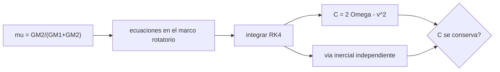

# B73-C01 — Problema restringido de tres cuerpos

<!-- nav:top -->
[🏠 Programa](../../../../README.md) · [📚 Bloque B73](../../../tronco-comun/B73-mecanica-celeste-resonancias-y-caos.md) · [← Anterior: B72-C21 — Propagador SGP4 y teoría general de perturbaciones](../../B72/B72-C21-propagador-sgp4-y-teoria-general-de-perturbaciones/CLASE.md) · [Siguiente: B73-C02 — Marcos rotatorios sinódicos →](../B73-C02-marcos-rotatorios-sinodicos/CLASE.md)
<!-- /nav -->

## 1. Ubicación, nivel y alcance

Clase 1 del bloque B73, que abre el área de mecánica celeste. Nivel N3. Tomas el problema de dos cuerpos del área A06 y le añades un tercero de masa despreciable: es el problema restringido de tres cuerpos circular (CR3BP). Aquí escribes sus ecuaciones en el marco que gira con los dos cuerpos masivos, integras una trayectoria Tierra–Luna y compruebas que la constante de Jacobi se conserva, con una segunda vía en el marco inercial. El estado inicial es **sintético**. Continúa en [B73-C02](../B73-C02-marcos-rotatorios-sinodicos/CLASE.md).

## 2. Por qué esta clase existe

Con tres cuerpos no hay solución cerrada, pero sí una cantidad conservada que organiza todo lo demás: puntos de equilibrio, regiones prohibidas y transferencias de bajo costo. La decisión central: **¿cuándo basta el modelo de tres cuerpos restringido, y cómo sé que mi integración no inventa dinámica?**

## 3. Lo que podrás hacer al terminar

1. Escribir las ecuaciones del CR3BP adimensional con el parámetro de masa `μ`.
2. Calcular `μ` del sistema Tierra–Luna con `GM` publicados.
3. Integrar una trayectoria con Runge–Kutta de orden 4 en el marco sinódico.
4. Calcular la constante de Jacobi y medir su deriva.
5. Contrastar la integración sinódica con una integración inercial independiente.
6. Estimar el orden de convergencia del integrador y declarar los supuestos del modelo.

La evidencia es la **ficha del CR3BP Tierra–Luna con control de conservación** del ejercicio 12 (sección 20).

## 4. Con qué llegas y cómo comprobarlo

1. ¿Qué es el parámetro de masa de un problema de dos cuerpos?
2. ¿Qué es un marco de referencia que gira?
3. ¿Qué es una cantidad conservada?
4. ¿Qué es un integrador de Runge–Kutta?
5. ¿Qué es un dato sintético?

<details>
<summary>Ver respuestas</summary>

1. La fracción de la masa total que tiene el cuerpo menor. 2. Uno cuyos ejes giran con velocidad angular constante respecto de un marco inercial. 3. Una función del estado que no cambia a lo largo del movimiento. 4. Un método que avanza una ecuación diferencial por pasos combinando varias evaluaciones de la derivada. 5. Un valor propuesto para el ejemplo, no medido.
</details>

Con cuatro o cinco aciertos, sigue; si no, repasa los prerrequisitos.

## 5. Un caso de contexto y casos de referencia

Con `GM` de la Luna `4902,800 km³/s²` y `GM` de la Tierra `≈ 398 600 km³/s²`, el parámetro de masa es `μ = 0,01215060`. Una masa de prueba que parte de `(0,85, 0)` con velocidad `(0, −0,40)` en el marco sinódico tiene constante de Jacobi `C = 3,030382` y tras `20` unidades de tiempo (`86,97` d) está a `108018` km de la Luna, con una deriva de `C` de `6,94e-09`. Es el **ejemplo conductor**. El estado inicial es **sintético**.

## 6. Vocabulario

El **CR3BP** estudia una masa despreciable bajo la gravedad de dos cuerpos masivos en órbita circular mutua. Su **parámetro de masa** es `μ = m₂/(m₁+m₂)`. En el **marco sinódico** (baricéntrico, rotatorio) los primarios están fijos en `(−μ, 0)` y `(1−μ, 0)`. La **constante de Jacobi** es `C = 2Ω − v²` con `Ω = (x²+y²)/2 + (1−μ)/r₁ + μ/r₂`. Las **unidades adimensionales** fijan la distancia entre primarios y la velocidad angular media en 1.

## 7. Modelo mental: una bola en un tazón que gira



*Descripción textual:* `μ` define las ecuaciones del marco rotatorio; se integra y se comprueba que `C` no cambia y que la vía inercial da el mismo resultado.

Analogía: una bola rueda en un tazón que gira: la forma del tazón (el potencial efectivo `Ω`) y un empuje lateral que no hace trabajo (Coriolis) determinan el movimiento, y la «energía» `C` se conserva. Límite: la masa de prueba no perturba a los primarios, y estos se suponen en órbita circular.

## 8. La explicación, paso a paso

### 8.1 Las ecuaciones

En el marco sinódico, con `r₁ = √((x+μ)²+y²)` y `r₂ = √((x−1+μ)²+y²)`:

`ẍ − 2ẏ = x − (1−μ)(x+μ)/r₁³ − μ(x−1+μ)/r₂³`

`ÿ + 2ẋ = y − (1−μ)y/r₁³ − μ y/r₂³`

El término `2ẏ` y `−2ẋ` es la aceleración de Coriolis; `x` e `y` son la fuerza centrífuga. Con los datos de las fichas, `μ = 0,01215060` (el cociente de masas Luna/Tierra es ≈ 0,0123, un poco mayor que `μ`, porque `μ` divide por la masa total).

### 8.2 La constante de Jacobi

Como Coriolis no hace trabajo, `C = x²+y²+2(1−μ)/r₁+2μ/r₂−(ẋ²+ẏ²)` es constante. Para el estado sintético, `C = 3,030382` y a lo largo de `20` unidades la desviación máxima es `6,94e-09`: el integrador (RK4, `dt = 10⁻³`) la conserva a la tolerancia pedida de `10⁻⁸`.

### 8.3 Segunda vía: el marco inercial

Si los primarios giran sobre círculos, `r̈ = −(1−μ)(r−r₁(t))/|r−r₁|³ − μ(r−r₂(t))/|r−r₂|³`. Se pasa el estado inicial al marco inercial (`v_in = R(v_rot + ω×r)`), se integra y se devuelve el resultado al sinódico. La diferencia máxima en el estado final es `2,43e-07`, dentro de `10⁻⁶`. Las dos vías comparten el integrador pero no las ecuaciones ni el marco: un error de signo en Coriolis aparecería aquí.

### 8.4 Orden de convergencia

Con pasos `4·10⁻³`, `2·10⁻³` y `10⁻³` las diferencias entre soluciones consecutivas dan un orden estimado `p = 4,13`, coherente con el 4 teórico de RK4.

### 8.5 Escalas físicas

La unidad de longitud es `384 400 km` y la de tiempo es `27,322 d/(2π) = 4,348 d`; la de velocidad es `1,023 km/s`. Por eso `T = 20` equivale a `86,97` d.

## 9. Magnitudes, símbolos y unidades

| Símbolo | Qué es | Unidad | Valor / nota |
|---|---|---|---|
| `μ` | parámetro de masa | — | 0,01215060 |
| `x, y` | posición en el marco sinódico | 384 400 km | adimensional |
| `vx, vy` | velocidad sinódica | 1,023 km/s | adimensional |
| `t` | tiempo | 4,348 d | adimensional |
| `C` | constante de Jacobi | — | 3,030382 |
| `p` | orden de convergencia | — | 4,13 |

## 10. Convenciones y referencias

Marco sinódico baricéntrico, ejes giratorios con los primarios en `(−μ, 0)` y `(1−μ, 0)`; unidades adimensionales (longitud = distancia Tierra–Luna media `384 400 km`, tiempo = 1/n). Masa de prueba sin masa, primarios en órbita circular (la excentricidad real de la Luna, `0,0554` en los elementos del JPL, se ignora). `GM` de la Tierra aproximado. Integrador RK4 de paso fijo.

## 11. De dónde sale lo que afirmamos

| ID | Fuente | Localizador | Respalda | Estado |
|---|---|---|---|---|
| S1 | NASA JPL SSD, Planetary Satellite Physical Parameters — https://ssd.jpl.nasa.gov/sats/phys_par/ (consultada 2026-11-10) | tabla de GM y radio medio; GM de la Luna (DE440), los galileanos (JUP365), Titán, Encélado y Mimas (SAT441) | GM de la Luna = 4902,800 ± 0,001 km³/s² (DE440); radio medio 1737,4 km | Consultada |
| S2 | NASA JPL SSD, Planetary Satellite Mean Elements — https://ssd.jpl.nasa.gov/sats/elem/ (consultada 2026-11-10) | tabla de elementos medios, época 2000-01-01.5 TDB; planos de Laplace (galileanos con JUP365, saturnianos con SAT441), eclíptica para la Luna (DE405) | semieje mayor de la Luna 384 400 km, e = 0,0554, periodo 27,322 d | Consultada |
| S3 | NASA JPL SSD, Planetary Physical Parameters — https://ssd.jpl.nasa.gov/planets/phys_par.html (consultada 2026-11-10) | tabla de masas y radios medios; registro de cambios 2019-12-12 (CODATA 2018) | masa de la Tierra del que se deduce `GM` ≈ 3,986×10⁵ km³/s² con G (CODATA 2018) | Consultada |
| — | Ecuaciones del CR3BP y constante de Jacobi (resultados clásicos de la mecánica celeste) | — | las verifica el laboratorio con una segunda vía | No consultada en una fuente concreta |

Límites: el `GM` de la Tierra es aproximado (deducido de la masa de la página, no leído como `GM`); el estado inicial es sintético; no se consultó la deducción original de las ecuaciones.

## 12. Cómo ver que la integración es fiable

| Magnitud | Valor |
|---|---|
| `μ` Tierra–Luna | 0,01215060 |
| `C` inicial | 3,030382 |
| deriva máxima de `C` | 6,94e-09 |
| diferencia sinódico/inercial | 2,43e-07 |
| orden de convergencia | 4,13 |

Descripción larga: los cinco números son los criterios de aceptación del laboratorio: `C` casi constante, dos marcos coincidentes y el orden 4 esperado.

## 13. Ejemplo trabajado: la posición de los primarios en kilómetros

**Paso 1 · Parámetro.** `μ = 4902,8/(398 600 + 4902,8) = 0,012151`.

**Paso 2 · Tierra.** Está en `x = −μ`, es decir `−0,0121506 × 384 400 ≈ −4671 km` del baricentro.

**Paso 3 · Luna.** Está en `1 − μ = 0,98785`, es decir `≈ 379 729 km` del baricentro.

**Paso 4 · Comprobación.** La suma de las distancias es `384 400 km`.

## 14. Distintas formas de describir el CR3BP

**Por fuerzas:** las ecuaciones de 8.1. **Por energía:** `C`. **Por potencial:** `Ω` y Coriolis. **Por marco:** sinódico (autónomo) o inercial (con primarios que giran).

## 15. Práctica guiada

**Ejercicio 1 · con los pasos indicados.** Calcula `μ` con `GM_Luna = 4902,8` y `GM_Tierra = 398 600`. *Pasos:* suma las dos y divide.

<details><summary>Solución comentada</summary>

`4902,8/403 502,8 = 0,012151`.
</details>

**Ejercicio 2 · con una pista.** Da la posición de la Tierra en el marco sinódico en kilómetros. *Pista:* está en `−μ` veces la unidad de longitud.

<details><summary>Solución comentada</summary>

`−0,0121506 × 384 400 ≈ −4671 km`.
</details>

**Ejercicio 3 · casi autónomo.** Con `r₁ = 0,86215` y `r₂ = 0,13785` en `(0,85, 0)` y velocidad `(0, −0,40)`, estima `C`.

<details><summary>Solución comentada</summary>

`0,7225 + 2,2916 + 0,1763 − 0,16 ≈ 3,0304`; el laboratorio da `3,030382`.
</details>

## 16. Práctica autónoma, transferencia e integrador

**Ejercicio 4 · autónomo.** Convierte la unidad de velocidad a km/s.

<details><summary>Solución comentada</summary>

`384 400 km / (4,348 d × 86 400 s/d) ≈ 1,023 km/s`; la velocidad `0,40` vale `≈ 0,409 km/s`.
</details>

**Ejercicio 5 · autónomo.** ¿A cuántos días equivale `T = 20`?

<details><summary>Solución comentada</summary>

`86,97` d (`20 × 27,322/(2π)`).
</details>

**Ejercicio 6 · autónomo.** ¿Por qué Coriolis no cambia `C`?

<details><summary>Solución comentada</summary>

Su aceleración es perpendicular a la velocidad: no hace trabajo.
</details>

**Ejercicio 7 · autónomo.** Si el paso se reduce a la mitad con RK4, ¿en cuánto baja el error?

<details><summary>Solución comentada</summary>

Un factor `2⁴ = 16` (el orden estimado es `4,13`).
</details>

**Ejercicio 8 · autónomo.** ¿Qué pasaría con `C` si olvidaras el término `x` (centrífuga) en la ecuación?

<details><summary>Solución comentada</summary>

El potencial dejaría de corresponder a `Ω` y `C` derivaría: la deriva dejaría de ser `6,9e-09`.
</details>

**Ejercicio 9 · transferencia.** **Transferencia.** Un colega integra en el marco inercial y su estado difiere `2×10⁻⁷` del sinódico. ¿Hay un error?

<details><summary>Solución comentada</summary>

No: es del orden de `2,4e-07` y cae dentro de la tolerancia `10⁻⁶`; son dos integraciones con errores de truncamiento distintos.
</details>

**Ejercicio 10 · transferencia.** **Transferencia.** ¿Es válido el CR3BP con la Luna real (`e = 0,0554`)?

<details><summary>Solución comentada</summary>

Como primera aproximación sí; para una precisión alta hay que pasar al problema restringido elíptico o a efemérides, porque los primarios no están en círculo.
</details>

**Ejercicio 11 · transferencia.** **Transferencia.** ¿Por qué `μ = 0,01215` y no `1/81,3 = 0,01230`?

<details><summary>Solución comentada</summary>

Porque `1/81,3` es el cociente de masas Luna/Tierra y `μ` divide por la masa total: `1/(1+81,3) ≈ 0,01215`.
</details>

**Ejercicio 12 · integrador.** **Integrador.** Elabora tu *ficha del CR3BP Tierra–Luna con control de conservación*: `μ`, estado inicial rotulado como sintético, `C`, deriva, diferencia entre vías, orden de convergencia y lista de supuestos.

<details><summary>Solución comentada</summary>

Secciones 8.1–8.5 y la salida del laboratorio.
</details>

## 17. Laboratorio: CR3BP Tierra–Luna, Jacobi y dos marcos

El script [tres_cuerpos.py](tres_cuerpos.py) integra la trayectoria en el marco sinódico y en el inercial, mide la deriva de `C` y estima el orden del integrador (**comprueba** `C` < `10⁻⁸`, diferencia < `10⁻⁶`, orden entre 3,5 y 4,5).

**Datos:** `GM` de la Luna, radio y elementos de la Luna del JPL (consultados); `GM` de la Tierra aproximado; estado inicial **sintético**. **Predice antes de ejecutar:** ¿cuánto valdrá la deriva de `C` con `dt = 10⁻³`? (del orden de `10⁻⁹`.) **Ejecución del 2026-11-10 (Python 3.12.9):**

```text
Python 3.12.9 (biblioteca estandar)
mu = GM_Luna/(GM_Tierra+GM_Luna) = 0.01215060  (GM_Tierra aproximado)
Estado final (T = 20.0 adimensional = 86.97 d): x = 0.873458 y = -0.256667 vx = -0.161979 vy = -0.037237
Constante de Jacobi inicial C = 3.030382 ; deriva maxima |C - C0| = 6.94e-09
Diferencia maxima entre marco sinodico e inercial en T = 2.43e-07
Orden de convergencia estimado de RK4 = 4.13
Distancia a la Luna al final = 108018 km (unidad = 384400 km)
Pruebas superadas.
```

```bash
python programa/clases/B73/B73-C01-problema-restringido-de-tres-cuerpos/tres_cuerpos.py
```

**Límites:** CR3BP circular, plano, paso fijo, `GM` de la Tierra aproximado, estado sintético.

## 18. Errores frecuentes y cómo corregirlos

**Confundir `μ` con el cociente de masas.** Se corrige con 8.1.

**Olvidar Coriolis o cambiar su signo.** Se corrige con la vía inercial de 8.3.

**Creer que `C` conservada prueba que la trayectoria es correcta.** Se corrige con 8.3: hace falta también una segunda vía.

**Presentar el estado como una trayectoria real.** Se corrige con la sección 10.

## 19. Cómo sabrás que vas bien

Tras la sección 8: ¿cuánto valía la deriva de `C` y qué esperabas? Si dudas, repasa el ejemplo 13. Tras el laboratorio: ¿qué comprueban sus tres criterios? (ver la sección 17).

## 20. Qué entregas y cómo se evalúa

El producto es tu **ficha del CR3BP Tierra–Luna con control de conservación** (ejercicio 12).

| Criterio | Inicial | En desarrollo | Logrado | Destacado |
|---|---|---|---|---|
| Conceptos | Los confunde | Parciales | Escribe el CR3BP y calcula `C` | Explica los límites |
| Cálculo | Sin unidades | Con errores | Tablas completas con unidades | Calcula casos nuevos |
| Comprobación | Sin comprobar | Un caso | Contraste con una segunda vía | Interpreta las diferencias |
| Fuentes | Sin fuente | Sin fecha | Fuentes con fecha y estado | Declara lo sintético y lo no consultado |
| Límites | No los nombra | Uno | Tres | Discute qué falta del modelo |

**Condiciones críticas (no se compensan con promedio):** rotular el estado inicial como sintético; no presentar la trayectoria como real; citar solo lo consultado y declarar el `GM` de la Tierra como aproximado.

## 21. Ética, seguridad y límites

Clase educativa: los modelos son simplificados y sus datos son publicados con fuente o sintéticos rotulados; ningún resultado describe una trayectoria real ni sirve para planificar una misión.  Accesibilidad: tablas equivalentes a las gráficas, fórmulas en texto, ejercicios sin conexión.

## 22. Para cerrar y seguir

El CR3BP Tierra–Luna con `μ = 0,012151` conserva `C = 3,030382` con una deriva de `6,9e-09` y coincide con la integración inercial en `2,4e-07`. Queda una pregunta: ¿cómo se pasa con rigor de un marco al otro?

**Glosario español–inglés.** problema restringido de tres cuerpos · *restricted three-body problem*; marco sinódico · *synodic frame*; constante de Jacobi · *Jacobi constant*; parámetro de masa · *mass parameter*; fuerza de Coriolis · *Coriolis force*.

**Continuidad.** [B73-CC02](../B73-C02-marcos-rotatorios-sinodicos/CLASE.md) estudia los marcos rotatorios sinódicos.

**Referencias:** ver sección 11.

<!-- nav:bottom -->
---

[← Anterior: B72-C21 — Propagador SGP4 y teoría general de perturbaciones](../../B72/B72-C21-propagador-sgp4-y-teoria-general-de-perturbaciones/CLASE.md) · [📚 Bloque B73](../../../tronco-comun/B73-mecanica-celeste-resonancias-y-caos.md) · [Siguiente: B73-C02 — Marcos rotatorios sinódicos →](../B73-C02-marcos-rotatorios-sinodicos/CLASE.md)
<!-- /nav -->
