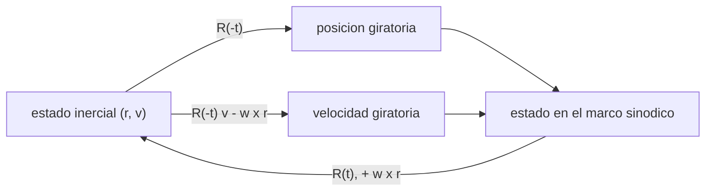

# B73-C02 — Marcos rotatorios sinódicos

<!-- nav:top -->
[🏠 Programa](../../../../README.md) · [📚 Bloque B73](../../../tronco-comun/B73-mecanica-celeste-resonancias-y-caos.md) · [← Anterior: B73-C01 — Problema restringido de tres cuerpos](../B73-C01-problema-restringido-de-tres-cuerpos/CLASE.md) · [Siguiente: B73-C03 — Puntos de equilibrio de Lagrange →](../B73-C03-puntos-de-equilibrio-de-lagrange/CLASE.md)
<!-- /nav -->

## 1. Ubicación, nivel y alcance

Clase 2 del bloque B73. Nivel N3. Sigue a [B73-C01](../B73-C01-problema-restringido-de-tres-cuerpos/CLASE.md), que escribió las ecuaciones directamente en el marco que gira con los primarios. Aquí aprendes a pasar un estado entre el marco inercial y el sinódico (posición y velocidad), a leer Coriolis y la fuerza centrífuga como aceleraciones aparentes y a calcular periodos sinódicos de pares de satélites. El satélite es **sintético**; los periodos son de la tabla del JPL.

## 2. Por qué esta clase existe

Un radar, un archivo de efemérides y un diseño de trayectoria rara vez usan el mismo marco. Confundir una velocidad inercial con una giratoria cambia el resultado en kilómetros por segundo. La decisión central: **¿en qué marco está cada número y cómo lo convierto sin perder información?**

## 3. Lo que podrás hacer al terminar

1. Transformar posición y velocidad entre el marco inercial y el sinódico.
2. Demostrar la ida y vuelta de la transformación a precisión de máquina.
3. Contrastar la fórmula de velocidad con una derivación numérica de la posición.
4. Calcular las aceleraciones de Coriolis y centrífuga de un satélite.
5. Calcular el periodo sinódico de dos cuerpos a partir de sus periodos.
6. Explicar por qué la Luna está quieta en el marco sinódico pero no en el inercial.

La evidencia es la **tabla de transformaciones con prueba de ida y vuelta** del ejercicio 12 (sección 20).

## 4. Con qué llegas y cómo comprobarlo

1. ¿Qué es una rotación en el plano?
2. ¿Qué es la velocidad angular de un marco?
3. ¿Qué es una fuerza ficticia?
4. ¿Qué es el periodo sinódico?
5. ¿Qué es una derivada por diferencias centrales?

<details>
<summary>Ver respuestas</summary>

1. Un cambio de coordenadas que gira los ejes un ángulo sin cambiar longitudes. 2. El ángulo que gira el marco por unidad de tiempo. 3. Una aceleración aparente que aparece al describir el movimiento desde un marco no inercial. 4. El tiempo entre dos alineaciones sucesivas de dos cuerpos. 5. Una estimación de la derivada con valores a ambos lados del punto.
</details>

Con cuatro o cinco aciertos, sigue; si no, repasa los prerrequisitos.

## 5. Un caso de contexto y casos de referencia

Con el periodo de la Luna de `27,322 d`, la velocidad angular del marco es `n = 2,6617e-06 rad/s` y la unidad de velocidad `1,02314 km/s`. Un satélite sintético en órbita circular inercial a `38 440 km` de la Tierra tiene `|v| = 3,2193 km/s` en el marco inercial y `3,1134 km/s` en el sinódico; sufre una aceleración de Coriolis de `1,657e-02 m/s²` y centrífuga de `2,835e-04 m/s²`. Es el **ejemplo conductor**. El satélite es **sintético**.

## 6. Vocabulario

Un **marco inercial** no acelera ni gira; el **marco sinódico** gira con velocidad angular constante `ω = n` alrededor del baricentro. Las posiciones se relacionan por una rotación `R(t)` y las velocidades por `v_rot = Rᵀ v_in − ω × r`. La **aceleración de Coriolis** es `−2ω × v_rot`; la **centrífuga**, `−ω × (ω × r)`. El **periodo sinódico** de dos cuerpos con periodos `P₁` y `P₂` cumple `1/P_sin = |1/P₁ − 1/P₂|`.

## 7. Modelo mental: un tiovivo visto desde fuera y desde dentro



*Descripción textual:* la posición se rota con `R(−t)`; la velocidad se rota y se le resta `ω × r`; la vuelta aplica las operaciones inversas.

Analogía: una persona quieta en un tiovivo ve el paisaje girar; alguien fuera ve a la persona girar. Los dos describen la misma realidad con números distintos. Límite: aquí la velocidad angular es constante y el eje pasa por el baricentro; con una velocidad angular variable aparecen más términos.

## 8. La explicación, paso a paso

### 8.1 Posición y velocidad

Con `ω = 1` (unidades adimensionales) y ángulo `t`, `x = X cos t + Y sen t`, `y = −X sen t + Y cos t`, y la velocidad `ẋ = V_X cos t + V_Y sen t + y`, `ẏ = −V_X sen t + V_Y cos t − x`. La vuelta usa `R(t)` y suma `ω × r = (−y, x)` antes de rotar. En 2000 estados aleatorios (semilla 73) la ida y vuelta tiene un error máximo de `8,88e-16`, es decir, precisión de máquina.

### 8.2 La Luna quieta y en movimiento

En el marco sinódico la Luna está en `(1−μ, 0) = (0,987849, 0)`, inmóvil. En el inercial, con el baricentro como origen, se mueve en círculo con rapidez `(1−μ) · 1,02314 km/s = 1,0107 km/s`. Es el mismo cuerpo: lo que cambia es el marco.

### 8.3 Segunda vía: derivar la posición

Para un satélite circular inercial a `0,1` unidades de la Tierra, la velocidad giratoria por diferencias centrales de la posición (con `h = 10⁻⁶`) coincide con la fórmula del apartado 8.1 con una diferencia de `6,43e-10`, dentro de la tolerancia `10⁻⁸`. Esto verifica el signo de `ω × r`, que es el error más frecuente.

### 8.4 Aceleraciones aparentes

Para ese satélite, `|v_inercial| = 3,2193 km/s` y `|v_giratoria| = 3,1134 km/s`: la velocidad sinódica es menor porque el satélite va en el mismo sentido que gira el marco. Las aceleraciones aparentes son `2 n |v_rot| = 1,657e-02 m/s²` (Coriolis) y `n² ρ = 2,835e-04 m/s²` (centrífuga); en esta órbita cercana a la Tierra ambas son pequeñas frente a la atracción terrestre.

### 8.5 Periodos sinódicos

Con los periodos de la tabla del JPL (época J2000; en [B73-C10](../B73-C10-resonancias-de-movimiento-medio/CLASE.md) se discute su uso): Io–Europa `3,5255 d`, Europa–Ganymede `6,9493 d`, Ganymede–Callisto `12,5256 d`. El de Io–Europa coincide con el periodo de Europa porque `P_Europa ≈ 2 P_Io` (adelanto de la resonancia 2:1 que verás en [B73-C10](../B73-C10-resonancias-de-movimiento-medio/CLASE.md)).

## 9. Magnitudes, símbolos y unidades

| Símbolo | Qué es | Unidad | Valor / nota |
|---|---|---|---|
| `ω = n` | velocidad angular del marco | rad/s | 2,6617e-06 |
| `R(t)` | rotación de ángulo `t` | — | adimensional |
| `v_rot` | velocidad en el marco sinódico | km/s | 3,1134 (satélite sintético) |
| `P_sin` | periodo sinódico | d | 3,5255 (Io–Europa) |
| `a_Cor` | aceleración de Coriolis | m/s² | 1,657e-02 |

## 10. Convenciones y referencias

Marco sinódico baricéntrico, sentido antihorario, eje `z` perpendicular al plano orbital de los primarios; `ω = n = 2π/P_Luna`. Unidades adimensionales con longitud `384 400 km` y velocidad `1,02314 km/s`. El satélite sintético usa solo la atracción de la Tierra para su órbita circular inercial.

## 11. De dónde sale lo que afirmamos

| ID | Fuente | Localizador | Respalda | Estado |
|---|---|---|---|---|
| S1 | NASA JPL SSD, Planetary Satellite Mean Elements — https://ssd.jpl.nasa.gov/sats/elem/ (consultada 2026-11-10) | tabla de elementos medios, época 2000-01-01.5 TDB; planos de Laplace (galileanos con JUP365, saturnianos con SAT441), eclíptica para la Luna (DE405) | periodo de la Luna 27,322 d, semieje 384 400 km; periodos de Io, Europa, Ganymede y Callisto (1,762732; 3,525463; 7,155588; 16,690440 d) | Consultada |
| S2 | NASA JPL SSD, Planetary Satellite Physical Parameters — https://ssd.jpl.nasa.gov/sats/phys_par/ (consultada 2026-11-10) | tabla de GM y radio medio; GM de la Luna (DE440), los galileanos (JUP365), Titán, Encélado y Mimas (SAT441) | GM de la Luna 4902,800 km³/s² | Consultada |
| S3 | NASA JPL SSD, Planetary Physical Parameters — https://ssd.jpl.nasa.gov/planets/phys_par.html (consultada 2026-11-10) | tabla de masas y radios medios; registro de cambios 2019-12-12 (CODATA 2018) | masa de la Tierra para `GM` ≈ 3,986×10⁵ km³/s² (aproximado) | Consultada |
| — | Transformación entre marcos inercial y giratorio, aceleraciones de Coriolis y centrífuga (cinemática clásica) | — | las verifica el laboratorio con una segunda vía | No consultada en una fuente concreta |

Límites: el satélite es sintético; el `GM` de la Tierra es aproximado; los periodos de la tabla son valores de época y no sirven como efeméride.

## 12. Cómo ver que la transformación es correcta

| Magnitud | Valor |
|---|---|
| error de ida y vuelta | 8,88e-16 |
| velocidad: fórmula frente a diferencias centrales | 6,43e-10 |
| rapidez de la Luna (inercial) | 1,0107 km/s |
| Coriolis del satélite | 1,657e-02 m/s² |
| `P_sin` Io–Europa | 3,5255 d |

Descripción larga: la transformación se verifica por su inversa y por una derivada independiente; la Luna está quieta en un marco y en movimiento en el otro.

## 13. Ejemplo trabajado: un punto fijo en el marco sinódico visto desde el inercial

**Paso 1 · Estado.** En el marco sinódico, `(x, y) = (0,5, 0)` en reposo, en `t = π/2`.

**Paso 2 · Posición inercial.** Se rota `90°`: `(X, Y) = (0, 0,5)`.

**Paso 3 · Velocidad inercial.** Al estar en reposo, la velocidad inercial es `ω × r = (−y, x) = (0, 0,5)` en el sinódico, rotada `90°`: `(−0,5, 0)`.

**Paso 4 · Interpretación.** Un punto fijo del marco sinódico recorre un círculo en el inercial con rapidez `ω r = 0,5` (unidades adimensionales).

## 14. Distintas formas de describir un estado orbital

**Inercial:** (r, v) sin fuerzas ficticias. **Sinódico:** (r, v) con Coriolis y centrífuga. **Elementos orbitales:** respecto del cuerpo central. **Por periodos:** el sinódico de un par.

## 15. Práctica guiada

**Ejercicio 1 · con los pasos indicados.** Calcula `n` en rad/s. *Pasos:* `2π/(27,322 × 86 400 s)`.

<details><summary>Solución comentada</summary>

`2,6617e-06 rad/s`.
</details>

**Ejercicio 2 · con una pista.** Pasa al marco inercial el punto del ejemplo 13 en `t = π/2`. *Pista:* rota 90° la posición y suma `ω × r` a la velocidad antes de rotar.

<details><summary>Solución comentada</summary>

Posición `(0, 0,5)`, velocidad `(−0,5, 0)`.
</details>

**Ejercicio 3 · casi autónomo.** ¿Con qué rapidez se mueve la Luna en el marco inercial baricéntrico?

<details><summary>Solución comentada</summary>

`(1 − μ) n a = 1,0107 km/s`.
</details>

## 16. Práctica autónoma, transferencia e integrador

**Ejercicio 4 · autónomo.** Calcula la aceleración de Coriolis de un cuerpo que se mueve a `3 km/s` en el marco sinódico.

<details><summary>Solución comentada</summary>

`2 n v = 2 × 2,6617e-06 × 3000 m/s ≈ 1,60×10⁻² m/s²`.
</details>

**Ejercicio 5 · autónomo.** ¿Por qué la velocidad sinódica del satélite es menor que la inercial?

<details><summary>Solución comentada</summary>

Porque el satélite va en el sentido de giro del marco: se le resta `ω × r`.
</details>

**Ejercicio 6 · autónomo.** Periodo sinódico Europa–Ganymede.

<details><summary>Solución comentada</summary>

`6,9493 d`.
</details>

**Ejercicio 7 · autónomo.** Periodo sinódico Ganymede–Callisto.

<details><summary>Solución comentada</summary>

`12,5256 d`.
</details>

**Ejercicio 8 · autónomo.** ¿Qué pasa con el periodo sinódico si `P₁ = P₂`?

<details><summary>Solución comentada</summary>

Es infinito: los dos cuerpos nunca se separan.
</details>

**Ejercicio 9 · transferencia.** **Transferencia.** Una estación entrega una posición y una velocidad inercial. ¿Qué haces para integrarlas en el CR3BP de [B73-C01](../B73-C01-problema-restringido-de-tres-cuerpos/CLASE.md)?

<details><summary>Solución comentada</summary>

Rotas la posición con `R(−t)`, restas `ω × r` a la velocidad rotada y adimensionalizas con la distancia y `n`; al terminar, haces lo inverso.
</details>

**Ejercicio 10 · transferencia.** **Transferencia.** Un colega dice que la fuerza centrífuga «empuja» a la nave. ¿Es una fuerza real?

<details><summary>Solución comentada</summary>

No: es una aceleración aparente por describir el movimiento en un marco que gira; en el inercial no existe.
</details>

**Ejercicio 11 · transferencia.** **Transferencia.** Alguien afirma que la Luna «no se mueve» en el marco sinódico, así que no tiene velocidad. Respóndele.

<details><summary>Solución comentada</summary>

Su velocidad es cero respecto del marco sinódico, pero en el inercial vale `1,0107 km/s`: una velocidad depende del marco.
</details>

**Ejercicio 12 · integrador.** **Integrador.** Elabora tu *tabla de transformaciones con prueba de ida y vuelta*: el estado sintético en ambos marcos, el error de ida y vuelta, la verificación por derivación, las aceleraciones aparentes y los periodos sinódicos.

<details><summary>Solución comentada</summary>

Secciones 8.1–8.5 y la salida del laboratorio.
</details>

## 17. Laboratorio: transformación entre marcos y periodos sinódicos

El script [marcos_sinodicos.py](marcos_sinodicos.py) transforma 2000 estados aleatorios (semilla 73) con su inversa, verifica la fórmula de velocidad por derivación numérica y calcula los periodos sinódicos (**comprueba** ida y vuelta < `10⁻¹²`, velocidad < `10⁻⁸`, `P_sin(Io–Europa) ≈ P_Europa`).

**Datos:** periodos y semiejes del JPL (consultados); `GM` de la Tierra aproximado; satélite y estados aleatorios **sintéticos**. **Predice antes de ejecutar:** ¿cuánto valdrá el periodo sinódico Io–Europa? (el de Europa, `3,5255 d`.) **Ejecución del 2026-11-10 (Python 3.12.9):**

```text
Python 3.12.9 (biblioteca estandar)
mu = 0.01215060 ; n = 2.661667e-06 rad/s ; unidad de velocidad = 1.02314 km/s
Ida y vuelta (2000 estados, semilla 73): error maximo = 8.88e-16
Luna: fija en (1-mu, 0) = (0.987849, 0); en el marco inercial se mueve a 1.0107 km/s (baricentrico)
Velocidad giratoria: diferencias centrales -2.91665123, -0.86777775 ; formula -2.91665123, -0.86777775 ; diferencia = 6.43e-10
Satelite sintetico a 38 440 km de la Tierra: |v_inercial| = 3.2193 km/s ; |v_giratoria| = 3.1134 km/s
Aceleraciones aparentes (m/s2): Coriolis = 1.657e-02 ; centrifuga = 2.835e-04
Periodos sinodicos (d), 1/Psin = |1/P1 - 1/P2| :
  Io-Europa: 3.5255 d
  Europa-Ganymede: 6.9493 d
  Ganymede-Callisto: 12.5256 d
Pruebas superadas.
```

```bash
python programa/clases/B73/B73-C02-marcos-rotatorios-sinodicos/marcos_sinodicos.py
```

**Límites:** velocidad angular constante, plano, eje por el baricentro, satélite sintético.

## 18. Errores frecuentes y cómo corregirlos

**Olvidar `ω × r` al transformar la velocidad.** Se corrige con 8.3.

**Creer que la fuerza centrífuga es real.** Se corrige con el ejercicio 10.

**Mezclar unidades adimensionales con kilómetros.** Se corrige con la sección 9.

**Usar el periodo sidéreo por el sinódico.** Se corrige con 8.5.

## 19. Cómo sabrás que vas bien

Tras la sección 8: ¿qué periodo sinódico esperabas para Io–Europa y cuál obtuviste? Si dudas, repasa el ejemplo 13. Tras el laboratorio: ¿qué comprueba? (ver la sección 17).

## 20. Qué entregas y cómo se evalúa

El producto es tu **tabla de transformaciones con prueba de ida y vuelta** (ejercicio 12).

| Criterio | Inicial | En desarrollo | Logrado | Destacado |
|---|---|---|---|---|
| Conceptos | Los confunde | Parciales | Transforma posición y velocidad | Explica los límites |
| Cálculo | Sin unidades | Con errores | Tablas completas con unidades | Calcula casos nuevos |
| Comprobación | Sin comprobar | Un caso | Contraste con una segunda vía | Interpreta las diferencias |
| Fuentes | Sin fuente | Sin fecha | Fuentes con fecha y estado | Declara lo sintético y lo no consultado |
| Límites | No los nombra | Uno | Tres | Discute qué falta del modelo |

**Condiciones críticas (no se compensan con promedio):** rotular el satélite como sintético; no confundir un marco con otro al reportar velocidades; citar solo lo consultado y declarar el `GM` de la Tierra como aproximado.

## 21. Ética, seguridad y límites

Clase educativa: los modelos son simplificados y sus datos son publicados con fuente o sintéticos rotulados; ningún resultado describe una trayectoria real ni sirve para planificar una misión.  Accesibilidad: tablas equivalentes a las gráficas, fórmulas en texto, ejercicios sin conexión.

## 22. Para cerrar y seguir

La transformación entre marcos recupera el estado con un error de `8,9e-16`, la Luna pasa de estar quieta a moverse a `1,011 km/s` al cambiar de marco, y los periodos sinódicos de los galileanos salen de sus periodos medios. Queda una pregunta: ¿dónde puede quedarse quieto un tercer cuerpo en el marco sinódico?

**Glosario español–inglés.** marco inercial · *inertial frame*; marco sinódico · *synodic frame*; aceleración de Coriolis · *Coriolis acceleration*; fuerza centrífuga · *centrifugal force*; periodo sinódico · *synodic period*.

**Continuidad.** [B73-CC03](../B73-C03-puntos-de-equilibrio-de-lagrange/CLASE.md) localiza los puntos de equilibrio de Lagrange.

**Referencias:** ver sección 11.

<!-- nav:bottom -->
---

[← Anterior: B73-C01 — Problema restringido de tres cuerpos](../B73-C01-problema-restringido-de-tres-cuerpos/CLASE.md) · [📚 Bloque B73](../../../tronco-comun/B73-mecanica-celeste-resonancias-y-caos.md) · [Siguiente: B73-C03 — Puntos de equilibrio de Lagrange →](../B73-C03-puntos-de-equilibrio-de-lagrange/CLASE.md)
<!-- /nav -->
