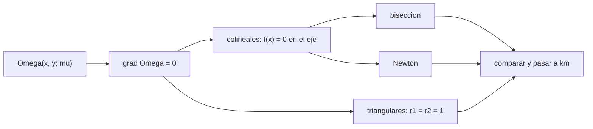

# B73-C03 — Puntos de equilibrio de Lagrange

<!-- nav:top -->
[🏠 Programa](../../../../README.md) · [📚 Bloque B73](../../../tronco-comun/B73-mecanica-celeste-resonancias-y-caos.md) · [← Anterior: B73-C02 — Marcos rotatorios sinódicos](../B73-C02-marcos-rotatorios-sinodicos/CLASE.md) · [Siguiente: B73-C04 — Estabilidad local de Lagrange →](../B73-C04-estabilidad-local-de-lagrange/CLASE.md)
<!-- /nav -->

## 1. Ubicación, nivel y alcance

Clase 3 del bloque B73. Nivel N3. Sigue a [B73-C02](../B73-C02-marcos-rotatorios-sinodicos/CLASE.md): en el marco sinódico un tercer cuerpo puede quedarse quieto. Aquí localizas los cinco puntos de equilibrio de Lagrange en tres sistemas (Tierra–Luna, Sol–Tierra y Sol–Júpiter) con dos métodos numéricos, los comparas con la aproximación de Hill y contrastas la distancia Sol–Tierra L2 con la que da la NASA para el telescopio Webb. Los sistemas usan `GM` y distancias publicados; no hay datos sintéticos.

## 2. Por qué esta clase existe

Los puntos de Lagrange son donde se estacionan observatorios y donde se acumulan asteroides troyanos. Un error de signo en la ecuación mueve L2 al otro lado. La decisión central: **¿dónde están los cinco puntos y cuánto vale su distancia en kilómetros?**

## 3. Lo que podrás hacer al terminar

1. Escribir la condición de equilibrio del potencial efectivo.
2. Hallar L1, L2 y L3 por bisección y por Newton y compararlos.
3. Ubicar L4 y L5 como vértices de triángulos equiláteros y comprobarlo con el gradiente.
4. Convertir las posiciones adimensionales a kilómetros en tres sistemas.
5. Comparar L1 con la aproximación de Hill `(μ/3)^(1/3)`.
6. Contrastar L2 Sol–Tierra con el dato publicado para Webb.

La evidencia es la **tabla de L1–L5 de Tierra–Luna y Sol–Tierra** del ejercicio 12 (sección 20).

## 4. Con qué llegas y cómo comprobarlo

1. ¿Qué es un punto de equilibrio en el marco sinódico?
2. ¿Qué es el parámetro `μ`?
3. ¿Qué es el método de bisección?
4. ¿Qué es el método de Newton?
5. ¿Qué es un triángulo equilátero?

<details>
<summary>Ver respuestas</summary>

1. Un punto donde la aceleración y la velocidad son cero: allí las fuerzas gravitacionales y la centrífuga se cancelan. 2. La fracción de masa del primario menor: `m₂/(m₁+m₂)`. 3. Encerrar una raíz entre dos puntos de signos opuestos y reducir el intervalo a la mitad. 4. Iterar `x ← x − f(x)/f′(x)` hasta que el paso es pequeño. 5. Uno con los tres lados iguales.
</details>

Con cuatro o cinco aciertos, sigue; si no, repasa los prerrequisitos.

## 5. Un caso de contexto y casos de referencia

Para Tierra–Luna (`μ = 1,215060e-02`) L1 está en `x = 0,83691507` (a `58 019` km de la Luna) y L2 en `1,15568221` (`64 515` km más allá). Para Sol–Tierra (`μ = 3,003487e-06`) L2 queda a `1 501 554` km de la Tierra, frente a «unos 1,5 millones de km» que da la NASA para Webb. Es el **ejemplo conductor**. Los `GM` y las distancias son publicados.

## 6. Vocabulario

Un **punto de Lagrange** es un equilibrio del potencial efectivo `Ω`: `∇Ω = 0`. Los **colineales** L1, L2, L3 están sobre el eje que une los primarios; los **triangulares** L4 y L5 forman con ellos un triángulo equilátero. La **aproximación de Hill** da la distancia de L1 y L2 al primario menor como `(μ/3)^(1/3)` unidades cuando `μ` es pequeño.

## 7. Modelo mental: un mapa de colinas con cinco llanos



*Descripción textual:* el gradiente nulo del potencial da una ecuación de una variable para L1–L3 y un triángulo equilátero para L4–L5; los colineales se resuelven por dos métodos y se pasan a kilómetros.

Analogía: en un mapa de colinas con un tazón que gira, los equilibrios son los puntos llanos: hay tres puertos de montaña sobre la línea que une las dos colinas grandes y dos hondonadas laterales. Límite: el equilibrio no dice si un cuerpo se queda allí; eso lo decide la estabilidad ([B73-C04](../B73-C04-estabilidad-local-de-lagrange/CLASE.md)).

## 8. La explicación, paso a paso

### 8.1 Los colineales

En el eje (`y = 0`) el equilibrio exige `x − (1−μ)(x+μ)/|x+μ|³ − μ(x−1+μ)/|x−1+μ|³ = 0`. Hay una raíz entre los primarios (L1), una más allá del menor (L2) y una más allá del mayor (L3). Con bisección y con Newton las tres raíces coinciden a `2,2e-16` en los tres sistemas.

### 8.2 Los triangulares

Con `r₁ = r₂ = 1` el gradiente se anula en `(1/2 − μ, ±√3/2)`. En los 15 puntos del laboratorio (cinco por sistema) el gradiente máximo es `1,1e-15`, cero a precisión de máquina.

### 8.3 Tres sistemas

| Sistema | `μ` | L1 (`x`) | L2 (`x`) | L3 (`x`) | L1 a (km) | L2 a (km) |
|---|---|---|---|---|---|---|
| Tierra–Luna | 1,2151e-02 | 0,836915 | 1,155682 | -1,005063 | 58 019 | 64 515 |
| Sol–Tierra | 3,0035e-06 | 0,990027 | 1,010034 | -1,000001 | 1 491 573 | 1 501 554 |
| Sol–Júpiter | 9,5369e-04 | 0,932370 | 1,068826 | -1,000397 | 51 907 525 | 54 323 567 |

Las distancias se miden desde el cuerpo menor. L2 queda siempre más lejos que L1 porque en L2 la atracción del menor se suma a la del mayor y hace falta un radio mayor para mantener el mismo periodo.

### 8.4 Aproximación de Hill

`(μ/3)^(1/3)` vale `0,159401` (Tierra–Luna), `0,010004` (Sol–Tierra) y `0,068249` (Sol–Júpiter). La distancia real de L1 al menor difiere de ella en `5,3%`, `0,3%` y `2,3%`: la aproximación mejora al bajar `μ`.

### 8.5 Contraste con un dato publicado

La NASA describe a Webb en el L2 Sol–Tierra a «unos 1,5 millones de km» de la Tierra; el cálculo da `1 501 554` km con `a = 149,6×10⁶ km`. La coincidencia es de orden de magnitud y de cifra redondeada, no una verificación fina: la página no da más cifras y Webb recorre una órbita alrededor de L2 de tamaño comparable a la órbita lunar.

## 9. Magnitudes, símbolos y unidades

| Símbolo | Qué es | Unidad | Valor / nota |
|---|---|---|---|
| `μ` | parámetro de masa | — | 1,2151e-02 (Tierra–Luna) |
| `L1, L2, L3` | abscisa de los colineales | distancia entre primarios | ver 8.3 |
| `L4, L5` | triangulares | distancia entre primarios | (½ − μ, ±√3/2) |
| `d` | distancia entre primarios | km | 384 400; 149,6×10⁶; 778,5×10⁶ |
| `(μ/3)^(1/3)` | radio de Hill adimensional | — | 0,159401 |

## 10. Convenciones y referencias

Marco sinódico baricéntrico, primarios en `(−μ, 0)` y `(1−μ, 0)`, distancia entre primarios como unidad. Las distancias entre primarios usan las tablas citadas (Sol–Tierra y Sol–Júpiter: «distancia al Sol» de la ficha de planetas, que no es el semieje mayor exacto). `GM` de la Tierra aproximado.

## 11. De dónde sale lo que afirmamos

| ID | Fuente | Localizador | Respalda | Estado |
|---|---|---|---|---|
| S1 | NASA/NSSDC, Sun Fact Sheet — https://nssdc.gsfc.nasa.gov/planetary/factsheet/sunfact.html (consultada 2026-11-10) | ficha leída; actualizada el 2024-05-09 | GM del Sol = 132 712 × 10⁶ km³/s² | Consultada |
| S2 | NASA/NSSDC, Jupiter Fact Sheet — https://nssdc.gsfc.nasa.gov/planetary/factsheet/jupiterfact.html (consultada 2026-11-10) | ficha leída; actualizada el 2024-10-02 | GM de Júpiter = 126,687 × 10⁶ km³/s² | Consultada |
| S3 | NASA JPL SSD, Planetary Satellite Physical Parameters — https://ssd.jpl.nasa.gov/sats/phys_par/ (consultada 2026-11-10) | tabla de GM y radio medio; GM de la Luna (DE440), los galileanos (JUP365), Titán, Encélado y Mimas (SAT441) | GM de la Luna = 4902,800 km³/s² | Consultada |
| S4 | NASA JPL SSD, Planetary Satellite Mean Elements — https://ssd.jpl.nasa.gov/sats/elem/ (consultada 2026-11-10) | tabla de elementos medios, época 2000-01-01.5 TDB; planos de Laplace (galileanos con JUP365, saturnianos con SAT441), eclíptica para la Luna (DE405) | semieje mayor de la Luna, 384 400 km | Consultada |
| S5 | NASA/NSSDC, Planetary Fact Sheet (métrico) — https://nssdc.gsfc.nasa.gov/planetary/factsheet/ (consultada 2026-11-10) | tabla comparativa leída; actualizada el 2025-03-18 | distancia al Sol de la Tierra 149,6×10⁶ km y de Júpiter 778,5×10⁶ km | Consultada |
| S6 | NASA, Webb orbit — https://science.nasa.gov/mission/webb/orbit/ (consultada 2026-11-10) | página leída completa | Webb en L2, a unos 1,5 millones de km de la Tierra | Consultada |
| S7 | NASA JPL SSD, Planetary Physical Parameters — https://ssd.jpl.nasa.gov/planets/phys_par.html (consultada 2026-11-10) | tabla de masas y radios medios; registro de cambios 2019-12-12 (CODATA 2018) | masa de la Tierra para `GM` ≈ 3,986×10⁵ km³/s² (aproximado) | Consultada |
| — | Condición de equilibrio de Lagrange y aproximación de Hill | — | las verifica el laboratorio con una segunda vía | No consultada en una fuente concreta |

Límites: la «distancia al Sol» de las fichas no es el semieje mayor exacto; el `GM` de la Tierra es aproximado; no se consultó la deducción original de Lagrange.

## 12. Cómo ver los cinco puntos

| Magnitud | Valor |
|---|---|
| L1 Tierra–Luna | `x = 0,836915` (58 019 km de la Luna) |
| L2 Sol–Tierra | 1 501 554 km de la Tierra |
| gradiente máximo | 1,1e-15 |
| bisección − Newton | 2,2e-16 |
| L1 frente a Hill (Sol–Tierra) | 0,3% |

Descripción larga: las tres raíces coinciden por dos métodos, el gradiente es nulo en los 15 puntos y L2 Sol–Tierra cae a 1,5 millones de kilómetros.

## 13. Ejemplo trabajado: L2 Sol–Tierra en kilómetros

**Paso 1 · Parámetro.** `μ = 398 600/(132 712×10⁶ + 398 600) = 3,003487e-06`.

**Paso 2 · Hill.** `(μ/3)^(1/3) = 0,010004`.

**Paso 3 · Raíz.** La raíz exacta de L2 está en `x − (1−μ) = 1 501 554/149 600 000 = 0,0100`.

**Paso 4 · Kilómetros.** `≈ 1,50 × 10⁶ km` de la Tierra, la cifra de la NASA para Webb.

## 14. Distintas formas de describir los puntos de Lagrange

**Por equilibrio:** `∇Ω = 0`. **Por potencial:** puertos y hondonadas de `Ω`. **Por geometría:** triángulos equiláteros (L4, L5). **Por Hill:** `(μ/3)^(1/3)` para L1 y L2.

## 15. Práctica guiada

**Ejercicio 1 · con los pasos indicados.** Calcula `μ` del sistema Sol–Tierra. *Pasos:* `GM_T/(GM_S + GM_T)`.

<details><summary>Solución comentada</summary>

`3,003487e-06`.
</details>

**Ejercicio 2 · con una pista.** Estima la distancia de L1 Tierra–Luna con Hill. *Pista:* `(μ/3)^(1/3) × 384 400 km`.

<details><summary>Solución comentada</summary>

`0,159401 × 384 400 ≈ 61 274 km`; el valor exacto es `58 019` km (`5,3%` menos).
</details>

**Ejercicio 3 · casi autónomo.** Da la posición de L4 Tierra–Luna en kilómetros respecto del baricentro.

<details><summary>Solución comentada</summary>

`x = 0,48785 × 384 400 ≈ 187 530 km`, `y = ±0,86603 × 384 400 ≈ ±332 900 km`.
</details>

## 16. Práctica autónoma, transferencia e integrador

**Ejercicio 4 · autónomo.** Distancia L1 Sol–Júpiter al planeta.

<details><summary>Solución comentada</summary>

`51 907 525` km.
</details>

**Ejercicio 5 · autónomo.** Distancia L2 Sol–Júpiter al planeta.

<details><summary>Solución comentada</summary>

`54 323 567` km.
</details>

**Ejercicio 6 · autónomo.** ¿Por qué L2 queda más lejos que L1 del cuerpo menor?

<details><summary>Solución comentada</summary>

Porque allí la atracción del menor se suma a la del mayor y se necesita un radio mayor para el mismo periodo.
</details>

**Ejercicio 7 · autónomo.** ¿Dónde queda L3 Sol–Tierra respecto de la Tierra?

<details><summary>Solución comentada</summary>

Al lado opuesto del Sol, a casi la misma distancia que la Tierra (`x = -1,00000125`).
</details>

**Ejercicio 8 · autónomo.** ¿Cómo se verifica que L5 es un equilibrio?

<details><summary>Solución comentada</summary>

Se evalúa `∇Ω` en `(½ − μ, −√3/2)`: el laboratorio da `1,1e-15` como máximo.
</details>

**Ejercicio 9 · transferencia.** **Transferencia.** Compara 1,5 millones de km con tu cálculo de L2 Sol–Tierra y explica por qué no coinciden con más cifras.

<details><summary>Solución comentada</summary>

El cálculo da `1 501 554` km; la fuente solo da una cifra redondeada, usé una «distancia al Sol» no exacta y Webb no está en L2 sino en una órbita alrededor.
</details>

**Ejercicio 10 · transferencia.** **Transferencia.** Un catálogo dice que un asteroide es «troyano de Júpiter». ¿Dónde esperas verlo?

<details><summary>Solución comentada</summary>

Cerca de L4 o L5: a `60°` por delante o por detrás de Júpiter en su órbita, a una distancia al Sol similar (`≈ 778,5×10⁶ km`).
</details>

**Ejercicio 11 · transferencia.** **Transferencia.** Un estudiante afirma que L3 está a exactamente 1 UA del Sol. ¿Es cierto?

<details><summary>Solución comentada</summary>

No exactamente: está a `1,00000125` de distancias baricéntricas, es decir unos 262 km más cerca del Sol que la Tierra (valores del laboratorio).
</details>

**Ejercicio 12 · integrador.** **Integrador.** Elabora tu *tabla de L1–L5 de Tierra–Luna y Sol–Tierra*: `μ`, abscisas, distancias en km, comparación con Hill, gradiente de comprobación y contraste con el dato de Webb.

<details><summary>Solución comentada</summary>

Secciones 8.1–8.5 y la salida del laboratorio.
</details>

## 17. Laboratorio: L1–L5 en tres sistemas

El script [puntos_lagrange.py](puntos_lagrange.py) halla L1–L3 por bisección y Newton, ubica L4 y L5, comprueba el gradiente y compara con Hill y con el dato de Webb (**comprueba** gradiente < `10⁻⁹`, bisección–Newton < `10⁻¹²`, L2 Sol–Tierra entre 1,4 y 1,6 millones de km).

**Datos:** `GM` del Sol, de Júpiter y de la Luna, distancias y la cifra de Webb, todos consultados; `GM` de la Tierra aproximado. **Predice antes de ejecutar:** ¿a cuántos kilómetros de la Tierra queda L2 Sol–Tierra? (`≈ 1,50×10⁶ km`.) **Ejecución del 2026-11-10 (Python 3.12.9):**

```text
Python 3.12.9 (biblioteca estandar)
Tierra-Luna: mu = 1.215060e-02
   L1 = 0.83691507 (58,019 km del cuerpo menor) ; L2 = 1.15568221 (64,515 km) ; L3 = -1.00506265
   L4,L5 = (0.48784940, +-0.86602540) ; Hill (mu/3)^(1/3) = 0.159401 ; |dist(L1) - Hill|/Hill = 0.053
Sol-Tierra: mu = 3.003487e-06
   L1 = 0.99002659 (1,491,573 km del cuerpo menor) ; L2 = 1.01003412 (1,501,554 km) ; L3 = -1.00000125
   L4,L5 = (0.49999700, +-0.86602540) ; Hill (mu/3)^(1/3) = 0.010004 ; |dist(L1) - Hill|/Hill = 0.003
Sol-Jupiter: mu = 9.536905e-04
   L1 = 0.93236998 (51,907,525 km del cuerpo menor) ; L2 = 1.06882610 (54,323,567 km) ; L3 = -1.00039737
   L4,L5 = (0.49904631, +-0.86602540) ; Hill (mu/3)^(1/3) = 0.068249 ; |dist(L1) - Hill|/Hill = 0.023
Gradiente maximo en los 15 puntos = 1.14e-15 ; diferencia biseccion-Newton maxima = 2.22e-16
Sol-Tierra: L2 a 1,501,554 km de la Tierra ; la pagina de NASA sobre Webb dice 'unos 1.5 millones de km'
Pruebas superadas.
```

```bash
python programa/clases/B73/B73-C03-puntos-de-equilibrio-de-lagrange/puntos_lagrange.py
```

**Límites:** CR3BP circular y plano; distancias entre primarios aproximadas; sin perturbaciones de otros cuerpos.

## 18. Errores frecuentes y cómo corregirlos

**Poner L1 al otro lado del cuerpo menor.** Se corrige con 8.1.

**Medir las distancias desde el baricentro en vez de desde el cuerpo menor.** Se corrige con 8.3.

**Creer que el equilibrio implica estabilidad.** Se corrige con la clase siguiente.

**Dar a Webb una posición exacta en L2.** Se corrige con 8.5.

## 19. Cómo sabrás que vas bien

Tras la sección 8: ¿a cuántos km quedaba L2 Sol–Tierra y qué esperabas? Si dudas, repasa el ejemplo 13. Tras el laboratorio: ¿qué comprueba? (ver la sección 17).

## 20. Qué entregas y cómo se evalúa

El producto es tu **tabla de L1–L5 de Tierra–Luna y Sol–Tierra** (ejercicio 12).

| Criterio | Inicial | En desarrollo | Logrado | Destacado |
|---|---|---|---|---|
| Conceptos | Los confunde | Parciales | Localiza L1–L5 y los pasa a km | Explica los límites |
| Cálculo | Sin unidades | Con errores | Tablas completas con unidades | Calcula casos nuevos |
| Comprobación | Sin comprobar | Un caso | Contraste con una segunda vía | Interpreta las diferencias |
| Fuentes | Sin fuente | Sin fecha | Fuentes con fecha y estado | Declara lo sintético y lo no consultado |
| Límites | No los nombra | Uno | Tres | Discute qué falta del modelo |

**Condiciones críticas (no se compensan con promedio):** no decir que Webb está exactamente en L2; citar solo lo consultado; declarar aproximados el `GM` de la Tierra y las distancias de las fichas.

## 21. Ética, seguridad y límites

Clase educativa: los modelos son simplificados y sus datos son publicados con fuente o sintéticos rotulados; ningún resultado describe una trayectoria real ni sirve para planificar una misión.  Accesibilidad: tablas equivalentes a las gráficas, fórmulas en texto, ejercicios sin conexión.

## 22. Para cerrar y seguir

Los cinco puntos salen de `∇Ω = 0`: L1 y L2 a `1 491 573` y `1 501 554` km de la Tierra en el sistema Sol–Tierra, y L4 y L5 en los vértices de triángulos equiláteros. Queda una pregunta: ¿un cuerpo situado allí se queda o se aleja?

**Glosario español–inglés.** punto de Lagrange · *Lagrange point*; punto colineal · *collinear point*; punto triangular · *triangular point*; esfera de Hill · *Hill sphere*; troyano · *Trojan*.

**Continuidad.** [B73-CC04](../B73-C04-estabilidad-local-de-lagrange/CLASE.md) estudia la estabilidad local de esos equilibrios.

**Referencias:** ver sección 11.

<!-- nav:bottom -->
---

[← Anterior: B73-C02 — Marcos rotatorios sinódicos](../B73-C02-marcos-rotatorios-sinodicos/CLASE.md) · [📚 Bloque B73](../../../tronco-comun/B73-mecanica-celeste-resonancias-y-caos.md) · [Siguiente: B73-C04 — Estabilidad local de Lagrange →](../B73-C04-estabilidad-local-de-lagrange/CLASE.md)
<!-- /nav -->
