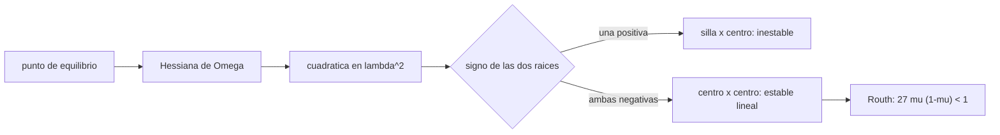

# B73-C04 — Estabilidad local de Lagrange

<!-- nav:top -->
[🏠 Programa](../../../../README.md) · [📚 Bloque B73](../../../tronco-comun/B73-mecanica-celeste-resonancias-y-caos.md) · [← Anterior: B73-C03 — Puntos de equilibrio de Lagrange](../B73-C03-puntos-de-equilibrio-de-lagrange/CLASE.md) · [Siguiente: B73-C05 — Órbitas periódicas →](../B73-C05-orbitas-periodicas/CLASE.md)
<!-- /nav -->

## 1. Ubicación, nivel y alcance

Clase 4 del bloque B73. Nivel N3. Sigue a [B73-C03](../B73-C03-puntos-de-equilibrio-de-lagrange/CLASE.md), que localizó los cinco equilibrios. Aquí linealizas el movimiento alrededor de cada uno, calculas sus autovalores en tres sistemas (Tierra–Luna, Sol–Tierra y Sol–Júpiter), obtienes el criterio de Routh `27μ(1−μ) < 1` para L4 y L5 y lo contrastas con una integración no lineal. Los sistemas usan `GM` y periodos publicados; las perturbaciones de las simulaciones no lineales son **sintéticas**.

## 2. Por qué esta clase existe

Que un punto sea de equilibrio no dice si una nave se queda o se va. Los autovalores dicen cuánto tiempo tienes antes de corregir la posición y si un grupo de asteroides puede quedarse en L4. La decisión central: **¿qué puntos son inestables, con qué escala de tiempo, y cuál es la condición de estabilidad de los triangulares?**

## 3. Lo que podrás hacer al terminar

1. Calcular las segundas derivadas del potencial efectivo en un punto de equilibrio.
2. Resolver la ecuación característica de la linealización.
3. Clasificar L1–L3 como silla×centro y L4–L5 como centro×centro cuando `μ` es pequeño.
4. Deducir y verificar el valor crítico de Routh `μ = 0,0385209`.
5. Convertir un autovalor en un tiempo de crecimiento en días.
6. Contrastar la tasa lineal con una integración no lineal.

La evidencia es la **ficha de estabilidad de cinco puntos y tres sistemas** del ejercicio 12 (sección 20).

## 4. Con qué llegas y cómo comprobarlo

1. ¿Qué es un autovalor?
2. ¿Qué significa un autovalor real positivo?
3. ¿Qué significa un autovalor imaginario puro?
4. ¿Qué es la matriz hessiana?
5. ¿Qué es la linealización?

<details>
<summary>Ver respuestas</summary>

1. Un número `λ` tal que `Ax = λx` para algún vector `x` distinto de cero. 2. Un modo que crece exponencialmente: inestabilidad. 3. Un modo que oscila sin crecer ni decaer. 4. La matriz de segundas derivadas de una función. 5. Aproximar la dinámica cerca de un equilibrio con su derivada.
</details>

Con cuatro o cinco aciertos, sigue; si no, repasa los prerrequisitos.

## 5. Un caso de contexto y casos de referencia

En Tierra–Luna, L1 tiene autovalores reales `±2,93206` (crecimiento de `1,48 d` por factor `e`) y L4 tiene dos pares imaginarios `±0,29821i` y `±0,95450i`. En Sol–Tierra L1 crece con `22,95 d` y en Sol–Júpiter L4 es estable (`27μ(1−μ) = 0,0257 < 1`). Es el **ejemplo conductor**. Los `GM` y los periodos son publicados; las perturbaciones no lineales son **sintéticas**.

## 6. Vocabulario

La **ecuación característica** de la linealización plana es `λ⁴ + (4 − Ω_xx − Ω_yy)λ² + (Ω_xxΩ_yy − Ω_xy²) = 0`, una cuadrática en `λ²`. Un punto es **silla×centro** si tiene un par real y un par imaginario, y **centro×centro** si tiene dos pares imaginarios. La **estabilidad lineal** no garantiza la estabilidad no lineal. El **tiempo de crecimiento** (e-folding) es `1/λ` en unidades de tiempo del sistema.

## 7. Modelo mental: una bola sobre una silla de montar que gira



*Descripción textual:* la hessiana de `Ω` alimenta una cuadrática en `λ²`; según el signo de sus dos raíces el punto es silla×centro (inestable) o centro×centro (estable lineal), y para L4 y L5 la condición es la de Routh.

Analogía: una bola sobre una silla de montar que gira: en los puertos (L1–L3) hay una dirección por la que rueda hacia afuera y otra por la que oscila; en las hondonadas (L4, L5) la fuerza de Coriolis la mantiene dando vueltas aunque el punto sea un máximo del potencial. Límite: la linealización solo vale para perturbaciones pequeñas, y el modelo ignora otras perturbaciones.

## 8. La explicación, paso a paso

### 8.1 La cuadrática

Con `B = 4 − Ω_xx − Ω_yy` y `D = Ω_xxΩ_yy − Ω_xy²`, `λ² = (−B ± √(B² − 4D))/2`. Si `D < 0` hay una raíz positiva y otra negativa: un par real `±a` y un par imaginario `±ib`. Las segundas derivadas se verificaron contra diferencias finitas del gradiente: la diferencia relativa máxima es `1,5e-08`.

### 8.2 Colineales

| Sistema | punto | `a` (real) | `b` (imaginario) | crecimiento `1/a` (d) |
|---|---|---|---|---|
| Tierra–Luna | L1 | 2,93206 | 2,33439 | 1,48 |
| Tierra–Luna | L2 | 2,15867 | 1,86265 | 2,01 |
| Tierra–Luna | L3 | 0,17788 | 1,01042 | 24,45 |
| Sol–Tierra | L1 | 2,53256 | 2,08639 | 22,95 |
| Sol–Tierra | L2 | 2,48441 | 2,05707 | 23,40 |
| Sol–Júpiter | L1 | 2,68113 | 2,17769 | 257,09 |
| Sol–Júpiter | L2 | 2,35207 | 1,97721 | 293,06 |

Todos son silla×centro: una perturbación crece como `e^{at}`. En Sol–Tierra, L1 y L2 multiplican el error por `e` en unos `23 d`, por lo que una nave cerca de ellos necesita correcciones periódicas, coherente con que la NASA describa L2 como metaestable.

### 8.3 Triangulares y el criterio de Routh

En L4 y L5, `D = (27/4) μ (1−μ)` y `B = 1`, de modo que el discriminante es `1 − 27μ(1−μ)`. Es no negativo si `μ < 0,0385209` (`½(1 − √(23/27))`). La bisección numérica da `0,0385209`. Los tres sistemas cumplen `27μ(1−μ) < 1`: Tierra–Luna `0,3241`, Sol–Tierra `8,11e-05`, Sol–Júpiter `0,0257`. Las frecuencias de Tierra–Luna son `0,29821` y `0,95450` (periodos `91,6 d` y `28,6 d`); en Sol–Júpiter, `0,08046` y `0,99676` (el modo lento tiene periodo `53 831 d`).

### 8.4 Segunda vía: integración no lineal

Con una perturbación sintética de `10⁻⁸` junto a L1 Tierra–Luna, la tasa medida entre `t = 3` y `t = 5` es `2,9445`, frente al autovalor `2,9321`: diferencia relativa `0,42%`, bajo el 1 %. Con una perturbación sintética de `10⁻⁶` junto a L4 Tierra–Luna, la distancia máxima a L4 durante `100` unidades (`435 d`) es `4,33e-05`: acotada, como predice la linealización.

### 8.5 Qué no dice la linealización

Estable linealmente no es estable para siempre: el modelo plano y circular ignora al Sol (en Tierra–Luna), a los demás planetas y las excentricidades. Solo la integración de [B73-C09](../B73-C09-integracion-de-largo-plazo/CLASE.md) en tiempos largos y con más cuerpos puede acercarse a esa pregunta.

## 9. Magnitudes, símbolos y unidades

| Símbolo | Qué es | Unidad | Valor / nota |
|---|---|---|---|
| `Ω_xx, Ω_yy, Ω_xy` | segundas derivadas del potencial | — | adimensional |
| `λ` | autovalor | 1/unidad de tiempo | ver 8.2 y 8.3 |
| `1/a` | tiempo de crecimiento | d | 1,48 (L1 Tierra–Luna) |
| `27μ(1−μ)` | indicador de Routh | — | debe ser < 1 |
| `μ_c` | valor crítico de Routh | — | 0,0385209 |

## 10. Convenciones y referencias

CR3BP plano, marco sinódico adimensional, primarios en `(−μ, 0)` y `(1−μ, 0)`. Unidad de tiempo = periodo/2π: `4,348 d` (Tierra–Luna), `58,12 d` (Sol–Tierra), `689,3 d` (Sol–Júpiter). Los periodos de la Tierra y Júpiter son los de la ficha de planetas (`365,2 d` y `4331 d`).

## 11. De dónde sale lo que afirmamos

| ID | Fuente | Localizador | Respalda | Estado |
|---|---|---|---|---|
| S1 | NASA/NSSDC, Sun Fact Sheet — https://nssdc.gsfc.nasa.gov/planetary/factsheet/sunfact.html (consultada 2026-11-10) | ficha leída; actualizada el 2024-05-09 | GM del Sol = 132 712 × 10⁶ km³/s² | Consultada |
| S2 | NASA/NSSDC, Jupiter Fact Sheet — https://nssdc.gsfc.nasa.gov/planetary/factsheet/jupiterfact.html (consultada 2026-11-10) | ficha leída; actualizada el 2024-10-02 | GM de Júpiter = 126,687 × 10⁶ km³/s² | Consultada |
| S3 | NASA JPL SSD, Planetary Satellite Physical Parameters — https://ssd.jpl.nasa.gov/sats/phys_par/ (consultada 2026-11-10) | tabla de GM y radio medio; GM de la Luna (DE440), los galileanos (JUP365), Titán, Encélado y Mimas (SAT441) | GM de la Luna = 4902,800 km³/s² | Consultada |
| S4 | NASA JPL SSD, Planetary Satellite Mean Elements — https://ssd.jpl.nasa.gov/sats/elem/ (consultada 2026-11-10) | tabla de elementos medios, época 2000-01-01.5 TDB; planos de Laplace (galileanos con JUP365, saturnianos con SAT441), eclíptica para la Luna (DE405) | periodo de la Luna 27,322 d | Consultada |
| S5 | NASA/NSSDC, Planetary Fact Sheet (métrico) — https://nssdc.gsfc.nasa.gov/planetary/factsheet/ (consultada 2026-11-10) | tabla comparativa leída; actualizada el 2025-03-18 | periodos de la Tierra 365,2 d y de Júpiter 4331 d | Consultada |
| S6 | NASA, Webb orbit — https://science.nasa.gov/mission/webb/orbit/ (consultada 2026-11-10) | página leída completa | L2 es metaestable; mantener la posición requiere pequeños empujes periódicos | Consultada |
| S7 | NASA JPL SSD, Planetary Physical Parameters — https://ssd.jpl.nasa.gov/planets/phys_par.html (consultada 2026-11-10) | tabla de masas y radios medios; registro de cambios 2019-12-12 (CODATA 2018) | masa de la Tierra para `GM` ≈ 3,986×10⁵ km³/s² (aproximado) | Consultada |
| — | Linealización del CR3BP y criterio de Routh `27μ(1−μ) < 1` | — | las verifica el laboratorio con una segunda vía | No consultada en una fuente concreta |

Límites: el `GM` de la Tierra es aproximado; las perturbaciones no lineales son sintéticas; no se consultó la deducción original del criterio de Routh.

## 12. Cómo ver la estabilidad de cada punto

| Magnitud | Valor |
|---|---|
| L1 Tierra–Luna: `1/a` | 1,48 d |
| L1 Sol–Tierra: `1/a` | 22,95 d |
| `μ_c` (bisección = teoría) | 0,0385209 |
| tasa no lineal frente a autovalor | 0,42% |
| distancia máxima a L4 (perturbación 1e-6) | 4,33e-05 |

Descripción larga: los puntos colineales amplifican las perturbaciones en días, los triangulares las mantienen acotadas cuando se cumple la condición de Routh.

## 13. Ejemplo trabajado: ¿es estable L4 en Sol–Júpiter?

**Paso 1 · Parámetro.** `μ = 126,687×10⁶/(132 712×10⁶ + 126,687×10⁶) = 9,536905e-04`.

**Paso 2 · Routh.** `27 μ (1 − μ) = 0,0257`, menor que 1.

**Paso 3 · Frecuencias.** `λ = ±0,08046i` y `±0,99676i`.

**Paso 4 · Conclusión.** Es estable linealmente; el modo lento tiene periodo de `53 831 d`, mucho mayor que el de Júpiter.

## 14. Distintas formas de describir la estabilidad de un equilibrio

**Por autovalores:** reales (crecimiento) o imaginarios (oscilación). **Por Routh:** una sola desigualdad en `μ`. **Por tiempo:** `1/a` en días. **Por integración no lineal:** la tasa medida.

## 15. Práctica guiada

**Ejercicio 1 · con los pasos indicados.** Calcula el indicador de Routh de Tierra–Luna. *Pasos:* `27 × 0,0121506 × (1 − 0,0121506)`.

<details><summary>Solución comentada</summary>

`0,3241`: es menor que 1, L4 es estable linealmente.
</details>

**Ejercicio 2 · con una pista.** ¿Cuál es el valor crítico de `μ`? *Pista:* resuelve `27μ(1−μ) = 1`.

<details><summary>Solución comentada</summary>

`μ = ½(1 − √(23/27)) = 0,0385209`.
</details>

**Ejercicio 3 · casi autónomo.** ¿Qué tipo de punto es L1 de Sol–Tierra?

<details><summary>Solución comentada</summary>

Silla×centro: `a = 2,53256` y `b = 2,08639`.
</details>

## 16. Práctica autónoma, transferencia e integrador

**Ejercicio 4 · autónomo.** Tiempo de crecimiento de L2 Sol–Tierra.

<details><summary>Solución comentada</summary>

`23,40 d`.
</details>

**Ejercicio 5 · autónomo.** Periodo del modo corto de L4 Tierra–Luna.

<details><summary>Solución comentada</summary>

`28,6 d`.
</details>

**Ejercicio 6 · autónomo.** Periodo del modo lento de L4 Sol–Júpiter.

<details><summary>Solución comentada</summary>

`53 831 d`.
</details>

**Ejercicio 7 · autónomo.** ¿Por qué L3 Tierra–Luna crece mucho más despacio que L1?

<details><summary>Solución comentada</summary>

Porque su `a = 0,17788` es mucho menor: el equilibrio está lejos de ambos primarios.
</details>

**Ejercicio 8 · autónomo.** ¿Qué pasa con L4 si `μ` supera `0,0385`?

<details><summary>Solución comentada</summary>

El discriminante se vuelve negativo, los autovalores se hacen complejos con parte real positiva y L4 es inestable.
</details>

**Ejercicio 9 · transferencia.** **Transferencia.** Una agencia dice que su observatorio en L2 Sol–Tierra «necesita correcciones cada pocas semanas». ¿Es coherente con el modelo?

<details><summary>Solución comentada</summary>

Sí: el crecimiento por factor `e` toma `23,4 d`, así que en pocas semanas un error se multiplica varias veces; es coherente con que la NASA diga que L2 es metaestable.
</details>

**Ejercicio 10 · transferencia.** **Transferencia.** Un colega afirma que los troyanos de Júpiter están en L4 y L5 porque son estables. ¿Qué parte demuestra tu laboratorio y cuál no?

<details><summary>Solución comentada</summary>

Que L4 y L5 son estables linealmente en el CR3BP (`0,0257 < 1`); no demuestra que los asteroides reales permanezcan allí, pues faltan los otros planetas y las excentricidades.
</details>

**Ejercicio 11 · transferencia.** **Transferencia.** Un colega afirma que, como L4 Tierra–Luna cumple Routh, hay polvo estable allí siempre. Respóndele.

<details><summary>Solución comentada</summary>

Cumple la condición del modelo plano y circular; el Sol y la excentricidad lunar no están en el modelo, de modo que la conclusión no se sigue.
</details>

**Ejercicio 12 · integrador.** **Integrador.** Elabora tu *ficha de estabilidad de cinco puntos y tres sistemas*: tabla de autovalores, tiempos de crecimiento, indicador de Routh, validación por diferencias finitas y por integración no lineal, y lista de límites.

<details><summary>Solución comentada</summary>

Secciones 8.1–8.5 y la salida del laboratorio.
</details>

## 17. Laboratorio: autovalores de L1–L5 y criterio de Routh

El script [estabilidad_lagrange.py](estabilidad_lagrange.py) calcula la hessiana (analítica y por diferencias finitas), los autovalores en 15 puntos, `μ_c` por bisección y dos integraciones no lineales (**comprueba** hessiana < `10⁻⁶`, `μ_c` < `10⁻¹²` de la teoría, tasa < 1 %, L4 acotado).

**Datos:** `GM` del Sol, Júpiter y la Luna y periodos, consultados; `GM` de la Tierra aproximado; perturbaciones de `10⁻⁸` y `10⁻⁶` **sintéticas**. **Predice antes de ejecutar:** ¿cuánto tarda en multiplicarse por `e` un error en L1 Sol–Tierra? (`≈ 23 d`.) **Ejecución del 2026-11-10 (Python 3.12.9):**

```text
Python 3.12.9 (biblioteca estandar)
Tierra-Luna (mu = 1.215060e-02, unidad de tiempo = 4.3484 d):
   L1: lambda = +-2.93206 (real) y +-2.33439i  -> silla x centro ; e-folding 1.48 d
   L2: lambda = +-2.15867 (real) y +-1.86265i  -> silla x centro ; e-folding 2.01 d
   L3: lambda = +-0.17788 (real) y +-1.01042i  -> silla x centro ; e-folding 24.45 d
   L4: lambda = +-0.29821i y +-0.95450i  -> centro x centro (estable linealmente)
   L5: lambda = +-0.29821i y +-0.95450i  -> centro x centro (estable linealmente)
Sol-Tierra (mu = 3.003487e-06, unidad de tiempo = 58.1234 d):
   L1: lambda = +-2.53256 (real) y +-2.08639i  -> silla x centro ; e-folding 22.95 d
   L2: lambda = +-2.48441 (real) y +-2.05707i  -> silla x centro ; e-folding 23.40 d
   L3: lambda = +-0.00281 (real) y +-1.00000i  -> silla x centro ; e-folding 20700.17 d
   L4: lambda = +-0.00450i y +-0.99999i  -> centro x centro (estable linealmente)
   L5: lambda = +-0.00450i y +-0.99999i  -> centro x centro (estable linealmente)
Sol-Jupiter (mu = 9.536905e-04, unidad de tiempo = 689.3001 d):
   L1: lambda = +-2.68113 (real) y +-2.17769i  -> silla x centro ; e-folding 257.09 d
   L2: lambda = +-2.35207 (real) y +-1.97721i  -> silla x centro ; e-folding 293.06 d
   L3: lambda = +-0.05002 (real) y +-1.00083i  -> silla x centro ; e-folding 13781.16 d
   L4: lambda = +-0.08046i y +-0.99676i  -> centro x centro (estable linealmente)
   L5: lambda = +-0.08046i y +-0.99676i  -> centro x centro (estable linealmente)
mu critico de Routh: biseccion = 0.0385208965 ; teoria (1 - sqrt(23/27))/2 = 0.0385208965 ; diferencia = 1.4e-17
No lineal L1 (perturbacion sintetica 1e-8): tasa medida = 2.9445 ; autovalor real = 2.9321 ; diferencia relativa = 0.42%
No lineal L4 Tierra-Luna (1e-6, t = 100 = 435 d): distancia maxima a L4 = 4.33e-05
Pruebas superadas.
```

```bash
python programa/clases/B73/B73-C04-estabilidad-local-de-lagrange/estabilidad_lagrange.py
```

**Límites:** modelo plano y circular, linealización, perturbaciones sintéticas, sin Sol en Tierra–Luna.

## 18. Errores frecuentes y cómo corregirlos

**Concluir estabilidad total de un centro×centro lineal.** Se corrige con 8.5.

**Confundir `μ` con el cociente de masas al aplicar Routh.** Se corrige con el ejemplo 13.

**Medir `1/a` en unidades adimensionales sin pasar a días.** Se corrige con la sección 10.

**Presentar la perturbación sintética como una medida.** Se corrige con la sección 21.

## 19. Cómo sabrás que vas bien

Tras la sección 8: ¿cuánto tardaba en multiplicarse por `e` un error en L1 Sol–Tierra y qué esperabas? Si dudas, repasa el ejemplo 13. Tras el laboratorio: ¿qué comprueba? (ver la sección 17).

## 20. Qué entregas y cómo se evalúa

El producto es tu **ficha de estabilidad de cinco puntos y tres sistemas** (ejercicio 12).

| Criterio | Inicial | En desarrollo | Logrado | Destacado |
|---|---|---|---|---|
| Conceptos | Los confunde | Parciales | Clasifica L1–L5 por autovalores | Explica los límites |
| Cálculo | Sin unidades | Con errores | Tablas completas con unidades | Calcula casos nuevos |
| Comprobación | Sin comprobar | Un caso | Contraste con una segunda vía | Interpreta las diferencias |
| Fuentes | Sin fuente | Sin fecha | Fuentes con fecha y estado | Declara lo sintético y lo no consultado |
| Límites | No los nombra | Uno | Tres | Discute qué falta del modelo |

**Condiciones críticas (no se compensan con promedio):** rotular las perturbaciones como sintéticas; no extender la estabilidad lineal a estabilidad real; citar solo lo consultado y declarar aproximado el `GM` de la Tierra.

## 21. Ética, seguridad y límites

Clase educativa: los modelos son simplificados y sus datos son publicados con fuente o sintéticos rotulados; ningún resultado describe una trayectoria real ni sirve para planificar una misión.  Accesibilidad: tablas equivalentes a las gráficas, fórmulas en texto, ejercicios sin conexión.

## 22. Para cerrar y seguir

L1, L2 y L3 son silla×centro con crecimientos de `1,5` a `23` días según el sistema, y L4 y L5 son estables linealmente mientras `27μ(1−μ) < 1`, es decir `μ < 0,03852`. Queda una pregunta: ¿qué trayectorias periódicas existen alrededor del punto inestable?

**Glosario español–inglés.** estabilidad lineal · *linear stability*; autovalor · *eigenvalue*; silla × centro · *saddle × center*; criterio de Routh · *Routh criterion*; tiempo de crecimiento · *e-folding time*.

**Continuidad.** [B73-CC05](../B73-C05-orbitas-periodicas/CLASE.md) estudia las órbitas periódicas alrededor de L1.

**Referencias:** ver sección 11.

<!-- nav:bottom -->
---

[← Anterior: B73-C03 — Puntos de equilibrio de Lagrange](../B73-C03-puntos-de-equilibrio-de-lagrange/CLASE.md) · [📚 Bloque B73](../../../tronco-comun/B73-mecanica-celeste-resonancias-y-caos.md) · [Siguiente: B73-C05 — Órbitas periódicas →](../B73-C05-orbitas-periodicas/CLASE.md)
<!-- /nav -->
