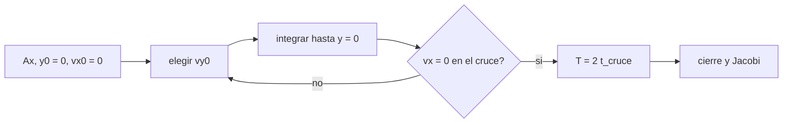

# B73-C05 — Órbitas periódicas

<!-- nav:top -->
[🏠 Programa](../../../../README.md) · [📚 Bloque B73](../../../tronco-comun/B73-mecanica-celeste-resonancias-y-caos.md) · [← Anterior: B73-C04 — Estabilidad local de Lagrange](../B73-C04-estabilidad-local-de-lagrange/CLASE.md) · [Siguiente: B73-C06 — Variedades invariantes →](../B73-C06-variedades-invariantes/CLASE.md)
<!-- /nav -->

## 1. Ubicación, nivel y alcance

Clase 5 del bloque B73. Nivel N3. Sigue a [B73-C04](../B73-C04-estabilidad-local-de-lagrange/CLASE.md): alrededor de L1 el modo central es una oscilación; al ir más allá de lo lineal aparecen órbitas periódicas de verdad. Aquí calculas órbitas de Lyapunov planas alrededor de L1 Tierra–Luna por corrección diferencial (disparo con bisección), mides su periodo, su constante de Jacobi y su cierre, y las comparas con el periodo lineal. Las amplitudes son **sintéticas**; los datos del sistema son publicados.

## 2. Por qué esta clase existe

Una nave que orbita un punto de Lagrange sigue una órbita periódica, no el punto. Hallarla exige resolver un problema de contorno: no hay fórmula. La decisión central: **¿cómo se encuentran las condiciones iniciales de una órbita que cierra, y cómo cambia su periodo con la amplitud?**

## 3. Lo que podrás hacer al terminar

1. Explicar por qué una órbita simétrica cruza el eje con velocidad perpendicular.
2. Resolver por disparo y bisección la velocidad inicial de una órbita de Lyapunov.
3. Calcular el periodo como el doble del tiempo de cruce.
4. Verificar el cierre tras un periodo y la conservación de Jacobi.
5. Comparar el periodo con el periodo lineal `2π/b`.
6. Describir cómo cambian el periodo y la constante de Jacobi con la amplitud.

La evidencia es la **ficha de una órbita periódica con su período y su Jacobi** del ejercicio 12 (sección 20).

## 4. Con qué llegas y cómo comprobarlo

1. ¿Qué es una órbita periódica?
2. ¿Qué es el método de disparo?
3. ¿Qué es la bisección?
4. ¿Qué es la simetría de un sistema?
5. ¿Qué es un periodo lineal?

<details>
<summary>Ver respuestas</summary>

1. Una trayectoria que vuelve al mismo estado tras un tiempo `T`. 2. Ajustar una condición inicial hasta que la solución cumpla una condición en otro instante. 3. Reducir a la mitad un intervalo donde una función cambia de signo. 4. Una transformación que deja las ecuaciones invariantes. 5. El periodo de las oscilaciones pequeñas de la linealización.
</details>

Con cuatro o cinco aciertos, sigue; si no, repasa los prerrequisitos.

## 5. Un caso de contexto y casos de referencia

Alrededor de L1 Tierra–Luna (`x = 0,83691507`), el periodo lineal es `2,6916` unidades, es decir `11,704 d`. Una órbita de amplitud `Ax = 10⁻³` (`384,4 km`) necesita `v_y0 = 0,008435` y tiene periodo `11,705 d`; con `Ax = 0,02` (`7688 km`) el periodo sube a `12,294 d`. Es el **ejemplo conductor**. Las amplitudes son **sintéticas**.

## 6. Vocabulario

Una **órbita de Lyapunov** es una órbita periódica plana alrededor de un punto colineal. La **simetría** `(x, y, t) → (x, −y, −t)` del CR3BP implica que una órbita que cruza `y = 0` con `vx = 0` es periódica si vuelve a cruzar con `vx = 0`. La **corrección diferencial** ajusta `v_y0` hasta anular `vx` en el cruce. La **amplitud** `A_x` es la distancia de partida a L1.

## 7. Modelo mental: un columpio que se afina hasta que vuelve al mismo punto



*Descripción textual:* se fija la amplitud, se prueba una velocidad inicial, se integra hasta el cruce y se repite hasta que la velocidad en `x` se anule; el periodo es el doble del tiempo de cruce y se verifica el cierre.

Analogía: empujas un columpio desde el extremo y quieres que vuelva exactamente al mismo lugar: ajustas el empuje hasta que, a mitad del camino, pase por el centro con la velocidad correcta. Límite: aquí hay una sola condición que ajustar porque la amplitud ya se fijó y la órbita es plana.

## 8. La explicación, paso a paso

### 8.1 Por qué basta medio periodo

Si la trayectoria cruza `y = 0` con `vx = 0`, la simetría la refleja en el tiempo y en `y`, de modo que la segunda mitad es el espejo de la primera. Así solo se integra hasta el primer cruce `t_h` y el periodo es `T = 2 t_h`. La condición a anular es `vx(t_h) = 0` y la variable es `v_y0`.

### 8.2 El disparo

Para cada amplitud se barre `v_y0` en pasos de `0,005`, se detecta el cambio de signo de `vx` en el cruce y se afina con 60 bisecciones. El cruce se localiza dentro del paso por otra bisección sobre el paso de RK4.

### 8.3 Resultados

| `Ax` | `Ax` (km) | `v_y0` | `T` (adim.) | `T` (d) | `C` | cierre | deriva de `C` |
|---|---|---|---|---|---|---|---|
| 10⁻³ | 384,4 | 0,008435 | 2,691790 | 11,705 | 3,188281 | 7,5e-13 | 1,3e-15 |
| 5×10⁻³ | 1922,0 | 0,043503 | 2,697285 | 11,729 | 3,186726 | 1,4e-13 | 8,9e-16 |
| 10⁻² | 3844,0 | 0,090663 | 2,717209 | 11,816 | 3,181211 | 5,0e-14 | 2,2e-15 |
| 2×10⁻² | 7688,0 | 0,196575 | 2,827250 | 12,294 | 3,153918 | 5,0e-14 | 1,6e-14 |

### 8.4 Segunda vía

(a) El **cierre** se mide integrando de nuevo un periodo completo y comparando con el estado inicial: el peor caso es `7,5e-13` (la tolerancia es `10⁻⁶`). (b) La **constante de Jacobi** se conserva con deriva máxima `1,6e-14`. (c) El **periodo lineal** `2π/b = 2,6916` y el de `Ax = 10⁻³` difieren `0,01%`, así que el disparo reproduce la teoría cuando la amplitud es pequeña.

### 8.5 Efecto de la amplitud

El periodo crece con la amplitud (de `11,71` a `12,29` d, un 5 %) y la constante de Jacobi baja (de `3,1883` a `3,1539`): una órbita más grande tiene más energía en el marco giratorio. Con amplitudes mayores las familias se acercan a la Luna o a la Tierra y el disparo simple deja de converger; aquí se usa hasta `0,02`.

## 9. Magnitudes, símbolos y unidades

| Símbolo | Qué es | Unidad | Valor / nota |
|---|---|---|---|
| `Ax` | amplitud respecto de L1 | 384 400 km | 10⁻³ a 2×10⁻² |
| `v_y0` | velocidad inicial en `y` | 1,023 km/s | 0,008435 a 0,196575 |
| `T` | periodo | 4,348 d | 2,6918 a 2,8272 |
| `C` | constante de Jacobi | — | 3,1883 a 3,1539 |
| `b` | frecuencia lineal | 1/(4,348 d) | 2,33439 |

## 10. Convenciones y referencias

CR3BP plano, marco sinódico adimensional (distancia `384 400 km`, tiempo `4,348 d`). Salida del plano en el sentido `x < x_L1` (hacia la Tierra). RK4 con `dt = 10⁻³`. `GM` de la Tierra aproximado. Las amplitudes son parámetros de ejemplo.

## 11. De dónde sale lo que afirmamos

| ID | Fuente | Localizador | Respalda | Estado |
|---|---|---|---|---|
| S1 | NASA JPL SSD, Planetary Satellite Physical Parameters — https://ssd.jpl.nasa.gov/sats/phys_par/ (consultada 2026-11-10) | tabla de GM y radio medio; GM de la Luna (DE440), los galileanos (JUP365), Titán, Encélado y Mimas (SAT441) | GM de la Luna = 4902,800 km³/s² | Consultada |
| S2 | NASA JPL SSD, Planetary Satellite Mean Elements — https://ssd.jpl.nasa.gov/sats/elem/ (consultada 2026-11-10) | tabla de elementos medios, época 2000-01-01.5 TDB; planos de Laplace (galileanos con JUP365, saturnianos con SAT441), eclíptica para la Luna (DE405) | semieje mayor de la Luna 384 400 km y periodo 27,322 d | Consultada |
| S3 | NASA JPL SSD, Planetary Physical Parameters — https://ssd.jpl.nasa.gov/planets/phys_par.html (consultada 2026-11-10) | tabla de masas y radios medios; registro de cambios 2019-12-12 (CODATA 2018) | masa de la Tierra para `GM` ≈ 3,986×10⁵ km³/s² (aproximado) | Consultada |
| S4 | NASA, Webb orbit — https://science.nasa.gov/mission/webb/orbit/ (consultada 2026-11-10) | página leída completa | la órbita de Webb alrededor de L2 se completa en unos 6 meses | Consultada |
| — | Simetría del CR3BP y método de corrección diferencial (resultados clásicos) | — | las verifica el laboratorio con una segunda vía | No consultada en una fuente concreta |

Límites: las amplitudes son sintéticas; el `GM` de la Tierra es aproximado; no se consultó la fuente original del método de disparo.

## 12. Cómo ver que la órbita cierra

| Magnitud | Valor |
|---|---|
| periodo lineal | 11,704 d |
| periodo con `Ax = 10⁻³` | 11,705 d |
| periodo con `Ax = 2×10⁻²` | 12,294 d |
| cierre máximo | 7,5e-13 |
| deriva máxima de `C` | 1,6e-14 |

Descripción larga: las cuatro órbitas cierran a `10⁻¹³`, conservan `C` a precisión de máquina y su periodo tiende al lineal al bajar la amplitud.

## 13. Ejemplo trabajado: el periodo en días

**Paso 1 · Frecuencia.** `b = 2,33439` (par imaginario de L1, [B73-C04](../B73-C04-estabilidad-local-de-lagrange/CLASE.md)).

**Paso 2 · Periodo lineal.** `T = 2π/b = 2,6916` unidades.

**Paso 3 · Días.** `2,6916 × 4,348 d = 11,704 d`.

**Paso 4 · Comparación.** La órbita de `Ax = 10⁻³` da `11,705 d`, casi igual.

## 14. Distintas formas de describir una órbita periódica

**Por condiciones iniciales:** `(x₀, v_y0)`. **Por periodo y amplitud:** `(T, Ax)`. **Por energía:** `C`. **Por simetría:** medio periodo y reflexión.

## 15. Práctica guiada

**Ejercicio 1 · con los pasos indicados.** Calcula el periodo lineal en días. *Pasos:* `2π/b × 4,348`.

<details><summary>Solución comentada</summary>

`11,704 d`.
</details>

**Ejercicio 2 · con una pista.** ¿Cuántos kilómetros mide `Ax = 10⁻³`? *Pista:* multiplica por la distancia entre primarios.

<details><summary>Solución comentada</summary>

`10⁻³ × 384 400 = 384,4 km`.
</details>

**Ejercicio 3 · casi autónomo.** ¿Por qué basta integrar medio periodo?

<details><summary>Solución comentada</summary>

Por la simetría `(y, t) → (−y, −t)`: la segunda mitad es el reflejo de la primera.
</details>

## 16. Práctica autónoma, transferencia e integrador

**Ejercicio 4 · autónomo.** Periodo de la órbita con `Ax = 10⁻²` en días.

<details><summary>Solución comentada</summary>

`11,816 d`.
</details>

**Ejercicio 5 · autónomo.** Constante de Jacobi con `Ax = 5×10⁻³`.

<details><summary>Solución comentada</summary>

`3,186726`.
</details>

**Ejercicio 6 · autónomo.** Aumento relativo del periodo entre `Ax = 10⁻³` y `2×10⁻²`.

<details><summary>Solución comentada</summary>

`(12,294 − 11,705)/11,705 ≈ 5 %`.
</details>

**Ejercicio 7 · autónomo.** ¿Qué significa un cierre de `10⁻¹³`?

<details><summary>Solución comentada</summary>

Que el estado tras un periodo coincide con el inicial a `10⁻¹³` unidades (≈ `4×10⁻⁸` km).
</details>

**Ejercicio 8 · autónomo.** ¿Por qué `C` baja al crecer la amplitud?

<details><summary>Solución comentada</summary>

Porque la órbita explora zonas de menor potencial efectivo `Ω` con mayor energía en el marco giratorio.
</details>

**Ejercicio 9 · transferencia.** **Transferencia.** La NASA dice que Webb tarda «unos 6 meses» en recorrer su órbita alrededor de L2 Sol–Tierra. ¿Es coherente con el periodo lineal?

<details><summary>Solución comentada</summary>

Sí: con `b = 2,05707` (B73-C04) y la unidad de `58,12 d`, `2π/b × 58,12 ≈ 177 d`, unos 6 meses; es un orden de magnitud correcto, aunque la de Webb es tridimensional.
</details>

**Ejercicio 10 · transferencia.** **Transferencia.** Un colega reutiliza el `v_y0` de `Ax = 10⁻²` para `Ax = 2×10⁻²`. ¿Qué ocurre?

<details><summary>Solución comentada</summary>

No cierra: `v_y0` depende de la amplitud (`0,0907` frente a `0,1966`); hay que volver a disparar.
</details>

**Ejercicio 11 · transferencia.** **Transferencia.** ¿Es estable la órbita de Lyapunov alrededor de L1?

<details><summary>Solución comentada</summary>

No: el punto L1 es silla×centro y la órbita hereda el modo inestable; por eso una nave debe corregir su posición (se verá en [B73-C06](../B73-C06-variedades-invariantes/CLASE.md)).
</details>

**Ejercicio 12 · integrador.** **Integrador.** Elabora tu *ficha de una órbita periódica con su período y su Jacobi*: tabla de cuatro amplitudes, cierre, deriva, comparación con el periodo lineal y lista de supuestos.

<details><summary>Solución comentada</summary>

Secciones 8.1–8.5 y la salida del laboratorio.
</details>

## 17. Laboratorio: órbitas de Lyapunov alrededor de L1 por disparo

El script [orbitas_periodicas.py](orbitas_periodicas.py) calcula cuatro órbitas periódicas, verifica cierre y Jacobi y compara con el periodo lineal (**comprueba** cierre < `10⁻⁶`, deriva < `10⁻⁸`, periodo dentro del 0,5 % del lineal).

**Datos:** `GM` de la Luna, semieje y periodo, consultados; `GM` de la Tierra aproximado; amplitudes **sintéticas**. **Predice antes de ejecutar:** ¿qué diferencia relativa habrá entre el periodo lineal y el de `Ax = 10⁻³`? (`≈ 10⁻⁴`.) **Ejecución del 2026-11-10 (Python 3.12.9):**

```text
Python 3.12.9 (biblioteca estandar)
L1 Tierra-Luna: x = 0.83691507 ; frecuencia lineal b = 2.33439 ; periodo lineal = 2.6916 (11.704 d)
 Ax [adim] Ax [km]    vy0         T [adim]   T [d]    C            cierre     deriva C
  1.0e-03     384.4    0.008435   2.691790   11.705    3.188281   7.48e-13  1.33e-15
  5.0e-03    1922.0    0.043503   2.697285   11.729    3.186726   1.42e-13  8.88e-16
  1.0e-02    3844.0    0.090663   2.717209   11.816    3.181211   5.03e-14  2.22e-15
  2.0e-02    7688.0    0.196575   2.827250   12.294    3.153918   5.00e-14  1.64e-14
Periodo con Ax = 1e-3 frente al lineal: diferencia relativa = 0.01%
Pruebas superadas.
```

```bash
python programa/clases/B73/B73-C05-orbitas-periodicas/orbitas_periodicas.py
```

**Límites:** CR3BP plano, familia inicial de Lyapunov, sin perturbaciones, amplitudes pequeñas o moderadas.

## 18. Errores frecuentes y cómo corregirlos

**Usar una amplitud tan pequeña que el barrido de `v_y0` salta la raíz.** Se corrige con el barrido más fino o con una amplitud mayor (con `10⁻⁴` el primer intento de este laboratorio falló).

**Olvidar que la órbita es inestable.** Se corrige con el ejercicio 11.

**Tomar el cierre numérico por demostración de periodicidad.** Se corrige con 8.4: hace falta también `C` constante.

**Confundir amplitud con distancia a la Luna.** Se corrige con la sección 9.

## 19. Cómo sabrás que vas bien

Tras la sección 8: ¿cuánto difiere el periodo lineal del de `Ax = 10⁻³` y qué esperabas? Si dudas, repasa el ejemplo 13. Tras el laboratorio: ¿qué comprueba? (ver la sección 17).

## 20. Qué entregas y cómo se evalúa

El producto es tu **ficha de una órbita periódica con su período y su Jacobi** (ejercicio 12).

| Criterio | Inicial | En desarrollo | Logrado | Destacado |
|---|---|---|---|---|
| Conceptos | Los confunde | Parciales | Halla una órbita que cierra por disparo | Explica los límites |
| Cálculo | Sin unidades | Con errores | Tablas completas con unidades | Calcula casos nuevos |
| Comprobación | Sin comprobar | Un caso | Contraste con una segunda vía | Interpreta las diferencias |
| Fuentes | Sin fuente | Sin fecha | Fuentes con fecha y estado | Declara lo sintético y lo no consultado |
| Límites | No los nombra | Uno | Tres | Discute qué falta del modelo |

**Condiciones críticas (no se compensan con promedio):** rotular las amplitudes como sintéticas; no presentar la órbita como trayectoria de misión; citar solo lo consultado y declarar aproximado el `GM` de la Tierra.

## 21. Ética, seguridad y límites

Clase educativa: los modelos son simplificados y sus datos son publicados con fuente o sintéticos rotulados; ningún resultado describe una trayectoria real ni sirve para planificar una misión.  Accesibilidad: tablas equivalentes a las gráficas, fórmulas en texto, ejercicios sin conexión.

## 22. Para cerrar y seguir

Cuatro órbitas de Lyapunov alrededor de L1 cierran a `10⁻¹³`, conservan `C` y pasan de `11,71` a `12,29` d al crecer la amplitud. Queda una pregunta: ¿cómo entra y sale una nave de esa órbita?

**Glosario español–inglés.** órbita de Lyapunov · *Lyapunov orbit*; corrección diferencial · *differential correction*; método de disparo · *shooting method*; amplitud · *amplitude*; periodo · *period*.

**Continuidad.** [B73-CC06](../B73-C06-variedades-invariantes/CLASE.md) estudia las variedades invariantes que entran y salen de L1.

**Referencias:** ver sección 11.

<!-- nav:bottom -->
---

[← Anterior: B73-C04 — Estabilidad local de Lagrange](../B73-C04-estabilidad-local-de-lagrange/CLASE.md) · [📚 Bloque B73](../../../tronco-comun/B73-mecanica-celeste-resonancias-y-caos.md) · [Siguiente: B73-C06 — Variedades invariantes →](../B73-C06-variedades-invariantes/CLASE.md)
<!-- /nav -->
