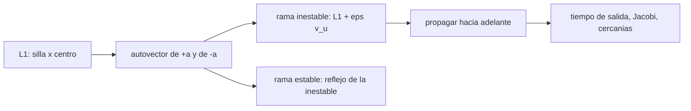

# B73-C06 — Variedades invariantes

<!-- nav:top -->
[🏠 Programa](../../../../README.md) · [📚 Bloque B73](../../../tronco-comun/B73-mecanica-celeste-resonancias-y-caos.md) · [← Anterior: B73-C05 — Órbitas periódicas](../B73-C05-orbitas-periodicas/CLASE.md) · [Siguiente: B73-C07 — Constante de Jacobi →](../B73-C07-constante-de-jacobi/CLASE.md)
<!-- /nav -->

## 1. Ubicación, nivel y alcance

Clase 6 del bloque B73. Nivel N3. Sigue a [B73-C05](../B73-C05-orbitas-periodicas/CLASE.md): el punto L1 es una silla×centro, y su modo inestable define dos ramas de trayectorias que se alejan de él y dos que se acercan, las variedades invariantes. Aquí calculas el autovector del modo real de L1 Tierra–Luna, propagas las dos ramas inestables desde un desplazamiento diminuto y verificas el crecimiento exponencial, la conservación de Jacobi y la consistencia lineal/no lineal. El desplazamiento inicial es **sintético**; el sistema es publicado.

## 2. Por qué esta clase existe

Las variedades son «autopistas» de la dinámica: una nave que empieza sobre ellas se aleja o llega al punto con muy poco combustible. Entender su origen lineal evita tomarlas por magia. La decisión central: **¿en qué dirección sale una trayectoria de L1 y en cuánto tiempo se aleja?**

## 3. Lo que podrás hacer al terminar

1. Calcular el autovector del autovalor real de un punto colineal.
2. Explicar por qué las variedades estable e inestable son simétricas en el CR3BP.
3. Propagar una rama inestable desde un desplazamiento pequeño.
4. Predecir el tiempo de salida con `ln(d/ε)/a` y compararlo con la integración.
5. Verificar la conservación de Jacobi a lo largo de una rama.
6. Contrastar el modo lineal con la solución no lineal.

La evidencia es la **ficha de variedad con tasa de crecimiento verificada** del ejercicio 12 (sección 20).

## 4. Con qué llegas y cómo comprobarlo

1. ¿Qué es un autovector?
2. ¿Qué es una variedad invariante?
3. ¿Qué es un punto silla?
4. ¿Qué es la reversibilidad temporal?
5. ¿Qué es un desplazamiento sintético?

<details>
<summary>Ver respuestas</summary>

1. Una dirección que la matriz solo estira o encoge. 2. Un conjunto de estados que, si la trayectoria entra en él, nunca lo abandona. 3. Un equilibrio con direcciones que se acercan y direcciones que se alejan. 4. Una simetría de las ecuaciones: si se invierte el tiempo, las soluciones siguen siéndolo. 5. Un valor propuesto para el ejemplo, no medido.
</details>

Con cuatro o cinco aciertos, sigue; si no, repasa los prerrequisitos.

## 5. Un caso de contexto y casos de referencia

En L1 Tierra–Luna el autovalor real es `a = 2,93206` y el autovector tiene `y/x = -0,46013`. Un desplazamiento sintético de `10⁻⁶` (`0,38 km`) a lo largo de ese vector se amplifica hasta `10⁻⁴` en `t = 1,580` unidades frente a las `1,571` del cálculo lineal (`0,60%`). La rama hacia la Luna llega a unos `5 771 km` de la Luna en `3,97` unidades (`17,3 d`). Es el **ejemplo conductor**. El desplazamiento y la ventana de integración son **sintéticos**.

## 6. Vocabulario

La **variedad inestable** `Wᵘ` de un punto es el conjunto de estados que tienden a él al retroceder en el tiempo; la **estable** `Wˢ`, los que tienden a él al avanzar. En el punto, sus tangentes son los autovectores de `+a` y de `−a`. Una **rama** es cada mitad de la variedad a un lado del punto. La **reversibilidad** del CR3BP, `(x, y, vx, vy; t) → (x, −y, −vx, vy; −t)`, hace que `Wˢ` sea el reflejo de `Wᵘ`.

## 7. Modelo mental: las dos pendientes de un puerto de montaña



*Descripción textual:* el autovector del modo real da la dirección de salida; se desplaza el punto una cantidad pequeña, se propaga y se verifica el tiempo de salida, el Jacobi y la consistencia con la linealización.

Analogía: en un puerto de montaña hay una pendiente por la que una bola rueda hacia afuera si la empujas un poco y otra por la que llegaría al puerto si viene en la dirección justa. Límite: la analogía es de un plano; el espacio de estados del CR3BP plano tiene cuatro dimensiones y la variedad es una curva en él.

## 8. La explicación, paso a paso

### 8.1 El autovector

De `ẍ − 2ẏ = Ω_xx x` y `ÿ + 2ẋ = Ω_yy y` con soluciones `e^{λt}`, se obtiene `y/x = (λ² − Ω_xx)/(2λ)`. Para `λ = a = 2,93206`, `y/x = -0,46013`; el autovector (normalizado en posición) es `(1, -0,46013, a, a·-0,46013)` en `(x, y, vx, vy)`. Para `λ = −a` el autovector es `(1, −y/x, −a, a y/x)`: el reflejo del anterior.

### 8.2 Las dos ramas

Se parte de `L1 ± ε v_u` con `ε = 10⁻⁶` y se integra con RK4 (`dt = 2×10⁻⁴`, 8 unidades de tiempo, `34,8 d`). La rama `−` va hacia la Tierra y la `+` hacia la Luna. La constante de Jacobi de ambas es la del punto, `C(L1) = 3,188341`, con derivas de `2,4e-14` y `1,8e-10`.

### 8.3 Tiempo de salida

El tiempo para pasar de `ε` a `d` es `t = ln(d/ε)/a`; para `d = 10⁻⁴` da `1,571` (`6,83 d`). La integración da `1,580` en una rejilla de `0,01`, con una diferencia de `0,60%`, por debajo del 2 % de tolerancia. El tiempo de crecimiento `1/a` es `1,48 d`.

### 8.4 Segunda vía: lineal frente a no lineal

La solución lineal `ε e^{at} v_u` a `t = 2` se compara con la integración no lineal; la diferencia relativa máxima es `1,60e-03`. Si el autovector tuviera un signo cambiado, esa diferencia sería del orden de 1.

### 8.5 A dónde llevan las ramas

En la ventana de 8 unidades, la rama `−` queda a `123 131 km` de la Tierra como mínimo y la rama `+` pasa a `5 771 km` de la Luna (radio medio `1737,4 km`, de modo que es una cota superior de la distancia mínima, muestreada cada `0,01` unidades). Esto no es un diseño de trayectoria: es una ilustración de que el modo inestable lleva a una nave cerca de uno de los primarios.

## 9. Magnitudes, símbolos y unidades

| Símbolo | Qué es | Unidad | Valor / nota |
|---|---|---|---|
| `a` | autovalor real de L1 | 1/(4,348 d) | 2,93206 |
| `y/x` | razón del autovector | — | -0,46013 |
| `ε` | desplazamiento inicial (sintético) | 384 400 km | 10⁻⁶ |
| `C(L1)` | Jacobi del punto | — | 3,188341 |
| `t` | tiempo de salida de 10⁻⁶ a 10⁻⁴ | 4,348 d | 1,571 |

## 10. Convenciones y referencias

CR3BP plano, marco sinódico adimensional (distancia `384 400 km`, tiempo `4,348 d`). La rama estable no se integra: es el reflejo exacto de la inestable por la simetría del problema (aritmética idéntica). `GM` de la Tierra aproximado. RK4 con `dt = 2×10⁻⁴`.

## 11. De dónde sale lo que afirmamos

| ID | Fuente | Localizador | Respalda | Estado |
|---|---|---|---|---|
| S1 | NASA JPL SSD, Planetary Satellite Physical Parameters — https://ssd.jpl.nasa.gov/sats/phys_par/ (consultada 2026-11-10) | tabla de GM y radio medio; GM de la Luna (DE440), los galileanos (JUP365), Titán, Encélado y Mimas (SAT441) | GM de la Luna = 4902,800 km³/s²; radio medio 1737,4 km | Consultada |
| S2 | NASA JPL SSD, Planetary Satellite Mean Elements — https://ssd.jpl.nasa.gov/sats/elem/ (consultada 2026-11-10) | tabla de elementos medios, época 2000-01-01.5 TDB; planos de Laplace (galileanos con JUP365, saturnianos con SAT441), eclíptica para la Luna (DE405) | semieje 384 400 km y periodo 27,322 d de la Luna | Consultada |
| S3 | NASA JPL SSD, Planetary Physical Parameters — https://ssd.jpl.nasa.gov/planets/phys_par.html (consultada 2026-11-10) | tabla de masas y radios medios; registro de cambios 2019-12-12 (CODATA 2018) | masa de la Tierra para `GM` ≈ 3,986×10⁵ km³/s² (aproximado) | Consultada |
| — | Teorema de la variedad estable y reversibilidad del CR3BP (resultados clásicos) | — | las verifica el laboratorio con una segunda vía | No consultada en una fuente concreta |

Límites: el desplazamiento inicial y la ventana de tiempo son sintéticos; el `GM` de la Tierra es aproximado; no se consultó un tratado sobre variedades invariantes.

## 12. Cómo ver una variedad

| Magnitud | Valor |
|---|---|
| `a` | 2,93206 |
| salida de 10⁻⁶ a 10⁻⁴ | 1,580 (lineal 1,571) |
| deriva de `C` (ramas − y +) | 2,4e-14 y 1,8e-10 |
| lineal frente a no lineal | 1,60e-03 |
| mínima distancia de la rama + a la Luna | 5 771 km |

Descripción larga: la rama sale a la velocidad que predice el autovalor, conserva `C` y coincide con la solución lineal mientras se mantiene cerca del punto.

## 13. Ejemplo trabajado: cuánto tarda una incertidumbre en volverse de 38 km

**Paso 1 · Datos.** `ε = 10⁻⁶` (`0,38 km`) y `d = 10⁻⁴` (`38,4 km`); `a = 2,93206`.

**Paso 2 · Tiempo.** `t = ln(100)/a = 1,571` unidades.

**Paso 3 · Días.** `1,571 × 4,348 = 6,83 d`.

**Paso 4 · Lectura.** Un error de posición de `0,38 km` cerca de L1 se multiplica por 100 en unos 7 días.

## 14. Distintas formas de describir la dinámica cerca de L1

**Lineal:** `ε e^{±at}` y el modo central. **Por variedades:** `Wᵘ` y `Wˢ`. **Por tiempo de salida:** `ln(d/ε)/a`. **Por simetría:** `Wˢ` es el reflejo de `Wᵘ`.

## 15. Práctica guiada

**Ejercicio 1 · con los pasos indicados.** Calcula el tiempo para amplificar `10⁻⁶` hasta `10⁻³`. *Pasos:* `ln(1000)/a`.

<details><summary>Solución comentada</summary>

`6,9078/2,93206 = 2,356` unidades (`10,2 d`).
</details>

**Ejercicio 2 · con una pista.** Da el vector de la rama estable. *Pista:* refleja `(1, y/x, a, a y/x)`.

<details><summary>Solución comentada</summary>

`(1, 0,46013, −2,93206, −1,3491)`: se cambia el signo de `y/x` y de `a`.
</details>

**Ejercicio 3 · casi autónomo.** ¿Qué valor tiene la constante de Jacobi sobre cualquiera de las ramas?

<details><summary>Solución comentada</summary>

`C(L1) = 3,188341`, porque `C` se conserva y las ramas parten de L1.
</details>

## 16. Práctica autónoma, transferencia e integrador

**Ejercicio 4 · autónomo.** Tiempo de crecimiento `1/a` en días.

<details><summary>Solución comentada</summary>

`1,48 d`.
</details>

**Ejercicio 5 · autónomo.** Tiempo para pasar de `10⁻⁶` a `1` (una distancia Tierra–Luna).

<details><summary>Solución comentada</summary>

`ln(10⁶)/a = 4,712` unidades, `≈ 20,5 d`, aunque la no linealidad cambia esto mucho antes.
</details>

**Ejercicio 6 · autónomo.** ¿Por qué la rama estable no hace falta integrarla?

<details><summary>Solución comentada</summary>

Porque es el reflejo exacto de la inestable por la reversibilidad del CR3BP.
</details>

**Ejercicio 7 · autónomo.** ¿Qué deriva de `C` tiene la rama que pasa cerca de la Luna?

<details><summary>Solución comentada</summary>

`1,8e-10`, mayor que la otra porque el RK4 de paso fijo pierde exactitud en el encuentro cercano.
</details>

**Ejercicio 8 · autónomo.** Si `ε` se redujera a `10⁻⁸`, ¿cuánto sube el tiempo de salida a `10⁻⁴`?

<details><summary>Solución comentada</summary>

De `1,571` a `ln(10⁴)/a = 3,141` unidades: el doble.
</details>

**Ejercicio 9 · transferencia.** **Transferencia.** Un equipo dice que una nave sobre la variedad estable de L1 llegaría «gratis». ¿Qué falta en esta clase para decir eso?

<details><summary>Solución comentada</summary>

Un modelo completo (otras perturbaciones), el cálculo del combustible de inserción y la comprobación con efemérides; aquí solo hay un CR3BP plano con desplazamiento sintético.
</details>

**Ejercicio 10 · transferencia.** **Transferencia.** Un colega confunde `Wᵘ` con la órbita de Lyapunov de [B73-C05](../B73-C05-orbitas-periodicas/CLASE.md). ¿Cuál es la diferencia?

<details><summary>Solución comentada</summary>

La órbita es periódica y vive en el modo central; `Wᵘ` es el conjunto de trayectorias que salen de L1 por el modo real.
</details>

**Ejercicio 11 · transferencia.** **Transferencia.** El error de posición de una nave cerca de L1 es 1 km. ¿Qué te dice el modelo sobre su evolución?

<details><summary>Solución comentada</summary>

Que sin control se multiplica por `e` cada 1,5 d, así que hace falta corregirlo.
</details>

**Ejercicio 12 · integrador.** **Integrador.** Elabora tu *ficha de variedad con tasa de crecimiento verificada*: autovalor y autovector, tiempo de salida lineal y medido, Jacobi de las ramas, comparación lineal/no lineal y lista de supuestos.

<details><summary>Solución comentada</summary>

Secciones 8.1–8.5 y la salida del laboratorio.
</details>

## 17. Laboratorio: ramas inestables de L1

El script [variedades.py](variedades.py) calcula el autovector, propaga las dos ramas y compara con el tiempo lineal y con la solución lineal (**comprueba** deriva de `C` < `10⁻⁸`, tiempo de salida dentro del 2 %, lineal–no lineal < 1 %).

**Datos:** `GM` de la Luna, semieje, periodo y radio (consultados); `GM` de la Tierra aproximado; desplazamiento `10⁻⁶` y ventana de 8 unidades **sintéticos**. **Predice antes de ejecutar:** ¿en cuánto tiempo pasa de `10⁻⁶` a `10⁻⁴` el desplazamiento? (`≈ 1,57` unidades, `≈ 6,8 d`.) **Ejecución del 2026-11-10 (Python 3.12.9):**

```text
Python 3.12.9 (biblioteca estandar)
L1: x = 0.83691507 ; a = 2.93206 ; y/x del autovector = -0.46013 ; C(L1) = 3.188341
Rama inestable hacia la Tierra (-): separacion 1e-4 en t = 1.580 (lineal 1.571, dif 0.60%) ; deriva de C = 2.4e-14
   minima distancia a la Tierra = 123,131 km ; a la Luna = 58,021 km (en t = 0.51 = 2.2 d)
Rama inestable hacia la Luna (+): separacion 1e-4 en t = 1.580 (lineal 1.571, dif 0.60%) ; deriva de C = 1.8e-10
   minima distancia a la Tierra = 326,382 km ; a la Luna = 5,771 km (en t = 3.97 = 17.3 d)
Lineal frente a no lineal en t = 2 (autovector): diferencia relativa maxima = 1.60e-03
Radio medio de la Luna = 1737.4 km (JPL SSD) ; unidad de longitud = 384400 km
Pruebas superadas.
```

```bash
python programa/clases/B73/B73-C06-variedades-invariantes/variedades.py
```

**Límites:** CR3BP plano; solo la variedad de un punto, no la de una órbita periódica; paso fijo; la cercanía a la Luna es una cota superior.

## 18. Errores frecuentes y cómo corregirlos

**Cambiar el signo del autovector.** Se corrige con 8.4.

**Creer que la variedad es una trayectoria de misión.** Se corrige con 8.5.

**Medir el tiempo de salida con un paso grande.** Se corrige con la rejilla de 0,01 de 8.3.

**Confundir las ramas `+` y `−`.** Se corrige con 8.2.

## 19. Cómo sabrás que vas bien

Tras la sección 8: ¿en cuántos días pasaba el desplazamiento de `10⁻⁶` a `10⁻⁴` y qué esperabas? Si dudas, repasa el ejemplo 13. Tras el laboratorio: ¿qué comprueba? (ver la sección 17).

## 20. Qué entregas y cómo se evalúa

El producto es tu **ficha de variedad con tasa de crecimiento verificada** (ejercicio 12).

| Criterio | Inicial | En desarrollo | Logrado | Destacado |
|---|---|---|---|---|
| Conceptos | Los confunde | Parciales | Calcula una rama desde el autovector | Explica los límites |
| Cálculo | Sin unidades | Con errores | Tablas completas con unidades | Calcula casos nuevos |
| Comprobación | Sin comprobar | Un caso | Contraste con una segunda vía | Interpreta las diferencias |
| Fuentes | Sin fuente | Sin fecha | Fuentes con fecha y estado | Declara lo sintético y lo no consultado |
| Límites | No los nombra | Uno | Tres | Discute qué falta del modelo |

**Condiciones críticas (no se compensan con promedio):** rotular el desplazamiento como sintético; no presentar una rama como plan de misión; citar solo lo consultado y declarar aproximado el `GM` de la Tierra.

## 21. Ética, seguridad y límites

Clase educativa: los modelos son simplificados y sus datos son publicados con fuente o sintéticos rotulados; ningún resultado describe una trayectoria real ni sirve para planificar una misión.  Accesibilidad: tablas equivalentes a las gráficas, fórmulas en texto, ejercicios sin conexión.

## 22. Para cerrar y seguir

El autovalor `a = 2,93206` de L1 predice la salida con un `0,6%` de diferencia, las ramas conservan `C = 3,1883` y una de ellas pasa cerca de la Luna. Queda una pregunta: ¿qué es exactamente la cantidad `C` que se conservó?

**Glosario español–inglés.** variedad invariante · *invariant manifold*; variedad inestable · *unstable manifold*; variedad estable · *stable manifold*; autovector · *eigenvector*; rama · *branch*.

**Continuidad.** [B73-CC07](../B73-C07-constante-de-jacobi/CLASE.md) estudia la constante de Jacobi y las regiones prohibidas.

**Referencias:** ver sección 11.

<!-- nav:bottom -->
---

[← Anterior: B73-C05 — Órbitas periódicas](../B73-C05-orbitas-periodicas/CLASE.md) · [📚 Bloque B73](../../../tronco-comun/B73-mecanica-celeste-resonancias-y-caos.md) · [Siguiente: B73-C07 — Constante de Jacobi →](../B73-C07-constante-de-jacobi/CLASE.md)
<!-- /nav -->
