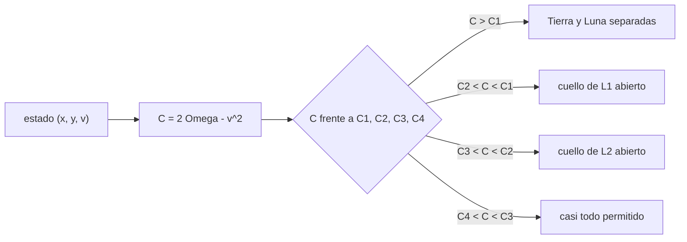

# B73-C07 — Constante de Jacobi

<!-- nav:top -->
[🏠 Programa](../../../../README.md) · [📚 Bloque B73](../../../tronco-comun/B73-mecanica-celeste-resonancias-y-caos.md) · [← Anterior: B73-C06 — Variedades invariantes](../B73-C06-variedades-invariantes/CLASE.md) · [Siguiente: B73-C08 — Sistemas de N cuerpos →](../B73-C08-sistemas-de-n-cuerpos/CLASE.md)
<!-- /nav -->

## 1. Ubicación, nivel y alcance

Clase 7 del bloque B73, que cierra el tramo del problema restringido de tres cuerpos. Nivel N3. Sigue a [B73-C06](../B73-C06-variedades-invariantes/CLASE.md), donde la constante `C` se conservó sin explicar qué restringe. Aquí la usas para dibujar las curvas de velocidad cero, calcular los cuatro umbrales `C₁ > C₂ > C₃ > C₄` en Tierra–Luna y Sol–Tierra, decidir si una región es accesible desde otra y comprobar que trayectorias sintéticas nunca entran en la región prohibida. Los `GM` son publicados; los estados iniciales son **sintéticos**.

## 2. Por qué esta clase existe

La constante de Jacobi es la única cantidad conservada del CR3BP y decide, sin integrar, si una nave puede ir de la Tierra a la Luna o escapar. La decisión central: **¿qué dice un número `C` sobre las regiones por las que se puede mover una partícula?**

## 3. Lo que podrás hacer al terminar

1. Calcular `C = 2Ω − v²` para un estado y despejar la velocidad permitida en un punto.
2. Obtener los umbrales `C₁` a `C₄` de los puntos de Lagrange.
3. Clasificar las regiones accesibles según el valor de `C`.
4. Dibujar y leer una curva de velocidad cero en texto.
5. Comprobar por flood-fill que la conectividad coincide con la teoría de umbrales.
6. Verificar que trayectorias integradas no entran en la región prohibida.

La evidencia es la **mapa de regiones permitidas por valor de `C`** del ejercicio 12 (sección 20).

## 4. Con qué llegas y cómo comprobarlo

1. ¿Qué es el potencial efectivo `Ω`?
2. ¿Qué es una curva de velocidad cero?
3. ¿Qué es un relleno por inundación (flood-fill)?
4. ¿Qué es una cantidad conservada?
5. ¿Qué es un estado sintético?

<details>
<summary>Ver respuestas</summary>

1. La suma del potencial gravitatorio y el centrífugo en el marco giratorio. 2. El borde de la región donde la partícula tendría velocidad cero: `2Ω = C`. 3. Un algoritmo que explora los puntos conectados de una rejilla desde uno de partida. 4. Una función del estado que no cambia con el movimiento. 5. Uno propuesto para el ejemplo, no medido.
</details>

Con cuatro o cinco aciertos, sigue; si no, repasa los prerrequisitos.

## 5. Un caso de contexto y casos de referencia

En Tierra–Luna (`μ = 1,215060e-02`) los umbrales son `C₁ = 3,188341`, `C₂ = 3,172161`, `C₃ = 3,012147` y `C₄ = C₅ = 2,987997`. Con `C = 3,1803` (entre `C₂` y `C₁`) la región permitida conecta la Tierra con la Luna pero no con el exterior. En Sol–Tierra `C₁ − C₂ = 4,0e-06`: casi no hay diferencia de energía entre abrir L1 y abrir L2. Es el **ejemplo conductor**. Los `GM` son publicados; los estados de las trayectorias son **sintéticos**.

## 6. Vocabulario

La **constante de Jacobi** es `C = 2Ω − v²`, con `2Ω = x² + y² + 2(1−μ)/r₁ + 2μ/r₂`. La **región prohibida** es donde `2Ω < C`, porque pediría `v² < 0`. Los **umbrales** `C_i = 2Ω(L_i)` marcan la apertura de los cuellos de L1, L2 y L3 al bajar `C`. Con `C₄ < C < C₃` solo quedan prohibidas las lunas de L4 y L5.

## 7. Modelo mental: el nivel del agua en un valle con tres collados



*Descripción textual:* el estado fija `C`; al compararlo con cuatro umbrales se obtiene qué cuellos están abiertos y, con ello, las regiones accesibles.

Analogía: un valle con varios collados: el nivel del agua (la energía) decide cuáles se desbordan y qué lagos se conectan. Límite: aquí «energía baja» es `C` alto; el nivel no es una altura geográfica sino el valor de `2Ω − v²` en el marco giratorio.

## 8. La explicación, paso a paso

### 8.1 La velocidad permitida

Como `v² = 2Ω − C`, en cada punto la velocidad queda fijada en módulo por `C`; solo falta la dirección. Si `2Ω < C` no hay movimiento posible: es la región prohibida.

### 8.2 Los umbrales

| Sistema | `C₁` (L1) | `C₂` (L2) | `C₃` (L3) | `C₄ = C₅` |
|---|---|---|---|---|
| Tierra–Luna | 3,188341 | 3,172161 | 3,012147 | 2,987997 |
| Sol–Tierra | 3,000891 | 3,000887 | 3,000003 | 2,999997 |

Siempre `C₁ > C₂ > C₃ > C₄`. Para L4 y L5, `C = 3 − μ(1−μ)` (Tierra–Luna: `2,987997`).

### 8.3 Conectividad por flood-fill

Sobre una rejilla de `0,01` se comprobó, desde un punto cercano a la Tierra, qué regiones se alcanzan:

| Ventana | `C` | ¿llega a la Luna? | ¿llega al exterior? |
|---|---|---|---|
| `C > C₁` | 3,2383 | no | no |
| `C₂ < C < C₁` | 3,1803 | sí | no |
| `C₃ < C < C₂` | 3,0922 | sí | sí |
| `C₄ < C < C₃` | 3,0001 | sí | sí |

Las cuatro filas coinciden con la teoría. El laboratorio dibuja en texto la curva para `C₂ < C < C₁`: una región prohibida con forma de anillo que rodea a la Tierra y la Luna, con el paso de L1 abierto entre ellas y el de L2 cerrado.

### 8.4 Segunda vía: trayectorias que respetan la frontera

Veinte estados sintéticos (semilla 73) con `C = 3,1803` se integraron con RK4 (`dt = 10⁻³`, hasta 10 unidades o hasta acercarse a menos de `0,1` de un primario): `C` derivó como máximo `1,2e-06` y el mínimo de `2Ω − C` fue `6,4e-04`, es decir, ninguna entró en la región prohibida. La cota de `0,1` evita el paso cerca de los primarios, donde el paso fijo pierde exactitud.

### 8.5 Qué no dice `C`

`C` no dice si la trayectoria irá de la Tierra a la Luna, solo si puede hacerlo. Dos naves con el mismo `C` pueden tener destinos muy distintos.

## 9. Magnitudes, símbolos y unidades

| Símbolo | Qué es | Unidad | Valor / nota |
|---|---|---|---|
| `C` | constante de Jacobi | — | 3,1883 a 2,9880 (umbrales) |
| `2Ω` | doble del potencial efectivo | — | función de la posición |
| `v` | velocidad en el marco giratorio | 1,023 km/s | `v² = 2Ω − C` |
| `C_i` | umbral del punto `L_i` | — | ver 8.2 |
| `μ` | parámetro de masa | — | 1,2151e-02 |

## 10. Convenciones y referencias

CR3BP plano, marco sinódico adimensional; `C = 2Ω − v²` (no `Ω − v²/2`). La rejilla de conectividad tiene paso `0,01` en `[−2, 2]²`. Las trayectorias se detienen a menos de `0,1` de un primario. `GM` de la Tierra aproximado.

## 11. De dónde sale lo que afirmamos

| ID | Fuente | Localizador | Respalda | Estado |
|---|---|---|---|---|
| S1 | NASA/NSSDC, Sun Fact Sheet — https://nssdc.gsfc.nasa.gov/planetary/factsheet/sunfact.html (consultada 2026-11-10) | ficha leída; actualizada el 2024-05-09 | GM del Sol = 132 712 × 10⁶ km³/s² | Consultada |
| S2 | NASA JPL SSD, Planetary Satellite Physical Parameters — https://ssd.jpl.nasa.gov/sats/phys_par/ (consultada 2026-11-10) | tabla de GM y radio medio; GM de la Luna (DE440), los galileanos (JUP365), Titán, Encélado y Mimas (SAT441) | GM de la Luna = 4902,800 km³/s² | Consultada |
| S3 | NASA JPL SSD, Planetary Physical Parameters — https://ssd.jpl.nasa.gov/planets/phys_par.html (consultada 2026-11-10) | tabla de masas y radios medios; registro de cambios 2019-12-12 (CODATA 2018) | masa de la Tierra para `GM` ≈ 3,986×10⁵ km³/s² (aproximado) | Consultada |
| — | Constante de Jacobi, umbrales de los puntos de Lagrange y curvas de velocidad cero (resultados clásicos) | — | las verifica el laboratorio con una segunda vía | No consultada en una fuente concreta |

Límites: los estados de las trayectorias son sintéticos; el `GM` de la Tierra es aproximado; no se consultó la deducción original de Jacobi ni de Hill.

## 12. Cómo ver las regiones permitidas

| Magnitud | Valor |
|---|---|
| `C₁`, `C₂` Tierra–Luna | 3,188341; 3,172161 |
| `C₁ − C₂` Sol–Tierra | 4,0e-06 |
| conectividad frente a teoría | 4 de 4 coinciden |
| deriva máxima de `C` | 1,2e-06 |
| mínimo de `2Ω − C` | 6,4e-04 |

Descripción larga: los umbrales ordenan las cuatro ventanas de energía, la conectividad numérica coincide con ellas y las trayectorias no cruzan la frontera.

## 13. Ejemplo trabajado: ¿puede una partícula ir de la Tierra a la Luna con C = 3,18?

**Paso 1 · Umbrales.** `C₁ = 3,188341` y `C₂ = 3,172161`.

**Paso 2 · Ventana.** `C₂ < 3,18 < C₁`.

**Paso 3 · Cuello.** El paso de L1 está abierto (hay `2Ω(L1) = C₁ > C`); el de L2 no.

**Paso 4 · Conclusión.** Puede ir de la Tierra a la Luna pero no escapar al exterior (el flood-fill lo confirma).

## 14. Distintas formas de describir la accesibilidad

**Por energía:** `C` y cuatro umbrales. **Por geometría:** las curvas `2Ω = C`. **Por conectividad:** relleno de una rejilla. **Por dinámica:** trayectorias que no cruzan la frontera.

## 15. Práctica guiada

**Ejercicio 1 · con los pasos indicados.** Calcula `C₄` de Tierra–Luna. *Pasos:* `3 − μ(1−μ)`.

<details><summary>Solución comentada</summary>

`3 − 0,0121506 × 0,98785 = 2,987997`.
</details>

**Ejercicio 2 · con una pista.** Un cuerpo con `C = 3,20` en Tierra–Luna, ¿puede ir de la Tierra a la Luna? *Pista:* compáralo con `C₁`.

<details><summary>Solución comentada</summary>

`3,20 > C₁ = 3,1883`: no, el paso de L1 está cerrado.
</details>

**Ejercicio 3 · casi autónomo.** ¿Qué velocidad tiene un cuerpo en un punto con `2Ω = 3,5` y `C = 3,1803`?

<details><summary>Solución comentada</summary>

`v = √(3,5 − 3,1803) = 0,565` unidades `= 0,578 km/s`.
</details>

## 16. Práctica autónoma, transferencia e integrador

**Ejercicio 4 · autónomo.** Dado `C = 3,0121 + 0,05`, ¿está abierto el cuello de L2?

<details><summary>Solución comentada</summary>

Sí: `C₃ < C < C₂` abre L2 (el flood-fill llega al exterior).
</details>

**Ejercicio 5 · autónomo.** `C₁ − C₂` en Tierra–Luna.

<details><summary>Solución comentada</summary>

`0,0162`.
</details>

**Ejercicio 6 · autónomo.** `C₁ − C₂` en Sol–Tierra.

<details><summary>Solución comentada</summary>

`4,0e-06`, mucho menor: abrir L1 y L2 cuesta casi la misma energía.
</details>

**Ejercicio 7 · autónomo.** ¿Qué región queda prohibida con `C₄ < C < C₃`?

<details><summary>Solución comentada</summary>

Solo las lunas alrededor de L4 y L5.
</details>

**Ejercicio 8 · autónomo.** ¿Puede `C` aumentar durante el movimiento?

<details><summary>Solución comentada</summary>

No: se conserva, salvo error numérico (`1,2e-06` en el laboratorio).
</details>

**Ejercicio 9 · transferencia.** **Transferencia.** Un colega afirma que una nave con `C = 3,17` puede ir de la Tierra a la Luna con cualquier trayectoria. ¿Es correcto?

<details><summary>Solución comentada</summary>

No: `C` indica que es posible, pero la trayectoria concreta depende de las condiciones iniciales.
</details>

**Ejercicio 10 · transferencia.** **Transferencia.** Un diseño exige abrir L1 pero no L2. ¿En qué intervalo de `C` debe caer en Tierra–Luna?

<details><summary>Solución comentada</summary>

`3,1722 < C < 3,1883`.
</details>

**Ejercicio 11 · transferencia.** **Transferencia.** En el sistema Sol–Tierra, ¿por qué es plausible que una nave pase de L1 a L2 con poco cambio de energía?

<details><summary>Solución comentada</summary>

Porque `C₁ − C₂ = 4,0e-06`: casi igual.
</details>

**Ejercicio 12 · integrador.** **Integrador.** Elabora tu *mapa de regiones permitidas por valor de `C`*: los umbrales de dos sistemas, la tabla de conectividad, el mapa en texto de una ventana y la verificación con trayectorias sintéticas.

<details><summary>Solución comentada</summary>

Secciones 8.1–8.5 y la salida del laboratorio.
</details>

## 17. Laboratorio: umbrales de Jacobi, regiones y trayectorias

El script [constante_jacobi.py](constante_jacobi.py) calcula los umbrales, rellena una rejilla para decidir conectividad, dibuja el mapa en texto e integra 20 trayectorias sintéticas (**comprueba** orden `C₁ > C₂ > C₃ > C₄`, conectividad 4 de 4 y `C` conservada a `10⁻⁵`).

**Datos:** `GM` del Sol y de la Luna (consultados); `GM` de la Tierra aproximado; 20 estados **sintéticos** (semilla 73). **Predice antes de ejecutar:** ¿cuál será `C₁ − C₂` en Sol–Tierra? (del orden de `10⁻⁶`.) **Ejecución del 2026-11-10 (Python 3.12.9):**

```text
Python 3.12.9 (biblioteca estandar)
Tierra-Luna (mu = 1.215060e-02): C1 = 3.188341 ; C2 = 3.172161 ; C3 = 3.012147 ; C4 = C5 = 2.987997
Sol-Tierra (mu = 3.003487e-06): C1 = 3.000891 ; C2 = 3.000887 ; C3 = 3.000003 ; C4 = C5 = 2.999997
Conectividad de la region permitida desde la Tierra (rejilla 0.01) frente a la teoria:
  C > C1       C = 3.2383: llega a la Luna = False ; llega al exterior = False ; esperado = (False, False)
  C2 < C < C1  C = 3.1803: llega a la Luna = True ; llega al exterior = False ; esperado = (True, False)
  Mapa (# prohibido, . permitido, T Tierra, L Luna; x de -1.6 a 1.6 paso 0.05, y de 1.2 a -1.2 paso 0.1):
    ........................#################........................
    ....................#########################....................
    .................###############################.................
    ...............###################################...............
    .............#######################################.............
    ............##############.............###############...........
    ..........#############...................#############..........
    .........###########........................###########..........
    .........##########...........................##########.........
    ........##########.............................##########........
    ........#########...............................#########........
    .......##########...............................###..####........
    .......##########...............T...................L..#.........
    .......##########...............................###..####........
    ........#########...............................#########........
    ........##########.............................##########........
    .........##########...........................##########.........
    .........###########........................###########..........
    ..........#############...................#############..........
    ............##############.............###############...........
    .............#######################################.............
    ...............###################################...............
    .................###############################.................
    ....................#########################....................
    ........................#################........................
  C3 < C < C2  C = 3.0922: llega a la Luna = True ; llega al exterior = True ; esperado = (True, True)
  C4 < C < C3  C = 3.0001: llega a la Luna = True ; llega al exterior = True ; esperado = (True, True)
20 trayectorias sinteticas (semilla 73) con C = 3.1803: deriva maxima de C = 1.2e-06 ; minimo de (2 Omega - C) = 6.4e-04 (>= 0 si nunca entran en la region prohibida)
Pruebas superadas.
```

```bash
python programa/clases/B73/B73-C07-constante-de-jacobi/constante_jacobi.py
```

**Límites:** CR3BP plano y circular; rejilla de `0,01`; trayectorias cortadas cerca de los primarios.

## 18. Errores frecuentes y cómo corregirlos

**Creer que `C` más alto significa más energía.** Se corrige con la analogía: `C` alto es energía baja en el marco giratorio.

**Pensar que `C` determina la trayectoria.** Se corrige con 8.5.

**Usar `Ω − v²/2` con los umbrales de `2Ω`.** Se corrige con la sección 10.

**Integrar cerca de un primario con paso fijo.** Se corrige con 8.4.

## 19. Cómo sabrás que vas bien

Tras la sección 8: ¿cuánto valía `C₁ − C₂` en Sol–Tierra y qué esperabas? Si dudas, repasa el ejemplo 13. Tras el laboratorio: ¿qué comprueba? (ver la sección 17).

## 20. Qué entregas y cómo se evalúa

El producto es tu **mapa de regiones permitidas por valor de `C`** (ejercicio 12).

| Criterio | Inicial | En desarrollo | Logrado | Destacado |
|---|---|---|---|---|
| Conceptos | Los confunde | Parciales | Clasifica las regiones por `C` | Explica los límites |
| Cálculo | Sin unidades | Con errores | Tablas completas con unidades | Calcula casos nuevos |
| Comprobación | Sin comprobar | Un caso | Contraste con una segunda vía | Interpreta las diferencias |
| Fuentes | Sin fuente | Sin fecha | Fuentes con fecha y estado | Declara lo sintético y lo no consultado |
| Límites | No los nombra | Uno | Tres | Discute qué falta del modelo |

**Condiciones críticas (no se compensan con promedio):** rotular los estados como sintéticos; no deducir una trayectoria de un valor de `C`; citar solo lo consultado y declarar aproximado el `GM` de la Tierra.

## 21. Ética, seguridad y límites

Clase educativa: los modelos son simplificados y sus datos son publicados con fuente o sintéticos rotulados; ningún resultado describe una trayectoria real ni sirve para planificar una misión.  Accesibilidad: tablas equivalentes a las gráficas, fórmulas en texto, ejercicios sin conexión.

## 22. Para cerrar y seguir

Los cuatro umbrales ordenan la accesibilidad en Tierra–Luna (`C₁ = 3,1883`, `C₂ = 3,1722`), el flood-fill coincide con la teoría y 20 trayectorias sintéticas respetan la frontera. Queda una pregunta: ¿qué cambia al pasar de tres a muchos cuerpos?

**Glosario español–inglés.** constante de Jacobi · *Jacobi constant*; curva de velocidad cero · *zero-velocity curve*; región prohibida · *forbidden region*; cuello · *neck*; relleno por inundación · *flood fill*.

**Continuidad.** [B73-CC08](../B73-C08-sistemas-de-n-cuerpos/CLASE.md) pasa a los sistemas de N cuerpos.

**Referencias:** ver sección 11.

<!-- nav:bottom -->
---

[← Anterior: B73-C06 — Variedades invariantes](../B73-C06-variedades-invariantes/CLASE.md) · [📚 Bloque B73](../../../tronco-comun/B73-mecanica-celeste-resonancias-y-caos.md) · [Siguiente: B73-C08 — Sistemas de N cuerpos →](../B73-C08-sistemas-de-n-cuerpos/CLASE.md)
<!-- /nav -->
