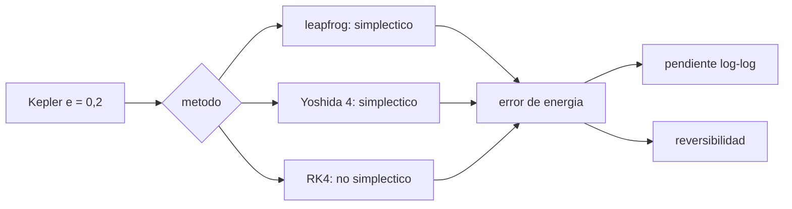

# B73-C09 — Integración de largo plazo

<!-- nav:top -->
[🏠 Programa](../../../../README.md) · [📚 Bloque B73](../../../tronco-comun/B73-mecanica-celeste-resonancias-y-caos.md) · [← Anterior: B73-C08 — Sistemas de N cuerpos](../B73-C08-sistemas-de-n-cuerpos/CLASE.md) · [Siguiente: B73-C10 — Resonancias de movimiento medio →](../B73-C10-resonancias-de-movimiento-medio/CLASE.md)
<!-- /nav -->

## 1. Ubicación, nivel y alcance

Clase 9 del bloque B73. Nivel N3. Sigue a [B73-C08](../B73-C08-sistemas-de-n-cuerpos/CLASE.md), que midió la conservación en una órbita corta. Aquí llevas el mismo problema a miles de órbitas: comparas un leapfrog de orden 2, un Yoshida de orden 4 (ambos simplécticos) y un Runge–Kutta 4 (no simpléctico) en un problema de Kepler con excentricidad `0,2`, miras cómo evoluciona el error de energía y compruebas la reversibilidad. El problema es **sintético** y adimensional; la escala a Io usa datos publicados.

## 2. Por qué esta clase existe

La estabilidad del sistema solar se estudia con integraciones de millones de órbitas, donde un integrador con deriva secular de energía inventa una dinámica que no existe. La decisión central: **¿qué integrador elijo para un horizonte largo y cómo reconozco que ha derivado?**

## 3. Lo que podrás hacer al terminar

1. Implementar leapfrog, Yoshida de orden 4 y RK4 para el problema de Kepler.
2. Medir el error de energía acumulado para 100, 300, 1000 y 3000 órbitas.
3. Estimar la pendiente log–log del error frente al número de órbitas.
4. Distinguir error acotado (simpléctico) de deriva secular (RK4).
5. Comprobar la reversibilidad temporal de cada método.
6. Explicar por qué un error de energía pequeño no garantiza una fase correcta.

La evidencia es la **comparación de integradores en 10⁴ órbitas** del ejercicio 12 (sección 20).

## 4. Con qué llegas y cómo comprobarlo

1. ¿Qué es un integrador de orden `p`?
2. ¿Qué es un integrador simpléctico?
3. ¿Qué es la reversibilidad temporal?
4. ¿Qué es una pendiente log–log?
5. ¿Qué es el error de fase?

<details>
<summary>Ver respuestas</summary>

1. Uno cuyo error local escala con `dt^(p+1)` y el global con `dt^p`. 2. Uno que preserva la estructura hamiltoniana y mantiene acotado el error de energía. 3. Que integrar hacia adelante y luego hacia atrás con el mismo paso recupera el estado inicial. 4. El exponente de una ley de potencias, `d ln y/d ln x`. 5. La diferencia de posición a lo largo de la órbita por un periodo calculado con error.
</details>

Con cuatro o cinco aciertos, sigue; si no, repasa los prerrequisitos.

## 5. Un caso de contexto y casos de referencia

Con `e = 0,2` y 100 pasos por órbita, tras `3000` órbitas el máximo error relativo de energía es `1,03e-03` (leapfrog), `1,06e-05` (Yoshida 4) y `1,55e-03` (RK4). Los dos primeros no crecen entre 100 y 3000 órbitas (pendiente log–log `0,00` y `0,00`); RK4 crece linealmente (pendiente `1,00`). Con la escala de Io (`a = 421 800 km`), 3000 órbitas son `14,5` años. Es el **ejemplo conductor**. El problema es **sintético**.

## 6. Vocabulario

El **error acotado** de un método simpléctico significa que la energía oscila alrededor de su valor inicial sin deriva sistemática. La **deriva secular** es un crecimiento del error proporcional al tiempo. La **composición de Yoshida** combina tres leapfrogs con pasos `w₁h, w₀h, w₁h` (`w₁ = 1/(2 − 2^{1/3})`, `w₀ = −2^{1/3} w₁`) para dar orden 4. La **reversibilidad** de un método es `Φ_{−h} ∘ Φ_h = id`.

## 7. Modelo mental: un reloj que se atrasa frente a uno que oscila



*Descripción textual:* tres métodos integran el mismo problema; se mide el error de energía a distintos tiempos, su pendiente log–log y la reversibilidad.

Analogía: un reloj de péndulo oscila alrededor de la hora correcta (error acotado) mientras que otro se atrasa un poco cada día (deriva secular); tras muchos días el segundo está muy lejos aunque cada día su error sea pequeño. Límite: la energía acotada no impide que la fase de la órbita se desfase.

## 8. La explicación, paso a paso

### 8.1 Los tres métodos

Cada paso del **leapfrog** es kick–drift–kick (orden 2, una evaluación de fuerza). El **Yoshida** compone tres leapfrogs con coeficientes que anulan el término de error de orden 3 (orden 4, tres evaluaciones). **RK4** es de orden 4 con cuatro evaluaciones, pero no conserva la estructura simpléctica.

### 8.2 Error de energía

| método | evaluaciones por paso | máx. `|ΔE/E|` (N=100) | (N=1000) | (N=3000) | pendiente log–log |
|---|---|---|---|---|---|
| leapfrog | 1 | 1,03e-03 | 1,03×10⁻³ | 1,03e-03 | 0,00 |
| Yoshida 4 | 3 | 1,06e-05 | 1,06×10⁻⁵ | 1,06e-05 | 0,00 |
| RK4 | 4 | 5,17e-05 | 5,17×10⁻⁴ | 1,55e-03 | 1,00 |

El máximo es acumulado desde el inicio. Los simplécticos alcanzan su amplitud de oscilación en la primera órbita (al pasar por el pericentro) y no la superan; RK4 empieza más bajo pero se multiplica por 30 al multiplicar por 30 el número de órbitas.

### 8.3 Reversibilidad

Tras `3000` órbitas adelante y `3000` atrás, el leapfrog regresa al estado inicial con `|r − r₀| = 2,2e-10` y el Yoshida con `1,4e-09` (error de redondeo acumulado); RK4 queda a `4,8e-02`, porque no es reversible y su deriva se acumula.

### 8.4 Segunda vía: el estado exacto tras órbitas enteras

La solución exacta de Kepler es periódica: tras un número entero de órbitas vuelve al punto de partida. Tras 3000 órbitas la distancia al punto inicial es `0,75` (leapfrog), `0,49` (Yoshida 4) y `2,00` (RK4: la partícula quedó en el lado opuesto de la órbita, a un diámetro de distancia). Es decir, todos los métodos acumulan un error de fase: la energía acotada no prueba que la partícula esté donde debe.

### 8.5 Escala física

Con `a = 421 800 km` y `GM = 126,687×10⁶ + 5959,9 km³/s²` (Júpiter + Io), una unidad de tiempo equivale a `24 340 s`, y `3000` órbitas, a `14,5` años. Esa cifra es un ejemplo de escala, no una simulación del sistema real.

## 9. Magnitudes, símbolos y unidades

| Símbolo | Qué es | Unidad | Valor / nota |
|---|---|---|---|
| `e` | excentricidad (sintética) | — | 0,2 |
| `dt` | paso | 1/100 de órbita | `2π/100` |
| `N` | número de órbitas | — | 100 a 3000 |
| `ΔE/E` | error relativo de energía | — | ver 8.2 |
| `p` | pendiente log–log | — | 0 (acotado) o 1 (secular) |

## 10. Convenciones y referencias

Problema de Kepler adimensional con `GM = 1` y `a = 1`, inicio en el pericentro `(1−e, 0)` con velocidad `(0, √((1+e)/(1−e)))`. Cien pasos fijos por órbita. El error de energía se muestrea cada 10 pasos. La escala a Io usa los valores citados.

## 11. De dónde sale lo que afirmamos

| ID | Fuente | Localizador | Respalda | Estado |
|---|---|---|---|---|
| S1 | NASA JPL SSD, Planetary Satellite Mean Elements — https://ssd.jpl.nasa.gov/sats/elem/ (consultada 2026-11-10) | tabla de elementos medios, época 2000-01-01.5 TDB; planos de Laplace (galileanos con JUP365, saturnianos con SAT441), eclíptica para la Luna (DE405) | semieje medio de Io 421 800 km y periodo 1,762732 d (tabla de época) | Consultada |
| S2 | NASA/NSSDC, Jupiter Fact Sheet — https://nssdc.gsfc.nasa.gov/planetary/factsheet/jupiterfact.html (consultada 2026-11-10) | ficha leída; actualizada el 2024-10-02 | GM de Júpiter = 126,687×10⁶ km³/s² | Consultada |
| S3 | NASA JPL SSD, Planetary Satellite Physical Parameters — https://ssd.jpl.nasa.gov/sats/phys_par/ (consultada 2026-11-10) | tabla de GM y radio medio; GM de la Luna (DE440), los galileanos (JUP365), Titán, Encélado y Mimas (SAT441) | GM de Io = 5959,91547 km³/s² | Consultada |
| — | Leapfrog, composición de Yoshida y RK4; comportamiento de integradores simplécticos (métodos estándar) | — | las verifica el laboratorio con una segunda vía | No consultada en una fuente concreta |

Límites: el problema es sintético; no se consultó la literatura sobre integradores simplécticos ni la ley de Brouwer; solo se muestra el comportamiento observado en un caso.

## 12. Cómo ver la deriva

| Magnitud | Valor |
|---|---|
| leapfrog: máx. `|ΔE/E|` y pendiente | 1,03e-03 y 0,00 |
| Yoshida 4 | 1,06e-05 y 0,00 |
| RK4 | 1,55e-03 y 1,00 |
| reversibilidad RK4 | 4,8e-02 |
| órbitas equivalentes en años (escala Io) | 14,5 |

Descripción larga: los métodos simplécticos tienen un error de energía plano; RK4 crece con el tiempo; solo los primeros son reversibles.

## 13. Ejemplo trabajado: ¿por qué una pendiente 1 es mala?

**Paso 1 · Dato.** RK4 tiene error `5,17e-05` en 100 órbitas.

**Paso 2 · Crecimiento.** Con pendiente `1`, a 3000 órbitas es 30 veces mayor: `1,55e-03`.

**Paso 3 · Extrapolación.** A `10⁶` órbitas sería `≈ 0,5`, es decir, la energía estaría completamente mal.

**Paso 4 · Contraste.** El leapfrog seguiría en `1,0e-03`.

## 14. Distintas formas de describir el error de un integrador

**Por energía:** acotada o secular. **Por orden:** `dt^p`. **Por reversibilidad:** ida y vuelta. **Por fase:** distancia al punto de retorno tras órbitas enteras.

## 15. Práctica guiada

**Ejercicio 1 · con los pasos indicados.** Calcula la pendiente log–log de RK4 entre 100 y 3000 órbitas. *Pasos:* `ln(E₃₀₀₀/E₁₀₀)/ln(30)`.

<details><summary>Solución comentada</summary>

`ln(1,55e-03/5,17e-05)/ln 30 = 1,00`.
</details>

**Ejercicio 2 · con una pista.** ¿Cuántas evaluaciones de fuerza hace Yoshida 4 en una órbita? *Pista:* 3 por paso y 100 pasos.

<details><summary>Solución comentada</summary>

`300`.
</details>

**Ejercicio 3 · casi autónomo.** ¿Qué método tiene menor error de energía con 3 evaluaciones por paso?

<details><summary>Solución comentada</summary>

Yoshida 4: `1,1e-05`, frente a `1,0e-03` del leapfrog.
</details>

## 16. Práctica autónoma, transferencia e integrador

**Ejercicio 4 · autónomo.** Error de energía de RK4 a las 1000 órbitas si la pendiente es 1.

<details><summary>Solución comentada</summary>

`≈ 10 ×` el de 100 órbitas, `≈ 5,2×10⁻⁴`.
</details>

**Ejercicio 5 · autónomo.** Evaluaciones de fuerza de RK4 en 3000 órbitas.

<details><summary>Solución comentada</summary>

`4 × 100 × 3000 = 1,2×10⁶`.
</details>

**Ejercicio 6 · autónomo.** ¿Qué mide la reversibilidad de RK4 (`4,8e-02`)?

<details><summary>Solución comentada</summary>

Cuánto se aleja del inicio tras ir y volver; no vale cero porque RK4 no es reversible.
</details>

**Ejercicio 7 · autónomo.** ¿Por qué la pendiente del leapfrog es 0?

<details><summary>Solución comentada</summary>

Porque su error de energía no crece: oscila con una amplitud fija.
</details>

**Ejercicio 8 · autónomo.** ¿Qué indica una distancia final de `0,75` tras órbitas enteras?

<details><summary>Solución comentada</summary>

Que el leapfrog acumuló un error de fase importante pese a conservar bien la energía.
</details>

**Ejercicio 9 · transferencia.** **Transferencia.** Un colega elige RK4 para integrar 10⁶ años de un planeta «porque es de orden 4». ¿Qué le adviertes?

<details><summary>Solución comentada</summary>

Que su error de energía crece linealmente y para horizontes largos produce una deriva física falsa; conviene un integrador simpléctico.
</details>

**Ejercicio 10 · transferencia.** **Transferencia.** Otro dice que Yoshida 4 es mejor que el leapfrog en todo. ¿Hay una contrapartida?

<details><summary>Solución comentada</summary>

Sí: cuesta tres evaluaciones por paso; con el mismo coste, el leapfrog podría usar un paso tres veces menor.
</details>

**Ejercicio 11 · transferencia.** **Transferencia.** Un informe muestra que la energía se conserva a `10⁻⁶` y concluye que la posición de un asteroide es correcta. ¿Es suficiente?

<details><summary>Solución comentada</summary>

No: el laboratorio muestra errores de fase de orden 1 con energía bien conservada.
</details>

**Ejercicio 12 · integrador.** **Integrador.** Elabora tu *comparación de integradores en 10⁴ órbitas*: tabla de energía y pendiente, reversibilidad, error de fase y recomendación justificada.

<details><summary>Solución comentada</summary>

Secciones 8.1–8.5 y la salida del laboratorio (el laboratorio llega a 3000 órbitas; el ejercicio pide extrapolar con la pendiente).
</details>

## 17. Laboratorio: tres integradores en 3000 órbitas de Kepler

El script [largo_plazo.py](largo_plazo.py) integra tres métodos durante 3000 órbitas, mide el error de energía, la pendiente log–log, la reversibilidad y el error de fase (**comprueba** pendiente `< 0,3` en los simplécticos, `> 0,7` en RK4 y Yoshida mejor que leapfrog).

**Datos:** problema de Kepler **sintético**; escala de Io con datos consultados del JPL y la NASA. **Predice antes de ejecutar:** ¿qué pendiente tendrá RK4? (`1`.) **Ejecución del 2026-11-10 (Python 3.12.9):**

```text
Python 3.12.9 (biblioteca estandar)
Kepler e = 0.2, 100 pasos/orbita, hasta 3000 orbitas (equivalen a 14.5 anos con la escala de Io)
 metodo     evals/paso E(N= 100) E(N= 300) E(N=1000) E(N=3000)   pend.log-log  |r-r0| (N=3000)
 leapfrog       1     1.03e-03 1.03e-03 1.03e-03 1.03e-03        0.00      7.54e-01
   reversibilidad (3000 orbitas adelante y atras): |r - r0| = 2.22e-10
 yoshida4       3     1.06e-05 1.06e-05 1.06e-05 1.06e-05        0.00      4.89e-01
   reversibilidad (3000 orbitas adelante y atras): |r - r0| = 1.37e-09
 rk4            4     5.17e-05 1.55e-04 5.17e-04 1.55e-03        1.00      2.00e+00
   reversibilidad (3000 orbitas adelante y atras): |r - r0| = 4.78e-02
Pruebas superadas.
```

```bash
python programa/clases/B73/B73-C09-integracion-de-largo-plazo/largo_plazo.py
```

**Límites:** un solo problema de Kepler con `e = 0,2`; paso fijo de 100 por órbita; sin perturbaciones; el laboratorio tarda unos minutos en Python puro.

## 18. Errores frecuentes y cómo corregirlos

**Confundir orden alto con buena conservación a largo plazo.** Se corrige con 8.2.

**Usar RK4 para horizontes de millones de órbitas.** Se corrige con el ejemplo 13.

**Creer que la energía acotada implica fase correcta.** Se corrige con 8.4.

**Comparar métodos sin igualar el coste.** Se corrige con el ejercicio 10.

## 19. Cómo sabrás que vas bien

Tras la sección 8: ¿qué pendiente tuvo RK4 y qué esperabas? Si dudas, repasa el ejemplo 13. Tras el laboratorio: ¿qué comprueba? (ver la sección 17).

## 20. Qué entregas y cómo se evalúa

El producto es tu **comparación de integradores en 10⁴ órbitas** (ejercicio 12).

| Criterio | Inicial | En desarrollo | Logrado | Destacado |
|---|---|---|---|---|
| Conceptos | Los confunde | Parciales | Distingue error acotado y deriva secular | Explica los límites |
| Cálculo | Sin unidades | Con errores | Tablas completas con unidades | Calcula casos nuevos |
| Comprobación | Sin comprobar | Un caso | Contraste con una segunda vía | Interpreta las diferencias |
| Fuentes | Sin fuente | Sin fecha | Fuentes con fecha y estado | Declara lo sintético y lo no consultado |
| Límites | No los nombra | Uno | Tres | Discute qué falta del modelo |

**Condiciones críticas (no se compensan con promedio):** rotular el problema como sintético; no extrapolar el comportamiento de un caso a todos los problemas; citar solo lo consultado.

## 21. Ética, seguridad y límites

Clase educativa: los modelos son simplificados y sus datos son publicados con fuente o sintéticos rotulados; ningún resultado describe una trayectoria real ni sirve para planificar una misión.  Accesibilidad: tablas equivalentes a las gráficas, fórmulas en texto, ejercicios sin conexión.

## 22. Para cerrar y seguir

En 3000 órbitas el leapfrog y el Yoshida mantienen la energía a `1e-03` y `1e-05` sin deriva, y RK4 la pierde linealmente hasta `2e-03`; ningún método conserva la fase. Queda una pregunta: ¿cuándo dos órbitas cercanas siguen juntas y cuándo se separan?

**Glosario español–inglés.** integrador simpléctico · *symplectic integrator*; deriva secular · *secular drift*; reversibilidad · *time reversibility*; error de fase · *phase error*; composición · *composition*.

**Continuidad.** [B73-CC10](../B73-C10-resonancias-de-movimiento-medio/CLASE.md) estudia las resonancias de movimiento medio.

**Referencias:** ver sección 11.

<!-- nav:bottom -->
---

[← Anterior: B73-C08 — Sistemas de N cuerpos](../B73-C08-sistemas-de-n-cuerpos/CLASE.md) · [📚 Bloque B73](../../../tronco-comun/B73-mecanica-celeste-resonancias-y-caos.md) · [Siguiente: B73-C10 — Resonancias de movimiento medio →](../B73-C10-resonancias-de-movimiento-medio/CLASE.md)
<!-- /nav -->
