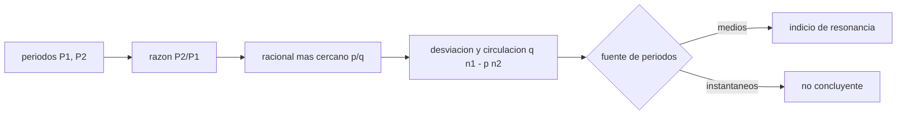

# B73-C10 — Resonancias de movimiento medio

<!-- nav:top -->
[🏠 Programa](../../../../README.md) · [📚 Bloque B73](../../../tronco-comun/B73-mecanica-celeste-resonancias-y-caos.md) · [← Anterior: B73-C09 — Integración de largo plazo](../B73-C09-integracion-de-largo-plazo/CLASE.md) · [Siguiente: B73-C11 — Resonancias seculares →](../../../tronco-comun/B73-mecanica-celeste-resonancias-y-caos.md#b73-c11)
<!-- /nav -->

## 1. Ubicación, nivel y alcance

Clase 10 del bloque B73, que abre el tramo de resonancias. Nivel N3. Sigue a [B73-C09](../B73-C09-integracion-de-largo-plazo/CLASE.md). Aquí detectas resonancias de movimiento medio a partir de periodos publicados: calculas la razón de periodos de seis pares de satélites, el racional más cercano, la velocidad de circulación de la línea de conjunción y la relación de Laplace de Io, Europa y Ganymede, con dos fuentes de periodos que **no coinciden** y que hay que saber leer. No hay datos sintéticos; todos los periodos son publicados.

## 2. Por qué esta clase existe

Una razón de periodos cercana a un número racional es el primer indicio de una resonancia, pero puede engañar si la fuente usa periodos instantáneos en lugar de medios. La decisión central: **¿qué periodos puedo usar para afirmar que hay una resonancia y qué puedo y no puedo concluir?**

## 3. Lo que podrás hacer al terminar

1. Calcular razones de periodos y su racional más cercano.
2. Calcular la tasa de circulación de la línea de conjunción `q n₁ − p n₂`.
3. Verificar la relación de Laplace `n₁ − 3n₂ + 2n₃ ≈ 0` con periodos publicados.
4. Contrastar dos fuentes y detectar cuándo una tabla no sirve para decidir resonancias.
5. Comprobar los periodos con la tercera ley de Kepler.
6. Distinguir un indicio de resonancia de su demostración.

La evidencia es la **tabla de resonancias con residuos** del ejercicio 12 (sección 20).

## 4. Con qué llegas y cómo comprobarlo

1. ¿Qué es el movimiento medio `n`?
2. ¿Qué es una conjunción?
3. ¿Qué es una razón racional?
4. ¿Qué es la tercera ley de Kepler?
5. ¿Qué es un periodo sidéreo?

<details>
<summary>Ver respuestas</summary>

1. La velocidad angular media de una órbita: `n = 360°/P`. 2. El instante en que dos cuerpos están alineados con el cuerpo central. 3. Un cociente de enteros, como `2:1` o `4:3`. 4. `P² = 4π² a³/GM`. 5. El tiempo en volver a la misma posición respecto de las estrellas.
</details>

Con cuatro o cinco aciertos, sigue; si no, repasa los prerrequisitos.

## 5. Un caso de contexto y casos de referencia

Con los periodos de la ficha NASA/NSSDC, Io, Europa y Ganymede cumplen `n_Io − 3n_Europa + 2n_Ganymede = -0,000029 °/d`, es decir `1,4e-07` de `n_Io`. Con la tabla del JPL el mismo número es `-1,4936 °/d` (`7,3e-03`) y la razón Europa/Ganymede se aleja un `1,48%` de 2:1. La línea de conjunción de Io y Europa da una vuelta cada `486,8 d`. Es el **ejemplo conductor**. Todos los periodos son publicados; ninguno es sintético.

## 6. Vocabulario

Una **resonancia de movimiento medio** `p:q` ocurre cuando `p n₂ ≈ q n₁`, de modo que los cuerpos repiten su configuración. El **argumento resonante** es el ángulo `φ = pλ₂ − qλ₁ − …` y **libra** si oscila alrededor de un valor. La **circulación** de la línea de conjunción tiene tasa `|q n₁ − p n₂|`. La **relación de Laplace** entre los tres galileanos internos es `n₁ − 3n₂ + 2n₃ ≈ 0`. El **orden** de la resonancia es `|p − q|`.

## 7. Modelo mental: tres relojes que se enganchan



*Descripción textual:* de los periodos se obtiene la razón y su racional más cercano; la desviación y la tasa de circulación indican si hay indicio de resonancia, siempre que el periodo sea un valor medio.

Analogía: tres engranajes de un reloj cuyos dientes están ajustados de modo que dan el mismo número de vueltas relativas: los periodos son sus velocidades y la relación racional es la del engranaje. Límite: dos engranajes pueden verse ajustados midiendo a destiempo; solo un periodo medio sirve.

## 8. La explicación, paso a paso

### 8.1 Razones de periodos

| Par | `P₂/P₁` (JPL) | `P₂/P₁` (NASA) | racional | desviación (NASA) | circulación (d, NASA) |
|---|---|---|---|---|---|
| Io–Europa | 1,999999 | 2,007295 | 2 | 3,65e-03 | 486,8 |
| Europa–Ganymede | 2,029687 | 2,014697 | 2 | 7,35e-03 | 486,8 |
| Ganymede–Callisto | 2,332504 | 2,332643 | 7/3 | 2,96e-04 | 8056,8 |
| Mimas–Tethys | 2,003139 | 2,003139 | 2 | 1,57e-03 | 601,4 |
| Enceladus–Dione | 1,997431 | 1,997430 | 2 | 1,28e-03 | 1065,1 |
| Titan–Hyperion | 1,334341 | 1,334340 | 4/3 | 7,55e-04 | 7047,0 |

Las razones de Io–Europa y Europa–Ganymede son casi 2:1, Mimas–Tethys y Enceladus–Dione son casi 2:1 y Titan–Hyperion casi 4:3. Ganymede–Callisto devuelve `7/3`, una resonancia de orden 4 sin significado dinámico: es un artefacto de buscar racionales con denominador hasta 5.

### 8.2 Circulación de la conjunción

Con la ficha NASA, `n_Io = 203,4889 °/d` y `n_Europa = 101,3747 °/d`, de modo que `n_Io − 2n_Europa = 0,7395 °/d` y la línea de conjunción circula en `486,8 d`. Europa y Ganymede dan el mismo valor (`486,8 d`): esa coincidencia es la base de la relación de Laplace.

### 8.3 La relación de Laplace y el contraste de fuentes

Con la ficha NASA, `n_Io − 3n_Europa + 2n_Ganymede = -0,000029 °/d` (`1,4e-07` de `n_Io`): cero para la precisión de los periodos. Con la tabla del JPL el resultado es `-1,4936 °/d`, `7,3e-03` de `n_Io`, y la razón Europa/Ganymede está a `1,48%` de 2:1. La tabla del JPL es una tabla de elementos a la época `2000-01-01.5`: su columna `P` figura como periodo sidéreo, pero su valor para Europa es el doble del de Io en seis cifras (`3,525463 = 2 × 1,762732`), una señal de que no es un periodo medio. No se verificó la causa; la lección operativa es usar periodos medios para decidir resonancias.

### 8.4 Segunda vía: la tercera ley de Kepler

Con `GM_J = 126,687×10⁶ km³/s²` y los semiejes del JPL, el periodo kepleriano de Io es `1,76995 d`: `0,05 %` más que la ficha NASA (`1,769138 d`) y `0,41 %` más que la tabla del JPL. Las diferencias de la ficha NASA son como máximo `0,05%` en los cuatro galileanos, y las de la tabla del JPL llegan a `0,75%`.

### 8.5 Qué no prueba esto

Una razón cercana a un racional es un indicio, no una demostración: la resonancia exige que el argumento resonante **libre** (no circule), lo que requiere longitudes y no solo periodos. La relación de Laplace también implica que las tres lunas no están a la vez en conjunción; esa afirmación no se verificó aquí.

## 9. Magnitudes, símbolos y unidades

| Símbolo | Qué es | Unidad | Valor / nota |
|---|---|---|---|
| `P` | periodo sidéreo | d | ver 8.1 |
| `n = 360°/P` | movimiento medio | °/d | 204,2284 (Io, JPL) |
| `p/q` | razón entera | — | 2/1, 4/3 |
| `δ = q n₁ − p n₂` | tasa de circulación | °/d | 0,7395 (Io–Europa) |
| `n₁ − 3n₂ + 2n₃` | residuo de Laplace | °/d | -0,000029 (NASA) |

## 10. Convenciones y referencias

Periodos sidéreos en días; movimientos medios en °/d. «Ficha NASA» = NASA/NSSDC; «tabla JPL» = columna `P` de los elementos de satélites del JPL SSD (época 2000-01-01.5, plano de Laplace). Para los saturnianos las dos fuentes coinciden. El racional se busca con denominador ≤ 5.

## 11. De dónde sale lo que afirmamos

| ID | Fuente | Localizador | Respalda | Estado |
|---|---|---|---|---|
| S1 | NASA JPL SSD, Planetary Satellite Mean Elements — https://ssd.jpl.nasa.gov/sats/elem/ (consultada 2026-11-10) | tabla de elementos, época 2000-01-01.5; el texto de la tabla define P como periodo sidéreo | columna P (periodo sidéreo) de Io, Europa, Ganymede, Callisto, Mimas, Enceladus, Tethys, Dione, Titan y Hyperion; semiejes de los galileanos | Consultada |
| S2 | NASA/NSSDC, Jovian Satellite Fact Sheet — https://nssdc.gsfc.nasa.gov/planetary/factsheet/joviansatfact.html (consultada 2026-11-10) | ficha leída; actualizada el 2023-12-06 | periodos de los galileanos (1,769138; 3,551181; 7,154553; 16,689017 d) | Consultada |
| S3 | NASA/NSSDC, Saturnian Satellite Fact Sheet — https://nssdc.gsfc.nasa.gov/planetary/factsheet/saturniansatfact.html (consultada 2026-11-10) | ficha leída; actualizada el 2025-07-22 | periodos de los saturnianos (Mimas 0,9424218 d … Hyperion 21,276609 d) | Consultada |
| S4 | NASA/NSSDC, Jupiter Fact Sheet — https://nssdc.gsfc.nasa.gov/planetary/factsheet/jupiterfact.html (consultada 2026-11-10) | ficha leída; actualizada el 2024-10-02 | GM de Júpiter = 126,687×10⁶ km³/s² | Consultada |
| — | Definición de resonancia de movimiento medio y relación de Laplace | — | las verifica el laboratorio con una segunda vía | No consultada en una fuente concreta |

Límites: no se verificó por qué la tabla del JPL difiere de la ficha NASA en los galileanos; no se dispone de longitudes, así que no se prueba la libración del argumento resonante; no se consultó una referencia sobre resonancias de los satélites galileanos.

## 12. Cómo ver una resonancia en los periodos

| Magnitud | Valor |
|---|---|
| Io–Europa (NASA) | desviación 3,65e-03; circulación 486,8 d |
| Europa–Ganymede (NASA) | desviación 7,35e-03 |
| Laplace (NASA) | -0,000029 °/d |
| Laplace (JPL) | -1,4936 °/d |
| `P_kepler` frente a ficha NASA | como máximo 0,05% |

Descripción larga: con periodos medios la relación de Laplace se cumple a `10⁻⁷` de `n_Io`; con la tabla del JPL el mismo cálculo falla en `10⁻²`.

## 13. Ejemplo trabajado: la circulación de la conjunción Io–Europa

**Paso 1 · Movimientos medios.** `n_Io = 360/1,769138 = 203,4889 °/d`; `n_Europa = 360/3,551181 = 101,3747 °/d`.

**Paso 2 · Combinación.** `n_Io − 2 n_Europa = 0,7395 °/d`.

**Paso 3 · Periodo.** `360/0,7395 = 486,8 d`.

**Paso 4 · Lectura.** La línea de conjunción da una vuelta en `≈ 1,3 años`: esa es la escala del argumento resonante.

## 14. Distintas formas de describir una resonancia

**Por razón de periodos:** `P₂/P₁ ≈ p/q`. **Por movimiento medio:** `p n₂ − q n₁ ≈ 0`. **Por argumento resonante:** libra o circula. **Por relación de varios cuerpos:** la de Laplace.

## 15. Práctica guiada

**Ejercicio 1 · con los pasos indicados.** Calcula `n_Io` con la ficha NASA. *Pasos:* `360/1,769138`.

<details><summary>Solución comentada</summary>

`203,4889 °/d`.
</details>

**Ejercicio 2 · con una pista.** Calcula `n_Io − 2 n_Europa`. *Pista:* `n_Europa = 101,3747 °/d`.

<details><summary>Solución comentada</summary>

`203,4889 − 202,7494 = 0,7395 °/d`.
</details>

**Ejercicio 3 · casi autónomo.** ¿En cuántos días da una vuelta esa combinación?

<details><summary>Solución comentada</summary>

`360/0,7395 ≈ 486,8 d`.
</details>

## 16. Práctica autónoma, transferencia e integrador

**Ejercicio 4 · autónomo.** Circulación de Mimas–Tethys (2:1).

<details><summary>Solución comentada</summary>

`601,4 d`.
</details>

**Ejercicio 5 · autónomo.** Circulación de Enceladus–Dione (2:1).

<details><summary>Solución comentada</summary>

`1065,1 d` (≈ 2,9 años).
</details>

**Ejercicio 6 · autónomo.** Circulación de Titan–Hyperion (4:3).

<details><summary>Solución comentada</summary>

`7047,0 d` (≈ 19,3 años).
</details>

**Ejercicio 7 · autónomo.** ¿Por qué Ganymede–Callisto «7/3» no es una resonancia útil?

<details><summary>Solución comentada</summary>

Es de orden 4 y la desviación se debe a haber buscado hasta denominador 5; no hay evidencia dinámica.
</details>

**Ejercicio 8 · autónomo.** Desviación de Europa–Ganymede con la tabla del JPL.

<details><summary>Solución comentada</summary>

`1,48%`, el doble de la de la ficha NASA (`0,73%`).
</details>

**Ejercicio 9 · transferencia.** **Transferencia.** Un colega concluye, con la tabla del JPL, que Europa y Ganymede no están en resonancia. ¿Qué le dices?

<details><summary>Solución comentada</summary>

Que esa tabla da un periodo instantáneo de época que no sirve para decidir resonancias; con periodos medios la relación de Laplace se cumple a `1e-07`.
</details>

**Ejercicio 10 · transferencia.** **Transferencia.** Con solo periodos, ¿puedes afirmar que Mimas y Tethys están en resonancia?

<details><summary>Solución comentada</summary>

No: la razón es 2,003 (0,16 % de 2:1), un indicio; falta mostrar que el argumento resonante libra.
</details>

**Ejercicio 11 · transferencia.** **Transferencia.** ¿Por qué una resonancia de orden bajo es más probable que una de orden alto?

<details><summary>Solución comentada</summary>

La intensidad de la interacción escala con potencias de la excentricidad y la inclinación según el orden; los órdenes bajos son más fuertes (resultado clásico no verificado aquí).
</details>

**Ejercicio 12 · integrador.** **Integrador.** Elabora tu *tabla de resonancias con residuos*: razones, racionales, circulación, Laplace con las dos fuentes y comentario sobre cuál usar y por qué.

<details><summary>Solución comentada</summary>

Secciones 8.1–8.5 y la salida del laboratorio.
</details>

## 17. Laboratorio: razones de periodos, Laplace y dos fuentes

El script [resonancias_mm.py](resonancias_mm.py) calcula razones, racionales, circulaciones y el residuo de Laplace con dos fuentes, y revisa los periodos con la tercera ley de Kepler (**comprueba** desviación NASA < 1 %, Laplace NASA < `10⁻³` de `n_Io`, y que la tabla JPL falle el 1 % en Europa/Ganymede).

**Datos:** periodos y semiejes de la NASA/JPL y de las fichas NASA/NSSDC, todos consultados; sin datos sintéticos. **Predice antes de ejecutar:** ¿cuánto valdrá el residuo de Laplace con la ficha NASA? (`≈ 0`, del orden de `10⁻⁵ °/d`.) **Ejecución del 2026-11-10 (Python 3.12.9):**

```text
Python 3.12.9 (biblioteca estandar)
Razones de periodos P2/P1 y racional mas cercano (denominador <= 5), fuente JPL frente a fuente NASA/NSSDC:
 par                  P2/P1(JPL)  racional  desv.JPL    P2/P1(NASA)  desv.NASA   circulacion [d] (NASA)
 Io-Europa              1.999999        2   2.84e-07     2.007295   3.65e-03         486.8
 Europa-Ganymede        2.029687        2   1.48e-02     2.014697   7.35e-03         486.8
 Ganymede-Callisto      2.332504      7/3   3.55e-04     2.332643   2.96e-04        8056.8
 Mimas-Tethys           2.003139        2   1.57e-03     2.003139   1.57e-03         601.4
 Enceladus-Dione        1.997431        2   1.28e-03     1.997430   1.28e-03        1065.1
 Titan-Hyperion         1.334341      4/3   7.55e-04     1.334340   7.55e-04        7047.0
Relacion de Laplace n_Io - 3 n_Europa + 2 n_Ganymede (grados/dia): ficha NASA/NSSDC = -0.000029 (cociente a n_Io = 1.4e-07) ; tabla JPL = -1.4936 (cociente = 7.3e-03)
Tercera ley de Kepler con GM_Jupiter y los semiejes (periodo kepleriano de una orbita circular) frente a la ficha NASA/NSSDC y a la tabla del JPL:
  Io       : P_kepler = 1.76995 d ; P_NASA = 1.769138 d (dif. 0.05%) ; P_JPL = 1.762732 d (dif. 0.41%)
  Europa   : P_kepler = 3.55207 d ; P_NASA = 3.551181 d (dif. 0.02%) ; P_JPL = 3.525463 d (dif. 0.75%)
  Ganymede : P_kepler = 7.15516 d ; P_NASA = 7.154553 d (dif. 0.01%) ; P_JPL = 7.155588 d (dif. 0.01%)
  Callisto : P_kepler = 16.69059 d ; P_NASA = 16.689017 d (dif. 0.01%) ; P_JPL = 16.690440 d (dif. 0.00%)
Pruebas superadas.
```

```bash
python programa/clases/B73/B73-C10-resonancias-de-movimiento-medio/resonancias_mm.py
```

**Límites:** solo periodos (no longitudes); la fuente JPL no es un periodo medio; no se prueba libración.

## 18. Errores frecuentes y cómo corregirlos

**Concluir resonancia solo por una razón cercana a un racional.** Se corrige con 8.5.

**Usar periodos instantáneos.** Se corrige con 8.3.

**Aceptar un racional de orden alto como resonancia.** Se corrige con la tabla 8.1.

**Mezclar periodos sidéreos con sinódicos.** Se corrige con la sección 10.

## 19. Cómo sabrás que vas bien

Tras la sección 8: ¿cuál era el residuo de Laplace con la ficha NASA y qué esperabas? Si dudas, repasa el ejemplo 13. Tras el laboratorio: ¿qué comprueba? (ver la sección 17).

## 20. Qué entregas y cómo se evalúa

El producto es tu **tabla de resonancias con residuos** (ejercicio 12).

| Criterio | Inicial | En desarrollo | Logrado | Destacado |
|---|---|---|---|---|
| Conceptos | Los confunde | Parciales | Detecta resonancias y compara fuentes | Explica los límites |
| Cálculo | Sin unidades | Con errores | Tablas completas con unidades | Calcula casos nuevos |
| Comprobación | Sin comprobar | Un caso | Contraste con una segunda vía | Interpreta las diferencias |
| Fuentes | Sin fuente | Sin fecha | Fuentes con fecha y estado | Declara lo sintético y lo no consultado |
| Límites | No los nombra | Uno | Tres | Discute qué falta del modelo |

**Condiciones críticas (no se compensan con promedio):** no afirmar una resonancia solo con periodos; declarar qué fuente de periodos se usa y por qué; citar solo lo consultado.

## 21. Ética, seguridad y límites

Clase educativa: los modelos son simplificados y sus datos son publicados con fuente o sintéticos rotulados; ningún resultado describe una trayectoria real ni sirve para planificar una misión.  Accesibilidad: tablas equivalentes a las gráficas, fórmulas en texto, ejercicios sin conexión.

## 22. Para cerrar y seguir

Con periodos medios, Io, Europa y Ganymede cumplen la relación de Laplace a `1e-07` de `n_Io`, y la conjunción Io–Europa circula en `487` d; con una tabla de época el mismo cálculo falla. Queda una pregunta: ¿cómo afectan las perturbaciones lentas que no dependen de los periodos?

**Glosario español–inglés.** resonancia de movimiento medio · *mean-motion resonance*; argumento resonante · *resonant argument*; conjunción · *conjunction*; libración · *libration*; relación de Laplace · *Laplace relation*.

**Continuidad.** [B73-CC11](../B73-C11-resonancias-seculares/CLASE.md) estudia las resonancias seculares.

**Referencias:** ver sección 11.

<!-- nav:bottom -->
---

[← Anterior: B73-C09 — Integración de largo plazo](../B73-C09-integracion-de-largo-plazo/CLASE.md) · [📚 Bloque B73](../../../tronco-comun/B73-mecanica-celeste-resonancias-y-caos.md) · [Siguiente: B73-C11 — Resonancias seculares →](../../../tronco-comun/B73-mecanica-celeste-resonancias-y-caos.md#b73-c11)
<!-- /nav -->
